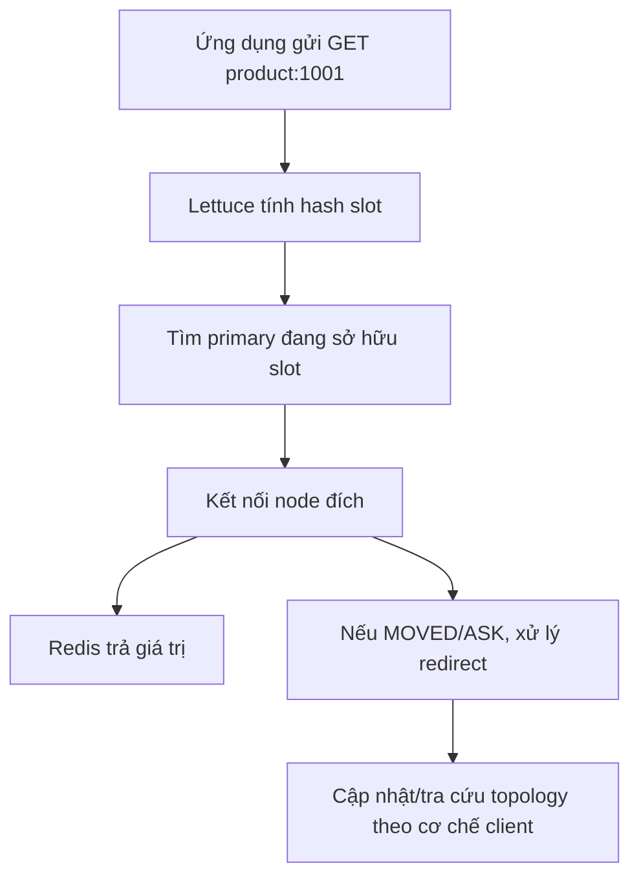
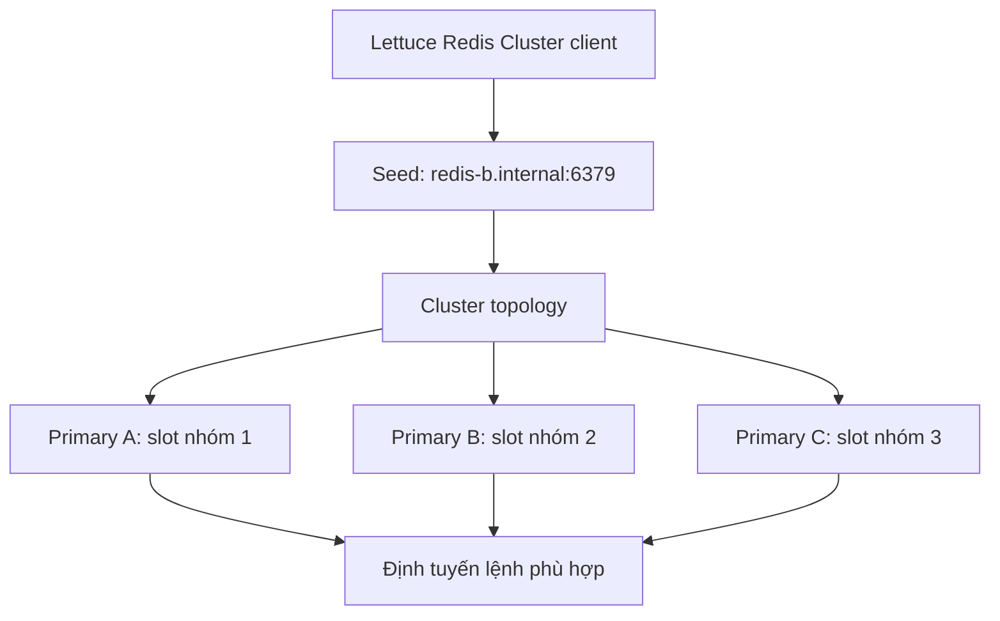

# Cấu hình RedisClusterConfiguration trong Spring Data Redis

Trong Redis standalone, ứng dụng thường chỉ cấu hình một địa chỉ `host:port`. Với **Redis Cluster**, dữ liệu lại được phân phối trên nhiều primary node theo **16.384 hash slot**, từ `0` đến `16383`. Vì vậy, client cần biết các node trong cluster, có khả năng xác định node sở hữu slot của từng key, xử lý chuyển hướng khi slot thay đổi và làm mới thông tin topology.

Trong Spring Data Redis, **`RedisClusterConfiguration`** là lớp mô tả cách một `RedisConnectionFactory` kết nối vào một **Redis Cluster đã tồn tại**. Lớp này chứa các địa chỉ **seed nodes**, thông tin xác thực khi cần và thiết lập chuyển hướng. Trong ứng dụng dùng Lettuce, cấu hình cluster thường được chuyển vào `LettuceConnectionFactory`, rồi factory được sử dụng bởi `RedisTemplate`, `StringRedisTemplate`, `ReactiveRedisTemplate`, Spring Cache hoặc Redis repositories.

Ví dụ tối thiểu:

```java
RedisClusterConfiguration cluster =
        new RedisClusterConfiguration(List.of(
                "redis-a.internal:6379",
                "redis-b.internal:6379",
                "redis-c.internal:6379"));

cluster.setMaxRedirects(5);
LettuceConnectionFactory factory =
        new LettuceConnectionFactory(cluster);
```

Đoạn này **không tạo ra một Redis Cluster**. Nó chỉ hướng dẫn client khám phá và kết nối một cluster đã được triển khai. Bài học tập trung vào cấu hình Java, Spring Boot, xác thực, TLS, Lettuce topology refresh, cách xác nhận cấu hình và những lỗi triển khai thường gặp.

## 1. Redis Cluster khác standalone và Sentinel thế nào?

Một Redis standalone server có thể giữ nhiều key:

```text
Spring application
       |
       v
Redis standalone :6379
    key A
    key B
    key C
```

Trong Redis Cluster:

```text
                   Spring Data Redis + Lettuce
                               |
                +--------------+--------------+
                |              |              |
                v              v              v
          Primary A       Primary B       Primary C
          slots 0..5460   5461..10922    10923..16383
                |              |              |
                v              v              v
          Replica A       Replica B       Replica C
```

Các khoảng slot trong sơ đồ chỉ minh họa một cách chia đều. Redis Cluster có thể phân phối slot khác và thay đổi phân bổ khi vận hành, resharding hoặc failover.

| Kiến trúc | Mục đích chính | Cấu hình Spring Data Redis |
|---|---|---|
| Standalone | Kết nối một Redis endpoint | `RedisStandaloneConfiguration` |
| Sentinel | Theo dõi primary và failover của nhóm replication | `RedisSentinelConfiguration` |
| Cluster | Sharding dữ liệu trên nhiều primary theo hash slot | `RedisClusterConfiguration` |

**Không nhầm Redis Sentinel với Redis Cluster.** Một nhóm Sentinel không tự biến dữ liệu thành 16.384 slot; một Redis Cluster không cần ứng dụng dùng Sentinel để định tuyến từng key.

### 1.1. Hash slot hoạt động ra sao?

Redis tính slot của key thông thường theo:

```text
hashSlot = CRC16(key) mod 16384
```

Ví dụ:

```text
product:1001
product:1002
order:42:status
```

Các key này có thể thuộc những slot khác nhau. Client cluster cần biết primary nào đang sở hữu từng slot.

### 1.2. Vì sao client không thể chỉ giữ một connection tới seed node?

Nếu chỉ nói “mọi thao tác gửi đến redis-a”, các key thuộc primary B/C có thể nhận phản hồi `MOVED` hoặc không được xử lý đúng. Cluster-aware client học topology, định tuyến từng lệnh và cập nhật topology khi cần.



## 2. RedisClusterConfiguration làm gì?

Lớp nằm ở package:

```java
org.springframework.data.redis.connection.RedisClusterConfiguration
```

Những thuộc tính quan trọng:

| Thuộc tính | Ý nghĩa |
|---|---|
| Seed nodes | Một hoặc nhiều endpoint `host:port` để khởi tạo kết nối và khám phá topology |
| `maxRedirects` | Giới hạn chuyển hướng theo cơ chế Cluster mà Spring Data Redis/driver sử dụng |
| Username | Redis ACL username khi server yêu cầu |
| Password | Credential Redis, dùng cùng username hoặc default user |

Mô hình cấu hình:

```text
RedisClusterConfiguration
       |
       v
LettuceConnectionFactory
       |
       +---- StringRedisTemplate
       |
       +---- RedisTemplate<K, V>
       |
       +---- ReactiveRedisTemplate<K, V>
       |
       +---- RedisCacheManager / Repositories
```

Lớp này **không quản lý Redis node**, không khởi tạo slot, không bật cluster mode trên server và không tự nâng cấp Redis standalone thành Cluster.

### 2.1. Phân biệt với RedisCacheConfiguration

Hai tên gần giống:

```text
RedisClusterConfiguration:
  Node nào, xác thực ra sao, kết nối theo topology nào?

RedisCacheConfiguration:
  TTL, serializer, key prefix, chính sách null của Spring Cache?
```

`RedisClusterConfiguration` giải bài toán **kết nối**; `RedisCacheConfiguration` giải bài toán **cách lưu entry cache**. Một ứng dụng có thể dùng cả hai, nhưng không nên hoán đổi vai trò.

## 3. Seed nodes: những địa chỉ để bắt đầu khám phá cluster

Giả sử có ba endpoint:

```text
redis-a.internal:6379
redis-b.internal:6379
redis-c.internal:6379
```

Client có thể liên hệ một seed node đang hoạt động, nhận thông tin phân phối slot và kết nối đến node thích hợp khi thao tác key.



**Seed nodes không nhất thiết là toàn bộ node của cluster**. Tuy vậy, cung cấp nhiều seed endpoint thuộc cùng cluster thường tăng khả năng kết nối ban đầu khi một node không sẵn sàng.

### 3.1. Seed list phải thuộc cùng một cluster

Không trộn:

```text
redis-a.production.internal
redis-b.production.internal
redis-a.staging.internal  <-- Sai môi trường
```

Client có thể lấy topology không phù hợp hoặc thao tác nhầm môi trường. Chọn seed endpoint theo profile/deployment, không trộn production và staging.

### 3.2. Một seed reachable chưa đủ

Nếu ứng dụng kết nối được `redis-a:6379` nhưng cluster quảng bá node B bằng một địa chỉ private mà JVM không truy cập được, request tới các slot của node B vẫn lỗi.

```text
JVM -> redis-a.internal:6379         OK
Redis topology -> 172.18.0.4:6379   không reachable
Redis topology -> 172.18.0.5:6379   không reachable
```

**Điều kiện thực tế:** các node mà Redis quảng bá qua topology phải reachable từ ứng dụng. Thêm seed nodes không sửa được DNS, firewall, NAT hoặc địa chỉ cluster announce sai.

## 4. Tạo cấu hình từ danh sách host:port

Cách đơn giản:

```java
import java.util.List;
import org.springframework.data.redis.connection.RedisClusterConfiguration;

RedisClusterConfiguration cluster =
        new RedisClusterConfiguration(List.of(
                "redis-a.internal:6379",
                "redis-b.internal:6379",
                "redis-c.internal:6379"));

cluster.setMaxRedirects(5);
```

Đây là ví dụ cấu hình với **địa chỉ giả định**. Ứng dụng phải thay bằng node đúng của Redis Cluster được triển khai.

### 4.1. Thêm node từng cái

```java
RedisClusterConfiguration cluster =
        new RedisClusterConfiguration();

cluster.clusterNode("redis-a.internal", 6379);
cluster.clusterNode("redis-b.internal", 6379);
cluster.clusterNode("redis-c.internal", 6379);
cluster.setMaxRedirects(5);
```

Cách này hữu ích khi seed nodes được đọc từ cấu hình đã validate. Nên đặt danh sách địa chỉ ngoài mã nguồn để thay đổi theo môi trường mà không cần biên dịch lại.

### 4.2. Những lỗi dữ liệu cấu hình cần tránh

- Danh sách rỗng.
- Port không hợp lệ.
- Hostname sai hoặc không resolve được.
- Seed node thuộc các cluster khác nhau.
- Endpoint chỉ cho phép một loại TLS khác với cấu hình client.
- Địa chỉ chỉ reachable trong mạng quản trị, không reachable từ service.
- Copy nhầm port cluster bus vào vị trí port xử lý Redis command.

## 5. Kết nối bằng LettuceConnectionFactory

Ví dụ một bean Spring:

```java
package com.example.redis.config;

import java.time.Duration;
import java.util.List;

import org.springframework.context.annotation.Bean;
import org.springframework.context.annotation.Configuration;
import org.springframework.data.redis.connection.RedisClusterConfiguration;
import org.springframework.data.redis.connection.RedisConnectionFactory;
import org.springframework.data.redis.connection.lettuce.LettuceClientConfiguration;
import org.springframework.data.redis.connection.lettuce.LettuceConnectionFactory;

@Configuration
public class RedisClusterConfig {

    @Bean
    public RedisConnectionFactory redisConnectionFactory() {
        RedisClusterConfiguration cluster =
                new RedisClusterConfiguration(List.of(
                        "redis-a.internal:6379",
                        "redis-b.internal:6379",
                        "redis-c.internal:6379"));

        cluster.setMaxRedirects(5);

        LettuceClientConfiguration client =
                LettuceClientConfiguration.builder()
                        .commandTimeout(Duration.ofSeconds(3))
                        .build();

        return new LettuceConnectionFactory(cluster, client);
    }
}
```

Ở đây:

1. `RedisClusterConfiguration` cung cấp seed nodes và giới hạn redirect.
2. `LettuceClientConfiguration` mô tả những tùy chọn phía client như timeout.
3. `LettuceConnectionFactory` tạo kết nối thông qua Lettuce.
4. Bean factory được Spring quản lý lifecycle.
5. Các template có thể sử dụng factory này để thực thi lệnh.

Spring tự xử lý callback khởi tạo bean khi factory do Spring quản lý. Không cần tự gọi `afterPropertiesSet()` trong `@Bean`, tránh khởi tạo lặp.

### 5.1. Điều cấu hình này không làm

Nó không thay cho:

```text
redis-cli --cluster create
CLUSTER MEET
CLUSTER ADDSLOTS
CLUSTER REPLICATE
```

Những thao tác là trách nhiệm vận hành Redis Cluster. Spring chỉ cần cấu hình để **sử dụng cluster đã tồn tại**.

## 6. Spring Boot: cấu hình bằng application.yml

Với Spring Boot 3.x, có thể để Spring Boot tạo connection factory dựa trên cấu hình:

```yaml
spring:
  data:
    redis:
      client-type: lettuce
      cluster:
        nodes:
          - redis-a.internal:6379
          - redis-b.internal:6379
          - redis-c.internal:6379
        max-redirects: 5
      connect-timeout: 3s
      timeout: 3s
```

Với dependency và điều kiện auto-configuration phù hợp, Spring Boot có thể tạo factory cluster mà **không cần tự khai báo một bean `RedisClusterConfiguration`**.

| Thuộc tính | Vai trò |
|---|---|
| `spring.data.redis.cluster.nodes` | Danh sách seed nodes |
| `spring.data.redis.cluster.max-redirects` | Giới hạn redirect cluster |
| `spring.data.redis.client-type` | Chọn client type trong những phiên bản Boot hỗ trợ |
| `spring.data.redis.connect-timeout` | Timeout giai đoạn thiết lập kết nối |
| `spring.data.redis.timeout` | Timeout thao tác Redis theo Boot/driver |

Các timeout **không phải những giới hạn tương đương nhau**. Connect timeout áp dụng cho việc mở kết nối; command timeout liên quan đến việc chờ lệnh hoàn tất. Giá trị thích hợp cần dựa trên độ trễ network, SLO của ứng dụng, failover và chiến lược retry.

### 6.1. Khác biệt namespace Boot 2.x và 3.x

Nhiều dự án cũ dùng:

```properties
spring.redis.cluster.nodes=redis-a:6379,redis-b:6379
spring.redis.cluster.max-redirects=5
```

Trong Spring Boot mới, namespace thường gặp là:

```properties
spring.data.redis.cluster.nodes=redis-a:6379,redis-b:6379
spring.data.redis.cluster.max-redirects=5
```

Phải kiểm tra phiên bản Boot của dự án. Đặt thuộc tính dưới prefix không còn được bind có thể khiến client chạy theo cấu hình mặc định hoặc một kết nối Redis khác.

### 6.2. Khi nào Java bean làm Boot back off?

Nếu ứng dụng tự khai báo `@Bean RedisConnectionFactory`, Boot thường không tạo một factory trùng mục đích. Vì vậy:

```java
@Bean
RedisConnectionFactory redisConnectionFactory() {
    return new LettuceConnectionFactory(myClusterConfig);
}
```

không có nghĩa mọi property `spring.data.redis.*` sẽ tiếp tục tự áp lên factory tùy chỉnh. Hoặc để Boot quản lý kết nối bằng properties, hoặc tự cấu hình factory đầy đủ. Tránh hai nguồn thiết lập thiếu nhất quán.

## 7. Dependency cho Spring Data Redis

Spring Boot Maven starter:

```xml
<dependency>
    <groupId>org.springframework.boot</groupId>
    <artifactId>spring-boot-starter-data-redis</artifactId>
</dependency>
```

Gradle:

```gradle
implementation("org.springframework.boot:spring-boot-starter-data-redis")
```

Starter thường tích hợp Spring Data Redis và Lettuce, với phiên bản dependency được quản lý theo Spring Boot BOM.

Không nên copy các version Lettuce/Netty không tương thích từ tài liệu khác vào build chỉ để dùng `RedisClusterConfiguration`. API và khả năng tùy chỉnh client phụ thuộc phiên bản Spring Data Redis, Lettuce và Spring Boot thực tế.

## 8. Username, password và Redis ACL

Redis có thể yêu cầu password hoặc Redis ACL username/password.

### 8.1. Password trong Spring Boot

```yaml
spring:
  data:
    redis:
      cluster:
        nodes:
          - redis-a.internal:6379
          - redis-b.internal:6379
      password: ${REDIS_PASSWORD}
```

Mật khẩu được nạp từ environment hoặc secret injection. Không viết mật khẩu thật vào mã nguồn, tài liệu, shell history hoặc file version control.

### 8.2. Redis ACL username

```yaml
spring:
  data:
    redis:
      cluster:
        nodes:
          - redis-a.internal:6379
          - redis-b.internal:6379
      username: ${REDIS_USERNAME}
      password: ${REDIS_PASSWORD}
```

Với Java config:

```java
import org.springframework.data.redis.connection.RedisPassword;

cluster.setUsername(username);
cluster.setPassword(RedisPassword.of(password));
```

Những API setter cần phù hợp phiên bản Spring Data Redis đang dùng. Nếu Redis sử dụng default user chỉ có password, thường không cần username riêng.

### 8.3. Quyền truy cập nên tối thiểu

Một ứng dụng chỉ đọc/ghi các namespace nhất định không nên có toàn quyền quản trị Redis. Hãy cân nhắc ACL giới hạn command, key pattern và những thao tác client cần thiết cho cluster discovery.

Nếu ACL quá hạn chế, một số lệnh ứng dụng hoặc thao tác khám phá cluster có thể thất bại dù kết nối TCP mở được. Cần phân biệt lỗi xác thực/ủy quyền với lỗi timeout hoặc routing.

## 9. TLS / SSL khi kết nối Redis Cluster

Nếu Redis Cluster yêu cầu TLS, Spring Boot hiện đại có thể cấu hình:

```yaml
spring:
  data:
    redis:
      cluster:
        nodes:
          - redis-a.secure.internal:6379
          - redis-b.secure.internal:6379
      username: ${REDIS_USERNAME}
      password: ${REDIS_PASSWORD}
      ssl:
        enabled: true
```

Cổng `6379` chỉ minh họa; cluster TLS thực tế có thể dùng port khác.

Java:

```java
LettuceClientConfiguration client =
        LettuceClientConfiguration.builder()
                .useSsl()
                .commandTimeout(Duration.ofSeconds(3))
                .build();

LettuceConnectionFactory factory =
        new LettuceConnectionFactory(cluster, client);
```

### 9.1. Lỗi TLS chỉ xuất hiện khi chuyển node

Seed node có thể dùng hostname khớp certificate, nhưng topology lại quảng bá IP private hoặc hostname khác. Client chuyển sang node mới rồi phát sinh certificate hostname mismatch.

Phải bảo đảm:

- TLS port đúng ở tất cả các node liên quan.
- Certificate chain được truststore của JVM tin cậy.
- Địa chỉ cluster quảng bá phù hợp certificate.
- Nếu server yêu cầu mutual TLS, client có certificate và key theo chính sách.
- Node discovery và redirect cũng đi qua kết nối an toàn.

**Không tắt certificate verification trong production chỉ để làm kết nối hoạt động.** Sửa hostname, certificate hoặc network topology.

## 10. maxRedirects: giới hạn chuyển hướng

Redis Cluster có thể trả:

```text
MOVED 12182 redis-b.internal:6379
```

khi client gửi lệnh tới node không còn sở hữu slot.

```java
cluster.setMaxRedirects(5);
```

giới hạn chuyển hướng trong những thao tác cluster mà cấu hình và driver hỗ trợ.

Nó **không phải**:

- Số retry cho mọi lỗi kết nối.
- Cơ chế bảo đảm một lệnh ghi chỉ thực thi đúng một lần.
- Cách sửa lỗi `CROSSSLOT`.
- Cách sửa DNS hoặc port của node không reachable.
- Cấu hình thay thế topology refresh.

Tăng max redirects có thể khiến request kéo dài hơn mà không khắc phục nguyên nhân nếu cluster quảng bá endpoint sai. Hãy xem log chuyển hướng, topology và network trước khi điều chỉnh.

## 11. MOVED khác ASK thế nào?

### 11.1. MOVED

Ví dụ:

```text
MOVED 12182 10.0.0.8:6379
```

Nó cho biết node được hỏi không còn là nơi sở hữu slot, và có một node đích mới phù hợp. Client cluster-aware cần định tuyến lại, đồng thời cập nhật topology theo cơ chế của driver.

### 11.2. ASK

Ví dụ:

```text
ASK 12182 10.0.0.8:6379
```

Thường liên quan đến **chuyển hướng tạm thời** khi Redis di chuyển slot. Theo protocol, client có thể cần gửi `ASKING` trên node đích trước lệnh được redirect.

| Tín hiệu | Ý nghĩa thường gặp | Hành vi client |
|---|---|---|
| `MOVED` | Ownership của slot chuyển sang node mới | Định tuyến lại, cập nhật topology |
| `ASK` | Chuyển hướng tạm trong giai đoạn migration | Dùng cơ chế chuyển hướng tạm, không mặc định coi ownership đã đổi vĩnh viễn |

Lettuce cluster client xử lý nhiều chi tiết này. Ứng dụng bình thường không cần tự parse message `MOVED`/`ASK` trong mỗi service method.

## 12. Topology refresh trong Lettuce

Redis Cluster có thể reshard hoặc failover. Client giữ topology quá cũ có thể định tuyến sai cho đến khi gặp redirect hoặc chủ động refresh.

Lettuce cung cấp:

- **Periodic refresh:** làm mới topology theo chu kỳ.
- **Adaptive refresh:** làm mới khi xuất hiện một số tín hiệu, như chuyển hướng hoặc trạng thái kết nối theo tùy chọn được bật.

`RedisClusterConfiguration` chứa seed nodes; các tùy chọn refresh chi tiết nằm ở **Lettuce client options**.

### 12.1. Ví dụ trực tiếp với LettuceClientConfiguration

```java
import java.time.Duration;
import io.lettuce.core.cluster.ClusterClientOptions;
import io.lettuce.core.cluster.ClusterTopologyRefreshOptions;
import org.springframework.data.redis.connection.lettuce.LettuceClientConfiguration;

ClusterTopologyRefreshOptions refresh =
        ClusterTopologyRefreshOptions.builder()
                .enablePeriodicRefresh(Duration.ofSeconds(30))
                .enableAllAdaptiveRefreshTriggers()
                .build();

ClusterClientOptions clientOptions =
        ClusterClientOptions.builder()
                .topologyRefreshOptions(refresh)
                .build();

LettuceClientConfiguration clientConfig =
        LettuceClientConfiguration.builder()
                .clientOptions(clientOptions)
                .commandTimeout(Duration.ofSeconds(3))
                .build();

LettuceConnectionFactory factory =
        new LettuceConnectionFactory(clusterConfig, clientConfig);
```

`30 giây` là giá trị minh họa. Chu kỳ refresh quá ngắn tăng traffic kiểm tra topology; quá dài khiến client cập nhật chậm khi cluster thay đổi.

### 12.2. Với Spring Boot auto-configuration

Trong phiên bản Spring Boot phù hợp, có thể dùng một `LettuceClientConfigurationBuilderCustomizer`:

```java
import java.time.Duration;
import io.lettuce.core.cluster.ClusterClientOptions;
import io.lettuce.core.cluster.ClusterTopologyRefreshOptions;
import org.springframework.boot.autoconfigure.data.redis.LettuceClientConfigurationBuilderCustomizer;
import org.springframework.context.annotation.Bean;

@Bean
LettuceClientConfigurationBuilderCustomizer
clusterRefreshCustomizer() {
    ClusterTopologyRefreshOptions topology =
            ClusterTopologyRefreshOptions.builder()
                    .enablePeriodicRefresh(Duration.ofSeconds(30))
                    .enableAllAdaptiveRefreshTriggers()
                    .build();

    ClusterClientOptions options =
            ClusterClientOptions.builder()
                    .topologyRefreshOptions(topology)
                    .build();

    return builder -> builder.clientOptions(options);
}
```

Điều này vẫn cần Boot đang xây dựng factory Lettuce. Nếu đã có một factory bean tự khai báo thì customizer có thể không tác động như dự định.

### 12.3. Chú ý khi có nhiều client customizer

Một customizer có thể đặt `clientOptions(...)` và **ghi đè** tùy chọn từ customizer khác nếu không được phối hợp. Khi app cần socket options, SSL, topology refresh và timeout, hãy có một nguồn cấu hình rõ ràng và xác định thứ tự áp dụng theo phiên bản Boot thực tế.

Topology refresh không giải quyết được Redis node bị firewall chặn hoặc hostname không resolve được.

## 13. Đọc từ replica với Lettuce

Lettuce có thể cho phép chính sách đọc từ replica:

```java
import io.lettuce.core.ReadFrom;

LettuceClientConfiguration clientConfig =
        LettuceClientConfiguration.builder()
                .readFrom(ReadFrom.REPLICA_PREFERRED)
                .commandTimeout(Duration.ofSeconds(3))
                .build();
```

Chính sách này có thể cải thiện khả năng phân bổ tải đọc, nhưng cần hiểu rằng Redis replication **bất đồng bộ**.

Ví dụ:

```text
T1 Primary: SET account:{42}:state ACTIVE
T2 Replica: chưa áp dụng bản cập nhật
T3 Client đọc replica: có thể thấy trạng thái trước đó
T4 Replica đồng bộ, dữ liệu được cập nhật
```

Nếu nghiệp vụ cần **read-after-write** hoặc đọc giá trị mới nhất để kiểm tra quyền, hạn mức, tồn kho, đọc replica có thể không phù hợp. Không bật replica reads mặc định chỉ vì “nhanh hơn”.

## 14. StringRedisTemplate dùng factory cluster thế nào?

Nếu Spring có một `RedisConnectionFactory` đúng, các template có thể sử dụng connection factory đó:

```java
import org.springframework.context.annotation.Bean;
import org.springframework.data.redis.connection.RedisConnectionFactory;
import org.springframework.data.redis.core.StringRedisTemplate;

@Bean
StringRedisTemplate stringRedisTemplate(
        RedisConnectionFactory connectionFactory) {
    return new StringRedisTemplate(connectionFactory);
}
```

Một service đơn giản:

```java
import org.springframework.data.redis.core.StringRedisTemplate;
import org.springframework.stereotype.Service;

@Service
public class ClusterProductStore {

    private final StringRedisTemplate redis;

    public ClusterProductStore(StringRedisTemplate redis) {
        this.redis = redis;
    }

    public void save(String productId, String name) {
        redis.opsForValue()
                .set("product:" + productId + ":name", name);
    }

    public String findName(String productId) {
        return redis.opsForValue()
                .get("product:" + productId + ":name");
    }
}
```

Đối với `GET`/`SET` trên một key, driver định tuyến dựa trên hash slot mà ứng dụng không cần tự giữ danh sách primary cho từng key.

### 14.1. Nếu có nhiều factory thì sao?

Nếu app kết nối hai cluster, ví dụ một cluster cho session và một cluster cho analytics, cần định danh bean:

```java
@Bean("sessionRedisTemplate")
StringRedisTemplate sessionRedisTemplate(
        @Qualifier("sessionRedisConnectionFactory")
        RedisConnectionFactory factory) {
    return new StringRedisTemplate(factory);
}
```

Nếu để Spring tự chọn một factory từ nhiều bean mà không xác định rõ `@Primary` hoặc `@Qualifier`, có thể gặp lỗi wiring hoặc kết nối nhầm cluster.

Đừng chỉ nhìn tên biến `redisTemplate` rồi cho rằng nó đang dùng đúng RedisClusterConfiguration; cần xác nhận bean factory thực tế.

## 15. Reactive Redis trên Cluster

Với Spring Data Redis reactive:

```java
private final ReactiveStringRedisTemplate reactiveRedis;

public Mono<String> find(String key) {
    return reactiveRedis.opsForValue().get(key);
}
```

`LettuceConnectionFactory` hỗ trợ các API reactive phù hợp và vẫn dùng cùng cluster topology. Không cần một loại `ReactiveRedisClusterConfiguration` riêng.

Một bean template khi cần khai báo tường minh:

```java
@Bean
ReactiveStringRedisTemplate reactiveStringRedisTemplate(
        ReactiveRedisConnectionFactory factory) {
    return new ReactiveStringRedisTemplate(factory);
}
```

Reactive API thay đổi cách ứng dụng xử lý kết quả dưới dạng `Mono`/`Flux`; nó không loại bỏ hash slot, `MOVED`, giới hạn multi-key, timeout hay yêu cầu TLS/ACL.

## 16. Kiểm tra cluster bằng redis-cli

Trước khi tìm lỗi Spring, xác minh Redis Cluster đang hoạt động.

Kết nối từ một môi trường có route tới cluster:

```bash
redis-cli -c -h redis-a.internal -p 6379
```

`-c` bật chế độ xử lý chuyển hướng cluster trong Redis CLI. Môi trường có ACL/TLS có thể cần tham số hoặc cơ chế xác thực riêng; tránh đặt password trực tiếp trong history.

### 16.1. CLUSTER INFO

```redis
CLUSTER INFO
```

Một cluster khỏe mạnh thường có những giá trị như:

```text
cluster_state:ok
cluster_slots_assigned:16384
cluster_slots_ok:16384
```

Đây là **kết quả tham khảo**, không phải thông tin luôn đúng trên bất kỳ cluster nào. Nếu cluster đang `fail` hoặc slot chưa được phân bổ phù hợp, ứng dụng có thể không thực thi được nhiều lệnh.

### 16.2. CLUSTER NODES

```redis
CLUSTER NODES
```

Quan sát:

- Địa chỉ/IP/hostname được node quảng bá.
- Primary và replica.
- Những node đang connected/disconnected.
- Slot đang thuộc primary nào.
- Những dấu hiệu chuyển slot hoặc failover.

### 16.3. CLUSTER SLOTS và CLUSTER SHARDS

```redis
CLUSTER SLOTS
CLUSTER SHARDS
```

Tùy Redis version, những lệnh này giúp hiển thị routing topology. Dữ liệu endpoint được trả về rất hữu ích để giải thích vì sao client chỉ connect seed nhưng không connect được node đích.

### 16.4. CLUSTER KEYSLOT

```redis
CLUSTER KEYSLOT user:42:status
CLUSTER KEYSLOT user:42:profile
```

Hai key có thể cho slot khác nhau. Khi muốn cùng slot, dùng hash tag:

```redis
CLUSTER KEYSLOT user:{42}:status
CLUSTER KEYSLOT user:{42}:profile
```

Hai tên ở phần sau cùng sử dụng tag `42` nên cùng slot.

### 16.5. Thử GET và SET qua redis-cli -c

```redis
SET demo:cluster:one hello
GET demo:cluster:one
SET demo:cluster:two world
GET demo:cluster:two
```

Các key có thể thuộc những slot khác nhau. Một CLI cluster-aware sẽ định tuyến/chuyển hướng theo khả năng của client. Nếu lệnh tới node khác thất bại, cần xem network và topology, không chỉ Spring code.

## 17. Hash tag và giới hạn multi-key

Redis Cluster yêu cầu nhiều thao tác trên nhiều key phải đáp ứng ràng buộc cùng slot. Ví dụ:

```redis
MGET order:42:status order:42:updatedAt
```

Hai key này không chắc cùng slot. Với lệnh cần cùng slot, Redis có thể trả:

```text
CROSSSLOT Keys in request don't hash to the same slot
```

Sửa theo key naming:

```text
order:{42}:status
order:{42}:updatedAt
```

Hash tag `{42}` khiến hai key có cùng slot.

### 17.1. Không dùng hash tag global bừa bãi

Sai về phân phối tải:

```text
order:{all}:1
order:{all}:2
order:{all}:3
```

Tất cả được hash vào cùng slot, dễ tạo hot slot. Chọn tag theo aggregate:

```text
order:{1}:status
order:{2}:status
order:{3}:status
```

### 17.2. Cấu hình cluster không làm Lua chạy nguyên tử xuyên slot

Nếu `RedisTemplate.execute(RedisScript, keys, args)` truyền nhiều key khác slot, việc dùng `RedisClusterConfiguration` không biến script thành distributed transaction. Cần khai báo đầy đủ tên key trong `KEYS` và bố trí key theo ranh giới cùng slot.

### 17.3. Không suy ra cross-slot từ tiền tố

Tên `inventory:sku42:available` và `inventory:sku42:reserved` có cùng prefix nhưng chưa chắc cùng slot. Cần dùng `inventory:{sku42}:available` và `inventory:{sku42}:reserved` nếu nghiệp vụ cần script thực thi nguyên tử trên cả hai.

## 18. Redis Cluster không dùng logical DB như standalone

Trong Redis standalone, ứng dụng đôi khi chọn DB bằng `SELECT`. Redis Cluster chuẩn chỉ hỗ trợ **database 0** trong mô hình vận hành thông thường.

Ví dụ cấu hình không phù hợp:

```yaml
spring:
  data:
    redis:
      database: 3
      cluster:
        nodes:
          - redis-a.internal:6379
```

Đừng dựa vào `database: 3` để tách dữ liệu trong Redis Cluster. Thay vào đó:

- Dùng namespace key: `app:cache:...`, `app:session:...`.
- Dùng Redis Cluster riêng nếu yêu cầu cách ly tài nguyên cao.
- Áp dụng ACL key patterns nếu phù hợp.

Prefix tên key không phải cơ chế phân quyền thay thế cho Redis ACL hoặc network isolation.

## 19. Những lỗi thường gặp trong Docker

Một cluster chạy trong Docker có thể quảng bá IP container:

```text
Host application -> localhost:7000          OK
Redis topology   -> 172.19.0.2:6379       unreachable
Redis topology   -> 172.19.0.3:6379       unreachable
Redis topology   -> 172.19.0.4:6379       unreachable
```

Client kết nối seed thành công, nhưng request tới slot của node khác timeout.

Cách xử lý:

1. Đặt ứng dụng trong cùng network với Redis nếu kiến trúc cho phép.
2. Sử dụng hostname/service name có thể resolve từ ứng dụng.
3. Cấu hình địa chỉ Redis Cluster quảng bá theo network thực tế.
4. Nếu dùng port mapping, đảm bảo mọi node/port được client sử dụng đều reachable.
5. Không map duy nhất một seed port rồi kỳ vọng client chỉ dùng port đó.

### 19.1. Redis cluster bus khác cổng client

Redis Cluster có giao tiếp nội bộ giữa Redis nodes, thường qua cluster bus. Để cluster khỏe, node phải trao đổi với nhau qua cổng/giao thức phù hợp.

Lớp mạng cần kiểm tra:

| Đường kết nối | Chức năng |
|---|---|
| Redis node ↔ Redis node | Gossip, failover, slot/topology |
| Spring app ↔ Redis node | Redis commands, topology discovery, redirects |

Mạng ứng dụng thông suốt chưa chắc cluster nodes đã trao đổi được với nhau, và ngược lại.

## 20. Kubernetes và địa chỉ topology

Trên Kubernetes, seed nodes có thể là DNS của các Redis pod hoặc Service theo cách triển khai cluster.

Ví dụ giả định:

```yaml
spring:
  data:
    redis:
      cluster:
        nodes:
          - redis-0.redis-headless.redis.svc.cluster.local:6379
          - redis-1.redis-headless.redis.svc.cluster.local:6379
          - redis-2.redis-headless.redis.svc.cluster.local:6379
```

Đây không phải tên service dùng được cho mọi Kubernetes cluster. Tên thực tế phụ thuộc operator, Helm chart, namespace và cách hạ tầng được quản lý.

Cần kiểm tra:

- JVM có resolve được seed và các advertised endpoints không?
- NetworkPolicy cho phép kết nối những primary/replica liên quan không?
- Khi pod đổi IP, cluster announce và topology refresh có cập nhật không?
- Nếu bật TLS, certificate có khớp DNS được quảng bá không?
- Service hoặc load balancer được Redis provider đề xuất có hỗ trợ mô hình cluster client không?

Nếu dùng Redis managed service, hãy tuân thủ hướng dẫn kết nối của provider, vì một số dịch vụ đưa ra **configuration endpoint** riêng để khám phá cluster.

## 21. Resharding và failover

Redis Cluster có thể chuyển slot từ node này sang node khác, hoặc chọn replica thành primary sau sự cố.

```text
Trước:
    Primary A giữ slot 100
    Replica A' sao chép A

Sau failover:
    A không sẵn sàng
    A' trở thành primary mới
    Client cần biết endpoint mới cho slot 100
```

Lettuce hỗ trợ reconnect/topology refresh nhưng trong một khoảng ngắn ứng dụng vẫn có thể nhận timeout hoặc Redis exception.

Không nên coi replica là bảo đảm mọi thao tác ghi được duy trì bền vững tuyệt đối: replication của Redis thường bất đồng bộ, nên gần thời điểm failover có các trường hợp mất bản cập nhật.

### 21.1. Retry có thể làm lặp side effect

```java
Long next = redis.opsForValue().increment("counter:{42}");
```

Server có thể đã thực hiện `INCR` nhưng response bị mất. Client retry có thể tăng lần thứ hai.

**Timeout không chứng minh một thao tác Redis chưa diễn ra.** Với thao tác không idempotent, cần operation ID, token hoặc logic chống xử lý lặp phù hợp.

## 22. Command timeout và connect timeout

Một số giới hạn:

| Cấu hình | Được dùng cho | Điểm cần tránh |
|---|---|---|
| Connect timeout | Mở connection đến Redis node | Quá ngắn trên môi trường có jitter |
| Command timeout | Đợi lệnh Redis trả kết quả | Timeout rồi retry lệnh ghi không idempotent |
| Topology refresh | Tìm lại slot ownership | Làm quá dày gây overhead |
| Max redirects | Giới hạn chuyển hướng | Dùng để che lỗi network/topology sai |
| HTTP deadline | Tổng thời gian request nghiệp vụ | Tổng timeout/retry vượt ngân sách |

Nên thiết kế timeout dựa trên độ trễ Redis và SLO thực tế. Hãy theo dõi p95/p99, connection errors, redirect rate và tần suất retry để điều chỉnh.

## 23. Spring Cache trong Redis Cluster

Khi Spring Cache dùng Redis:

```java
@Cacheable(cacheNames = "productDetail", key = "#id")
public ProductDto find(String id) {
    return productRepository.load(id);
}
```

Connection factory cluster giúp thao tác trên mỗi cache key được định tuyến. Nhưng TTL, serializer và prefix nằm ở `RedisCacheConfiguration`, ví dụ:

```java
RedisCacheConfiguration cacheConfig =
        RedisCacheConfiguration.defaultCacheConfig()
                .entryTtl(Duration.ofMinutes(15));

RedisCacheManager cacheManager =
        RedisCacheManager.builder(redisConnectionFactory)
                .cacheDefaults(cacheConfig)
                .build();
```

Lưu ý:

- Cache key vật lý có thể là `productDetail::42`, tùy prefix.
- Cache clear có thể phải duyệt key trên nhiều node; cần biết RedisCacheWriter/driver xử lý thế nào.
- Một hash tag cố định cho mọi cache entry dễ tạo hot slot.
- Redis Cache không tự cung cấp tính nhất quán mạnh với database nguồn.

## 24. Kết nối thành công tới một node không chứng minh toàn cluster khỏe

Thử:

```redis
PING
```

trên seed node A chỉ cho thấy endpoint A trả lời ở thời điểm đó. Nó **không xác nhận** rằng mọi slot đã được phân bổ, các primary còn lại reachable hoặc replication khỏe.

Để kiểm tra:

1. `CLUSTER INFO` để xem trạng thái tổng thể.
2. `CLUSTER NODES`/`CLUSTER SLOTS`/`CLUSTER SHARDS` để kiểm tra endpoints/ownership.
3. `CLUSTER KEYSLOT` trên nhiều key để nhận biết slot.
4. `GET`/`SET` trên các key thuộc nhiều vùng slot.
5. Kiểm tra lỗi connect, ACL và TLS tới các node được khám phá.

Ở production, nên có quan sát liên tục thay vì chỉ một bài thử lúc startup.

## 25. Ví dụ cấu hình đầy đủ bằng Java và property tùy chỉnh

Nếu muốn **tự sở hữu `RedisConnectionFactory`**, có thể đọc danh sách seed từ property riêng:

```java
package com.example.redis.config;

import java.time.Duration;
import java.util.List;

import org.springframework.beans.factory.annotation.Value;
import org.springframework.context.annotation.Bean;
import org.springframework.context.annotation.Configuration;
import org.springframework.data.redis.connection.RedisClusterConfiguration;
import org.springframework.data.redis.connection.RedisConnectionFactory;
import org.springframework.data.redis.connection.RedisPassword;
import org.springframework.data.redis.connection.lettuce.LettuceClientConfiguration;
import org.springframework.data.redis.connection.lettuce.LettuceConnectionFactory;

@Configuration
public class ExplicitClusterConfig {

    @Bean
    RedisConnectionFactory redisConnectionFactory(
            @Value("${app.redis.cluster.nodes}") List<String> seedNodes,
            @Value("${app.redis.username:}") String username,
            @Value("${app.redis.password:}") String password) {

        if (seedNodes == null || seedNodes.isEmpty()) {
            throw new IllegalArgumentException(
                    "At least one Redis Cluster seed node is required");
        }

        RedisClusterConfiguration cluster =
                new RedisClusterConfiguration(seedNodes);
        cluster.setMaxRedirects(5);

        if (!username.isBlank()) {
            cluster.setUsername(username);
        }
        if (!password.isBlank()) {
            cluster.setPassword(RedisPassword.of(password));
        }

        LettuceClientConfiguration client =
                LettuceClientConfiguration.builder()
                        .useSsl()
                        .commandTimeout(Duration.ofSeconds(3))
                        .build();

        return new LettuceConnectionFactory(cluster, client);
    }
}
```

Và:

```yaml
app:
  redis:
    cluster:
      nodes:
        - redis-a.prod.internal:6379
        - redis-b.prod.internal:6379
        - redis-c.prod.internal:6379
    username: ${REDIS_USERNAME:}
    password: ${REDIS_PASSWORD:}
```

**Đây là ví dụ yêu cầu TLS**, vì `useSsl()` được bật. Nếu cluster chỉ chấp nhận kết nối plaintext, ví dụ không phù hợp và sẽ thất bại. Nếu production bắt buộc xác thực, nên validate password không được rỗng; không âm thầm kết nối anonymous.

Trong ứng dụng có nhiều property, `@ConfigurationProperties` giúp binding danh sách và validate dễ bảo trì hơn `@Value`. Nếu dùng `@ConfigurationProperties`, phải đăng ký bằng `@EnableConfigurationProperties` hoặc `@ConfigurationPropertiesScan` theo cấu hình Boot tương ứng.

### 25.1. Không cùng lúc dùng hai factory không rõ chủ sở hữu

Ví dụ tự tạo factory có thể làm Boot back off. Đừng đặt cấu hình ở `spring.data.redis.*` rồi kỳ vọng factory tự viết dùng toàn bộ những thiết lập ấy nếu code Java không đọc property.

Chọn một trong hai chiến lược:

1. **Boot properties + customizer** khi auto-configuration đủ đáp ứng.
2. **Custom RedisConnectionFactory** khi cần kiểm soát toàn bộ cấu hình.

Hai chiến lược đều hợp lệ, nhưng cần thể hiện rõ nguồn thiết lập.

## 26. Những lỗi cấu hình thường gặp

### Lỗi 1 — Chỉ dùng spring.data.redis.host thay vì cluster.nodes

```yaml
spring:
  data:
    redis:
      host: redis-a.internal
      port: 6379
```

Đây không phải cấu hình Redis Cluster rõ ràng. Để client dùng topology cluster, khai báo `cluster.nodes` hoặc factory được tạo với `RedisClusterConfiguration`.

### Lỗi 2 — Trộn seed nodes của nhiều cluster

Một danh sách chứa staging lẫn production có thể dẫn tới kết nối nhầm hoặc discovery bất thường. Chỉ dùng seed cùng một cluster.

### Lỗi 3 — Quên advertised node addresses

Seed connect được nhưng Redis quảng bá IP container inaccessible. Sửa network, DNS hoặc địa chỉ cluster announce, không chỉ đổi timeout.

### Lỗi 4 — Dùng port cluster bus làm cổng client

Node Redis có cổng giao tiếp nội bộ. Seed endpoint phải là cổng Redis command phù hợp, không tự suy đoán mọi cổng có thể dùng để gửi `GET`.

### Lỗi 5 — Tắt TLS verification

Thay vì bỏ xác minh certificate, hãy sửa truststore, hostname và TLS certificate đúng.

### Lỗi 6 — Hardcode secret

```java
cluster.setPassword(RedisPassword.of("example-production-secret"));
```

Không đưa credential thật vào mã nguồn. Dùng secret injection và tránh log password.

### Lỗi 7 — Tăng maxRedirects để sửa CROSSSLOT

`CROSSSLOT` là lỗi thiết kế key/command. Redirect không tạo transaction multi-key xuyên slot.

### Lỗi 8 — Cho rằng failover luôn không mất dữ liệu

Redis replication không đồng bộ tuyệt đối theo mặc định. Cần xem yêu cầu durability/RPO, không dùng cluster như cam kết ACID mạnh tự động.

### Lỗi 9 — Đọc replica cho tác vụ cần dữ liệu mới nhất

Replica lag có thể làm stale read. Chọn đọc primary khi cần read-your-writes.

### Lỗi 10 — Dùng SELECT 3 trong Cluster

Redis Cluster chuẩn không cung cấp phân chia logical DB theo cách Redis standalone. Dùng DB 0 và namespace hoặc cluster riêng.

### Lỗi 11 — Duyệt KEYS * trên một node rồi tưởng là toàn cluster

`KEYS`/`SCAN` có phạm vi và semantics liên quan node/driver. Cần dùng API cluster-aware phù hợp nếu muốn làm việc với nhiều slot; tránh `KEYS *` trên keyspace lớn.

### Lỗi 12 — Nạp mọi key vào một hash tag

`{global}` khiến lượng lớn key về cùng slot, dễ tạo điểm nóng. Thiết kế hash tag theo aggregate cần thao tác nguyên tử.

### Lỗi 13 — Đọc nhầm factory bean

Một `StringRedisTemplate` có thể được nối tới RedisConnectionFactory khác với factory cluster vừa tạo. Kiểm tra `@Qualifier`, `@Primary` và auto-configuration.

### Lỗi 14 — Coi CONNECT seed thành công là cluster ready

Phải xem `CLUSTER INFO`, topology và thử thao tác với key thuộc các slot khác nhau. Một node khỏe không bảo đảm toàn cluster khỏe.

## 27. Bảng chẩn đoán nhanh

| Triệu chứng | Nguyên nhân có thể | Hướng kiểm tra |
|---|---|---|
| Không kết nối được seed | DNS, firewall, port, TLS, ACL | TCP/DNS, certificate, credential |
| Kết nối seed được nhưng key khác timeout | Advertised node không reachable | `CLUSTER NODES`/`SLOTS` |
| `MOVED` liên tục | Topology cũ, slot migration, node/port sai | Refresh options, topology, network |
| `ASK` trong resharding | Slot đang di chuyển | Trạng thái migration, driver cluster-aware |
| `CROSSSLOT` | Multi-key khác slot | `CLUSTER KEYSLOT`, hash tags |
| `CLUSTERDOWN` | Cluster không phục vụ bình thường | `CLUSTER INFO`, node health/quorum |
| `WRONGPASS`/`NOAUTH` | Credential không đúng | ACL username/password |
| Lỗi TLS hostname | Certificate không khớp endpoint | DNS/announce address/certificate |
| Dữ liệu đọc replica cũ | Replication lag | ReadFrom policy và lag |
| Boot vẫn kết nối localhost | Property không được bind hoặc factory khác | Namespace Boot, bean wiring |

Một cách xử lý hiệu quả là phân chia rõ **lỗi server**, **lỗi network**, **lỗi configuration binding**, **lỗi client topology** và **lỗi semantic Redis command**. Không thay hash tag để sửa TLS hoặc tăng redirects để sửa ACL.

## 28. Thực hành có hướng dẫn

### Bài 1 — Khởi tạo RedisClusterConfiguration

Cho:

```text
redis-a.test.internal:6379
redis-b.test.internal:6379
redis-c.test.internal:6379
```

Viết `RedisClusterConfiguration` và `LettuceConnectionFactory`, đặt `maxRedirects = 5` và command timeout 3 giây. Giải thích vì sao ví dụ không tự tạo Redis Cluster.

### Bài 2 — Chuyển Java config sang application.yml

Chuyển cấu hình bài 1 thành `spring.data.redis.cluster.nodes` và `spring.data.redis.cluster.max-redirects`. Xác định khi nào có thể để Spring Boot auto-configure factory mà không tạo `@Bean RedisConnectionFactory`.

### Bài 3 — Node được quảng bá không reachable

Ứng dụng kết nối `localhost:7000` thành công nhưng `CLUSTER SLOTS` quảng bá `172.20.0.5:6379` không reachable.

Hãy nêu:

- Vì sao một số lệnh có thể thành công, còn lệnh khác timeout.
- Cách dùng topology output để xác định node gây lỗi.
- Vì sao tăng `maxRedirects` không sửa root cause.
- Những phương án thay đổi network/announce address.

### Bài 4 — So sánh slot và hash tag

```redis
CLUSTER KEYSLOT cart:42:items
CLUSTER KEYSLOT cart:42:total
CLUSTER KEYSLOT cart:{42}:items
CLUSTER KEYSLOT cart:{42}:total
```

Giải thích vì sao cặp có tag `{42}` chắc chắn cùng slot.

### Bài 5 — ACL và TLS

Thiết kế một `application.yml` nhận username/password từ environment, bật TLS và dùng ít nhất hai seed endpoints. Giải thích vì sao certificate phải hợp lệ đối với các node được khám phá qua topology.

### Bài 6 — MOVED và ASK

Viết ngắn luồng xử lý khi cluster trả `MOVED` và `ASK`. Chúng khác nhau thế nào, và vì sao một driver cluster-aware nên xử lý redirect thay cho code nghiệp vụ?

### Bài 7 — Topology refresh

Thêm periodic refresh mỗi 30 giây và adaptive refresh trong Lettuce. Thảo luận tác động của refresh quá thường xuyên và trường hợp cluster reshard nhiều lần.

### Bài 8 — Replica lag

Sau khi primary ghi `status = ACTIVE`, một replica vẫn trả `PENDING`. Hãy giải thích replication lag và cách chọn chính sách đọc cho endpoint cần read-after-write.

### Bài 9 — Nhiều connection factory

Một ứng dụng dùng hai cluster khác nhau. Hãy tạo hai `StringRedisTemplate` với `@Qualifier` rõ ràng và giải thích nguy cơ repository/bean dùng nhầm cluster.

### Bài 10 — Chẩn đoán CLUSTERDOWN

Một triển khai trả `CLUSTERDOWN`. Dùng `CLUSTER INFO` và `CLUSTER NODES` để xác định cluster state, node health và slot ownership. Giải thích tại sao đây không nhất thiết là lỗi Java configuration.

## 29. Bảng ghi nhớ

| Câu hỏi | Câu trả lời |
|---|---|
| RedisClusterConfiguration là gì? | Cấu hình Spring Data Redis kết nối một Redis Cluster đã tồn tại |
| Có tự tạo Redis Cluster không? | Không |
| Seed nodes để làm gì? | Khởi tạo khám phá topology |
| Có cần liệt kê tất cả node không? | Không bắt buộc; nhiều seed giúp tăng khả năng kết nối |
| Factory thường dùng là gì? | `LettuceConnectionFactory` |
| Boot 3.x khai báo seed ở đâu? | `spring.data.redis.cluster.nodes` |
| Đặt maxRedirects bằng gì? | `setMaxRedirects(...)` hoặc `cluster.max-redirects` |
| ACL username/password cấu hình ở đâu? | Cluster config hoặc Spring Boot properties, lấy secret an toàn |
| TLS bật ở đâu? | Lettuce client configuration hoặc Boot SSL properties |
| Topology refresh cấu hình ở đâu? | Lettuce client options/customizer |
| MOVED có nghĩa gì? | Slot được chuyển sang node khác |
| ASK có nghĩa gì? | Chuyển hướng tạm thời khi migration |
| Seed kết nối được thì cluster đã sẵn sàng chưa? | Chưa; node quảng bá và slot khác có thể lỗi |
| Có bao nhiêu hash slot? | 16.384 |
| Có dùng DB 3 như standalone không? | Không trong Redis Cluster chuẩn |
| CROSSSLOT sửa bằng tăng maxRedirects? | Không; phải xử lý key/command |
| RedisClusterConfiguration và RedisCacheConfiguration giống nhau? | Không; một cấu hình kết nối, một cấu hình cache |
| Đọc replica có thể cũ không? | Có, replication thường bất đồng bộ |

**Kết luận:** `RedisClusterConfiguration` là cách Spring Data Redis mô tả một **Redis Cluster có nhiều node và nhiều hash slot**. Kết hợp seed nodes, xác thực và `LettuceConnectionFactory` giúp client định tuyến theo topology; Spring Boot có thể tạo cấu hình đó từ `application.yml` khi auto-configuration phù hợp.

Tuy nhiên, kết nối thành công tới seed node **không bảo đảm mọi địa chỉ node đều reachable**, và cấu hình cluster đúng **không loại bỏ ràng buộc multi-key cùng slot, dữ liệu cũ ở replica hoặc lỗi khi failover**. Khi triển khai thực tế, cần đồng thời xác minh Redis cluster state, advertised endpoints, ACL/TLS, topology refresh, key naming và cơ chế xử lý lỗi của ứng dụng.

### Tài liệu tham khảo

- [Spring Data Redis — Redis Cluster](https://docs.spring.io/spring-data/redis/reference/redis/cluster.html)
- [Spring Data Redis — RedisClusterConfiguration API](https://docs.spring.io/spring-data/redis/reference/api/java/org/springframework/data/redis/connection/RedisClusterConfiguration.html)
- [Spring Data Redis — LettuceConnectionFactory API](https://docs.spring.io/spring-data/redis/reference/api/java/org/springframework/data/redis/connection/lettuce/LettuceConnectionFactory.html)
- [Spring Data Redis — Connecting to Redis](https://docs.spring.io/spring-data/redis/reference/redis/redis-connection.html)
- [Spring Boot — Redis](https://docs.spring.io/spring-boot/reference/data/nosql.html#data.nosql.redis)
- [Redis — Redis Cluster specification](https://redis.io/docs/latest/operate/oss_and_stack/reference/cluster-spec/)
- [Redis — CLUSTER INFO](https://redis.io/docs/latest/commands/cluster-info/)
- [Redis — CLUSTER NODES](https://redis.io/docs/latest/commands/cluster-nodes/)
- [Redis — CLUSTER SHARDS](https://redis.io/docs/latest/commands/cluster-shards/)
- [Redis — CLUSTER KEYSLOT](https://redis.io/docs/latest/commands/cluster-keyslot/)
- [Lettuce — Advanced Usage](https://redis.github.io/lettuce/advanced-usage/)
