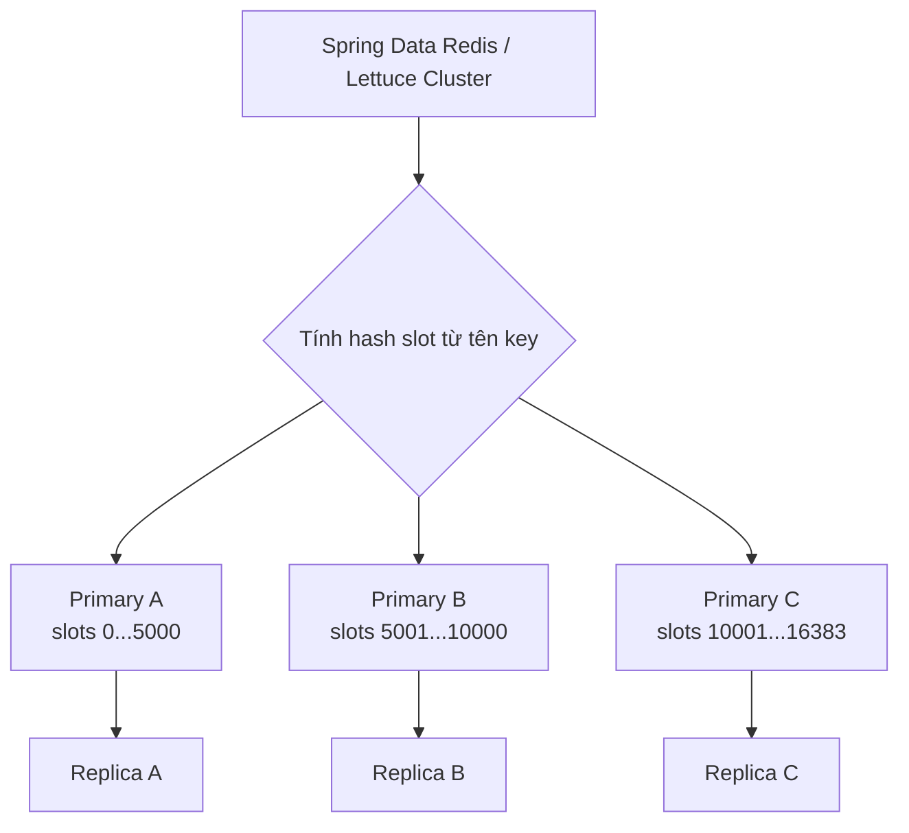
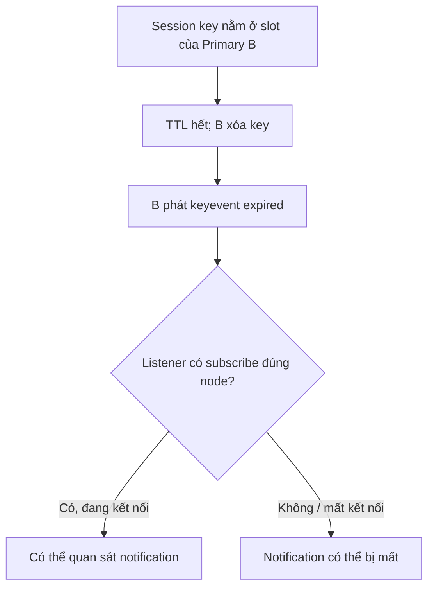

# Ảnh hưởng Cluster đến Repository, chỉ mục và keyspace

**Redis Cluster** phân phối dữ liệu lên nhiều primary theo **16.384 hash slot**, còn **Spring Data Redis Repository** ánh xạ một đối tượng Java thành nhiều cấu trúc Redis: hash của aggregate, tập hợp ID thuộc keyspace, các secondary index và đôi khi cả khóa phục vụ TTL. Hai mô hình này tương tác trực tiếp với nhau.

Một thao tác `repository.save(product)` trông giống việc lưu một đối tượng, nhưng ở tầng Redis có thể liên quan đến **nhiều key**. Trong Cluster, những key này có thể nằm ở các node khác nhau. Điều đó ảnh hưởng tới thao tác nhiều key, giao dịch, truy vấn chỉ mục, xóa dữ liệu, quét keyspace và xử lý sự kiện hết hạn.

Điểm cần nắm là: **kết nối Spring Data Redis tới Cluster không tự làm mọi thao tác của Repository trở nên nguyên tử hoặc không có giới hạn cross-slot**. Cần hiểu khóa nào được tạo, khóa nào phải nằm cùng slot và liệu một chỉ mục tập trung có trở thành điểm nóng hay không.

## 1. Redis Cluster phân phối dữ liệu như thế nào?

Redis Cluster chia không gian khóa thành **16.384 hash slot**, đánh số `0` đến `16383`. Mỗi primary chịu trách nhiệm cho một tập slot. Khi client gửi lệnh đến một key, driver cluster-aware xác định node sở hữu slot đó và định tuyến request.



Các khoảng slot trong sơ đồ chỉ là ví dụ minh họa; ranh giới và số node phụ thuộc Cluster thực tế.

Một vài hệ quả:

- **Lệnh đơn key** như `GET key`, `HGETALL key`, `SET key ...` thường được driver cluster-aware gửi đến đúng primary.
- **Lệnh nhiều key** thường phải tuân thủ quy tắc các key cùng **hash slot**, đặc biệt các lệnh như `MGET`, `SINTER`, `SUNION`, giao dịch nhiều key và Lua script.
- **`MULTI`/`EXEC`** không tạo giao dịch nguyên tử trên nhiều slot tùy ý.
- **Một Redis logical database:** Redis Cluster sử dụng database `0`, không dựa vào `SELECT 1`, `SELECT 2` như một cách tách dữ liệu.
- Việc **resharding** chuyển slot sang node khác có thể sinh phản hồi điều hướng `MOVED`/`ASK`. Driver phải cập nhật topology hoặc thực hiện redirect phù hợp.

Không nên hiểu Cluster là “một Redis đơn có dữ liệu lớn hơn”. Những lệnh hợp lệ trên Redis standalone có thể không dùng được khi các key liên quan bị phân phối vào nhiều slot.

## 2. Hash slot và hash tag

Redis tính slot từ tên key, dựa trên thuật toán CRC16 và phép lấy phần dư cho `16384`. Bình thường, hai key có tên khác nhau có khả năng nằm ở những slot khác nhau.

Redis có cú pháp **hash tag**: nếu tên key chứa một cặp ngoặc nhọn hợp lệ với phần bên trong không rỗng, phần trong ngoặc được dùng để tính slot.

```text
products:101           # Tính slot theo toàn bộ tên key
products:102           # Có thể ở slot khác

{products}:101         # Tính slot dựa trên "products"
{products}:sku:A-101   # Cùng hash tag "products" => cùng slot
{products}:category:IT # Cùng hash tag "products" => cùng slot

{tenant-7}:product:101 # Slot theo "tenant-7"
{tenant-8}:product:101 # Thường ở slot khác
```

Có thể tự xem slot trong Redis Cluster:

```redis
CLUSTER KEYSLOT products:101
CLUSTER KEYSLOT products:102
CLUSTER KEYSLOT {products}:101
CLUSTER KEYSLOT {products}:sku:A-101
CLUSTER KEYSLOT {products}:category:IT
```

Ba key mang cùng hash tag `{products}` sẽ có cùng **giá trị slot**. Còn các key không có tag có thể tình cờ cùng slot do phép băm; không nên thiết kế hệ thống dựa vào sự trùng hợp đó.

**Đánh đổi:** hash tag giúp đưa các key cần thao tác chung về một slot, nhưng đồng thời **tập trung toàn bộ chúng vào một primary sở hữu slot ấy**. Nếu gom mọi sản phẩm của một hệ thống lớn vào `{products}`, Cluster không thể phân tán khối dữ liệu đó trên nhiều primary.

## 3. Redis Repository tạo những loại key nào?

Giả sử một entity được ánh xạ như sau:

```java
package com.example.catalog.redis;

import org.springframework.data.annotation.Id;
import org.springframework.data.redis.core.RedisHash;
import org.springframework.data.redis.core.index.Indexed;

@RedisHash("products")
public class ProductDocument {

    @Id
    private String id;

    @Indexed
    private String sku;

    @Indexed
    private String category;

    private String title;

    public ProductDocument() {
    }

    public ProductDocument(
            String id, String sku, String category, String title) {
        this.id = id;
        this.sku = sku;
        this.category = category;
        this.title = title;
    }

    public String getId() {
        return id;
    }

    public void setId(String id) {
        this.id = id;
    }

    public String getSku() {
        return sku;
    }

    public void setSku(String sku) {
        this.sku = sku;
    }

    public String getCategory() {
        return category;
    }

    public void setCategory(String category) {
        this.category = category;
    }

    public String getTitle() {
        return title;
    }

    public void setTitle(String title) {
        this.title = title;
    }
}
```

Repository tương ứng:

```java
package com.example.catalog.redis;

import java.util.List;
import java.util.Optional;
import org.springframework.data.repository.CrudRepository;

public interface ProductRepository
        extends CrudRepository<ProductDocument, String> {

    Optional<ProductDocument> findBySku(String sku);

    List<ProductDocument> findByCategory(String category);
}
```

Khi thực hiện:

```java
products.save(new ProductDocument(
        "101", "A-101", "ELECTRONICS", "Bàn phím"));
```

Spring Data Redis Repository có thể quản lý nhiều cấu trúc:

| Cấu trúc | Tên key minh họa | Mục đích |
| --- | --- | --- |
| **Hash aggregate** | `products:101` | Các thuộc tính của `ProductDocument` |
| **Keyspace set / metadata** | `products` | Theo dõi ID của aggregate thuộc keyspace |
| **Secondary index set** | `products:sku:A-101` | Tập ID của sản phẩm có SKU tương ứng |
| **Secondary index set** | `products:category:ELECTRONICS` | Tập ID của sản phẩm thuộc category tương ứng |
| **Index bookkeeping** | Các key bổ trợ do repository tạo | Giúp cập nhật/xóa index khi aggregate thay đổi |

Tên minh họa dựa trên quy ước mặc định của Redis Repository và có thể thay đổi theo cấu hình keyspace, mapping hoặc phiên bản thư viện. Không dựa vào chuỗi tên key nội bộ làm hợp đồng API công khai nếu chưa kiểm tra implementation đang sử dụng.

### 3.1. Lưu một entity không nhất thiết chỉ là một Redis command

Ở mức khái niệm:

```text
Repository.save(ProductDocument)
    |
    +--> Ghi hash của entity
    +--> Theo dõi ID trong keyspace
    +--> Cập nhật secondary index cho sku
    +--> Cập nhật secondary index cho category
    +--> Cập nhật metadata index để phục vụ sửa/xóa
```

Một lệnh Redis riêng lẻ có tính nguyên tử theo hợp đồng lệnh, nhưng **toàn bộ chuỗi thao tác repository trên nhiều key không tự trở thành một giao dịch nguyên tử toàn Cluster**. Khi có lỗi kết nối, resharding, timeout hoặc failover giữa các bước, ứng dụng cần biết rằng hash và index có thể không được quan sát ở cùng một trạng thái tại mọi thời điểm.

## 4. Vì sao Repository và secondary index dễ gặp cross-slot?

Với tên key mặc định:

```text
products:101
products:sku:A-101
products:category:ELECTRONICS
products
```

Những key này thường được băm tới **các slot khác nhau**. Điều đó có hai dạng hệ quả:

**Thứ nhất**, một thao tác gồm các lệnh đơn key riêng biệt có thể phải đi đến nhiều primary. Dù từng lệnh thực thi được, chúng không có một ranh giới commit nguyên tử chung trên tất cả primary.

**Thứ hai**, một thao tác cần nhiều key trong **cùng một Redis command** có thể bị Redis Cluster từ chối bằng lỗi `CROSSSLOT Keys in request don't hash to the same slot`.

Ví dụ độc lập với Repository:

```redis
SADD products:category:ELECTRONICS 101
SADD products:sku:A-101 101

# Có thể gây CROSSSLOT nếu hai set nằm ở các slot khác nhau:
SINTER products:category:ELECTRONICS products:sku:A-101
```

Lệnh `SINTER` dùng nhiều key, nên yêu cầu các key tham gia nằm cùng slot. Đối với repository, một số dạng truy vấn dẫn xuất liên quan nhiều điều kiện chỉ mục có thể cần phép xử lý trên nhiều tập ID, từ đó chịu giới hạn tương tự.

**Không nên suy luận rằng mọi `findBy...` trên Cluster đều thất bại.** Một truy vấn dựa trên một index set hoặc một thao tác đơn key có thể hoạt động; giới hạn xuất hiện theo loại truy vấn, cách Spring Data Redis triển khai phiên bản đang dùng, vị trí các key và số key cần phối hợp.

## 5. Cách đặt hash tag trong `@RedisHash` để gom key cùng slot

Khi ưu tiên thao tác Repository trên nhiều cấu trúc liên quan, có thể cân nhắc dùng **keyspace chứa hash tag cố định**:

```java
@RedisHash("{catalog-products}")
public class ProductDocument {
    @Id
    private String id;

    @Indexed
    private String sku;

    @Indexed
    private String category;

    // Các thuộc tính, constructor và accessor tương tự ví dụ trên.
}
```

Với quy ước tên key được tạo từ keyspace này, các key liên quan có thể có dạng:

```text
{catalog-products}:101
{catalog-products}:102
{catalog-products}:sku:A-101
{catalog-products}:category:ELECTRONICS
{catalog-products}
```

Chúng chia sẻ hash tag `{catalog-products}`, nên Redis Cluster tính chúng vào **cùng hash slot**:

```redis
CLUSTER KEYSLOT {catalog-products}:101
CLUSTER KEYSLOT {catalog-products}:sku:A-101
CLUSTER KEYSLOT {catalog-products}:category:ELECTRONICS
CLUSTER KEYSLOT {catalog-products}
```

Nếu cần phối hợp nhiều key này trong một thao tác cross-key được Redis Cluster cho phép, cùng slot là điều kiện cần.

**Cần thận trọng:**

1. Đây là **quy tắc thiết kế keyspace**, không phải bảo đảm rằng mọi thao tác Redis Repository sẽ trở thành transaction.
2. Phải xác nhận **mọi key thực tế tham gia thao tác** đều có tag phù hợp. Index bookkeeping, phantom copy hoặc key do custom converter tạo có thể có quy tắc riêng.
3. Một tag cố định cho toàn bộ repository khiến **mọi aggregate/index của repository bị gom về một slot**. Khi dữ liệu lớn, điều này có thể làm mất lợi ích phân phối của Cluster.
4. Đổi từ `@RedisHash("products")` sang `@RedisHash("{catalog-products}")` không phải thay đổi vô hại: nó **đổi tên khóa**. Dữ liệu và index cũ không tự được chuyển sang keyspace mới.
5. Dùng hash tag không tự tạo ra **truy vấn global phân tán** hay một secondary index hỗ trợ toàn Cluster.

Vì vậy, hash tag phù hợp với những nhóm dữ liệu tương đối nhỏ, có quan hệ chặt và thường cần thao tác chung. Nếu cần lưu hàng triệu aggregate phân tán trên nhiều node **đồng thời** tìm kiếm toàn cục theo thuộc tính, phải thiết kế chiến lược index/query riêng thay vì buộc tất cả vào một slot.

## 6. Đánh đổi giữa co-location và phân tán

Không có một quy tắc hash tag tối ưu cho mọi ứng dụng.

| Chiến lược | Lợi ích | Chi phí / giới hạn |
| --- | --- | --- |
| Không dùng tag, key theo ID | Aggregate có thể phân tán trên nhiều slot | Index và keyspace metadata có thể ở slot khác; multi-key command khó phối hợp |
| Một tag cho toàn repository, ví dụ `{products}` | Các key cùng tag có thể xử lý multi-key trong một slot | **Hot slot**, giới hạn mở rộng trên nhiều primary |
| Tag theo tenant, ví dụ `{tenant-7}` | Dữ liệu liên quan một tenant ở cùng slot | Muốn truy vấn toàn bộ tenant cần thiết kế fan-out/aggregation |
| Tag theo aggregate ID | Các key phụ của một aggregate cùng slot | Một **secondary index dùng chung nhiều aggregate** không thể đồng thời cùng slot với mọi aggregate |
| Tách index/search khỏi Redis Repository | Có thể phân phối dữ liệu và truy vấn theo thiết kế riêng | Cần đồng bộ chỉ mục, quản lý độ trễ và phục hồi |

Ví dụ chiến lược tag theo tenant:

```text
{tenant-7}:product:101
{tenant-7}:product:102
{tenant-7}:index:sku:A-101

{tenant-8}:product:301
{tenant-8}:index:sku:B-301
```

Thiết kế trên có thể giữ các thao tác **trong một tenant** ở cùng slot, đồng thời phân tán các tenant khác nhau. Tuy nhiên, **đừng suy ra** rằng `@RedisHash` mặc định sẽ tự sinh keyspace/tag động dựa trên trường `tenantId`. Annotation class-level có keyspace tĩnh; muốn định tuyến tenant động phải có thiết kế mapping/keyspace resolver hoặc tầng lưu trữ được kiểm soát riêng.

Một query "tìm mọi sản phẩm của tất cả tenant theo một SKU" vẫn là bài toán **global lookup** cần giải pháp riêng. Hash tag chỉ quyết định vị trí lưu key, không tạo engine truy vấn phân tán.

## 7. Secondary index: cơ chế và giới hạn khi trải nhiều slot

Spring Data Redis hỗ trợ secondary index bằng `@Indexed`. Với một aggregate có:

```java
@Indexed
private String category;
```

Spring Data Redis quản lý tập ID của những aggregate cùng giá trị thuộc tính. Ví dụ:

```text
products:category:ELECTRONICS -> {101, 102, 108}
products:category:BOOKS       -> {205, 206}
```

Đây là **Redis Set chứa ID**, không phải một B-tree toàn Cluster hoặc chỉ mục tự phân tán. Những thao tác như:

```java
List<ProductDocument> findByCategory(String category);
```

có thể dùng index để tìm ID, rồi đọc các aggregate tương ứng. Nếu index set và các hash nằm trên các node khác nhau, việc đọc dữ liệu và duy trì index chịu chi phí network/topology và rủi ro nhất quán của nhiều thao tác.

### 7.1. Kết hợp nhiều điều kiện index

Giả sử repository có hai thuộc tính `@Indexed`:

```java
List<ProductDocument> findByCategoryAndSku(
        String category, String sku);
```

Về logic, kết quả cần thỏa:

```text
ID thuộc index(category=ELECTRONICS)
  INTERSECT
ID thuộc index(sku=A-101)
```

Nếu implementation thực hiện phép giao tập qua `SINTER` trên hai index key ở khác slot, Cluster trả `CROSSSLOT`. Nếu implementation dùng đường đi khác, kết quả và chi phí lại phụ thuộc đường đi đó.

Vì vậy, cần đánh giá **truy vấn cụ thể** chứ không chỉ xác nhận rằng `repository.save()` hay `findById()` đã chạy thành công. Một use case có thể chỉ lỗi khi chuyển sang truy vấn kết hợp điều kiện hoặc khi số lượng index tăng.

### 7.2. Thay đổi giá trị được index

```java
ProductDocument p = products.findById("101").orElseThrow();
p.setCategory("OFFICE");
products.save(p);
```

Ở mức logic, repository cần:

1. Cập nhật hash của sản phẩm.
2. Gỡ ID `101` khỏi index `ELECTRONICS`.
3. Thêm ID `101` vào index `OFFICE`.
4. Cập nhật metadata theo dõi các chỉ mục của aggregate.

Nếu các key liên quan ở nhiều slot, không thể giả định bốn bước là một transaction nguyên tử toàn Cluster. Trong thời gian cập nhật hoặc khi có lỗi giữa chừng, index cũ và mới có thể không đồng nhất với hash.

Đối với dữ liệu có yêu cầu chính xác mạnh (tồn kho, thanh toán, quyền truy cập), **không nên dựa duy nhất vào secondary index của Redis Repository như nguồn sự thật nghiệp vụ**. Cần xác minh điều kiện ở nơi thực hiện commit.

## 8. `@GeoIndexed` và chỉ mục địa lý trong Cluster

Redis Repository còn hỗ trợ `@GeoIndexed`:

```java
import org.springframework.data.geo.Point;
import org.springframework.data.redis.core.index.GeoIndexed;

@GeoIndexed
private Point location;
```

Về bản chất, geo index sử dụng cấu trúc Redis phù hợp với các lệnh `GEOADD`, `GEOSEARCH` và các thao tác GEO khác. Một index địa lý chứa member là ID của nhiều aggregate.

Ví dụ key minh họa:

```text
stores:location              -> geo index (sorted set)
stores:store-101             -> hash aggregate
stores:store-102             -> hash aggregate
```

Trong Redis Cluster:

- Một **geo index key** nằm trên **một slot**. Redis không tự chia một sorted set GEO thành nhiều primary.
- Các hash của địa điểm có thể nằm ở những slot khác với geo index.
- Tìm trong một geo index có thể trả ID, rồi repository phải lấy các aggregate theo ID; những lần đọc đó có thể trải nhiều node.
- Nếu cần tra vị trí trên quy mô rất lớn, một geo index tập trung có thể trở thành điểm nóng.
- Nếu phân chia nhiều geo index theo vùng/tenant, truy vấn gần ranh giới cần gom kết quả từ nhiều vùng và xử lý lọc/sắp xếp.

Do đó, `@GeoIndexed` không tự tạo **spatial search phân tán toàn Cluster**. Phải chọn mô hình index phù hợp với phạm vi tìm kiếm của ứng dụng và xem xét chi phí cập nhật/xóa index khi aggregate thay đổi.

## 9. `@Reference`, quan hệ và nhiều aggregate

Một entity Redis Repository có thể tham chiếu ID/key của entity khác qua cơ chế mapping. Trong Cluster, hai aggregate độc lập có thể được lưu ở hai slot khác nhau.

```text
customer:customer-7      -> slot A
orders:order-101         -> slot B
orders:order-102         -> slot C
```

Đọc tham chiếu có thể đòi hỏi nhiều round trip đến các node khác nhau. **Một tham chiếu trong model Java không biến các aggregate thành cùng một transaction**. Việc lưu `Order` không có nghĩa mọi thay đổi của `Customer`, `Order` và index đã được commit nguyên tử trên Cluster.

Nếu thao tác nghiệp vụ cần cập nhật hai aggregate cùng lúc, hãy chọn một chiến lược nhất quán rõ ràng:

- Gom những dữ liệu thật sự phải thay đổi nguyên tử vào **một Redis key** nếu kích thước và mô hình dữ liệu cho phép.
- Đưa các key liên quan vào **cùng slot** khi cần lệnh nhiều key hoặc Lua script, nhưng tránh tạo hot slot quá lớn.
- Dùng cơ sở dữ liệu giao dịch phù hợp làm **nguồn sự thật**, còn Redis giữ bản sao hoặc read model.
- Nếu nhiều nguồn dữ liệu buộc phải phối hợp, dùng idempotency, outbox, bù trừ hoặc saga có trạng thái bền vững.

Không cố biến Redis Repository thành ORM quan hệ có join, foreign-key constraint và transaction xuyên shard chỉ bằng annotation.

## 10. Keyspace là gì trong ngữ cảnh Repository và Cluster?

Từ **keyspace** có thể chỉ những khái niệm khác nhau:

1. **Redis database keyspace:** toàn bộ key trong một logical database Redis.
2. **Repository keyspace:** tiền tố/nhóm aggregate của một entity, ví dụ `products` từ `@RedisHash("products")`.
3. **Keyspace notifications:** các thông báo Pub/Sub về thay đổi, xóa, hết hạn hoặc eviction của Redis key.

Ba khái niệm này **không đồng nhất**. `@RedisHash("products")` không tạo một database riêng trên Cluster; nó chỉ xác định một phần quy ước ánh xạ tên key.

### 10.1. Tập ID của keyspace

Để hỗ trợ các thao tác trên toàn bộ aggregate của một loại, Repository có thể dùng một **keyspace set** theo dõi ID.

```text
products -> {101, 102, 103, ...}
```

Hệ quả:

- Nếu tập này rất lớn, một key duy nhất có thể thành điểm nóng và tiêu tốn bộ nhớ lớn trên một node.
- Đọc nhiều ID rồi nạp hash có thể tạo fan-out tới nhiều node.
- Việc xóa hàng loạt hoặc `findAll()` có thể gây tải cao và kéo dài; không nên coi chúng là một scan/phân trang ổn định toàn Cluster.
- Thao tác `count()` hoặc duyệt toàn bộ repository phải được đánh giá theo implementation và khối lượng dữ liệu, không mặc định có chi phí hằng số hoặc luôn chính xác tuyệt đối giữa các cập nhật đồng thời.

Nếu cần truy vấn tập dữ liệu rất lớn, nên cân nhắc API có phân trang theo ID, index chuyên dụng hoặc mô hình lưu trữ phân vùng rõ ràng.

### 10.2. Đổi keyspace không tự di chuyển dữ liệu

Thay:

```java
@RedisHash("products")
```

thành:

```java
@RedisHash("{catalog-products}")
```

làm thay đổi cách đặt tên các key mới. Dữ liệu cũ dưới `products:101` **không tự biến thành** `{catalog-products}:101`. Repository mới có thể không nhìn thấy những aggregate và index cũ qua quy ước mới.

Cần có quy trình migration: lựa chọn downtime hoặc dual-read/dual-write, sao chép và kiểm tra dữ liệu, xây dựng lại secondary index, xử lý TTL còn lại và cắt chuyển ứng dụng có kiểm soát.

## 11. `KEYS`, `SCAN` và duyệt dữ liệu trên nhiều primary

Trên standalone Redis, người học thường kiểm tra:

```redis
KEYS products:*
SCAN 0 MATCH products:* COUNT 100
```

Trong Cluster, **mỗi primary sở hữu một phần keyspace**. Một lệnh `SCAN` chạy trên một node chỉ duyệt tập key mà node đó chịu trách nhiệm; nó không tự quét mọi primary còn lại.

Để duyệt toàn Cluster về mặt khái niệm:

```text
Cluster discovery
    |
    +--> Primary A: SCAN theo cursor A
    +--> Primary B: SCAN theo cursor B
    +--> Primary C: SCAN theo cursor C
    |
    +--> Kết hợp kết quả, dedup nếu cần
```

Mỗi primary có cursor riêng. `SCAN` không phải ảnh chụp dữ liệu bất biến: key có thể được tạo, xóa, di chuyển slot giữa lúc quét, và key có thể xuất hiện lặp. Khi resharding xảy ra, kết quả càng cần được xem là **best effort** chứ không phải danh sách snapshot chính xác tại một thời điểm.

`KEYS` quét toàn bộ keyspace trên node và có thể làm tăng độ trễ khi dữ liệu lớn. Một số API cluster-aware có thể fan-out lệnh tới nhiều node, nhưng **không nên giả định mọi `keys(pattern)` hoặc `scan()` đều tự duyệt toàn Cluster**; phải kiểm tra API, driver và topology đang sử dụng.

Ví dụ kiểm tra từng node trong môi trường học tập:

```sh
redis-cli -h redis-primary-a -p 6379 SCAN 0 MATCH 'products:*' COUNT 100
redis-cli -h redis-primary-b -p 6379 SCAN 0 MATCH 'products:*' COUNT 100
redis-cli -h redis-primary-c -p 6379 SCAN 0 MATCH 'products:*' COUNT 100
```

Đây chỉ là **một trang SCAN** trên mỗi node. Để duyệt hết, phải tiếp tục theo cursor trả về đến `0`, cập nhật danh sách primary nếu topology thay đổi và tránh chạy quét toàn bộ trong request phục vụ người dùng.

**Đừng dùng `KEYS products:*` để xóa hàng loạt trong production**. Khi cần dọn dữ liệu, ưu tiên giới hạn phạm vi key, batch nhỏ, chính sách TTL phù hợp và một quy trình có thể tiếp tục sau khi bị gián đoạn.

## 12. TTL và keyspace notifications trong Redis Cluster

Redis Repository có thể cấu hình thời gian sống:

```java
@RedisHash(value = "sessions", timeToLive = 900)
public class SessionDocument {

    @Id
    private String id;

    private String userId;

    // Constructor, getter và setter...
}
```

Lúc lưu, Redis áp dụng TTL lên **key hash của aggregate**. Khi TTL hết, Redis xóa key theo cơ chế expiration của node đang giữ key.

Vấn đề là **keyspace notifications trong Redis Cluster có phạm vi node**. Thông báo được tạo tại node xảy ra sự kiện, không phải một lịch sử sự kiện bền vững được đồng bộ trên mọi node.



Một listener chỉ subscribe tới một node **không nên được coi là đã quan sát toàn bộ expiration của cả Cluster**. Với Cluster, cần xem xét cách Spring Data Redis và driver hiện hành subscribe các node, cập nhật subscription khi topology thay đổi và cấu hình notifications đồng nhất trên các primary.

### 12.1. `RedisKeyExpiredEvent` của Repository

Spring Data Redis Repository có thể dùng keyspace notifications để phát sự kiện Java khi aggregate hết hạn. Ví dụ cấu hình:

```java
import org.springframework.context.annotation.Configuration;
import org.springframework.data.redis.core.RedisKeyValueAdapter.EnableKeyspaceEvents;
import org.springframework.data.redis.repository.configuration.EnableRedisRepositories;

@Configuration
@EnableRedisRepositories(
        basePackageClasses = SessionRepository.class,
        enableKeyspaceEvents = EnableKeyspaceEvents.ON_STARTUP)
public class RedisRepositoryConfiguration {
}
```

`SessionRepository` trong ví dụ là interface repository tương ứng với entity. `ON_STARTUP` yêu cầu khởi tạo cơ chế lắng nghe từ lúc bắt đầu ứng dụng, nhưng **không làm notifications trở thành durable events**.

Giới hạn:

- Listener có thể mất sự kiện khi offline, mất kết nối, failover hoặc resharding.
- Thông báo có thể đến trễ so với thời điểm TTL lý thuyết vì Redis loại bỏ key hết hạn theo cơ chế chủ động/bị động.
- `RedisKeyExpiredEvent` dựa trên Pub/Sub, không có lịch sử để replay khi consumer khởi động lại.
- Khi Repository dùng secondary index, mất notification hết hạn có thể khiến dữ liệu index phụ trợ **không được dọn hoàn toàn**.
- Những bản sao tạm (*shadow/phantom copies*) phục vụ payload expiration event có thể tạo thêm Redis key, chiếm bộ nhớ và cần kiểm tra tác động đến slot/topology.

Với môi trường Redis được quản lý, ứng dụng có thể không có quyền `CONFIG SET`. Nếu cần tránh Spring Data Redis tự thay đổi cấu hình server, có thể dùng `keyspaceNotificationsConfigParameter = ""` trong `@EnableRedisRepositories` theo khả năng phiên bản, đồng thời **bật `notify-keyspace-events` bằng cấu hình hạ tầng** trên những node cần thiết. Đặt chuỗi rỗng không tự bật notifications.

### 12.2. Không dùng notification như sự kiện nghiệp vụ đáng tin cậy

Ví dụ `session:123` hết TTL không tự chứng minh một giao dịch nghiệp vụ cần bị hủy hay một khoản tiền phải được hoàn lại. Nếu một luồng business phải xử lý chắc chắn, dùng nguồn trạng thái/deadline có thể đối soát, outbox hoặc hàng đợi/log có cơ chế replay.

Trên Cluster, rủi ro mất notification và dữ liệu index sai lệch còn phụ thuộc việc node nào giữ key, tình trạng chuyển slot và cấu hình listener. Việc bật keyspace notifications không giải quyết toàn bộ vấn đề tính nhất quán của Repository.

## 13. Cấu hình Spring Data Redis với Cluster

Ví dụ ứng dụng Spring Boot 3.x:

```groovy
// build.gradle
dependencies {
    implementation 'org.springframework.boot:spring-boot-starter-data-redis'
}
```

Khai báo địa chỉ một số node để driver khám phá topology:

```yaml
# src/main/resources/application.yml
spring:
  data:
    redis:
      cluster:
        nodes:
          - redis-1.example.internal:6379
          - redis-2.example.internal:6379
          - redis-3.example.internal:6379
        max-redirects: 5
      timeout: 3s
      connect-timeout: 2s
```

Địa chỉ ví dụ chỉ là placeholder. Trong production cần TLS, credentials, network access và cấu hình topology phù hợp. Driver phải kết nối được **những endpoint mà Cluster công bố**, không chỉ các seed node ban đầu.

Với Spring Boot, `LettuceConnectionFactory` có thể được tạo tự động từ cấu hình Cluster khi dependency và điều kiện auto-configuration đáp ứng. Nếu muốn chỉ rõ phạm vi repository:

```java
package com.example.catalog;

import com.example.catalog.redis.ProductRepository;
import org.springframework.boot.SpringApplication;
import org.springframework.boot.autoconfigure.SpringBootApplication;
import org.springframework.data.redis.repository.configuration.EnableRedisRepositories;

@SpringBootApplication
@EnableRedisRepositories(basePackageClasses = ProductRepository.class)
public class CatalogApplication {

    public static void main(String[] args) {
        SpringApplication.run(CatalogApplication.class, args);
    }
}
```

`@EnableRedisRepositories` đăng ký và quét các repository. Annotation này **không thay đổi quy tắc hash slot**, không tự gắn hash tag lên tên key và không bảo đảm mọi secondary index nằm cùng slot.

### 13.1. Cấu hình Java thay thế khi cần

Nếu cần tạo connection factory bằng code, Spring Data Redis cung cấp `RedisClusterConfiguration`:

```java
import java.util.List;
import org.springframework.context.annotation.Bean;
import org.springframework.context.annotation.Configuration;
import org.springframework.data.redis.connection.RedisClusterConfiguration;
import org.springframework.data.redis.connection.lettuce.LettuceConnectionFactory;

@Configuration
public class ClusterConnectionConfiguration {

    @Bean
    public LettuceConnectionFactory redisConnectionFactory() {
        RedisClusterConfiguration config =
                new RedisClusterConfiguration(List.of(
                        "redis-1.example.internal:6379",
                        "redis-2.example.internal:6379",
                        "redis-3.example.internal:6379"));
        config.setMaxRedirects(5);

        return new LettuceConnectionFactory(config);
    }
}
```

Đây là **phương án thay thế**, không phải hướng dẫn tạo thêm một factory thứ hai bên cạnh auto-configuration của Boot. Khi tự cấu hình factory, phải bổ sung xác thực/TLS/timeouts/topology theo môi trường thực tế và kiểm soát các bean template nào sử dụng factory đó.

Redis Cluster không phải Redis Sentinel: Sentinel theo dõi một primary và replica để failover một tập dữ liệu, còn Redis Cluster phân chia dữ liệu theo slot và có thể có nhiều primary. Không dùng đồng thời hai cấu hình như thể chúng là một chế độ kết nối duy nhất.

## 14. Giao dịch, Lua và thao tác nhiều key

Một điểm cần khẳng định rõ:

> **Cùng slot là điều kiện cần cho nhiều thao tác nhiều key trong Redis Cluster, nhưng không tự làm mọi chuỗi lệnh trở thành một transaction.**

Ví dụ hai key khác slot:

```redis
MGET customer:101 order:500
```

Lệnh này có thể gặp `CROSSSLOT`. Tương tự, một Lua script cần thao tác nhiều key ở các slot khác nhau không có khả năng truy cập phân tán tất cả key như thể Redis là một server duy nhất.

Nếu dữ liệu buộc phải cập nhật nguyên tử trên Redis:

1. Xác định chính xác các key cần trong thao tác.
2. Thiết kế để chúng cùng slot nếu mô hình dung lượng cho phép.
3. Dùng **một lệnh Redis, transaction hợp lệ hoặc Lua script** với hợp đồng rõ ràng.
4. Xử lý timeout hoặc failover bằng operation ID/idempotency nếu kết quả không chắc chắn.
5. Không giả định atomicity cục bộ của script ngăn được mọi rủi ro mất ghi do replication bất đồng bộ sau failover.

Ví dụ dùng hash tag chung:

```redis
MULTI
SET {order-500}:status CONFIRMED
INCRBY {order-500}:version 1
EXEC
```

Hai key nằm cùng slot, đáp ứng điều kiện về slot cho transaction Cluster. Nhưng một lệnh `MULTI` không thể được mở rộng tùy ý sang `customer:101` trên slot khác.

Một `repository.save()` có thể thực hiện các thao tác nội bộ khác với transaction ví dụ trên. Không được suy ra rằng chỉ cần đặt hash tag là `save()` sẽ tự động có cùng ranh giới nguyên tử như một `MULTI` do ứng dụng viết rõ.

## 15. Lưu ý về pipeline và truy vấn nhiều key

Spring Data Redis hỗ trợ pipeline để giảm round trip, nhưng trong Cluster:

- Các lệnh được định tuyến đến node sở hữu key.
- Một pipeline chứa nhiều lệnh cho nhiều slot **không có một transaction commit toàn Cluster**.
- Thứ tự và hoàn tất của các lệnh trên nhiều node không nên được hiểu như một chuỗi ghi nguyên tử.
- Nếu có một lệnh lỗi giữa chừng, các lệnh khác có thể đã thực thi; việc nhận kết quả cần tương ứng với từng lệnh.
- Một client timeout không chứng minh tất cả lệnh trong pipeline chưa ghi.

Do đó, không dùng pipeline thay cho giao dịch nghiệp vụ. Với các cập nhật quan trọng, cần thiết kế đường ghi có trạng thái/idempotency riêng hoặc sử dụng datastore có giao dịch phù hợp.

## 16. Xóa, TTL và nhất quán chỉ mục

Một số vòng đời mà Repository cần quản lý:

```text
SAVE:
  hash mới / metadata keyspace / chỉ mục thuộc tính

UPDATE:
  hash mới / gỡ chỉ mục cũ / thêm chỉ mục mới

DELETE:
  xóa hash / gỡ ID khỏi index / cập nhật metadata

EXPIRE:
  Redis tự xóa hash khi TTL hết
  Listener có thể được dùng để dọn chỉ mục phụ trợ
```

Trên Redis Cluster, những thao tác chạm nhiều key có thể phân tán qua các slot. Việc xóa hash hoặc hết TTL **không tự xóa mọi secondary index nằm ở các key khác**. Khi một index còn chứa ID không còn aggregate:

```text
index category=ELECTRONICS -> ID 101
GET hash products:101      -> key không tồn tại
```

Ứng dụng cần xác định cách xử lý những ID "mồ côi":

- Bỏ qua kết quả khi aggregate thực sự không còn.
- Ghi nhận metric về index drift.
- Sửa logic vòng đời để đi qua Repository khi cập nhật/xóa.
- Có công việc đối soát có kiểm soát để xây dựng lại index dựa trên nguồn dữ liệu chính.
- Không phụ thuộc duy nhất vào việc tất cả expiration notification luôn đến đủ.

Nếu dữ liệu chính vẫn ở Redis và không có nguồn đối chiếu khác, cần đặc biệt thận trọng trước khi xóa hàng loạt để "reindex": thao tác đó có thể làm mất các giá trị không thể tái tạo.

### 16.1. Phân biệt TTL keyspace và slot

TTL luôn gắn với **key**. Hash tag quyết định slot của key, không quyết định thời gian sống. Ví dụ:

```redis
EXPIRE {catalog-products}:101 3600
TTL {catalog-products}:101
CLUSTER KEYSLOT {catalog-products}:101
```

`TTL` trả thời gian còn lại, còn `CLUSTER KEYSLOT` trả slot tương ứng. Nếu key được reshard sang primary khác, thuộc tính hết hạn đi cùng dữ liệu theo cơ chế di chuyển key; tuy nhiên listener ở node cũ không thể được mặc định là vẫn nhận thông báo expired do node mới phát.

## 17. Thực hành kiểm tra Repository trên Cluster

Giả sử ứng dụng đang chạy với keyspace `products`.

**Bước 1: Quan sát topology và slot.**

```redis
CLUSTER INFO
CLUSTER NODES
CLUSTER KEYSLOT products:101
CLUSTER KEYSLOT products:category:ELECTRONICS
```

**Bước 2: Lưu một vài aggregate bằng repository.**

```java
products.save(new ProductDocument(
        "101", "A-101", "ELECTRONICS", "Bàn phím"));
products.save(new ProductDocument(
        "102", "A-102", "ELECTRONICS", "Màn hình"));
```

**Bước 3: Kiểm tra các thao tác độc lập.**

```java
ProductDocument byId = products.findById("101")
        .orElseThrow();

List<ProductDocument> byCategory =
        products.findByCategory("ELECTRONICS");
```

Thao tác theo ID và truy vấn secondary index có thể có đặc tính routing khác nhau. Cần kiểm thử trên **Cluster thật có nhiều primary**, không chỉ trên một Redis standalone.

**Bước 4: Xem key thực tế do Repository tạo ra.**

Quan sát ở môi trường thử nghiệm bằng công cụ cluster-aware hoặc các lệnh quét từng primary. Đừng suy đoán tên index chỉ từ ví dụ ở tài liệu rồi áp dụng `DEL` lên production.

**Bước 5: Thử đổi một thuộc tính được index.**

```java
ProductDocument p = products.findById("101")
        .orElseThrow();
p.setCategory("OFFICE");
products.save(p);
```

Sau đó thử:

```java
products.findByCategory("ELECTRONICS");
products.findByCategory("OFFICE");
```

Ở đây mục tiêu là hiểu việc **một thay đổi aggregate kéo theo index maintenance**. Với bài toán thật cần các tiêu chí chặt, kiểm tra cả tình huống thao tác bị gián đoạn, quá tải và resharding.

**Bước 6: Thử mô hình keyspace có hash tag trên dữ liệu tách biệt.**

Đổi sang một entity/class thử nghiệm có keyspace `{catalog-products}` trong môi trường kiểm thử riêng, rồi quan sát các slot. Không đổi annotation của entity production đang có dữ liệu mà không có migration.

## 18. Những lỗi thường gặp

### 18.1. `CROSSSLOT Keys in request don't hash to the same slot`

Nguyên nhân: một command nhiều key nhận các key ở các slot khác nhau. Cần xác định lệnh thực tế, liệt kê key tham gia, dùng `CLUSTER KEYSLOT` để hiểu vị trí, rồi thiết kế lại key/operation. Không sửa bằng cách retry cùng lệnh với các key không đổi.

### 18.2. `findById()` chạy được nhưng `findBy...And...()` lỗi

Đọc theo ID thường truy cập một hash; truy vấn index phức tạp có thể cần nhiều index key. Không lấy kết quả của `findById` làm bằng chứng toàn bộ Repository tương thích với mọi kiểu truy vấn trên Cluster.

### 18.3. Gắn `{products}` lên tất cả key và tưởng Cluster đã scale dữ liệu

Cùng hash tag nghĩa là cùng slot; một slot chỉ thuộc một primary tại một thời điểm. Nếu dữ liệu đủ lớn để cần sharding, một tag chung cho toàn bộ repository là điểm nghẽn tiềm tàng.

### 18.4. Dùng `SCAN 0` một lần rồi tuyên bố đã quét toàn Cluster

`SCAN` có cursor và mỗi node có phạm vi keyspace riêng. Phải duyệt hết cursor của từng primary, đồng thời hiểu kết quả không phải snapshot giữa các cập nhật.

### 18.5. Không nhận được `RedisKeyExpiredEvent` cho một số entity

Có thể do notifications chưa bật trên node giữ key, listener không subscribe đủ node, app ngắt kết nối hoặc topology thay đổi. Đừng coi event này là bảo đảm giao nhận đáng tin cậy.

### 18.6. Xóa hash bằng Redis CLI và chờ Repository tự sửa mọi index

Gọi `DEL` trực tiếp bypass đường dọn index do Repository quản lý. Index có thể chứa ID mồ côi; ưu tiên API repository và có kế hoạch reconciliation.

### 18.7. Tưởng thay `@RedisHash` chỉ đổi tên hiển thị

`@RedisHash` xác định keyspace và ảnh hưởng tới tên Redis key. Đổi keyspace thường cần migration dữ liệu, index và TTL; không tự động đọc được những key cũ.

### 18.8. Nhầm Spring Cache với Redis Repository

`@Cacheable`/`RedisCacheManager` thuộc Spring Cache; `@RedisHash`, `CrudRepository` và `@Indexed` thuộc Redis Repository. Cả hai có thể dùng Redis Cluster nhưng tạo key và quản lý vòng đời khác nhau. Không áp dụng giả định về keyspace/index của Repository cho mọi cache entry.

### 18.9. Giả định keyspace notifications là log sự kiện đáng tin cậy

Redis notifications dùng Pub/Sub, không có ACK hoặc replay. Dùng để quan sát hoặc hỗ trợ cleanup best effort, không làm cơ sở duy nhất cho quyết định thanh toán/hủy đơn hàng.

### 18.10. Coi nhiều key cùng slot là một SQL transaction

Co-location cho phép một số multi-key command, nhưng không tự cho phép join, foreign key, transaction đa entity mặc định hay rollback toàn bộ một chuỗi ghi của Repository. Phải xác định rõ ranh giới nguyên tử thực tế.

## 19. Quan sát và vận hành trên Cluster

Khi đưa Redis Repository lên Cluster, nên theo dõi:

| Chỉ số / tín hiệu | Ý nghĩa |
| --- | --- |
| Số key và bộ nhớ theo primary | Phát hiện phân bố không đều hoặc hot slot |
| CPU/network theo primary | Chỉ mục tập trung có thể làm một node chịu tải vượt trội |
| `MOVED`/`ASK` và topology refresh | Dấu hiệu chuyển slot hoặc client cập nhật topology |
| `CROSSSLOT` errors | Dấu hiệu có command nhiều key chưa được thiết kế đúng |
| Latency của `save`, `delete`, truy vấn index | Chi phí phối hợp nhiều key/nhiều node |
| Secondary index cardinality | Phát hiện set index quá lớn, fan-out nhiều aggregate |
| Keyspace/index drift | ID trong index nhưng hash không tồn tại hoặc giá trị không khớp |
| TTL và expired notifications | Đánh giá khả năng quan sát expiration theo node |
| Reconnect/failover/retry | Gián đoạn làm cho một chuỗi cập nhật nhiều key không hoàn tất |
| Cluster slot distribution | Xác định tag nào đang dồn dữ liệu vào một primary |

Cần log dạng có kiểm soát: tên repository, loại thao tác, khóa/slot liên quan theo định danh không nhạy cảm, exception code, node/role và correlation ID. Không đưa mật khẩu, token hay giá trị nhạy cảm của entity vào log.

Khi một use case gặp lỗi `CROSSSLOT`, ưu tiên tìm đúng command và key thay vì tăng `maxRedirects`. `MOVED`/`ASK` là vấn đề điều hướng topology; `CROSSSLOT` là vấn đề **mô hình vị trí của nhiều key**. Tăng số lần redirect không giải quyết được khác biệt đó.

## 20. Ma trận lựa chọn thiết kế

| Yêu cầu chính | Hướng cân nhắc |
| --- | --- |
| CRUD theo ID cho một lượng lớn entity | Phân phối key theo ID; đo tác động metadata/index của Repository |
| Truy vấn theo một thuộc tính có index | Kiểm tra đường query, phân bố index và chi phí đọc aggregate |
| Truy vấn kết hợp nhiều index theo giao tập | Bảo đảm các index key tương thích slot hoặc chuyển sang cơ chế query riêng |
| Giao dịch nguyên tử nhiều key nhỏ, liên quan chặt | Hash tag phù hợp, một command/transaction/script có phạm vi rõ |
| Dữ liệu quá lớn cho một slot | Phân vùng theo tenant/bucket hoặc dùng kho tìm kiếm/chỉ mục khác |
| Cần truy vấn toàn cục trên nhiều shard | Thiết kế query fan-out/aggregation hay hệ thống tìm kiếm phân tán |
| Cần cleanup khi TTL hết | Không phụ thuộc duy nhất vào notifications; có reconciliation |
| Cần sự kiện nghiệp vụ đáng tin cậy | Nguồn sự thật + outbox/stream/broker + idempotent consumer |
| Cần dữ liệu quan trọng không sai lệch khi lỗi giữa thao tác nhiều key | Đặt invariant và transaction ở hệ thống phù hợp; Redis Repository không là SQL đa shard |

## 21. Tổng kết

**Redis Cluster phân phối key theo hash slot, còn Redis Repository thường lưu một aggregate qua nhiều key**: hash chính, keyspace metadata và secondary/geo index. Khi các key này nằm ở những slot khác nhau, các lệnh đơn key có thể được định tuyến tới nhiều node, nhưng thao tác nhiều key có thể gặp `CROSSSLOT`, và toàn bộ vòng đời aggregate không tự có giao dịch nguyên tử toàn Cluster.

**Hash tag** giúp đưa các key liên quan về cùng slot để đáp ứng giới hạn multi-key, đổi lại là nguy cơ tạo **hot slot** và hạn chế khả năng phân tán dữ liệu. `@RedisHash` xác định keyspace, không tự biến Repository thành một cơ chế chỉ mục toàn Cluster. TTL, shadow copy và keyspace notifications cũng chịu các giới hạn của từng node và Pub/Sub, nên không thể chỉ dựa vào expiration event để bảo đảm dọn index hay hoàn tất nghiệp vụ.

Khi triển khai, hãy kiểm tra **key thực tế**, **slot thực tế**, các **phương thức repository cụ thể**, vòng đời index và những thao tác mất kết nối/failover. Nếu yêu cầu là truy vấn phân tán ở quy mô lớn hoặc giao dịch nghiệp vụ chính xác cao, cần thiết kế lưu trữ và chỉ mục phù hợp hơn thay vì chỉ đổi cấu hình kết nối sang Cluster.

### Tài liệu tham khảo

- [Redis — Redis Cluster specification](https://redis.io/docs/latest/operate/oss_and_stack/reference/cluster-spec/): slot, hash tag, định tuyến và giới hạn cross-slot.
- [Redis — Scale with Redis Cluster](https://redis.io/docs/latest/operate/oss_and_stack/management/scaling/): mô hình primary/replica, phân phối dữ liệu và resharding.
- [Redis — CLUSTER KEYSLOT](https://redis.io/docs/latest/commands/cluster-keyslot/): xem hash slot của key.
- [Redis — SCAN](https://redis.io/docs/latest/commands/scan/): cursor và các giới hạn khi duyệt keyspace.
- [Redis — Keyspace notifications](https://redis.io/docs/latest/develop/pubsub/keyspace-notifications/): phạm vi event, cấu hình và giới hạn Pub/Sub.
- [Spring Data Redis — Redis Cluster](https://docs.spring.io/spring-data/redis/reference/redis/cluster.html): API và các khác biệt giữa Cluster và standalone Redis.
- [Spring Data Redis — Redis Repositories](https://docs.spring.io/spring-data/redis/reference/redis/redis-repositories.html): lưu aggregate, mapping và keyspace.
- [Spring Data Redis — Secondary Indexes](https://docs.spring.io/spring-data/redis/reference/redis/redis-repositories/indexes.html): `@Indexed`, `@GeoIndexed` và cách quản lý chỉ mục.
- [Spring Data Redis — Time To Live](https://docs.spring.io/spring-data/redis/reference/redis/redis-repositories/expirations.html): TTL, expiration events và phantom copy.
