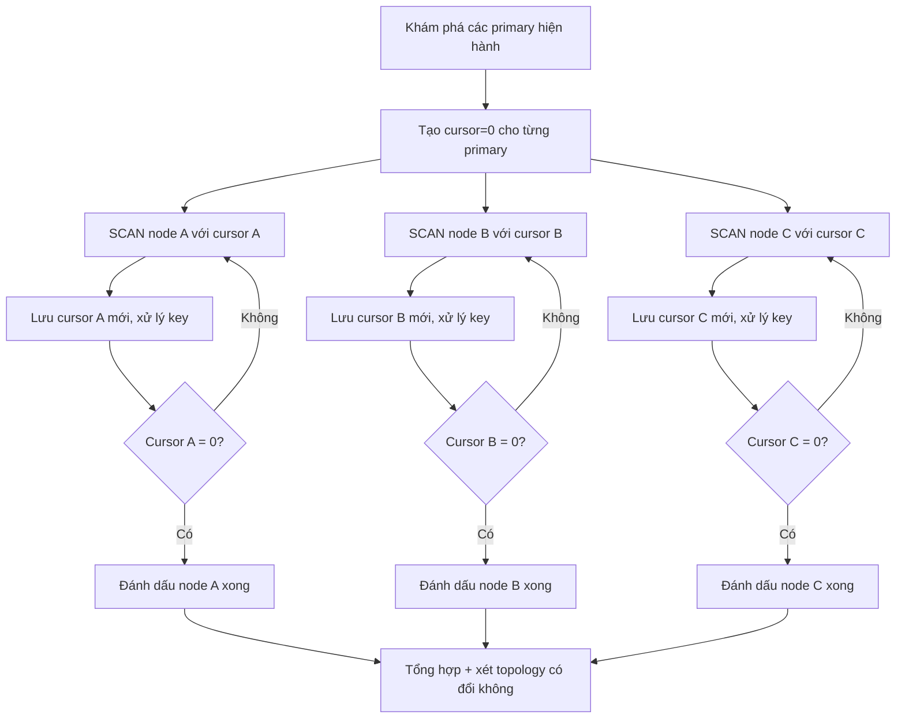
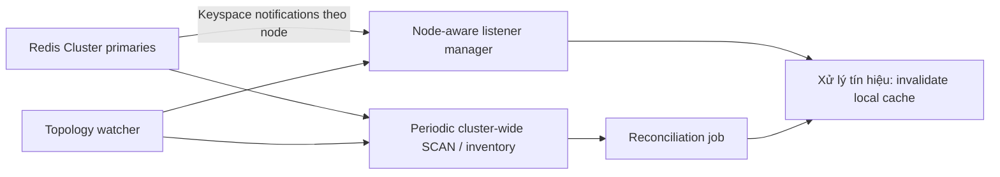

# Quét khóa và quản lý thông báo trên nhiều nút trong Redis Cluster với Spring Data Redis

## 1. Vấn đề: một Redis Cluster không phải một Redis server duy nhất

Khi dùng Redis standalone, ứng dụng thường kết nối một endpoint để đọc, ghi, quét key và đăng ký Pub/Sub. Với **Redis Cluster**, dữ liệu được phân chia giữa nhiều **primary node** theo **hash slot**. Các **replica node** nhận dữ liệu sao chép từ primary nhằm phục vụ nhu cầu sẵn sàng cao và, khi được cấu hình phù hợp, một số luồng đọc.

Vì vậy, hai thao tác tưởng như đơn giản phải được xem xét lại:

1. **Quét tất cả key có prefix nhất định:** chạy `SCAN` trên một node không có nghĩa đã xem toàn bộ key của cluster.
2. **Lắng nghe key được tạo, thay đổi, xóa hoặc hết hạn:** một subscription nhận **keyspace notification** từ một node không mặc nhiên đại diện cho những thông báo phát trên các node khác.

Ví dụ cụm có ba primary:

```text
                         Spring Data Redis
                                 |
                   Cluster-aware connection
                                 |
        +------------------------+------------------------+
        |                        |                        |
        v                        v                        v
   Primary A                 Primary B                Primary C
   slots 0..5460             slots 5461..10922        slots 10923..16383
   app:user:12               app:user:42              app:user:78
   app:cart:1                app:cart:2               app:cart:3
        |                        |                        |
     Replica A                Replica B                Replica C
```

Các dải slot và tên key chỉ có tính minh họa. Trong thực tế, phân phối slot có thể thay đổi khi rebalance, reshard hoặc failover.

Nếu ứng dụng quét Primary A, kết quả **không chứa toàn bộ key ở B và C**. Nếu listener chỉ subscribe keyspace event ở A, ứng dụng cũng có nguy cơ **bỏ lỡ những thay đổi ở B và C**.

Bài này giới thiệu cách thao tác đúng trong Spring Data Redis: hiểu phạm vi từng lệnh, quét per-node, tạo và duy trì listener, xử lý topology change, cùng các giới hạn độ nhất quán và khả năng mất sự kiện.

## 2. Hash slot quyết định khóa nằm ở node nào

Redis Cluster chia keyspace thành **16.384 hash slot**, đánh số từ `0` đến `16383`. Redis tính slot của key và chuyển lệnh tới primary đang sở hữu slot đó.

```text
Key: app:profile:42
          |
          v
      CRC16-based hash
          |
          v
slot = CRC16(key) mod 16384
          |
          v
Primary đang sở hữu slot
```

Với *hash tag*, chỉ phần giữa cặp ngoặc nhọn hợp lệ đầu tiên được dùng để tính slot:

```text
cart:{order42}:items
cart:{order42}:summary

Hai key có cùng hash tag "order42"
-> cùng hash slot
-> có thể phục vụ một số lệnh nhiều key trong cluster.
```

Định tuyến theo slot rất phù hợp cho `GET`, `SET` hoặc lệnh theo key đã biết. Nhưng các lệnh **không chỉ rõ một key duy nhất**, như `SCAN`, cần cách suy nghĩ khác: Redis không có một cursor SCAN thống nhất cho toàn bộ các node.

### Tên key đã biết khác bài toán tìm mọi key

Nếu cần đọc `app:profile:42`, hãy dùng client cluster-aware và truy cập key trực tiếp:

```java
String value = stringRedisTemplate
        .opsForValue()
        .get("app:profile:42");
```

Driver và connection layer định tuyến thao tác tới node sở hữu slot. **Không cần quét cluster để tìm một key đã biết tên**.

Nếu cần liệt kê tất cả key `app:profile:*` để đối soát dữ liệu, khi đó mới cần bài toán scan nhiều primary.

## 3. Vì sao không nên dùng `KEYS *` để quét cluster?

Redis có lệnh:

```redis
KEYS app:profile:*
```

Lệnh `KEYS` thực hiện liệt kê trong phạm vi node đang xử lý; nó có thể chặn Redis server trong thời gian đáng kể nếu keyspace lớn. Trong cluster, một số API client cấp cao có thể có logic gửi lệnh tới nhiều node và tổng hợp kết quả, nhưng **không được giả định mọi cách gọi `KEYS` đều quét toàn cluster**, và dù có tổng hợp, việc dùng `KEYS` trên từng primary vẫn có thể gây tải lớn.

So sánh:

| Tiêu chí | `KEYS pattern` | `SCAN cursor MATCH pattern COUNT hint` |
| --- | --- | --- |
| Cách trả kết quả | Trả danh sách kết quả một lần trên node được hỏi | Duyệt theo nhiều lượt với cursor |
| Tải trên server | Có thể tạo một thao tác dài/chặn các lệnh khác | Cho phép chia nhỏ công việc |
| Thích hợp production keyspace lớn | Thường không | Phù hợp hơn nếu kiểm soát nhịp quét |
| Phạm vi mặc định của Redis command | Node được hỏi | Node được hỏi |
| Có ảnh chụp nhất quán khi dữ liệu thay đổi? | Không nên coi là transaction/snapshot toàn cluster | Không; có thể lặp/bỏ lỡ key khi tập dữ liệu đang biến động |
| Cách biết đã hoàn tất | Command kết thúc | Cursor của **mỗi node** quay về `0` |

**Khuyến nghị:** dùng `SCAN` với nhịp quét có giới hạn để duyệt keyspace lớn; tránh `KEYS *` trong đường request phục vụ người dùng hoặc tác vụ vận hành trên Redis production.

Một trường hợp có thể tối ưu khác: nếu ứng dụng đã lưu danh sách ID trong một Redis Set, Sorted Set hoặc một index đáng tin cậy, việc duyệt cấu trúc đó thường rõ ràng và ít tốn tài nguyên hơn quét toàn keyspace.

## 4. Redis `SCAN` là phép duyệt theo cursor, không phải snapshot

Cú pháp:

```redis
SCAN 0 MATCH app:profile:* COUNT 200
```

Redis trả một cursor mới và một nhóm key. Client phải gửi lại cursor nhận được cho tới khi Redis trả cursor `0`.

Ví dụ đơn giản:

```text
SCAN 0   -> cursor 142, keys [app:profile:12, app:profile:13]
SCAN 142 -> cursor 68,  keys [app:profile:42]
SCAN 68  -> cursor 0,   keys [app:profile:78]

Đã hoàn tất một lượt quét node này.
```

Cursor là token của một vòng duyệt trên **một Redis node**. Không dùng cursor của Primary A đem sang Primary B, và không gộp các cursor thành một con số duy nhất để đại diện cả cluster.

### Bốn tính chất cần nhớ

1. **`COUNT` chỉ là gợi ý công việc mỗi lượt**, không bảo đảm mỗi response trả đúng số key yêu cầu. Có lượt trả ít key hoặc không có key dù cursor chưa trở về 0.
2. **`MATCH` lọc theo pattern**, không tạo một index truy vấn theo prefix. Redis vẫn phải duyệt keyspace theo thuật toán SCAN; một prefix hẹp không đồng nghĩa luôn có chi phí cố định nhỏ.
3. **Một key có thể được trả nhiều lần** trong một vòng quét; xử lý nên idempotent hoặc có deduplication phù hợp.
4. **Tập key thay đổi trong quá trình quét không có snapshot**: key được tạo/xóa/expire trong lúc duyệt có thể được thấy hoặc không; chỉ có những đảm bảo giới hạn đối với tập phần tử tồn tại ổn định trong toàn bộ quá trình duyệt.

Điều này càng quan trọng trên Redis Cluster vì topology có thể thay đổi giữa các lượt quét.

### Redis có thể trả một trang rỗng

Ví dụ:

```text
cursor = 612
keys   = []
```

Vẫn phải tiếp tục bằng cursor `612` nếu cursor khác `0`. Đừng dừng khi danh sách key của một lượt rỗng.

### Quét theo data type nếu cần

Trên phiên bản Redis hỗ trợ `SCAN TYPE`, có thể dùng:

```redis
SCAN 0 MATCH app:profile:* COUNT 200 TYPE hash
```

Thao tác này chỉ lấy key có Redis type phù hợp tại lúc được kiểm tra. Nó không thay thế yêu cầu quét từng primary trong cluster, và dữ liệu vẫn có thể thay đổi sau khi key được trả về.

## 5. Quy trình quét tất cả primary trong cluster

Một kế hoạch vận hành rõ ràng:

1. **Khám phá topology hiện tại** của cluster và danh sách các primary đang sở hữu slot.
2. **Tạo một cursor riêng cho từng primary**, bắt đầu từ `0`.
3. Trên mỗi primary, gọi `SCAN` theo pattern/COUNT phù hợp cho tới khi cursor của node đó trả `0`.
4. Xử lý mỗi key theo logic **idempotent** vì SCAN có thể trả trùng.
5. Giới hạn concurrency và tần suất để không tạo burst lên các primary.
6. Khi topology thay đổi đáng kể, ghi nhận rằng kết quả có thể thiếu/trùng và cân nhắc chạy một lượt đối soát mới.
7. Hoàn tất khi mọi node trong **topology đang được quét** đã đạt cursor `0`, không chỉ node đầu tiên.

Sơ đồ:



### Vì sao ưu tiên quét primary?

Replica chứa bản sao của key đã replicate. Nếu đồng thời quét cả primary và replica để “tìm tất cả key”, phần lớn key có thể bị đếm nhiều lần; replica còn có khả năng chậm hơn primary hoặc đang đồng bộ lại. Đối với bài toán inventory của logical keyspace, thông thường **quét các primary hiện sở hữu slot**, không quét mọi node bất kể role.

Trong tình huống failover hoặc phục hồi cluster, danh sách primary có thể thay đổi. Vì vậy không hardcode rằng một host sẽ luôn đóng vai trò primary.

## 6. Thử quét nhiều node bằng Redis CLI

Giả sử môi trường thử nghiệm có ba primary tại các cổng `7000`, `7001` và `7002` trên localhost. Địa chỉ chỉ có tính minh họa.

Xem topology:

```bash
redis-cli -c -p 7000 CLUSTER NODES
redis-cli -c -p 7000 CLUSTER SLOTS
```

`CLUSTER NODES` cho biết địa chỉ, role và slot; `CLUSTER SLOTS` hoặc lệnh topology tương ứng của phiên bản Redis cung cấp phân bố slot hiện hành. Khi có failover, không mặc định cổng/host được gán role như lúc khởi tạo.

Sau khi ghi một số key thử nghiệm bằng client cluster-aware:

```bash
redis-cli -c -p 7000 SET app:profile:12 ACTIVE
redis-cli -c -p 7000 SET app:profile:42 PENDING
redis-cli -c -p 7000 SET app:profile:78 ACTIVE
```

Quét từng primary:

```bash
redis-cli -p 7000 SCAN 0 MATCH 'app:profile:*' COUNT 100
redis-cli -p 7001 SCAN 0 MATCH 'app:profile:*' COUNT 100
redis-cli -p 7002 SCAN 0 MATCH 'app:profile:*' COUNT 100
```

**Đây là những lượt đầu**, không phải toàn bộ vòng quét. Phải dùng cursor được trả từ mỗi node cho những lượt tiếp theo.

`redis-cli -c` hỗ trợ tự chuyển hướng theo cluster slot cho nhiều lệnh có key cụ thể. Nhưng **không được hiểu rằng một câu `SCAN 0` chạy với `-c` sẽ tự quét tất cả primary**. SCAN không có một key slot để client redirect thành “cluster-wide scan”.

Nếu Redis không chạy tại localhost hoặc các primary có authentication/TLS, điều chỉnh các thông số kết nối phù hợp, không đưa secret trực tiếp vào tài liệu vận hành.

## 7. Quét qua Spring Data Redis: `RedisClusterConnection`

Spring Data Redis cung cấp các API làm việc với Redis Cluster, gồm `RedisClusterConnection` và thông tin `RedisClusterNode`. Khi cần chủ động quét đúng từng node, có thể dùng overload `scan(node, scanOptions)` của cluster connection.

Ví dụ sau minh họa một lượt quét toàn cụm **theo các primary khám phá tại thời điểm bắt đầu**, xử lý kết quả dạng String:

```java
import java.nio.charset.StandardCharsets;
import java.util.HashSet;
import java.util.Set;

import org.springframework.data.redis.connection.RedisClusterConnection;
import org.springframework.data.redis.connection.RedisClusterNode;
import org.springframework.data.redis.connection.RedisConnectionFactory;
import org.springframework.data.redis.core.Cursor;
import org.springframework.data.redis.core.ScanOptions;

public class ClusterKeyScanner {

    private final RedisConnectionFactory connectionFactory;

    public ClusterKeyScanner(RedisConnectionFactory connectionFactory) {
        this.connectionFactory = connectionFactory;
    }

    public Set<String> scanProfileKeys() {
        ScanOptions options = ScanOptions.scanOptions()
                .match("app:profile:*")
                .count(200)
                .build();

        Set<String> result = new HashSet<>();

        try (RedisClusterConnection connection =
                     connectionFactory.getClusterConnection()) {

            for (RedisClusterNode node : connection.clusterGetNodes()) {
                if (!node.isMaster()) {
                    continue; // Bỏ qua các replica.
                }

                try (Cursor<byte[]> cursor =
                             connection.scan(node, options)) {
                    while (cursor.hasNext()) {
                        byte[] rawKey = cursor.next();

                        // Chỉ đúng nếu key được lưu dưới dạng UTF-8 text.
                        String key = new String(
                                rawKey, StandardCharsets.UTF_8);
                        result.add(key);
                    }
                }
            }
        }

        return result;
    }
}
```

**Hợp đồng của ví dụ:**

- Connection factory phải thật sự được cấu hình cho Redis Cluster; code không có ý nghĩa khi backend là standalone mà không hỗ trợ cluster connection.
- `clusterGetNodes()` trả các node mà kết nối cluster biết theo topology; trong ứng dụng thực tế cần kiểm soát lỗi khi node không sẵn sàng và refresh topology.
- Chỉ quét những node `isMaster()`, tránh đếm trùng vì replica.
- `ScanOptions` cấu hình pattern và gợi ý COUNT; `Cursor<byte[]>` phải được đóng.
- Chuyển byte key sang UTF-8 chỉ phù hợp nếu key serializer của ứng dụng thống nhất theo text. Với key serializer khác, dùng đúng serializer để giải mã.
- `Set<String>` là cách deduplication đơn giản cho demo; **không phù hợp nếu tập key cực lớn** vì kéo toàn bộ inventory về RAM ứng dụng.

Tùy phiên bản Spring Data Redis và driver, chữ ký/khả năng hỗ trợ lệnh cluster-specific có thể khác; khi triển khai, đối chiếu API của phiên bản đang dùng. Mục tiêu của mẫu là thể hiện logic quét **theo node**, không cam kết một vòng quét là snapshot toàn cluster.

### Xử lý theo từng trang để giảm bộ nhớ

Trong ứng dụng thật, thay vì lưu mọi key vào `HashSet`, có thể xử lý từng key khi cursor trả về:

```java
try (Cursor<byte[]> cursor = connection.scan(node, options)) {
    while (cursor.hasNext()) {
        byte[] raw = cursor.next();
        String key = new String(raw, StandardCharsets.UTF_8);

        inventoryHandler.accept(key);  // Phải idempotent.
    }
}
```

`inventoryHandler` là callback do ứng dụng cung cấp. Nếu mỗi key được xử lý bằng thao tác network chậm, tránh vô tình giữ một connection/cursor mở quá lâu; cần giới hạn tốc độ, timeout và kế hoạch resume khi lỗi.

### Đừng dùng scan để thay thế query nghiệp vụ có index

Nếu nghiệp vụ thường xuyên cần “liệt kê toàn bộ đơn hàng thuộc tenant 42”, việc SCAN theo prefix mỗi request thường quá tốn kém. Nên duy trì một tập ID/index ở Redis hoặc một database/query engine phù hợp, đồng thời có cơ chế bảo đảm index không lệch khỏi dữ liệu gốc.

SCAN thích hợp hơn cho kiểm kê, bảo trì, chẩn đoán và đối soát có kiểm soát.

## 8. Các giới hạn của lượt quét trong lúc reshard và failover

Một lượt SCAN không có snapshot, và Redis Cluster còn có thể **di chuyển slot giữa primary**.

Ví dụ:

```text
t0: key app:profile:42 thuộc Primary A
t1: scanner đã quét qua phần keyspace chứa key ở A
t2: reshard chuyển slot của key sang Primary B
t3: scanner đã quét xong B trước khi slot chuyển tới
```

Trong trường hợp này, key có thể bị bỏ lỡ bởi lượt inventory. Ở một thứ tự khác, một key có thể xuất hiện hai lần ở A và B.

Failover cũng có thể thay đổi node nào là primary. Nếu scanner bắt đầu với danh sách node cũ, một node có thể không còn giữ role hoặc không còn tiếp nhận connection như trước.

### Giảm rủi ro

- Đối với job inventory quan trọng, cân nhắc chạy khi topology ổn định hoặc có cửa sổ bảo trì.
- Ghi lại cluster topology/slot ownership trước và sau lượt quét; nếu thay đổi, đánh dấu kết quả cần reconcile.
- Thiết kế xử lý key **idempotent** và không dựa vào đúng-một-lần.
- Nếu cần một tập dữ liệu chính xác, ổn định tại một thời điểm, dùng nguồn dữ liệu/index bền vững hoặc giao thức snapshot theo yêu cầu nghiệp vụ.
- Nếu scan chỉ nhằm dọn key cũ, kiểm tra lại điều kiện ngay trước khi xóa. Không xóa một key chỉ vì nó xuất hiện trong danh sách cách đây nhiều phút.
- Khi gặp `MOVED`, `ASK`, timeout hoặc lỗi kết nối, cập nhật topology theo cơ chế driver, rồi chạy lại phần công việc có kiểm soát thay vì ghép cursor cũ tùy ý với node khác.

**Không coi kết quả quét một lần là bằng chứng chắc chắn rằng một key không tồn tại ở bất cứ đâu trong cluster** nếu có cập nhật/reshard đồng thời.

## 9. Keyspace notifications trong Redis Cluster khác Pub/Sub thông thường

Redis có cơ chế **keyspace notifications**: khi loại sự kiện được bật, node xử lý thay đổi có thể phát thông điệp Pub/Sub về việc key được ghi, xóa, hết hạn hoặc eviction.

Hai định dạng phổ biến:

```text
Keyevent:
  channel = __keyevent@0__:set
  payload = app:profile:42

Keyspace:
  channel = __keyspace@0__:app:profile:42
  payload = set
```

Trong Redis Cluster, database logic thường là DB 0. Dấu `@0` là một phần trong quy ước tên channel.

**Điểm khác biệt quan trọng:** keyspace notifications được phát tại **node nơi sự kiện key xảy ra** và **không được tự broadcast như một sự kiện cluster-wide cho toàn bộ các node**. Muốn quan sát đủ các key phân tán trên nhiều primary, client cần đăng ký trên **các node liên quan**.

Điều này khác với cách **Pub/Sub thông thường** qua `PUBLISH/SUBSCRIBE` hoạt động trong Redis Cluster. Không thể suy từ việc một channel ứng dụng tự `PUBLISH` được lan truyền trong cluster rằng mọi `__keyevent@0__:*` cũng sẽ được chuyển qua một subscription tại một node bất kỳ.

### Ví dụ ba primary

```text
Primary A: có app:profile:12
Primary B: có app:profile:42
Primary C: có app:profile:78

Spring listener chỉ subscribe __keyevent@0__:set tại Primary A

SET app:profile:12 ACTIVE  -> có thể nhận thông báo ở listener A
SET app:profile:42 ACTIVE  -> event được tạo ở B, listener A không tự thấy
SET app:profile:78 ACTIVE  -> event được tạo ở C, listener A không tự thấy
```

Muốn bao phủ ba primary, cần duy trì subscription phù hợp tới A, B và C, đồng thời xử lý topology change khi một replica được promote hoặc slot được chuyển.

## 10. Bật `notify-keyspace-events` trên từng node cần theo dõi

Mặc định Redis có thể chưa bật keyspace notifications. Kiểm tra:

```redis
CONFIG GET notify-keyspace-events
```

Cờ cấu hình tiêu biểu:

| Cờ | Ý nghĩa |
| --- | --- |
| `K` | Phát channel dạng keyspace, tên key ở channel. |
| `E` | Phát channel dạng keyevent, tên sự kiện ở channel. |
| `$` | Nhóm sự kiện String như `SET`. |
| `h` | Nhóm sự kiện Hash như `HSET`. |
| `g` | Nhóm sự kiện generic như `DEL`. |
| `x` | Key thực sự hết hạn, sự kiện `expired`. |
| `e` | Key bị loại bởi chính sách eviction. |
| `A` | Bí danh cho nhiều nhóm sự kiện; dùng cùng `K` hoặc `E`. |

Ví dụ chỉ quan sát key hết hạn theo keyevent:

```redis
CONFIG SET notify-keyspace-events Ex
```

Ví dụ theo dõi cả keyspace và keyevent cho String, Hash, delete, expire và eviction trong Redis test:

```redis
CONFIG SET notify-keyspace-events 'KE$ghxe'
```

**Trong Redis Cluster, cấu hình notification là cấu hình của từng Redis server, không phải một toggle tự động lan tới mọi node.** Cần kiểm tra và áp dụng tại những node phù hợp theo cách quản trị Redis của môi trường.

Không chạy `CONFIG SET` trên hệ thống production dùng chung nếu chưa kiểm tra cấu hình hiện hữu: một giá trị mới có thể vô tình tắt nhóm event mà dịch vụ khác đang cần. Với managed Redis, cấu hình thông qua parameter group hoặc công cụ của nhà cung cấp vì lệnh `CONFIG` có thể bị chặn.

### Một Redis node mới có được kế thừa cấu hình không?

Không được giả định. Khi thêm node, thay instance hoặc chuyển môi trường, cấu hình Redis server cần được provision từ hệ thống quản lý cấu hình. Ứng dụng nên có phép kiểm tra lúc khởi động/giám sát để phát hiện node chưa bật notification cần thiết.

Nếu chỉ bật `Ex` trên Primary A còn B và C chưa bật, subscribe đúng tất cả primary vẫn chưa đủ: những node không phát `expired` thì subscriber không nhận được event từ chúng.

## 11. Chọn kênh keyevent hay keyspace cho bài toán nhiều node

### 11.1. Keyevent: dễ lọc loại sự kiện

Ví dụ:

```redis
PSUBSCRIBE __keyevent@0__:*
```

Khi node phát:

```text
channel = __keyevent@0__:del
body    = app:profile:42
```

Listener biết ngay loại event qua channel, nhưng phải lọc prefix key trong code.

### 11.2. Keyspace: dễ lọc namespace theo tên key

Ví dụ:

```redis
PSUBSCRIBE __keyspace@0__:app:profile:*
```

Khi node phát:

```text
channel = __keyspace@0__:app:profile:42
body    = del
```

Listener chỉ nhận những channel có key nằm trong prefix phù hợp. Điều này có thể giảm lưu lượng gửi tới ứng dụng nếu nhiều key khác cùng tồn tại trên node.

### 11.3. Bảng so sánh

| Đặc điểm | Keyevent | Keyspace |
| --- | --- | --- |
| Tên key nằm ở | Payload | Channel |
| Tên event nằm ở | Channel | Payload |
| Pattern theo loại event | Thuận tiện | Thường phải lọc payload |
| Pattern theo prefix key | Thường phải lọc payload | Thuận tiện |
| Tự động nhận mọi node cluster? | Không | Không |
| Tự lưu message để phát lại khi reconnect? | Không | Không |
| Mang value cũ/mới của key? | Không | Không |

Nếu ứng dụng đăng ký cả hai dạng cho cùng thay đổi, có thể phản ứng trùng. Thông thường nên chọn một dạng dựa trên nhu cầu lọc, hoặc thiết kế handler idempotent nếu cần cả hai.

## 12. Đăng ký listener Spring Data Redis trên một node

Spring Data Redis dùng:

- `MessageListener`: callback nhận một thông điệp và channel.
- `RedisMessageListenerContainer`: quản lý Pub/Sub connection, subscription và callback.
- `ChannelTopic`: subscribe chính xác một channel.
- `PatternTopic`: subscribe theo pattern.

Ví dụ listener cho keyspace notification trên namespace `app:profile:`:

```java
package com.example.rediscluster;

import java.nio.charset.StandardCharsets;

import org.slf4j.Logger;
import org.slf4j.LoggerFactory;
import org.springframework.data.redis.connection.Message;
import org.springframework.data.redis.connection.MessageListener;
import org.springframework.stereotype.Component;

@Component
public class ProfileKeyspaceListener implements MessageListener {

    private static final Logger log =
            LoggerFactory.getLogger(ProfileKeyspaceListener.class);

    private static final String PREFIX =
            "__keyspace@0__:app:profile:";

    @Override
    public void onMessage(Message message, byte[] pattern) {
        String channel = new String(
                message.getChannel(), StandardCharsets.UTF_8);
        String operation = new String(
                message.getBody(), StandardCharsets.UTF_8);

        if (!channel.startsWith(PREFIX)) {
            return;
        }

        String profileId = channel.substring(PREFIX.length());

        switch (operation) {
            case "set", "hset" -> onChanged(profileId);
            case "del", "expired", "evicted" -> onUnavailable(profileId);
            default -> {
                // Bỏ qua sự kiện không quan tâm.
            }
        }
    }

    private void onChanged(String profileId) {
        // Ví dụ invalidate một bản cache cục bộ.
        // Không giả định event mang theo trạng thái dữ liệu mới.
        log.debug("Profile key changed");
    }

    private void onUnavailable(String profileId) {
        // Key không còn, hoặc cần đọc nguồn dữ liệu lại.
        log.debug("Profile key became unavailable");
    }
}
```

Mẫu dùng tên key UTF-8. Nếu ứng dụng sử dụng key serializer nhị phân, không được giải mã tùy tiện sang String.

Đăng ký vào container:

```java
import org.springframework.context.annotation.Bean;
import org.springframework.context.annotation.Configuration;
import org.springframework.data.redis.connection.RedisConnectionFactory;
import org.springframework.data.redis.listener.PatternTopic;
import org.springframework.data.redis.listener.RedisMessageListenerContainer;

@Configuration
public class NodeKeyspaceListenerConfig {

    @Bean
    RedisMessageListenerContainer keyspaceContainer(
            RedisConnectionFactory nodeConnectionFactory,
            ProfileKeyspaceListener listener) {

        RedisMessageListenerContainer container =
                new RedisMessageListenerContainer();

        container.setConnectionFactory(nodeConnectionFactory);
        container.addMessageListener(
                listener,
                new PatternTopic("__keyspace@0__:app:profile:*"));

        return container;
    }
}
```

**Đoạn trên chỉ mô tả một subscription qua connection factory được cung cấp.** Trong cluster, một container có connection factory trỏ tới một endpoint **không tự bảo đảm** đã subscribe mọi primary. Muốn đủ phạm vi, cần chiến lược node-aware subscription và kiểm chứng bằng integration test đa node.

## 13. Quản lý một listener cho mỗi primary: chiến lược kiến trúc

Một phương án dễ kiểm soát là quản lý **node-specific Pub/Sub connection** trên từng primary hiện hành. Mỗi connection/container subscribe cùng pattern tại node mà nó theo dõi.

```text
                    Topology watcher / coordinator
                          |
             Tìm các primary hiện hành
                          |
            +-------------+-------------+
            |             |             |
       Container A    Container B   Container C
       connect A      connect B     connect C
       pattern P      pattern P     pattern P
            |             |             |
       Primary A      Primary B     Primary C
            \             |             /
                 ProfileKeyspaceListener
                          |
                   invalidate / metric
```

Quy trình:

1. Khám phá danh sách primary và địa chỉ node có thể kết nối từ môi trường ứng dụng.
2. Tạo subscription trực tiếp tới từng primary, dùng cùng pattern cần lắng nghe.
3. Gắn node identity hoặc connection identity vào log/metric của tầng quản lý subscription.
4. Theo dõi tình trạng kết nối, reconnect và lỗi callback.
5. Định kỳ refresh topology hoặc nhận tín hiệu topology change từ driver/monitoring.
6. Khi có primary mới (promote, reshard, scale-out), bảo đảm có subscription cho node mới.
7. Khi node cũ không còn role phù hợp, loại subscription cũ theo chính sách; tránh vừa bỏ node cũ quá sớm vừa chưa subscribe node mới.
8. Dùng handler idempotent để chịu được event trùng trong thời gian overlap.

**Quan trọng:** tránh tạo rất nhiều `RedisMessageListenerContainer` tạm thời mà không quản lý lifecycle. Với ứng dụng Spring, nên dùng bean hoặc một coordinator có cơ chế start/stop/destroy rõ ràng, giới hạn connection và executor, đồng thời quản lý danh tính node ổn định.

### Dùng connection factory gắn một node

Nếu cần cấu hình một Redis node cố định cho Pub/Sub trong môi trường thử nghiệm, có thể tạo một `LettuceConnectionFactory` dùng standalone host/port để subscribe trực tiếp tới node đó:

```java
import org.springframework.context.annotation.Bean;
import org.springframework.context.annotation.Configuration;
import org.springframework.data.redis.connection.RedisStandaloneConfiguration;
import org.springframework.data.redis.connection.lettuce.LettuceConnectionFactory;

@Configuration
public class NodeAConnectionConfig {

    @Bean
    LettuceConnectionFactory nodeARedisConnectionFactory() {
        RedisStandaloneConfiguration node =
                new RedisStandaloneConfiguration("redis-node-a", 7000);

        return new LettuceConnectionFactory(node);
    }
}
```

Bean này **không thay thế cluster-aware connection factory dùng cho thao tác dữ liệu**; đây là ví dụ về kết nối trực tiếp một node. Trong production cần xử lý authentication, TLS, lifecycle, địa chỉ công bố nội bộ/NAT và thay đổi topology. Không gắn mọi listener vào một host cố định rồi coi hệ thống được theo dõi toàn cluster.

Với nhiều node, cấu hình tương ứng có thể được quản lý bởi một coordinator phát hiện topology và tạo resource theo chính sách ứng dụng, thay vì viết cứng ba bean cho ba node trong một cluster hay thay đổi.

## 14. Vì sao failover có thể làm mất phạm vi lắng nghe?

Giả sử:

```text
Ban đầu:
  Primary A: slots 0..5000
  Replica A1: sao chép từ A
  Listener: subscribe tại A

Khi A lỗi:
  Replica A1 được promote thành primary mới
  Slot 0..5000 chuyển sang A1
  Client ghi key thuộc slot này tại A1
```

Nếu ứng dụng không subscribe tới A1, những keyspace notification mới do A1 phát sẽ không được listener cũ nhìn thấy. Một client Redis Cluster có thể tự chuyển hướng các lệnh `GET`/`SET` theo topology mới, nhưng cơ chế routing data command **không tự đồng nghĩa** với việc những Pub/Sub subscription per-node đã được tạo lại đầy đủ.

Vì vậy cần:

- Quan sát các sự kiện thay đổi topology hoặc refresh theo chu kỳ.
- Khởi tạo subscription cho node mới được promote.
- Kiểm tra lại `notify-keyspace-events` tại node đó.
- Chấp nhận giai đoạn chuyển tiếp có thể thiếu/trùng thông báo.
- Có cơ chế đối soát để sửa trạng thái ứng dụng sau sự cố.

### Reshard cũng tác động

Khi một slot được chuyển từ A sang B, những thay đổi đối với key trong slot sẽ được xử lý tại node sở hữu mới. Nếu subscriber chỉ nghe A, nó có thể bỏ lỡ event sau khi slot chuyển. Theo dõi **tất cả primary hiện hành** giúp giảm rủi ro này, nhưng không làm Pub/Sub trở thành dòng sự kiện bền vững.

## 15. Keyspace notifications là Pub/Sub at-most-once, không phải change log

Redis keyspace notifications không lưu lịch sử để subscriber offline nhận lại. Nếu ứng dụng ngắt mạng trong lúc có 1.000 lệnh `SET`, những thông báo tương ứng có thể bị bỏ lỡ vĩnh viễn.

| Tình huống | Điều có thể xảy ra |
| --- | --- |
| Listener chưa start | Event phát trước thời điểm subscribe bị mất đối với listener đó. |
| Một primary bị mất kết nối | Event của node đó không có đường phát lại mặc định. |
| Primary failover | Có cửa sổ subscription cần chuyển sang primary mới. |
| Thay đổi key trong lúc scanner chạy | Scan có thể thấy hoặc bỏ lỡ key; không có snapshot. |
| Listener xử lý lỗi | Redis không retry message theo nghiệp vụ. |
| Nhiều instance cùng subscribe | Cùng event có thể được nhiều instance xử lý. |
| Listener subscribe cả keyevent lẫn keyspace | Một thay đổi có thể tạo hai callback phù hợp. |

Nếu mục tiêu chỉ là **invalidate local cache**, Pub/Sub best effort có thể đủ khi cache có TTL ngắn hoặc cơ chế đối soát.

Nếu mục tiêu là “mọi thay đổi phải được xử lý ít nhất một lần”, chỉ dùng keyspace notification là không đủ. Nên ghi business event vào **Redis Streams**, message broker bền vững hoặc transactional outbox cùng cơ sở dữ liệu nguồn.

### Chỉ quét + nghe sự kiện vẫn chưa tạo snapshot tuyệt đối

Một thiết kế có thể định làm:

```text
1. Quét SCAN để biết danh sách key hiện có.
2. Subscribe notifications để nghe các thay đổi về sau.
```

Có thể tồn tại khoảng hở **giữa lần quét và lúc subscribe**. Nếu đổi thứ tự:

```text
1. Subscribe trước.
2. Quét sau.
```

cửa sổ hở có thể nhỏ hơn trong lúc cả hai cùng hoạt động, nhưng vẫn còn yêu cầu xử lý event trùng, trạng thái thay đổi khi quét, failover, mất kết nối và đảm bảo subscription đã sẵn sàng trên mọi primary. Không thể suy ra một “ảnh chụp tuyệt đối đúng” chỉ bằng cách kết hợp hai kỹ thuật best effort.

Khi cần trạng thái chính xác và có thể replay, hãy dùng nguồn dữ liệu có transaction/version hoặc log sự kiện bền vững, kết hợp cơ chế đối soát theo watermark/sequence phù hợp.

## 16. Đọc lại key từ listener: dữ liệu có thể đã đổi tiếp

Giả sử listener nhận:

```text
__keyevent@0__:hset
app:profile:42
```

Sau đó ứng dụng đọc Hash:

```java
Map<Object, Object> snapshot =
        stringRedisTemplate.opsForHash()
                .entries("app:profile:42");
```

Kết quả là **trạng thái tại lúc đọc**, không phải snapshot được gửi kèm event.

Giữa lúc Redis phát `hset` và lúc handler đọc lại, một writer khác có thể sửa Hash, xóa key hoặc chuyển TTL. Trên cluster, re-routing/replication còn có thể khiến việc đọc từ replica quan sát trạng thái cũ. Nếu mục tiêu cập nhật local cache, thường nên đọc primary hoặc nguồn dữ liệu có tính nhất quán phù hợp.

Thông báo thông thường chỉ cho biết **tên key và loại thao tác**; không chỉ rõ field nào vừa đổi hoặc value trước/sau. Nếu cần payload chi tiết, dùng business event do ứng dụng phát từ logic cập nhật hoặc một cơ chế CDC/event log phù hợp.

### Hết hạn và eviction

- `expired`: Redis thực sự loại key do TTL hết hạn. Sự kiện không nhất thiết xuất hiện đúng mili giây khi TTL chạm 0.
- `evicted`: Redis loại key theo chính sách bộ nhớ.
- `del`: key bị xóa theo thao tác xóa tương ứng.

Nếu muốn quan sát “key biến mất” cần xét nhiều nguyên nhân thay vì chỉ subscribe `del`. Nhưng không dùng event đó làm scheduler bảo đảm đúng hạn.

## 17. Liệt kê key bằng scan và xóa: tránh race condition

Một anti-pattern:

```text
SCAN app:session:*  -> lấy app:session:42
Kiểm tra key cũ từ dữ liệu đã đọc
Chờ vài giây
DEL app:session:42
```

Trong lúc chờ, key có thể đã bị xóa và tạo lại cùng tên cho một phiên mới. `DEL` mù quáng có thể xóa dữ liệu không còn thuộc đối tượng cần dọn ban đầu.

Nếu cần dọn theo trạng thái:

1. Quét key như **danh sách ứng viên**.
2. Đọc trạng thái/version/TTL hiện tại trước khi can thiệp.
3. Nếu điều kiện phải nguyên tử, dùng Lua script kiểm tra rồi xóa/cập nhật trên server.
4. Xử lý trường hợp key chuyển slot giữa lúc quét và lúc ghi.
5. Log số ứng viên, số key thực sự thay đổi và số lỗi/retry.

Trong Redis Cluster, script nhiều key còn phải đáp ứng cùng hash slot. Tránh tạo tên key động từ `ARGV` trong Lua thay vì công khai danh sách key.

Quét toàn cụm để dọn dữ liệu quá hạn thường không cần thiết nếu key đã có TTL đúng và Redis tự expiration. Chỉ dùng scan khi có lý do vận hành cụ thể hoặc cần đối soát những key không tuân thủ TTL.

## 18. Quản lý quyền Redis ACL cho scan và listener

Tài khoản dùng để quét key và tài khoản dùng để subscribe notification có thể cần quyền khác nhau.

| Nhiệm vụ | Nhóm quyền cần cân nhắc |
| --- | --- |
| Quét keyspace | Lệnh `SCAN`, quyền cần thiết cho các thao tác đọc thêm như `TYPE`/`TTL` và phạm vi key được cho phép |
| Đọc value của key vừa quét | `GET`, `HGETALL` hoặc lệnh đọc tùy data type |
| Lắng nghe keyevent/keyspace | `SUBSCRIBE`/`PSUBSCRIBE` và quyền channel pattern phù hợp |
| Chỉnh `notify-keyspace-events` | Quyền quản trị `CONFIG`, thường chỉ cấp cho hệ thống vận hành |
| Thực hiện xóa theo kết quả quét | `DEL`/`UNLINK` hoặc script thích hợp, phải tách khỏi role chỉ quan sát |

Redis ACL có khái niệm **key pattern** và **channel pattern** khác nhau. Quyền đọc key `app:*` không tự đồng nghĩa được subscribe tất cả `__keyevent@0__:*`; ngược lại, subscribe channel thông báo có thể làm lộ **tên key** dù subscriber không được phép đọc value.

Không sử dụng một Redis user có `+@all` cho cả inventory và subscriber nếu chính sách bảo mật không đòi hỏi. Cần hạn chế namespace, định danh, TLS và các endpoint được phép kết nối.

### Thận trọng với dữ liệu nhạy cảm trong tên key

Keyspace event có thể lộ:

```text
session:user-id
password-reset:token
tenant:customer-id
```

Không đặt token bí mật trực tiếp trong key name khi không cần thiết. Không ghi toàn bộ body notification vào log dài hạn nếu nó có thể chứa định danh nhạy cảm; thay bằng hash, prefix hoặc thông tin đã được phép quan sát.

## 19. Hiệu năng và kế hoạch capacity

Quét keyspace và subscribe event có mẫu tải khác nhau:

- **SCAN:** công việc tốn tài nguyên theo số lượng key được duyệt, số lần round-trip, `MATCH` và thời gian một vòng quét; cần giới hạn nhịp.
- **Keyspace notifications:** chi phí tăng theo tốc độ các sự kiện được bật, số subscriber và độ rộng pattern; khi ghi nhiều, số callback có thể tăng rất nhanh.
- **Topology watcher:** refresh quá thường xuyên tạo thêm lệnh quản trị; quá ít lại có thể bỏ lỡ chuyển node sau failover.
- **Callback:** handler chậm có thể gây backlog trong buffer client/server, nguy cơ mất kết nối khi vượt giới hạn Pub/Sub output buffer.

Ví dụ: cụm ba primary có 6 triệu key, ứng dụng muốn quét prefix `app:*` một lần mỗi phút. Ngay cả khi chỉ 10% key khớp, tổng lượng key Redis phải duyệt có thể rất lớn. Tăng `COUNT` lên cực cao không làm công việc biến mất; nó chỉ thay đổi cách chia từng lượt và có thể làm tăng độ trễ của một command.

Hướng tiếp cận:

1. Thực hiện scan theo lịch ít ảnh hưởng đến tải production.
2. Đặt giới hạn số node quét đồng thời.
3. Chọn COUNT hợp lý dựa trên latency và thử tải.
4. Dừng/giảm tốc khi Redis latency, CPU hoặc network vượt ngưỡng.
5. Ưu tiên index nếu ứng dụng phải liệt kê thường xuyên.
6. Với event listener, chọn pattern và các cờ notification tối thiểu.
7. Không xử lý việc nặng trực tiếp trong callback Pub/Sub.

### Metrics cần theo dõi

| Metric | Ý nghĩa |
| --- | --- |
| Node coverage | Bao nhiêu primary hiện hành đang có subscription hoạt động |
| Topology refresh age | Lần cuối hệ thống xác minh danh sách primary |
| Scan duration mỗi node | Phát hiện node đang quét quá chậm |
| SCAN calls/second | Tải command quét lên Redis |
| Số key khớp và số duplicate | Quan sát tác động của dữ liệu động và chính sách dedup |
| Listener reconnect count | Tín hiệu subscription không ổn định |
| Event receive rate theo node | Phát hiện node im lặng bất thường hoặc mất cấu hình |
| Handler failure/latency | Đo khả năng xử lý message |
| Redis command latency/CPU | Xác định tác động tổng lên cụm |
| Số lần thay đổi slot/role | Giải thích gián đoạn và tính đầy đủ inventory |

Sự kiện không đến không tự chứng minh key không đổi; có thể listener mất kết nối, node chưa bật cờ hoặc subscription sai. Cần health check riêng cho listener.

## 20. Thực hành với Redis Cluster ba primary

Chỉ thực hiện trên **môi trường thử nghiệm** do nhóm sở hữu. Các lệnh `CONFIG SET` và đổi topology không dành cho Redis production nếu chưa có runbook.

### Bước 1 — Xem danh sách primary

```bash
redis-cli -c -p 7000 CLUSTER NODES
```

Ghi lại những node có role master/primary và slot range của chúng. Nếu hệ thống có replica, không dùng mọi node làm danh sách scan inventory.

### Bước 2 — Tạo dữ liệu thử nghiệm

Dùng cluster-aware client:

```bash
redis-cli -c -p 7000 SET demo:scan:one 1
redis-cli -c -p 7000 SET demo:scan:two 2
redis-cli -c -p 7000 SET demo:scan:three 3
```

Lệnh có thể được redirect tới primary tương ứng theo slot. Không cần quan tâm cụ thể key sẽ nằm node nào trước khi chạy thử; có thể dùng `CLUSTER KEYSLOT key` để quan sát slot.

### Bước 3 — Quét từng primary

Trên từng primary đang có slot:

```redis
SCAN 0 MATCH demo:scan:* COUNT 100
```

Tiếp tục với cursor đến khi nó về `0`, rồi tổng hợp kết quả của **mọi primary**.

Nếu một lần SCAN đầu tiên ở node A không có key nhưng node B trả một số key, đây là hành vi bình thường: key được phân bố theo slot.

### Bước 4 — Bật keyspace notifications đúng phạm vi

Trên **mỗi primary của môi trường thử nghiệm**, kiểm tra:

```redis
CONFIG GET notify-keyspace-events
```

Nếu muốn quan sát cả keyspace và keyevent cho thay đổi String và xóa key:

```redis
CONFIG SET notify-keyspace-events 'KE$g'
```

Đảm bảo không vô tình làm mất cờ cấu hình khác mà môi trường thử nghiệm cũng sử dụng.

### Bước 5 — Subscribe tại nhiều node

Trên terminal kết nối riêng tới từng primary:

```redis
PSUBSCRIBE __keyspace@0__:demo:scan:*
```

Giữ các terminal hoạt động. Sau đó dùng cluster-aware client thực hiện:

```bash
redis-cli -c -p 7000 SET demo:scan:one UPDATED
redis-cli -c -p 7000 DEL demo:scan:two
```

Quan sát terminal nào nhận event. Mỗi key được xử lý tại node sở hữu slot của nó; một terminal chỉ subscribe một primary không tự thay thế tất cả terminal khác.

### Bước 6 — Lặp lại với Spring listener

Triển khai `RedisMessageListenerContainer` và `ProfileKeyspaceListener` đã trình bày, thay pattern thành `__keyspace@0__:demo:scan:*` và prefix tương ứng trong listener. Cấu hình kết nối node-specific cho từng primary; đăng ký khi các container đã sẵn sàng.

Phát lại các lệnh `SET`/`DEL` qua client cluster-aware, so sánh số event được xử lý với node sở hữu key.

### Bước 7 — Kiểm tra gián đoạn

Dừng **một listener thử nghiệm**, phát thay đổi trên node đó, rồi khởi động lại listener. Nó không nhận lại event cũ. Sau đó chạy SCAN đối soát để thấy trạng thái hiện tại của key, nhưng nhớ rằng SCAN cũng không tái tạo lịch sử từng thay đổi đã mất.

Nếu môi trường cho phép một bài lab failover có kiểm soát, thử đổi primary rồi xác nhận hệ thống subscription refresh sang primary mới. Không tự ý chuyển vai trò node trên cluster sản xuất.

## 21. Một thiết kế tổng hợp: scanner + listeners + đối soát

Một hệ thống cần **quan sát gần thời gian thực** và **khả năng tự sửa lệch** có thể tổ chức:



Vai trò từng khối:

- **Node-aware listener manager:** nhận các tín hiệu thay đổi khi có subscription, cập nhật phạm vi khi topology đổi.
- **Scanner định kỳ:** quan sát trạng thái key hiện tại theo các primary để phát hiện sai lệch hoặc đối soát, với chi phí được kiểm soát.
- **Reconciliation job:** so sánh trạng thái mong đợi với trạng thái thực tế và sửa lệch theo quy tắc idempotent.
- **Topology watcher:** cập nhật những node cần quét và cần subscribe.
- **Nguồn sự thật nghiệp vụ:** nếu trạng thái phải chính xác, thông thường nên có nguồn dữ liệu bền vững hoặc log sự kiện để khôi phục.

Kết hợp này hữu ích cho cache invalidation hoặc metrics best effort. Nhưng nó vẫn không tự cung cấp bảo đảm “mọi chuyển đổi trạng thái đều được ghi nhận”. Muốn audit đầy đủ, cần thiết kế event log bền vững tại thời điểm phát sinh thay đổi, có ID/sequence và khả năng replay.

## 22. Những hiểu lầm thường gặp

**“Redis Cluster đã có routing tự động thì SCAN một lần cũng quét tất cả key.”**  
Không. Redis SCAN cơ bản theo phạm vi node; muốn inventory toàn cluster cần kiểm soát việc quét từng primary và cursor riêng.

**“Dùng `redis-cli -c` khiến lệnh SCAN chạy trên mọi primary.”**  
Không. `-c` giúp xử lý chuyển hướng của lệnh theo slot, không tạo cluster-wide cursor.

**“Đặt COUNT rất lớn làm cho SCAN nhanh và không tốn tài nguyên.”**  
Không. COUNT chỉ điều chỉnh gợi ý công việc của từng lượt; tổng lượng key phải duyệt không biến mất.

**“SCAN đảm bảo mỗi key xuất hiện đúng một lần.”**  
Không. Key có thể bị trả trùng; với thay đổi concurrent, có key mới có thể không được trả.

**“Chỉ subscribe một node là thấy toàn bộ keyspace notification của Redis Cluster.”**  
Không. Keyspace notification do node xử lý key phát và không tự broadcast trên toàn cluster.

**“Redis Pub/Sub thông thường chạy cluster-wide nên keyspace notification cũng vậy.”**  
Không. Hai phạm vi phát khác nhau; keyspace notifications cần được theo dõi per-node.

**“Chỉ cần bật notify-keyspace-events trên một primary.”**  
Không. Cấu hình thuộc từng Redis server và cần đáp ứng ở những node phát event.

**“Replica chứa bản sao nên nên quét cả primary lẫn replica để đầy đủ hơn.”**  
Thông thường không. Cách đó dễ đếm trùng và đọc trạng thái trễ; inventory logical keyspace nên dựa trên các primary.

**“Listener nhận event rồi GET là thấy chính value tại lúc event xảy ra.”**  
Không. Key có thể đã bị thay đổi lại hoặc xóa; notification không mang snapshot value.

**“Subscribe trước SCAN thì có thể đạt exactly-once snapshot + event.”**  
Không. Cần kiểm soát topology, ranh giới thời gian, duplicate, disconnect và log bền vững nếu yêu cầu chính xác mạnh.

**“Keyspace event mất khi downtime có thể được Redis phát lại sau reconnect.”**  
Không. Pub/Sub không lưu lịch sử để replay.

## 23. Câu hỏi tự kiểm tra

1. Vì sao một `SCAN 0 MATCH app:*` trên Primary A không đảm bảo liệt kê key trên Primary B?
2. Khi quét ba primary, vì sao phải có ba cursor độc lập?
3. `COUNT 200` bảo đảm điều gì và không bảo đảm điều gì?
4. Khi key bị chuyển slot trong lúc quét, những trường hợp thiếu/trùng nào có thể xảy ra?
5. Keyspace và keyevent khác nhau ở vị trí tên key và tên event trong channel/payload ra sao?
6. Vì sao `__keyevent@0__:expired` trên một primary không bao phủ expiration của mọi primary khác?
7. Vì sao `notify-keyspace-events` phải được kiểm tra trên từng node?
8. Sau failover, tại sao subscription cũ có thể không còn theo dõi primary đang sở hữu slot?
9. Khi listener chỉ muốn nghe `app:profile:*`, dùng keyspace pattern giúp giảm lưu lượng như thế nào?
10. Nếu một listener ngắt kết nối 10 phút, SCAN sau khi nối lại có khôi phục được từng event trong 10 phút đó không?
11. Vì sao không nên xóa key chỉ dựa trên kết quả scan được lưu cách đây vài phút?
12. Khi nào cần Redis Streams hoặc transactional outbox thay vì chỉ dựa vào keyspace notifications?
13. Quét primary và replica cùng lúc có vấn đề gì với inventory?
14. Các số đo nào giúp phát hiện một primary chưa có listener hoạt động?
15. Tại sao biết một key còn tồn tại khi scan không bảo đảm value không thay đổi giữa lúc scan và lúc đọc?

**Ghi nhớ:** Trong Redis Cluster, **khóa được phân tán theo hash slot**, nên `SCAN` cần được thực hiện **theo từng primary với cursor riêng**. **Keyspace notifications được phát tại node xử lý sự kiện**, vì thế Spring Data Redis cần chiến lược subscription **node-aware**, cấu hình notification trên từng node và cập nhật listener khi failover/reshard. Cả SCAN lẫn Pub/Sub đều **không cung cấp snapshot hoặc event log bền vững**; muốn xử lý quan trọng, hãy bổ sung idempotency, đối soát và nguồn dữ liệu đáng tin cậy.

## Tài liệu tham khảo

- [Spring Data Redis — Redis Cluster](https://docs.spring.io/spring-data/redis/reference/redis/cluster.html): kết nối cluster, các API cluster node và phạm vi lệnh.
- [Spring Data Redis — RedisClusterConnection API](https://docs.spring.io/spring-data/redis/docs/current/api/org/springframework/data/redis/connection/RedisClusterConnection.html): thao tác theo node, đặc biệt SCAN và khám phá topology.
- [Spring Data Redis — Pub/Sub Messaging](https://docs.spring.io/spring-data/redis/reference/redis/pubsub.html): MessageListener và RedisMessageListenerContainer.
- [Redis — SCAN](https://redis.io/docs/latest/commands/scan/): cursor, MATCH, COUNT, TYPE và đặc tính duyệt.
- [Redis — Keyspace Notifications](https://redis.io/docs/latest/develop/pubsub/keyspace-notifications/): channel keyspace/keyevent, cờ notify-keyspace-events và phạm vi thông báo trong cluster.
- [Redis — Redis Cluster](https://redis.io/docs/latest/operate/oss_and_stack/management/scaling/): hash slot, topology, reshard, failover và client routing.
- [Redis — Pub/Sub](https://redis.io/docs/latest/develop/pubsub/): tính chất broadcast không lưu lịch sử.
