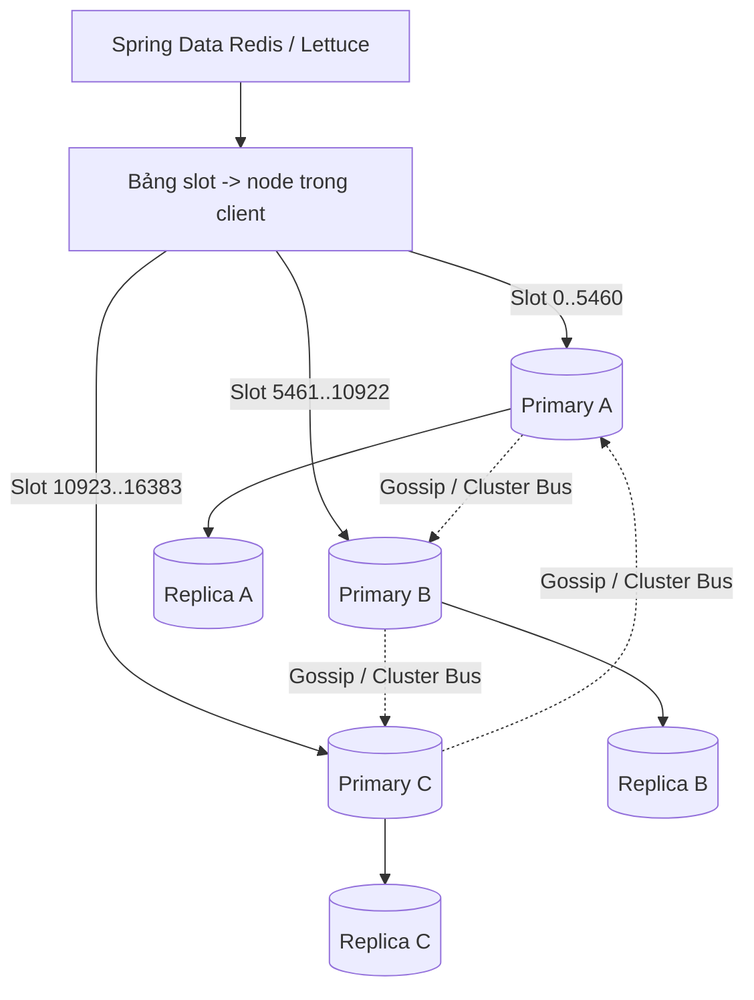
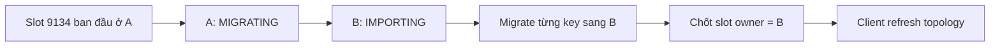
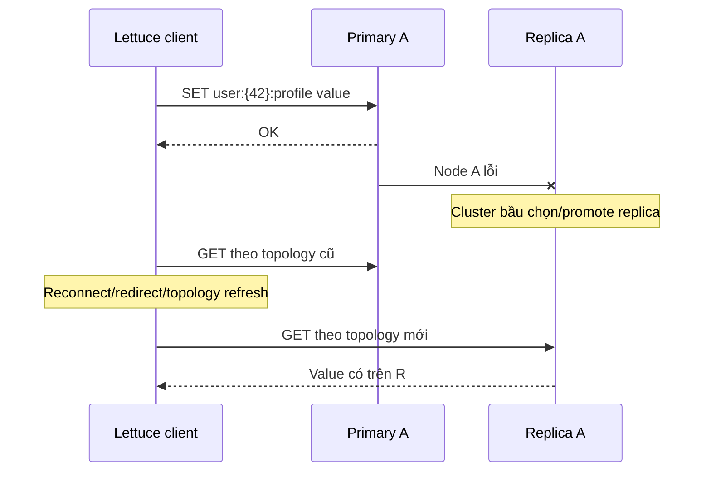
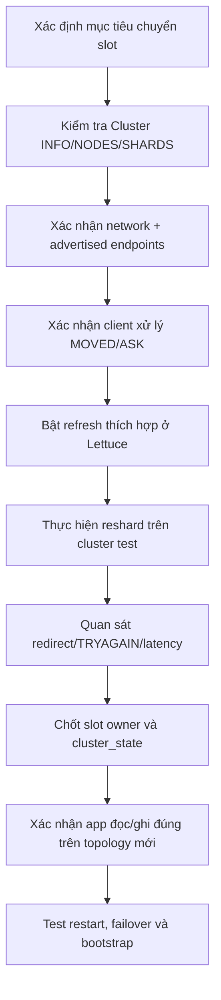

# Thay đổi topology, resharding và làm mới thông tin nút trong Redis Cluster

## 1. Tại sao một ứng dụng đang chạy bỗng nhận `MOVED`?

Giả sử dịch vụ Spring Boot lưu giỏ hàng vào Redis Cluster:

```java
redis.opsForValue().set("cart:{u-42}:status", "CHECKOUT");
String status = redis.opsForValue().get("cart:{u-42}:status");
```

Lúc đầu, các lệnh chạy bình thường. Đội vận hành thêm một Redis primary mới rồi di chuyển một số hash slot sang node đó để phân tải. Trong quá trình ấy, một Redis client vẫn có thể giữ **bảng định tuyến cũ**: nó tưởng slot chứa `cart:{u-42}:status` do node A quản lý, trong khi hiện tại slot đã chuyển sang node B.

Khi client gửi lệnh đến A, Redis có thể đáp:

```text
-MOVED 9134 10.0.0.22:6379
```

Thông báo này không có nghĩa Redis đã mất dữ liệu hoặc key sai. Nó cho biết **hash slot 9134 hiện do một node khác phụ trách** và client phải điều chỉnh đường đi. Trong giai đoạn chuyển dữ liệu chưa hoàn tất, client cũng có thể gặp:

```text
-ASK 9134 10.0.0.22:6379
```

Hai loại redirect **không cùng ý nghĩa**:

- **`MOVED`** thường chỉ ra **thay đổi chủ sở hữu slot**, nên client cần cập nhật topology và chuyển những lệnh tiếp theo tới node đúng.
- **`ASK`** chỉ ra **chuyển hướng tạm thời của một lệnh** khi slot đang trong quá trình di chuyển. Client phải gửi `ASKING` đến đích trước khi gửi lệnh đó; không được coi ASK là bằng chứng mọi key thuộc slot đã đổi chủ.

Redis Cluster dựa vào client hiểu topology. Với ứng dụng Spring Data Redis dùng **Lettuce**, khả năng tự xử lý redirect và làm mới thông tin node là phần quan trọng giúp ứng dụng tiếp tục hoạt động khi cluster re-shard, thêm/bớt node hoặc failover.

Bài học này giải thích cơ chế Redis Cluster, cách cấu hình Spring Data Redis/Lettuce, chiến lược cập nhật topology, các vấn đề thực tế trong vận hành và cách kiểm thử mà không ảnh hưởng production.

## 2. Redis Cluster phân vùng dữ liệu như thế nào?

Redis Cluster phân chia không gian key thành **16.384 hash slot**, đánh số từ 0 đến 16.383. Mỗi key được ánh xạ tới một slot, và mỗi slot được một primary node sở hữu ở trạng thái topology ổn định.

```text
16.384 hash slots
┌───────────────────────────────────────────────────┐
│ 0 ... 5460 │ 5461 ... 10922 │ 10923 ... 16383    │
└──────┬─────┴────────┬────────┴───────────┬────────┘
       │              │                    │
       ▼              ▼                    ▼
   Primary A       Primary B           Primary C
       │              │                    │
   Replica A       Replica B            Replica C
```

Ví dụ trên chỉ minh họa một phương án phân bố slot. Trong thực tế, mỗi primary có thể sở hữu nhiều đoạn slot không liên tiếp. Replica hỗ trợ sao chép và failover nhưng không thường là chủ sở hữu slot để nhận ghi.

### 2.1. Cách xác định slot

Về nguyên tắc:

```text
slot = CRC16(hash-input) mod 16384
```

Thông thường, `hash-input` là toàn bộ key. Nếu key chứa một **hash tag hợp lệ** trong dấu ngoặc nhọn, Redis dùng nội dung trong cặp ngoặc đó để tính slot:

```text
cart:{u-42}:status
cart:{u-42}:items
cart:{u-42}:total
```

Cả ba key trên có cùng hash tag `u-42`, nên thuộc cùng hash slot.

Kiểm tra bằng Redis CLI:

```redis
CLUSTER KEYSLOT cart:{u-42}:status
CLUSTER KEYSLOT cart:{u-42}:items
CLUSTER KEYSLOT cart:{u-42}:total
```

Ba lệnh phải trả cùng một số slot. Đừng tự đoán số slot trong tài liệu; giá trị trả về từ cluster là căn cứ để đối chiếu.

### 2.2. Vì sao hash tag quan trọng khi resharding?

Redis Cluster có các giới hạn cho lệnh truy cập nhiều key. Ví dụ:

```redis
MGET cart:{u-42}:status cart:{u-42}:total
```

Hai key cùng slot nên có thể được xử lý theo các quy tắc multi-key của Redis Cluster. Nếu dùng key của hai user khác tag:

```redis
MGET cart:{u-42}:status cart:{u-99}:status
```

Redis có thể báo `CROSSSLOT` vì một lệnh đa key yêu cầu slot chung.

Việc các key cùng slot **không đồng nghĩa mọi multi-key operation chắc chắn thành công khi slot đang di chuyển**: trong giai đoạn resharding, một số key đã ở nguồn, một số đã ở đích; Redis có thể trả lỗi tạm thời như `TRYAGAIN` cho các thao tác cần nhiều key.

**Không đưa toàn bộ key của ứng dụng vào cùng một hash tag** chỉ để tránh `CROSSSLOT`. Việc ấy dồn mọi key về một slot và làm mất lợi ích phân tải của Redis Cluster.

## 3. Topology không chỉ là danh sách IP

Một Redis client cần biết nhiều thông tin:

1. Những primary nào đang tồn tại.
2. Mỗi primary sở hữu hash slot nào.
3. Những replica nào thuộc các primary tương ứng.
4. Những node nào đã thay đổi vai trò sau failover.
5. Địa chỉ mà Redis **quảng bá** cho các node khác và client.
6. Những chuyển tiếp topology đang xảy ra trong cluster.



Redis nodes trao đổi thông tin topology qua cluster bus. Cluster có cơ chế dùng **configuration epoch** và thông tin trạng thái để giải quyết quyền sở hữu slot khi topology thay đổi. Client thường không cần tự thực hiện thuật toán gossip; client lấy topology từ các node và xử lý redirect.

**Lưu ý:** client có thể có một snapshot topology **khác thời điểm** so với node Redis. Vì vậy, topology cache của client là dữ liệu cần được làm mới, không phải cấu hình bất biến trong suốt thời gian JVM chạy.

## 4. Tại sao topology lại thay đổi?

| Sự kiện | Điều thay đổi | Tác động tới client |
|---|---|---|
| Thêm primary | Có node mới, ban đầu có thể chưa sở hữu slot | Cần học node mới khi slot được phân bổ |
| Resharding | Chuyển các slot và dữ liệu liên quan từ primary này sang primary khác | Có thể gặp `ASK`, `MOVED`, lỗi tạm thời |
| Rebalancing | Phân phối lại các slot để cân bằng tải | Nhiều slot thay chủ, client phải refresh |
| Primary failover | Replica được promote thành primary | Địa chỉ/role/slot owner có thể đổi |
| Xóa node | Slot phải được chuyển đi hoặc node bị thay vai trò trước khi gỡ | Seed cũ có thể không còn truy cập được |
| Network partition | Các node có góc nhìn topology khác nhau trong khoảng thời gian ngắn | Redirect, timeout, `CLUSTERDOWN` |
| Thay đổi địa chỉ quảng bá | IP/hostname/port cho client kết nối khác trước | Phải refresh endpoint và sửa network |
| Rolling upgrade | Node lần lượt restart hoặc đổi role theo thao tác vận hành | Reconnect và cập nhật topology |

**Resharding** là việc di chuyển quyền sở hữu slot (cùng dữ liệu cần thiết) giữa primary. **Rebalancing** là quá trình quyết định phân bổ lại nhiều slot để giảm lệch tải. Hai khái niệm liên quan nhưng không đồng nhất: một cụm có thể reshard theo mục tiêu cụ thể mà không cân bằng toàn bộ số slot.

## 5. Trạng thái ổn định và giai đoạn resharding

Ở trạng thái bình thường:

```text
Slot 9134
  owner: Primary A
  các key thuộc slot: ở A
  GET/SET -> A
```

Khi di chuyển slot từ A sang B, một quy trình resharding thường:

1. Đặt slot ở **trạng thái `MIGRATING`** trên node nguồn A.
2. Đặt slot ở **trạng thái `IMPORTING`** trên node đích B.
3. Di chuyển các key thuộc slot từ A sang B theo từng đợt.
4. Khi di chuyển hoàn tất, cập nhật quyền sở hữu slot sang B.
5. Lan truyền topology mới tới các node còn lại và cho client.



Trong giai đoạn di chuyển, các key cùng slot có thể **chưa cùng nằm trên một node**. Redis dùng phản hồi `ASK` để giúp client truy cập đúng đích tạm thời trước khi slot chuyển chủ hoàn toàn.

### 5.1. Vì sao không đơn giản đổi bảng slot trước rồi copy key?

Nếu chốt quyền sở hữu toàn bộ slot về B trong khi phần lớn key còn ở A, nhiều request sẽ tới B nhưng chưa có dữ liệu. Nếu chỉ copy key mà không kiểm soát giai đoạn chuyển tiếp, các lệnh đọc/ghi có thể chạy trên node không phù hợp.

Cơ chế `MIGRATING`/`IMPORTING` và redirect giúp Redis phân biệt:

- Node nào đang được xem là chủ sở hữu slot.
- Key nào còn ở nguồn.
- Request nào phải chuyển tới đích tạm thời.
- Khi nào có thể công bố ownership mới.

Đây là cơ chế định tuyến trong quá trình di chuyển, không phải một transaction toàn cục khóa mọi thao tác ứng dụng cho đến khi kết thúc.

## 6. MOVED: redirect mang ý nghĩa topology lâu dài

Giả sử client có bảng cũ:

```text
slot 9134 -> A
```

Nhưng cluster đã cập nhật:

```text
slot 9134 -> B
```

Client gửi:

```redis
GET cart:{u-42}:status
```

đến A và nhận một phản hồi có dạng:

```text
MOVED 9134 10.0.0.22:6379
```

Client cluster-aware sẽ chuyển request đến node phù hợp và **cập nhật thông tin định tuyến** hoặc kích hoạt topology refresh theo cơ chế driver.

### 6.1. Ba thành phần của MOVED

```text
MOVED <slot> <host>:<port>
```

- `MOVED`: loại redirect.
- `<slot>`: slot mà key của lệnh thuộc về.
- `<host>:<port>`: endpoint Redis node có quyền xử lý slot theo thông tin trả về.

Redis có thể quảng bá hostname hoặc địa chỉ phù hợp với cấu hình cluster, không nhất thiết là IP mà bạn đã dùng để bootstrap.

**Không nên bắt lỗi MOVED tại service và chuyển nó thành "Redis không có key".** Đó là tín hiệu định tuyến; một driver Cluster như Lettuce cần xử lý.

### 6.2. MOVED không cần ứng dụng tự tính lại key

Key `cart:{u-42}:status` vẫn ánh xạ đến cùng hash slot dù slot chuyển chủ từ A sang B. Ứng dụng không cần đổi tên key, không cần re-hash thủ công và không cần gọi `GET` cho tất cả node để tìm dữ liệu.

Điều cần thay đổi là **bảng ánh xạ slot → node** ở client.

## 7. ASK: redirect tạm thời trong lúc di chuyển slot

Khi slot đang `MIGRATING` trên A và `IMPORTING` trên B, Redis có thể phản hồi:

```text
ASK 9134 10.0.0.22:6379
```

Khác với MOVED, `ASK` **không nói rằng B đã sở hữu toàn bộ slot một cách ổn định**. Nó chỉ hướng dẫn thực thi **lệnh cụ thể này** trên B.

Client xử lý bằng cách gửi `ASKING` tới B, rồi gửi lệnh cần thực thi trên **cùng kết nối**:

```text
Client                        Node A                  Node B
   | GET key                     |                        |
   |---------------------------->|                        |
   |<----------------------------| ASK 9134 B             |
   |                                                      |
   | ASKING                                              |
   |----------------------------------------------------->|
   |<-----------------------------------------------------| OK
   | GET key                                              |
   |----------------------------------------------------->|
   |<-----------------------------------------------------| value
```

`ASKING` cho phép node B chấp nhận một request cho slot đang ở trạng thái importing trong ngữ cảnh chuyển giao.

### 7.1. Vì sao phải phân biệt ASK và MOVED?

| Đặc điểm | `MOVED` | `ASK` |
|---|---|---|
| Ý nghĩa chính | Slot cần được định tuyến tới owner khác | Lệnh cụ thể cần đi tới node đích tạm thời |
| Thường xuất hiện | Sau đổi owner, topology client lỗi thời | Khi slot đang được migrate/import |
| Cần gửi `ASKING`? | Không | **Có**, trước lệnh tại node đích |
| Nên thay đổi route slot lâu dài? | Có thể, thường kích hoạt refresh | **Không chỉ dựa vào ASK** |
| Redis client cluster-aware | Xử lý redirect theo semantics riêng | Xử lý redirect và `ASKING` theo semantics riêng |

Một lỗi phổ biến là coi mọi redirect đều giống MOVED rồi sửa bảng slot ngay khi nhận ASK. Khi source vẫn là owner và nhiều key chưa chuyển, sửa route toàn bộ slot quá sớm có thể làm các lệnh khác đi sai node.

### 7.2. ASK không bảo đảm mọi lệnh multi-key thành công

Trong giai đoạn một số key đã ở B và số khác còn ở A, một thao tác đa key cùng slot cũng có thể gặp `TRYAGAIN` hoặc lỗi điều kiện chuyển giao. Vì vậy, cần xử lý retry có giới hạn và cân nhắc idempotency, thay vì mặc định resharding là hoàn toàn vô hình đối với mọi nghiệp vụ.

## 8. Các lỗi Redis Cluster cần phân biệt

| Phản hồi | Ý nghĩa khái quát | Cách ứng dụng/driver nên xử lý |
|---|---|---|
| `MOVED` | Slot thuộc node khác theo topology hiện tại | Redirect, cập nhật bảng định tuyến |
| `ASK` | Chuyển hướng tạm trong giai đoạn migration | `ASKING` trên node đích rồi thực thi lệnh |
| `TRYAGAIN` | Điều kiện tạm thời không thể hoàn tất, ví dụ multi-key khi slot đang dịch chuyển | Retry có giới hạn, backoff khi phù hợp |
| `CROSSSLOT` | Một lệnh đa key sử dụng key khác slot | Sửa thiết kế key/hash tag hoặc tách operation |
| `CLUSTERDOWN` | Cluster không thể phục vụ theo trạng thái/configuration hiện tại | Điều tra coverage, failover, connectivity |
| Timeout/mất kết nối | Chưa rõ lệnh đã được thực thi hay chưa | Điều tra kết quả, tránh replay mù thao tác không idempotent |
| `READONLY` | Lệnh ghi tới replica/đường không được phép ghi | Refresh role/topology, kiểm tra route và chính sách đọc |

**Không được xử lý mọi lỗi bằng một vòng retry vô hạn.** `CROSSSLOT` thường là lỗi thiết kế cần sửa, còn `TRYAGAIN` có thể là lỗi tạm thời; timeout của lệnh ghi có semantics hoàn toàn khác với MOVED được trả rõ ràng.

## 9. Làm mới topology ở phía Lettuce

Redis Cluster không đẩy một bản cập nhật đầy đủ, tức thời và bắt buộc cho mọi Redis client ngoài cluster mỗi khi slot đổi chủ. Client phải chủ động duy trì topology:

```text
Startup:
  seed nodes -> hỏi CLUSTER SLOTS/SHARDS/NODES theo client -> tạo bảng slot->node

Runtime:
  gửi lệnh theo bảng đang giữ
      |
      +-- Thành công: tiếp tục
      |
      +-- MOVED/ASK: xử lý redirect
      |
      +-- Trigger adaptive refresh: hỏi topology mới
      |
      +-- Periodic refresh: làm mới theo lịch nếu được bật
```

Trong Spring Data Redis, Lettuce thường là Redis driver mặc định khi dùng Spring Boot starter. Lettuce hỗ trợ **topology refresh** cho Redis Cluster, gồm refresh theo lịch và theo sự kiện.

### 9.1. Periodic topology refresh

**Periodic refresh** yêu cầu Lettuce định kỳ lấy topology mới từ Redis. Ví dụ chu kỳ 30 giây:

```java
ClusterTopologyRefreshOptions refresh =
    ClusterTopologyRefreshOptions.builder()
        .enablePeriodicRefresh(Duration.ofSeconds(30))
        .build();
```

Ưu điểm:

- Cập nhật topology dù không có lệnh nào tạo redirect trên một số đường code.
- Có thể nhận ra node mới/role mới theo chu kỳ.
- Giảm tình trạng client giữ bảng cũ quá lâu ở các ứng dụng ít traffic.

Đánh đổi:

- Mỗi client có hoạt động refresh riêng, tiêu tốn lệnh query tới cluster.
- Nếu có hàng nghìn JVM với chu kỳ rất ngắn, tải quản trị topology có thể tăng đáng kể.
- Refresh theo lịch **không bảo đảm** ngăn MOVED trong khoảng giữa hai lần lấy topology.

Không chọn chu kỳ 1 giây cho mọi instance chỉ vì muốn "topology luôn đúng". Nên đo tốc độ thay đổi cluster, quy mô fleet, độ trễ khôi phục mong muốn và khả năng chịu tải của Redis.

### 9.2. Adaptive topology refresh

**Adaptive refresh** cho phép Lettuce kích hoạt việc lấy topology mới khi có tín hiệu runtime, chẳng hạn:

- `MOVED` hoặc `ASK` redirect.
- Nhiều lần reconnect không thành công.
- Gặp slot chưa được biểu diễn trong topology client.
- Gặp node chưa biết theo các điều kiện driver.

Ví dụ:

```java
ClusterTopologyRefreshOptions refresh =
    ClusterTopologyRefreshOptions.builder()
        .enableAllAdaptiveRefreshTriggers()
        .build();
```

Lợi ích: khi thực sự xuất hiện thay đổi, client không nhất thiết phải đợi hết một chu kỳ refresh dài để phát hiện.

**Lưu ý:** việc bật adaptive triggers không tự giải quyết lỗi kết nối mạng, ACL hoặc node Redis quảng bá địa chỉ client không tới được. Nó chỉ giúp client chủ động khám phá lại topology.

### 9.3. Kết hợp cả hai

Một cấu hình thường đáng cân nhắc:

```java
ClusterTopologyRefreshOptions refresh =
    ClusterTopologyRefreshOptions.builder()
        .enablePeriodicRefresh(Duration.ofSeconds(30))
        .enableAllAdaptiveRefreshTriggers()
        .build();
```

Periodic refresh bổ sung khả năng phát hiện khi không có redirect; adaptive refresh giúp phản ứng nhanh hơn với sự kiện runtime.

Adaptive refresh có thể có cơ chế giới hạn tần suất để tránh refresh liên tục khi cluster bất ổn. Việc một loạt lệnh nhận MOVED **không đồng nghĩa mỗi lệnh tạo một topology fetch riêng**.

## 10. Cấu hình Spring Data Redis với Lettuce Cluster

Ví dụ Spring Boot 3.x, Java 17+, Redis Cluster gồm nhiều primary và replica.

### 10.1. Dependency và khai báo seed nodes

```groovy
dependencies {
    implementation 'org.springframework.boot:spring-boot-starter-data-redis'
}
```

Nếu dùng auto-configuration của Spring Boot:

```yaml
spring:
  data:
    redis:
      cluster:
        nodes:
          - redis-0.internal:6379
          - redis-1.internal:6379
          - redis-2.internal:6379
        max-redirects: 5
      timeout: 3s
```

Đây là các **seed nodes để bootstrap topology**, không phải danh sách cố định "key nào đi node nào". Khi kết nối thành công, driver cần khám phá slot ownership và các node khác từ cluster.

`max-redirects` giới hạn số lần Redis client theo các redirect trong một chuỗi yêu cầu tương ứng. Giới hạn không thay thế điều kiện mạng khỏe; nếu topology thay đổi liên tục và vượt giới hạn, request có thể báo lỗi.

### 10.2. Java config bật periodic và adaptive refresh

Có thể cấu hình một `LettuceConnectionFactory` tường minh:

```java
package com.example.redis.config;

import java.time.Duration;

import io.lettuce.core.cluster.ClusterClientOptions;
import io.lettuce.core.cluster.ClusterTopologyRefreshOptions;

import org.springframework.context.annotation.Bean;
import org.springframework.context.annotation.Configuration;
import org.springframework.data.redis.connection.RedisClusterConfiguration;
import org.springframework.data.redis.connection.lettuce.LettuceClientConfiguration;
import org.springframework.data.redis.connection.lettuce.LettuceConnectionFactory;

@Configuration
public class RedisClusterConnectionConfig {

    @Bean
    LettuceConnectionFactory redisConnectionFactory() {
        RedisClusterConfiguration cluster =
            new RedisClusterConfiguration();

        cluster.clusterNode("redis-0.internal", 6379);
        cluster.clusterNode("redis-1.internal", 6379);
        cluster.clusterNode("redis-2.internal", 6379);
        cluster.setMaxRedirects(5);

        ClusterTopologyRefreshOptions refreshOptions =
            ClusterTopologyRefreshOptions.builder()
                .enablePeriodicRefresh(Duration.ofSeconds(30))
                .enableAllAdaptiveRefreshTriggers()
                .build();

        ClusterClientOptions clusterOptions =
            ClusterClientOptions.builder()
                .topologyRefreshOptions(refreshOptions)
                .build();

        LettuceClientConfiguration clientConfig =
            LettuceClientConfiguration.builder()
                .clientOptions(clusterOptions)
                .commandTimeout(Duration.ofSeconds(3))
                .build();

        return new LettuceConnectionFactory(cluster, clientConfig);
    }
}
```

Ý nghĩa:

1. `RedisClusterConfiguration` biết những địa chỉ bootstrap.
2. `LettuceClientConfiguration` chứa cấu hình driver.
3. `ClusterTopologyRefreshOptions` bật cả periodic lẫn adaptive refresh.
4. `LettuceConnectionFactory` cấp kết nối cho Spring Data Redis templates.
5. Khi cluster thay đổi, Lettuce xử lý redirect và refresh topology theo cơ chế của nó.

**Chú ý phạm vi:** đây là một phương án **thay thế** cho việc dựa hoàn toàn vào Redis connection auto-configuration của Boot. Không sao chép một cấu hình tạo connection factory thứ hai trong cùng context mà không xác định bean nào được inject.

Các class và builder methods thuộc các dòng Lettuce/Spring Data Redis tương ứng; khi dự án dùng phiên bản khác, đối chiếu Javadoc của dependency đã resolve trước khi đưa nguyên văn code vào production.

### 10.3. Dùng StringRedisTemplate sau khi kết nối

Một service đơn giản:

```java
import org.springframework.data.redis.core.StringRedisTemplate;
import org.springframework.stereotype.Service;

@Service
public class CartStatusStore {

    private final StringRedisTemplate redis;

    public CartStatusStore(StringRedisTemplate redis) {
        this.redis = redis;
    }

    public void save(String userId, String status) {
        redis.opsForValue().set(
            "cart:{" + userId + "}:status", status
        );
    }

    public String find(String userId) {
        return redis.opsForValue().get(
            "cart:{" + userId + "}:status"
        );
    }
}
```

Client gọi template như ứng dụng Redis thông thường. Tính toán hash slot, chọn node và xử lý MOVED/ASK được driver đảm nhiệm, nếu connection factory thực sự cấu hình Redis Cluster.

**Không nên tự bắt `MOVED` ở lớp business rồi phát nhiều `GET` tới tất cả node**. Làm như vậy vừa tăng tải vừa có thể tạo kết quả sai trong resharding.

## 11. Spring Boot auto-configuration và tùy biến Lettuce

Nếu muốn giữ phần lớn cấu hình Boot trong `application.yml`, có thể cân nhắc `LettuceClientConfigurationBuilderCustomizer` để tùy biến builder do Spring Boot tạo, tùy phiên bản Boot/Spring Data Redis.

Tuy nhiên, việc đặt client options phải phù hợp với loại Redis topology (cluster khác standalone/Sentinel). Trong một dự án thực tế:

- Kiểm tra có bean `LettuceConnectionFactory` do Boot tạo hay do cấu hình tùy chỉnh.
- Xác nhận `RedisClusterConfiguration` đã được dùng, không phải `RedisStandaloneConfiguration`.
- Đảm bảo `ClusterTopologyRefreshOptions` được gắn vào `ClusterClientOptions` của đúng Lettuce client.
- Không tạo hai factories một cách vô tình khiến `StringRedisTemplate` và `ReactiveRedisTemplate` định tuyến khác nhau.

**Tên thuộc tính Boot và API builder có thể phát triển theo phiên bản.** Chỉ nhìn thấy `spring.data.redis.cluster.nodes` chưa chứng minh periodic/adaptive refresh đã bật theo ý muốn; cần xem cấu hình driver đã áp dụng.

## 12. Seed nodes, dynamic refresh sources và địa chỉ quảng bá

Một lỗi triển khai Redis Cluster phổ biến: **client kết nối được seed node nhưng không kết nối được các node mà cluster trả về**.

Ví dụ:

```text
Client ngoài Kubernetes:
  kết nối seed redis.example.com:7000 -> thành công

Redis CLUSTER SLOTS/NODES trả:
  10.244.1.12:6379
  10.244.2.17:6379
  10.244.3.19:6379

Client ngoài cluster không route được tới các địa chỉ pod nội bộ.
Kết quả: refresh lấy được topology nhưng lệnh dữ liệu vẫn timeout.
```

Nguyên nhân không nằm ở `maxRedirects` và cũng không thể chữa chỉ bằng cách gọi refresh nhiều hơn. Redis nodes cần quảng bá **địa chỉ khả dụng từ mạng của client**, hoặc hạ tầng cần cung cấp proxy/translation/topology mapping được driver hỗ trợ.

### 12.1. Các cấu hình network ảnh hưởng khả năng khám phá

Redis Cluster có các thiết lập liên quan tới địa chỉ quảng bá, ví dụ:

```text
cluster-announce-ip
cluster-announce-port
cluster-announce-bus-port
```

Tên và khả năng dùng hostname có thể phụ thuộc version Redis. Ngoài client port phục vụ commands, các Redis nodes cần trao đổi qua **cluster bus port** theo topology hạ tầng.

Một cluster có thể trả `cluster_state:ok` cho node nội bộ nhưng ứng dụng bên ngoài vẫn lỗi vì không kết nối được endpoint advertised. Do đó phải test từ **vị trí mạng của ứng dụng**, không chỉ chạy `redis-cli` ngay trên Redis node.

### 12.2. Dynamic topology refresh sources

Lettuce có khả năng dùng những node học được từ topology làm nguồn cho lần refresh tiếp theo. Điều này giúp client vẫn khám phá cluster khi một seed bị loại bỏ, nhưng có đánh đổi:

- Các node được học phải reachable từ client.
- ACL phải cho phép query topology thích hợp.
- Nếu địa chỉ do Redis quảng bá là internal-only, bổ sung nguồn refresh có thể khiến lỗi lặp lại trên nhiều node.
- Với proxy hoặc managed Redis đặc biệt, cần xem tài liệu nhà cung cấp về khả năng cluster topology discovery.

Không nên tắt/bật dynamic refresh sources theo suy đoán. Trước tiên kiểm tra endpoint được quảng bá, DNS, network, TLS và khả năng kết nối thực tế.

## 13. Khi nào resharding được coi là hoàn tất?

Một đợt resharding không chỉ kết thúc khi dữ liệu của một vài key đã xuất hiện trên node đích. Cần xem:

1. Các slot dự kiến đã chuyển sang owner mới.
2. Node nguồn/đích không còn để lại trạng thái importing/migrating bất thường cho những slot đã hoàn tất.
3. Thông tin owner slot đã được phổ biến và cluster đạt trạng thái phục vụ phù hợp.
4. Replica của primary mới đang đồng bộ theo chính sách HA.
5. Client đã refresh topology, không tiếp tục gặp redirect/error bất thường ở mức gây sự cố.
6. Latency, CPU, memory và network trở về phạm vi vận hành mong muốn.

```text
Trong quá trình:
  A: slot 9134 migrating
  B: slot 9134 importing
  Client: có ASK / TRYAGAIN

Sau khi chốt:
  B: owner slot 9134
  Client cũ: có thể nhận MOVED
  Client mới: route trực tiếp tới B
```

Lúc Redis chốt slot owner không đồng nghĩa mọi JVM đã nhận cùng topology trong cùng một microsecond. Chính vì vậy, việc xử lý redirect phải tiếp tục hoạt động **ngay cả khi periodic refresh đã bật**.

## 14. Các lệnh Redis để quan sát topology

Trong Redis CLI được kết nối tới một cluster node:

```redis
CLUSTER INFO
CLUSTER NODES
CLUSTER SLOTS
```

Trên Redis 7.0+ còn có:

```redis
CLUSTER SHARDS
```

Ý nghĩa:

| Lệnh | Thông tin thường dùng |
|---|---|
| `CLUSTER INFO` | Trạng thái chung của cluster, số slot assigned/ok/pfail/fail |
| `CLUSTER NODES` | Node ID, role, link, config epoch, slot ranges và trạng thái migration |
| `CLUSTER SLOTS` | Ánh xạ slot ranges tới primary và replica |
| `CLUSTER SHARDS` | Mô tả shards, nodes, roles và endpoints theo cấu trúc mới hơn |
| `CLUSTER KEYSLOT key` | Slot của một key cụ thể |
| `CLUSTER COUNTKEYSINSLOT slot` | Số key thuộc slot trên node được hỏi |
| `CLUSTER GETKEYSINSLOT slot count` | Một số key trong slot trên node được hỏi |

Ví dụ một phần `CLUSTER INFO`:

```text
cluster_state:ok
cluster_slots_assigned:16384
cluster_slots_ok:16384
cluster_slots_pfail:0
cluster_slots_fail:0
cluster_known_nodes:6
```

Đây là **dữ liệu minh họa**, không phải trạng thái một cụm thực tế.

### 14.1. Đọc CLUSTER NODES đúng ý nghĩa

Một dòng `CLUSTER NODES` có thể chứa:

```text
<node-id> <address> <flags> <master-id> <ping> <pong> <config-epoch> <link-state> <slots>
```

- `flags` cho biết role/trạng thái như master, slave/replica, fail.
- `master-id` cho biết primary của replica khi có.
- `config-epoch` phản ánh thế hệ thông tin cấu hình.
- `slots` cho biết slot ranges đang được node sở hữu và có thể có ký hiệu importing/migrating.

Không dùng một dòng `CLUSTER NODES` trong quá trình resharding để suy luận tất cả các node trên toàn cluster đã hội tụ cùng thời điểm. Khi điều tra, nên quan sát nhiều node nếu cần.

### 14.2. Tránh lệnh quét gây tải

`CLUSTER GETKEYSINSLOT` và `CLUSTER COUNTKEYSINSLOT` có ích để chẩn đoán một slot, nhưng không nên quét toàn bộ dữ liệu production chỉ vì nghi topology sai. Với cluster, lệnh `SCAN` được thực hiện theo **node**, không tự là một phép duyệt ổn định toàn bộ cluster khi ứng dụng đang chuyển slot.

Các lệnh như `KEYS *` có thể gây tải lớn; không dùng trên node production có dữ liệu lớn để "tìm key vừa bị chuyển".

## 15. Thực hiện resharding bằng redis-cli

Với cluster **dành riêng cho test** có node seed ở `127.0.0.1:7000`, Redis CLI có công cụ quản trị:

```text
redis-cli --cluster check 127.0.0.1:7000
redis-cli --cluster reshard 127.0.0.1:7000
redis-cli --cluster rebalance 127.0.0.1:7000
```

Khái niệm:

- `check`: quan sát cấu hình phân bổ slot và tính nhất quán topology theo kiểm tra của công cụ.
- `reshard`: yêu cầu chuyển một số slot từ các source nodes sang destination node.
- `rebalance`: cân bằng lại việc phân bố slot theo công cụ.

**Không chạy `reshard`/`rebalance` trên production chỉ để học.** Chúng thực sự thay đổi quyền sở hữu slot, có thể tạo redirect và tăng tải network/CPU; cần cửa sổ vận hành và kế hoạch dự phòng tương ứng.

### 15.1. Một quy trình thử nghiệm an toàn

1. Dùng Redis Cluster test độc lập (ví dụ ba primary, ba replica).
2. Ghi một tập key theo các prefix rõ ràng.
3. Ghi lại topology bằng `CLUSTER NODES` và `CLUSTER SLOTS`.
4. Dùng `CLUSTER KEYSLOT` xác định slot của một key thử.
5. Chạy một chương trình đọc/ghi đều đặn qua Spring Data Redis.
6. Trong một terminal riêng, thực hiện `redis-cli --cluster reshard` và chọn một số slot ít tải.
7. Quan sát `ASK`/`MOVED`, thời gian request, lỗi và trạng thái client.
8. Sau khi reshard hoàn tất, xác nhận slot owner mới và ứng dụng vẫn đọc được giá trị đúng.
9. Dừng thử nghiệm, ghi nhận những đặc tính chưa phù hợp với cấu hình refresh.

Nếu nhóm vận hành sử dụng Kubernetes operator hoặc managed Redis, ưu tiên quy trình resharding do chính nền tảng quản lý. Không tự can thiệp `CLUSTER SETSLOT` hoặc `MIGRATE` ở một cluster do hệ thống khác điều phối.

## 16. Minh họa trực tiếp MOVED với redis-cli

Redis CLI có tùy chọn `-c` để tự theo redirect trong Redis Cluster:

```text
redis-cli -c -h 127.0.0.1 -p 7000 GET 'cart:{u-42}:status'
```

Khi không bật cluster mode, có thể thấy redirect:

```text
redis-cli -h 127.0.0.1 -p 7000 GET 'cart:{u-42}:status'
-> MOVED <slot> <host>:<port>
```

Đây là cách minh họa khác biệt giữa **client không xử lý redirect** và **client cluster-aware**. Khi dùng `redis-cli -c`, công cụ cố theo MOVED/ASK thay cho người dùng.

Tuy nhiên, **không nên lấy việc `redis-cli -c` hoạt động làm bằng chứng rằng Spring Data Redis đã cấu hình đúng**: Java service có thể dùng seed khác, TLS khác, client options khác hoặc chạy từ subnet không tới được advertised node endpoints.

### 16.1. Vì sao không nên tự gửi ASKING trong service Java?

Redis Cluster driver đã quản lý ASK/ASKING theo yêu cầu trên cùng connection. Nếu ứng dụng tự gửi `ASKING` bằng một `RedisTemplate` khác rồi gửi `GET` trên kết nối khác, semantics có thể không còn đúng.

Chỉ tự thao tác `ASKING` khi bạn chủ động xây client protocol hoặc đang debug bằng CLI. Với Spring Data Redis thông thường, hãy để Lettuce quản lý redirect.

## 17. Điều gì xảy ra với lệnh khi đang chuyển slot?

Xét các tình huống:

### 17.1. GET/SET độc lập

Một client có thể gặp ASK trong quá trình migrate rồi tiếp tục thao tác sau redirect. Khi hoàn tất đổi owner, những request dùng topology cũ có thể nhận MOVED; driver update route và tiếp tục.

Không nên coi mọi request đều chắc chắn không lỗi: network timeout, redirect limit hoặc hạ tầng chưa hội tụ có thể làm thao tác thất bại.

### 17.2. MGET/MSET và các thao tác nhiều key

Các key phải thỏa điều kiện cùng slot. Trong resharding, nếu key của một lệnh đa key đang phân tán tạm thời giữa source và target, Redis có thể từ chối tạm để tránh thực hiện một thao tác nhiều key trên dữ liệu chưa cùng vị trí.

Ví dụ:

```redis
MGET cart:{u-42}:status cart:{u-42}:total
```

Hai key cùng hash tag, nhưng nếu một key đã migrate và key kia còn ở source, thao tác đa key có thể gặp `TRYAGAIN` cho đến khi di chuyển đạt trạng thái phù hợp.

### 17.3. Lua script và transaction

Script hoặc transaction truy cập nhiều key cần tuân theo giới hạn slot của Redis Cluster. Với script:

```lua
local quantity = tonumber(redis.call('GET', KEYS[1]) or '0')
local reserved = tonumber(redis.call('GET', KEYS[2]) or '0')
return quantity - reserved
```

Hai key được truyền qua `KEYS` nên cần được bố trí hợp lệ trên cùng slot nếu script thao tác đa key trong Cluster. Resharding có thể tạo điều kiện tạm thời khiến script hoặc multi-key command phải retry.

**Không nhúng trực tiếp tên key hoặc ID user vào source Lua để né quy tắc Cluster.** Điều đó không thay đổi ownership slot và làm tăng số script SHA khác nhau.

### 17.4. Pipeline qua nhiều slot

Một pipeline chứa các lệnh tới nhiều key có thể cần được driver phân phối qua nhiều Redis nodes. Không nên giả định toàn bộ pipeline là một request đến một node hoặc có một thứ tự toàn cục giữa các shard.

Khi resharding xảy ra giữa chừng, một số lệnh có thể thành công, một số cần redirect/retry. Khả năng tự retry/redirect của pipeline phụ thuộc driver và phiên bản Spring Data Redis; phải kiểm tra đúng API đang dùng.

Đặc biệt, **pipeline không cung cấp atomicity**. Không chạy lại toàn bộ batch mù quáng khi một phần response lỗi/timeout, nhất là với `INCR`, `DECR` hoặc các thao tác có side effect không idempotent.

## 18. Redirect, retry và nguy cơ xử lý trùng

Cần phân biệt:

**A. Client nhận phản hồi MOVED/ASK tường minh.**

Ở trạng thái này, node trả redirect thay vì thực thi lệnh theo đường cũ. Driver có đủ thông tin để chuyển lệnh tới node đúng theo quy tắc Redis Cluster.

**B. Client bị timeout/mất kết nối.**

Lúc này, ứng dụng **không chắc** server đã thực thi lệnh hay chưa. Ví dụ:

```redis
INCR order:metrics:paid
```

Nếu lệnh thực thi thành công nhưng phản hồi bị mất, retry sẽ tăng counter thêm một lần. Đây là vấn đề idempotency, không thể giải quyết bằng cách tăng `max-redirects`.

**C. Client nhận TRYAGAIN.**

Có thể thực hiện retry có giới hạn và backoff nếu lỗi mang tính tạm thời. Nhưng cần kiểm soát deadline request, giới hạn concurrency và bảo đảm retry không tạo bão request khi cluster đang migrate.

Một cách phân loại:

| Nhóm | Ví dụ | Chiến lược |
|---|---|---|
| Redirect rõ ràng | MOVED, ASK | Driver cluster-aware xử lý |
| Tạm thời có thể retry | TRYAGAIN, một số lỗi chuyển topology | Bounded retry/backoff, quan sát |
| Không rõ đã thực thi | Timeout/mất kết nối sau write | Xác minh/idempotency trước khi replay |
| Lỗi thiết kế | CROSSSLOT | Sửa key model hoặc tách thao tác |
| Cluster không phục vụ | CLUSTERDOWN | Điều tra coverage/quorum/node, không retry vô hạn |

## 19. Refresh topology và Redis Cluster failover

Mỗi slot thường được một primary sở hữu. Khi primary gặp sự cố, replica có thể được promote theo cơ chế failover của Redis Cluster. Sau đó client phải cập nhật thông tin role/owner.



Hai vấn đề cần phân biệt:

1. **Định tuyến:** ứng dụng phải tìm được primary mới và chuyển lệnh tới đúng node.
2. **Nhất quán/độ bền:** replication là bất đồng bộ; một write ACK ở primary cũ nhưng chưa tới replica được promote có nguy cơ không xuất hiện sau failover.

Làm mới topology giải quyết **địa chỉ node và ownership**, **không tự bảo đảm mọi write đã tồn tại ở primary mới**.

Vì vậy, test failover phải kiểm tra cả:

- Ứng dụng reconnect và tiếp tục thao tác.
- Những dữ liệu quan trọng có thể mất hoặc stale không, theo hợp đồng nghiệp vụ.
- Retry của các thao tác ghi có an toàn không.

## 20. Redis Cluster và Replica reads

Một số ứng dụng dùng Lettuce `ReadFrom.REPLICA_PREFERRED` hoặc chính sách tương tự để phân tải đọc.

Trong Redis Cluster:

- Topology chứa cả primary và replica.
- Driver có thể route read-eligible commands tới replica theo policy.
- Replica có thể chậm hơn primary vì replication bất đồng bộ.
- Sau failover hoặc resharding, driver phải học role/slot mapping mới.

**Topology refresh chính xác không tự loại bỏ stale read từ replica.** Một topology hoàn toàn mới vẫn có thể trỏ đúng tới một replica đang tụt sau dữ liệu primary.

Đối với read cần tính đúng ngay sau ghi hoặc kiểm tra quyền/số dư, cân nhắc đọc current primary hoặc nguồn dữ liệu authoritative phù hợp, thay vì mở replica-read một cách toàn cục.

## 21. Lỗi địa chỉ node không reachable

Giả sử Redis trả:

```text
MOVED 9134 10.244.2.17:6379
```

nhưng Spring Boot chạy ngoài Kubernetes chỉ kết nối được qua `redis.company.internal:7000`. Khi đó:

```text
Application -> seed: thành công
Application -> CLUSTER SLOTS: có kết quả
Application -> 10.244.2.17:6379: network unreachable
Application -> retry/refresh: vẫn có cùng unreachable address
```

Thay đổi `enablePeriodicRefresh(Duration.ofSeconds(5))` không thể sửa sự cố reachability. Cần điều chỉnh thiết kế mạng/địa chỉ quảng bá/node exposure/proxy phù hợp với topology, hoặc dùng cách kết nối do managed provider hỗ trợ.

### 21.1. Checklist network

| Nội dung | Câu hỏi |
|---|---|
| Seed DNS | Ứng dụng resolve và kết nối được seed node? |
| Advertised endpoints | Các địa chỉ từ `CLUSTER SLOTS/SHARDS/NODES` có tới được? |
| TLS | Client có kết nối đúng protocol/cert tới từng node? |
| Redis ACL | Client có quyền query topology và thực thi lệnh? |
| Cluster bus | Các Redis nodes có trao đổi topology/failover được? |
| NAT/containers | Endpoint Redis quảng bá có bị thay đổi hoặc chỉ có thể truy cập nội bộ? |
| DNS TTL | Client có nhận endpoint mới theo chính sách DNS phù hợp? |
| Connection exhaustion | Có quá nhiều clients/refresh/reconnect đồng thời? |

Không bắt đầu bằng việc tăng timeout lên hàng phút để che giấu cấu hình địa chỉ sai.

## 22. Quyền truy cập để làm mới topology

Lettuce cần truy vấn Redis nodes để lấy thông tin slot/node/role. Trong hệ thống có Redis ACL giới hạn:

- User của ứng dụng có thể được phép `GET`/`SET` nhưng không được phép những Redis Cluster introspection commands mà driver cần.
- Bootstrap có thể thất bại hoặc periodic refresh liên tục báo lỗi permission.
- Một số managed Redis cung cấp endpoint/proxy riêng và chính sách ACL khác Redis OSS tự quản trị.

Cần kiểm tra quyền cho các lệnh topology thích hợp với phiên bản client/Redis, ví dụ `CLUSTER SLOTS` hoặc `CLUSTER SHARDS` khi driver sử dụng chúng. Không mở toàn bộ quyền admin chỉ để chữa một lỗi; hãy cấp **least privilege** theo nhu cầu driver và mô hình hạ tầng.

Ngoài ra, việc dùng Spring Data Redis với Redis Cluster thường giới hạn database logic về **DB 0** theo semantics Redis Cluster. Không dựa vào lệnh `SELECT 1` để tách tenant như Redis standalone; ưu tiên key prefix/namespace và phân vùng dữ liệu phù hợp.

## 23. Kiểm tra thực tế một ứng dụng Spring Data Redis

Một bài kiểm tra nên dùng nhiều key ở nhiều slot:

```java
import java.util.List;

import org.springframework.data.redis.core.StringRedisTemplate;

public class ClusterSmokeProbe {

    private final StringRedisTemplate redis;

    public ClusterSmokeProbe(StringRedisTemplate redis) {
        this.redis = redis;
    }

    public void run() {
        for (String userId : List.of("u-1", "u-2", "u-3", "u-4")) {
            String key = "cluster:test:{" + userId + "}:status";
            String value = "READY-" + userId;

            redis.opsForValue().set(key, value);
            String actual = redis.opsForValue().get(key);

            if (!value.equals(actual)) {
                throw new IllegalStateException(
                    "Unexpected value for " + key
                );
            }
        }
    }
}
```

Đây là một smoke test đơn giản. Nó không tạo ra resharding, không đo latency và không chứng minh mọi dạng retry đều an toàn. Trong test, cần dùng keyspace riêng và TTL/cleanup phù hợp, không để lại các key thử trong cluster production.

### 23.1. Trong khi smoke test chạy, tiến hành resharding trên test cluster

Một phép thử tốt cần thu các dữ kiện:

1. Slot owner trước/sau của các key.
2. Số MOVED/ASK/TRYAGAIN nếu driver exposes metrics/log phù hợp.
3. Số command timeout/reconnect.
4. Độ trễ p50/p95/p99 của GET/SET.
5. Mức độ lỗi trong khoảng reshard.
6. Thời gian để client hết dùng topology cũ sau khi reshard hoàn tất.
7. Dữ liệu cuối được đọc đúng.

Với bài thử có nhiều instance, nên quan sát ít nhất một ứng dụng có periodic+adaptive refresh và một cấu hình khác trong môi trường riêng, nếu mục tiêu là so sánh hành vi. Không cần tạo tải cao ngay; bắt đầu với throughput thấp và tăng dần theo khả năng cụm thử nghiệm.

### 23.2. Không giả định một lần smoke test qua là đủ

Ở thời điểm cluster ổn định, mọi redirect có thể được driver xử lý rất nhanh và test luôn pass. Những lỗi khó phát hiện thường nằm ở:

- Reshard đang diễn ra.
- Một node rời khỏi cluster trong lúc connection pool còn session cũ.
- Node mới có endpoint quảng bá khác môi trường mạng client.
- Redis driver bị ACL từ chối đọc topology.
- Pipeline/script/transaction đi qua những key đang migrate.
- Một write timeout sau khi server đã thực thi.

Muốn kết luận kiến trúc chịu được topology changes, phải có test vận hành mô phỏng các tình huống này trên môi trường cô lập.

## 24. Thống kê và giám sát khi topology thay đổi

| Nhóm metric | Ví dụ cần quan sát | Hành động khi tăng bất thường |
|---|---|---|
| Redirect | MOVED/ASK theo phút | Kiểm tra resharding và client refresh |
| Retry | TRYAGAIN, retry count, delay | Điều chỉnh reshard rate hoặc retry policy |
| Connection | Reconnect/timeout per node | Kiểm tra node health, DNS và network |
| Topology | Số nodes, slot coverage, failover events | Đối chiếu với kế hoạch reshard/rebalance |
| Availability | Tỷ lệ `CLUSTERDOWN`, slot unassigned | Khắc phục cluster state và slot ownership |
| Performance | GET/SET p95/p99, command queue | Giảm tải hoặc điều chỉnh batch/concurrency |
| Replication | Replica lag, link status | Phòng rủi ro stale reads/lost writes |
| Memory | Used memory per shard | Kiểm tra lệch dữ liệu và nhu cầu rebalance |
| Network | Bytes/s, errors và số connections | Phát hiện migration hoặc refresh gây tải |

### 24.1. Phân biệt sự cố ngắn hạn và lỗi kéo dài

Một số MOVED ngay khi vừa reshard hoàn tất có thể là bình thường đối với client có topology snapshot cũ. Tuy nhiên:

```text
MOVED/ASK liên tục hàng giờ
  +
Redis topology không còn đổi
  +
Command timeout tăng
```

có thể là dấu hiệu client không refresh được, Redis nodes không hội tụ, advertised addresses sai hoặc connection routing bất ổn.

Đừng chỉ đếm redirect. Cần biết **sau redirect, lệnh có thành công hay không**, và các lỗi có tập trung ở một số slot/node cụ thể hay không.

### 24.2. Các lệnh CLI phù hợp

```redis
CLUSTER INFO
CLUSTER NODES
CLUSTER SLOTS
INFO replication
INFO stats
INFO commandstats
```

Khi quan sát một cluster, lệnh `INFO` thường phản ánh **node đang được kết nối**, không phải báo cáo tổng hợp bắt buộc cho mọi node. Dùng monitoring thu theo từng node rồi tổng hợp có nhận diện node/role rõ ràng.

## 25. Trường hợp cụ thể: ứng dụng restart khi seed node đã bị gỡ

Giả sử config cũ chỉ có:

```yaml
spring:
  data:
    redis:
      cluster:
        nodes:
          - redis-old.internal:6379
```

Sau khi reshard/rebalance và gỡ node này, JVM đang chạy có thể còn hoạt động vì đã khám phá các nodes khác. Nhưng **một instance vừa restart** có thể không bootstrap được vì seed không còn reachable.

Đó là lý do nên:

- Khai báo nhiều seed nodes độc lập khi phù hợp.
- Cập nhật cấu hình seed khi node bị thay thế.
- Theo dõi khả năng bootstrap sau restart, không chỉ health của client đang chạy.
- Chọn endpoint discovery được nhà cung cấp Redis hỗ trợ nếu dùng managed cluster.

Một client có bảng topology trong memory không giúp được một JVM mới chưa từng kết nối nếu toàn bộ seed endpoints đều lỗi.

## 26. Trường hợp cụ thể: thay đổi topology ở môi trường Kubernetes

Trong Kubernetes, pod IP có thể thay đổi sau restart, rescheduling hoặc failover. Nếu Redis Cluster quảng bá pod IP không thể truy cập từ application network khác, client có thể hoạt động lúc ban đầu rồi lỗi sau khi topology đổi.

Một thiết kế cần thống nhất:

1. Cách mỗi Redis node được định danh ổn định.
2. Endpoint advertised nào được mọi Redis client phép truy cập.
3. Redis Cluster bus giữa các Redis nodes hoạt động qua đâu.
4. TLS, DNS và network policies theo mỗi endpoint.
5. Operator/managed service nào chịu trách nhiệm resharding và failover.
6. Lettuce lấy topology từ seed, và refresh topology theo cách nào.

Không tự thêm danh sách pod IP vào code như một bảng slot tĩnh. Dùng một cơ chế discovery rõ ràng và kiểm tra thực tế sau node churn.

## 27. Resharding có thể gây ảnh hưởng hiệu năng

Di chuyển key tiêu thụ tài nguyên:

- Redis phải xử lý các lệnh migration và quản lý trạng thái slot.
- Network chuyển payload từ source sang target.
- CPU và memory tăng tùy số lượng/kích thước key.
- Redis command latency có thể tăng khi cluster đang chịu tải.
- Client có thể phải xử lý nhiều redirect/reconnect và retry hơn.

Ví dụ hai slot có cùng số lượng key nhưng chi phí migrate rất khác:

```text
Slot A: 10.000 key × 200 byte   ≈ vài MB
Slot B:    100 key × 10 MB      ≈ khoảng 1 GB
```

Vì vậy, **cân bằng số slot không tự bảo đảm cân bằng bộ nhớ hoặc CPU**. Một số slot có thể chứa key lớn/hot keys và chịu tải cao hơn. Phải theo dõi thực tế size, hot keys, rate của commands và khả năng chịu tải của từng primary.

### 27.1. Khuyến nghị vận hành

- Thực hiện reshard/rebalance theo kế hoạch, từng đợt có giới hạn.
- Theo dõi p95/p99 latency, error rate và CPU/network.
- Ưu tiên giờ thấp tải khi dữ liệu lớn hoặc yêu cầu latency chặt.
- Chuẩn bị phương án dừng/hạ tốc độ migration nếu SLA bị ảnh hưởng.
- Tránh thực hiện đồng thời nhiều thay đổi hạ tầng lớn không cần thiết.
- Không dùng lệnh quản trị thủ công để sửa một topology do operator khác đang điều phối.

## 28. Những hiểu nhầm thường gặp

### "Redis Cluster có 16.384 primary nodes"

Không. Có 16.384 **hash slots**, các slot được phân bổ giữa những primary nodes; số primary thường nhỏ hơn rất nhiều.

### "MOVED nghĩa là key đã bị xóa"

Không. MOVED báo thay đổi node phụ trách slot, không phải báo key không tồn tại.

### "ASK nghĩa là toàn bộ slot đã đổi owner vĩnh viễn"

Không. ASK là redirect tạm cho lệnh đang thực thi; client phải gửi ASKING trước lệnh đến node đích và không đổi route toàn slot chỉ dựa vào ASK.

### "Bật periodic refresh thì không bao giờ gặp MOVED"

Không. Có khoảng thời gian giữa hai lần refresh; node cũng có thể đổi sau lúc snapshot được lấy.

### "Adaptive refresh chỉ cần hoạt động thì không phải kiểm tra network"

Không. Nếu endpoints Redis quảng bá không reachable, refresh tiếp tục học địa chỉ không thể kết nối.

### "Seed nodes phải liệt kê mọi node của cluster"

Không nhất thiết. Seed phục vụ bootstrap; driver có thể khám phá topology từ Redis. Nhưng cần nhiều điểm bootstrap đủ tin cậy và cập nhật khi nodes bị gỡ.

### "Mỗi Redis key đổi slot khi resharding"

Không. Hash slot của một key thường giữ nguyên; quyền sở hữu slot mới thay đổi. Key không tự cần đổi tên.

### "Các key cùng hash tag sẽ luôn xử lý multi-key thành công cả khi resharding"

Không. Trong lúc di chuyển slot, các key có thể tạm ở hai phía và lệnh có thể gặp TRYAGAIN.

### "Chỉ tăng maxRedirects là giải quyết được mọi lỗi"

Không. Nó không sửa CROSSSLOT, CLUSTERDOWN, ACL, DNS, timeout hoặc dữ liệu đã ghi nhưng response mất.

### "Một lệnh write timeout có thể retry vô điều kiện"

Không. Server có thể đã chạy lệnh; retry INCR/DECR có thể nhân đôi side effect.

### "Cluster refresh giải quyết stale read ở replica"

Không. Nó làm mới định tuyến, không thay đổi cơ chế replication bất đồng bộ.

### "redis-cli -c hoạt động nghĩa là mọi Java client cũng hoạt động"

Không. Java service có driver options, TLS, DNS và network path riêng. Phải kiểm tra từ chính môi trường chạy ứng dụng.

### "Rebalance 16.384 slots đều nhau thì CPU và RAM các node cũng đều"

Không. Kích thước key, tỷ lệ thao tác trên hot keys và throughput thực tế có thể lệch lớn.

### "Một node trả cluster_state:ok là mọi client đã có topology mới"

Không. Client có bảng định tuyến riêng và cần refresh/redirect.

## 29. Quy trình kiểm tra trước và sau resharding



Checklist vận hành:

1. Đã biết slot nào chuyển, node nguồn và node đích.
2. Đã xác nhận hai node khả dụng và Redis cluster thông báo endpoints đúng.
3. Driver dùng Redis Cluster connection thật, không phải standalone connection trỏ một seed.
4. Đã cấu hình redirect limits và command timeout theo SLA.
5. Đã cân nhắc kết hợp periodic và adaptive topology refresh.
6. Đã thiết kế retry/backoff cho lỗi tạm thời mà không replay mù write không idempotent.
7. Đã kiểm tra multi-key, Lua, transaction và pipeline liên quan slot di chuyển.
8. Đã đo thông số trước/sau: p95 latency, error rate, reconnect, Redis CPU/network.
9. Đã kiểm tra lại khả năng restart khi một seed node cũ mất khỏi cluster.
10. Đã xác định tác động replication/failover lên durability và stale reads.

## 30. Kết luận

Redis Cluster phân vùng dữ liệu qua **16.384 hash slots**. Khi thêm/bớt node, reshard hoặc failover, **quyền sở hữu slot và topology node thay đổi**, trong khi nhiều client vẫn có thể giữ bảng định tuyến cũ. Redis sử dụng `MOVED` cho chuyển hướng phản ánh owner mới và `ASK` cho các lần chuyển hướng tạm thời trong giai đoạn migration.

Với Spring Data Redis sử dụng Lettuce, nên hiểu cách client xử lý redirect và làm mới topology: **adaptive refresh** giúp phản ứng với những tín hiệu bất thường, còn **periodic refresh** giúp phát hiện thay đổi ngay cả khi ít traffic. Tuy nhiên, không có cơ chế refresh nào chữa được địa chỉ Redis quảng bá sai, ACL không đủ hoặc một write đã thực thi nhưng response bị mất.

Trong vận hành, resharding cần được xem là một quá trình thay đổi dữ liệu và network routing thực sự: có thể tăng latency, tạo lỗi tạm thời và ảnh hưởng đến multi-key operations. Kiểm tra đúng hash slot, node owner, trạng thái migration, kết nối từ ứng dụng và retry semantics là chìa khóa để giữ hệ thống ổn định.

**Điểm ghi nhớ:** hash slot của key thường không đổi khi re-shard; **node sở hữu slot mới là thứ thay đổi**. Ứng dụng cần một Redis Cluster client biết **theo redirect, làm mới topology và xử lý lỗi có giới hạn** thay vì ghi cứng bản đồ node hoặc phỏng đoán Redis đã mất dữ liệu.

## Tài liệu tham khảo

- [Redis Documentation — Redis Cluster specification](https://redis.io/docs/latest/operate/oss_and_stack/reference/cluster-spec/)
- [Redis Documentation — Scale with Redis Cluster](https://redis.io/docs/latest/operate/oss_and_stack/management/scaling/)
- [Redis Documentation — CLUSTER INFO](https://redis.io/docs/latest/commands/cluster-info/)
- [Redis Documentation — CLUSTER NODES](https://redis.io/docs/latest/commands/cluster-nodes/)
- [Redis Documentation — CLUSTER SLOTS](https://redis.io/docs/latest/commands/cluster-slots/)
- [Redis Documentation — CLUSTER SHARDS](https://redis.io/docs/latest/commands/cluster-shards/)
- [Redis Documentation — CLUSTER KEYSLOT](https://redis.io/docs/latest/commands/cluster-keyslot/)
- [Redis Documentation — ASKING](https://redis.io/docs/latest/commands/asking/)
- [Redis Documentation — MIGRATE](https://redis.io/docs/latest/commands/migrate/)
- [Spring Data Redis Reference — Connection Modes / Redis Cluster](https://docs.spring.io/spring-data/redis/reference/redis/connection-modes.html)
- [Spring Data Redis Reference — Redis Connections](https://docs.spring.io/spring-data/redis/reference/redis/drivers.html)
- [Spring Data Redis API — RedisClusterConfiguration](https://docs.spring.io/spring-data/redis/docs/current/api/org/springframework/data/redis/connection/RedisClusterConfiguration.html)
- [Lettuce — Cluster](https://redis.github.io/lettuce/advanced-usage/#cluster)
- [Lettuce — ClusterTopologyRefreshOptions](https://javadoc.io/doc/io.lettuce/lettuce-core/latest/io/lettuce/core/cluster/ClusterTopologyRefreshOptions.html)
