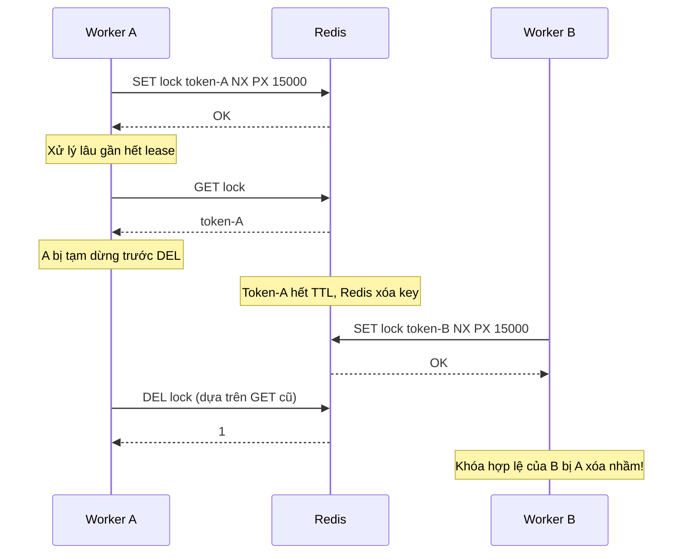
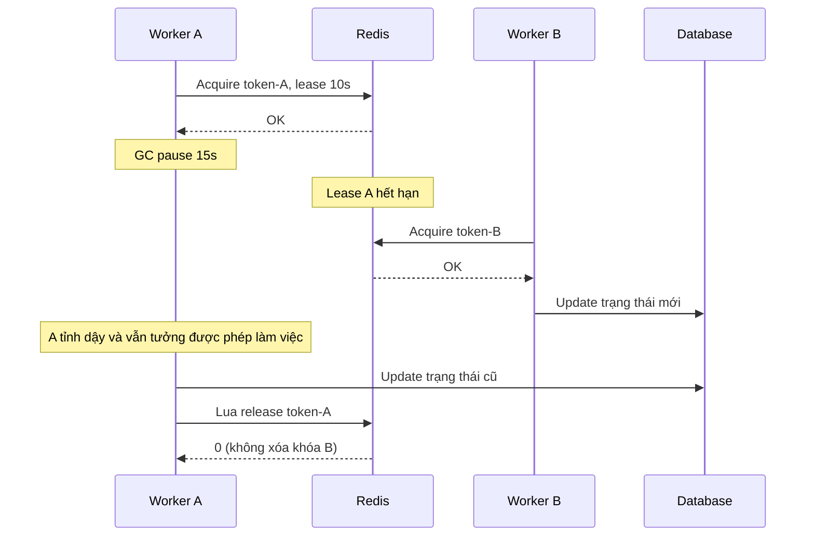

# Giải phóng khóa bằng token sở hữu và thao tác nguyên tử trong Spring Data Redis

## 1. Bối cảnh: tại sao cần cơ chế unlock có điều kiện?

Trong ứng dụng Spring Boot chạy nhiều instance, một số tác vụ có thể cần **chỉ một worker thực hiện tại một thời điểm**, chẳng hạn:

- Một scheduler xử lý đơn hàng quá hạn.
- Một worker tạo báo cáo nặng theo từng khách hàng.
- Một service tính lại cache tổng hợp cho một tài nguyên cụ thể.
- Một tiến trình thực hiện migration hoặc đồng bộ dữ liệu theo partition.
- Một API tránh hai request đồng thời cập nhật cùng trạng thái tạm thời.

Một phương án phổ biến là dùng Redis làm nơi giữ **distributed lock theo lease**: worker ghi một key bằng `SET key value NX PX milliseconds`. Nếu Redis trả `OK`, worker vừa giành được khóa; nếu không, khóa có thể đã thuộc một worker khác.

Nhưng **giành khóa an toàn chưa đủ**. Cần giải phóng khóa sao cho worker chỉ xóa được khóa **do chính lần giành khóa của mình** tạo ra.

Ví dụ sự cố:

1. Worker A lấy khóa `lock:order:42` với TTL 10 giây.
2. A bị tạm dừng vì GC, network hoặc một tác vụ chậm, kéo dài hơn 10 giây.
3. Redis tự xóa khóa đã hết TTL.
4. Worker B lấy được cùng tên khóa, bắt đầu công việc.
5. A hoạt động lại và gọi `DEL lock:order:42`.
6. Khóa của B bị xóa nhầm; worker C có thể cũng chiếm được khóa.

Do đó, câu lệnh `DEL` trực tiếp **không an toàn** trong thiết kế khóa có thời hạn.

> Quy tắc: **Mỗi lần acquire tạo một token sở hữu riêng. Khi release, Redis phải kiểm tra giá trị hiện tại còn bằng token đó rồi mới xóa — trong cùng một thao tác nguyên tử.**

Spring Data Redis có thể triển khai mẫu này bằng `StringRedisTemplate`, `SET ... NX PX` và một Lua script dùng `GET` + `DEL` ở phía Redis.

## 2. Phân biệt key, token, lease và quyền sở hữu

Một khóa Redis dùng cho mutual exclusion gồm bốn thành phần:

| Thành phần | Ví dụ | Mục đích |
|---|---|---|
| **Lock key** | `lock:order:42` | Xác định tài nguyên cần bảo vệ |
| **Owner token** | `c6ef...` (UUID ngẫu nhiên) | Nhận diện **một lần acquire cụ thể** |
| **Lease/TTL** | 15 giây | Giới hạn thời gian tồn tại khi worker chết |
| **Operation context** | Xử lý order 42 | Xác định việc nào đang được bảo vệ |

Tên khóa giống nhau qua các lần acquire; **token phải khác nhau**.

Ví dụ:

```text
t0: Redis key lock:order:42 = "token-A" ; TTL=15s
t1: Worker A đang xử lý
t2: Redis xóa khóa vì TTL hết
t3: Worker B SET NX thành công
    lock:order:42 = "token-B" ; TTL=15s
t4: A gọi unlock bằng token-A
    -> không được xóa giá trị token-B
```

Không dùng một token cố định như `"my-service"` cho tất cả lần acquire. Nếu A và B đều sử dụng cùng token thì phép so sánh không còn phân biệt được owner mới và owner cũ.

### 2.1. Token nên được sinh thế nào?

Đối với mẫu khóa đơn giản, dùng giá trị **đủ ngẫu nhiên và khó trùng lặp** cho **mỗi lần acquire**. `UUID.randomUUID()` là lựa chọn thực dụng khi không cần giao thức token chuyên biệt.

Không dùng:

- Tên thread (`Thread.currentThread().getName()`).
- ID container hoặc hostname được tái sử dụng qua nhiều lượt khóa.
- ID người dùng hoặc ID tài nguyên.
- Một biến token tạo một lần rồi tái sử dụng cho mọi lệnh khóa.
- Giá trị thời gian mili-giây đơn thuần có thể trùng khi nhiều worker cùng chạy.

Token không phải session đăng nhập; tuy nhiên nó là **bằng chứng quyền release** của lock. Vì vậy đừng log toàn bộ token ở log công khai, đưa token vào message không cần thiết hoặc cho ứng dụng không liên quan quyền sửa key khóa.

## 3. Acquire: dùng một lệnh SET NX với TTL

Redis hỗ trợ câu lệnh:

```redis
SET lock:order:42 token-A NX PX 15000
```

Giải thích:

- `SET`: đặt giá trị key.
- `NX`: chỉ ghi nếu key **chưa tồn tại**.
- `PX 15000`: đặt TTL 15.000 mili-giây cho key, cùng thao tác ghi.

Nếu thành công:

```text
OK
```

Nếu key đã tồn tại, Redis không ghi đè và trả kết quả biểu thị điều kiện `NX` không thỏa (Redis CLI thường hiển thị nil/null).

### 3.1. Vì sao phải có TTL ngay trong SET?

Đây là cách **không nên dùng**:

```redis
SETNX lock:order:42 token-A
EXPIRE lock:order:42 15
```

Hai lệnh riêng tạo một cửa sổ lỗi:

```text
SETNX thành công
       |
       X worker chết, timeout hoặc mất kết nối
       |
EXPIRE chưa được gửi
       |
       v
Khóa có thể tồn tại không TTL
```

Một khóa không TTL có thể tồn tại vô hạn tới khi được xóa thủ công hoặc server mất dữ liệu. Các worker khác có thể bị chặn mãi.

Dùng `SET key token NX PX ttl` giải quyết cửa sổ giữa **tạo khóa** và **đặt thời hạn**, vì Redis thực hiện chúng trong một command.

### 3.2. Trường hợp resource lock đã tồn tại

Khi `SET NX` không thành công, ứng dụng không nên tự động:

```redis
DEL lock:order:42
```

vì key có thể thuộc một worker đang chạy hợp lệ.

Thay vào đó, chọn một chính sách:

- Trả kết quả **busy/conflict** cho caller.
- Đưa công việc lại vào queue có giới hạn.
- Retry với backoff và jitter, có deadline rõ.
- Đọc trạng thái tác vụ từ nguồn dữ liệu chính để tránh xử lý lại nếu công việc đã hoàn tất.

**Không spin liên tục** bằng hàng nghìn `SET NX` mỗi giây. Một nhóm worker đang tranh chấp có thể tạo lượng lệnh Redis rất lớn mà không cải thiện throughput nghiệp vụ.

## 4. Lỗi kinh điển: GET rồi DEL là hai thao tác không nguyên tử

Một ý tưởng ban đầu:

```java
String current = redis.opsForValue().get(lockKey);

if (token.equals(current)) {
    redis.delete(lockKey);
}
```

Điều kiện kiểm tra có vẻ đúng, nhưng **không an toàn trong hệ phân tán**. Sau `GET` và trước `DEL`, Redis vẫn có thể xử lý lệnh từ client khác, và TTL vẫn tiếp tục trôi.

### 4.1. Race condition theo thời gian



Vấn đề là: quyết định "tôi sở hữu khóa" được đưa ra ở **thời điểm GET**, nhưng hành động DEL diễn ra sau đó. Thời gian giữa hai bước có thể thay đổi trạng thái key.

Dùng Java `synchronized`, `ReentrantLock` hoặc mutex bên trong cùng process không giải quyết được việc các **process khác nhau** cùng truy cập Redis. Java local lock chỉ bảo vệ thread trong một JVM.

### 4.2. Transaction hoặc pipeline có tự sửa lỗi này không?

- **Pipeline:** gửi `GET` và `DEL` liên tiếp không cho ứng dụng kiểm tra kết quả GET rồi mới quyết định DEL trong cùng một phép toán nguyên tử; pipeline không phải transaction.
- **MULTI/EXEC:** các lệnh trong `EXEC` chạy tuần tự, nhưng không có logic if/else dựa trên kết quả GET ngay trong lô theo cách ví dụ mong muốn. `WATCH` có thể triển khai optimistic check với nhiều lượt mạng và retry, nhưng phức tạp hơn cho thao tác release đơn giản.
- **Lua script:** Redis chạy logic so sánh + xóa trong một lần thực thi script nguyên tử; phù hợp với thao tác compare-and-delete này.

Vì thế, giải pháp thông dụng là **server-side compare-and-delete**.

## 5. Giải phóng khóa bằng Lua script

Script Redis:

```lua
if redis.call('GET', KEYS[1]) == ARGV[1] then
    return redis.call('DEL', KEYS[1])
end

return 0
```

Các đối số:

- `KEYS[1]`: lock key do client truyền.
- `ARGV[1]`: owner token của **lần acquire** mà client muốn release.
- Nếu giá trị hiện tại bằng token: `DEL` và trả 1.
- Nếu key không tồn tại hoặc value khác token: **không xóa** và trả 0.

Đây là thao tác nguyên tử xét ở mức lệnh/script Redis: giữa bước `GET` và `DEL` bên trong script, các command khác không chen vào để thay đổi key.

### 5.1. Hành vi theo trạng thái Redis

| Trạng thái key khi script bắt đầu | Token yêu cầu release | Kết quả | Ý nghĩa |
|---|---|---|---|
| Key có value `token-A` | `token-A` | `1` | Xóa khóa do token đó sở hữu |
| Key có value `token-B` | `token-A` | `0` | Khác owner; **không xóa** |
| Key không tồn tại | `token-A` | `0` | Khóa đã hết hạn/xóa/không có |
| Key có value `token-B` | `token-B` | `1` | Worker B release khóa của mình |
| Key có value bất kỳ | Token sai | `0` | Không được giải phóng khóa |

`0` **không chứng minh duy nhất** "khóa bị worker khác lấy". Nó cũng có thể có nghĩa key đã hết hạn hoặc bị xóa trước đó. Ứng dụng nên ghi nhận `not owner or absent` thay vì kết luận cụ thể khi không có dữ liệu bổ sung.

### 5.2. Thử với redis-cli trên key tách biệt

Ví dụ chỉ dùng namespace thử nghiệm:

```redis
DEL demo:lock:release:42

SET demo:lock:release:42 token-A NX PX 120000
# OK

EVAL "if redis.call('GET', KEYS[1]) == ARGV[1] then return redis.call('DEL', KEYS[1]) else return 0 end" 1 demo:lock:release:42 token-B
# (integer) 0

GET demo:lock:release:42
# "token-A"

EVAL "if redis.call('GET', KEYS[1]) == ARGV[1] then return redis.call('DEL', KEYS[1]) else return 0 end" 1 demo:lock:release:42 token-A
# (integer) 1

EXISTS demo:lock:release:42
# (integer) 0
```

`120000` được dùng để giảm nguy cơ hết TTL khi thao tác thủ công. Nếu chờ quá lâu trước lệnh `EVAL` cuối, kết quả có thể là 0 do key đã hết hạn; đó vẫn là hành vi an toàn.

### 5.3. Vì sao script phải nhận key qua KEYS?

Redis Lua script được khuyến nghị nhận những key cần truy cập qua `KEYS[]`; dữ liệu khác qua `ARGV[]`. Đặc biệt trong Redis Cluster, key mà script sử dụng phải được khai báo và tuân theo ràng buộc hash slot.

Không lắp ghép chuỗi tên key và token vào source Lua để mỗi lần release lại tạo một script khác. Dùng **một script cố định**, truyền dữ liệu qua argument giúp dễ quản lý script cache, logging và quyền truy cập.

## 6. Ví dụ hoàn chỉnh với Spring Data Redis và StringRedisTemplate

### 6.1. Dependency và kết nối

Ví dụ dùng Spring Boot với Redis mặc định:

```groovy
dependencies {
    implementation 'org.springframework.boot:spring-boot-starter-data-redis'
}
```

```yaml
spring:
  data:
    redis:
      host: localhost
      port: 6379
      connect-timeout: 2s
      timeout: 3s
```

Cần cấu hình authentication/TLS cho môi trường triển khai thực tế. Các credential không được đặt trực tiếp trong tài liệu hoặc source code.

Spring Data Redis có cả `RedisTemplate` và `StringRedisTemplate`. Mẫu dưới đây cố ý dùng **StringRedisTemplate** để:

- Lock key là String.
- Token được lưu là String.
- `GET` trong Lua đọc đúng bytes value do String serializer tạo.
- `ARGV[1]` được serialize nhất quán thành String.
- Tránh lỗi so sánh token vì `RedisTemplate` chung dùng serializer JDK/JSON khác.

### 6.2. Lớp OwnedRedisLock

```java
package com.example.redis.lock;

import java.time.Duration;
import java.util.Collections;
import java.util.Optional;
import java.util.UUID;

import org.springframework.data.redis.core.StringRedisTemplate;
import org.springframework.data.redis.core.script.DefaultRedisScript;
import org.springframework.stereotype.Component;

@Component
public class OwnedRedisLock {

    private static final String KEY_PREFIX = "lock:job:";

    private static final DefaultRedisScript<Long> RELEASE_SCRIPT =
            createReleaseScript();

    private final StringRedisTemplate redis;

    public OwnedRedisLock(StringRedisTemplate redis) {
        this.redis = redis;
    }

    private static DefaultRedisScript<Long> createReleaseScript() {
        DefaultRedisScript<Long> script = new DefaultRedisScript<>();

        script.setScriptText("""
                if redis.call('GET', KEYS[1]) == ARGV[1] then
                    return redis.call('DEL', KEYS[1])
                end
                return 0
                """);

        script.setResultType(Long.class);
        return script;
    }

    /**
     * Một lần acquire thành công phải tạo ra một token riêng.
     * Resource được giới hạn ký tự để tránh key collision và
     * tránh đưa chuỗi tùy ý vào namespace khóa.
     */
    public Optional<LockHandle> tryAcquire(
            String resource, Duration lease) {

        if (resource == null
                || !resource.matches("[A-Za-z0-9_-]{1,80}")) {
            throw new IllegalArgumentException("Invalid resource");
        }

        if (lease == null
                || lease.isZero()
                || lease.isNegative()
                || lease.toMillis() <= 0) {
            throw new IllegalArgumentException("Invalid lease");
        }

        String key = KEY_PREFIX + resource;
        String token = UUID.randomUUID().toString();

        Boolean acquired =
                redis.opsForValue().setIfAbsent(key, token, lease);

        if (Boolean.TRUE.equals(acquired)) {
            return Optional.of(new LockHandle(key, token));
        }

        if (Boolean.FALSE.equals(acquired)) {
            return Optional.empty(); // Worker khác đang giữ khóa.
        }

        // Spring Data Redis có thể trả null trong pipeline/transaction.
        // Đừng coi null là bằng chứng chắc chắn lock đã thất bại.
        throw new IllegalStateException(
                "No confirmed response for Redis lock acquisition"
        );
    }

    /**
     * Chỉ xóa khi Redis key đang chứa đúng token của handle.
     */
    public boolean release(LockHandle handle) {
        if (handle == null) {
            throw new IllegalArgumentException("handle is required");
        }

        Long removed = redis.execute(
                RELEASE_SCRIPT,
                Collections.singletonList(handle.key()),
                handle.token()
        );

        if (removed == null) {
            throw new IllegalStateException(
                    "No confirmed response for Redis lock release"
            );
        }

        return removed == 1L;
    }

    public record LockHandle(String key, String token) {}
}
```

Đoạn code sử dụng Java 17+ vì có `record` và Java text block (`"""..."""`). Với Java cũ, thay `record` bằng class bất biến và khai báo script bằng chuỗi nối dòng.

**Hợp đồng của lớp:**

- `tryAcquire(...)` trả `Optional.of(handle)` nếu nhận được xác nhận acquire thành công.
- Trả `Optional.empty()` khi Redis xác nhận `SET NX` không thể lấy khóa.
- Nếu lỗi mạng/driver thì có thể ném ngoại lệ; không tự coi là "busy".
- `release(handle)` trả `true` khi script xác nhận xóa đúng owner.
- Trả `false` khi key không tồn tại hoặc đã có owner khác.
- Nếu không nhận được kết quả script, ném ngoại lệ để caller **không khẳng định chắc chắn đã release**.

### 6.3. Vì sao trả lại handle thay vì chỉ Boolean?

Nếu chỉ có:

```java
boolean locked = acquire("order-42");
```

thì caller không có token để chứng minh quyền release. Có thể lưu token trong `ThreadLocal`, nhưng cách đó dễ lỗi với:

- Async execution/CompletableFuture.
- Reactive pipelines và thread switching.
- Worker pool dùng lại thread.
- Một method nắm nhiều khóa.
- Code được gọi qua các tầng service và callback khác nhau.

Một `LockHandle(key, token)` bất biến giúp truyền quyền sở hữu một cách tường minh theo chính lần acquire. Nó cũng tránh trường hợp lấy được khóa A nhưng vô tình gọi release bằng một token toàn cục khác.

**Không serialize hoặc lưu handle lâu dài chỉ để một process khác tự ý unlock.** Với những workflow cần chuyển quyền giữa process, phải thiết kế ownership transfer/lease protocol riêng.

## 7. Sử dụng khóa trong một service Spring

Ví dụ xử lý một tác vụ theo ID:

```java
package com.example.redis.lock;

import java.time.Duration;
import java.util.Optional;

import org.slf4j.Logger;
import org.slf4j.LoggerFactory;
import org.springframework.stereotype.Service;

@Service
public class InvoiceRebuildService {

    private static final Logger log =
            LoggerFactory.getLogger(InvoiceRebuildService.class);

    private final OwnedRedisLock lock;
    private final InvoiceRebuildWorker worker;

    public InvoiceRebuildService(
            OwnedRedisLock lock,
            InvoiceRebuildWorker worker) {
        this.lock = lock;
        this.worker = worker;
    }

    public boolean rebuild(String invoiceId) {
        Optional<OwnedRedisLock.LockHandle> acquired =
                lock.tryAcquire(
                        invoiceId, Duration.ofSeconds(30)
                );

        if (acquired.isEmpty()) {
            return false; // Có worker khác giữ lease.
        }

        var handle = acquired.get();

        try {
            worker.rebuildInvoice(invoiceId);
            return true;
        } finally {
            try {
                boolean released = lock.release(handle);

                if (!released) {
                    log.warn(
                            "Lock no longer owned during release: invoiceId={}",
                            invoiceId
                    );
                }
            } catch (RuntimeException releaseError) {
                log.error(
                        "Redis lock release was not confirmed: invoiceId={}",
                        invoiceId,
                        releaseError
                );
            }
        }
    }

    public interface InvoiceRebuildWorker {
        void rebuildInvoice(String invoiceId);
    }
}
```

Ví dụ dùng `finally` để cố release kể cả khi tác vụ ném exception. Nó **không bảo đảm** Redis luôn có thể trả lời trong `finally`, và **không bảo đảm tác vụ vẫn còn sở hữu lease đến cuối**.

Ở đây khối `catch` chỉ ghi log việc release không được xác nhận rồi để exception từ công việc chính giữ nguyên nếu có. Đó là một lựa chọn API; sản phẩm thật phải quyết định cách report warning, metric và recovery. Đặc biệt, kết quả `true` của `rebuild` chỉ nói code worker đã chạy xong, **chưa chứng minh lock luôn còn hiệu lực trong suốt toàn bộ quá trình**.

### 7.1. Tại sao finally vẫn cần token?

Nếu worker mất lease giữa chừng, `release(handle)` trả 0 và không xóa khóa mới của worker khác. Đây chính là lợi ích của token.

Nhưng không được thấy `release=false` rồi tự gọi:

```java
redis.delete(handle.key()); // Sai: xóa khóa không cần ownership!
```

Lệnh xóa cưỡng bức có thể phá vỡ chính cơ chế bảo vệ vừa thiết kế.

### 7.2. Kết quả trả 0 không phải lỗi cần sửa bằng DEL

Giả sử A release và nhận 0:

- TTL đã hết, key không tồn tại.
- B đã chiếm được key với token mới.
- Một thao tác vận hành hợp lệ đã xóa key.
- Key đã thay đổi do lỗi cấu hình hoặc client khác.

Nếu A cố "dọn sạch key" bằng `DEL`, nó có thể phá khóa B. Phản ứng đúng là **ghi nhận mất ownership**, không can thiệp vào khóa hiện tại.

## 8. Những giới hạn của lease: release an toàn không đồng nghĩa xử lý an toàn

Lua compare-and-delete giải quyết một lỗi cụ thể: **owner cũ không xóa được khóa mới**. Nó không giải quyết tất cả vấn đề mutual exclusion trong hệ phân tán.

### 8.1. Worker có thể tiếp tục làm việc sau khi lease hết



Trong ví dụ, Lua release hoạt động **hoàn toàn đúng** nhưng A vẫn có thể ghi đè dữ liệu của B ở database. Nguy cơ này xảy ra trước khi A gọi release.

Vì vậy khóa có TTL cần đi kèm những cơ chế khác nếu nghiệp vụ có invariant mạnh:

- Tác vụ có giới hạn thời gian dự kiến và có deadline.
- Kiểm tra lease/ownership trước khi commit side effect có rủi ro.
- Ghi dữ liệu có version hoặc điều kiện cập nhật.
- Idempotency để chống xử lý lặp.
- **Fencing token** được resource đích kiểm tra nếu cần loại bỏ thao tác từ owner cũ.
- Hoặc dùng transaction/lock ở database là nguồn dữ liệu chính khi cần tính đúng tuyệt đối.

**Kiểm tra `GET key == token` trước khi ghi database cũng chưa tạo atomicity giữa Redis và database**: lease có thể hết ngay sau phép GET, trước khi DB commit.

### 8.2. Fencing token khác random owner token

**Owner token** (UUID ngẫu nhiên) trả lời: "Có đúng lần acquire này đang giữ key tại lúc release không?"

**Fencing token** (số tăng đơn điệu, ví dụ 101, 102, 103) trả lời: "Thao tác này có mới hơn những thao tác đã được resource đích chấp nhận không?"

Ví dụ:

```text
A acquire -> fence = 101
B acquire -> fence = 102 (sau khi lease A hết)

B ghi database với fence 102 -> thành công
A tỉnh dậy, gửi ghi với fence 101 -> database từ chối
```

Điều kiện ở database/storage phải có khả năng loại những write mang fencing number cũ hơn giá trị đã nhận:

```sql
-- Mẫu minh họa về kiểm soát phiên bản tại resource đích.
UPDATE invoice_projection
SET payload = :payload,
    last_fence = :fence
WHERE invoice_id = :invoice_id
  AND last_fence < :fence;
```

Mẫu SQL trên giả định row đã tồn tại và cột `last_fence` được khởi tạo/kiểm soát; trong hệ thống thực phải xử lý insert/upsert, transaction, bảo đảm thứ tự và kết quả update rows.

Fencing token **không thể chỉ là UUID**: resource đích cần so sánh thứ tự đơn điệu. Ngay cả khi dùng `INCR` để tạo fence, cần thiết kế generation gắn với acquire, tính bền vững của counter qua failover và thao tác validate tại resource đích. Một Redis counter có thể mất các lần tăng chưa replicate khi failover; **không mặc định một counter trên một primary Redis với replication bất đồng bộ tạo fencing token có bảo đảm tuyệt đối**.

### 8.3. Lease chỉ là một cửa sổ thời gian

Khi chọn `Duration.ofSeconds(30)`:

- Nếu tác vụ bình thường mất 100 ms, lease 30 giây có thể dư nhưng gây chậm phục hồi khi worker chết.
- Nếu tác vụ có p99 là 45 giây, lease 30 giây quá ngắn và dễ mất quyền khi đang làm việc.
- Nếu không biết thời gian chạy tối đa, lease cố định không thể bảo đảm chỉ một worker thực thi suốt công việc.

Đo thời gian thực thi, khoảng GC pause, network stall và độ trễ dependency. Không dùng TTL rất dài chỉ để tránh hết hạn, vì worker chết sẽ giữ khóa lâu hơn cần thiết.

## 9. Gia hạn lease: chỉ owner hiện tại mới được kéo dài TTL

Với công việc lâu, có thể cần **lease renewal** định kỳ. Nhưng gia hạn bằng hai lệnh:

```redis
GET lock:job:invoice-42
PEXPIRE lock:job:invoice-42 30000
```

cũng gặp race condition tương tự GET+DEL: lease có thể hết và worker khác acquire giữa GET và PEXPIRE. Owner cũ có thể kéo dài TTL khóa của owner mới.

Dùng script nguyên tử:

```lua
if redis.call('GET', KEYS[1]) == ARGV[1] then
    return redis.call('PEXPIRE', KEYS[1], ARGV[2])
end

return 0
```

`ARGV[1]` là owner token, `ARGV[2]` là TTL mới tính bằng mili-giây dương.

Nếu value khác token hoặc key không còn, script không gia hạn và trả 0.

### 9.1. Tích hợp vào OwnedRedisLock

Bổ sung script và method nếu nghiệp vụ cần renewal:

```java
private static DefaultRedisScript<Long> createRenewScript() {
    DefaultRedisScript<Long> script = new DefaultRedisScript<>();

    script.setScriptText("""
            if redis.call('GET', KEYS[1]) == ARGV[1] then
                return redis.call('PEXPIRE', KEYS[1], ARGV[2])
            end
            return 0
            """);

    script.setResultType(Long.class);
    return script;
}

private static final DefaultRedisScript<Long> RENEW_SCRIPT =
        createRenewScript();

public boolean renew(
        LockHandle handle, Duration newLease) {

    if (handle == null
            || newLease == null
            || newLease.toMillis() <= 0) {
        throw new IllegalArgumentException("Invalid renewal");
    }

    Long renewed = redis.execute(
            RENEW_SCRIPT,
            Collections.singletonList(handle.key()),
            handle.token(),
            Long.toString(newLease.toMillis())
    );

    if (renewed == null) {
        throw new IllegalStateException(
                "No confirmed response for lease renewal"
        );
    }

    return renewed == 1L;
}
```

Snippet này được **thêm vào** class `OwnedRedisLock` ở phần trước và tái sử dụng các import, field đã khai báo. Nó không phải một Java class hoàn chỉnh độc lập.

Một lần `renew=false` phải được xem là tín hiệu **đã mất quyền sở hữu**, không được gọi `SET` để "sửa" lease bằng cách ghi đè owner khác.

### 9.2. Renewal không loại bỏ mọi rủi ro

Một vòng gia hạn thường cần:

- Chạy sớm trước khi TTL gần hết.
- Có deadline và số lần retry giới hạn.
- Dừng gia hạn khi công việc hoàn tất.
- Phát hiện kết quả `renew=false`.
- Xử lý tình huống timeout: không biết renewal đã được Redis thực hiện hay chưa.
- Hủy hoặc chặn side effect khi không còn bằng chứng còn lease, trong giới hạn khả thi.

Nếu thread bị tạm dừng lâu, tác vụ renew có thể không chạy đúng lịch. Nếu Redis failover khiến key bị mất hoặc thay đổi, renewal không ngăn được owner khác acquire. Vì vậy vẫn cần fencing hoặc điều kiện ghi ở resource đích cho các trường hợp yêu cầu tính đúng cao.

## 10. Mất kết nối và kết quả không chắc chắn

Không phải mọi exception Redis đều có thể phân loại thành "khóa chưa lấy" hoặc "khóa chưa xóa".

### 10.1. Timeout khi acquire

Client gửi:

```redis
SET lock:job:invoice-42 token-A NX PX 30000
```

Redis có thể đã thực thi command và tạo khóa, nhưng reply `OK` bị mất khi kết nối ngắt. Ứng dụng nhận timeout nên không có bằng chứng chắc chắn rằng nó sở hữu khóa, dù key có thể đang giữ token-A.

Đừng tự suy luận:

```text
Timeout khi SET -> khóa chắc chắn chưa tạo.
```

Chiến lược an toàn:

1. Giữ token được tạo cho **lần thử acquire** này trong ngữ cảnh xử lý lỗi.
2. Không bắt đầu side effect nếu chưa có xác nhận hợp lệ.
3. Có thể đối soát bằng cách đọc trạng thái lock, nhưng một lần `GET` khớp token chỉ xác nhận tình trạng tại một thời điểm.
4. Nếu không thể xác nhận an toàn, để TTL tự thu hồi và áp dụng retry/backoff có giới hạn.
5. Không `DEL` key khi chưa có quyền sở hữu được xác nhận.

Đoạn `tryAcquire` mẫu ném ngoại lệ trong lỗi đường truyền để caller không hiểu nhầm timeout thành `Optional.empty()` hay thành một lượt acquire chắc chắn thành công.

### 10.2. Timeout khi release

A gửi script compare-and-delete với token-A, Redis có thể đã:

- Nhận và xóa khóa của A, nhưng reply bị mất.
- Chưa nhận được lệnh hoặc chưa thực thi.
- Nhận lệnh khi khóa đã hết hạn hoặc chuyển owner, trả 0 nhưng reply bị mất.

Nếu client không nhận response, kết quả là **unknown outcome**. Có thể retry **chính script compare-and-delete với cùng token**, bởi script không xóa khóa có token khác:

- Nếu lượt trước đã xóa, lần sau trả 0 vì key không tồn tại.
- Nếu lượt trước chưa xóa và key vẫn mang token-A, lần sau có thể xóa.
- Nếu B đã chiếm khóa, script trả 0 và không xóa B.

Tuy nhiên kết quả 0 sau retry không phân biệt chắc lần đầu đã xóa hay TTL đã hết; chỉ chứng minh tại lần chạy gần nhất không có key mang token-A bị xóa. Không thay script có điều kiện bằng `DEL` trần để "làm sạch chắc chắn".

### 10.3. Không để auto-retry nhân đôi side effect

Các thao tác `SET NX PX` và Lua compare-and-delete có tính chất riêng. Với acquire, retry dùng **token mới** sau timeout có thể gặp lại khóa do chính token cũ tạo ra; vì thế lớp retry cần biết attempt ID và chính sách kiểm tra. Với release, retry cùng script/token có thể an toàn đối với **quyền xóa** nhưng không bảo đảm caller biết lần nào đã xóa.

Đừng áp dụng một bộ retry chung kiểu `catch (Exception e) { runAllAgain(); }` cho cả thao tác Redis và nghiệp vụ thanh toán/email/database, vì side effect khác có thể không idempotent.

## 11. Redis Cluster, Sentinel và failover

### 11.1. Lua compare-and-delete trên một key trong Cluster

Script release mẫu chỉ truy cập **một key**, vì vậy dễ triển khai với Redis Cluster khi client định tuyến đúng key tới node sở hữu slot. Script không tạo ra một transaction đa-node; nó nguyên tử trên server xử lý key đó.

Nếu mở rộng script để kiểm tra lock key, tăng fencing counter và ghi dữ liệu khác, các key trong script phải tuân theo ràng buộc hash slot của Redis Cluster. Ví dụ các key cùng hash tag:

```text
lock:{invoice-42}:owner
lock:{invoice-42}:fence
```

Cùng phần `{invoice-42}` khiến Redis Cluster định tuyến chúng vào cùng slot. Nhưng **cùng slot không tự làm script có rollback**, và cũng không giải quyết việc resource đích nằm trong database khác.

### 11.2. Bất đồng bộ replication có thể tạo hai owner

Một tình huống:

```text
1. Client A SET NX PX thành công trên Redis primary P.
2. P chưa kịp replicate lock key sang replica R.
3. P gặp sự cố; R được promote thành primary mới.
4. R không có khóa của A.
5. Client B SET NX PX thành công trên R.
6. A và B đều nghĩ mình từng lấy được khóa hợp lệ.
```

Redis replication và Sentinel failover thường có thành phần bất đồng bộ. Vì vậy **một khóa trên primary Redis** không tự trở thành cơ chế mutual exclusion an toàn tuyệt đối trước mọi failover.

Lua script đảm bảo compare-and-delete nguyên tử **trên server đang xử lý nó**, nhưng không thể hoàn tác tình huống lost write/duplicate ownership do failover.

Nếu yêu cầu tính đúng rất cao:

- Cân nhắc lock/transaction ở database giữ dữ liệu chính.
- Áp dụng fencing token được resource đích kiểm tra.
- Thiết kế idempotency và optimistic concurrency.
- Đánh giá các thuật toán distributed lock nhiều node theo yêu cầu/giả định cụ thể; không coi Redis Sentinel tự tương đương Redlock hay consensus lock service.
- Xác định rõ mức rủi ro chấp nhận của nghiệp vụ.

### 11.3. Khóa để giảm công việc trùng khác khóa bảo đảm correctness

Nếu khóa chỉ giúp tránh **hai lần tính lại một cache** thì một lần tính trùng sau failover có thể chấp nhận được.

Nếu khóa dùng để "chắc chắn chỉ trừ tồn kho một lần" hoặc "chắc chắn chỉ thanh toán một lần", phải có cơ chế bảo vệ invariant tại nguồn dữ liệu chính. **Redis lock token chỉ là một lớp phối hợp, không thay thế transaction/idempotency của nghiệp vụ.**

## 12. So sánh các mẫu unlock

| Cách unlock | Có kiểm tra owner? | Atomic? | An toàn khi A hết TTL và B acquire? |
|---|---|---|---|
| `DEL lockKey` | Không | DEL là một lệnh nguyên tử, nhưng không có kiểm tra | **Không** |
| Java `GET` rồi `DEL` | Có, nhưng kiểm tra tách rời | **Không nguyên tử** cho cả quy trình | **Không** |
| Java `GET`, so sánh rồi khóa JVM cục bộ, `DEL` | Chỉ kiểm tra local; Redis vẫn có client khác | Không ở Redis | **Không** |
| `WATCH` + `MULTI/EXEC` với retry đúng | Có thể | Có điều kiện ở cấp transaction Redis | Có thể, nhưng phức tạp hơn cho thao tác đơn giản |
| Lua compare token + `DEL` | Có | **Có**, khi server thực thi script | **Có**, đối với việc không xóa nhầm khóa B |
| Gia hạn TTL không kiểm tra token | Không | Tùy câu lệnh; sai semantics | **Không** |
| Lua compare token + `PEXPIRE` | Có | **Có** | Không kéo dài lease của owner mới |

Câu "an toàn" trong bảng chỉ nói về **quyền unlock/renew trên key Redis**. Nó không có nghĩa toàn bộ công việc trong `try-finally` đã được bảo vệ suốt thời gian chạy nếu lease có thể hết hạn.

## 13. Quy trình retry và backoff khi khóa đang bận

Không phải ứng dụng nào cũng cần đợi. Có hai nhóm:

- **API trực tuyến:** nếu không lấy được khóa, trả trạng thái "đang xử lý" hoặc xem lại kết quả hiện tại thay vì block request quá lâu.
- **Worker nền:** có thể retry sau khi delay, nhưng cần giới hạn số lượt và tránh dồn toàn bộ worker vào Redis mỗi vài mili-giây.

Mô hình retry bounded:

```text
deadline = now + maxWait
attempt = 0

while now < deadline:
    result = tryAcquire(resource, lease)

    if acquired:
        return lockHandle

    attempt++
    sleep(backoffWithJitter(attempt))

return busy
```

Thực thi thực tế nên dùng clock đơn điệu cho deadline chờ, tôn trọng interrupt/cancellation và có giới hạn backoff. Không chặn event-loop reactive bằng `Thread.sleep`.

Khi khóa bận, nếu nghiệp vụ đã hoàn tất theo `operationId`, việc retry lấy lock có thể không còn cần thiết. Kiểm tra idempotency/result ở nguồn dữ liệu chính giúp tránh công việc thừa.

### 13.1. Đừng gia hạn TTL khi không giữ owner token

Một anti-pattern:

```java
if (Boolean.FALSE.equals(
        redis.opsForValue().setIfAbsent(key, "fixed", lease))) {
    redis.expire(key, lease); // Sai: có thể gia hạn khóa của người khác.
}
```

Nếu client không lấy được khóa thì nó **không có quyền** thay đổi TTL của lock key. Không dùng `EXPIRE` hoặc `PERSIST` trên key của owner khác. Renewal chỉ được thực hiện bằng token khớp trong Lua.

## 14. RedisTemplate, serializer và kiểu dữ liệu của script

### 14.1. Vì sao StringRedisTemplate là lựa chọn thuận tiện?

`StringRedisTemplate` sử dụng string-oriented serialization cho key/value. Trong Lua:

```lua
redis.call('GET', KEYS[1]) == ARGV[1]
```

đòi hỏi bytes của giá trị lưu và bytes token truyền vào có cùng biểu diễn.

Với `RedisTemplate<String, Object>` được cấu hình JDK serialization hoặc JSON serializer, giá trị token trong key có thể khác chuỗi `ARGV[1]`, gây ra so sánh không khớp dù Java `token.equals(token)` là true.

Khi dùng template khác, cần thiết kế serializer cho cả `SET` và `execute(script, keys, args)` một cách nhất quán. Đối với key lock đơn giản, một `StringRedisTemplate` riêng giúp giảm độ phức tạp.

### 14.2. Spring Data Redis thực thi script ra sao?

`DefaultRedisScript<Long>` chứa source Lua và kiểu kết quả mong đợi. Khi gọi `redis.execute(script, keys, args...)`, Spring Data Redis kết hợp với driver gửi script tới Redis. Framework có thể sử dụng `EVALSHA` và fallback sang `EVAL` khi script chưa được cache, tùy cách triển khai/version.

Vì thế, quyền ACL cho client lock có thể cần các command/script permissions thích hợp. Không cấp bừa `+@all`; phải kiểm tra chính xác lệnh mà driver sử dụng, policy script của Redis server và yêu cầu least privilege.

Lưu ý:

- Script cố định có thể tái sử dụng qua các lượt gọi.
- `Long.class` phù hợp với reply số nguyên 0/1 của Redis.
- Không gọi một script phụ thuộc kết quả trả về ngay bên trong pipeline nếu caller cần quyết định nghiệp vụ lập tức.
- Không coi giá trị Java `null` do transaction/pipeline hoặc lỗi adapter là "script chắc chắn không xóa".
- Redis Lua script có tính nguyên tử của quá trình thực thi, nhưng nếu script phức tạp gây lỗi **sau các lệnh ghi**, Redis không tự rollback side effect trước đó. Script release ngắn phía trên tránh vấn đề này bằng một điều kiện và một `DEL`.

## 15. Giải phóng khóa trong ứng dụng reactive và async

Với code reactive (Project Reactor) hoặc async, việc dùng `ThreadLocal` để ghi nhận token rất dễ sai vì các bước có thể chạy ở thread khác.

Nguyên tắc:

1. Token là dữ liệu thuộc **một lần acquire**, không thuộc thread.
2. Truyền token trong context/handle của workflow.
3. Release khi luồng hoàn tất, thất bại hoặc bị hủy theo operator/lifecycle thích hợp.
4. Không block event loop bằng `StringRedisTemplate` hoặc `Thread.sleep` nếu đang ở reactive runtime.
5. Nếu dùng `ReactiveRedisTemplate`, cần API script/reactive tương ứng để compare-and-delete mà vẫn chạy trong một thao tác server-side.

Ví dụ tư duy:

```text
acquire(resource)
    -> handle(key, token)
    -> doWork(handle)
    -> release(handle) on completion/error/cancel
```

Dùng operators như `usingWhen` trong Reactor khi cần phối hợp lifecycle bất đồng bộ. Tuy nhiên cần hiểu cancellation và release failure có thể xảy ra; một luồng bị cancel cũng không thể giả định side effect đã được rollback.

## 16. Kịch bản thực tế: chỉ một worker đồng bộ dữ liệu theo orderId

Giả sử Kafka/Redis Stream hoặc một scheduler có thể kích hoạt cùng lệnh:

```text
Rebuild invoice projection for invoice-42
```

Hai Spring instances có thể nhận cùng work item gần như đồng thời.

Một thiết kế có nhiều lớp:

1. **Idempotency:** lưu ID tác vụ hoặc version đã xử lý trong database nguồn.
2. **Redis lease lock:** giảm khả năng hai worker đồng thời tính cùng projection.
3. **Operation token riêng:** chỉ owner hiện tại có thể release/renew khóa.
4. **Conditional database update:** kiểm tra version/fencing nếu projection phải chống ghi đè của worker cũ.
5. **Retry/queue:** chỉ ack work item khi side effect đã hoàn tất theo hợp đồng.
6. **Recovery:** khi Redis gặp sự cố, có thể chạy lại công việc mà không tạo side effect sai.

Ví dụ diễn biến bình thường:

```text
Worker A:
  SET lock:job:invoice-42 token-A NX PX 30000 -> OK
  load invoice
  calculate projection
  update projection with version check
  Lua GET==token-A ? DEL : no-op -> 1

Worker B:
  SET lock:job:invoice-42 token-B NX PX 30000 -> nil
  log/busy/backoff, không làm tác vụ cùng lúc
```

Diễn biến mất lease:

```text
Worker A:
  acquire -> thành công
  xử lý kéo dài hơn TTL

Worker B:
  acquire -> thành công với token-B
  cập nhật projection nếu version hợp lệ

Worker A:
  cố cập nhật projection -> bị version/fencing từ chối nếu thiết kế đúng
  release token-A -> 0, không xóa lock của B
```

Ở đây chính **database version check** bảo vệ dữ liệu, còn Lua release bảo vệ lock key.

## 17. Các tình huống vận hành cần quan sát

### 17.1. Metric đề xuất

| Metric | Câu hỏi |
|---|---|
| `redis_lock_acquire_success_total` | Có bao nhiêu lần giành khóa thành công? |
| `redis_lock_acquire_busy_total` | Có bao nhiêu lần tài nguyên đang bị giữ? |
| `redis_lock_acquire_errors_total` | Redis/driver lỗi bao nhiêu lần khi acquire? |
| `redis_lock_release_deleted_total` | Có bao nhiêu release thực sự xóa key cùng token? |
| `redis_lock_release_not_owner_total` | Bao nhiêu release trả 0 (key mất hoặc đổi owner)? |
| `redis_lock_release_unknown_total` | Bao nhiêu release không nhận được xác nhận? |
| `redis_lock_renew_failure_total` | Có bao nhiêu lần gia hạn không thành công? |
| `redis_lock_work_duration_seconds` | Tác vụ chạy bao lâu so với lease? |
| `redis_lock_acquire_wait_seconds` | Worker đợi khóa bao lâu? |
| `redis_lock_lock_expired_while_working_total` | Có bằng chứng/cảnh báo lease hết lúc công việc chưa hoàn tất? |

Tên metric là ví dụ ở tầng ứng dụng, không phải metric Spring Data Redis tự động sinh. Tránh dùng `resourceId` hoặc token của từng job làm label nếu cardinality cao; có thể phân nhóm theo loại resource/workflow.

### 17.2. Log có hữu ích không?

Một log tối thiểu có thể ghi:

```text
event=lock_acquired, resourceType=invoice, leaseMs=30000
event=lock_release, result=not_owner_or_absent
event=lock_acquire_failed, category=redis_timeout
event=lock_renew_failed, action=stop_work
```

Không cần log token nguyên văn. Khi cần correlation, dùng một trace/operation ID khác hoặc hash token có chính sách bảo mật phù hợp. Cần phân biệt rõ `busy`, `not_owner` và `unknown`; cả ba không có cùng nghĩa.

### 17.3. Khi release không thành công

Nếu Redis trả 0:

- Không gọi DEL cưỡng bức.
- Điều tra tác vụ có chạy lâu hơn TTL không.
- Kiểm tra pause, overload, số lượng retry, latency.
- Xác định có worker khác đang xử lý cùng resource không.
- Với dữ liệu quan trọng, đối chiếu kết quả ghi bằng invariant nghiệp vụ.

Nếu Redis timeout:

- Giữ trạng thái release outcome unknown.
- Có thể retry compare-and-delete với cùng token theo một chính sách bounded.
- Nếu không thể xác nhận, TTL giúp giới hạn việc khóa bị giữ, nhưng chưa chứng minh tính đúng của công việc.

## 18. Những lỗi triển khai phổ biến

| Lỗi | Vì sao sai | Cách sửa |
|---|---|---|
| `SETNX` rồi `EXPIRE` | Hai lệnh tạo cửa sổ khóa không TTL | `SET ... NX PX` |
| Lưu value cố định `"locked"` | Không nhận diện được lần acquire cụ thể | UUID token mới mỗi lượt |
| `DEL` trong `finally` | Owner cũ có thể xóa lock của owner mới | Lua compare-and-delete |
| Java `GET` → `DEL` | Race condition giữa hai round trips | Chuyển kiểm tra vào Lua |
| `GET` → `PEXPIRE` | Owner cũ có thể gia hạn lock mới | Lua compare-and-expire |
| Cho rằng `release=false` là lỗi cần `DEL` | Có thể đang có owner B hợp lệ | Không xóa, ghi nhận mất owner |
| Bắt timeout acquire rồi chạy công việc | Không có bằng chứng đang giữ khóa | Không chạy side effect |
| Không đặt TTL | Worker chết có thể giữ khóa vô hạn | Lease hữu hạn |
| TTL ngắn hơn thời gian tác vụ | Worker cũ có thể tiếp tục khi B đã acquire | Chọn lease/renew/fencing |
| Tái dùng token giữa các lượt | Mất khả năng phân biệt owner mới/cũ | Sinh token mỗi acquisition |
| Dùng `ThreadLocal` trong async | Thread switching làm sai ownership | Truyền handle rõ ràng |
| Serializer khóa và script khác nhau | Lua `GET` không bằng `ARGV` | `StringRedisTemplate` hoặc serializer nhất quán |
| Mặc định Redis failover không mất lock write | Replication có thể bất đồng bộ | Fencing, DB constraints, SLA rõ |
| Cho rằng khóa Redis thay thế DB transaction | Không bảo vệ side effect ngoài Redis | Version/transaction/idempotency |
| Release trước khi side effect kết thúc | Worker khác có thể bắt đầu sớm | Giữ handle tới đúng ranh giới nghiệp vụ |
| Retry dồn dập khi bận | Tăng Redis QPS và CPU | Backoff, jitter, deadline |
| Cố ghi đè value khi khóa bận | Phá quyền sở hữu | Không `SET` không điều kiện |
| Log toàn bộ token/credential | Rò capability giải phóng khóa | Chỉ log metadata không nhạy cảm |

## 19. Một cách kiểm tra hành vi theo kịch bản

Để hiểu semantics trên một Redis thử nghiệm, có thể lần lượt tái hiện các tình huống:

### 19.1. A chỉ giải phóng khóa của A

```text
A acquire -> token-A, OK
A release(token-A) -> 1
GET key -> nil
```

### 19.2. B không được giải phóng khóa của A

```text
A acquire -> token-A, OK
B release(token-B) -> 0
GET key -> token-A
```

### 19.3. Token cũ sau TTL không xóa khóa mới

```text
A acquire token-A, lease rất ngắn
Redis key expired
B acquire token-B, OK
A release(token-A) -> 0
GET key -> token-B
```

### 19.4. Worker xử lý dài hơn lease

```text
A acquire, bắt đầu xử lý
TTL hết
B acquire, bắt đầu xử lý
A release -> 0
Dữ liệu cuối cùng phải được bảo vệ bằng version/fencing nếu nghiệp vụ cần
```

### 19.5. Timeout hoặc failover

```text
Gửi acquire/release nhưng connection bị ngắt
=> outcome có thể chưa xác định

Không tự khẳng định acquired/released
Không DEL bừa hoặc tự chạy side effect
Theo dõi TTL, đối soát và retry có giới hạn
```

Những kịch bản này hướng dẫn **cách suy nghĩ về hậu quả** chứ không tạo ra một chứng nhận correctness cho mọi topology Redis. Với hệ thống sản xuất cần kiểm chứng thêm tác động replication, pause, failover và source-of-truth semantics phù hợp với SLA.

## 20. Khi nào nên dùng thư viện khóa thay vì tự viết?

Mẫu `SET NX PX + Lua` đủ rõ ràng cho nhiều tác vụ **best-effort mutual exclusion** ngắn và có idempotency. Khi yêu cầu nâng cao như:

- Reentrant lock.
- Lease watchdog/renewal tự động.
- Phối hợp nhiều Redis instances.
- Read/write locks, semaphores, fair lock hoặc lock cancellation.
- Reactive API phức tạp.
- Tích hợp theo các mẫu synchronization đa dạng.

có thể cân nhắc thư viện như **Redisson**, nhưng phải hiểu chính xác **bảo đảm và failure model** của abstraction được chọn. Một thư viện không thể tự làm mọi thay đổi trong database bên ngoài trở thành atomic transaction.

Đặc biệt, không suy luận "thư viện có watchdog nên khóa không bao giờ hết" hoặc "có Redlock nên đã có fencing cho mọi external side effect". Với nghiệp vụ yêu cầu chống stale owner ghi đè, vẫn phải xác định cơ chế version/fencing được phía resource đích thực thi.

## 21. Tổng kết

Giải phóng distributed lock an toàn trong Spring Data Redis cần hai nguyên tắc đi liền nhau:

1. **Acquire bằng một lệnh nguyên tử** `SET key token NX PX ttl`, trong đó **token mới được tạo cho từng lần lấy khóa**.
2. **Release bằng thao tác nguyên tử có kiểm tra token** — thông dụng nhất là Lua script: `GET == ownerToken` thì `DEL`, ngược lại không xóa.

Hai nguyên tắc này ngăn worker cũ xóa nhầm khóa của worker mới sau khi TTL hết hạn. `StringRedisTemplate` cùng `DefaultRedisScript<Long>` giúp triển khai thuận tiện, giữ bytes của token nhất quán và nhận kết quả 1/0 từ Redis.

Tuy vậy, **không xóa nhầm khóa chỉ là một phần của bài toán**. Lease có thể hết trong khi worker vẫn chạy; timeout làm kết quả acquire/release không chắc chắn; Redis failover có thể làm mất ghi chưa replicate. Với những nghiệp vụ yêu cầu correctness mạnh, hãy kết hợp **idempotency, version check hoặc fencing tại nguồn dữ liệu chính**, chọn TTL phù hợp, giới hạn retry và theo dõi mất ownership. Không được dùng `DEL` không điều kiện để bù cho một lần unlock trả 0.

## Tài liệu tham khảo

- [Redis documentation — Distributed locks with Redis](https://redis.io/docs/latest/develop/use/patterns/distributed-locks/)
- [Redis documentation — SET command, NX and PX options](https://redis.io/docs/latest/commands/set/)
- [Redis documentation — EVAL and Lua scripting](https://redis.io/docs/latest/develop/programmability/eval-intro/)
- [Spring Data Redis — Scripting](https://docs.spring.io/spring-data/redis/reference/redis/scripting.html)
- [Spring Data Redis — ValueOperations.setIfAbsent API](https://docs.spring.io/spring-data/redis/docs/current/api/org/springframework/data/redis/core/ValueOperations.html)
- [Spring Data Redis — DefaultRedisScript API](https://docs.spring.io/spring-data/redis/docs/current/api/org/springframework/data/redis/core/script/DefaultRedisScript.html)
