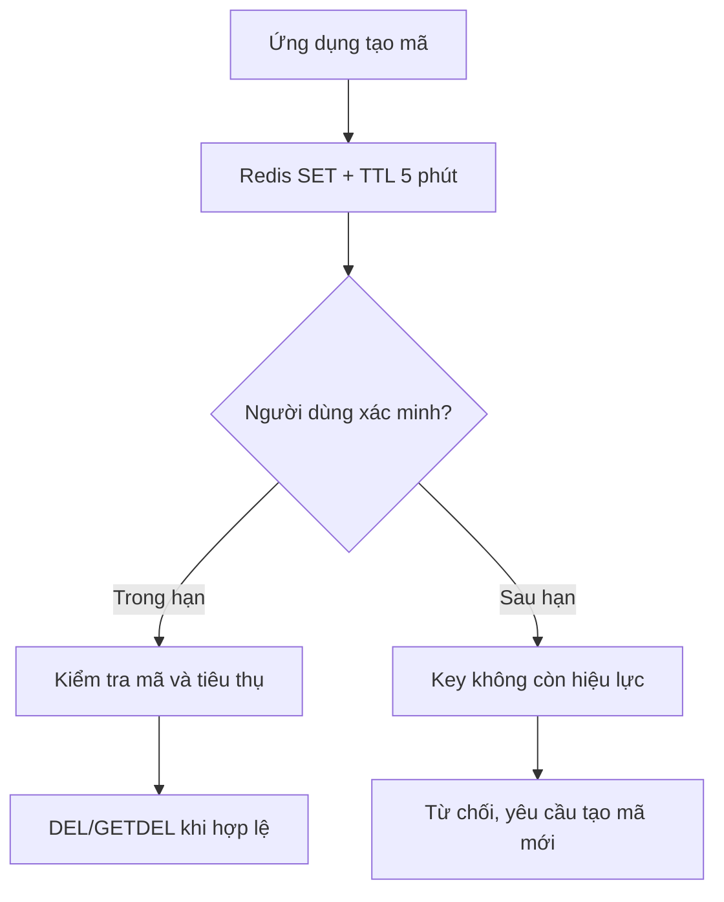
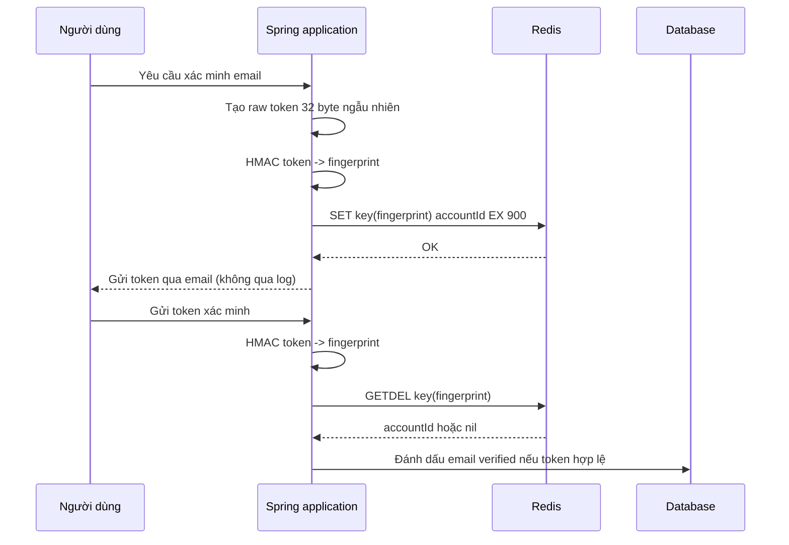

# Lưu mã xác minh hoặc token tạm thời với TTL trong Spring Data Redis

Một ứng dụng thường cần phát cho người dùng một **mã xác minh (OTP)** hoặc **token dùng một lần**: mã xác nhận địa chỉ email, mã xác minh số điện thoại, liên kết đặt lại mật khẩu, token chấp nhận lời mời hoặc token xác nhận một hành động nhạy cảm. Những dữ liệu này có đặc điểm chung: **sống ngắn, có phạm vi sử dụng rõ ràng và thường phải mất hiệu lực ngay sau khi được dùng thành công**.

Redis phù hợp để lưu trạng thái tạm thời như vậy vì có các thao tác nhanh trên key, hỗ trợ **TTL (time to live)** và những lệnh/script thực thi nguyên tử trên server. Spring Data Redis cung cấp `StringRedisTemplate`, `RedisTemplate`, `ReactiveStringRedisTemplate` và khả năng gọi Redis Lua script để xây dựng luồng phát hành–xác minh–tiêu thụ.

Ví dụ yêu cầu nghiệp vụ:

> Người dùng yêu cầu xác minh email. Hệ thống tạo mã sáu chữ số, cho phép tối đa năm lần nhập sai trong năm phút, và chỉ chấp nhận một lần. Sau khi xác minh thành công hoặc hết thời gian, mã không còn được dùng.

Một mô hình khác:

> Người dùng nhận một đường dẫn đặt lại mật khẩu chứa token ngẫu nhiên có entropy cao. Token tồn tại trong mười lăm phút và khi được tiêu thụ thì không thể dùng lại.

Hai bài toán có vẻ giống nhau nhưng có **mô hình đe dọa khác nhau**. OTP sáu chữ số chỉ có một triệu khả năng, nên phải chống đoán mã và giới hạn số lần thử. Token được tạo từ 32 byte ngẫu nhiên có không gian tìm kiếm lớn hơn rất nhiều, nhưng vẫn phải bảo vệ khỏi rò rỉ URL, ghi log, replay và lỗi giữa Redis với database.

Bài học này xây dựng hai mẫu ứng dụng với **Spring Data Redis + TTL**: một mẫu **token ngẫu nhiên dùng một lần** bằng `GETDEL`, và một mẫu **OTP ngắn có giới hạn lần nhập sai** bằng Redis Hash và Lua. Đồng thời giải thích chi tiết TTL, tính nguyên tử, bảo mật, xử lý lỗi, kiểm thử và cách triển khai thực tế.

## 1. Yêu cầu trước khi chọn cấu trúc Redis

Không nên bắt đầu bằng câu hỏi “lưu OTP trong String hay Hash?”. Trước hết, cần thống nhất hợp đồng nghiệp vụ.

| Câu hỏi | Ví dụ lựa chọn |
|---|---|
| **Mục đích** | Xác minh email, đăng nhập bằng OTP, reset mật khẩu, xác nhận giao dịch |
| **Đối tượng** | User ID nội bộ, account ID, phiên xác minh, challenge ID |
| **Hình thức bí mật** | OTP 6 chữ số hoặc token ngẫu nhiên 32 byte |
| **Thời hạn** | 3–10 phút với OTP; 10–30 phút với token, tùy chính sách |
| **Số lần sử dụng** | Một lần, hoặc nhiều lần trong khoảng TTL nếu nghiệp vụ cho phép |
| **Số lần thử sai** | Ví dụ tối đa 5 lần đối với OTP |
| **Phát hành lại** | Chờ cooldown, từ chối khi còn mã cũ hoặc thay mã theo chính sách |
| **Khi Redis lỗi** | Từ chối xác minh và cho thử lại; không tự bỏ qua kiểm tra |
| **Khi nghiệp vụ sau xác minh lỗi** | Token đã tiêu thụ hay có cơ chế phục hồi riêng? |
| **Khi đối tượng bị xóa/khóa** | Token cũ có còn được chấp nhận không? |

TTL giúp tự dọn trạng thái theo thời gian, nhưng **TTL không thay thế việc kiểm tra mục đích, người dùng, số lần thử và hiệu lực một lần**.

### 1.1. Phân biệt OTP và token ngẫu nhiên

| Khía cạnh | OTP ngắn | Token ngẫu nhiên có entropy cao |
|---|---|---|
| Ví dụ | `042781` | Chuỗi Base64URL khoảng 43 ký tự từ 32 byte |
| Khả năng nhập tay | Tốt | Không phù hợp |
| Không gian tìm kiếm | 1.000.000 trường hợp nếu 6 chữ số | Khoảng 2^256 trường hợp nếu sinh 32 byte an toàn |
| Chống brute force | Bắt buộc có giới hạn lần thử và rate limit | Vẫn cần rate limit và phát hiện lạm dụng |
| Cách lưu nên chọn | HMAC của mã, bộ đếm attempts và TTL | Lưu fingerprint/HMAC của token làm Redis key, TTL |
| Cách dùng điển hình | SMS/email code | Liên kết xác minh hoặc đặt lại mật khẩu |
| Tiêu thụ nguyên tử | Lua kiểm tra + xóa | `GETDEL` hoặc Lua |

OTP và token đều là **credential tạm thời**. Chúng không nên xuất hiện trong log, metric label, URL analytics hoặc Redis key ở dạng nguyên văn.

## 2. TTL thực sự làm gì?

TTL là khoảng thời gian Redis cho phép một key tồn tại trước khi hết hạn.

Ví dụ:

```redis
SET demo:verification:42 pending EX 300
```

`EX 300` thiết lập thời gian sống 300 giây, tương đương năm phút. Sau khi hết thời hạn, key không còn được trả về như một key hợp lệ.

Các biến thể:

```redis
SET demo:verification:42 pending EX 300
SET demo:verification:42 pending PX 300000
EXPIRE demo:verification:42 300
PEXPIRE demo:verification:42 300000
```

Trong Spring Data Redis:

```java
stringRedisTemplate.opsForValue().set(
        "demo:verification:42",
        "pending",
        Duration.ofMinutes(5));
```

Phương thức `set(key, value, Duration)` gửi thao tác ghi gắn expiration theo cơ chế Redis/Spring Data Redis phù hợp. Đây thường là lựa chọn tốt hơn so với ghi xong rồi mới gọi `expire`.

### 2.1. Vì sao nên đặt TTL cùng lúc với ghi?

Ví dụ thiếu an toàn về vòng đời:

```java
redis.opsForValue().set(key, value);
redis.expire(key, Duration.ofMinutes(5));
```

Giữa hai lệnh, ứng dụng có thể crash hoặc kết nối Redis bị lỗi. Khi đó key có thể tồn tại **không có TTL**, để lại một mã xác minh tồn tại lâu hơn dự kiến.

Với Redis String, ưu tiên:

```java
redis.opsForValue().set(key, value, Duration.ofMinutes(5));
```

Nếu dữ liệu cần lưu bằng Redis Hash với nhiều field và TTL, có thể dùng **một Lua script** để `HSET` và `PEXPIRE` trong cùng một lượt thực thi nguyên tử trên Redis server.

### 2.2. TTL được Redis tính, không phải bộ đếm trong JVM

TTL không cần một thread Java riêng gọi `sleep(300000)` rồi xóa key. Redis duy trì expiration trên server.

Sơ đồ:



Với mô hình này, nhiều instance Spring có thể cùng sử dụng một Redis mà không cần chia sẻ biến Java hoặc tạo nhiều timer độc lập.

### 2.3. TTL không phải lịch phát sự kiện đúng giờ

Redis sử dụng cơ chế expiration thụ động và chủ động. Một key quá hạn sẽ không còn được coi là hợp lệ khi truy cập, nhưng thông báo `expired` nếu được bật **không bảo đảm phát đúng mili-giây TTL về 0**.

Với xác minh token, **hãy dựa vào trạng thái còn hiệu lực của key trong Redis khi thực thi lệnh**, không dựa vào việc listener đã nhận notification `expired` hay chưa. Việc dọn dẹp và quan sát expired event là vấn đề khác.

## 3. Hiểu rõ TTL, PTTL và các giá trị đặc biệt

Redis cung cấp:

```redis
TTL demo:verification:42
PTTL demo:verification:42
```

| Kết quả | Ý nghĩa |
|---|---|
| Số dương hoặc `0` | Thời gian sống còn lại, đơn vị giây với `TTL` hoặc mili-giây với `PTTL` |
| `-1` | Key còn tồn tại nhưng **không có thời hạn** |
| `-2` | Key không tồn tại, bao gồm trường hợp đã hết hạn |

Ví dụ quan sát:

```redis
SET demo:ttl:code sample EX 60
TTL demo:ttl:code
PTTL demo:ttl:code
GET demo:ttl:code
```

Một giá trị TTL dương không chứng minh mã xác minh còn được phép sử dụng về mặt nghiệp vụ: mã có thể đã bị vô hiệu hóa bởi trạng thái tài khoản, purpose, attempt limit hoặc rule xác thực bổ sung.

### 3.1. Ghi đè key có thể làm mất TTL

Ví dụ:

```redis
SET demo:ttl:code old EX 60
SET demo:ttl:code new
TTL demo:ttl:code
```

Một lệnh `SET` thông thường không kèm tùy chọn giữ TTL sẽ **thay giá trị và bỏ expiration cũ**. Đây là lỗi nghiêm trọng nếu code “cập nhật OTP” nhưng quên cung cấp TTL mới.

Khi phát hành lại, cần một chính sách rõ ràng và gắn TTL cùng thao tác ghi. Với Redis Hash, cập nhật field bằng `HSET` không tự làm mất TTL của key đã có theo cách `SET` ghi đè String, nhưng **tạo một Hash mới rồi quên `EXPIRE` vẫn nguy hiểm**.

### 3.2. Không coi TTL là bằng chứng lưu trữ bền vững

Redis có thể mất key sớm hơn TTL do:

- `DEL`/`UNLINK` chủ động.
- Redis eviction vì memory pressure, tùy `maxmemory-policy`.
- Restart/failover với mức persistence không đủ.
- Flush database hoặc thao tác quản trị.
- Ứng dụng phát hành mã mới làm thay thế hoặc thu hồi mã cũ.

Vì vậy, TTL biểu diễn **giới hạn thời gian sống của trạng thái khi Redis giữ nó**, không cam kết Redis sẽ giữ key đúng đến giây cuối.

## 4. Quy tắc bảo mật chung cho mã xác minh

Khi thiết kế service, hãy coi OTP/token là bí mật có khả năng cho phép thay đổi trạng thái tài khoản.

1. **Sinh bí mật bằng CSPRNG.** Trong Java dùng `SecureRandom`, không dùng `Random` hay phép tính từ timestamp.
2. **Không lưu nguyên văn OTP/token** nếu không cần. Với OTP ít entropy, dùng HMAC có khóa bí mật nằm ngoài Redis để giảm nguy cơ đoán từ bản dump.
3. **Có purpose rõ ràng** như `EMAIL_VERIFY` hoặc `PASSWORD_RESET`. Token dùng cho mục đích này không được dùng cho mục đích khác.
4. **Ràng buộc đúng chủ thể**, ví dụ account ID nội bộ hoặc challenge ID, không tin một user ID tùy ý do người gọi gửi mà chưa xác thực.
5. **Có TTL ngắn** và kiểm tra hiệu lực khi tiêu thụ.
6. **Tiêu thụ một lần** bằng lệnh Redis nguyên tử hoặc một giao thức trạng thái đủ mạnh.
7. **Giới hạn lần nhập sai và tần suất yêu cầu phát mã**, đặc biệt với OTP 4–8 chữ số.
8. **Không tiết lộ trạng thái tài khoản** qua thông báo lỗi khác biệt giữa email tồn tại và không tồn tại khi không cần thiết.
9. **Không trả mã qua endpoint công khai**. Chỉ chuyển mã cho kênh delivery phù hợp như email/SMS đã xác minh quy trình.
10. **Không ghi mã vào log/trace/analytics**, kể cả khi Redis TTL rất ngắn.

### 4.1. Vì sao không dùng timestamp làm mã?

Sai:

```java
String code = Long.toString(System.currentTimeMillis())
        .substring(7);
```

Mã có cấu trúc dự đoán được. Những người biết khoảng thời gian yêu cầu mã có thể giảm mạnh số khả năng cần thử.

Đúng cho mã sáu chữ số:

```java
SecureRandom random = new SecureRandom();
String code = String.format(
        Locale.ROOT,
        "%06d",
        random.nextInt(1_000_000));
```

Mỗi mã từ `000000` đến `999999` có thể được tạo với xác suất gần đồng đều khi sử dụng CSPRNG theo cách trên.

### 4.2. Vì sao không dùng UUID như một OTP nhập tay?

Một UUID v4 có thể phù hợp để định danh challenge nếu sinh bằng cơ chế an toàn, nhưng quá dài cho mã người dùng phải gõ. Khi cần đường dẫn có token, hãy dùng một chuỗi ngẫu nhiên có entropy cao; khi cần mã ngắn, dùng số chữ số dễ nhập và **bảo vệ bằng attempt limit + rate limiting**.

## 5. Hai sơ đồ dữ liệu Redis phù hợp

### 5.1. Token ngẫu nhiên: token fingerprint làm Redis key

Producer tạo token ngẫu nhiên `rawToken`, rồi tính HMAC/fingerprint:

```text
rawToken (chỉ gửi cho người dùng)
        |
        v
HMAC-SHA256(serverSecret, purpose || rawToken)
        |
        v
Redis key: verify:token:v1:password-reset:<digest>
Redis value: opaqueAccountId
Redis TTL: 15 phút
```

Lợi ích:

- Redis không lưu token nguyên văn.
- Redis key có thể lookup trực tiếp từ token do người dùng trình lên.
- `GETDEL` có thể **đọc và xóa một lần nguyên tử**.
- Digest được namespace theo purpose/version.

Do token có entropy cao, một fingerprint như SHA-256 cũng có thể hợp lý. Dùng HMAC với khóa bí mật phía ứng dụng giúp phân tách rõ bề mặt credential và tránh lộ fingerprint có thể tính từ token ở những môi trường khác.

### 5.2. OTP ngắn: Redis Hash có digest và attempts

Đối với mã sáu chữ số:

```text
Redis key: verify:otp:v1:email:<opaque-or-digested-account-id>
Redis type: Hash
    digest   = HMAC-SHA256(secret, purpose + accountId + code)
    attempts = 0
TTL: 5 phút
```

Khi người dùng nhập mã, server tự tính digest rồi dùng Lua để:

1. Đọc digest và attempts hiện tại.
2. Nếu key không tồn tại, từ chối.
3. Nếu mã khớp và chưa bị khóa, xóa key và chấp nhận.
4. Nếu sai, tăng attempts.
5. Nếu vượt ngưỡng, xóa key hoặc đánh dấu đã khóa.

Các thao tác kiểm tra + cập nhật + tiêu thụ cần chạy **nguyên tử**, tránh hai request cùng dùng một OTP.

## 6. Khởi tạo Spring Data Redis

Với Spring Boot 3.x, dependency Maven thông thường:

```xml
<dependency>
    <groupId>org.springframework.boot</groupId>
    <artifactId>spring-boot-starter-data-redis</artifactId>
</dependency>
```

Gradle:

```gradle
implementation("org.springframework.boot:spring-boot-starter-data-redis")
```

Cấu hình kết nối ví dụ:

```yaml
spring:
  data:
    redis:
      host: localhost
      port: 6379
      timeout: 3s
```

Đây chỉ là cấu hình phát triển local. Ở production, cần TLS, ACL, network restriction, quản lý secret, availability/failover và timeout theo hạ tầng thật.

### 6.1. Vì sao dùng StringRedisTemplate?

`StringRedisTemplate` thường dùng `StringRedisSerializer` cho key và value, giúp ta biết rõ:

- Key Redis là chuỗi có namespace.
- Value là account ID hoặc các trường Hash dạng chuỗi.
- Digest được lưu dưới dạng chuỗi hex.
- Không có serializer Java object khó kiểm soát ở tầng credential.

Nếu sử dụng `RedisTemplate<String, Object>` với serializer khác, cần kiểm tra định dạng byte và key thực tế. Với token tạm thời, định dạng đơn giản và nhất quán thường dễ vận hành hơn.

## 7. Mẫu ứng dụng A: token dùng một lần với GETDEL

Giả sử người dùng nhận email chứa liên kết xác minh. Token là một chuỗi Base64URL từ **32 byte SecureRandom**, lưu trong Redis trong 15 phút và phải được tiêu thụ một lần.

Luồng:



`GETDEL` lấy giá trị và xóa key **trong một lệnh Redis nguyên tử**. Hai request xác minh đồng thời cùng token không thể đều nhận được account ID từ cùng một entry.

### 7.1. Sinh token ngẫu nhiên an toàn

```java
import java.security.SecureRandom;
import java.util.Base64;

public final class TokenGenerator {
    private static final SecureRandom RANDOM = new SecureRandom();

    private TokenGenerator() {}

    public static String generate() {
        byte[] bytes = new byte[32];
        RANDOM.nextBytes(bytes);
        return Base64.getUrlEncoder()
                .withoutPadding()
                .encodeToString(bytes);
    }
}
```

Đầu ra là chuỗi Base64URL an toàn hơn khi đưa vào URL so với Base64 thông thường vì không chứa `+` hoặc `/`, và bỏ dấu padding. Chuỗi này vẫn là **bí mật**; URL-safe không đồng nghĩa an toàn để ghi log hoặc phát tán.

### 7.2. Tính HMAC-SHA256 với server secret

Một utility có thể dùng cho token và OTP:

```java
package com.example.verification;

import java.nio.charset.StandardCharsets;
import java.security.GeneralSecurityException;
import java.util.Base64;
import java.util.HexFormat;

import javax.crypto.Mac;
import javax.crypto.spec.SecretKeySpec;

public final class VerificationHmac {

    private final byte[] secret;

    public VerificationHmac(String base64Secret) {
        byte[] decoded = Base64.getDecoder().decode(base64Secret);
        if (decoded.length < 32) {
            throw new IllegalArgumentException(
                    "Verification HMAC secret must contain at least 32 bytes");
        }
        this.secret = decoded.clone();
    }

    public String hexDigest(String data) {
        try {
            Mac mac = Mac.getInstance("HmacSHA256");
            mac.init(new SecretKeySpec(secret, "HmacSHA256"));

            byte[] result = mac.doFinal(
                    data.getBytes(StandardCharsets.UTF_8));

            return HexFormat.of().formatHex(result);
        } catch (GeneralSecurityException error) {
            throw new IllegalStateException(
                    "Cannot calculate verification HMAC", error);
        }
    }
}
```

Ở production, secret này phải đến từ secret manager hoặc biến môi trường được bảo vệ, không hardcode trong Git. Các instance xác minh phải dùng cấu hình khóa tương thích; nếu thay secret ngay lập tức, token còn hiệu lực có thể không còn tìm thấy trong Redis.

`Mac` được khởi tạo **theo lần gọi**, không chia sẻ một instance `Mac` mutable giữa nhiều thread.

### 7.3. Cài đặt TokenService bằng StringRedisTemplate

Ví dụ self-contained:

```java
package com.example.verification;

import java.time.Duration;
import java.util.Optional;

import org.springframework.beans.factory.annotation.Value;
import org.springframework.data.redis.core.StringRedisTemplate;
import org.springframework.stereotype.Service;

@Service
public class OneTimeVerificationTokenService {

    private static final Duration TOKEN_TTL =
            Duration.ofMinutes(15);

    private static final String PURPOSE = "email-verify";
    private static final String PREFIX =
            "verify:token:v1:" + PURPOSE + ":";

    private final StringRedisTemplate redis;
    private final VerificationHmac hmac;

    public OneTimeVerificationTokenService(
            StringRedisTemplate redis,
            @Value("${security.verification.hmac-secret-base64}")
            String secretBase64) {
        this.redis = redis;
        this.hmac = new VerificationHmac(secretBase64);
    }

    public String issue(String accountId) {
        if (accountId == null || accountId.isBlank()) {
            throw new IllegalArgumentException("Invalid accountId");
        }

        String rawToken = TokenGenerator.generate();
        String key = redisKey(rawToken);

        // Lưu opaque account ID, KHÔNG lưu raw token.
        // TTL được đặt ngay khi SET.
        redis.opsForValue().set(key, accountId, TOKEN_TTL);

        // Chỉ trả raw token cho thành phần delivery bảo mật;
        // không trả trực tiếp từ endpoint yêu cầu mã.
        return rawToken;
    }

    public Optional<String> consume(String rawToken) {
        if (rawToken == null
                || !rawToken.matches("[A-Za-z0-9_-]{43}")) {
            return Optional.empty();
        }

        String key = redisKey(rawToken);

        // Tương ứng Redis GETDEL, yêu cầu server hỗ trợ.
        String accountId = redis.opsForValue().getAndDelete(key);
        return Optional.ofNullable(accountId);
    }

    private String redisKey(String rawToken) {
        String digest = hmac.hexDigest(
                "token:v1:" + PURPOSE + ":" + rawToken);
        return PREFIX + digest;
    }
}
```

Một token 32 byte mã hóa Base64URL không padding dài **43 ký tự**. Regex trong ví dụ tương ứng đúng định dạng của generator trên; nếu sau này đổi định dạng token, cập nhật cả parser và version key một cách nhất quán.

### 7.4. Hợp đồng của issue()

`issue(accountId)` tạo key Redis có TTL rồi **trả token cho lớp gửi email**. Một ví dụ điều phối:

```java
public void requestEmailVerification(
        AuthenticatedAccount account) {

    String token = tokenService.issue(account.id());

    emailDelivery.sendVerificationLink(
            account.email(),
            token);
}
```

`AuthenticatedAccount` và `emailDelivery` là các thành phần nghiệp vụ minh họa. Đường API gọi `requestEmailVerification` không được trả `token` trong HTTP response, không log tham số và không đưa token vào telemetry.

Nếu gửi email thất bại sau khi Redis đã lưu token, key sẽ vẫn tồn tại đến TTL, trừ khi app có quy trình thu hồi riêng. Đây là một **khoảng không nguyên tử giữa Redis và dịch vụ email**; thường chấp nhận được nếu token không lộ và chỉ được gửi theo retry hợp lệ, nhưng cần chính sách gửi lại/cooldown.

### 7.5. Hợp đồng của consume()

`consume(rawToken)` trả:

- `Optional.of(accountId)` nếu Redis key còn tồn tại và request đầu tiên đã lấy/xóa được key.
- `Optional.empty()` nếu token sai, đã hết hạn, đã tiêu thụ hoặc không có entry.
- Exception nếu Redis không sẵn sàng hoặc lỗi hạ tầng nghiêm trọng; **không tự biến lỗi Redis thành “token sai”**.

Hành vi này không tiết lộ chi tiết vì sao token không hợp lệ qua giá trị trả về. Nếu cần chẩn đoán nội bộ, dùng metric không lộ token.

### 7.6. Redis GETDEL cần phiên bản server phù hợp

Lệnh Redis:

```redis
GETDEL verify:token:v1:email-verify:<digest>
```

được hỗ trợ từ **Redis 6.2**. Các phiên bản Spring Data Redis hiện đại có API `ValueOperations.getAndDelete(key)` tương ứng, nhưng cần kiểm tra server và dependency đang triển khai.

Nếu Redis cũ không có `GETDEL`, có thể dùng Lua thực hiện `GET` và `DEL` nguyên tử trong một script. Không thay bằng hai lời gọi Java tách biệt rồi giả định chúng vẫn bảo đảm một lần.

## 8. Vì sao GET rồi DEL không đủ?

Cách đơn giản nhưng có race condition:

```java
String accountId = redis.opsForValue().get(key);

if (accountId != null) {
    redis.delete(key);
    markEmailVerified(accountId);
}
```

Hai request đồng thời:

| Thời điểm | Request A | Request B |
|---|---|---|
| T1 | `GET token` → account 42 | |
| T2 | | `GET token` → account 42 |
| T3 | `DEL token` | |
| T4 | | `DEL token`, key đã mất |
| T5 | Cả hai đều có accountId | Cả hai đều có accountId |

Nếu logic chỉ kiểm tra account ID đã được đọc ở T1/T2, cả hai request có thể thực hiện side effect nghiệp vụ. **Lệnh xóa sau đó không làm cho lần GET trước trở thành giao dịch nguyên tử.**

`GETDEL` biến việc lấy và tiêu thụ thành một bước:

```text
Request A -> GETDEL token -> accountId
Request B -> GETDEL token -> nil
```

Đây là bảo đảm về **một Redis key**. Nó không tự bảo đảm side effect tại DB chỉ xảy ra một lần nếu còn các đường xử lý khác không tuân thủ giao thức.

## 9. GETDEL và transaction nghiệp vụ là hai ranh giới riêng

Giả sử token reset mật khẩu được tiêu thụ, sau đó ứng dụng cập nhật mật khẩu trong PostgreSQL:

```text
Redis GETDEL -> trả accountId, token đã bị xóa
DB UPDATE password -> có thể thành công hoặc thất bại
```

Nếu DB UPDATE thất bại, token **đã bị tiêu thụ** và người dùng có thể phải yêu cầu token mới.

Đây là lựa chọn **consume-before-action**. Nó ngăn việc retry cùng token, nhưng có chi phí trải nghiệm khi downstream lỗi.

Một lựa chọn khác là đọc token rồi chỉ xóa sau DB commit, nhưng lại mở ra khoảng replay nếu không có giao thức khóa/claim hoặc optimistic locking ở DB.

Không thể có giao dịch ACID duy nhất cho Redis `GETDEL` và database quan hệ chỉ bằng cách đặt `@Transactional` lên method.

### 9.1. Mẫu xử lý an toàn hơn cho hành động quan trọng

Với các thay đổi nhạy cảm:

1. Token được cấp cho mục đích cụ thể và chủ thể cụ thể.
2. Khi nhận token, ứng dụng thực hiện một bước **claim** có giới hạn thời gian và định danh thao tác.
3. Database kiểm tra trạng thái nghiệp vụ, lưu operation ID hoặc unique constraint để thực hiện side effect idempotent.
4. Sau khi thành công, hoàn tất trạng thái token; khi lỗi, chính sách retry phải rõ ràng.

Nếu nghiệp vụ chỉ xác minh email và thao tác DB là idempotent (“đã verified” vẫn là verified), `GETDEL` trước thao tác DB thường là thỏa hiệp dễ vận hành.

Nếu nghiệp vụ là chuyển tiền hoặc hành động không thể thực hiện lặp, **không nên chỉ dựa vào Redis token một lần**. Phải có khóa/unique constraint/transaction ở hệ thống có thẩm quyền để bảo vệ side effect.

### 9.2. Không dùng một token để cấp quyền vượt mục đích

Token email verification không tự trở thành reset password token. Mục đích phải được ràng buộc qua namespace, HMAC input, record và luồng xử lý.

Ví dụ:

```text
verify:token:v1:email-verify:<digest>
verify:token:v1:password-reset:<digest>
verify:token:v1:invitation:<digest>
```

Mỗi endpoint chỉ tìm namespace tương ứng. Nếu dùng chung chuỗi HMAC input cho nhiều mục đích, cần có bước kiểm tra purpose tường minh để không vô tình tạo một credential đa năng.

## 10. Mẫu ứng dụng B: OTP sáu chữ số với TTL và số lần thử

OTP ngắn có thể được người dùng nhập thủ công, nhưng **không gian tìm kiếm nhỏ**:

```text
000000
000001
...
999999
```

Nếu cho phép thử không giới hạn trong năm phút, một attacker có thể tự động đoán. Vì vậy, mẫu OTP cần cả:

- CSPRNG để sinh mã.
- HMAC digest thay vì raw code trong Redis.
- TTL ngắn.
- Giới hạn số lần thử sai **nguyên tử**.
- Rate limit cấp endpoint/identity/IP/device.
- Quy tắc resend và cooldown.
- Xác minh đúng account/purpose.
- Xóa key ngay sau khi mã được chấp nhận.

### 10.1. Redis Hash biểu diễn một OTP challenge

Ví dụ:

```text
Key: verify:otp:v1:email:<opaque-id-digest>
Type: Redis Hash
Fields:
    digest   = <HMAC-SHA256 hex>
    attempts = 0
TTL: 300 seconds
```

Không đưa OTP thật vào key. Tên key cũng không cần chứa email hoặc số điện thoại nguyên văn.

**Lưu ý:** việc dùng HMAC cho OTP rất quan trọng nếu attacker chỉ có bản dump Redis: một hash SHA-256 không có secret của mã sáu chữ số có thể bị brute-force offline qua một triệu trường hợp. HMAC với secret nằm ngoài Redis ngăn cách đoán offline đó khi secret chưa bị lộ.

## 11. Sinh OTP đúng cách và chuẩn hóa đầu vào

Java:

```java
import java.security.SecureRandom;
import java.util.Locale;

public final class OtpGenerator {
    private static final SecureRandom RANDOM = new SecureRandom();

    private OtpGenerator() {}

    public static String generateSixDigits() {
        return String.format(
                Locale.ROOT,
                "%06d",
                RANDOM.nextInt(1_000_000));
    }
}
```

**Dữ liệu OTP là String, không phải Integer.** Nếu mã là `004271`, chuyển sang số nguyên rồi format lại không đúng cách có thể làm mất hai số `0` đầu.

Khi nhận:

```java
if (code == null || !code.matches("[0-9]{6}")) {
    return false;
}
```

Regex này chấp nhận đúng sáu chữ số ASCII. Nếu UX cho phép khoảng trắng hoặc dấu gạch giữa các nhóm số, cần một quy tắc normalize **rõ ràng trước khi xác minh**, không tự bỏ mọi ký tự không phải số nếu điều đó tạo đường kiểm tra mơ hồ.

Không thực hiện HMAC trên một mã đã bị parser làm mất số 0 ở đầu.

## 12. Bẫy: HSET rồi EXPIRE là hai lệnh riêng

Mẫu thiếu bảo đảm về TTL:

```java
Map<String, String> fields = Map.of(
        "digest", codeDigest,
        "attempts", "0");

redis.opsForHash().putAll(key, fields);
redis.expire(key, Duration.ofMinutes(5));
```

Nếu tiến trình lỗi giữa `HSET` và `EXPIRE`, Hash có thể không có TTL. Với dữ liệu xác thực nhạy cảm, cần ràng buộc rằng **không có trạng thái pending không thời hạn**.

Một Redis Lua script thực hiện cả hai lệnh trên server trong cùng một lượt:

```lua
-- KEYS[1] = OTP hash key
-- ARGV[1] = HMAC digest of code
-- ARGV[2] = TTL milliseconds

local ttl = tonumber(ARGV[2])
if not ttl or ttl <= 0 then
    return redis.error_reply('TTL must be positive')
end

-- NX semantics: không tạo mới nếu challenge hiện hữu.
if redis.call('EXISTS', KEYS[1]) == 1 then
    return 0
end

redis.call('HSET', KEYS[1],
    'digest', ARGV[1],
    'attempts', '0')

redis.call('PEXPIRE', KEYS[1], ttl)
return 1
```

Kết quả:

- `1`: một challenge mới được tạo với TTL.
- `0`: challenge còn tồn tại, lần phát hành mới bị từ chối theo chính sách **một OTP đang hoạt động trên mỗi account/purpose**.

Script tránh việc hai request đồng thời phát mã cho cùng một account đều thành công, với điều kiện **mọi đường phát mã sử dụng cùng key và script**.

### 12.1. Vì sao dùng EXISTS trong script thay vì Java if?

Nếu tách:

```java
if (!Boolean.TRUE.equals(redis.hasKey(key))) {
    redis.opsForHash().putAll(key, fields);
    redis.expire(key, ttl);
}
```

hai request có thể cùng thấy key chưa tồn tại rồi cùng tạo Hash. Một request có thể ghi đè digest của request kia và thay đổi TTL. Script giúp kiểm tra–ghi–đặt thời hạn như một đơn vị nguyên tử phía Redis.

### 12.2. Không gửi OTP nếu Redis lưu thất bại

Thứ tự phát hành nên là:

```text
Tạo mã trong memory
    |
    v
Tính HMAC digest
    |
    v
Redis create challenge + TTL
    |
    +-- Thất bại -> không gửi mã, trả lỗi có kiểm soát
    |
    +-- Thành công -> gửi mã bằng email/SMS
```

Nếu gửi trước khi lưu và Redis write thất bại, người dùng nhận một mã **không thể xác minh**. Ghi trước rồi gửi là lựa chọn thực dụng hơn, dù vẫn còn trường hợp gửi lỗi sau khi key đã tồn tại.

## 13. Xác minh OTP và giới hạn attempts nguyên tử

Yêu cầu:

- Chấp nhận mã đúng đúng một lần.
- Tăng bộ đếm khi mã sai.
- Sau lần sai thứ năm, xóa challenge.
- Không reset TTL mỗi lần người dùng nhập sai.
- Các request đồng thời không thể cùng tiêu thụ OTP.

Lua script:

```lua
-- KEYS[1] = OTP hash key
-- ARGV[1] = digest của mã người dùng vừa nhập
-- ARGV[2] = giới hạn lần sai, ví dụ 5
--
-- Return:
--   1 = success, đã xóa challenge
--   0 = sai hoặc không có challenge
--  -1 = vượt giới hạn, challenge bị xóa

local maxAttempts = tonumber(ARGV[2])
if not maxAttempts or maxAttempts < 1 then
    return redis.error_reply('Invalid attempt limit')
end

local expected = redis.call('HGET', KEYS[1], 'digest')
if not expected then
    return 0
end

local attempts = tonumber(
    redis.call('HGET', KEYS[1], 'attempts') or '0')

if not attempts then
    return redis.error_reply('Invalid attempts field')
end

if attempts >= maxAttempts then
    redis.call('DEL', KEYS[1])
    return -1
end

if expected == ARGV[1] then
    redis.call('DEL', KEYS[1])
    return 1
end

attempts = redis.call('HINCRBY', KEYS[1], 'attempts', 1)
if attempts >= maxAttempts then
    redis.call('DEL', KEYS[1])
    return -1
end

return 0
```

Ví dụ trạng thái:

| Lần gửi | Mã nhập | Redis attempts trước | Kết quả |
|---|---|---:|---|
| 1 | Sai | 0 | attempts = 1, trả `0` |
| 2 | Sai | 1 | attempts = 2, trả `0` |
| 3 | Đúng | 2 | `DEL` challenge, trả `1` |
| 4 | Thử lại mã đúng | Key đã mất | Trả `0` |

Nếu người dùng nhập sai liên tiếp đến lần thứ năm, script xóa key và trả `-1`. Những request sau không thể dùng lại challenge đó.

### 13.1. Vì sao Lua phù hợp?

Redis xử lý script như một đơn vị thực thi trên server đối với các key được phép truy cập trong phạm vi cluster/node. Một request khác không thể xen một thao tác `GET`/`DEL` vào giữa các lệnh của cùng script trên server.

Không nên làm bằng Java:

```java
String expected = (String) redis.opsForHash().get(key, "digest");

if (expected != null && expected.equals(inputDigest)) {
    redis.delete(key);
    return true;
}
```

Vì hai request song song có thể đều đọc được expected trước khi một request xóa key.

### 13.2. Lua comparison và constant-time

So sánh `expected == ARGV[1]` trong Lua **không phải cam kết so sánh constant-time cấp mật mã**. Ở đây giá trị so sánh là HMAC digest, không phải OTP thô; thêm rate limit/attempt cap và giới hạn truy cập Redis là những lớp bảo vệ quan trọng.

Nếu mô hình đe dọa yêu cầu kiểm tra bí mật với bảo đảm constant-time nghiêm ngặt ở Java, cần thiết kế giao thức khác (ví dụ dùng `MessageDigest.isEqual` sau khi lấy digest và kết hợp một primitive compare-and-delete có version/fencing), đồng thời đánh giá race giữa các thao tác. Đừng mô tả một phép so sánh Lua thông thường là constant-time mà không có cơ sở.

## 14. Cấu hình RedisScript<Long> trong Spring Data Redis

Spring Data Redis có `DefaultRedisScript<T>` và `RedisScript<T>`. Có thể khai báo hai script thành bean để tái sử dụng.

Ví dụ cho lệnh tạo OTP:

```java
package com.example.verification;

import org.springframework.context.annotation.Bean;
import org.springframework.context.annotation.Configuration;
import org.springframework.data.redis.core.script.DefaultRedisScript;
import org.springframework.data.redis.core.script.RedisScript;

@Configuration
public class OtpScriptConfig {

    @Bean("issueOtpScript")
    RedisScript<Long> issueOtpScript() {
        DefaultRedisScript<Long> script = new DefaultRedisScript<>();
        script.setScriptText("""
                local ttl = tonumber(ARGV[2])
                if not ttl or ttl <= 0 then
                    return redis.error_reply('TTL must be positive')
                end
                if redis.call('EXISTS', KEYS[1]) == 1 then
                    return 0
                end
                redis.call('HSET', KEYS[1],
                    'digest', ARGV[1],
                    'attempts', '0')
                redis.call('PEXPIRE', KEYS[1], ttl)
                return 1
                """);
        script.setResultType(Long.class);
        return script;
    }

    @Bean("verifyOtpScript")
    RedisScript<Long> verifyOtpScript() {
        DefaultRedisScript<Long> script = new DefaultRedisScript<>();
        script.setScriptText("""
                local maxAttempts = tonumber(ARGV[2])
                if not maxAttempts or maxAttempts < 1 then
                    return redis.error_reply('Invalid attempt limit')
                end
                local expected = redis.call(
                    'HGET', KEYS[1], 'digest')
                if not expected then return 0 end

                local attempts = tonumber(
                    redis.call('HGET', KEYS[1], 'attempts') or '0')
                if not attempts then
                    return redis.error_reply('Invalid attempts field')
                end
                if attempts >= maxAttempts then
                    redis.call('DEL', KEYS[1])
                    return -1
                end
                if expected == ARGV[1] then
                    redis.call('DEL', KEYS[1])
                    return 1
                end
                attempts = redis.call(
                    'HINCRBY', KEYS[1], 'attempts', 1)
                if attempts >= maxAttempts then
                    redis.call('DEL', KEYS[1])
                    return -1
                end
                return 0
                """);
        script.setResultType(Long.class);
        return script;
    }
}
```

`RedisScript<Long>` được gọi qua `StringRedisTemplate.execute(...)`. Spring Data Redis có cơ chế hỗ trợ chạy script trên Redis, thường dùng `EVALSHA` khi phù hợp và fallback theo cách framework thực hiện nếu script chưa có trong cache Redis.

Hai bean cùng kiểu generic `RedisScript<Long>`, nên service cần dùng `@Qualifier` khi inject.

## 15. Service OTP với TTL, HMAC và attempts

Ví dụ ứng dụng xác minh email cho **account đã được xác định và xác thực ở tầng gọi**. Phần này không tự thực hiện xác thực người dùng hoặc gửi email; nó chịu trách nhiệm phát hành challenge và kiểm tra OTP.

```java
package com.example.verification;

import java.security.SecureRandom;
import java.time.Duration;
import java.util.List;
import java.util.Locale;
import java.util.Optional;

import org.springframework.beans.factory.annotation.Qualifier;
import org.springframework.beans.factory.annotation.Value;
import org.springframework.data.redis.core.StringRedisTemplate;
import org.springframework.data.redis.core.script.RedisScript;
import org.springframework.stereotype.Service;

@Service
public class EmailOtpService {

    private static final String PURPOSE = "email-verify";
    private static final Duration OTP_TTL =
            Duration.ofMinutes(5);
    private static final int MAX_ATTEMPTS = 5;

    private final SecureRandom random = new SecureRandom();
    private final StringRedisTemplate redis;
    private final RedisScript<Long> issueScript;
    private final RedisScript<Long> verifyScript;
    private final VerificationHmac hmac;

    public EmailOtpService(
            StringRedisTemplate redis,
            @Qualifier("issueOtpScript")
            RedisScript<Long> issueScript,
            @Qualifier("verifyOtpScript")
            RedisScript<Long> verifyScript,
            @Value("${security.verification.hmac-secret-base64}")
            String secretBase64) {

        this.redis = redis;
        this.issueScript = issueScript;
        this.verifyScript = verifyScript;
        this.hmac = new VerificationHmac(secretBase64);
    }

    // Chỉ gọi sau khi đã xác thực accountId và áp rate limit.
    // Chuỗi OTP trả về CHỈ dành cho thành phần gửi email/SMS.
    public Optional<String> issue(String accountId) {
        requireAccountId(accountId);

        String code = String.format(
                Locale.ROOT,
                "%06d",
                random.nextInt(1_000_000));

        String key = otpKey(accountId);
        String digest = otpDigest(accountId, code);

        Long created = redis.execute(
                issueScript,
                List.of(key),
                digest,
                Long.toString(OTP_TTL.toMillis()));

        if (Long.valueOf(1L).equals(created)) {
            return Optional.of(code);
        }

        // Đã có challenge đang hiệu lực.
        return Optional.empty();
    }

    public boolean verify(String accountId, String code) {
        requireAccountId(accountId);

        // Invalid format không được coi là valid OTP.
        // Endpoint cần áp rate limit kể cả các input sai format.
        if (code == null || !code.matches("[0-9]{6}")) {
            return false;
        }

        Long result = redis.execute(
                verifyScript,
                List.of(otpKey(accountId)),
                otpDigest(accountId, code),
                Integer.toString(MAX_ATTEMPTS));

        return Long.valueOf(1L).equals(result);
    }

    private String otpKey(String accountId) {
        String accountFingerprint = hmac.hexDigest(
                "otp-key:v1:" + PURPOSE + ":" + accountId);

        return "verify:otp:v1:" + PURPOSE + ":"
                + accountFingerprint;
    }

    private String otpDigest(String accountId, String code) {
        return hmac.hexDigest(
                "otp-code:v1:" + PURPOSE + ":"
                        + accountId + ":" + code);
    }

    private static void requireAccountId(String accountId) {
        if (accountId == null
                || !accountId.matches("[A-Za-z0-9_-]{1,80}")) {
            throw new IllegalArgumentException(
                    "Invalid opaque accountId");
        }
    }
}
```

Service trên có hai mục đích thiết kế:

- Redis key không chứa account email nguyên văn; thay bằng HMAC fingerprint của opaque account ID.
- Redis value không chứa OTP nguyên văn; chỉ có HMAC digest và attempts.

**Giả định bắt buộc:** `accountId` do tầng tin cậy xác định từ người dùng đã xác thực, không chỉ là tham số tự khai báo trong JSON request. Nếu endpoint cho người lạ nhập tùy ý account ID, họ có thể thử đoán/chặn challenge hoặc gây denial-of-service cho người khác.

### 15.1. Vì sao mỗi account/purpose chỉ có một challenge?

Script phát hành dùng `EXISTS` để từ chối tạo challenge mới khi key còn tồn tại. Chính sách này giúp tránh hai lần request đồng thời vô tình thay code hoặc làm TTL kéo dài.

Mặt khác, nếu người dùng chưa nhận được email, họ phải chờ TTL hoặc dùng một **luồng resend** có kiểm soát. Có thể cho phép resend cùng mã ở phía delivery adapter mà không biết lại raw code? Vì hệ thống chỉ lưu HMAC, nó **không thể đọc lại mã cũ** từ Redis. Đây là kết quả chủ đích của việc không lưu plaintext.

Thiết kế resend cần chọn một trong các cách:

1. Từ chối phát lại cho đến khi challenge cũ hết hạn; hiển thị cooldown rõ ràng.
2. Thu hồi challenge cũ và tạo mã mới với TTL mới bằng một giao thức nguyên tử.
3. Dùng challenge ID/version riêng, có thể có nhiều challenge nhưng áp limit số lượng đang hoạt động.

Nếu thu hồi cũ rồi phát mã mới, email cũ có thể đến muộn sau email mới. Cần UI giải thích mã nào là mã mới và chính sách xác minh rõ ràng.

### 15.2. Vì sao không lưu code trong Redis để resend?

Nếu hệ thống giữ raw OTP chỉ để tiện gửi lại, rủi ro khi Redis snapshot/log hoặc tài khoản Redis bị lộ tăng lên đáng kể. Mã sáu chữ số có entropy thấp. Thường nên phát hành một mã mới theo cooldown, hoặc lưu một thông điệp gửi đi trong dịch vụ delivery bảo mật với lifecycle riêng; không biến Redis thành kho plaintext OTP mặc định.

## 16. Hạn chế việc trả trạng thái quá chi tiết

Lua verify có thể trả:

```text
1  -> OTP đúng, tiêu thụ thành công
0  -> sai hoặc không tìm thấy challenge
-1 -> quá số lần thử, challenge đã bị xóa
```

Trong nội bộ, ứng dụng có thể dùng kết quả để ghi metric. Nhưng API công khai không nhất thiết trả chi tiết:

```json
{"message":"Mã không hợp lệ hoặc đã hết hạn"}
```

Nếu phân biệt rõ “tài khoản tồn tại”, “mã đã gần đúng”, “chỉ còn một lần thử” hoặc “challenge tồn tại”, attacker có thể sử dụng thông tin này để tối ưu các lần đoán.

Một ứng dụng có UI thân thiện vẫn có thể hiển thị số lần thử còn lại **trong luồng đã xác thực**, tùy threat model. Quyết định này nên nhất quán với chính sách bảo mật và rate limiting, không phải chỉ là vấn đề đổi HTTP status.

### 16.1. Mã sai format có cần tính một lần thử không?

Trong ví dụ Java, chuỗi không đúng sáu chữ số bị từ chối trước Lua và không tăng `attempts` trong Hash. Đó là **một quyết định về input validation**, nhưng attacker có thể gửi rất nhiều request sai format để gây tải.

Vì vậy, ngoài attempt count trên mã hợp lệ, endpoint vẫn cần **rate limit mọi request xác minh**, kể cả request sai format. Nếu yêu cầu tất cả lần gửi đều tính vào attempt budget, chuyển quy tắc kiểm tra format/count vào logic được thiết kế chung.

## 17. Rate limiting: TTL và năm attempts chưa đủ

Giả sử mỗi challenge chỉ cho phép năm lần nhập sai. Một attacker có thể liên tục yêu cầu challenge mới hoặc thử qua nhiều tài khoản, IP và thiết bị.

Cần ít nhất hai phạm vi rate limit:

**Phát hành mã:**

- Giới hạn số lần yêu cầu theo account ID.
- Giới hạn theo địa chỉ IP/device/session khi phù hợp.
- Cooldown giữa hai lần gửi email/SMS.
- Giới hạn số mã/ngày để chống spam và chi phí SMS.

**Xác minh mã:**

- Số lần thử cho mỗi challenge.
- Tốc độ request theo account/IP/session.
- Theo dõi hành vi thử nhiều tài khoản.
- Cơ chế tăng độ trễ hoặc chặn tạm thời khi có dấu hiệu lạm dụng.

### 17.1. Một mẫu fixed-window đơn giản

Redis counter với TTL:

```text
rate:otp-issue:v1:<accountFingerprint>:<timeWindow>
    -> số lần phát hành trong cửa sổ
TTL ngắn gắn với cửa sổ
```

Nếu dùng:

```java
Long count = redis.opsForValue().increment(rateKey);
redis.expire(rateKey, Duration.ofMinutes(15));
```

thì hai lệnh riêng tạo một khoảng lỗi; có thể bị kéo dài TTL mỗi lần hoặc key không có TTL nếu request crash. Khi rate limit quan trọng, nên dùng Redis script/transaction thiết kế cẩn thận để **tăng counter và đặt TTL khi tạo lần đầu** trong một thao tác nguyên tử.

Ví dụ Lua cơ bản:

```lua
-- KEYS[1] = rate key của một window
-- ARGV[1] = TTL milliseconds
-- ARGV[2] = max requests

local ttl = tonumber(ARGV[1])
local limit = tonumber(ARGV[2])
if not ttl or ttl <= 0 or not limit or limit < 1 then
    return redis.error_reply('Invalid limit or TTL')
end

local count = redis.call('INCR', KEYS[1])
if count == 1 then
    redis.call('PEXPIRE', KEYS[1], ttl)
end

if count > limit then
    return 0
end
return 1
```

Đây là một fixed-window counter tối giản, không phải mô hình chống abuse đầy đủ. Để chống các đợt burst ở ranh giới cửa sổ, có thể dùng sliding-window hoặc token-bucket phù hợp. Không dùng duy nhất IP vì nhiều người dùng hợp lệ có thể chia sẻ NAT; cũng không bỏ qua IP/device khi một account đang bị thử hàng loạt.

### 17.2. Không khóa tài khoản vô thời hạn vì một OTP bị nhập sai

Nếu attacker có thể xin mã cho email người khác rồi làm sai năm lần, việc **khóa vĩnh viễn tài khoản** dễ tạo denial-of-service. Challenge có thể bị thu hồi, account có cooldown hợp lý và phương thức xác minh lại phù hợp, nhưng tránh cho người không xác thực quyền khóa tài khoản lâu dài chỉ bằng request sai.

## 18. Khi token hết hạn, người dùng sẽ thấy gì?

Tình huống:

```text
T0  -> token được tạo, TTL 15 phút
T5  -> người dùng mở email nhưng chưa nhấp
T15 -> key quá hạn
T16 -> người dùng gửi token
```

Với `GETDEL`, Redis trả nil vì key không còn hiệu lực. `consume(...)` trả `Optional.empty()`.

API có thể phản hồi một thông báo an toàn:

```json
{
  "message": "Liên kết không hợp lệ hoặc đã hết hạn. Vui lòng yêu cầu liên kết mới."
}
```

Không cần phân biệt token đã bị dùng với token chưa từng tồn tại cho client không tin cậy.

### 18.1. Không nên gia hạn TTL khi xác minh sai

Nếu mỗi lần nhập sai gọi `EXPIRE key 300`, attacker có thể kéo dài tuổi thọ challenge bằng cách gửi request liên tục. Với OTP, script ở trên chỉ `HINCRBY attempts`, **không gia hạn TTL**.

Nếu nghiệp vụ thực sự cần sliding expiration, đó là quyết định thiết kế riêng; với OTP/token an ninh, **hạn cố định từ lúc phát hành** thường dễ kiểm soát hơn.

### 18.2. TTL của token và mã UI cần đồng bộ

Nếu backend đặt TTL 5 phút nhưng frontend hiển thị đồng hồ đếm 10 phút, người dùng có thể nhập mã đúng nhưng đã hết hạn. Hãy đảm bảo UX hiển thị thời gian tương ứng với chính sách server, có tính đến thời gian gửi mail/SMS và độ trễ mạng.

Không để frontend quyết định hiệu lực chỉ bằng đồng hồ JS; **server/Redis là bên kiểm tra cuối cùng**.

## 19. Mất điện, Redis restart và token bị xóa sớm

Một token Redis có thể biến mất trước TTL do lỗi hạ tầng, eviction hoặc quản trị. Với xác minh thông thường, hệ thống có thể cho người dùng **yêu cầu mã mới** thay vì cố khôi phục token.

Chính sách:

- Nếu Redis mất key: coi mã không hợp lệ, có đường cấp lại.
- Nếu Redis connection lỗi: không bỏ qua xác minh; trả lỗi tạm thời hoặc thông báo thử lại.
- Nếu Redis có replica/failover: hiểu replication có thể bất đồng bộ.
- Nếu app nhiều instance: dùng cùng key naming, HMAC secret và Redis environment tương ứng.

Không đưa câu lệnh “nếu Redis lỗi thì chấp nhận OTP” vào đường xác thực.

### 19.1. Fail closed và fail open

Đối với **bước xác minh credential**, fail closed nghĩa là **không chấp nhận** khi không kiểm chứng được. Đây là chính sách an toàn thông thường.

Đối với một số **cache đọc không nhạy cảm**, fail open có thể phù hợp: khi Redis cache lỗi, đọc DB. Nhưng Redis ở bài này không chỉ là cache tăng tốc — nó giữ **trạng thái chứng minh token còn hiệu lực và chưa bị dùng**. Vì vậy, biến lỗi Redis thành “mã hợp lệ” là sai nghiêm trọng.

### 19.2. Redis persistence không thay thế business audit

Một token tạm thời có thể không cần lưu bền quá lâu, nhưng hành động xác minh **thành công** có thể cần lưu vào DB:

```text
account.emailVerifiedAt
account.passwordChangedAt
securityAudit.operationId
```

Redis key hết hạn không phải nhật ký lâu dài để chứng minh người dùng đã xác minh khi nào. Với yêu cầu kiểm toán, ghi trạng thái/audit vào nguồn có thẩm quyền.

## 20. Redis Cluster và Lua script một key

Trong Redis Cluster, mỗi key thuộc một hash slot. Các script OTP ở trên chỉ thao tác **một Redis key** là `KEYS[1]`, nên không phải giải bài toán nhiều key khác slot.

Nếu muốn kết hợp:

```text
otp challenge key
rate limit key
account cooldown key
```

trong **một Lua script nguyên tử**, các key phải đáp ứng ràng buộc cùng hash slot của Redis Cluster.

Ví dụ hash tag theo một account ID đã được encode an toàn:

```text
verify:{acct-42}:otp
verify:{acct-42}:attempts
verify:{acct-42}:rate
```

Các key có cùng phần `{acct-42}` sẽ cùng slot.

**Không** đưa mọi challenge vào hash tag cố định `{all-verifications}` vì dễ tạo hot slot, dồn tải vào một primary. Hash tag chỉ nên nhóm những key cần atomicity theo cùng một aggregate.

### 20.1. Scripts không thay thế transaction database

Lua giúp atomically kiểm tra/xóa OTP trên Redis, nhưng không đưa DB update, email delivery hay HTTP response vào cùng transaction Redis. Khi muốn bảo đảm một hành động nghiệp vụ không thực hiện hai lần, cần đặt ràng buộc tại database hoặc hệ thống xử lý có thẩm quyền.

## 21. Điều kiện thời điểm của token so với phiên bản dữ liệu

Ví dụ:

```text
T0: Người dùng yêu cầu reset mật khẩu.
T1: Token A được tạo và lưu Redis.
T2: Người dùng đã đổi mật khẩu qua kênh khác.
T3: Token A chưa hết TTL.
```

Có nên cho Token A reset mật khẩu lần nữa?

Tùy chính sách, nhưng nhiều hệ thống muốn token cũ **không còn hiệu lực sau khi mật khẩu đã đổi**. TTL chưa thể biểu diễn điều này.

Những cách tăng ràng buộc:

- Lưu `credentialVersion` hoặc `passwordChangedAt` tại thời điểm phát hành, so sánh với trạng thái DB khi tiêu thụ.
- Thu hồi token theo purpose/account khi thay đổi credential.
- Dùng một generation counter tại nguồn có thẩm quyền; token chỉ hợp lệ nếu generation hiện tại khớp.

Lưu ý khi so sánh nhiều hệ thống:

- Đọc trạng thái DB có thể thay đổi giữa kiểm tra và cập nhật.
- Nếu cần strong consistency, đặt điều kiện version trong **cùng DB transaction** với thay đổi mật khẩu.
- Không dựa hoàn toàn vào việc xóa Redis key khi thay đổi password vì invalidation có thể thất bại hoặc bị race.

Một token còn TTL không đồng nghĩa người dùng vẫn có quyền thực hiện mọi hành động đã từng được cho phép lúc phát hành.

## 22. Thiết kế endpoint không làm lộ tài khoản

Giả sử một endpoint:

```text
POST /password-reset/request
body = {"email": "person@example.com"}
```

Nếu response:

```text
Email không tồn tại -> HTTP 404
Email tồn tại -> HTTP 200
```

attacker có thể kiểm tra danh sách email để xác định tài khoản hợp lệ. Một thiết kế giảm enumeration thường trả thông điệp chung:

```json
{
  "message": "Nếu tài khoản phù hợp tồn tại, hướng dẫn sẽ được gửi tới địa chỉ đã đăng ký."
}
```

Tuy nhiên, response chung **chưa đủ** nếu latency, rate limit hay mã lỗi phụ vẫn tiết lộ việc account tồn tại. Cần cân nhắc toàn bộ luồng.

### 22.1. Không trả OTP/token từ request endpoint

Ví dụ sai:

```json
{
  "code": "042781",
  "expiresInSeconds": 300
}
```

Nếu endpoint này cho phép người khác gửi yêu cầu xác minh, phản hồi raw code làm vô hiệu ý nghĩa của kênh xác minh email/SMS.

Đường nội bộ có thể nhận code để truyền cho email adapter, nhưng public API chỉ xác nhận đã tiếp nhận yêu cầu theo chính sách. Trong test local, nếu cần xem code, dùng môi trường test chuyên biệt và fixture an toàn, không đưa behavior trả code vào production.

### 22.2. Bảo vệ token trong URL

Token trong query string có thể xuất hiện ở:

- Browser history.
- Reverse proxy/access log.
- Referrer header khi điều hướng.
- Analytics, APM và telemetry.
- Screenshot hoặc copy/paste.

Một số biện pháp:

- TTL ngắn và one-time consumption.
- Không ghi toàn bộ URL có token vào log.
- Sử dụng `Referrer-Policy` phù hợp, ví dụ `no-referrer` ở trang xử lý.
- Tránh script analytics bên thứ ba trên trang xác minh trước khi token được trao đổi.
- Sau khi nhận token, có thể trao đổi nó lấy trạng thái phiên ngắn rồi loại token khỏi URL.
- Với hành động nhạy cảm, dùng POST và kiểm soát CSRF/origin tùy mô hình xác thực.

Base64URL giúp biểu diễn token trong URL, **không mã hóa hoặc che giấu token khỏi người nhìn thấy URL**.

## 23. HMAC secret và kế hoạch rotation

Ví dụ dùng:

```yaml
security:
  verification:
    hmac-secret-base64: ${VERIFICATION_HMAC_SECRET_BASE64}
```

Giá trị phải là một secret **ngẫu nhiên đủ dài** (ví dụ ít nhất 32 byte trước khi Base64), được quản lý và phân phối an toàn.

Không:

```yaml
hmac-secret-base64: "password123"
```

vì đây không phải một khóa ngẫu nhiên Base64 an toàn.

### 23.1. Điều gì xảy ra khi thay khóa?

Một token đã phát được ánh xạ thành Redis key từ HMAC secret cũ. Nếu đổi khóa, digest mới không còn trùng key cũ.

Các hướng:

1. Chấp nhận mọi token cũ mất hiệu lực khi rotate khẩn cấp.
2. Giữ một key ring có version trong thời gian chuyển tiếp, và xác minh bằng khóa theo version được phép.
3. Đặt TTL đủ ngắn để thực hiện rotation sau khi chờ các challenge cũ hết hiệu lực.

Không nên lưu secret version không có chính sách thu hồi và để khóa cũ tồn tại vô hạn.

### 23.2. HMAC secret không thay thế Redis ACL

HMAC giúp bảo vệ giá trị OTP trước một số kiểu lộ dữ liệu Redis, nhưng không bảo vệ được nếu attacker có cả Redis data, secret ứng dụng và quyền gọi endpoint tùy ý. Vẫn phải dùng:

- Network isolation.
- Redis ACL và TLS.
- App secret management.
- Rate limiting.
- Logging/redaction.
- Kiểm soát quyền truy cập vào các môi trường staging/production.

## 24. Một số kiểu lưu dữ liệu khác và trade-off

### 24.1. Redis String với raw code — dễ nhưng không nên ưu tiên

```redis
SET otp:email:account42 042781 EX 300
```

Dễ triển khai nhưng bất kỳ ai đọc được Redis key/value đều có mã đang còn hiệu lực. Với dữ liệu xác thực, nên dùng HMAC digest và không đưa thông tin nhận diện trực tiếp vào key.

### 24.2. Redis String với digest và counter riêng

```text
otp:v1:account42:digest
otp:v1:account42:attempts
```

Cách này có hai key, làm phức tạp việc đồng bộ TTL và thao tác nguyên tử; trong Cluster phải đảm bảo cùng slot nếu muốn dùng một script nhiều key.

### 24.3. Redis Hash với digest + attempts

```text
otp:v1:<accountFingerprint>
    digest=...
    attempts=...
```

Một key, tiện cho một script. TTL áp trên toàn Hash, không phải từng field. Phù hợp cho một challenge ngắn.

### 24.4. Token dùng Redis key dựa trên fingerprint

```text
verify:token:v1:<digest> -> accountId
```

Một String key cho mỗi token, TTL bằng `SET EX/PX` và tiêu thụ bằng `GETDEL`. Phù hợp nhất cho token có entropy cao, không cần attempts trong record.

### 24.5. Lưu trạng thái tại database

Với hoạt động yêu cầu kiểm toán mạnh hoặc rollback/phục hồi phức tạp, có thể lưu challenge/usedAt/expiryAt trong database có transaction. Redis có thể làm cache hoặc rate limiter phụ trợ. Đây không phải thất bại của Redis — chỉ là lựa chọn đúng nguồn có thẩm quyền theo yêu cầu nghiệp vụ.

## 25. Hạn sử dụng cố định và sliding TTL

Với verification code, thường cần:

```text
issuedAt = T0
expiresAt = T0 + 5 phút
```

Không nên gia hạn thêm 5 phút mỗi lần người dùng nhập sai.

Trong mẫu OTP:

- `PEXPIRE` chỉ chạy lúc issue.
- `HINCRBY attempts` khi sai không kéo dài TTL.
- `DEL` khi đúng hoặc khi hết attempts.

Nếu cần đồng hồ countdown cho frontend, trả **thời lượng tối đa** hoặc một mốc hết hạn ở response phát hành mã, nhưng server vẫn là bên kiểm tra cuối cùng. Không tin đồng hồ client để chấp nhận mã.

### 25.1. Tình huống request đồng thời gần hạn

Giả sử user bấm xác minh đúng lúc TTL sắp hết:

```text
T0 + 299.9s: Client bắt đầu gửi HTTP
T0 + 300.1s: Redis nhận request
```

Nếu Redis đã coi key hết hạn, xác minh bị từ chối. Đó là hành vi phù hợp nếu policy quy định phải đến server trước hạn. UX nên có dư địa thông báo và khả năng yêu cầu mã mới.

Không dùng timestamp từ browser làm bằng chứng “người dùng đã bấm trước lúc hết hạn” nếu server không có một giao thức tin cậy ghi nhận thời điểm đó.

## 26. Cache và trạng thái xác minh không giống nhau

Spring Cache `@Cacheable` thường dùng để tăng tốc truy vấn:

```java
@Cacheable(cacheNames = "productById", key = "#id")
public ProductDto find(String id) { ... }
```

Trong khi OTP/token là **trạng thái xác thực có vòng đời và semantics tiêu thụ riêng**.

Không nên mặc định:

```java
@Cacheable(cacheNames = "otp", key = "#accountId")
public String generateOtp(...) { ... }
```

vì annotation cache có thể:

- Trả lại giá trị cũ thay vì phát mã mới theo chính sách.
- Không biểu diễn attempts/one-time consume nguyên tử.
- Không đảm bảo TTL đúng nếu manager chưa được cấu hình.
- Có null serializer/key prefix riêng làm luồng xác minh khó kiểm soát.

Đối với OTP, dùng `StringRedisTemplate` hoặc một service chuyên biệt với Redis primitives/script thường **minh bạch hơn** so với ép security workflow vào `@Cacheable`.

## 27. Không phụ thuộc vào keyspace expired notification để từ chối mã

Một số ứng dụng đăng ký:

```text
__keyevent@0__:expired
```

rồi chỉ từ chối mã khi đã nhận event này. Cách đó sai về bảo mật:

- Redis expiration notification là Pub/Sub best-effort.
- Listener có thể offline và bỏ lỡ message.
- Event không nhất thiết phát đúng thời điểm TTL về 0.
- Event chỉ báo key đã bị xóa, không thay thế việc kiểm tra nguyên tử khi xác minh.

Đường xác minh phải thực thi `GETDEL` hoặc Lua trên key đang còn hiệu lực tại Redis. **Nếu key không còn, kết quả phải là không hợp lệ** ngay cả khi app chưa nhận notification nào.

Event expired có thể dùng để thống kê/dọn tài nguyên phụ trợ, nhưng không phải nguồn sự thật của hiệu lực token.

## 28. Hành vi khi resend

Resend là một bài toán khó hơn “ghi lại Redis key”.

Ví dụ:

```text
T0   OTP A được tạo, email A bắt đầu gửi
T1   User bấm resend
T2   OTP B được tạo, email B gửi thành công
T3   Email A tới muộn hơn email B
T4   User nhập OTP A
```

Nếu policy chỉ một OTP hiện hành, OTP A phải bị từ chối sau khi OTP B thay thế. Nhưng người dùng có thể nhầm vì email cũ đến sau.

Các chính sách:

| Chính sách | Ưu điểm | Hạn chế |
|---|---|---|
| Một OTP đang hoạt động, không resend trước TTL | Đơn giản, ít race | UX không tốt nếu email bị chậm |
| Mỗi lần resend thu hồi mã cũ và phát mã mới | Chỉ một mã hiệu lực | Email đến sai thứ tự gây nhầm |
| Một challenge ID cho mỗi lần phát | Dễ đối chiếu mã và request | Nhiều key, cần hạn chế số challenge |
| Resend cùng OTP | Giảm nhầm mã mới/cũ | Cần lưu hoặc quản lý lại raw OTP trong hệ thống delivery |

Không nên tự kéo dài TTL vô hạn khi user nhấn resend nhiều lần. Cần giới hạn tổng thời gian, cooldown và số lượng message được gửi.

### 28.1. Nếu muốn thay mã cũ, thao tác phải có ranh giới nguyên tử

Một cách thô:

```java
redis.delete(otpKey);
createNewOtp(otpKey);
```

có cửa sổ giữa xóa và tạo; hai request resend có thể tranh nhau. Một script có thể thay digest, reset attempts và TTL trong một lần, nhưng phải kết hợp rate limit/cooldown theo chính sách.

Mẫu ở bài này cố ý **từ chối phát mới khi challenge còn tồn tại**, giúp minh họa một cấu hình đơn giản, dễ giải thích.

## 29. Quan sát và xử lý lỗi

Các metric nên có:

| Metric | Ý nghĩa |
|---|---|
| `verification_issue_success_total` | Số challenge lưu Redis thành công |
| `verification_issue_throttled_total` | Số request bị cooldown/rate limit |
| `verification_verify_success_total` | Số lần xác minh đúng |
| `verification_verify_rejected_total` | Số lần xác minh bị từ chối |
| `verification_verify_locked_total` | Số challenge hết attempt budget |
| `verification_redis_error_total` | Lỗi Redis khi phát/xác minh |
| `verification_delivery_failure_total` | Lỗi email/SMS delivery |
| Latency p95/p99 | Độ trễ phát hành và xác minh |

**Không sử dụng raw token, OTP, email hay account ID làm metric label.** Việc đưa giá trị nhạy cảm hoặc cardinality rất lớn vào label vừa gây rủi ro lộ dữ liệu, vừa làm hệ thống monitoring quá tải.

### 29.1. Log gì khi xác minh lỗi?

Nên log:

```text
operation=otp_verify
purpose=email_verify
outcome=rejected
requestId=<opaque-id>
errorCategory=invalid_or_expired
```

Không log:

```text
userSubmittedCode=042781
rawToken=...
HMAC secret=...
passwordResetUrl=https://...?...token=...
```

Ngay cả fingerprint/digest cũng không cần đưa vào log thông thường nếu không có yêu cầu điều tra cụ thể.

## 30. Những tình huống lỗi giữa các hệ thống

### 30.1. Redis lưu mã, email gửi thất bại

Redis key vẫn tồn tại cho đến khi hết TTL nếu không bị xóa. Service cần thông báo lỗi gửi có kiểm soát và cho request lại sau cooldown. Tránh để frontend khẳng định “email đã được gửi” khi delivery adapter đã báo lỗi.

### 30.2. Email gửi thành công, HTTP response timeout

Người dùng có thể nhấn lại và tạo thêm request. Nếu script `EXISTS` từ chối challenge mới, server tránh phát liên tiếp nhiều mã thay thế. Nhưng UI/delivery cần giải thích “mã đã được gửi gần đây”.

### 30.3. Redis GETDEL thành công, DB update thất bại

Token đã bị tiêu thụ; có thể yêu cầu token mới. Với tác vụ quan trọng, cân nhắc thiết kế claim/finalize và database idempotency.

### 30.4. Redis connection timeout khi phát token

Client không chắc Redis đã ghi thành công hay chưa. Không nên gửi raw token nếu service chưa xác nhận đủ điều kiện lưu hoặc không có cơ chế tra cứu an toàn; nếu client retry, có thể tạo token mới. Cần policy xử lý trạng thái không chắc chắn và giới hạn tần suất.

### 30.5. Redis connection timeout khi tiêu thụ token

`GETDEL` có thể đã xóa key nhưng response bị mất. Retry cùng token sẽ không tìm thấy. Với workflow quan trọng, cần idempotent operation ID hoặc trạng thái claim bền để phân biệt.

### 30.6. Redis failover mất key

Người dùng có thể nhận “mã đã hết hạn/không hợp lệ” dù chưa đến TTL. Cần đường cấp mã mới và SLO vận hành phù hợp, không tự động bỏ qua xác minh.

### 30.7. HMAC key bị thay đổi giữa hai instance

Instance A cấp OTP dùng secret X, instance B xác minh dùng secret Y. Digest không khớp. Cần phân phối secret nhất quán và versioning/rotation có kế hoạch.

### 30.8. Account bị khóa sau khi mã đã phát

TTL vẫn còn nhưng user không nên tiếp tục hoàn thành workflow bị cấm. Sau khi Redis xác minh, DB phải kiểm tra **trạng thái quyền hiện tại** của account trong transaction thích hợp.

## 31. Kiểm thử TTL bằng Redis CLI

Trong môi trường test, có thể thử một String key:

```redis
SET test:verify:code abc EX 10
GET test:verify:code
TTL test:verify:code
PTTL test:verify:code
```

Đợi qua thời gian hết hạn rồi:

```redis
GET test:verify:code
TTL test:verify:code
```

Lúc này `GET` có thể trả nil và `TTL` trả `-2`.

Thử `GETDEL`:

```redis
SET test:verify:once account-42 EX 60
GETDEL test:verify:once
GETDEL test:verify:once
```

Lần đầu trả `account-42`, lần hai trả nil. Đây là hành vi one-time consumption ở phạm vi Redis key.

Thử TTL bị bỏ mất khi `SET` ghi đè:

```redis
SET test:verify:overwrite old EX 60
SET test:verify:overwrite new
TTL test:verify:overwrite
```

Lệnh cuối có thể trả `-1`. Ví dụ này giúp hiểu vì sao mọi đường cập nhật mã phải quan tâm expiration.

## 32. Kiểm thử integration cho Java service

Khi tạo integration tests, sử dụng một Redis riêng cho test hoặc Redis Testcontainers để tránh sửa dữ liệu thật. Những trường hợp quan trọng:

| Test | Kỳ vọng |
|---|---|
| Tạo token | Key fingerprint được ghi, có TTL dương |
| Dùng token một lần | `consume` lần đầu trả account ID, lần sau rỗng |
| Token sai format | Bị từ chối, không phát sinh lỗi parser |
| Token hết hạn | Không được chấp nhận |
| Hai request dùng token cùng lúc | Chỉ một request lấy được account ID |
| Tạo OTP | Redis Hash có digest/attempts và TTL |
| OTP đúng | Verify thành công và challenge mất hiệu lực |
| OTP sai 1–4 lần | Không thành công, attempts tăng, TTL không bị gia hạn |
| OTP sai lần thứ 5 | Challenge bị xóa/khóa theo policy |
| Verify sau thành công | Không thể dùng lại |
| Hai verify đúng đồng thời | Không thể cả hai cùng thành công |
| Issue khi challenge đang tồn tại | Từ chối hoặc tuân thủ resend policy |
| Redis không truy cập được | Không bỏ qua kiểm tra credential |
| Hai instance dùng khác HMAC secret | Hệ thống phát hiện/làm rõ cấu hình sai |

### 32.1. Kiểm thử race condition

Một bài test có thể chạy hai task đồng thời:

```java
ExecutorService executor = Executors.newFixedThreadPool(2);
CountDownLatch start = new CountDownLatch(1);

Callable<Boolean> task = () -> {
    start.await();
    return otpService.verify(accountId, correctOtp);
};

Future<Boolean> a = executor.submit(task);
Future<Boolean> b = executor.submit(task);

start.countDown();

boolean resultA = a.get();
boolean resultB = b.get();

assertEquals(1,
        (resultA ? 1 : 0) + (resultB ? 1 : 0));

executor.shutdown();
```

Đây là một đoạn minh họa kiểm thử sau khi đã phát OTP hợp lệ cho `accountId`. Cần import Java concurrency và assertions tương ứng. Khi triển khai test hoàn chỉnh, đảm bảo fixture tạo đúng một challenge trước khi thả latch, có timeout khi `Future.get` để tránh test treo và cleanup executor trong `finally`.

**Mục tiêu của test** là kiểm tra nguyên tử ở mức tương tác Redis, không phải chứng minh database side effect nằm trong cùng transaction với Lua.

### 32.2. Tránh assertion thời gian quá cứng

Không nên viết test kiểu:

```text
Sau đúng 5.000 milliseconds, bắt buộc expired event đã được gửi.
```

Expiration callback có thể trễ và Redis là hệ thống ngoài JVM. Thay vì phụ thuộc callback, test có thể dùng TTL ngắn, chờ có biên an toàn, rồi kiểm tra **Redis không còn chấp nhận key**.

### 32.3. Không dùng mã thật trong fixture được chia sẻ

Mã OTP kiểm thử là dữ liệu giả. Không lấy token/secret từ môi trường production để đưa vào test log, artifact CI hoặc ảnh chụp màn hình.

## 33. Nếu dùng ReactiveStringRedisTemplate

Trong hệ Spring WebFlux, có thể tạo token với:

```java
Mono<Boolean> saved = reactiveRedis.opsForValue()
        .set(key, value, Duration.ofMinutes(15));
```

Kết quả publisher cho biết trạng thái lệnh ghi theo API reactive, không phải là raw token để trả ngay. Khi tiêu thụ, API reactive tương ứng có thể có `getAndDelete(key)` ở những phiên bản Spring Data Redis hỗ trợ, với semantics hoàn tất rỗng khi không có key.

Ví dụ khái niệm:

```java
Mono<String> accountId = reactiveRedis.opsForValue()
        .getAndDelete(tokenKey);
```

Không dùng `block()` trong WebFlux event loop chỉ để lấy account ID. Nên tổ chức toàn bộ luồng dưới dạng `Mono` và xử lý missing/exception theo operator phù hợp.

### 33.1. Mono.empty không phải “token null”

Khi key không tồn tại, một reactive Redis GET/GETDEL thích hợp có thể hoàn tất rỗng:

```text
onComplete()
```

Không có `onNext(null)`. Điều này nhất quán với Reactor/Reactive Streams. Có thể dùng `switchIfEmpty(...)` để trả lỗi “token không hợp lệ hoặc hết hạn”, nhưng **đừng dùng `onErrorResume` bừa bãi để biến Redis outage thành token miss**.

### 33.2. Redis Lua và reactive

Spring Data Redis reactive hỗ trợ thực thi script theo API phiên bản tương ứng. Nguyên tắc không đổi:

- Key phải cùng slot nếu script dùng nhiều key trong Cluster.
- TTL và attempt count được thực hiện nguyên tử phía Redis.
- Chỉ chấp nhận success khi script trả kết quả mong đợi.
- Error signal do Redis timeout không được coi là OTP hợp lệ.

## 34. Mẫu mở rộng: token có purpose và subject riêng

Một ứng dụng có thể cần token cho nhiều workflow:

```text
EMAIL_VERIFY
PHONE_VERIFY
PASSWORD_RESET
INVITATION_ACCEPT
DEVICE_CONFIRM
```

Không nên cho một token phát cho `EMAIL_VERIFY` dùng được ở `PASSWORD_RESET`.

Một record thiết kế có thể chứa:

```json
{
  "subjectId": "account-42",
  "purpose": "PASSWORD_RESET",
  "issuedAt": "2026-11-13T03:00:00Z",
  "credentialVersion": 7
}
```

Record có thể được serialize thành JSON với schema được quản lý, nhưng Redis key vẫn nên là fingerprint của token chứ không phải token thô. Khi tiêu thụ:

1. Tính fingerprint từ raw token và purpose mà endpoint cho phép.
2. Lấy/xóa entry còn TTL theo primitive phù hợp.
3. Kiểm tra record purpose, subject và schema.
4. Đối chiếu trạng thái DB hiện tại.
5. Thực hiện thay đổi nghiệp vụ trong transaction có idempotency/version checks.

### 34.1. Có nhất thiết phải lưu issuedAt khi đã có TTL?

Không phải lúc nào cũng cần, vì Redis tự kiểm soát expiry. Tuy nhiên, `issuedAt` và `expiresAt` có thể hữu ích cho audit hoặc UX và hỗ trợ di trú. Chúng không được thay thế việc kiểm tra Redis key còn hợp lệ khi tiêu thụ.

Nếu timestamp phụ thuộc đồng hồ trên nhiều instance, cần cân nhắc sai lệch clock. Trong luồng thông thường, TTL do Redis thực thi có thể là nguồn kiểm soát thời hạn vận hành thuận tiện hơn.

## 35. Những lỗi thường gặp

### Lỗi 1 — Lưu OTP plaintext trong Redis rồi cho nhiều service đọc

```redis
SET verify:email:user@example.com 042781 EX 300
```

Vừa để lộ email trong key, vừa để lộ OTP trong value. Dùng opaque ID/fingerprint và HMAC digest.

### Lỗi 2 — Dùng java.util.Random sinh mã xác thực

Không phù hợp cho credential. Dùng `SecureRandom`.

### Lỗi 3 — Dùng số nguyên để biểu diễn OTP

Mất số 0 đầu và có thể sai khi người dùng nhập `004271`. Dùng chuỗi sáu chữ số.

### Lỗi 4 — SET rồi EXPIRE trong hai lệnh độc lập

Ứng dụng có thể crash giữa hai lệnh, để lại key không TTL. Với String dùng `set(key, value, Duration)`; với Hash dùng Lua hoặc một primitive atomic.

### Lỗi 5 — GET rồi DEL cho token một lần

Hai request đồng thời có thể đều GET được dữ liệu. Dùng `GETDEL` hoặc script nguyên tử.

### Lỗi 6 — Không giới hạn lần nhập sai

OTP ngắn có thể bị brute-force. Dùng attempts theo challenge và rate limiting tại endpoint.

### Lỗi 7 — Reset TTL mỗi khi nhập sai

Mã có thể được giữ sống quá lâu. Chỉ đặt TTL khi phát hành, không tự gia hạn khi verify thất bại.

### Lỗi 8 — Trả raw code trong HTTP response

Điều này có thể bỏ qua kênh email/SMS mà mã được dùng để xác minh. Đường request công khai không được tiết lộ mã.

### Lỗi 9 — Lưu token trong URL và log toàn bộ request

Token có thể xuất hiện ở proxy log, browser history, referrer hoặc analytics. Thực hiện redaction và one-time consumption.

### Lỗi 10 — Coi Redis error là token hợp lệ

Mất kết nối không phải xác minh thành công. Fail closed khi không thể kiểm tra.

### Lỗi 11 — Coi Redis error là token không tồn tại mà không ghi nhận

Điều này làm giấu outage, khiến người dùng nhận sai thông báo. Phân biệt Redis failure và invalid/expired token để vận hành.

### Lỗi 12 — Dùng expired notification làm điểm quyết định

Pub/Sub notification không bền và có thể trễ. Kiểm tra key trong Redis khi xác minh.

### Lỗi 13 — Tạo nhiều OTP đang hoạt động không giới hạn

Attacker có thể xin nhiều mã hoặc người dùng bị nhầm khi email đến sai thứ tự. Thiết kế resend/cooldown.

### Lỗi 14 — Dùng một mã cho nhiều purpose

Mã email verify không được dùng cho reset password. Namespace và HMAC context phải tách.

### Lỗi 15 — Đổi HMAC secret mà không xét challenge đang tồn tại

Digest mới không khớp key cũ. Chọn chính sách rotation/version phù hợp với TTL.

### Lỗi 16 — Cho rằng Lua bao trùm DB transaction

Lua chỉ thao tác nguyên tử trên Redis trong phạm vi được phép; không cam kết DB update thành công.

### Lỗi 17 — Chỉ rate limit theo IP

NAT có thể chia sẻ IP giữa người dùng hợp lệ; attacker cũng có thể đổi IP. Kết hợp account/session/device, theo yêu cầu bảo mật.

### Lỗi 18 — Dùng account email làm Redis key

Tăng rủi ro lộ PII qua monitoring/log và làm thay đổi key khi email đổi. Dùng opaque ID hoặc digest có namespace.

### Lỗi 19 — Coi TTL đảm bảo key không bao giờ mất sớm

Redis eviction/failover có thể mất entry. Phải có đường cấp lại an toàn.

### Lỗi 20 — Token còn TTL nên có quyền sửa dữ liệu

Quyền và trạng thái account có thể thay đổi sau phát hành. DB vẫn cần kiểm tra điều kiện hiện tại.

## 36. Checklist thiết kế trước khi triển khai production

Khi xây một luồng xác minh, nên xác định cụ thể:

| Hạng mục | Điều cần quyết định |
|---|---|
| Loại credential | OTP nhập tay hay token liên kết entropy cao |
| Sinh ngẫu nhiên | SecureRandom, độ dài/entropy, format |
| Mục đích | Tách purpose và endpoint |
| Chủ thể | Opaque account ID/challenge ID, trusted mapping |
| Redis key | Namespace/version, không chứa plaintext secret |
| Redis value | HMAC digest/metadata cần thiết |
| TTL | Gắn cùng thao tác ghi, thời hạn hữu hạn |
| Attempt limit | Trên một challenge, cập nhật nguyên tử |
| Rate limit | Trên issue/verify, account/IP/session/device |
| One-time | GETDEL hoặc Lua compare-and-delete |
| Resend | Cooldown, replace/reject, xử lý email đến trễ |
| Error handling | Fail closed, thông báo lỗi phù hợp |
| Database side effect | Transaction, version/unique constraint, idempotency |
| Secret management | TLS/ACL/HMAC secret, rotation |
| Audit và logging | Không lộ token/OTP/PII; chỉ lưu outcome |
| Test | TTL, race, expiry, retries, Redis outage |

Đây không phải checklist QA nội dung tài liệu; đây là **các quyết định kiến trúc** mà team ứng dụng cần làm rõ trước khi đưa workflow xác minh vào production.

## 37. Bài tập thực hành

### Bài 1 — Tạo token ngẫu nhiên có TTL

Viết method tạo 32 byte bằng `SecureRandom`, encode Base64URL, tính HMAC fingerprint rồi lưu Redis:

```text
verify:token:v1:email-verify:<digest> -> accountId
TTL = 15 phút
```

Giải thích vì sao không lưu token nguyên văn làm Redis key.

### Bài 2 — Chứng minh GETDEL chỉ tiêu thụ một lần

Trong Redis CLI:

```redis
SET test:token:one account-42 EX 60
GETDEL test:token:one
GETDEL test:token:one
```

Ghi lại phản hồi của hai lần `GETDEL`. So sánh với hai lời gọi Java `GET` rồi `DEL`.

### Bài 3 — Đo TTL

```redis
SET test:otp:value example EX 30
TTL test:otp:value
PTTL test:otp:value
```

Giải thích ý nghĩa của kết quả `-1` và `-2`. Dùng một `SET` không kèm expiration để quan sát TTL có thể bị bỏ.

### Bài 4 — Tạo OTP Hash bằng Lua

Viết script kiểm tra `EXISTS`, ghi `digest` và `attempts=0` bằng `HSET`, rồi `PEXPIRE`. Yêu cầu: nếu challenge còn tồn tại, không ghi đè.

Giải thích vì sao dùng một script tốt hơn hai lời gọi `HSET` và `EXPIRE` riêng.

### Bài 5 — Chặn brute-force

Cho max attempts = 5. Viết script kiểm tra mã, `HINCRBY` khi sai và `DEL` khi đủ năm lần sai. Chứng minh TTL không được gia hạn bởi lần nhập sai.

### Bài 6 — Test xác minh đồng thời

Phát một OTP hợp lệ, dùng hai thread đồng thời gọi `verify` với cùng code. Kỳ vọng chỉ một thread nhận kết quả thành công.

### Bài 7 — Password reset sau khi mật khẩu đã đổi

Token phát lúc `credentialVersion = 7`. Người dùng đổi mật khẩu qua kênh khác và DB tăng version lên `8`. Giải thích vì sao token còn TTL không tự đồng nghĩa được tiếp tục reset, và cách kiểm tra version trong DB transaction.

### Bài 8 — Thiết kế resend

Hai email OTP đến sai thứ tự. Đề xuất một policy resend (reject, replace, challenge ID) và chỉ rõ xử lý race, cooldown, TTL và việc người dùng nhập mã cũ.

### Bài 9 — Redis Cluster và multi-key script

Bạn muốn atomically kiểm tra OTP và cập nhật rate limiter. Thiết kế tên hai key có hash tag cùng account để tránh `CROSSSLOT`, nhưng không dùng hash tag cố định cho mọi account.

### Bài 10 — Redis gặp sự cố

Trong lúc xác minh, Redis bị timeout. Hãy mô tả:

1. Vì sao không thể bỏ qua kiểm tra token.
2. Vì sao cũng không nên trả “token chắc chắn sai”.
3. Cách ghi metric/log an toàn.
4. Cách cho người dùng yêu cầu token mới sau khi hạ tầng phục hồi.

## 38. Bảng ghi nhớ

| Câu hỏi | Trả lời ngắn |
|---|---|
| TTL dùng để làm gì? | Giới hạn thời gian tồn tại của key |
| Đặt TTL khi lưu String bằng gì? | `set(key, value, Duration)` hoặc Redis `SET EX/PX` |
| Vì sao không SET rồi EXPIRE riêng? | Có khoảng lỗi để lại key không TTL |
| OTP sáu chữ số sinh bằng gì? | `SecureRandom`, format giữ số 0 đầu |
| Có nên lưu OTP plaintext không? | Thường không; dùng HMAC digest với secret riêng |
| Token entropy cao có thể lưu thế nào? | HMAC fingerprint làm key, metadata/subject làm value, TTL |
| Dùng gì để tiêu thụ token một lần? | Redis `GETDEL` hoặc Lua nguyên tử |
| GETDEL yêu cầu Redis nào? | Redis 6.2 trở lên |
| Hai request có thể cùng GET trước DEL không? | Có; đó là race của hai lệnh riêng |
| OTP attempts quản lý thế nào? | Counter trong challenge, cập nhật nguyên tử bằng Lua |
| Nhập sai có nên gia hạn TTL không? | Không nếu chính sách là thời hạn cố định |
| Redis Hash có TTL từng field không? | TTL ví dụ ở đây áp cho cả key Hash |
| Có cần rate limit ngoài attempts không? | Có, cả issue và verify |
| Redis lỗi có nên xác minh thành công không? | Không; fail closed |
| Token hết TTL nhưng app chưa nhận expired event thì sao? | Redis vẫn không chấp nhận key hết hạn |
| Lua có commit chung với PostgreSQL không? | Không |
| Redis Cluster script nhiều key cần gì? | Các key nằm cùng hash slot |
| Nên lưu lại việc xác minh thành công ở đâu? | Nguồn dữ liệu nghiệp vụ/audit có thẩm quyền |
| Khi đổi HMAC secret cần gì? | Rotation/versioning, xét token đang còn TTL |
| Có nên dùng Spring Cache @Cacheable để quản lý OTP? | Thường không; cần trạng thái attempts và consume riêng |

**Kết luận:** Redis TTL là công cụ phù hợp cho **mã xác minh và token tạm thời**, nhưng một thiết kế an toàn cần nhiều hơn `SET key code EX 300`. Với **token ngẫu nhiên có entropy cao**, có thể lưu fingerprint/HMAC làm Redis key và tiêu thụ bằng `GETDEL`. Với **OTP ngắn**, cần lưu HMAC digest, đặt TTL nguyên tử, giới hạn attempts và dùng Lua để tránh các race giữa kiểm tra–tăng bộ đếm–xóa mã.

Ở tầng ứng dụng, hãy kết hợp **SecureRandom, secret management, rate limiting, one-time consumption, kiểm tra purpose/subject, chính sách resend và xử lý lỗi theo hướng fail closed**. Cần nhớ Redis TTL và Lua chỉ bảo đảm những khía cạnh trong phạm vi Redis; hành động nghiệp vụ tại database, email/SMS delivery và kiểm toán vẫn cần giao thức riêng để đạt tính đúng và độ tin cậy mà hệ thống mong muốn.

### Tài liệu tham khảo

- [Spring Data Redis — Redis Templates](https://docs.spring.io/spring-data/redis/reference/redis/template.html)
- [Spring Data Redis — Scripting](https://docs.spring.io/spring-data/redis/reference/redis/scripting.html)
- [Spring Data Redis — ValueOperations API](https://docs.spring.io/spring-data/redis/reference/api/java/org/springframework/data/redis/core/ValueOperations.html)
- [Spring Data Redis — RedisTemplate API](https://docs.spring.io/spring-data/redis/reference/api/java/org/springframework/data/redis/core/RedisTemplate.html)
- [Redis — SET](https://redis.io/docs/latest/commands/set/)
- [Redis — GETDEL](https://redis.io/docs/latest/commands/getdel/)
- [Redis — EXPIRE](https://redis.io/docs/latest/commands/expire/)
- [Redis — TTL](https://redis.io/docs/latest/commands/ttl/)
- [Redis — PTTL](https://redis.io/docs/latest/commands/pttl/)
- [Redis — HSET](https://redis.io/docs/latest/commands/hset/)
- [Redis — HINCRBY](https://redis.io/docs/latest/commands/hincrby/)
- [Redis — EVAL](https://redis.io/docs/latest/commands/eval/)
- [Redis — Redis Cluster specification](https://redis.io/docs/latest/operate/oss_and_stack/reference/cluster-spec/)
- [OWASP — Authentication Cheat Sheet](https://cheatsheetseries.owasp.org/cheatsheets/Authentication_Cheat_Sheet.html)
- [OWASP — Forgot Password Cheat Sheet](https://cheatsheetseries.owasp.org/cheatsheets/Forgot_Password_Cheat_Sheet.html)
