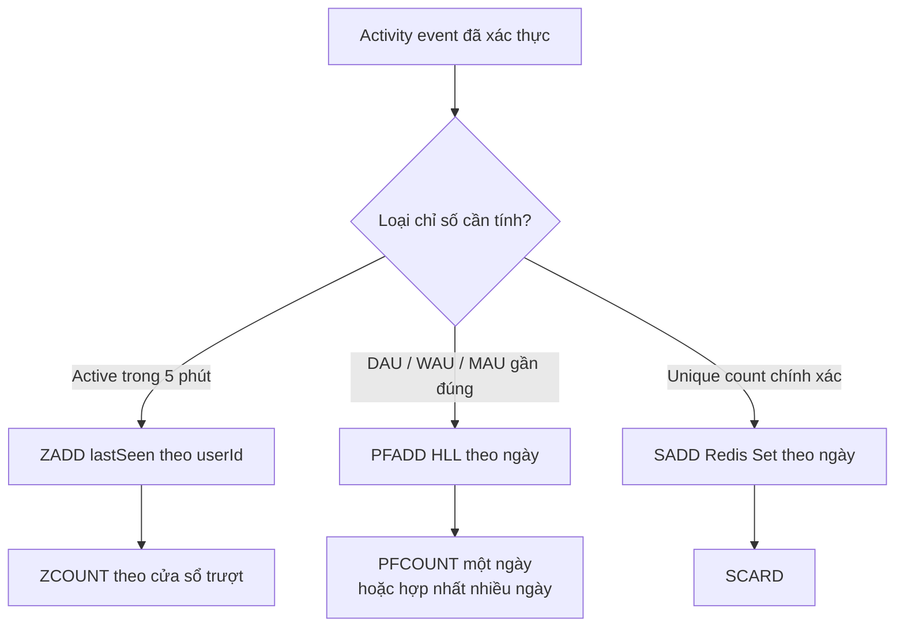
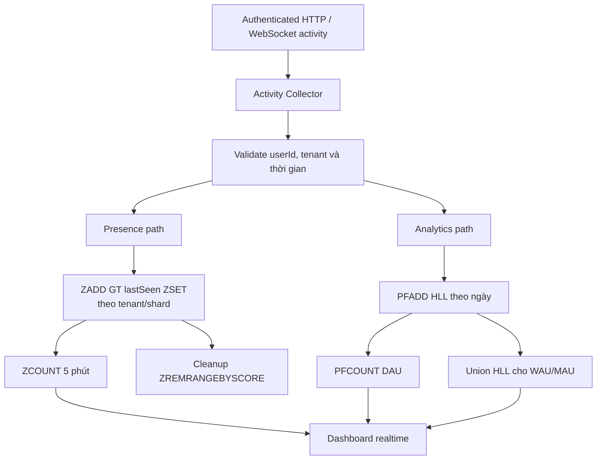

# Đếm người dùng hoạt động và thống kê gần đúng

Trong một ứng dụng nhiều người dùng, các dashboard thường hiển thị những chỉ số như **“đang hoạt động trong 5 phút qua”**, **DAU** (*Daily Active Users*), **WAU** (*Weekly Active Users*) hoặc **MAU** (*Monthly Active Users*). Những chỉ số này nghe giống nhau nhưng có **định nghĩa thời gian, độ chính xác và chi phí lưu trữ khác nhau**.

Với **Spring Data Redis**, có thể xây dựng hai mô hình chính:

- **Sorted Set (ZSET)** lưu `lastSeen` của từng người dùng để đếm số định danh có hoạt động trong một **cửa sổ trượt**. Kết quả là **đếm chính xác các định danh đã được ghi nhận** trong cửa sổ, miễn là dữ liệu và thời gian cập nhật được quản lý đúng.
- **HyperLogLog (HLL)** lưu phác họa (*sketch*) để **ước lượng số người dùng duy nhất** trong từng ngày, tuần hoặc tháng. Bộ nhớ nhỏ và gần như không tăng theo số người dùng, nhưng kết quả có **sai số thống kê**, không thể liệt kê danh sách người dùng và không thể xóa từng member như Redis Set.

Không nên gọi mọi con số trên là “số người online” theo nghĩa người dùng chắc chắn đang mở ứng dụng tại thời điểm hiện tại. Chỉ số chỉ đúng theo **định nghĩa tín hiệu hoạt động** đã được chọn: heartbeat, request có xác thực, truy cập trang, sự kiện tương tác, v.v.

## 1. Đầu tiên phải định nghĩa “hoạt động”

Giả sử ứng dụng có 100.000 tài khoản nhưng chỉ một số tài khoản gửi request trong ngày. Ta có thể đo:

| Chỉ số | Định nghĩa minh họa | Có cần biết từng user ID? |
| --- | --- | --- |
| **Online theo kết nối** | Người dùng đang có ít nhất một WebSocket/session được xác nhận còn sống | Thường có nếu cần quản lý phiên/kết nối |
| **Active trong 5 phút** | Người dùng có heartbeat/request gần nhất trong vòng 5 phút | Có thể dùng ZSET theo `lastSeen` |
| **DAU** | Số `userId` duy nhất phát sinh ít nhất một sự kiện đủ điều kiện trong **một ngày lịch** | Không nhất thiết nếu chỉ cần số ước lượng |
| **WAU** | Số người dùng duy nhất có hoạt động trong **7 ngày xác định** | Cần hợp nhất tập user hoặc HLL của các ngày |
| **MAU** | Số người dùng duy nhất hoạt động trong **30 ngày trượt** hoặc **tháng lịch**, tùy hợp đồng | Phải thống nhất rõ loại khoảng thời gian |
| **Tổng lượt request** | Số request/sự kiện nhận được | Không giống số người dùng duy nhất |

Ví dụ user `u-101` gửi 500 request trong ngày nhưng chỉ được tính **một** người dùng cho DAU. Còn `u-101` truy cập 10 lần hôm nay và 10 lần ngày mai thì xuất hiện trong DAU của **hai ngày**; WAU của tuần có thể vẫn chỉ tính user đó một lần.

Ba quyết định cần chốt trước khi viết code:

1. **Tín hiệu nào tạo hoạt động?** Request HTTP bất kỳ, request sau đăng nhập, heartbeat từ ứng dụng, giao dịch có ý nghĩa, hay hành động của người dùng?
2. **Thời gian tính theo hệ quy chiếu nào?** UTC hay một múi giờ nghiệp vụ cố định? Ngày lịch khác với 24 giờ trượt.
3. **Mức chính xác nào được chấp nhận?** Dashboard vận hành cần sai số thấp có thể dùng HyperLogLog; một giới hạn quota, số ghế, thanh toán hoặc cấp quyền **không được dựa vào số gần đúng**.

### 1.1. Minh họa một người dùng có nhiều request

```text
10:00:00  u-101 -> GET /home
10:00:30  u-101 -> GET /products
10:01:00  u-102 -> POST /search
10:03:00  u-101 -> heartbeat

Tổng request/heartbeat quan sát = 4
Số userId duy nhất trong khoảng = 2
```

Đếm request bằng `INCR` cho ra 4; đếm người dùng duy nhất phải có bước khử trùng theo định danh. Đây là khác biệt quan trọng nhất giữa **event count** và **unique user count**.

## 2. Chọn cấu trúc Redis theo nhu cầu

| Cấu trúc | Mô hình dữ liệu | Phù hợp | Giới hạn |
| --- | --- | --- | --- |
| `String` counter | `INCR metrics:requests` | Tổng số request/lượt thao tác | Không deduplicate user |
| `Set` | `SADD dau:date userId` | **Số user duy nhất chính xác**, có thể kiểm tra membership | Bộ nhớ tăng theo số user |
| `Sorted Set` | `ZADD presence score userId` | Last-seen, active trong cửa sổ trượt, truy vấn hoạt động gần đây | Bộ nhớ tăng theo số user được giữ |
| **HyperLogLog** | `PFADD hll:date userId` | Số **user duy nhất gần đúng** với chi phí bộ nhớ nhỏ | Không liệt kê user, không xóa member |
| Bitmap | `SETBIT key numericUserId 1` | ID số nguyên không âm, ổn định và đủ dày | Offset quá lớn có thể làm bitmap rất lớn |

Không có một cấu trúc tối ưu cho mọi chỉ số. Một hệ thống thực tế có thể dùng **ZSET** cho presence trong vài phút và **HLL** cho DAU/WAU/MAU, trong khi dữ liệu nghiệp vụ chính vẫn lưu ở cơ sở dữ liệu riêng.



## 3. Đếm người dùng hoạt động gần đây bằng Sorted Set

Redis Sorted Set lưu các cặp **member/score**. Với bài toán active user:

- **Member** là một định danh người dùng ổn định, ví dụ `u-101`.
- **Score** là timestamp của lần hoạt động được ghi nhận gần nhất, ví dụ Unix epoch **mili giây**.
- **Key** đại diện cho phạm vi thống kê, ví dụ `presence:{shop}:last-seen`.

Ví dụ Redis CLI:

```redis
ZADD presence:{shop}:last-seen 1763000000000 u-101
ZADD presence:{shop}:last-seen 1763000020000 u-102
ZADD presence:{shop}:last-seen 1763000030000 u-101
```

Mỗi `member` chỉ có **một score** trong ZSET, nên `u-101` không bị đếm hai lần khi heartbeat được ghi lại. Lệnh `ZADD` cuối cập nhật score của `u-101` từ timestamp trước sang timestamp mới.

Quan sát:

```redis
ZRANGE presence:{shop}:last-seen 0 -1 WITHSCORES
ZSCORE presence:{shop}:last-seen u-101
ZCARD presence:{shop}:last-seen
```

`ZCARD` trả tổng số member **còn được giữ trong ZSET**, không tự hiểu đâu là người dùng đã hoạt động trong 5 phút. Nếu ZSET còn các bản ghi cũ, `ZCARD` sẽ cao hơn số active thực tế.

### 3.1. Tính cửa sổ trượt 5 phút

Giả sử `nowMs` là timestamp hiện tại theo mili giây và cửa sổ hoạt động là **300.000 ms**:

```text
cutoffMs = nowMs - 300000
active nếu lastSeenMs > cutoffMs
```

Hai hướng đếm:

**Hướng A — không cần xóa ngay dữ liệu cũ:**

```redis
ZCOUNT presence:{shop}:last-seen (1762999700000 +inf
```

Dấu `(` trước số score nghĩa là **loại trừ ranh giới đó**. Ví dụ trên dùng cutoff minh họa; trong chương trình phải thay bằng cutoff được tính theo thời gian hiện tại.

**Hướng B — dọn dữ liệu cũ trước rồi đếm:**

```redis
ZREMRANGEBYSCORE presence:{shop}:last-seen -inf 1762999700000
ZCARD presence:{shop}:last-seen
```

Đây là hai lệnh riêng biệt. Nếu các heartbeat liên tục cập nhật đồng thời, việc đọc `ZCARD` sau cleanup không phải một snapshot nguyên tử của thời điểm cleanup. Trong nhiều dashboard, điều này chấp nhận được; nếu cần một số đếm chính xác tại một mốc duy nhất, hãy định nghĩa giao thức đọc phù hợp.

### 3.2. Khi nào dùng `ZCOUNT`, khi nào dùng `ZCARD`?

| Nhu cầu | Cách làm |
| --- | --- |
| Đếm người dùng trong cửa sổ 5 phút **mà không phụ thuộc vào cleanup** | `ZCOUNT` với score nằm trong khoảng thời gian |
| Đếm tất cả member sau khi ZSET đã được dọn chính xác | `ZCARD` |
| Lấy các user hoạt động gần đây | `ZRANGEBYSCORE`/API range by score có giới hạn kết quả |
| Tìm lần hoạt động gần nhất của một user | `ZSCORE` |
| Giải phóng bộ nhớ của các member hết hạn | `ZREMRANGEBYSCORE` |

`ZCOUNT` làm việc theo score, không cần đưa toàn bộ user ID về JVM để đếm. Với ZSET có cấu trúc cân bằng, thao tác tìm theo score có chi phí thấp hơn việc lấy mọi member rồi lọc ở Java.

## 4. Ví dụ Spring Data Redis: ghi heartbeat và đếm active

Sử dụng Spring Boot 3.x và `StringRedisTemplate`.

```groovy
// build.gradle
dependencies {
    implementation 'org.springframework.boot:spring-boot-starter-data-redis'
}
```

```yaml
# src/main/resources/application.yml
spring:
  data:
    redis:
      host: localhost
      port: 6379
```

Một service cơ bản:

```java
package com.example.analytics;

import java.time.Clock;
import java.time.Duration;
import org.springframework.data.redis.core.StringRedisTemplate;
import org.springframework.stereotype.Service;

@Service
public class ActiveUserService {

    private static final String KEY = "presence:{shop}:last-seen";
    private static final Duration WINDOW = Duration.ofMinutes(5);

    private final StringRedisTemplate redis;
    private final Clock clock;

    public ActiveUserService(
            StringRedisTemplate redis, Clock clock) {
        this.redis = redis;
        this.clock = clock;
    }

    public void heartbeat(String userId) {
        requireUserId(userId);
        long nowMs = clock.millis();

        redis.opsForZSet()
                .add(KEY, userId, (double) nowMs);
    }

    public long countActiveUsers() {
        long cutoffMs = clock.millis() - WINDOW.toMillis();
        // Score lưu dưới dạng mili giây nguyên; +1 loại trừ cutoff.
        Long count = redis.opsForZSet()
                .count(KEY, (double) cutoffMs + 1,
                        Double.POSITIVE_INFINITY);

        if (count == null) {
            throw new IllegalStateException(
                    "Redis count unavailable in current context");
        }
        return count;
    }

    public long removeInactiveUsers() {
        long cutoffMs = clock.millis() - WINDOW.toMillis();
        Long removed = redis.opsForZSet()
                .removeRangeByScore(
                        KEY,
                        Double.NEGATIVE_INFINITY,
                        (double) cutoffMs);
        if (removed == null) {
            throw new IllegalStateException(
                    "Redis cleanup result unavailable");
        }
        return removed;
    }

    private static void requireUserId(String userId) {
        if (userId == null || userId.isBlank()) {
            throw new IllegalArgumentException("userId is required");
        }
    }
}
```

Để inject `Clock`, khai báo bean:

```java
package com.example.analytics;

import java.time.Clock;
import org.springframework.context.annotation.Bean;
import org.springframework.context.annotation.Configuration;

@Configuration
public class TimeConfiguration {

    @Bean
    Clock clock() {
        return Clock.systemUTC();
    }
}
```

`Clock` tách biệt thời gian khỏi logic Redis, giúp dễ mô phỏng các thời điểm trong phép thử và tránh gắn trực tiếp toàn bộ code vào `System.currentTimeMillis()`.

### 4.1. Dùng service

```java
activeUserService.heartbeat("u-101");
activeUserService.heartbeat("u-102");
activeUserService.heartbeat("u-101");

long active = activeUserService.countActiveUsers();
System.out.println("Observed active users: " + active);
```

Trong điều kiện hai ID đã được ghi trong cửa sổ 5 phút và không có ID khác, kết quả là `2`, không phải `3`.

**Lưu ý phạm vi chính xác:** ZSET đếm **đúng số user ID có score thỏa điều kiện**, không chứng minh người đó còn kết nối tại thời điểm truy vấn. Nếu user tắt trình duyệt đột ngột và không có logout event, ID của họ có thể tiếp tục được tính cho đến khi hết cửa sổ.

### 4.2. Vì sao ghi timestamp dưới dạng `double`?

Redis sorted set dùng score dạng số thực 64-bit. Unix epoch mili giây hiện đại nằm trong khoảng số nguyên biểu diễn chính xác của IEEE 754 `double` (đến `2^53`), nên có thể dùng cho `lastSeen` ở thời điểm hiện nay.

Không tự nhồi những giá trị định danh 64-bit rất lớn vào score rồi kỳ vọng độ chính xác nguyên tuyệt đối. Member giữ **ID**, score giữ **thời gian** hoặc đại lượng cần sắp xếp.

## 5. Tránh heartbeat cũ ghi đè thời điểm mới

Ví dụ hai request được xử lý không đúng thứ tự:

```text
Request A ghi nhận timestamp = 10:00:05 nhưng bị delay
Request B ghi nhận timestamp = 10:00:08 và ghi ZADD trước
Request A cuối cùng ghi ZADD với timestamp 10:00:05
```

Nếu dùng `ZADD` thông thường, score của user có thể **lùi từ 10:00:08 về 10:00:05**. Khi cửa sổ nhỏ, user có thể bị coi là inactive sớm hơn thực tế.

Redis `ZADD` hỗ trợ điều kiện **`GT`** trên những phiên bản có tính năng này, cho phép chỉ cập nhật score khi giá trị mới **lớn hơn score hiện tại**:

```redis
ZADD presence:{shop}:last-seen GT 1763000030000 u-101
```

Đối với member chưa tồn tại, `ZADD GT` vẫn có thể thêm mới. Nhưng số được lệnh `ZADD` trả về ở chế độ mặc định thường đếm số **member mới** chứ không phải số member đã cập nhật; đừng dùng nó như thống kê số heartbeat đã nhận.

Một cách biểu diễn logic monotonic update bằng Lua:

```lua
-- KEYS[1]: ZSET lastSeen
-- ARGV[1]: userId
-- ARGV[2]: timestamp mili giây dạng số
local now = tonumber(ARGV[2])
if not now then
    return redis.error_reply('invalid timestamp')
end

local previous = redis.call('ZSCORE', KEYS[1], ARGV[1])
if not previous or now > tonumber(previous) then
    redis.call('ZADD', KEYS[1], now, ARGV[1])
    return 1
end
return 0
```

Script kết hợp đọc score và cập nhật trong **một lượt thực thi trên Redis**, tránh race condition giữa kiểm tra và ghi. Với ứng dụng lớn, có thể dùng một script dùng chung và kiểm soát độ dài/thời gian thực thi. Không gọi riêng `ZSCORE` rồi `ZADD` trong hai request độc lập nếu cần đảm bảo chỉ tiến lên.

**Quan trọng:** monotonic update không giải quyết **đồng hồ giữa các instance lệch nhau**. Một host có đồng hồ đi trước nhiều phút có thể ghi score ở tương lai và khiến user được tính active quá lâu. Để giảm sai số, đồng bộ đồng hồ hệ thống hoặc dùng thời gian từ Redis (ví dụ `TIME`) làm nguồn chung khi thiết kế luồng heartbeat. Nếu dùng Redis `TIME` kết hợp cập nhật, phải chọn cơ chế phù hợp để không tạo cửa sổ race giữa hai thao tác.

## 6. Dọn dữ liệu cũ để tránh tăng bộ nhớ vô hạn

Nếu mọi user từng truy cập được giữ lại trong ZSET, `ZCOUNT` vẫn cho số active hợp lệ nhưng **bộ nhớ không giảm**. Sau vài tháng, ZSET có thể chứa hàng triệu user đã không còn hoạt động.

Một công việc dọn:

```java
import org.springframework.scheduling.annotation.Scheduled;

// Đặt trong một bean Spring, có inject ActiveUserService.
@Scheduled(fixedDelay = 60_000)
public void cleanupPresence() {
    long removed = activeUserService.removeInactiveUsers();
    // Ghi metric removed nếu cần, không log userId nhạy cảm.
}
```

Để dùng `@Scheduled`, bật scheduling tại cấu hình ứng dụng:

```java
import org.springframework.context.annotation.Configuration;
import org.springframework.scheduling.annotation.EnableScheduling;

@Configuration
@EnableScheduling
public class SchedulingConfiguration {
}
```

Phương thức cleanup đã loại bỏ mọi member có score **nhỏ hơn hoặc bằng cutoff**. Nếu có heartbeat mới ghi trước khi Redis thực hiện cleanup, score mới không còn nằm trong khoảng bị xóa. Nếu cleanup chạy trước heartbeat, heartbeat sẽ thêm/cập nhật lại member.

Trong triển khai nhiều instance, **không cần tất cả instance cùng chạy cleanup mỗi phút**. Có thể cấu hình một job dành riêng cho bảo trì hoặc chia key theo tenant/shard rồi phân phối cleanup để giảm lệnh dư thừa. Không xóa nguyên ZSET bằng `EXPIRE` ngắn nếu trong đó vẫn có các user còn hoạt động.

### 6.1. TTL của ZSET không phải TTL cho từng user

```redis
EXPIRE presence:{shop}:last-seen 300
```

Lệnh trên đặt TTL cho **toàn bộ key ZSET**, không phải TTL riêng cho mỗi member. Nếu key hết hạn, **tất cả user** đều bị xóa cùng lúc. Mô hình presence cần **score theo user và cleanup theo score**, không dựa vào `EXPIRE` để tự làm hết hạn từng member.

Nếu chỉ cần đếm, `ZCOUNT` đủ; cleanup phục vụ tối ưu bộ nhớ. Một hệ thống có thể giữ dữ liệu lâu hơn 5 phút (ví dụ 24 giờ) để phục vụ các chỉ số khác và chỉ dùng `ZCOUNT` với khoảng riêng cho mỗi truy vấn.

## 7. Định nghĩa “online” khi một user có nhiều thiết bị

Một user có thể mở cùng tài khoản trên ba thiết bị:

```text
user u-101
  +--- mobile session s-1
  +--- browser session s-2
  +--- tablet session s-3
```

Nếu ZSET dùng **member là `userId`**, cả ba thiết bị đều cập nhật **một phần tử**, nên số active user vẫn là `1`.

Nếu dùng member là `sessionId`, ZSET sẽ đếm **số session**, không phải số người dùng. Để hiển thị online user khi nhiều session, phải có bước gom về `userId` hoặc một cấu trúc duy trì quan hệ user–session với logic cleanup thích hợp.

Logout/disconnect rõ ràng có thể xóa score:

```redis
ZREM presence:{shop}:last-seen u-101
```

Nhưng xóa ngay `userId` khi **một** thiết bị logout có thể sai nếu thiết bị khác vẫn active. Vì vậy nếu nghiệp vụ yêu cầu presence theo kết nối, nên theo dõi session hoặc connection trước rồi suy ra user online. Nếu chỉ đo “có hoạt động trong 5 phút qua”, cách cập nhật một `userId` trong ZSET đơn giản và phù hợp hơn.

### 7.1. Tránh dùng ID không ổn định

Không dùng IP làm định danh unique user: nhiều người dùng có chung NAT/IP, còn một người có thể đổi IP. Cookie hay anonymous device ID cũng không đồng nghĩa user thật, và có thể bị xóa hoặc thay đổi. Khi diễn giải số liệu, ghi rõ **đơn vị đếm**: account ID, authenticated user ID, session ID hay anonymous device ID.

Chỉ lưu định danh cần thiết; không nhúng email, số điện thoại hoặc thông tin nhạy cảm thô vào Redis key/member nếu không có lý do. Có thể dùng ID nội bộ hoặc token đã được chuẩn hóa theo chính sách bảo vệ dữ liệu.

## 8. DAU chính xác với Redis Set

Nếu muốn **đếm số user duy nhất trong một ngày chính xác theo dữ liệu đã ghi**, Redis Set là lựa chọn trực tiếp:

```redis
SADD metrics:{shop}:dau:2030-05-01 u-101
SADD metrics:{shop}:dau:2030-05-01 u-102
SADD metrics:{shop}:dau:2030-05-01 u-101

SCARD metrics:{shop}:dau:2030-05-01
# 2
```

`SADD` không tạo thêm phần tử khi member đã có. `SCARD` trả số member của Set, không có sai số thống kê.

Với Spring Data Redis:

```java
import org.springframework.data.redis.core.StringRedisTemplate;

String key = "metrics:{shop}:dau:2030-05-01";

redis.opsForSet().add(key, "u-101");
redis.opsForSet().add(key, "u-102");
redis.opsForSet().add(key, "u-101");

Long exact = redis.opsForSet().size(key);
System.out.println("DAU exact: " + exact);
```

**Đánh đổi:** bộ nhớ của Set tăng theo số user duy nhất trong ngày. Nếu một ngày có vài triệu user, việc giữ các ID cho nhiều ngày liên tiếp có thể tiêu tốn dung lượng đáng kể. Set phù hợp khi cần **đếm chính xác**, kiểm tra user có thuộc tập không, hoặc đôi khi cần lấy danh sách member để điều tra.

Nếu chỉ cần giá trị thống kê trên dashboard và chấp nhận sai số nhỏ, **HyperLogLog** giúp giảm đáng kể bộ nhớ.

## 9. HyperLogLog: đếm unique user gần đúng

**Redis HyperLogLog** là cấu trúc xác suất ước lượng **cardinality**, tức số phần tử duy nhất đã được thêm. Nó không giữ tập đầy đủ các user ID như Redis Set.

Các lệnh chính:

| Lệnh | Ý nghĩa |
| --- | --- |
| `PFADD key userId ...` | Đưa các giá trị vào HLL; trùng lặp thường không làm tăng ước lượng theo cách cộng tuyến tính |
| `PFCOUNT key` | Ước lượng số phần tử duy nhất của một HLL |
| `PFCOUNT key1 key2 ...` | Ước lượng số phần tử duy nhất của **hợp** nhiều HLL |
| `PFMERGE destination source1 source2 ...` | Hợp nhất các HLL vào một key đích |

Ví dụ:

```redis
PFADD metrics:{shop}:dau:2030-05-01 u-101 u-102 u-101
PFCOUNT metrics:{shop}:dau:2030-05-01
# Thường gần 2; là ước lượng, không phải bảo đảm tuyệt đối
```

Một HLL của Redis dùng xấp xỉ **12 KB** ở biểu diễn đầy đủ cho dữ liệu cardinality lớn, và có thể dùng ít bộ nhớ hơn ở dạng sparse cho tập nhỏ. Sai số chuẩn tương đối thường được mô tả khoảng **0,81%** đối với thuật toán Redis HLL.

**Sai số chuẩn không phải giới hạn sai số cứng.** Một lần quan sát có thể lệch hơn 0,81%, đặc biệt khi yêu cầu đánh giá theo xác suất hoặc số lượng nhỏ. Dùng HLL cho xu hướng, dashboard, thống kê marketing; không dùng để tính số hóa đơn cần thu tiền hoặc quyết định từ chối quyền truy cập theo quota chính xác.

### 9.1. PFADD trả về gì?

Giá trị trả về của Redis `PFADD` cho biết cấu trúc HLL **có thay đổi trạng thái nội bộ hay không**. Nó **không phải boolean xác định chắc một user mới chưa từng xuất hiện**. HLL không hỗ trợ truy vấn `contains(userId)` một cách chính xác.

Ví dụ không nên:

```java
// Không nên hiểu kết quả PFADD như "người dùng mới duy nhất".
var changed = redis.opsForHyperLogLog().add(key, "u-101");
// changed != 0 không chứng minh u-101 chưa từng có trong tập.
```

Nếu cần kiểm tra một user đã được ghi nhận trong ngày hay chưa, dùng Redis Set hoặc một kho dữ liệu có membership chính xác. HLL chỉ trả về **ước lượng cardinality**.

### 9.2. Không thể xóa một user khỏi HLL

Redis HLL không hỗ trợ:

```redis
PFREM key u-101
```

Đây **không phải** lệnh Redis hợp lệ. Một HLL đã nhận dữ liệu không có thao tác xóa riêng một member. Muốn điều chỉnh bộ dữ liệu, thường phải xây dựng lại HLL từ nguồn các ID còn hợp lệ, hoặc dùng bucket mới và đợi bucket cũ hết thời gian lưu.

HLL cũng không liệt kê tất cả user. Nếu nhu cầu có quyền được loại một tài khoản khỏi báo cáo cụ thể hoặc tái tính toán chính xác, phải có dữ liệu nguồn và quy trình dựng lại thống kê.

## 10. Dùng Spring Data Redis HyperLogLogOperations

`StringRedisTemplate` cung cấp `opsForHyperLogLog()`. Ví dụ một service lưu DAU:

```java
package com.example.analytics;

import java.time.Clock;
import java.time.LocalDate;
import java.time.ZoneId;
import org.springframework.data.redis.core.StringRedisTemplate;
import org.springframework.stereotype.Service;

@Service
public class DailyActiveUserService {

    // Ví dụ thống nhất toàn hệ thống tính ngày theo UTC.
    private static final ZoneId REPORTING_ZONE = ZoneId.of("UTC");
    private static final String PREFIX = "metrics:{shop}:dau:";

    private final StringRedisTemplate redis;
    private final Clock clock;

    public DailyActiveUserService(
            StringRedisTemplate redis, Clock clock) {
        this.redis = redis;
        this.clock = clock;
    }

    public void recordActivity(String userId) {
        if (userId == null || userId.isBlank()) {
            throw new IllegalArgumentException("userId is required");
        }

        LocalDate date = LocalDate.now(clock.withZone(REPORTING_ZONE));
        String key = PREFIX + date;

        redis.opsForHyperLogLog().add(key, userId);
    }

    public long estimateDau(LocalDate date) {
        Long value = redis.opsForHyperLogLog()
                .size(PREFIX + date);

        if (value == null) {
            throw new IllegalStateException(
                    "HyperLogLog count unavailable");
        }
        return value;
    }
}
```

Ví dụ gọi:

```java
dailyActiveUserService.recordActivity("u-101");
dailyActiveUserService.recordActivity("u-102");
dailyActiveUserService.recordActivity("u-101");

long estimate = dailyActiveUserService.estimateDau(
        java.time.LocalDate.now(java.time.ZoneOffset.UTC));

System.out.println("Estimated DAU: " + estimate);
```

Mỗi lần gọi `recordActivity` có thể thực hiện `PFADD`, nhưng cùng user ID được thêm nhiều lần không làm cardinality tăng tuyến tính theo số request.

**Chú ý triển khai:** code minh họa gọi `PFADD` trên từng activity, có thể tạo tải cao khi lượng sự kiện rất lớn. Nên định nghĩa sự kiện nào thật sự cần ghi vào HLL (ví dụ lần hoạt động hợp lệ mỗi khoảng) và cân nhắc batching, pipeline hoặc hàng đợi thống kê riêng. Dù ghi trùng không gây sai số tăng tuyến tính như counter, mỗi lệnh vẫn tiêu tốn network và CPU.

## 11. Ước lượng WAU và MAU không được cộng DAU

Giả sử:

```text
Thứ Hai: u-101, u-102    -> DAU = 2
Thứ Ba: u-101, u-103     -> DAU = 2
```

**Không được tính** người dùng duy nhất hai ngày bằng `2 + 2 = 4`. Hợp của hai tập là `{u-101, u-102, u-103}` nên **unique users = 3**.

Với HyperLogLog, cần **hợp nhất sketch** của các ngày hoặc dùng `PFCOUNT` trên nhiều HLL:

```redis
PFCOUNT metrics:{shop}:dau:2030-05-01 metrics:{shop}:dau:2030-05-02
```

Redis ước lượng cardinality của **hợp tập**, không cộng các ước lượng ngày.

### 11.1. Ví dụ tính WAU 7 ngày trượt

```java
package com.example.analytics;

import java.time.LocalDate;
import java.util.stream.IntStream;
import org.springframework.data.redis.core.StringRedisTemplate;
import org.springframework.stereotype.Service;

@Service
public class RollingDistinctUsersService {

    private static final String PREFIX = "metrics:{shop}:dau:";

    private final StringRedisTemplate redis;

    public RollingDistinctUsersService(StringRedisTemplate redis) {
        this.redis = redis;
    }

    public long estimateLast7CalendarDays(LocalDate lastDay) {
        String[] keys = IntStream.range(0, 7)
                .mapToObj(i -> PREFIX + lastDay.minusDays(i))
                .toArray(String[]::new);

        Long result = redis.opsForHyperLogLog().size(keys);
        if (result == null) {
            throw new IllegalStateException("HLL result unavailable");
        }
        return result;
    }
}
```

Đoạn mã này đếm người dùng duy nhất trong **7 ngày lịch** bao gồm `lastDay`. Nó không đồng nghĩa **168 giờ chính xác** tính ngược từ một thời điểm giữa ngày. Nếu sản phẩm định nghĩa WAU theo tuần ISO từ thứ Hai đến Chủ nhật, phải chọn đúng các ngày tương ứng thay vì luôn lấy 7 ngày gần nhất.

Tương tự:

- **30-day active users**: hợp HLL của 30 ngày lịch theo quy ước.
- **MAU tháng lịch**: hợp các HLL từ ngày đầu đến cuối tháng đã chọn.
- **WAU tuần lịch**: hợp các HLL thuộc tuần định nghĩa theo múi giờ sản phẩm.

Không lưu một HLL duy nhất cho “tất cả người dùng đã từng online” rồi dùng nó để tính DAU/WAU: HLL không có phép xóa user hết hạn khỏi một cửa sổ trượt.

### 11.2. PFMERGE khi cần giữ kết quả hợp

```redis
PFMERGE metrics:{shop}:wau:2030-W18 metrics:{shop}:dau:2030-05-01 metrics:{shop}:dau:2030-05-02
PFCOUNT metrics:{shop}:wau:2030-W18
```

`PFMERGE` tạo/ghi kết quả vào key đích. Khi dùng key tuần, phải xác định cách cập nhật lại nếu thêm activity muộn trong một ngày nguồn. **Giữ một WAU HLL đã merge không tự bảo đảm nó phản ánh các thay đổi nguồn phát sinh sau lần merge đó**; cần merge lại hoặc có một luồng cập nhật tập hợp tuần riêng.

Nếu chỉ cần hiển thị dashboard định kỳ, có thể dùng `PFCOUNT` nhiều key mà không lưu bản sao HLL tuần. Khi số lượng key lớn hoặc nhiều query lặp lại, có thể cache ước lượng/tạo sketch tổng hợp theo lịch với chính sách làm mới rõ ràng.

## 12. Redis Cluster: HLL nhiều ngày phải cùng slot

Redis Cluster giới hạn nhiều command thao tác trên **nhiều key** vào **cùng hash slot**. `PFCOUNT key1 key2` và `PFMERGE destination source1 ...` chịu giới hạn này.

Vì vậy tên key minh họa dùng hash tag:

```text
metrics:{shop}:dau:2030-05-01
metrics:{shop}:dau:2030-05-02
metrics:{shop}:wau:2030-W18
```

Các key đều có tag `{shop}`, nên có cùng slot và có thể tham gia phép hợp HLL.

```redis
CLUSTER KEYSLOT metrics:{shop}:dau:2030-05-01
CLUSTER KEYSLOT metrics:{shop}:dau:2030-05-02
```

Nếu hai HLL nằm trên hai slot khác nhau, một lệnh `PFCOUNT` nhiều key hoặc `PFMERGE` có thể gặp `CROSSSLOT`. Driver cluster-aware không tự tạo phép hợp HyperLogLog phân tán xuyên nhiều primary.

**Đánh đổi:** toàn bộ key HLL của `{shop}` tập trung một slot. Với hệ thống một tenant rất lớn và lưu lượng `PFADD` cao, đây có thể là **hot slot**. Có thể thay:

```text
metrics:{tenant-1}:dau:2030-05-01
metrics:{tenant-2}:dau:2030-05-01
```

để phân phối các tenant, nhưng phép hợp toàn bộ tenant không còn là một lệnh `PFCOUNT` đa key trên một slot. Cần giải pháp tổng hợp ở tầng ứng dụng hoặc một dịch vụ analytics phù hợp, **không được cộng các ước lượng HLL của các shard** rồi gọi đó là số user duy nhất toàn cục (cùng user có thể xuất hiện ở nhiều shard).

Nếu chọn shard theo **hash(userId)** ổn định, một user luôn thuộc cùng shard, nên tổng unique theo shard có thể hạn chế trùng lặp giữa shard. Tuy nhiên việc đổi số shard, chuyển user giữa tenant hoặc dùng nhiều định danh vẫn cần quy trình migration và đánh giá sai số HLL. Với các phép union gần đúng trên toàn cluster, phải có cách hợp các **sketch**, không chỉ cộng ước lượng tùy ý.

## 13. TTL và thời gian lưu các bucket thống kê

Nếu HLL theo ngày được giữ mãi, số key tăng theo thời gian. Cần chính sách retention, ví dụ giữ 90 ngày để tính MAU và so sánh tháng gần đây:

```text
metrics:{shop}:dau:2030-05-01
metrics:{shop}:dau:2030-05-02
...
```

`EXPIRE` trên HLL đặt TTL cho **toàn bộ key của ngày**:

```redis
EXPIRE metrics:{shop}:dau:2030-05-01 7776000
```

Ví dụ `7.776.000` giây tương đương 90 ngày, nhưng nếu chạy lại `EXPIRE` sau mỗi activity, thời điểm key biến mất có thể bị dời liên tục. Để có retention theo ngày lịch nhất quán, tốt hơn là đặt **thời điểm hết hạn tuyệt đối** sau ngày báo cáo một số ngày bằng `EXPIREAT` hoặc tương đương trong Spring Data Redis.

```java
import java.time.Instant;
import java.time.LocalDate;
import java.time.ZoneOffset;
import java.util.Date;

LocalDate bucketDay = LocalDate.of(2030, 5, 1);
Instant expireAt = bucketDay.plusDays(91)
        .atStartOfDay(ZoneOffset.UTC)
        .toInstant();

redis.expireAt(
        "metrics:{shop}:dau:" + bucketDay,
        Date.from(expireAt));
```

Ví dụ chỉ minh họa xác định deadline tuyệt đối. Nếu lời gọi ghi `PFADD` thành công nhưng cập nhật expiration thất bại, bucket có thể không được đặt TTL; một job bảo trì nên kiểm tra những key không có expiration hoặc có TTL bất thường. Khi nhiều producer cùng ghi, cần chính sách đặt expiration không mâu thuẫn và không vô tình làm mất dữ liệu quá sớm.

**Cảnh báo bucket quá khứ:** một event đến muộn có thể cần ghi lại vào bucket của ngày đã qua. Nếu bucket đó đã hết hạn, hệ thống cần quyết định bỏ qua, tái lập từ nguồn sự kiện hoặc cập nhật báo cáo lịch sử theo một quy trình rõ ràng. Không đơn giản đưa tất cả event trễ vào bucket của ngày nhận vì điều đó thay đổi ý nghĩa DAU theo ngày xảy ra.

## 14. Chọn thời gian event hay thời gian nhận?

Giả sử người dùng thực hiện hành động lúc `23:59:58`, nhưng request đến server lúc `00:00:03` do mạng chậm. Nếu producer dùng giờ nhận, event được tính vào ngày tiếp theo. Nếu dùng `occurredAt` từ client, event vào ngày trước nhưng cần cân nhắc đồng hồ client và khả năng giả mạo timestamp.

| Nguồn thời gian | Ưu điểm | Rủi ro |
| --- | --- | --- |
| Thời gian xử lý của server | Dễ tin cậy, đơn giản | Event đến trễ có thể lệch ngày hoạt động thực tế |
| Timestamp của event từ nguồn đáng tin | Phản ánh thời điểm phát sinh nghiệp vụ | Cần xử lý late events, version và time zone |
| Timestamp từ client | Gần hành động người dùng ở thiết bị | Clock skew, giả mạo, offline sync |
| Redis server time | Thống nhất giữa các app instance ghi vào cùng Redis | Cần thiết kế lệnh hợp lý, không tự giải quyết ngày nghiệp vụ khi event đến trễ |

Với dashboard DAU phổ thông, có thể chọn **ngày nhận theo UTC** nếu công bố đúng định nghĩa. Với phân tích sản phẩm nghiêm ngặt, nên chọn **event time đáng tin**, chấp nhận độ trễ hoàn tất số liệu (*data freshness*) và có chính sách cập nhật các bucket cũ.

### 14.1. Múi giờ và thay đổi giờ mùa hè

Nếu báo cáo theo múi giờ nghiệp vụ, một **ngày lịch** không nhất thiết luôn có đúng 24 giờ ở các vùng có DST. Tránh tính bucket bằng cách lấy epoch milliseconds chia cho cố định `86_400_000` nếu báo cáo phải theo `LocalDate` của múi giờ cụ thể.

Ví dụ:

```java
ZoneId zone = ZoneId.of("Asia/Ho_Chi_Minh");
LocalDate date = eventTime.atZone(zone).toLocalDate();
```

Trong ví dụ, `eventTime` là một `Instant` do hệ thống tin cậy cung cấp. Cả producer, consumer và dashboard phải nhất quán về múi giờ; nếu thay chính sách múi giờ, cần biết số liệu lịch sử có phải tính lại không.

## 15. Ước lượng sai số của HyperLogLog

Với HLL Redis, sai số chuẩn tương đối khoảng **0,81%** thường được dẫn theo thiết kế thuật toán. Minh họa đơn giản:

| Số unique thực tế | Độ lệch tương đương 0,81% (tham khảo) |
| ---: | ---: |
| 1.000 | Khoảng 8 |
| 100.000 | Khoảng 810 |
| 1.000.000 | Khoảng 8.100 |
| 10.000.000 | Khoảng 81.000 |

Bảng **không phải cam kết rằng kết quả luôn nằm trong khoảng đó**. Nó chỉ giúp hình dung quy mô sai số chuẩn; phân bố sai số và kỹ thuật ước lượng cần được xem xét nếu bài toán thống kê yêu cầu mức tin cậy cụ thể.

Ví dụ trên dashboard:

```text
DAU ước lượng hôm nay:       1.005.300
DAU ước lượng hôm qua:         999.700
Chênh lệch ước lượng:           5.600
```

Nếu chênh lệch nhỏ hơn mức nhiễu thống kê tiềm tàng, **không nên kết luận chắc chắn sản phẩm đã tăng trưởng** chỉ từ hai giá trị HLL. Cần phân tích sai số, khung thời gian, độ đầy đủ event và có thể đối chiếu với tập user chính xác trên mẫu dữ liệu.

### 15.1. Không dùng HLL để thực thi giới hạn cứng

```text
Nếu số unique user > 1.000 -> tính thêm phí
```

Không nên dùng `PFCOUNT` làm điều kiện thu phí chính xác ở ranh giới 1.000: sai số có thể dẫn đến tính phí sai. Những yêu cầu này cần Set/transaction/cơ sở dữ liệu có tính chính xác phù hợp.

HLL phù hợp hơn với câu hỏi “DAU hôm nay xấp xỉ bao nhiêu?” hoặc “xu hướng số tài khoản có hoạt động trong tháng là gì?”.

## 16. So sánh kiến trúc khi tải tăng

Giả sử hệ thống có hàng triệu hoạt động mỗi phút, nhiều instance và nhiều tenant. Một key ZSET cho mọi user có thể trở thành **hot key**.

### 16.1. Phân vùng ZSET presence theo shard

Nếu chọn shard theo một hàm băm ổn định của `userId`:

```text
presence:{shop-0}:last-seen
presence:{shop-1}:last-seen
presence:{shop-2}:last-seen
presence:{shop-3}:last-seen
```

Mỗi user được gán **một shard duy nhất**, các heartbeat của user luôn đi tới shard đó. Mỗi lần đọc active count, ứng dụng `ZCOUNT` trên từng shard rồi cộng các kết quả:

```text
activeTotal =
    ZCOUNT(shard0, cutoff, +inf)
  + ZCOUNT(shard1, cutoff, +inf)
  + ZCOUNT(shard2, cutoff, +inf)
  + ZCOUNT(shard3, cutoff, +inf)
```

Phép cộng là hợp lệ **nếu mỗi user chỉ có thể xuất hiện trong đúng một shard** tại thời điểm tính. Nếu đổi số shard hoặc thay hàm băm mà không migration, một user có thể còn ở shard cũ và được ghi vào shard mới, dẫn tới đếm trùng.

Trong Redis Cluster, các hash tag khác nhau thường phân bố trên những slot khác nhau, giúp chia tải nhiều primary. Nhưng đây là tradeoff: truy vấn tổng active user cần lấy nhiều số đếm, có latency và không phải một snapshot nguyên tử trên mọi node.

### 16.2. HLL cho từng shard và vấn đề hợp nhất

Một chiến lược tương tự có thể chia HLL theo tenant/shard:

```text
metrics:{shop-0}:dau:2030-05-01
metrics:{shop-1}:dau:2030-05-01
```

Nếu user có thể xuất hiện ở cả hai shard (ví dụ phân vùng theo request, không theo user), **không được cộng hai `PFCOUNT`** để ra unique toàn cục. Cần cơ chế hợp nhất sketch hoặc định tuyến ổn định theo user để tránh xuất hiện chéo.

Ngay cả khi shard theo user và không trùng nhau, phép cộng các ước lượng HLL của từng shard không giống một ước lượng HLL của hợp tập và có đặc điểm sai số khác; dashboard cần chấp nhận/đánh giá sai số tổng hợp trước khi công bố.

Đối với dữ liệu analytics cực lớn, có thể dùng pipeline sự kiện/warehouse hoặc công cụ chuyên dụng để tính unique trên nhiều phân vùng thay vì buộc Redis Cluster xử lý một phép hợp HLL đa slot không được hỗ trợ.

## 17. Tốc độ ghi, giảm nhiễu và độ trễ số liệu

**Mỗi heartbeat không nhất thiết phải tạo một Redis command.** Nếu một user đang tương tác liên tục, ghi `ZADD` từng request có thể tạo tải không cần thiết.

Các hướng giảm tải:

- Chỉ ghi heartbeat ở chu kỳ hợp lý, ví dụ mỗi 30–60 giây thay vì mỗi request.
- Chỉ tính những action đã qua xác thực và được định nghĩa là hoạt động.
- Batching/pipelining những cập nhật thống kê ít nhạy cảm với độ trễ, nếu có chính sách xử lý lỗi.
- Phân vùng theo tenant/user shard khi một key bị ghi quá nóng.
- Dùng job cleanup theo lô, tránh xóa toàn bộ dữ liệu trong một request dashboard.
- Cache kết quả `PFCOUNT` trong thời gian ngắn nếu dashboard được đọc rất nhiều lần.

Tuy nhiên, giảm tần suất ghi làm thay đổi ý nghĩa số liệu. Nếu heartbeat mỗi 60 giây nhưng cửa sổ active chỉ 30 giây, một người đang dùng app vẫn có thể bị tính inactive giữa hai heartbeat. Chu kỳ heartbeat phải **ngắn hơn và có độ dự phòng** so với cửa sổ active.

### 17.1. Tác động của sự cố Redis và mất event

Một dấu `ZADD` hoặc `PFADD` có thể không được ghi khi Redis mất kết nối, client timeout hoặc event bị bỏ trước khi gửi. HLL không thể tự tái tạo những user mà producer chưa từng báo.

Do đó:

```text
Sai số tổng = sai số thống kê HLL
          + ảnh hưởng event bị thiếu/trùng/sai bucket
          + ảnh hưởng thay đổi danh tính người dùng
          + ảnh hưởng thời gian và topology
```

Sai số 0,81% chỉ nói về **thuật toán HLL đối với tập input đã nhận**, không bảo đảm toàn bộ dữ liệu tracking có chất lượng tốt trong hệ thống thực tế.

Nếu số liệu dùng cho báo cáo hợp đồng hoặc thanh toán, hãy lưu event nguồn phù hợp để có thể **tính lại** sau lỗi, thay vì phụ thuộc duy nhất vào các HLL key đã ghi trong Redis.

## 18. Đếm active theo phút và vấn đề sliding window HLL

HyperLogLog có thể được bucket hóa theo phút:

```text
hll:{shop}:minute:2030-05-01T10:00
hll:{shop}:minute:2030-05-01T10:01
hll:{shop}:minute:2030-05-01T10:02
```

Hợp các bucket của 5 phút gần nhất cho ra **ước lượng distinct users của hợp các bucket**. Nhưng đây là **cửa sổ theo ranh giới phút**, không nhất thiết đúng với cửa sổ **300.000 ms trượt liên tục**. Ngoài ra, HLL không hỗ trợ xóa một user khỏi bucket vừa hết một phần cửa sổ.

So sánh:

| Cách tính | Ưu điểm | Hạn chế |
| --- | --- | --- |
| ZSET `lastSeen` theo mili giây | Đếm chính xác số member có lastSeen trong cửa sổ trượt | Tốn bộ nhớ theo user và cần cleanup |
| HLL bucket theo phút rồi hợp | Rất ít bộ nhớ cho mỗi bucket ở cardinality lớn | Sai số HLL + sai số ranh giới bucket; khó có cửa sổ chính xác từng mili giây |
| HLL từng ngày | Đơn giản cho DAU/WAU/MAU theo ngày | Không phù hợp đếm presence tức thời chính xác |

Chọn **ZSET** khi muốn biết user nào còn hoạt động và có thể cần danh sách/lastSeen. Chọn **HLL** khi chỉ cần cardinality ước lượng theo bucket và không yêu cầu truy vấn từng thành viên.

## 19. Cần tránh những nhầm lẫn phổ biến

### 19.1. “ZCARD luôn là số user đang online”

Không. `ZCARD` đếm mọi member còn lưu. Nếu chưa xóa user cũ, nó đếm cả user đã rời đi. Dùng `ZCOUNT` với cutoff đúng hoặc cleanup trước khi dùng `ZCARD`.

### 19.2. “EXPIRE trên ZSET tự làm từng user offline”

Không. `EXPIRE` áp dụng lên toàn key. Xóa từng user dựa trên score bằng `ZREMRANGEBYSCORE` hoặc một mô hình session riêng.

### 19.3. “INCR mỗi request là DAU”

Không. `INCR` là event count; DAU đếm user ID duy nhất. Một người gửi 100 request chỉ nên tính một user cho DAU.

### 19.4. “PFADD trả 1 nghĩa là user chưa từng xuất hiện”

Không. Nó báo cấu trúc HyperLogLog có thay đổi theo cách Redis định nghĩa, không phải membership check chính xác.

### 19.5. “PFCOUNT là số đúng tuyệt đối”

Không. `PFCOUNT` là ước lượng. Sai số chuẩn khoảng 0,81% không phải bảo đảm sai số tối đa cho mọi tập dữ liệu.

### 19.6. “WAU bằng tổng DAU trong bảy ngày”

Không. User hoạt động nhiều ngày sẽ bị cộng lặp. Dùng phép hợp Set hoặc `PFCOUNT`/`PFMERGE` của các HLL.

### 19.7. “Có thể trừ HLL hôm qua khỏi HLL hôm nay”

Không. HyperLogLog không có phép trừ member/cardinality chính xác cho sliding window. Phải dùng nhiều bucket phù hợp rồi hợp, hoặc mô hình dữ liệu khác.

### 19.8. “Cùng userId trên hai tenant vẫn là một người”

Phụ thuộc định nghĩa. Nếu báo cáo theo tenant, một user có thể được tính trong mỗi tenant. Nếu báo cáo toàn hệ thống, phải có ID toàn cục và cách deduplicate xuyên tenant/shard.

### 19.9. “Client đóng tab là có thể xóa user ngay”

Không nên suy ra với mô hình active theo heartbeat. Browser có thể không gửi logout khi đóng đột ngột; một user cũng có thể có nhiều thiết bị. Cửa sổ heartbeat là phép suy luận, không là chứng cứ kết nối chính xác.

### 19.10. “Thêm nhiều hash tag làm Redis Cluster tự hợp HLL”

Không. `PFCOUNT` nhiều key và `PFMERGE` phải tuân thủ giới hạn cùng slot. Hash tag khác nhau không tự cho phép phép hợp phân tán.

### 19.11. “Một ZSET phù hợp với mọi quy mô”

Không. Một key quá nóng có thể làm nghẽn một primary. Với tải lớn cần sharding theo user/tenant, hoặc chuyển thống kê sang một pipeline analytics chuyên dụng.

### 19.12. “Số gần đúng thì không cần dữ liệu đầu vào đáng tin”

Không. HLL chỉ ước lượng số phần tử duy nhất của những giá trị **đã nhận**; nếu tracking mất event, sai bucket, trùng ID hoặc bị bot thao túng, kết quả vẫn lệch so với hoạt động thực tế.

## 20. Quan sát và vận hành

Một dashboard nên phân biệt ba tầng:

| Tầng | Chỉ số nên đo | Ý nghĩa |
| --- | --- | --- |
| Tracking ingestion | Số event nhận, số event bỏ, số lỗi Redis, độ trễ event | Độ đầy đủ đầu vào |
| Redis presence | ZSET cardinality, ZCOUNT active, số member cleanup, tốc độ ZADD | Chi phí lưu trữ và active theo cửa sổ |
| Redis unique estimates | PFCOUNT theo bucket, số HLL key, tuổi bucket, memory | DAU/WAU/MAU ước lượng |

Theo dõi thêm:

- CPU, memory, network và command latency Redis theo node.
- Tỷ lệ lỗi timeout/reconnect, số operation có kết quả ghi không chắc chắn.
- Bộ nhớ của presence ZSET theo thời gian; báo động nếu cleanup ngừng chạy.
- Sự khác nhau giữa số liệu Redis và mẫu đếm chính xác từ kho dữ liệu nguồn.
- Tỷ lệ activity không có `userId`, nhầm múi giờ hoặc đến muộn.
- Tần suất thực thi `PFCOUNT` nhiều key và độ trễ dashboard.
- Hot key/hot slot nếu nhiều hoạt động dồn về một tenant.

Không log danh sách toàn bộ user để kiểm tra dashboard. Nếu cần điều tra, lấy mẫu và ẩn hoặc mã hóa thông tin định danh theo chính sách bảo vệ dữ liệu.

## 21. Ví dụ một kiến trúc tổng hợp

Một mẫu ứng dụng có thể tách **presence** và **analytics** như sau:



### 21.1. Ví dụ quy tắc ghi nhận

Giả sử:

- Người dùng phải đăng nhập mới được tính.
- Presence dùng cửa sổ 5 phút; heartbeat tối thiểu mỗi 30 giây khi ứng dụng đang hoạt động.
- DAU dùng ngày lịch UTC.
- WAU là hợp của 7 ngày lịch gần nhất, không cộng 7 giá trị DAU.
- HLL được giữ trong 90 ngày; presence ZSET được cleanup mỗi phút.
- Một `userId` chỉ được tính một lần cho từng tenant/bucket.

Khi một request hợp lệ tới:

```text
1. Xác thực request và xác định tenantId, userId.
2. Ghi lastSeen của user vào ZSET theo tenant.
3. Ghi userId vào HLL bucket theo ngày UTC.
4. Trả lời request nghiệp vụ.
5. Dashboard đọc ZCOUNT và PFCOUNT theo lịch cập nhật.
```

Đây là mô hình đơn giản cho thống kê mang tính **best effort**. Không có giao dịch xuyên ZSET/HLL và nguồn dữ liệu nghiệp vụ ở đây: nếu Redis tạm thời lỗi, một số hoạt động có thể thiếu trong số liệu. Nếu cần tái tính toán đáng tin cậy, hãy ghi event nguồn vào log/hàng đợi có retention và xử lý lại bằng một pipeline riêng.

### 21.2. Bảng lựa chọn nhanh

| Câu hỏi sản phẩm | Cấu trúc / lệnh gợi ý |
| --- | --- |
| “Bao nhiêu tài khoản có request trong 5 phút qua?” | ZSET `lastSeen` + `ZCOUNT` |
| “Ai đã hoạt động gần đây?” | ZSET + truy vấn range theo score có phân trang |
| “Bao nhiêu tài khoản duy nhất hôm nay, cần chính xác?” | Set + `SADD`/`SCARD` |
| “DAU gần đúng của 10 triệu tài khoản?” | HLL + `PFADD`/`PFCOUNT` |
| “Unique users trong bảy ngày?” | Hợp 7 Set chính xác hoặc 7 HLL gần đúng |
| “Có user X trong DAU hôm nay không?” | Redis Set hoặc dữ liệu nguồn, **không phải HLL** |
| “Ai đang giữ kết nối WebSocket?” | Registry/session liveness chuyên biệt; không đồng nhất với DAU |
| “Giới hạn cứng 1.000 người dùng trả phí?” | Đếm chính xác trong dữ liệu nghiệp vụ/transaction phù hợp |

## 22. Tổng kết

**Đếm người dùng hoạt động** và **ước lượng người dùng duy nhất** là hai bài toán gần nhau nhưng không giống nhau.

Với **Spring Data Redis**:

1. Dùng **Sorted Set** ghi `lastSeen` theo `userId` để có số active trong cửa sổ trượt; `ZCOUNT` đếm theo khoảng thời gian, `ZREMRANGEBYSCORE` dọn user cũ.
2. Dùng **Redis Set** khi cần tập user duy nhất **chính xác** theo ngày và chấp nhận chi phí bộ nhớ theo số thành viên.
3. Dùng **HyperLogLog** cho DAU/WAU/MAU **gần đúng** khi cardinality lớn: `PFADD` ghi user ID, `PFCOUNT` ước lượng, `PFMERGE` hợp nhiều bucket.
4. **Không cộng DAU để suy ra WAU/MAU**; phải hợp tập hoặc hợp HLL để khử người dùng xuất hiện ở nhiều ngày.
5. Thống nhất định nghĩa activity, ID, múi giờ, cửa sổ thời gian, chính sách retention và cách xử lý event đến muộn.
6. Đánh giá sai số HLL và chất lượng dữ liệu đầu vào; không dùng số ước lượng để thực thi quota/thu phí có yêu cầu chính xác.
7. Khi triển khai nhiều tenant hoặc Redis Cluster, cân nhắc **hash slot, hot key, chi phí fan-out và giới hạn multi-key** trước khi phân vùng hoặc hợp nhất số liệu.

Một dashboard tốt không chỉ trả về một con số. Nó còn phải nói rõ **đang đếm ai**, **trong khoảng nào**, **theo tín hiệu nào**, và **kết quả là chính xác trên dữ liệu ghi nhận hay là một ước lượng có sai số**.

### Tài liệu tham khảo

- [Redis — Sorted Sets](https://redis.io/docs/latest/develop/data-types/sorted-sets/): mô hình member/score, truy vấn range theo score và cập nhật.
- [Redis — ZADD](https://redis.io/docs/latest/commands/zadd/): thêm/cập nhật member và tùy chọn `GT`.
- [Redis — ZCOUNT](https://redis.io/docs/latest/commands/zcount/): đếm member trong khoảng score.
- [Redis — ZREMRANGEBYSCORE](https://redis.io/docs/latest/commands/zremrangebyscore/): xóa những member có score ngoài cửa sổ cần giữ.
- [Redis — HyperLogLog](https://redis.io/docs/latest/develop/data-types/probabilistic/hyperloglogs/): cách ước lượng cardinality và đặc điểm bộ nhớ/sai số.
- [Redis — PFADD](https://redis.io/docs/latest/commands/pfadd/): ghi phần tử vào HyperLogLog.
- [Redis — PFCOUNT](https://redis.io/docs/latest/commands/pfcount/): ước lượng unique count của một hoặc nhiều HLL.
- [Redis — PFMERGE](https://redis.io/docs/latest/commands/pfmerge/): hợp nhiều sketch HyperLogLog.
- [Spring Data Redis — RedisTemplate](https://docs.spring.io/spring-data/redis/reference/redis/template.html): `StringRedisTemplate`, `opsForZSet`, `opsForSet` và `opsForHyperLogLog`.
- [Spring Data Redis — HyperLogLogOperations API](https://docs.spring.io/spring-data/redis/reference/api/java/org/springframework/data/redis/core/HyperLogLogOperations.html): API `add`, `size` và `union`.
