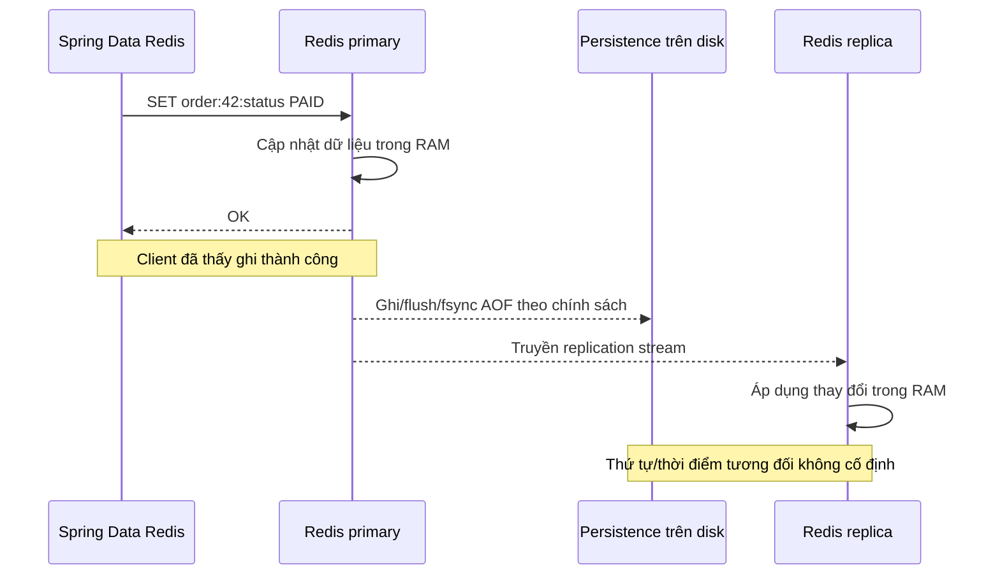
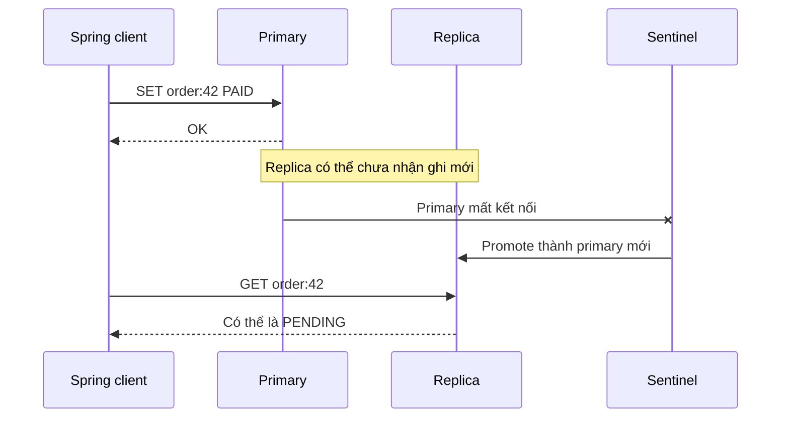

# Phân biệt dữ liệu trong bộ nhớ với bản sao bền vững trong Spring Data Redis

## 1. Một lệnh `SET` thành công có nghĩa dữ liệu đã an toàn sau khi Redis khởi động lại?

Redis là cơ sở dữ liệu ưu tiên thao tác trên **dữ liệu đang nằm trong bộ nhớ (RAM)** để phục vụ đọc/ghi với độ trễ thấp. Khi ứng dụng Spring Data Redis gọi:

```java
stringRedisTemplate.opsForValue()
        .set("order:42:status", "PAID");
```

Redis có thể cập nhật dataset trong RAM và trả phản hồi thành công. Nhưng một phản hồi thành công **không mặc nhiên chứng minh rằng thay đổi đó đã được ghi bền vững xuống đĩa, đã được replica nhận, hoặc đã có một bản backup có thể khôi phục**.

Để hiểu mức độ an toàn của dữ liệu, phải phân biệt:

- **Trạng thái dữ liệu trong RAM:** tập key/value Redis hiện đang dùng để trả lời lệnh `GET`, `HGETALL`, `ZRANGE`... Khi Redis process kết thúc hoặc máy mất nguồn, RAM không phải nơi lưu trữ phục hồi mặc định.
- **RDB snapshot:** một bản chụp dataset ở một thời điểm, lưu thành tệp để Redis có thể nạp lại khi khởi động.
- **AOF (Append Only File):** nhật ký các thay đổi có thể được dùng để tái dựng dataset sau khi restart; độ bền phụ thuộc cách flush/fsync và tình trạng lưu trữ.
- **Replication:** một hoặc nhiều replica đang giữ bản sao dữ liệu của primary và theo luồng thay đổi; không tự đồng nghĩa với dữ liệu đã được ghi bền vững.
- **Backup độc lập:** một bản dữ liệu được lưu, bảo vệ và kiểm thử để khôi phục khi có sự cố lớn, xóa nhầm hoặc hỏng dữ liệu.

Cùng một key có thể tồn tại trong RAM primary, chưa vào bản chụp RDB gần nhất, đang nằm trong buffer của AOF chưa fsync, đã hoặc chưa tới replica, và hoàn toàn không nằm trong bản backup nào. Vì vậy câu hỏi “Redis đã lưu key chưa?” cần nói rõ **đã lưu ở lớp nào**.

## 2. Hai khái niệm quan trọng: tính sẵn có và độ bền

Trong vận hành Redis, ba tình huống khác nhau:

1. **Redis còn chạy:** key đã ghi có thể được đọc từ RAM gần như ngay sau khi primary xử lý command.
2. **Redis process hoặc host khởi động lại:** Redis chỉ khôi phục được những dữ liệu mà cơ chế persistence đang bật và hệ thống lưu trữ còn giữ lại.
3. **Máy, volume hoặc vùng triển khai bị mất:** ngay cả RDB/AOF trên cùng volume cũng có thể biến mất; cần bản sao nằm ở failure domain khác hoặc khả năng khôi phục từ nguồn dữ liệu gốc.

| Nhu cầu | Công cụ thường dùng | Không nên tự suy ra |
| --- | --- | --- |
| Phục vụ request nhanh | Dataset trong RAM | Dữ liệu đã được fsync xuống disk |
| Khôi phục sau restart | RDB/AOF | Không bao giờ mất ghi mới nhất |
| Phục vụ khi primary hỏng | Replication, Sentinel hoặc Cluster failover | Replica chắc chắn có mọi ghi được primary xác nhận |
| Khôi phục sau xóa nhầm, lỗi logic, mất volume | Backup có lưu giữ nhiều phiên bản | Replica hoặc RDB trên cùng máy đã là backup |
| Bảo đảm tác vụ nghiệp vụ không thất lạc | Nguồn dữ liệu bền vững, outbox, idempotency, quy trình đối soát | `RedisTemplate` trả thành công đồng nghĩa end-to-end exactly-once |

**Durability** là khả năng những thay đổi đã được ghi còn tồn tại sau một loại sự cố xác định. **Availability** là khả năng hệ thống tiếp tục nhận và phục vụ request. Một topology có nhiều replica có thể tăng availability, nhưng vẫn không đạt yêu cầu mất dữ liệu bằng 0 nếu sao chép bất đồng bộ.

## 3. Các mốc thời gian của một thao tác ghi

Đừng gộp “Redis đã xử lý lệnh”, “client đã nhận OK”, “AOF đã fsync” và “replica đã đồng bộ” vào cùng một thời điểm.

Ví dụ luồng khái niệm khi Redis bật AOF với fsync theo chu kỳ và có một replica:



Thực tế Redis có thể đưa dữ liệu vào buffer và ghi log trong quá trình xử lý command; sơ đồ **không mô tả thứ tự chi tiết nội bộ của từng syscall**. Điều quan trọng là mốc phản hồi cho client không phải cam kết rằng mọi lớp disk, replica và backup đều đã an toàn.

Nếu Redis hoặc host hỏng ngay sau khi app nhận `OK`, kết quả khôi phục tùy:

- Redis có bật RDB/AOF không?
- Snapshot gần nhất ở thời điểm nào?
- AOF đã được ghi và fsync tới đoạn nào?
- File persistence có nằm trên volume được giữ lại không?
- Replica nào đã nhận được thay đổi và được chọn làm primary nếu failover?
- Backup có được lưu bên ngoài máy/volume gặp lỗi không?

## 4. Khi Redis không có persistence: dataset chỉ nằm trong RAM

Một Redis instance có thể chạy với cả RDB snapshot lẫn AOF bị tắt. Trong khi process đang hoạt động, ứng dụng vẫn thực hiện `SET`, `GET`, `INCR` bình thường và nhận phản hồi thành công.

Ví dụ về **ý nghĩa cấu hình**:

```conf
save ""
appendonly no
```

- `save ""`: không dùng quy tắc tự động tạo RDB snapshot theo điều kiện save.
- `appendonly no`: không dùng AOF để ghi nhật ký thay đổi.

Đây là cấu hình chỉ nên áp dụng khi **có chủ đích chấp nhận mất dataset lúc restart/crash**, như Redis cache có thể tái tạo toàn bộ. Không sao chép vào production nếu dữ liệu cần được giữ lại.

Diễn biến:

```text
09:00 Redis khởi động với dataset rỗng
09:01 SET cache:product:42 "..."
09:02 GET cache:product:42 -> có value
09:03 Redis process bị mất hoàn toàn
09:04 Redis khởi động lại
09:05 GET cache:product:42 -> thường không còn value
```

RAM rất nhanh, nhưng **RAM của Redis process không phải bản sao bền vững**. RAM của một replica khác có thể giúp duy trì dịch vụ khi primary hỏng, nhưng nếu cả topology không có persistence hoặc replica cũng mất, vẫn không có nguồn dữ liệu bền vững để nạp lại.

### Khi mô hình chỉ RAM là hợp lý

- Cache có thể rebuild từ database hoặc API nguồn.
- Dữ liệu tính toán tạm, chấp nhận tạo lại sau sự cố.
- Một số trạng thái ngắn hạn mà nghiệp vụ không yêu cầu lưu qua restart.
- Môi trường thử nghiệm không chứa dữ liệu cần bảo vệ.

Dù chỉ dùng cache, vẫn cần dự kiến **cache cold start**: sau Redis restart, hàng loạt request có thể cùng miss và dồn tải về database. Có thể phải có rate limit, prewarming, circuit breaker, TTL jitter hoặc cơ chế bảo vệ cache stampede.

## 5. RDB snapshot: bản chụp dữ liệu tại một mốc thời gian

**RDB (Redis Database)** là cách Redis lưu một bản chụp dataset vào file nhị phân. Khi Redis khởi động lại, file RDB hợp lệ có thể dùng để nạp các key/value đã có tại mốc snapshot.

Một cấu hình minh họa:

```conf
save 900 1
save 300 10
save 60 10000
dbfilename dump.rdb
```

Mỗi dòng `save seconds changes` là một điều kiện: nếu sau khoảng thời gian tương ứng có đủ số thay đổi, Redis có thể tự tạo snapshot. **Các ngưỡng thực tế phụ thuộc cấu hình/phiên bản**, không nên coi ba dòng trên là mặc định chung của mọi Redis.

Ví dụ:

```text
09:00 BGSAVE thành công -> dump.rdb chứa state tại snapshot
09:01 SET order:42 PAID  -> có trong RAM primary
09:03 SET order:43 PAID  -> có trong RAM primary
09:04 Host đột ngột mất nguồn, không có snapshot mới
09:05 Redis nạp dump.rdb khi khởi động lại
Kết quả: các ghi 09:01 và 09:03 có thể không còn.
```

Đó là **cửa sổ mất dữ liệu (data-loss window)** của RDB: những thay đổi sau snapshot cuối chưa chắc được phục hồi.

### `BGSAVE` khác `SAVE`

Redis có các lệnh:

```redis
BGSAVE
LASTSAVE
```

- `BGSAVE` yêu cầu tạo snapshot ở chế độ nền, sử dụng cơ chế fork/child process trên những nền tảng và cấu hình thích hợp, cho phép Redis tiếp tục phục vụ nhiều thao tác.
- `SAVE` tạo snapshot đồng bộ và có thể chặn xử lý trong lúc thực hiện; tránh dùng tùy tiện trên Redis production.

Lệnh `BGSAVE` trả về khi yêu cầu được chấp nhận/khởi tạo, **không chứng minh rằng file snapshot mới đã hoàn tất và an toàn**. Cần xem trạng thái hoàn thành trong `INFO persistence` và kiểm tra kết quả của quá trình.

Các metric thường gặp:

```redis
INFO persistence
LASTSAVE
```

Chú ý các trường như `rdb_bgsave_in_progress`, `rdb_last_bgsave_status` và `rdb_last_save_time`. Tên trường có thể thay đổi theo Redis version. `LASTSAVE` cho biết thời điểm snapshot hoàn thành thành công gần nhất theo Redis, **không phải thời điểm lệnh SET gần nhất đã được ghi bền vững**.

### Snapshot có gây ảnh hưởng đến RAM không?

Khi Redis fork để snapshot, parent tiếp tục xử lý ghi còn child cần thấy dữ liệu tại mốc nhất quán. Thao tác ghi trong lúc đó có thể khiến copy-on-write tăng mức sử dụng bộ nhớ hệ thống. Vì vậy, dù RDB tạo file trên disk, quá trình snapshot vẫn có thể làm tăng memory footprint và I/O.

Cần theo dõi:

- Thời gian `BGSAVE`.
- `rdb_last_bgsave_status` và các lỗi I/O.
- Bộ nhớ RSS/copy-on-write, đặc biệt khi dataset lớn và lưu lượng ghi cao.
- Dung lượng disk và filesystem.
- Khoảng cách thời gian giữa các snapshot thành công.

### RDB phù hợp khi nào?

RDB hữu ích khi cần bản chụp tương đối gọn để khôi phục dataset hoặc làm điểm khởi đầu cho backup. Nó phù hợp nếu ứng dụng **chấp nhận mất những thay đổi từ snapshot gần nhất** khi sự cố xảy ra.

RDB không phải một “bản sao riêng liên tục được cập nhật mỗi khi SET”. Một file RDB được tạo thành công ở 09:00 không tự chứa lệnh SET đã xảy ra ở 09:01.

## 6. AOF: nhật ký thay đổi để tái dựng dataset

**AOF (Append Only File)** ghi lại một luồng thao tác thay đổi dữ liệu dưới dạng nhật ký để khi restart Redis có thể phát lại và tái dựng trạng thái.

Cấu hình minh họa:

```conf
appendonly yes
appendfsync everysec
```

Cơ chế khái niệm:

```text
Redis RAM:
  order:42 = PAID
  counter:visits = 15

AOF:
  ... SET order:42 PAID
  ... INCR counter:visits
  ... (những thay đổi liên quan khác)

Khi restart:
  Redis đọc/replay AOF hợp lệ
  -> tái dựng dataset theo chuỗi thao tác
```

AOF giúp khôi phục trạng thái sát các lần ghi gần đây hơn cấu hình RDB định kỳ, nhưng **độ bền vẫn phụ thuộc chính sách fsync và tình trạng disk**.

### Ba chế độ `appendfsync`

| Cấu hình | Cách hiểu | Đánh đổi chính |
| --- | --- | --- |
| `appendfsync always` | Yêu cầu đồng bộ AOF với disk rất thường xuyên, về cơ bản sau các lần ghi theo cơ chế Redis | Giảm cửa sổ mất dữ liệu do crash nhưng tốn I/O và có thể tăng độ trễ |
| `appendfsync everysec` | Redis cố gắng fsync theo chu kỳ khoảng mỗi giây | Cân bằng hiệu năng/độ bền; khi crash có thể mất những ghi gần đây, không phải SLA đúng tuyệt đối 1 giây |
| `appendfsync no` | Redis không tự yêu cầu fsync theo chu kỳ cho AOF, dựa nhiều vào OS | Có thể nhanh trong một số môi trường nhưng mức mất dữ liệu khi lỗi OS/host khó dự đoán hơn |

Cần phân biệt ba lớp:

1. **Redis đã xử lý command và cập nhật RAM.**
2. **Dữ liệu AOF đã được đưa qua write path của OS**, có thể còn trong page cache.
3. **Dữ liệu đã được fsync theo chính sách**, tiến gần hơn tới việc có thể phục hồi sau crash.

Việc ứng dụng gọi `set(...)` và nhận kết quả không mặc định buộc `fsync` thành công trước khi phương thức Java trả về ở mọi cấu hình.

Ngay cả `appendfsync always` cũng không phải lời bảo đảm tuyệt đối trước mọi loại lỗi: còn phần cứng, filesystem, volume/network storage, lỗi cấu hình và failover.

### Ví dụ cửa sổ mất dữ liệu với `everysec`

```text
10:00:00.000  AOF đã fsync đến một tiến độ nhất định
10:00:00.250  SET order:42 PAID -> Redis trả OK
10:00:00.400  Host mất nguồn trước lần fsync tiếp theo

Sau restart:
  Nếu đoạn ghi mới chưa bền vững,
  giá trị order:42 có thể quay về phiên bản cũ.
```

Đây là minh họa một rủi ro, không phải khẳng định mọi crash ở thời điểm ấy đều mất lệnh. Tùy timing, OS, filesystem và tình trạng AOF, dữ liệu mới cũng có thể đã được lưu.

## 7. AOF rewrite: giảm kích thước log, không phải xóa dữ liệu

Nếu AOF giữ mãi mọi thao tác, file có thể tăng rất lớn:

```redis
SET counter 1
SET counter 2
SET counter 3
SET counter 4
```

Để khôi phục dataset hiện tại, không nhất thiết phải giữ nguyên toàn bộ các lệnh lịch sử trên. Redis có cơ chế **AOF rewrite** để tạo biểu diễn gọn hơn cho trạng thái dữ liệu hiện có, đồng thời duy trì thay đổi phát sinh trong quá trình rewrite.

Lệnh quan sát/thao tác:

```redis
INFO persistence
BGREWRITEAOF
```

`BGREWRITEAOF` yêu cầu rewrite ở nền. Không nên gọi liên tục trên production mà không xem tải disk, bộ nhớ và trạng thái rewrite đang chạy. Khi rewrite, Redis cần xử lý các thay đổi được ghi đồng thời để không mất trạng thái hiện hành.

### Cấu trúc AOF phụ thuộc Redis version

Ở Redis 7 trở lên, AOF có thể gồm nhiều file theo cơ chế multipart AOF, chẳng hạn base AOF/RDB, incremental AOF và manifest mô tả những file đang có hiệu lực. Ở các phiên bản/cấu hình cũ hơn, cách lưu trữ có thể là một file AOF đơn.

Điều này dẫn tới lưu ý vận hành:

- Không mặc định chỉ cần copy một file tên `appendonly.aof` từ Redis đang chạy là đã có backup nhất quán.
- Không xóa bừa file cũ trong thư mục AOF; cần hiểu cơ chế rewrite và manifest tương ứng.
- Khi backup, nên dùng cơ chế snapshot/backup được Redis và hạ tầng lưu trữ hỗ trợ, bảo đảm tập file nhất quán.
- Cần thử **restore thật** vào một Redis instance test để biết bản sao có thể dùng được.

AOF rewrite là một tối ưu dung lượng và thời gian phục hồi, không thay thế quy trình backup độc lập.

## 8. Khi bật cả RDB và AOF

Redis có thể bật đồng thời RDB và AOF:

```conf
save 300 10
appendonly yes
appendfsync everysec
```

Trong tình huống này:

- RDB tạo snapshot theo lịch/điều kiện cấu hình.
- AOF ghi lại chuỗi thay đổi theo cơ chế append.
- Khi khởi động mà AOF hợp lệ được bật, Redis thông thường ưu tiên khôi phục từ AOF vì nó có thể chứa dữ liệu mới hơn RDB.

**Không hiểu rằng Redis sẽ cộng hai tập dữ liệu vào nhau**. Khi phục hồi, Redis dùng cơ chế nạp dữ liệu theo cấu hình và định dạng persistence đang hiện diện; phải kiểm tra log startup và trạng thái dữ liệu.

RDB và AOF có các điểm mạnh khác nhau:

| Yếu tố | RDB | AOF |
| --- | --- | --- |
| Mô hình | Snapshot dataset | Nhật ký các thay đổi / biểu diễn phục hồi |
| Tần suất ghi bền vững | Theo lịch, điều kiện hoặc BGSAVE | Theo write path và chính sách fsync |
| Cửa sổ mất dữ liệu khi crash | Có thể dài từ snapshot gần nhất | Thường ngắn hơn khi fsync phù hợp, nhưng không bằng 0 trong mọi cấu hình |
| Dung lượng | File snapshot thường gọn | Có thể lớn; rewrite giúp giảm |
| Tải tài nguyên | Fork/COW, snapshot I/O | Ghi log liên tục, fsync và rewrite I/O |
| Khôi phục | Nạp snapshot | Replay/nạp cơ sở AOF và phần tăng dần |
| Phù hợp backup | Dễ quản lý bản chụp nhất quán khi tạo đúng | Cần quản lý trạng thái file/manifest và tính nhất quán lúc copy |

Nếu hai cơ chế cùng bật nhưng volume lưu file bị mất, cả hai có thể không còn. Độ bền dữ liệu không chỉ là chọn định dạng mà còn là **nơi lưu và khả năng khôi phục của hạ tầng**.

## 9. Ma trận rủi ro: sự cố nào gây mất những dữ liệu nào?

Giả sử ứng dụng đã nhận OK cho một lệnh `SET`, và sự cố xảy ra ngay sau đó.

| Cấu hình/trạng thái | Redis process crash | Host mất nguồn | Disk/volume mất hoàn toàn |
| --- | --- | --- | --- |
| Chỉ RAM, không RDB/AOF | Dataset có thể mất sau restart | Dataset có thể mất | Không có bản local để khôi phục |
| RDB theo lịch | Khôi phục đến snapshot thành công gần nhất | Có thể mất ghi từ snapshot gần nhất | File RDB local cũng mất nếu nằm trên volume đó |
| AOF `everysec` | Có thể mất đoạn ghi gần nhất chưa đủ bền vững | Có thể mất đoạn ghi chưa fsync | AOF local mất nếu volume mất |
| AOF `always` | Cửa sổ mất ghi do chưa fsync giảm đáng kể, không tuyệt đối | Còn phụ thuộc storage/OS/hardware | Vẫn mất nếu volume mất |
| Có replica nhưng không backup | Có thể chuyển phục vụ sang replica nếu còn sống | Replica khác failure domain có thể giúp | Nếu replica chưa đồng bộ hoặc cũng mất, dữ liệu vẫn rủi ro |
| Có backup độc lập đã thử restore | Có nguồn khôi phục riêng theo mốc backup | Có nguồn khôi phục riêng theo mốc backup | Có thể khôi phục từ nơi lưu độc lập, vẫn có RPO theo mốc backup |

Bảng cố ý dùng “có thể”: mất dữ liệu là kết quả của cấu hình, tiến độ I/O, thời điểm sự cố và mức bảo vệ của hạ tầng. Không có một quy tắc “Redis có AOF thì luôn mất đúng 1 giây” hay “có replica thì không mất ghi”.

## 10. Replication là bản sao RAM đang hoạt động, không tự đồng nghĩa với persistence

Một primary và replica có thể có cùng dataset ở một thời điểm:

```text
Redis primary RAM:  order:42 = PAID
Redis replica RAM:  order:42 = PAID
```

Nhưng hai node đều có thể **chưa fsync** thay đổi đó. Replication chủ yếu chuyển luồng thay đổi để một replica bắt kịp primary; nó không tự đảm bảo một bản file trên disk đã được ghi cho mỗi lệnh.

Ví dụ:



Nếu replica được promote trong khi chưa có ghi cuối, primary mới có thể thiếu thay đổi đã được primary cũ xác nhận.

### Redis `WAIT` giúp gì?

Trong một số trường hợp, ứng dụng có thể dùng:

```redis
SET order:42 PAID
WAIT 1 1000
```

Khi gọi từ cùng kết nối client phù hợp, `WAIT 1 1000` yêu cầu chờ tối đa khoảng 1000 ms cho một replica xác nhận tiến độ replication của các ghi trước đó. Kết quả trả về là số replica đáp ứng.

Nhưng:

- `WAIT` không làm replication trở thành một hệ consensus có cam kết zero data loss.
- Replica đã nhận/áp dụng dữ liệu chưa chắc đã fsync bản sao xuống disk.
- Khi gọi `WAIT` trên kết nối khác với lệnh ghi, không thể tự giả định semantics chờ cùng write history.
- Nếu gặp timeout hoặc số replica ít hơn yêu cầu, ứng dụng phải quyết định cách xử lý; lệnh ghi trước đó có thể đã thành công.

**Replication tăng khả năng sẵn có và khả năng phục hồi khi một node hỏng, còn persistence và backup phục vụ mục tiêu khác.**

## 11. Replica cũng có cấu hình persistence riêng

Mỗi Redis process có RAM, cấu hình RDB/AOF và filesystem riêng. Một replica có thể bật AOF/RDB hoặc không, tùy triển khai.

Đừng suy luận:

- “Primary bật AOF thì mọi replica cũng đã bật AOF.”
- “Replica có tất cả key nghĩa là nó đã ghi được file AOF.”
- “Hai replica đặt cùng host/volume là hai bản sao độc lập trước lỗi hạ tầng.”

Nếu yêu cầu dữ liệu vẫn có thể khôi phục sau lỗi host, cần quan tâm nơi đặt replica, độ trễ đồng bộ, cấu hình persistence của từng node và failover topology.

Đặc biệt, nếu replica có nhiệm vụ phục vụ read traffic thì nó thường có trạng thái dữ liệu **eventually consistent**. Một `GET` trên replica có thể trả dữ liệu cũ ngay cả khi primary đã ghi thành công; đây là vấn đề read consistency khác với việc dữ liệu có thể phục hồi từ disk sau crash hay không.

## 12. TTL và eviction: dữ liệu có thể biến mất dù persistence hoạt động đúng

Một key Redis không nhất thiết tồn tại vô hạn. Ví dụ:

```java
stringRedisTemplate.opsForValue().set(
        "session:42:token",
        "token-for-demo",
        Duration.ofMinutes(15)
);
```

Sau khi TTL hết hạn, Redis sẽ xử lý loại bỏ key theo cơ chế expiration. Việc RDB/AOF bật không có nghĩa key đã hết hạn sẽ được “sống lại” sau restart.

Cần phân biệt:

- **TTL expiration:** key hết hạn theo chính sách thời gian, đây là hành vi hợp lệ.
- **Eviction:** Redis chủ động loại key theo chính sách `maxmemory-policy` để giải phóng bộ nhớ.
- **Explicit delete:** ứng dụng thực hiện `DEL` hoặc thao tác tương ứng.
- **Data loss do crash:** thay đổi chưa bền vững bị mất khi hệ thống khôi phục.

Hai ví dụ:

```redis
SET demo:temp:1 VALUE EX 30
TTL demo:temp:1

CONFIG GET maxmemory-policy
INFO memory
```

Một key không thấy sau restart có thể do nó đã hết hạn đúng logic hoặc bị eviction, không phải luôn do AOF/RDB lỗi. Khi chẩn đoán, cần biết thời điểm cuối cùng key tồn tại, TTL, memory policy và log startup.

### TTL được lưu với dataset ra sao?

RDB/AOF lưu thông tin cần thiết để Redis duy trì semantics expiration khi khôi phục. Trong RDB, expiration được mô tả bằng thời điểm hết hạn; khi nạp lại, Redis có thể bỏ các key đã hết hạn theo thời gian hệ thống. AOF tái dựng trạng thái có expiration theo các thao tác được ghi và biểu diễn persistence phù hợp.

Điều này dẫn đến yêu cầu đồng hồ hệ thống đúng: đồng hồ host sai lệch nghiêm trọng có thể làm TTL/expiration hành xử khác mong đợi. Không dùng khôi phục từ persistence như cách cố gắng gia hạn trái chính sách các token đã hết hạn.

## 13. Eviction và persistence có quan hệ ra sao?

Redis có giới hạn bộ nhớ qua `maxmemory` và chính sách `maxmemory-policy`, ví dụ:

```conf
maxmemory 2gb
maxmemory-policy allkeys-lru
```

Nếu cần giải phóng bộ nhớ, Redis có thể loại bớt key theo chính sách đã chọn. Những thay đổi dữ liệu do eviction là thay đổi hợp lệ trong dataset, và cơ chế replication/persistence sẽ phản ánh trạng thái theo semantics tương ứng.

Vì vậy **RDB/AOF không phải công cụ ngăn Redis xóa key khi thiếu RAM**.

Với Redis chỉ dùng làm cache, eviction thường nằm trong thiết kế bình thường. Với Redis giữ dữ liệu quan trọng, cần chọn chính sách bộ nhớ và năng lực RAM phù hợp; `noeviction` có thể từ chối một số lệnh ghi khi vượt giới hạn, nhưng điều đó **không tự bảo đảm durability** và cũng không thay thế memory capacity planning.

Các chỉ số nên theo dõi:

```redis
INFO memory
INFO stats
INFO persistence
```

Lưu ý bộ nhớ RSS có thể cao hơn dataset logic trong RAM do fragmentation, allocator, buffer, copy-on-write khi fork và các yếu tố khác. Không dùng mỗi `used_memory` để kết luận máy chắc chắn còn đủ RAM cho BGSAVE/AOF rewrite.

## 14. Spring Data Redis: lớp template không tự cấu hình độ bền server

Một service mẫu:

```java
import java.time.Duration;

import org.springframework.data.redis.core.StringRedisTemplate;
import org.springframework.stereotype.Service;

@Service
public class OrderStatusCache {

    private final StringRedisTemplate redis;

    public OrderStatusCache(StringRedisTemplate redis) {
        this.redis = redis;
    }

    public void storeStatus(String orderId, String status) {
        String key = "orders:" + orderId + ":status";

        redis.opsForValue().set(
                key, status, Duration.ofMinutes(20));
    }

    public String findStatus(String orderId) {
        return redis.opsForValue().get(
                "orders:" + orderId + ":status");
    }
}
```

Khi `storeStatus(...)` trả về bình thường, ứng dụng biết lời gọi Redis đã được xử lý theo contract của client. Nhưng method Java **không chứa một lời gọi fsync của Redis** và không quyết định RDB/AOF policy. Độ bền phụ thuộc Redis server/hạ tầng.

Một `RedisTemplate` có thể làm việc với Redis được cấu hình:

- Chỉ RAM.
- RDB.
- AOF.
- RDB + AOF.
- Managed Redis có persistence/backup theo hợp đồng dịch vụ.

Cùng một đoạn code Java sẽ có **đặc tính phục hồi sau crash khác nhau** tùy backend.

### Đừng nhầm `@Transactional` với lưu bền vững

Spring transaction chủ yếu quản lý một phạm vi commit/rollback theo transaction manager và tài nguyên liên quan. Ngay cả khi dùng Spring-managed Redis transaction với `MULTI/EXEC`, nó **không tự bật AOF/RDB hoặc yêu cầu fsync**.

Một nhóm lệnh Redis được `EXEC` không có nghĩa mỗi command đã vào file bền vững hoặc được sao chép lên nhiều replica trước khi client nhận kết quả. Atomicity của thao tác và durability sau crash là hai thuộc tính khác nhau.

### Redis Repository cũng chịu cấu hình persistence của Redis server

Lưu entity bằng `CrudRepository.save(...)` trong Spring Data Redis có thể ghi Hash, index và TTL ở Redis. Những cấu trúc đó vẫn nằm trong cùng dataset Redis và cùng chịu chính sách persistence.

`@RedisHash(timeToLive = ...)` có thể đặt expiration của entity, nhưng TTL của entity không phải bảo đảm độ bền. Một entity có TTL dài vẫn có thể mất ghi gần nhất nếu Redis crash trước khi persistence ghi phần thay đổi tương ứng.

## 15. Redis Cache: khi nào không cần bảo đảm dữ liệu được giữ qua restart?

Với nhiều ứng dụng, Redis là **cache**, còn database SQL hoặc nguồn nghiệp vụ khác là *source of truth*:

```text
Database:
  order 42 = PAID   (nguồn dữ liệu chính)

Redis Cache RAM:
  order:42:status = PAID

Khi Redis mất dataset:
  cache miss -> truy vấn database -> tính lại cache
```

Nếu cache có thể rebuild, không bắt buộc AOF/RDB phải đạt mức độ bền của database nguồn. Tuy nhiên cache miss hàng loạt sau restart vẫn có thể làm tăng tải backend. Cần kế hoạch:

- Warm-up key nóng theo mức ưu tiên.
- Chống cache stampede.
- Giới hạn request tới database.
- TTL phù hợp với tính đúng đắn nghiệp vụ.
- Chấp nhận một khoảng giảm hiệu năng khi cache cold start.

Ngược lại, nếu ứng dụng lưu **dữ liệu không thể tái tạo** chỉ trong Redis mà lại cấu hình Redis như cache RAM, đó là sai lệch yêu cầu độ bền.

### Phân loại một số loại dữ liệu

| Dữ liệu | Có thể chấp nhận mất sau restart? | Khuyến nghị định hướng |
| --- | --- | --- |
| Cache danh mục sản phẩm từ database | Thường có, nếu có đường tái tạo | Redis có thể dùng cache-only; kiểm soát miss/stampede |
| Cache kết quả truy vấn tốn thời gian | Tùy hiệu năng và chi phí tái tạo | Cân nhắc persistence để giảm cold start hoặc tự rebuild |
| Session người dùng | Tùy chính sách đăng nhập/đăng xuất và bảo mật | Cần xác định hành vi khi Redis mất hoặc failover |
| Counter thống kê không quan trọng | Có thể, nếu chấp nhận sai lệch | Redis là lựa chọn phù hợp với giới hạn được nêu |
| Số dư hoặc giao dịch thanh toán | Thường không | Không dựa vào RAM Redis hay replica bất đồng bộ như nguồn duy nhất |
| Trạng thái công việc cần retry | Thường không | Dùng log/queue bền vững, idempotency và ACK |
| Token hết hạn ngắn | Tùy rủi ro bảo mật | TTL đúng và chính sách mất state phải được kiểm soát |

Quyết định này không chỉ là lựa chọn Redis server. Nó là **hợp đồng nghiệp vụ**: mất dữ liệu tối đa bao nhiêu, mất trong điều kiện nào, mất bao lâu để phục hồi và ai chịu trách nhiệm đối soát.

## 16. RPO và RTO: chuyển yêu cầu nghiệp vụ thành cấu hình

Hai chỉ số quan trọng:

- **RPO — Recovery Point Objective:** khoảng mất dữ liệu tối đa mà hệ thống có thể chấp nhận khi xảy ra sự cố.
- **RTO — Recovery Time Objective:** khoảng thời gian tối đa mong muốn để dịch vụ hoạt động trở lại.

Ví dụ:

```text
RPO = 5 phút
  Chấp nhận khôi phục về trạng thái trong vòng 5 phút trước lỗi.

RTO = 10 phút
  Mong muốn dịch vụ phục hồi trong khoảng 10 phút.
```

Cần hiểu RPO/RTO là **mục tiêu thiết kế**, không phải cam kết tự động do đặt một dòng cấu hình Redis.

| Yêu cầu | Cách suy nghĩ |
| --- | --- |
| Cache có thể mất hết, nhưng API phải sẵn sàng | Tập trung fallback và tốc độ rebuild |
| Chấp nhận mất vài phút ghi | RDB theo lịch có thể là một phần phương án nếu snapshot thành công đủ thường xuyên |
| Muốn giảm rủi ro mất ghi gần nhất | AOF fsync phù hợp, có thể kèm replication và persistence mạnh hơn |
| Không chấp nhận mất giao dịch đã xác nhận | Cần đánh giá một hệ thống nguồn có bảo đảm commit phù hợp hơn hoặc thiết kế nghiệp vụ end-to-end |
| Mất cả host hoặc vùng triển khai | Replica khác failure domain và backup độc lập |
| Xóa nhầm key hàng loạt | Backup có retention/version, quy trình restore và quyền hạn an toàn |

Một hệ thống có RPO nghiêm ngặt không được suy từ `appendfsync everysec` rằng sẽ mất tối đa chính xác một giây: hãy kiểm thử lỗi, đo điều kiện thật và đưa thêm biện pháp bảo vệ cần thiết.

## 17. File persistence phải nằm trên nơi lưu trữ được giữ lại

Với Redis chạy trong container hoặc Kubernetes, một cấu hình:

```conf
appendonly yes
appendfsync everysec
dir /data
```

chỉ hữu ích cho phục hồi nếu thư mục `/data` được gắn tới nơi lưu trữ **thực sự tồn tại sau khi Redis container bị thay thế hoặc host gặp sự cố**.

Ví dụ:

```text
Redis process
    |
    v
/data trong container
    |
    +-- Không có persistent volume:
    |     file có thể mất khi container bị tạo lại
    |
    +-- Có volume được giữ lại:
          file có cơ hội tồn tại sau process/container restart
          nhưng vẫn phải xét lỗi host, disk, PVC và backup
```

Cấu hình RDB/AOF là **persistence ở mức Redis**, còn độ bền của media là **hợp đồng lưu trữ**. Nếu underlying disk/volume là ephemeral, có thể mất file khi hạ tầng thay đổi.

Trong production cần kiểm tra:

- Redis ghi file vào đúng thư mục được mount.
- Quyền ghi filesystem, dung lượng, IOPS và quota.
- Cơ chế giữ volume khi deployment restart/recreate.
- Khả năng mất volume khi node/availability zone hỏng.
- Backup của volume hoặc tệp persistence được lưu ở failure domain khác.
- Quy trình restore và thời gian load dataset thực tế.
- Encryption at rest và quyền truy cập file backup.

Không kết luận “có `dump.rdb` trên disk là an toàn” khi file đó nằm trên cùng host hoặc cùng volume có thể mất đồng thời với Redis.

## 18. Backup khác với persistence tại chỗ

**Persistence** trả lời: *Redis có thể nạp lại trạng thái từ những file mà nó duy trì hay không?*

**Backup** trả lời: *Khi dữ liệu tại chỗ bị xóa, ghi sai, hỏng hoặc mất, ta có một bản độc lập từ trước để khôi phục không?*

Ví dụ:

```text
12:00 Một script lỗi chạy DEL trên 100.000 key.
12:01 Thay đổi DEL được primary xử lý.
12:02 AOF ghi lại các thao tác xóa.
12:03 Replica đồng bộ trạng thái key đã biến mất.

Lúc này:
  - RAM primary: dữ liệu bị xóa
  - RAM replica: dữ liệu bị xóa
  - AOF hiện tại: phản ánh xóa
  - RDB tạo sau 12:00: cũng có thể thiếu dữ liệu

Nếu có backup độc lập lúc 11:00:
  có thể khôi phục trạng thái trước lỗi, rồi đối soát phần thay đổi hợp lệ.
```

Replica không phải backup đối với lỗi logic được replicate. Một AOF/RDB duy nhất tại chỗ cũng không phải backup có retention theo thời gian.

Chính sách backup cần xác định:

1. Tần suất backup và tuổi dữ liệu được chấp nhận khi restore.
2. Nơi lưu độc lập với primary, replica và volume production.
3. Nhiều phiên bản/retention để khôi phục trước lúc xóa sai.
4. Kiểm tra checksum, quyền truy cập và encryption.
5. Thử restore định kỳ vào môi trường tách biệt.
6. Quy trình chuyển ứng dụng sang trạng thái phục hồi an toàn.
7. Đối soát dữ liệu đã thay đổi sau thời điểm backup.

Không copy file AOF đang rewrite tùy tiện rồi cho rằng backup nhất quán. Với RDB, cần xác định snapshot hoàn thành thành công trước khi lấy file; với AOF, phải hiểu cấu trúc multipart/manifest và quy trình backup phù hợp phiên bản.

## 19. Quan sát trạng thái persistence bằng Redis CLI

Trên Redis thử nghiệm hoặc endpoint có quyền quan sát:

```redis
INFO persistence
INFO memory
INFO replication
CONFIG GET save
CONFIG GET appendonly
CONFIG GET appendfsync
CONFIG GET dir
CONFIG GET dbfilename
LASTSAVE
```

Không phải managed Redis nào cũng cho tài khoản ứng dụng gọi `CONFIG GET`, và các thuộc tính có thể được nhà cung cấp quản lý bên ngoài Redis. Khi bị `NOPERM`, cần kiểm tra bằng dashboard/cấu hình được vận hành cung cấp, không nâng quyền runtime một cách tùy tiện.

Các tín hiệu đáng quan tâm:

| Tín hiệu | Dùng để hiểu gì? | Giới hạn |
| --- | --- | --- |
| `rdb_last_save_time` | Mốc snapshot thành công gần nhất | Không xác nhận các ghi sau mốc đó đã bền vững |
| `rdb_bgsave_in_progress` | Có snapshot đang chạy hay không | Không cho biết snapshot đó đã thành công |
| `rdb_last_bgsave_status` | Kết quả lần snapshot gần nhất | Không nói được AOF đã fsync đến đâu |
| `aof_enabled` | AOF có bật không | Bật AOF chưa đồng nghĩa file/volume an toàn |
| `aof_last_write_status` | Trạng thái ghi AOF gần đây | Không chứng minh mọi ghi đã có backup độc lập |
| `aof_last_bgrewrite_status` | Kết quả rewrite gần nhất | Không phải trạng thái mọi lần fsync |
| `aof_pending_bio_fsync` | Hoạt động fsync đang chờ theo phiên bản Redis | Cần đọc cùng fsync policy và lag I/O |
| `used_memory` | Redis đang dùng bộ nhớ cho dataset/overhead | Khác RSS và bộ nhớ COW khi snapshot |
| Replication link/offset | Replica đang đồng bộ đến đâu | Offset không phải mốc fsync trên disk |

Một dashboard tốt cần ghi nhận **mức độ sẵn có của file phục hồi và thời điểm backup thành công** từ hệ thống vận hành, không chỉ lấy metric RAM/Redis command.

## 20. Khi Redis trả lỗi persistence, ứng dụng nên làm gì?

Một số lỗi:

- Disk đầy hoặc I/O error khiến Redis không thể ghi AOF.
- `BGSAVE` thất bại vì thiếu bộ nhớ/disk hoặc quyền filesystem.
- RDB save thất bại và Redis được cấu hình `stop-writes-on-bgsave-error yes` có thể từ chối một số thao tác ghi với lỗi liên quan đến lưu snapshot.
- AOF rewrite hoặc quá trình nạp persistence lỗi.
- Volume bị mount read-only.
- Redis restart nhưng file thiếu/hỏng hoặc manifest không đầy đủ.

Phải phân biệt **lỗi command** và **nguy cơ mất durability**. Ví dụ ứng dụng có thể thấy một số thao tác `GET` vẫn thành công dù việc tạo snapshot đã liên tục thất bại; server còn sống trong RAM không có nghĩa dữ liệu an toàn khi restart.

Trong Spring Data Redis:

```java
try {
    stringRedisTemplate.opsForValue()
            .set("app:status", "READY");
} catch (DataAccessException ex) {
    // Ghi metric/lỗi; không giả định command chắc chắn chưa thực thi.
    // Quyết định có retry dựa vào idempotency và loại dữ liệu.
    throw ex;
}
```

Import `org.springframework.dao.DataAccessException`. Khi xảy ra timeout hoặc mất kết nối sau lệnh ghi, client có thể không biết Redis đã thực hiện lệnh hay chưa. Retry một thao tác không idempotent như `INCR` có thể nhân đôi hiệu ứng.

Nếu ứng dụng cần đảm bảo write accepted only when persistence healthy, phải thiết kế health gates, phương án dừng ghi và các điều kiện durability riêng; một lần `SET` thành công đơn thuần chưa đủ.

## 21. Thực hành: phân biệt RAM, RDB và AOF trên Redis test

Bài thực hành **chỉ dùng một Redis test instance hoặc container dùng riêng**, không chứa dữ liệu công việc hay production. Không sử dụng `FLUSHALL` hoặc tắt Redis đang phục vụ người dùng.

### 21.1. Chuẩn bị ba profile thử nghiệm

Tạo ba môi trường Redis riêng với thư mục dữ liệu và cổng khác nhau:

| Profile | RDB | AOF | Điều sẽ quan sát |
| --- | --- | --- | --- |
| `lab-memory` | Tắt tự động snapshot | Tắt | Dữ liệu chỉ ở RAM có thể mất sau restart sạch nếu không lưu file nào |
| `lab-rdb` | Bật save theo lịch | Tắt | Restore từ snapshot cuối thành công |
| `lab-aof` | Có thể tắt RDB để dễ quan sát | Bật `everysec` | Restore từ AOF hợp lệ với rủi ro đoạn chưa fsync |

Ví dụ cấu hình **riêng cho lab**:

```conf
# lab-memory.conf
port 6381
dir /tmp/redis-lab-memory
save ""
appendonly no
```

```conf
# lab-rdb.conf
port 6382
dir /tmp/redis-lab-rdb
save 60 1
appendonly no
```

```conf
# lab-aof.conf
port 6383
dir /tmp/redis-lab-aof
save ""
appendonly yes
appendfsync everysec
```

Thư mục phải tồn tại và Redis phải có quyền ghi. Đường dẫn `/tmp/...` chỉ minh họa trên hệ thống Unix cho lab, không phù hợp làm nơi giữ dữ liệu production vì có thể bị dọn. Trên Windows hoặc container dùng đường dẫn tương ứng.

### 21.2. Ghi dữ liệu và quan sát RAM

Ở mỗi instance thử nghiệm:

```redis
SET demo:persistence:order PAID
GET demo:persistence:order
INFO persistence
```

Cả ba có thể trả `PAID` khi đang chạy. Vì vậy **quan sát `GET` trả giá trị không phân biệt được mô hình chỉ RAM, RDB hay AOF**.

### 21.3. Xác minh snapshot RDB

Trong lab-rdb:

```redis
BGSAVE
INFO persistence
LASTSAVE
```

Chờ `rdb_bgsave_in_progress` chuyển về trạng thái hoàn tất và xác nhận `rdb_last_bgsave_status` là thành công. Kiểm tra file RDB trong thư mục test.

Sau đó thêm một key mới **sau snapshot** và hiểu rằng file RDB vừa tạo chưa chắc có key mới ấy. Không phải cứ gọi `GET` trả về key là RDB đã chứa nó.

### 21.4. Xác minh AOF đang được sử dụng

Trong lab-aof:

```redis
CONFIG GET appendonly
CONFIG GET appendfsync
INFO persistence
```

Quan sát `aof_enabled` và các trạng thái ghi/rewrite. Chờ môi trường được khởi tạo theo cấu hình AOF rồi kiểm tra sự hiện diện của file AOF hoặc thư mục multipart AOF thích hợp.

Không can thiệp thủ công vào file AOF đang hoạt động. Nếu muốn kiểm tra khả năng restore, dừng/restart **instance thử nghiệm** theo quy trình phù hợp, sử dụng đúng cùng thư mục persistent, rồi đọc lại key.

### 21.5. Vì sao không dùng shutdown sạch để kết luận crash loss?

Một Redis shutdown có kiểm soát có thể thực hiện các bước ghi/lưu cần thiết theo cấu hình, và OS có thể flush buffer. Do đó kết quả sau **shutdown sạch** không đại diện chắc chắn cho tình huống **process bị kill đột ngột, host mất nguồn hoặc disk lỗi**.

Muốn thực nghiệm các giới hạn RPO thực tế, cần có lab cô lập, phương pháp giả lập lỗi có kiểm soát và hiểu rõ cách hệ thống lưu trữ xử lý fsync/cache. Không thực hiện hành động phá hoại trên Redis production để “kiểm tra durability”.

## 22. Khôi phục sau restart: Redis nạp file nào?

Quy trình khái niệm:

```text
Redis process bắt đầu
        |
        v
Đọc cấu hình persistence
        |
        +-- AOF enabled và dữ liệu AOF hợp lệ?
        |       |
        |       +--> Nạp/replay AOF theo định dạng được hỗ trợ
        |
        +-- Không dùng AOF, có RDB hợp lệ?
        |       |
        |       +--> Nạp RDB snapshot
        |
        +-- Không có dữ liệu persistence hợp lệ?
                |
                +--> Dataset có thể khởi đầu rỗng
                     hoặc startup báo lỗi tùy tình huống
```

Đây là lưu đồ khái niệm, không bao quát mọi trường hợp lỗi file, AOF truncation, module, phiên bản định dạng hoặc chế độ khôi phục của managed Redis.

Khi Redis khởi động thất bại vì persistence hỏng, không nên xóa file RDB/AOF để “cho server lên trước” rồi hy vọng dữ liệu tự quay lại. Cần lưu bản sao file lỗi để điều tra, tham khảo quy trình recovery chính thức của phiên bản Redis đang chạy và tiến hành trên bản sao/test trước khi thay đổi nguồn dữ liệu.

Nếu Redis là cache tái tạo được, chạy với dataset rỗng có thể là một chiến lược có chủ đích. Nếu Redis giữ state quan trọng, việc bỏ file persistence có thể làm mất dữ liệu không thể khôi phục.

## 23. Những ngộ nhận phổ biến về dữ liệu bền vững trong Redis

**“Redis lưu in-memory tức là không có khả năng lưu xuống disk.”**  
Không đúng. Redis có RDB và AOF; vấn đề là chúng có được bật, cấu hình và đặt trên lưu trữ phù hợp hay không.

**“`SET` trả OK thì file RDB mới đã chứa value.”**  
Không. Snapshot RDB là ảnh dữ liệu ở một mốc, không được tạo lại sau mọi `SET`.

**“AOF `everysec` bảo đảm mất tối đa đúng một giây.”**  
Không. Đây là chính sách fsync theo chu kỳ, không phải cam kết SLA tuyệt đối trước mọi lỗi OS, filesystem và hạ tầng.

**“Có hai replica là có hai backup bền vững.”**  
Không. Replica đồng bộ thay đổi, có thể chưa fsync và có thể cùng nhận những thao tác xóa/sửa sai.

**“Sentinel failover nghĩa là không mất ghi cuối.”**  
Không. Failover có thể promote một replica chưa bắt kịp primary.

**“`WAIT` làm mọi replica ghi xuống disk.”**  
Không. `WAIT` xử lý xác nhận replication theo điều kiện; nó không thay thế chính sách fsync hay backup.

**“RDB và AOF bật cùng lúc thì có thể mất một file cũng không sao.”**  
Không nên kết luận như vậy. Khả năng recovery còn phụ thuộc file nào hợp lệ, dữ liệu mới nhất, nơi lưu và cơ chế startup; cần kiểm thử khôi phục.

**“Container đã bật AOF nên recreate pod không mất dữ liệu.”**  
Không chắc. Nếu `/data` nằm trên filesystem ephemeral của container, file AOF cũng có thể mất.

**“Key không còn sau restart chắc chắn Redis làm mất dữ liệu.”**  
Không hẳn. Key có thể đã hết TTL, bị eviction hoặc bị xóa hợp lệ. Phải xác định nguyên nhân.

**“`@Transactional` trong Spring làm dữ liệu Redis được fsync ngay.”**  
Không. Spring transaction không thay thế cấu hình persistence phía Redis server.

**“Có snapshot mới nhất là có backup.”**  
Chưa đủ. Snapshot nằm cùng disk có thể mất cùng node; xóa nhầm có thể đã phản ánh vào snapshot mới. Backup cần sự độc lập và chính sách retention.

**“Tôi có RDB/AOF thì không cần restore test.”**  
Không. Chỉ khi khôi phục thử và xác nhận dữ liệu thực tế, đội vận hành mới có bằng chứng rằng file, manifest, đường dẫn và phiên bản Redis tương thích với kế hoạch phục hồi.

## 24. Hướng dẫn ra quyết định cho dự án Spring Data Redis

Trước khi cấu hình persistence, trả lời:

1. Redis là **cache** hay **source of truth**? Nếu Redis mất toàn bộ key, dữ liệu có thể tái tạo không?
2. **RPO/RTO** chấp nhận được là bao nhiêu?
3. Có cần bảo vệ trước crash process, mất host, mất availability zone hay cả xóa nhầm của ứng dụng?
4. Redis đang có RDB, AOF hoặc cả hai? Chính sách fsync/snapshot có được giám sát không?
5. File persistence được lưu ở đâu? Khi container/host thay thế, file còn không?
6. Replica được đặt ở failure domain nào? Có đảm bảo backup bên ngoài topology không?
7. Sau failover, client Spring có thể đọc dữ liệu trễ hoặc thiếu ghi cuối không?
8. Lỗi disk/persistence có được cảnh báo trước khi sự cố xảy ra không?
9. Có kịch bản restore định kỳ, bao gồm kiểm tra dataset và TTL không?
10. Khi lệnh Redis timeout, nghiệp vụ xử lý retry và trạng thái commit không rõ như thế nào?

Một số hướng chọn theo nhu cầu:

| Tình huống | Hướng thiết kế |
| --- | --- |
| Cache có thể rebuild, muốn ưu tiên đơn giản | Có thể dùng Redis chỉ RAM hoặc snapshot để giảm cold start; cần kế hoạch rebuild |
| Cần giảm mất dữ liệu gần đây | Xem xét AOF fsync phù hợp, giám sát I/O và replication |
| Cần phục hồi sau restart nhưng chấp nhận mất một số thay đổi gần nhất | RDB snapshot có thể đủ trong một số trường hợp |
| Cần HA khi primary hỏng | Replication và Sentinel/Cluster, đồng thời chấp nhận/kiểm soát giới hạn bất đồng bộ |
| Cần chống xóa nhầm, hỏng dữ liệu hoặc mất volume | Backup độc lập có retention và test restore |
| Không được phép mất một giao dịch đã xác nhận | Đặt dữ liệu tại hệ thống có hợp đồng durability phù hợp, thiết kế end-to-end thay vì chỉ dựa vào Redis |

Không có cấu hình “tối ưu chung” cho mọi ứng dụng. Một cache nóng có thể chịu mất dataset và ưu tiên tốc độ; một hệ thống trạng thái công việc cần retry có thể yêu cầu độ bền và quy trình recovery mạnh hơn nhiều.

## 25. Câu hỏi tự kiểm tra

1. Vì sao `GET key` trả đúng ngay sau `SET key value` chưa chứng minh dữ liệu có thể khôi phục sau crash?
2. Dataset trong RAM khác file RDB ở thời điểm cập nhật ra sao?
3. RDB snapshot có thể làm mất những ghi từ khoảng thời gian nào khi host mất nguồn?
4. `appendfsync everysec` có ý nghĩa gì, và tại sao không được coi là giới hạn mất dữ liệu tuyệt đối?
5. `appendfsync always` có xóa bỏ mọi rủi ro mất dữ liệu khi cả volume bị hỏng không?
6. Redis có thể bật RDB và AOF đồng thời không? Khi AOF được bật và hợp lệ, Redis thường ưu tiên nguồn nào khi nạp lại?
7. AOF rewrite giảm dung lượng bằng cách nào và vì sao không phải backup?
8. Có hai replica đều chứa key thì có chắc file persistence trên một node đã an toàn không?
9. `WAIT` hỗ trợ điều gì và không thể bảo đảm điều gì?
10. Trong Kubernetes, vì sao `appendonly yes` có thể vẫn không bảo vệ dữ liệu khi pod/container bị thay thế?
11. Nếu một token có TTL đã hết hạn, RDB/AOF có nên tự khôi phục token đó thành còn hiệu lực không?
12. Vì sao eviction theo `maxmemory-policy` khác data loss do crash?
13. `@Transactional`/`MULTI/EXEC` có thay thế `fsync` hoặc backup không?
14. Khi Redis là cache có thể rebuild, vì sao kế hoạch cold start vẫn quan trọng?
15. Sự khác biệt giữa persistence tại chỗ và backup có retention là gì?
16. Nếu Redis trả lỗi timeout sau một `INCR`, tại sao retry trực tiếp có thể gây tăng hai lần?
17. RPO và RTO mô tả hai mục tiêu phục hồi khác nhau như thế nào?
18. Vì sao phải thử restore thật thay vì chỉ kiểm tra file `dump.rdb` tồn tại?

**Ghi nhớ:** Redis xử lý dữ liệu chủ yếu trong **RAM**, còn **RDB** là snapshot theo mốc và **AOF** là nhật ký phục hồi với mức fsync có thể cấu hình. **Ghi thành công trên Redis chưa chắc đã bền vững trên disk**, và **replication không đồng nghĩa backup**. Trong Spring Data Redis, cách ứng dụng dùng `RedisTemplate`, Redis Repository hay Spring Cache không tự quyết định durability. Muốn dữ liệu an toàn, phải thiết kế đồng thời persistence, lưu trữ, replication, backup, RPO/RTO và quy trình kiểm tra phục hồi.

## Tài liệu tham khảo

- [Redis — Persistence](https://redis.io/docs/latest/operate/oss_and_stack/management/persistence/): RDB, AOF, fsync policy, rewrite và phương án vận hành.
- [Redis — Replication](https://redis.io/docs/latest/operate/oss_and_stack/management/replication/): sao chép bất đồng bộ và giới hạn dữ liệu khi failover.
- [Redis — WAIT](https://redis.io/docs/latest/commands/wait/): xác nhận tiến độ replication và các giới hạn.
- [Redis — INFO](https://redis.io/docs/latest/commands/info/): trạng thái persistence, memory và replication.
- [Redis — BGSAVE](https://redis.io/docs/latest/commands/bgsave/): tạo snapshot nền.
- [Redis — BGREWRITEAOF](https://redis.io/docs/latest/commands/bgrewriteaof/): tạo lại biểu diễn AOF gọn hơn.
- [Redis — Key Expiration](https://redis.io/docs/latest/develop/use/keyspace/): TTL, expiration và quản lý vòng đời key.
- [Spring Data Redis — RedisTemplate](https://docs.spring.io/spring-data/redis/reference/redis/template.html): API thao tác Redis, connection và serialization.
- [Spring Data Redis — Redis Cache](https://docs.spring.io/spring-data/redis/reference/redis/redis-cache.html): Redis làm cache và cấu hình thời hạn entry.
