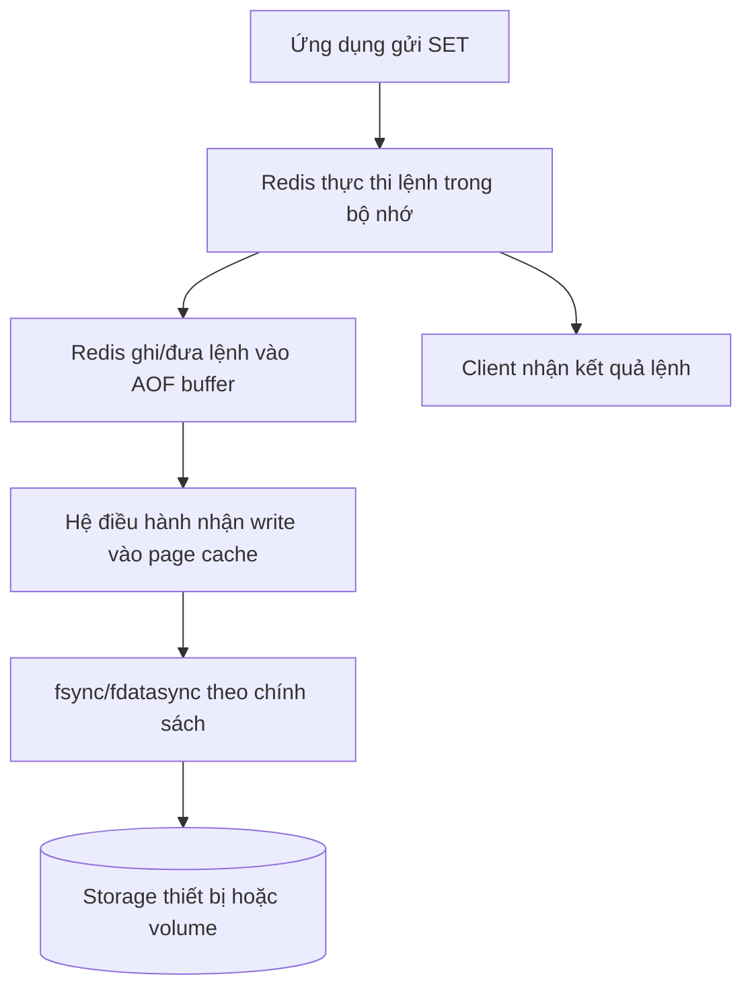
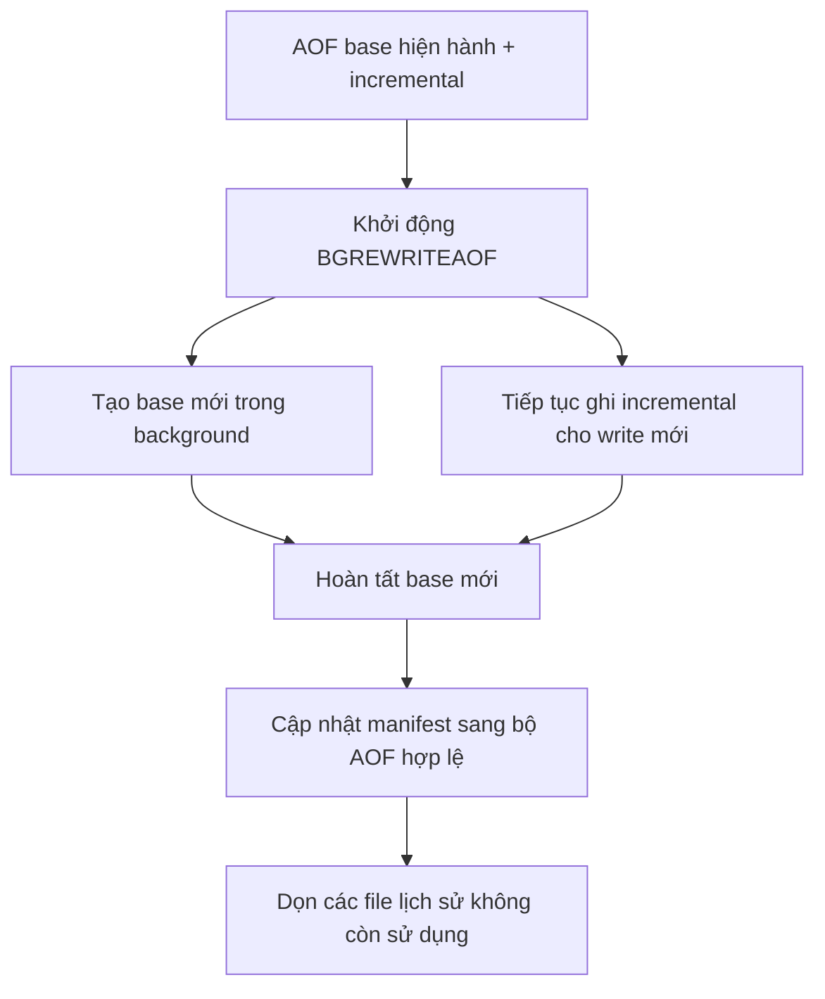
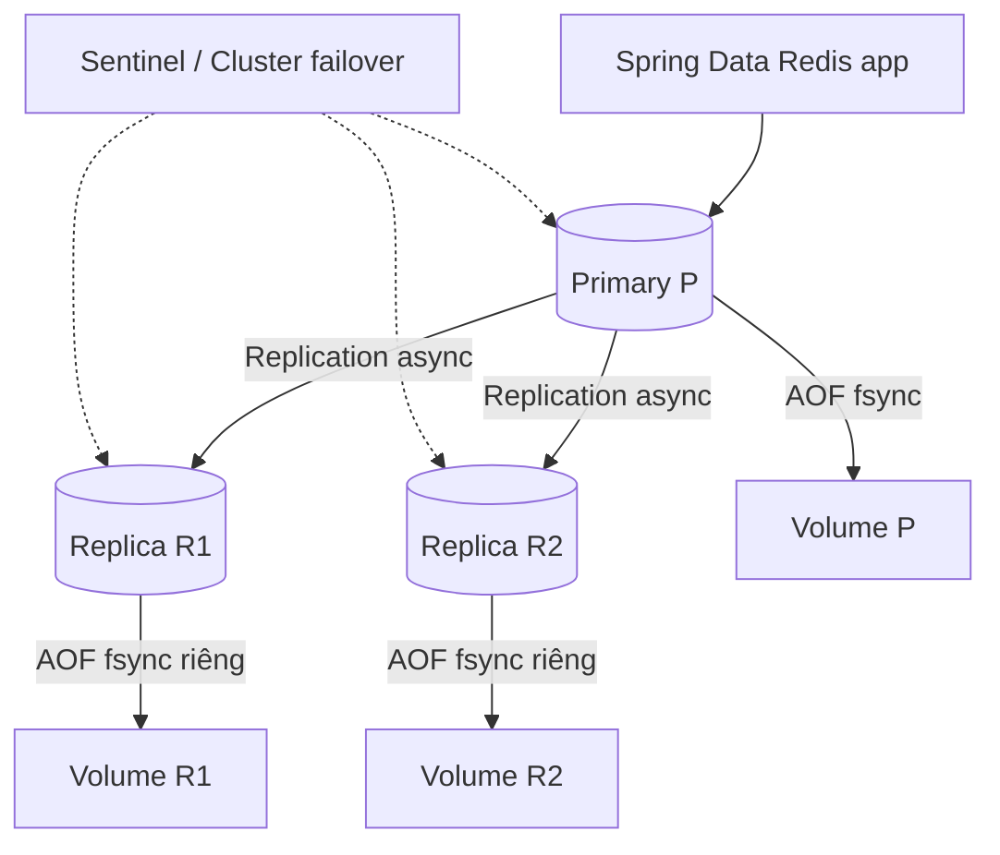
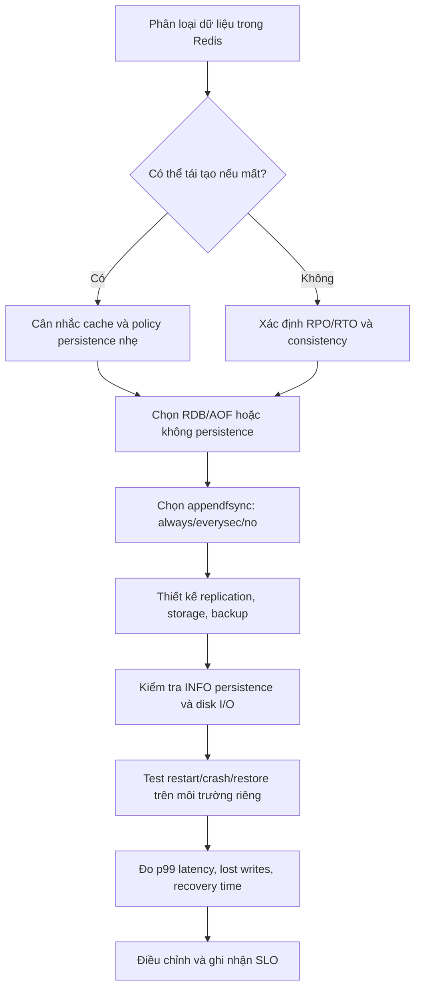

# AOF và các chính sách đồng bộ xuống đĩa trong Spring Data Redis

## 1. Lệnh SET thành công có nghĩa dữ liệu đã an toàn trên đĩa chưa?

Giả sử một ứng dụng Spring Boot sử dụng Redis để lưu trạng thái xử lý đơn hàng:

```java
stringRedisTemplate.opsForValue().set(
    "order:o-101:status",
    "PAID"
);
```

Redis trả thành công, ứng dụng tiếp tục xử lý và thông báo cho người dùng. Ngay sau đó, máy chủ Redis mất điện hoặc tiến trình bị dừng đột ngột. Khi Redis khởi động lại, liệu giá trị `PAID` có còn không?

Câu trả lời **không thể suy ra chỉ từ việc `SET` thành công**. Nó phụ thuộc vào cấu hình lưu bền (*persistence*), chính sách đồng bộ xuống đĩa, hệ điều hành, thiết bị lưu trữ, cách triển khai Redis và loại sự cố.

Nếu bật **Append Only File (AOF)**, Redis ghi một biểu diễn của các thao tác thay đổi dữ liệu vào tệp nhật ký để có thể xây dựng lại trạng thái sau khi restart. Nhưng ngay cả khi bật AOF, vẫn có sự khác biệt quan trọng giữa:

- Lệnh đã được xử lý trong **bộ nhớ Redis**.
- Dữ liệu AOF đã được gửi tới **bộ đệm của hệ điều hành**.
- Hệ điều hành đã được yêu cầu **đồng bộ dữ liệu xuống thiết bị lưu trữ** bằng `fsync` hoặc cơ chế tương đương.
- Thiết bị lưu trữ thực sự đã bảo toàn dữ liệu qua sự cố điện/hardware theo cam kết của nó.

```text
Spring application
      |
      | SET order:o-101:status PAID
      v
Redis xử lý lệnh trong RAM
      |
      +-----> OK cho client
      |
      v
AOF append / buffer của hệ điều hành
      |
      | fsync theo chính sách
      v
Ổ đĩa / storage system
      |
      v
Khôi phục sau restart: đọc AOF để dựng lại dữ liệu
```

Đối với phần lớn ứng dụng, lựa chọn chính sách AOF là một **đánh đổi giữa độ bền dữ liệu, latency, throughput và chi phí I/O**. Không có một giá trị phù hợp cho mọi hệ thống.

Sau bài học, bạn có thể:

1. Giải thích AOF lưu điều gì và khác RDB ở đâu.
2. Phân biệt `appendfsync always`, `everysec` và `no`.
3. Hiểu vì sao ghi vào page cache chưa đồng nghĩa đã an toàn qua mất điện.
4. Hiểu cách AOF rewrite, multipart AOF và AOF manifest hoạt động.
5. Cấu hình Redis phục vụ ứng dụng Spring Data Redis mà không nhầm cấu hình client với cấu hình server.
6. Đọc `INFO persistence`, nhận diện độ trễ đồng bộ và lỗi ghi.
7. Phân biệt `WAIT`, `WAITAOF`, replication, failover và bảo đảm lưu bền.
8. Xây kế hoạch thử nghiệm backup, restart và crash recovery trên môi trường cô lập.

## 2. Redis là in-memory database nhưng có cơ chế persistence

Redis tối ưu phần lớn thao tác dữ liệu bằng bộ nhớ. Tùy cấu hình, Redis có thể lưu trạng thái xuống đĩa để phục hồi sau khi tiến trình/server khởi động lại.

Hai cơ chế persistence truyền thống:

| Cơ chế | Dữ liệu lưu chính | Phương thức khôi phục |
|---|---|---|
| **RDB snapshot** | Ảnh chụp trạng thái dataset tại một thời điểm | Nạp snapshot để tái tạo dữ liệu |
| **AOF** | Nhật ký biểu diễn các thay đổi dữ liệu; phiên bản mới có thể kết hợp base snapshot với các phần tăng dần | Nạp base và phát lại phần thay đổi cần thiết |

Redis có thể:

- Chỉ bật RDB.
- Chỉ bật AOF.
- Bật cả RDB và AOF.
- Tắt cả hai nếu dữ liệu thực sự có thể mất và được tái tạo.

Khi cả AOF và RDB được bật, Redis thường ưu tiên nạp AOF lúc restart vì AOF có thể phản ánh trạng thái mới hơn snapshot RDB. Tuy vậy, phải xem phiên bản Redis và trạng thái file thực tế, không mặc định mọi file AOF đều hợp lệ.

### 2.1. RDB giống ảnh chụp, AOF giống nhật ký diễn tiến

Ví dụ một key:

```redis
SET cart:42:total 100
INCRBY cart:42:total 50
SET cart:42:status CHECKOUT
```

Một RDB snapshot có thể mô tả trạng thái tại một thời điểm:

```text
cart:42:total  = 150
cart:42:status = CHECKOUT
```

AOF có thể biểu diễn các thao tác thay đổi dẫn tới trạng thái đó:

```text
SET cart:42:total 100
INCRBY cart:42:total 50
SET cart:42:status CHECKOUT
```

Đây là mô tả **logic** để học, không phải khẳng định bytes thực tế của AOF luôn đúng chuỗi lệnh trên. Redis sử dụng định dạng giao thức Redis để ghi log, có thể biến đổi một số thao tác để phát lại xác định, và AOF rewrite có thể thay lịch sử dài bằng biểu diễn trạng thái gọn hơn.

### 2.2. AOF không phải event log nghiệp vụ

AOF được Redis quản lý để khôi phục dữ liệu của chính Redis. Nó **không tương đương** một event store ứng dụng hay một transaction audit log có schema, phân quyền và thời hạn lưu giữ do nghiệp vụ quy định.

Không nên đọc AOF như một nguồn event chính thức để tái tạo luồng nghiệp vụ hoặc dùng AOF thay Kafka/Redis Streams/transactional outbox. Redis có thể rewrite AOF, thay đổi biểu diễn câu lệnh và loại bỏ lịch sử không cần thiết cho việc tái tạo trạng thái cuối.

## 3. Cơ chế append-only file

Khi cấu hình:

```conf
appendonly yes
```

Redis bật AOF persistence. Khi có thao tác thay đổi dữ liệu, Redis đưa thông tin cần thiết vào đường ghi AOF. Sau restart, Redis sử dụng AOF phù hợp để tái dựng dataset.

Ví dụ:

```redis
SET user:42:name Linh
HSET user:42:profile tier GOLD points 125
DEL temp:expired-job
```

Các thay đổi có thể được ghi nhận để khôi phục key/value, Hash và xóa key tương ứng.

**Những điều cần phân biệt:**

- AOF hoạt động ở **Redis server**. Một `RedisTemplate` hay `ReactiveRedisTemplate` không tự quyết định dữ liệu có được fsync ngay hay không.
- AOF không bảo đảm một lệnh đã trả thành công được tất cả replica nhận hoặc có trên primary mới sau failover.
- AOF được tối ưu để khôi phục **trạng thái Redis**, không bảo đảm lưu đủ mọi câu lệnh như nhật ký audit bất biến.
- Không phải mọi trạng thái tạm thời của Redis đều được phục hồi theo cùng cách như dữ liệu key/value; ví dụ client connections và trạng thái subscription live không phải dataset cần phát lại.

### 3.1. AOF lưu gì với TTL?

Giả sử:

```redis
SET session:s-42 active EX 300
```

Khi khôi phục, Redis cần giữ được thông tin expiration phù hợp, chứ không đơn giản tạo một session có TTL 300 giây mới tính từ thời điểm restart trong mọi tình huống.

AOF và quá trình replay có logic xử lý expiration để dữ liệu sau restart không sống lại tùy ý chỉ vì quá trình khôi phục. Trên thực tế, nếu một key đã hết hạn khi Redis khởi động lại, nó không được coi là một session còn hiệu lực chỉ do restart.

**Đừng dùng thử nghiệm restart để kéo dài session TTL.** Thời hạn dữ liệu phải dựa trên hợp đồng expiration của Redis và thời gian thực.

## 4. Từ lệnh Redis tới disk: các lớp cần hiểu

Một lệnh ghi có thể trải qua nhiều bước:



Sơ đồ là mô hình khái quát; đường xử lý Redis có tối ưu, buffering và thứ tự response theo implementation. Điểm cần nhớ là **client acknowledgment** và **disk synchronization** là hai sự kiện không được mặc định đồng nhất.

### 4.1. Page cache của hệ điều hành

Khi một chương trình gọi thao tác ghi file thông thường, hệ điều hành có thể giữ dữ liệu trong bộ nhớ đệm và quyết định thời điểm chuyển tới thiết bị. Việc hệ điều hành trả thành công cho thao tác ghi không có nghĩa mọi byte đã được ghi bền xuống vật lý.

Điều đó mang lại hiệu năng tốt vì nhiều lần ghi nhỏ có thể được gộp, nhưng tạo ra một cửa sổ rủi ro nếu máy mất điện hoặc kernel crash trước khi dữ liệu được đẩy tới thiết bị.

### 4.2. fsync và điều mà nó cam kết

`fsync` yêu cầu hệ điều hành đồng bộ những thay đổi cần thiết của file xuống thiết bị lưu trữ theo semantics của OS/filesystem. `fdatasync` có liên quan nhưng tập trung vào dữ liệu và metadata cần thiết theo nền tảng.

Đây là bước quan trọng khi nói đến *durability*. Tuy nhiên:

- Lệnh fsync có thể bị chậm vì storage quá tải.
- Có thể có lỗi I/O, hết dung lượng hoặc volume mất kết nối.
- Thiết bị/ảo hóa/cloud storage phải thực hiện đúng cam kết flush; phần cứng không trung thực hoặc cấu hình cache không có bảo vệ nguồn điện có thể phá vỡ kỳ vọng.
- Một file đã fsync không tự đảm bảo replica khác hay một node failover đã có dữ liệu tương ứng.

Vì vậy, `appendfsync always` là chính sách mạnh hơn về đồng bộ cục bộ, nhưng **không nên gọi nó là bảo đảm dữ liệu không bao giờ mất trong mọi thảm họa**.

## 5. Ba chính sách `appendfsync`

Redis cung cấp ba giá trị chính:

```conf
appendfsync always
appendfsync everysec
appendfsync no
```

Chỉ chọn **một** giá trị trong cấu hình server đang chạy.

| Chính sách | Ý định đồng bộ | Ưu điểm | Đánh đổi |
|---|---|---|---|
| `always` | Yêu cầu fsync sau các thao tác ghi theo chính sách thực thi | Rủi ro mất write cục bộ do thiếu fsync thấp hơn | Tăng disk I/O và latency; throughput có thể giảm rõ rệt |
| `everysec` | Yêu cầu fsync khoảng mỗi giây | Cân bằng phổ biến giữa hiệu năng và durability | Có cửa sổ dữ liệu chưa fsync; dưới sự cố có thể mất phần write gần nhất |
| `no` | Redis không chủ động yêu cầu fsync thường xuyên cho AOF; để OS quyết định | Giảm chi phí fsync chủ động | Cửa sổ mất dữ liệu khó dự đoán, phụ thuộc OS và storage |

### 5.1. `appendfsync always`

Ví dụ:

```conf
appendonly yes
appendfsync always
```

Redis yêu cầu đồng bộ AOF rất thường xuyên, gắn với quá trình ghi, để giảm lượng dữ liệu còn nằm trong bộ đệm chưa bền.

Phù hợp cân nhắc khi:

- Khối lượng write không quá lớn hoặc có thể chịu chi phí disk sync.
- Mỗi write quan trọng hơn throughput.
- Hạ tầng storage có latency fsync ổn định và được giám sát.

Giới hạn:

- Khi storage chậm, p95/p99 latency của Redis commands có thể tăng.
- Dưới write burst, hàng đợi I/O và CPU có thể tạo áp lực cho cả server.
- Không ngăn write loss do failover sang replica chưa có dữ liệu.
- Không thay thế backup, replication hoặc một database giao dịch có cam kết consistency mạnh.

### 5.2. `appendfsync everysec`

Ví dụ:

```conf
appendonly yes
appendfsync everysec
```

Đây là lựa chọn **rất thường gặp** khi muốn AOF bền hơn cấu hình không fsync chủ động nhưng vẫn duy trì hiệu năng khá tốt. Redis thực hiện yêu cầu đồng bộ khoảng một lần mỗi giây theo cách quản lý I/O của nó.

Đánh đổi thường được mô tả là có thể mất khoảng một giây write trong sự cố nghiêm trọng, **không phải SLA tuyệt đối rằng mọi trường hợp chỉ mất nhiều nhất 1.000 ms**.

Vì sao không nên hứa một giây chính xác?

- Thiết bị lưu trữ hoặc OS có thể bị stall.
- fsync trước chưa hoàn tất, gây chậm các bước tiếp theo.
- Redis/host chịu tải cao hoặc gặp lỗi I/O.
- Sự cố có thể xảy ra đúng lúc dữ liệu đang chờ flush.
- Cách lưu bền phía hạ tầng cloud có thêm semantics riêng.

Ở mức thiết kế, hãy đo thời gian fsync thực tế và thử crash recovery. Không suy ra RPO của hệ thống chỉ từ một dòng cấu hình.

### 5.3. `appendfsync no`

Ví dụ:

```conf
appendonly yes
appendfsync no
```

Redis vẫn có đường ghi AOF, nhưng không chủ động đồng bộ xuống đĩa thường xuyên; OS quyết định thời điểm flush theo chính sách hệ thống.

Điều này có thể giảm một phần chi phí đồng bộ nhưng khiến thời gian dữ liệu tồn tại chỉ trong bộ đệm **khó kiểm soát hơn**. Không nên hiểu `no` là "tắt ghi AOF": AOF vẫn được sử dụng nếu `appendonly yes`.

### 5.4. Phân biệt `appendonly no` với `appendfsync no`

Hai cấu hình rất khác:

```conf
appendonly no
```

nghĩa là **tắt AOF** (cơ chế RDB có thể vẫn bật).

Trong khi:

```conf
appendonly yes
appendfsync no
```

nghĩa là **có AOF, nhưng không chủ động fsync thường xuyên** theo Redis policy.

Nhầm hai giá trị này có thể khiến ứng dụng không có đường khôi phục AOF như đã dự kiến.

## 6. So sánh rủi ro theo từng kiểu sự cố

Không phải mọi lỗi đều tác động tới AOF theo cùng cách.

| Sự cố | Dữ liệu trong Redis RAM | Page cache của OS | AOF đã fsync |
|---|---|---|---|
| Redis process crash, OS vẫn chạy | Mất theo process | Có thể còn | Có thể còn |
| Container/process bị kill, host vẫn khỏe | Mất theo process | Có thể còn nếu volume/host còn | Có thể còn |
| Kernel panic/host mất điện | Mất | Có nguy cơ mất | Phụ thuộc filesystem/storage đã cam kết flush |
| Volume/storage bị hỏng | Có thể còn tạm thời khi process sống | Không đáng tin | Có thể mất hoặc lỗi file |
| Redis primary chết và replica được promote | Dữ liệu cục bộ primary không quyết định toàn bộ | Không tự chuyển theo failover | Chỉ giúp khôi phục node cũ; replica mới có thể chưa nhận write |

**Không dùng mỗi một lần `kill -9` làm bằng chứng về mất điện.** Kill process thường không xóa bộ đệm OS hoặc nội dung volume, còn cắt điện đột ngột có thể làm mất những buffer chưa đồng bộ.

RPO thực tế phụ thuộc cả loại sự cố bạn muốn chống chịu. Hệ thống nào chỉ yêu cầu phục hồi sau process restart sẽ có mục tiêu khác hệ thống cần sống sót qua host outage, storage failure hay mất cả một availability zone.

## 7. Cấu hình Redis AOF trong redis.conf

Một ví dụ dành cho Redis OSS hiện đại, mang tính minh họa:

```conf
# Bật AOF persistence.
appendonly yes

# Cân bằng độ bền và hiệu năng.
appendfsync everysec

# Cân nhắc rewrite theo tăng trưởng kích thước AOF.
auto-aof-rewrite-percentage 100
auto-aof-rewrite-min-size 64mb

# Giữ fsync bình thường khi AOF rewrite diễn ra.
no-appendfsync-on-rewrite no

# Chỉ có ý nghĩa trên những phiên bản hỗ trợ.
aof-use-rdb-preamble yes
```

Ý nghĩa:

- `appendonly yes`: bật cơ chế AOF.
- `appendfsync everysec`: yêu cầu đồng bộ khoảng mỗi giây.
- `auto-aof-rewrite-percentage`: ngưỡng tăng trưởng tương đối để cân nhắc rewrite.
- `auto-aof-rewrite-min-size`: kích thước tối thiểu để tự kích hoạt rewrite.
- `no-appendfsync-on-rewrite no`: tiếp tục chính sách fsync thay vì chủ động bỏ qua fsync trong thời gian rewrite.
- `aof-use-rdb-preamble yes`: khi hỗ trợ, cho phép dùng snapshot RDB làm phần mở đầu của base AOF mới.

Những tên tùy chọn cần được đối chiếu với phiên bản Redis và cách Redis được đóng gói. Nếu dùng managed Redis, nhiều tham số có thể được cấu hình qua parameter group hoặc control plane, không phải chỉnh file `redis.conf` trực tiếp.

### 7.1. Kiểm tra cấu hình đang có hiệu lực

Trong môi trường test, dùng:

```redis
CONFIG GET appendonly
CONFIG GET appendfsync
CONFIG GET no-appendfsync-on-rewrite
CONFIG GET auto-aof-rewrite-percentage
CONFIG GET auto-aof-rewrite-min-size
```

Điều cần đọc là **giá trị mà server đang chạy trả về**, không chỉ giá trị trong file cấu hình mà người vận hành nghĩ đã được nạp.

Nếu chạy trên dịch vụ Redis managed, một số lệnh `CONFIG GET` hoặc `CONFIG SET` có thể bị hạn chế bởi ACL/provider. Khi đó, dùng giao diện quản trị hạ tầng phù hợp.

### 7.2. Không mặc định bật AOF từ Spring Boot

Cấu hình Spring:

```yaml
spring:
  data:
    redis:
      host: redis.internal
      port: 6379
```

chỉ hướng dẫn **Spring Data Redis client** kết nối đến Redis. Nó **không tự bật AOF trên server**.

Tương tự, `RedisTemplate` có thể gửi thành công `SET` nhưng không có quyền hay trách nhiệm tự quyết định server dùng `appendfsync everysec` hay `always`.

Việc chọn AOF policy thuộc cấu hình Redis server/cluster hoặc hệ thống quản lý Redis. Ứng dụng Spring cần biết cam kết persistence để thiết kế SLA, retry và cách ghi nhận trạng thái nghiệp vụ.

## 8. AOF rewrite: tại sao không giữ mãi mọi lệnh cũ?

Nếu Redis ghi:

```redis
SET counter 1
INCR counter
INCR counter
INCR counter
INCR counter
```

trạng thái cuối là `counter = 5`. Việc giữ nguyên toàn bộ lịch sử từng `INCR` trong AOF mãi mãi làm file tăng không giới hạn dù chỉ có một key hiện còn.

**AOF rewrite** tạo một biểu diễn gọn của dữ liệu đang có để khôi phục được trạng thái tương đương, thay vì giữ nguyên mọi command lịch sử.

```text
AOF cũ:
  SET counter 1
  INCR counter
  INCR counter
  INCR counter
  INCR counter
      |
      | AOF rewrite
      v
AOF base mới biểu diễn:
  counter = 5
```

Đây là mô hình logic: Redis có thể tạo phần base dưới dạng RDB preamble, không nhất thiết ghi `SET counter 5` thành dòng text.

### 8.1. Rewrite khác việc xóa dữ liệu

Rewrite nhằm giảm kích thước log và cải thiện khả năng load. Nếu hoạt động đúng, nó **không có ý định xóa các key đang cần lưu** hoặc thay đổi giá trị business.

Nhưng nó tốn tài nguyên:

- CPU để xây base representation.
- Bộ nhớ thêm trong quá trình background child process/copy-on-write.
- Disk I/O để ghi file base mới.
- Dung lượng đĩa cho file mới cùng file cũ trong khoảng chuyển đổi.

Khi dataset lớn, rewrite có thể khiến Redis hoặc host tăng memory, latency và pressure lên volume.

### 8.2. BGREWRITEAOF

Redis có lệnh:

```redis
BGREWRITEAOF
```

để yêu cầu tạo AOF rewrite ở background khi điều kiện cho phép. Đây là thao tác quản trị gây tải, **không chạy tùy tiện trên production** chỉ để "dọn file" hoặc thử nghiệm.

Không nên liên tục gọi `BGREWRITEAOF` nếu Redis đang rewrite, đang thiếu dung lượng đĩa hoặc đang gặp tình trạng memory pressure.

### 8.3. Tự động rewrite

Redis có thể dựa vào tỷ lệ tăng kích thước AOF so với base và ngưỡng tối thiểu:

```conf
auto-aof-rewrite-percentage 100
auto-aof-rewrite-min-size 64mb
```

Ví dụ ý nghĩa: khi AOF lớn hơn đáng kể so với kích thước cơ sở gần nhất và vượt min size, Redis có thể lên lịch rewrite.

Không hiểu `100` là "rewrite sau đúng 100 lệnh" hoặc "cứ mỗi 100 giây". Nó là ngưỡng **tỷ lệ tăng kích thước**.

## 9. Multi-part AOF từ Redis 7

Redis 7 đưa vào cấu trúc **multi-part AOF**: thay vì luôn chỉ có một file AOF duy nhất, Redis có thể quản lý nhiều thành phần:

1. **Base AOF**: phần dữ liệu cơ sở, có thể được tạo bằng RDB preamble.
2. **Incremental AOF**: các thay đổi được append trong thời gian hoạt động.
3. **Manifest**: metadata xác định tập file AOF hợp lệ và thứ tự phục hồi.

```text
appendonlydir/
    |
    +-- appendonly.aof.manifest
    |
    +-- appendonly.aof.<sequence>.base.rdb
    |
    +-- appendonly.aof.<sequence>.incr.aof
```

Tên file trên chỉ mô tả **mẫu**. Tên cụ thể, phần mở rộng và số thứ tự tùy phiên bản/cấu hình.

### 9.1. Vai trò của manifest

Khi rewrite, Redis có thể tạo base mới, tiếp tục ghi các thay đổi mới vào incremental AOF, rồi chuyển sang một bộ file hợp lệ thông qua manifest.

Ý tưởng:



Mục tiêu là để Redis có tập file nhất quán cho recovery mà vẫn tiếp nhận nhiều thao tác ghi trong rewrite. Không được tự thay nội dung manifest, xóa file base cũ hay đổi tên incremental theo phỏng đoán.

**Với Redis 7+, một file `appendonly.aof` đơn lẻ có thể không còn là toàn bộ dữ liệu cần backup.** Việc sao lưu/khôi phục phải xét toàn bộ thư mục AOF và manifest theo phiên bản Redis.

### 9.2. Cấu hình thư mục AOF

Redis có tùy chọn:

```conf
appenddirname appendonlydir
```

trên các phiên bản hỗ trợ multi-part AOF. Thư mục này nằm trong đường dẫn dữ liệu Redis theo cấu hình server.

Nếu Redis chạy trong container, cần đảm bảo thư mục dữ liệu tương ứng được gắn trên **persistent volume** khi mong muốn dữ liệu tồn tại qua việc thay container/pod. Đừng chỉ bật AOF trong cấu hình rồi để thư mục dữ liệu nằm hoàn toàn trong filesystem tạm của container.

## 10. AOF rewrite có làm ứng dụng ngừng ghi không?

Redis thiết kế rewrite để phần lớn công việc chạy ở background. Trong lúc đó server tiếp tục xử lý commands và ghi nhận thay đổi mới.

Điều này **không có nghĩa rewrite không có chi phí**. Tùy hệ điều hành và quy mô dataset:

- Fork background process có thể gây pause ngắn.
- Copy-on-write làm tăng bộ nhớ khi có nhiều write.
- Việc ghi base file cạnh tranh I/O với hoạt động AOF khác.
- Storage bandwidth có thể trở thành nút cổ chai.

Nếu Redis có volume chậm, rewrite và fsync đồng thời có thể làm tăng latency hoặc số lượng fsync bị trì hoãn.

### 10.1. `no-appendfsync-on-rewrite`

Tùy chọn:

```conf
no-appendfsync-on-rewrite yes
```

cho phép Redis tránh chủ động fsync AOF theo chính sách thông thường trong một số giai đoạn background save/rewrite để giảm tác động I/O.

Điều đó có thể giúp ổn định latency ở một số môi trường đĩa chậm, **nhưng tăng cửa sổ dữ liệu chưa bền** trong khi rewrite. Nếu yêu cầu durability cao, việc bật `yes` phải được đánh giá cẩn thận.

Ví dụ cấu hình thiên về độ bền hơn:

```conf
appendonly yes
appendfsync everysec
no-appendfsync-on-rewrite no
```

Nếu chọn `yes` chỉ vì một benchmark latency tốt hơn, cần ghi nhận rõ RPO khi background rewrite và cơ chế backup/failover.

## 11. Khi AOF dài hoặc bị lỗi: hành vi phục hồi

### 11.1. Restart sau shutdown sạch

Nếu Redis tắt theo quy trình bình thường và file persistence hợp lệ, Redis có thể load AOF khi start để phục hồi dataset. Thời gian load phụ thuộc kích thước base/incremental AOF, storage throughput và CPU.

Không dùng phản hồi `PONG` làm bằng chứng ứng dụng đã hoàn tất mọi bước khôi phục business từ hệ thống liên quan. Một số dữ liệu như cache warming, connection state hoặc pending tasks của các thành phần khác còn cần khôi phục theo cơ chế riêng.

### 11.2. AOF bị cắt ở cuối file

Nếu Redis/server crash giữa lúc ghi một record vào AOF, phần cuối file có thể chưa hoàn chỉnh. Redis có cơ chế xử lý AOF bị truncate tùy cấu hình và phiên bản, ví dụ:

```conf
aof-load-truncated yes
```

Tùy chọn này giúp Redis xử lý một số trường hợp phần cuối AOF bị cắt để phục hồi phần dữ liệu hợp lệ, nhưng **không phải bảo đảm rằng mọi dạng corruption đều được sửa tự động hoặc mọi write đều còn**.

Nếu file có corruption ở giữa hoặc manifest/volume hỏng, Redis có thể không khởi động được và cần quy trình vận hành phù hợp.

### 11.3. Công cụ redis-check-aof

Redis có công cụ để kiểm tra/sửa một số dạng AOF không hợp lệ, thường được gọi:

```text
redis-check-aof
```

**Không chạy chế độ sửa như `--fix` trên bộ dữ liệu production duy nhất khi chưa có bản sao an toàn.** Tùy lỗi, thao tác sửa có thể cắt bỏ phần cuối không hợp lệ và làm mất những record lân cận.

Với multi-part AOF, cần thực hiện theo hướng dẫn chính xác của phiên bản Redis và cấu trúc manifest. Không dùng quy trình chỉ dành cho Redis 6 trên một thư mục AOF Redis 7 rồi tự xóa file theo cảm tính.

### 11.4. Recovery không thay thế backup

AOF là cơ chế khôi phục cục bộ. Nếu disk bị mất, volume bị xóa, ransomware thay nội dung hoặc data center hỏng, bản AOF nằm trên cùng failure domain có thể không giúp được.

Hệ thống cần kế hoạch backup độc lập:

- Bản sao theo lịch và retention phù hợp.
- Lưu trữ ngoài máy/zone khi yêu cầu.
- Mã hóa và kiểm soát truy cập backup.
- Kiểm tra restore thực tế, không chỉ kiểm tra file backup tồn tại.
- Kế hoạch RPO/RTO có thể đo được.

## 12. Phân biệt AOF với replication

**AOF persistence** và **Redis replication** giải quyết hai vấn đề liên quan nhưng khác nhau:

| Khía cạnh | AOF | Primary–replica replication |
|---|---|---|
| Mục tiêu | Khôi phục dữ liệu trên một Redis server sau restart | Duy trì các bản sao ở node khác |
| Địa điểm | File/volume của node | Các Redis nodes qua network |
| Đơn vị tiến độ | Ghi file và fsync theo policy | Replication offset và replica acknowledgments |
| Rủi ro chính | Dữ liệu chưa fsync mất khi host crash | Replica chưa nhận write, có thể stale hoặc thiếu sau failover |
| Phụ thuộc Sentinel/Cluster? | Không nhất thiết | Thường kết hợp để có failover |
| Có cam kết strong consistency? | Không | Không với replication bất đồng bộ mặc định |

### 12.1. Primary có AOF luôn an toàn khi replica được promote?

Không. Ví dụ:

```text
T0: Primary P nhận SET balance:u-42 900
T1: P ghi AOF và đã fsync cục bộ
T2: P trả OK
T3: Replica R chưa áp dụng write tương ứng
T4: P bị mất kết nối, hệ thống promote R
T5: Ứng dụng đọc primary mới R, thấy balance cũ
```

Vì AOF trên node P không tự đồng bộ vào disk của R, việc **P đã fsync** không bảo đảm **R đã có write**.

Đây là lý do chỉ bật `appendfsync always` trên primary không biến Redis Sentinel/Cluster thành một hệ thống ghi đồng bộ qua quorum.

### 12.2. Replica cũng có thể dùng AOF

Một replica có thể bật persistence riêng theo cấu hình. Khi đó, replica nhận dữ liệu qua replication rồi áp dụng chính sách AOF của chính nó.

Tuy nhiên, lag replication và lag fsync là **hai cửa sổ khác nhau**:

```text
Write on primary
   |
   +--> Primary AOF fsync
   |
   +--> Replica receives/applies write
                  |
                  +--> Replica AOF fsync
```

Một chỉ số chỉ nói "replica nhận write" chưa chắc chứng minh replica đã fsync write đó vào AOF.

## 13. WAIT: xác nhận tiến độ sao chép, không xác nhận fsync

Redis có lệnh:

```redis
SET payment:p-101:status AUTHORIZED
WAIT 1 1000
```

Hai lệnh cần được thực hiện trên **cùng Redis client connection** nếu muốn WAIT theo dõi những write tương ứng của client đó.

`WAIT 1 1000` yêu cầu đợi ít nhất một replica xác nhận replication offset liên quan trong thời gian tối đa 1.000 ms. Lệnh trả về số replica đáp ứng.

Giới hạn:

- Replica acknowledgment không có nghĩa AOF trên replica đã fsync.
- Nếu timeout, write trước đó không tự bị rollback.
- Replica được promote có thể không phải replica vừa ACK.
- Không bảo đảm mọi read tiếp theo, trên mọi replica, đều thấy value mới.

Vì vậy, `WAIT` giúp **giảm một dạng rủi ro replication** nhưng không thay thế chính sách appendfsync.

## 14. WAITAOF: chờ AOF persistence có điều kiện

Redis **7.2+** có lệnh `WAITAOF`, cho phép client yêu cầu đợi một số mức độ AOF persistence cho những write trước đó trên cùng kết nối.

Cú pháp:

```text
WAITAOF numlocal numreplicas timeout
```

Trong đó:

- `numlocal`: yêu cầu xác nhận AOF persistence tại local primary, thường là `0` hoặc `1` theo giới hạn command.
- `numreplicas`: số replica mong muốn có AOF persistence tương ứng.
- `timeout`: thời gian chờ theo mili giây; semantics của giá trị 0 cần đối chiếu documentation khi triển khai.

Ví dụ trên cùng một kết nối tới Redis:

```redis
SET payment:p-101:status AUTHORIZED
WAITAOF 1 1 2000
```

Ý định: chờ local và ít nhất một replica đạt điều kiện AOF persistence liên quan tới các write trước đó của client, với thời gian chờ tối đa 2.000 ms.

Kết quả lệnh biểu diễn số điều kiện/replica thực tế đã được xác nhận theo hợp đồng Redis. Ứng dụng phải **đọc và so sánh kết quả với mục tiêu**, không coi việc lệnh trả kết quả bất kỳ là đủ.

### 14.1. Điều kiện dùng WAITAOF

- Phiên bản Redis hỗ trợ lệnh.
- AOF phải được bật ở những node cần tham gia theo yêu cầu.
- Client phải giữ đúng ngữ cảnh kết nối sau lệnh ghi cần đợi.
- Cần chọn timeout phù hợp với SLA.
- Không mặc định mọi driver/Spring Data Redis version có API wrapper cao cấp cho `WAITAOF`.

Nếu driver chưa có method tương ứng, cần dùng một cơ chế gọi command thấp hơn phù hợp phiên bản và topology, hoặc dùng quy trình server/client đã được hỗ trợ. Không viết một ví dụ Java giả định API không tồn tại.

### 14.2. WAITAOF vẫn không phải consensus commit

Dù local và một số replica đã ghi bền vào AOF, điều đó vẫn không cung cấp đầy đủ:

- Một giao thức consensus đảm bảo mọi acknowledged write sẽ được giữ qua mọi phân vùng.
- Transaction phân tán giữa Redis và database khác.
- Exactly-once side effects cho một request bị retry.
- Bảo đảm replica được promote luôn là node vừa báo fsync.

**`WAITAOF` mạnh hơn `WAIT` ở khía cạnh disk persistence mà nó kiểm tra**, nhưng không nên mô tả nó như giải pháp thay thế một hệ thống authoritative có cam kết strong consistency.

### 14.3. Không chèn lệnh đợi tùy tiện vào event-loop

Một ứng dụng Spring WebFlux có thể trả `Mono<Boolean>` sau khi `SET` hoàn tất. Nhưng nếu lập trình viên tiếp tục gọi một lệnh chờ fsync bằng API blocking trên event-loop, latency có thể tăng và làm nghẽn luồng.

Khi cần dùng `WAIT`/`WAITAOF` trong đường reactive, phải kiểm tra:

1. Driver hỗ trợ command và route đúng node.
2. Lệnh ghi và lệnh đợi có **cùng connection semantics** cần thiết.
3. API có chặn thread hay trả Publisher phù hợp.
4. Timeout, cancellation và trường hợp đã ghi nhưng điều kiện chờ chưa đạt được xử lý thế nào.

Không được tự động chạy lại một lệnh tăng counter chỉ vì `WAITAOF` chưa đủ replica trước deadline: write có thể đã được thực thi.

## 15. AOF và các mức cam kết mà ứng dụng thấy

Một ứng dụng có thể phân biệt các cấp độ:

| Cấp độ | Quan sát được | Chưa đảm bảo |
|---|---|---|
| Lệnh `SET` trả `OK` | Primary đã xử lý request theo semantics Redis | AOF fsync, replica nhận write |
| `WAIT` đạt yêu cầu | Số replica tương ứng xác nhận replication offset | Replica đã fsync |
| `WAITAOF` đạt mục tiêu | Các điều kiện AOF persistence được xác nhận theo lệnh | Consensus trên mọi node hoặc external DB commit |
| Redis restart khôi phục key | Dữ liệu từng có trong file persistence phù hợp | Backup ngoài failure domain hoặc mọi write khác còn |
| Backup restore thành công | Có thể phục hồi từ backup đã kiểm thử | RPO bằng 0 nếu backup theo lịch |

Với business domain, cần xác định **lúc nào có thể trả thành công cho người dùng**, và trả thành công đó có nghĩa gì.

Ví dụ cập nhật trạng thái gửi email có thể chấp nhận độ trễ nhỏ, còn xác nhận thanh toán có thể yêu cầu một database giao dịch làm nguồn sự thật, Redis chỉ giữ cache hoặc trạng thái phụ trợ.

## 16. Cấu hình Redis cho ứng dụng Spring Boot

Spring Boot có thể kết nối tới Redis đang bật AOF như bình thường:

```yaml
spring:
  data:
    redis:
      host: redis.internal
      port: 6379
      timeout: 3s
```

`RedisConnectionFactory` và `RedisTemplate` không cần biết file AOF nằm ở đâu để thực hiện lệnh Redis.

Ví dụ:

```java
package com.example.orders;

import java.time.Duration;

import org.springframework.data.redis.core.StringRedisTemplate;
import org.springframework.stereotype.Service;

@Service
public class OrderStateStore {

    private final StringRedisTemplate redis;

    public OrderStateStore(StringRedisTemplate redis) {
        this.redis = redis;
    }

    public void markPaid(String orderId) {
        redis.opsForValue().set(
            "order:" + orderId + ":status",
            "PAID",
            Duration.ofDays(7)
        );
    }

    public String findStatus(String orderId) {
        return redis.opsForValue()
            .get("order:" + orderId + ":status");
    }
}
```

Trong đoạn này:

- `set(...)` gửi một Redis command và xử lý kết quả theo API Spring.
- TTL 7 ngày mô tả thời gian key tồn tại, **không phải khoảng thời gian Redis phải giữ AOF backup**.
- Việc key tồn tại qua Redis process crash phụ thuộc Redis persistence và storage.
- Không có đoạn code nào ở đây tự cấu hình `appendfsync always/everysec/no`.

### 16.1. Tách cấu hình application và cấu hình server

| Thuộc tính | Thuộc lớp nào? |
|---|---|
| `spring.data.redis.host` | Spring Boot client |
| `spring.data.redis.timeout` | Spring Boot/client |
| `RedisTemplate` serializer | Spring Data Redis |
| `appendonly yes` | Redis server |
| `appendfsync everysec` | Redis server |
| `auto-aof-rewrite-percentage` | Redis server |
| Redis persistent volume | Hạ tầng/triển khai |
| Backup retention và offsite copy | Hạ tầng/chính sách vận hành |

Đây là phân biệt căn bản khi điều tra một service "đã ghi Redis nhưng mất dữ liệu sau pod restart": lỗi có thể nằm ở volume hoặc cấu hình server, không phải ở method `opsForValue().set(...)`.

## 17. ReactiveRedisTemplate cũng không thay đổi cam kết fsync

Một ứng dụng WebFlux có thể dùng:

```java
import java.time.Duration;

import org.springframework.data.redis.core.ReactiveStringRedisTemplate;
import org.springframework.stereotype.Service;

import reactor.core.publisher.Mono;

@Service
public class ReactiveOrderStateStore {

    private final ReactiveStringRedisTemplate redis;

    public ReactiveOrderStateStore(ReactiveStringRedisTemplate redis) {
        this.redis = redis;
    }

    public Mono<Boolean> markPaid(String orderId) {
        return redis.opsForValue()
            .set(
                "order:" + orderId + ":status",
                "PAID",
                Duration.ofDays(7)
            );
    }
}
```

Khi subscriber nhận `Boolean.TRUE`, command đã thành công theo phản hồi Redis. Điều đó **không có nghĩa lệnh `fsync` của server đã hoàn tất** nếu policy cho phép trì hoãn.

Reactive API thay đổi cách ứng dụng điều phối I/O, không thay đổi semantics của AOF phía Redis.

### 17.1. Không dùng delay như một cam kết durability

Anti-pattern:

```java
return redis.opsForValue().set(key, value)
    .delayElement(Duration.ofSeconds(2));
```

Việc đợi thêm hai giây ở client **không chứng minh** một lần fsync cụ thể đã thành công. Nếu storage đang lỗi hoặc `appendfsync no`, thời gian cố định không thay thế một acknowledgment durability.

Nếu thực sự cần xác nhận replication/AOF, dùng cơ chế được Redis hỗ trợ và đối chiếu đúng ngữ nghĩa, không suy ra kết quả từ việc thời gian đã trôi qua.

## 18. Quan sát AOF bằng INFO persistence

Redis cung cấp:

```redis
INFO persistence
```

Một số trường hữu ích, tùy phiên bản:

```text
aof_enabled:1
aof_rewrite_in_progress:0
aof_rewrite_scheduled:0
aof_last_bgrewrite_status:ok
aof_last_write_status:ok
aof_current_size:...
aof_base_size:...
aof_pending_bio_fsync:...
aof_delayed_fsync:...
rdb_bgsave_in_progress:0
rdb_last_bgsave_status:ok
```

Các dấu ba chấm là **giá trị minh họa**, không phải metrics đã lấy từ Redis thật.

### 18.1. Giải nghĩa các metric AOF thường gặp

| Metric | Điều cần quan sát |
|---|---|
| `aof_enabled` | AOF có bật không |
| `aof_rewrite_in_progress` | Rewrite đang chạy? |
| `aof_rewrite_scheduled` | Rewrite đã được lên lịch? |
| `aof_last_bgrewrite_status` | Lần rewrite background gần nhất có thành công? |
| `aof_last_write_status` | Tình trạng ghi AOF gần nhất theo Redis |
| `aof_current_size` | Kích thước AOF hiện hành theo cách Redis báo |
| `aof_base_size` | Kích thước cơ sở dùng khi tính điều kiện rewrite |
| `aof_pending_bio_fsync` | Số công việc fsync đang pending trong background I/O |
| `aof_delayed_fsync` | Số lần fsync bị trì hoãn theo metric Redis |

Nếu `aof_delayed_fsync` tăng nhanh trong lúc Redis chịu tải, cần điều tra storage latency, rewrite và workload, không chỉ tăng timeout client rồi bỏ qua.

Metric trong `INFO persistence` là thông tin **từng Redis node**. Với Sentinel/Cluster có nhiều node, cần theo dõi từng primary và replica riêng để hiểu replica nào có AOF, node nào đang rewrite và node nào có lỗi I/O.

### 18.2. Redis logs quan trọng không kém INFO

Nếu AOF ghi lỗi hoặc rewrite thất bại, Redis log có thể chứa nguyên nhân như:

- Không còn dung lượng đĩa.
- Quyền truy cập file/thư mục không đúng.
- Filesystem chuyển thành read-only.
- Background rewrite process không tạo được.
- Lỗi storage I/O.

Monitoring nên kết hợp log, `INFO persistence`, dung lượng volume, disk latency, filesystem metrics và Redis command latency. Không nên chỉ đo số lần `SET` trả OK.

## 19. AOF write errors và điều ứng dụng phải làm

Giả sử volume gần đầy. Redis có thể tiếp tục phục vụ một số lệnh hoặc báo lỗi liên quan persistence tùy trạng thái, cấu hình và phiên bản. Không nên dựa vào một hành vi duy nhất cho mọi trường hợp.

Những biện pháp vận hành:

1. Alert trước khi disk đầy, không đợi đến khi AOF không ghi được.
2. Theo dõi kết quả background rewrite và trạng thái write.
3. Có chính sách dọn backup cũ, tăng dung lượng hoặc thay volume phù hợp.
4. Không tự xóa các file AOF đang được Redis quản lý để giải phóng dung lượng.
5. Kiểm tra sự sẵn sàng của Redis và kế hoạch chuyển tải/failover.
6. Với dữ liệu quan trọng, đánh giá lại việc ghi thành công theo SLA durability đã đặt ra.

### 19.1. Lệnh Redis thành công không chứng minh volume khỏe

Trong chế độ `everysec` hoặc `no`, có thể tồn tại khoảng cách giữa command acknowledgment và disk synchronization. Nếu lỗi storage xuất hiện, phía ứng dụng có thể chưa nhận thông báo tương ứng ngay khi thực hiện một write cụ thể.

Do đó, không được thay monitoring persistence bằng kiểm tra:

```redis
PING
```

`PONG` chỉ cho biết Redis có thể trả lời ping ở thời điểm đó, không phải một chứng chỉ AOF bền vững.

## 20. AOF và hiệu năng ghi

Các yếu tố ảnh hưởng tới throughput/latency:

```text
Ứng dụng gửi writes
    |
    +-- số lệnh Redis/giây
    |
    +-- số byte AOF phát sinh
    |
    +-- chi phí write() vào filesystem
    |
    +-- chi phí fsync theo policy
    |
    +-- mức độ contention với AOF rewrite/RDB save
    |
    +-- disk IOPS / bandwidth / latency
    |
    +-- CPU, memory, network và Redis event loop
```

Với `appendfsync always`, fsync latency có thể trở thành một thành phần quan trọng của thời gian ghi.

Với `everysec`, việc fsync được điều phối ít thường xuyên hơn, có thể giúp throughput tốt hơn nhưng tạo cửa sổ risk. Với `no`, chi phí fsync chủ động giảm nhưng phụ thuộc vào OS và mức độ chịu tải của filesystem.

### 20.1. Batching/pipelining có làm mất nhu cầu fsync?

Spring Data Redis hỗ trợ Redis pipelining để giảm round trip của nhiều lệnh:

```java
stringRedisTemplate.executePipelined((RedisCallback<Object>) connection -> {
    // Gửi nhiều thao tác theo một pipeline.
    return null;
});
```

Pipelining chủ yếu tối ưu **chi phí mạng giữa client và Redis**, không loại bỏ các thay đổi AOF và không biến nhiều lệnh ghi độc lập thành một transaction durable.

Tương tự, `MULTI/EXEC` giúp nhóm thực thi về mặt Redis, nhưng không đồng nghĩa với một cam kết fsync được phân phối trên mọi node.

### 20.2. So sánh theo tải thật

Khi benchmark policy AOF, cần giữ nhất quán:

- Cùng version Redis.
- Cùng dataset và kiểu lệnh.
- Cùng số connections, concurrency, payload size.
- Cùng volume và disk performance.
- Cùng mức replication và backup workload.
- Cùng các giới hạn CPU/RAM của container/VM.

Đo p50/p95/p99 latency, throughput, fsync delays, Redis CPU, disk write latency và kích thước file. Một benchmark chỉ đo trung bình trong 10 giây không đủ để quyết định RPO hoặc chi phí rewrite của ứng dụng chạy lâu dài.

## 21. RDB + AOF: khi nào bật cả hai?

RDB snapshot có thể thuận tiện cho backup/sao chép một trạng thái nhất quán tại thời điểm chụp. AOF có thể giảm khoảng mất dữ liệu so với chỉ snapshot định kỳ, tùy fsync policy.

Một cấu hình có cả hai:

```conf
appendonly yes
appendfsync everysec

# Ví dụ điều kiện tự tạo RDB snapshot trên phiên bản hỗ trợ.
save 900 1
save 300 10
save 60 10000
```

Các điều kiện `save` là ví dụ cho Redis phiên bản hỗ trợ syntax đó; không nên coi chúng là mặc định cố định trên mọi bản Redis.

Đánh đổi:

- Có thêm tác vụ RDB background và AOF rewrite, cần quản lý RAM/I/O.
- Cần chính sách sao lưu và cleanup.
- Phải kiểm tra Redis khôi phục từ file nào và trong tình huống nào.
- Không thể thay một restore test bằng việc bật cả hai tùy chọn.

### 21.1. RDB preamble trong AOF không phải chế độ "tắt AOF"

Với:

```conf
aof-use-rdb-preamble yes
```

Redis có thể dùng RDB-style representation cho phần base của AOF rewrite. Điều này giúp quá trình load dữ liệu base hiệu quả hơn trong một số tình huống.

Nhưng Redis vẫn có cơ chế ghi các thay đổi incremental theo AOF và vẫn áp dụng `appendfsync` như đã cấu hình cho đường ghi thích hợp. Không nên vì file base có extension `.rdb` mà kết luận AOF đã tắt.

## 22. Redis trên Docker/Kubernetes: bật AOF nhưng dữ liệu vẫn mất?

Một tình huống thường gặp:

```text
Container Redis:
  appendonly yes
  appendfsync everysec
  Data directory nằm trong ephemeral container layer

Pod bị xóa và tạo lại trên node khác
  -> Volume không được giữ
  -> Không còn bộ file AOF cũ
```

Ở đây cấu hình fsync không sửa được lỗi **không có persistent storage**.

Hệ thống container cần:

- Mount đúng Redis data directory lên persistent volume.
- Xác nhận permissions để Redis ghi và rewrite.
- Bảo đảm dung lượng và IOPS phù hợp.
- Hiểu chính sách reclaim/retention của volume.
- Thiết kế backup ngoài volume khi cần.
- Kiểm tra khôi phục sau pod rescheduling và node failure.

### 22.1. Chỉ restart container và xóa pod là hai phép thử khác nhau

Restart cùng container hoặc pod có thể giữ volume hoặc filesystem cũ tùy cách triển khai. Một lần test restart thành công không chứng minh dữ liệu vẫn còn sau khi pod được reschedule sang node khác hay volume bị mất.

Hãy mô tả **failure model** muốn kiểm chứng: process crash, pod restart, node outage, mất volume, AZ outage hay thay thế toàn cụm.

## 23. AOF khi Redis Sentinel hoặc Cluster failover

Một Redis deployment có thể đồng thời dùng:

- AOF trên từng Redis node.
- Replica sao chép qua mạng.
- Sentinel hoặc Redis Cluster để promote node khác khi primary mất.



### 23.1. Những câu hỏi phải được trả lời độc lập

1. Node hiện đang là primary có bật AOF không?
2. Các replica có bật AOF không?
3. Write đã tới replica nào và replica đó đã fsync chưa?
4. Node nào được chọn sau failover?
5. Redis client đã cập nhật topology và kết nối đúng primary mới chưa?
6. Các write mà ứng dụng nhận ACK trước failover có còn trên primary mới?
7. Khi primary cũ trở lại, dữ liệu riêng trên node đó được xử lý thế nào?

Không được chỉ xem `aof_enabled:1` trên primary rồi kết luận mọi replica hoặc node sau failover đều có bảo đảm tương đương.

### 23.2. AOF mạnh hơn không làm biến mất stale reads

Ngay cả khi primary và replica đều cấu hình `appendfsync always`, replica vẫn có thể chưa nhận write mới từ primary ở thời điểm client đọc. **Disk durability và replication freshness là hai vấn đề khác nhau.**

Với request cần dữ liệu mới nhất, phải thiết kế read routing và consistency riêng; fsync policy không quyết định lệnh `GET` đang tới primary hay replica.

## 24. Thực hành 1: xác định AOF đang bật hay tắt

Thực hành trên Redis test riêng.

### Bước 1 — Kiểm tra cấu hình

```redis
CONFIG GET appendonly
CONFIG GET appendfsync
INFO persistence
```

Ghi lại:

```text
appendonly = yes/no
appendfsync = always/everysec/no
aof_enabled = 1/0
aof_last_write_status = ...
```

Nếu `appendonly no`, đừng kết luận Redis sẽ không bao giờ khôi phục dữ liệu: RDB có thể vẫn được bật. Cần kiểm tra cả phần cấu hình snapshot tương ứng.

### Bước 2 — Ghi key test

```redis
SET demo:aof:status started
SET demo:aof:counter 10
INCR demo:aof:counter
GET demo:aof:counter
```

Kỳ vọng counter là `11` nếu các lệnh được thực thi bình thường.

### Bước 3 — Restart sạch

Khởi động lại Redis theo quy trình được môi trường test hỗ trợ, không cố tình ngắt điện. Sau khi server lên lại:

```redis
GET demo:aof:status
GET demo:aof:counter
INFO persistence
```

Quan sát key được phục hồi hoặc không dựa trên **persistence thực tế đã bật và file volume còn nguyên**.

### Bước 4 — Đọc log khi restart

Redis log thường cho biết quá trình nạp RDB/AOF và các cảnh báo liên quan. Nếu Redis không start được do AOF lỗi, đừng tự xóa file; trước tiên sao lưu hiện trạng để có thể phục hồi/điều tra.

## 25. Thực hành 2: so sánh chính sách fsync

Nên dùng **ba Redis test instances có cùng version và storage tương đương**, cấu hình khác nhau ở:

```text
Test A: appendonly yes, appendfsync always
Test B: appendonly yes, appendfsync everysec
Test C: appendonly yes, appendfsync no
```

### 25.1. Những chỉ số cần thu

| Chỉ số | Mục đích |
|---|---|
| Số writes/s | So sánh throughput |
| p50, p95, p99 latency của SET/HSET | Quan sát tail latency |
| CPU của Redis | Xem overhead của workload |
| Disk write IOPS và bandwidth | Xem áp lực lên volume |
| fsync latency / AOF delayed fsync | Xem ảnh hưởng từ synchronization |
| AOF size sau thời gian chạy | Đánh giá rewrite/retention |
| Thời gian restart/load | Đánh giá RTO |
| Số write phục hồi được sau failure injection | Ước lượng RPO theo failure model |

### 25.2. Các nguyên tắc đo

- Ghi số lượng và kích thước payload tương đương.
- Không so sánh storage SSD nhanh của Test A với ổ chậm của Test B.
- Lặp lại kết quả, tránh một mẫu ngắn bị nhiễu.
- Phân biệt restart sạch với mất điện/host crash.
- Giám sát disk/OS để thấy fsync stall.
- Không benchmark trên Redis production.

### 25.3. Kết quả nào mới đáng tin?

Ví dụ nếu `always` có p99 cao hơn trong workload của bạn, đó là một quan sát hợp lý về chi phí fsync trên storage cụ thể. Nhưng nó **không đủ để kết luận** `everysec` luôn tốt hơn cho mọi ứng dụng.

Cần đặt kết quả latency bên cạnh **ngưỡng dữ liệu có thể mất** và chi phí phục hồi nghiệp vụ.

## 26. Thực hành 3: quan sát AOF rewrite

Trên Redis test có AOF:

```redis
INFO persistence
BGREWRITEAOF
INFO persistence
```

Quan sát các trường:

```text
aof_rewrite_in_progress
aof_last_bgrewrite_status
aof_current_size
aof_base_size
```

Khi background rewrite hoàn tất, kiểm tra lại `INFO persistence` và giá trị key nghiệp vụ đã lưu.

**Không mặc định file AOF sẽ giảm ngay lập tức trong mọi thử nghiệm.** Với dataset nhỏ, ít thao tác cập nhật trùng lặp, kích thước base/manifest và overhead có thể khiến thay đổi không đáng kể.

Nếu Redis 7 dùng multi-part AOF, quan sát đúng thư mục, manifest và file base/incremental **qua công cụ hệ điều hành trên môi trường test**, không tự sửa file. Bài thực hành chỉ yêu cầu hiểu cấu trúc và trạng thái, không yêu cầu người học thao tác dữ liệu production.

## 27. Thực hành 4: kiểm chứng WAIT và WAITAOF

Yêu cầu Redis test có replication và version phù hợp. Khi thử:

### Bước 1 — Xác định primary/replica

```redis
ROLE
INFO replication
INFO persistence
```

Trên cả primary và replica, xác nhận role, trạng thái replication và AOF.

### Bước 2 — Ghi và chờ replication

Trong một **redis-cli session kết nối primary**:

```redis
SET demo:durability:version v2
WAIT 1 1000
```

Đọc số replica được xác nhận và ghi nhận thời gian.

### Bước 3 — Chờ AOF persistence (Redis 7.2+)

Chỉ khi AOF đã được bật và phiên bản hỗ trợ:

```redis
SET demo:durability:version v3
WAITAOF 1 1 2000
```

Đọc kết quả theo cấu trúc reply thực tế và kiểm tra điều kiện local/replica đã đạt hay chưa. Không suy diễn rằng command response chung nghĩa là mọi replica đều đã fsync.

### Bước 4 — Quan sát failure

Khi số replica thiếu hoặc AOF gặp lỗi, một số điều kiện chờ có thể không đạt trước timeout. Ghi lại kết quả, **không retry mù SET/INCR có side effect** chỉ vì lệnh chờ chưa đạt.

Thử nghiệm với write quan trọng cần thiết kế idempotency riêng. Không tạo network partition hoặc tắt replica trên production để kiểm tra.

## 28. Xử lý retry với dữ liệu quan trọng

Một lỗi phổ biến:

```text
SET/INCR -> phản hồi timeout
Ứng dụng retry toàn bộ thao tác
```

Nếu Redis đã thực thi command nhưng response bị mất, `INCR` có thể bị áp dụng hai lần. AOF và `appendfsync always` không tự giúp ứng dụng phân biệt lần write đầu tiên đã xảy ra hay chưa.

Với một thao tác có side effect:

```redis
INCR payment:p-101:attempts
```

retry mù sau timeout có thể làm counter tăng dư. Giải pháp cần nằm ở semantic nghiệp vụ:

- Gắn request ID và kiểm soát idempotency.
- Dùng lệnh set có điều kiện hoặc Lua script khi phù hợp.
- Ghi nhận trạng thái xử lý vào nguồn dữ liệu authoritative.
- Kiểm tra lại trạng thái trước khi quyết định retry.
- Có reconciliation cho các kết quả không chắc chắn.

### 28.1. Fsync không thay thế atomicity

Giả sử cần cập nhật hai key:

```redis
DECRBY balance:u-42 100
INCRBY balance:merchant-7 100
```

`appendfsync always` chỉ liên quan đến việc đồng bộ dữ liệu đã được Redis ghi xuống file. Nó **không làm hai lệnh riêng lẻ tự trở thành một giao dịch nghiệp vụ nguyên tử**.

Có thể cần `MULTI/EXEC`, Lua, conditional update hoặc tốt hơn là dùng một transactional database làm nguồn sự thật cho yêu cầu tài chính. Sự lựa chọn atomicity và durability là hai chiều thiết kế khác nhau.

## 29. Các rủi ro bảo mật của AOF

Nếu ứng dụng ghi token hoặc dữ liệu nhạy cảm vào Redis, dữ liệu có thể tồn tại trong AOF/backup ngay cả sau khi key đã bị xóa ở trạng thái hiện tại.

Ví dụ:

```text
SET session:token-42 <sensitive-data>
DEL session:token-42
```

Nếu AOF cũ chưa rewrite, các biểu diễn thao tác có thể còn lưu trên đĩa trong một khoảng thời gian. Backup cũ cũng có thể giữ dữ liệu nhạy cảm theo retention.

Do đó:

- Hạn chế đưa thông tin bí mật vào Redis khi không cần.
- Mã hóa volume/backup theo yêu cầu.
- Giới hạn ai được đọc file AOF và backup.
- Quản lý backup retention và deletion đúng chính sách.
- Không gửi AOF chứa dữ liệu thật cho người ngoài chỉ vì muốn debug.
- Không coi `DEL` là một cam kết secure erase mọi bytes trong mọi bản lưu trữ.

AOF là thành phần persistence, không phải cơ chế encryption.

## 30. Những hiểu nhầm thường gặp

### "Redis trả OK tức là fsync đã hoàn tất"

Không mặc định đúng. Cần xem `appendfsync` và các điều kiện persistence thực tế.

### "appendfsync everysec đảm bảo chỉ mất tối đa đúng 1.000 ms"

Không. Đây là tần suất đồng bộ theo thiết kế, không phải một SLA tuyệt đối qua mọi kiểu storage stall và failure.

### "appendfsync no nghĩa là Redis không ghi AOF"

Không. Nếu `appendonly yes`, Redis vẫn dùng AOF; `appendfsync no` chỉ thay chính sách chủ động fsync.

### "appendonly yes là đủ bảo vệ dữ liệu khi pod bị xóa"

Không nếu directory AOF không gắn persistent volume hoặc volume không được giữ.

### "AOF rewrite xóa các key cũ khỏi Redis"

Rewrite tạo biểu diễn log gọn hơn. Việc xóa key khỏi dataset là thao tác dữ liệu riêng.

### "AOF là audit log có thể dùng thay event store"

Không. Redis quản lý/viết lại file để khôi phục trạng thái; format và rewrite không cung cấp hợp đồng event audit cho ứng dụng.

### "AOF 7+ luôn là một file appendonly.aof"

Không. Redis 7 có multi-part AOF với manifest, base và incremental files.

### "BGREWRITEAOF không ảnh hưởng hiệu năng"

Không. Nó có chi phí CPU, memory, copy-on-write, disk I/O và dung lượng tạm.

### "WAIT 1 có nghĩa một replica đã fsync AOF"

Không. `WAIT` đợi acknowledgment replication, không phải acknowledgment disk persistence.

### "WAITAOF là commit quorum mạnh"

Không. Nó kiểm tra điều kiện AOF persistence theo lệnh, không tạo toàn bộ semantics của consensus hoặc transaction phân tán.

### "AOF trên primary đảm bảo primary mới sau failover có mọi write"

Không. Replication có thể trễ; primary mới có thể chưa nhận những write được fsync ở primary cũ.

### "Thay appendfsync trong application.yml sẽ đổi Redis server"

Không. AOF policy thuộc Redis server/hạ tầng, không phải cấu hình kết nối Spring Data Redis.

### "Cache có TTL thì không cần backup"

TTL chỉ mô tả vòng đời key. Nếu dữ liệu cần khôi phục, phải có persistence/backup phù hợp; nếu chỉ là cache tái tạo được, cần đánh giá liệu AOF có thật sự cần thiết không.

### "Bật always càng nhiều càng tốt"

Không phải mọi ứng dụng cần latency và chi phí I/O của `always`. Chọn theo RPO/RTO và chi phí xử lý dữ liệu mất.

## 31. Chọn chính sách theo nhu cầu nghiệp vụ

| Kiểu dữ liệu | Mục tiêu thường gặp | Chính sách cần cân nhắc |
|---|---|---|
| Cache có thể tái tạo hoàn toàn | Tối ưu throughput, chấp nhận cache mất | Có thể không cần AOF; RDB hoặc không persistence tùy thiết kế |
| Session có thể khôi phục bằng đăng nhập lại | Cân bằng hiệu năng và khả năng phục hồi | AOF everysec hoặc policy khác theo SLA |
| Job trạng thái trung gian cần tiếp tục sau restart | Giảm mất tiến độ | AOF + backup/replication + idempotent recovery |
| Redis Streams chứa event quan trọng | Giữ backlog để xử lý lại | AOF policy có RPO rõ, retention phù hợp, ACK và backup |
| Dữ liệu cấu hình ít thay đổi nhưng quan trọng | Ưu tiên độ bền khi write hiếm | Cân nhắc fsync mạnh hơn và backup |
| Số dư hoặc giao dịch tài chính authoritative | Yêu cầu strong consistency và durability nghiêm ngặt | Ưu tiên transactional source of truth; Redis chỉ hỗ trợ theo kiến trúc rõ |

Một câu hỏi quyết định:

**"Nếu mất những write vừa được Redis xác nhận trong một vài giây cuối, ứng dụng có thể tái tạo hoặc đối soát chính xác được không?"**

Nếu câu trả lời là "có" và dữ liệu là cache, một policy nhẹ có thể đủ. Nếu câu trả lời là "không", cần xem lại vai trò Redis, chính sách fsync, replication, backups và thậm chí loại storage nền tảng.

## 32. Quy trình thiết kế và kiểm chứng độ bền



Checklist trước production:

1. Đã biết từng keyspace là cache hay nguồn trạng thái nghiệp vụ quan trọng.
2. Đã xác định RPO và RTO có thể chấp nhận.
3. Đã kiểm tra `CONFIG GET appendonly/appendfsync` trên từng node.
4. Đã cấu hình persistent volume với dung lượng, latency và retention phù hợp.
5. Đã dự trù disk space cho AOF rewrite và backup.
6. Đã giám sát `aof_last_write_status`, `aof_delayed_fsync`, rewrite status và disk errors.
7. Đã hiểu `WAIT` và `WAITAOF` cần cùng connection với những write tương ứng khi áp dụng.
8. Đã phân biệt disk persistence với replication và failover.
9. Đã có quy trình xử lý AOF corruption bằng backup trước khi sửa.
10. Đã test restore từ backup độc lập, không chỉ test Redis process restart.
11. Đã có cơ chế idempotency cho các thao tác có side effect khi request timeout.
12. Đã đặt chính sách bảo vệ AOF/backup chứa dữ liệu nhạy cảm.

## 33. Kết luận

**Append Only File** là cơ chế Redis ghi lại những thay đổi cần thiết để tái dựng dữ liệu sau restart. Nhưng độ bền dữ liệu không dừng ở việc bật `appendonly yes`: chính sách **`appendfsync` quyết định mức độ thường xuyên Redis yêu cầu hệ điều hành đồng bộ AOF xuống storage**.

Ba lựa chọn cần nhớ:

- **`always`**: ưu tiên giảm cửa sổ dữ liệu chưa fsync, đánh đổi latency và I/O.
- **`everysec`**: cân bằng phổ biến giữa hiệu năng và durability, nhưng vẫn có cửa sổ rủi ro và không có SLA mất dữ liệu đúng một giây trong mọi sự cố.
- **`no`**: giao nhiều trách nhiệm flush cho OS, phù hợp chỉ khi chấp nhận cửa sổ rủi ro khó đoán hơn.

Redis 7+ còn dùng **multi-part AOF** với base, incremental files và manifest; **AOF rewrite** giúp thu gọn biểu diễn dữ liệu nhưng có chi phí tài nguyên. Khi Redis chạy cùng Sentinel/Cluster, phải hiểu AOF cục bộ không thay thế replication hay bảo đảm write đã fsync trên primary sẽ hiện diện ở primary mới.

Trong Spring Data Redis, `RedisTemplate` và `ReactiveRedisTemplate` vẫn thực thi Redis commands như bình thường; **AOF policy là cấu hình của Redis server và storage**, không phải thuộc tính tự có của Mono, Flux hoặc template. Chọn policy đúng nghĩa là xác định rõ **dữ liệu nào có thể mất, khoảng mất nào chấp nhận được và cách khôi phục thật sự**.

## Tài liệu tham khảo

- [Redis Documentation — Redis persistence](https://redis.io/docs/latest/operate/oss_and_stack/management/persistence/)
- [Redis Documentation — Configuration](https://redis.io/docs/latest/operate/oss_and_stack/management/config/)
- [Redis Documentation — INFO](https://redis.io/docs/latest/commands/info/)
- [Redis Documentation — BGREWRITEAOF](https://redis.io/docs/latest/commands/bgrewriteaof/)
- [Redis Documentation — CONFIG GET](https://redis.io/docs/latest/commands/config-get/)
- [Redis Documentation — WAIT](https://redis.io/docs/latest/commands/wait/)
- [Redis Documentation — WAITAOF](https://redis.io/docs/latest/commands/waitaof/)
- [Redis Documentation — Replication](https://redis.io/docs/latest/operate/oss_and_stack/management/replication/)
- [Redis Documentation — Sentinel](https://redis.io/docs/latest/operate/oss_and_stack/management/sentinel/)
- [Redis Documentation — Redis Cluster specification](https://redis.io/docs/latest/operate/oss_and_stack/reference/cluster-spec/)
- [Spring Data Redis Reference — Redis Connections](https://docs.spring.io/spring-data/redis/reference/redis/drivers.html)
- [Spring Data Redis Reference — RedisTemplate](https://docs.spring.io/spring-data/redis/reference/redis/template.html)
- [Spring Data Redis Reference — Reactive Redis Support](https://docs.spring.io/spring-data/redis/reference/redis/reactive.html)
