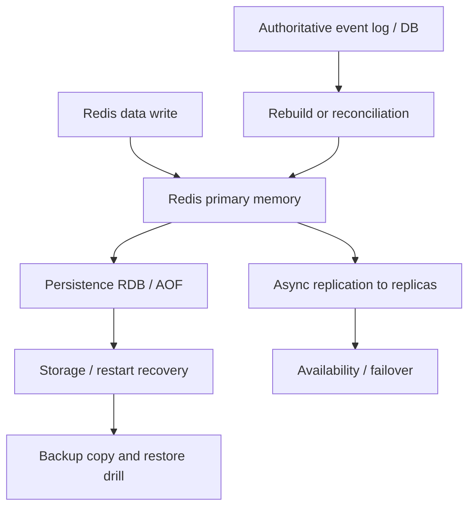
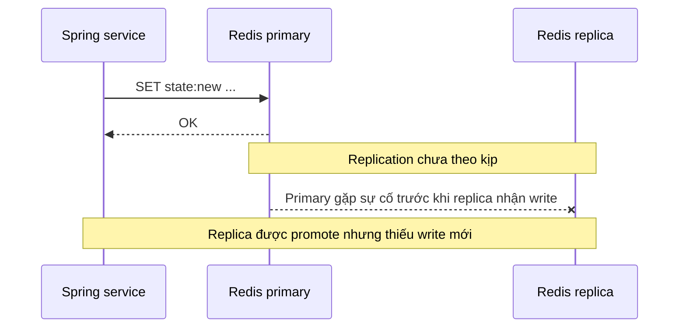
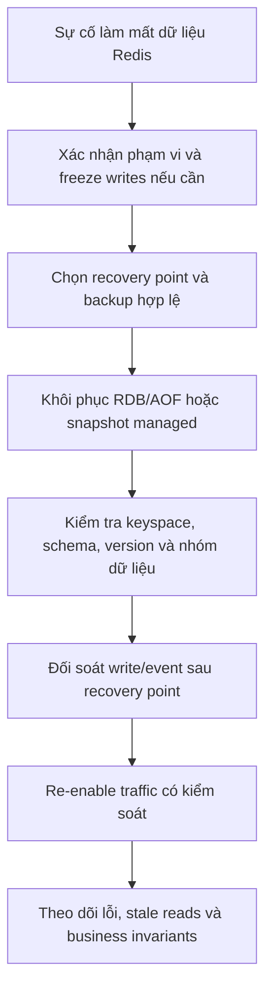
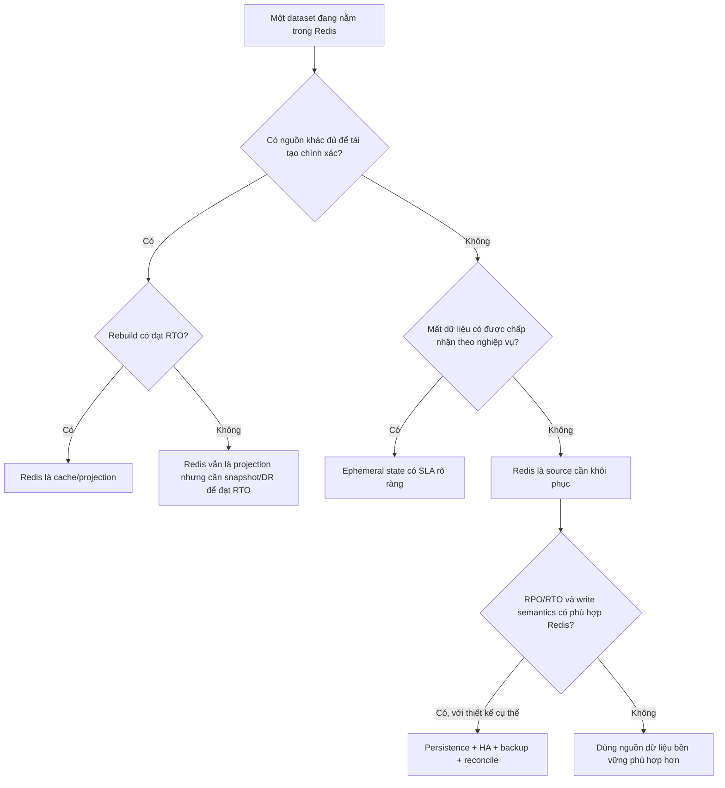

# Xác định Redis là cache hay nguồn dữ liệu cần khôi phục trong Spring Data Redis

## 1. Câu hỏi cần trả lời trước khi cấu hình độ bền

Redis là cơ sở dữ liệu trong bộ nhớ, nhưng điều đó **không có nghĩa Redis luôn chỉ là cache**. Redis có thể phục vụ dữ liệu được tái tạo từ một nguồn khác, đồng thời cũng có thể giữ dữ liệu mà hệ thống không có bản sao đầy đủ ở nơi khác. Hai cách dùng này tạo ra yêu cầu hoàn toàn khác nhau về lưu trữ, replication, backup, failover và xử lý lỗi.

Trong Spring Data Redis, cả hai kiểu ứng dụng đều có thể gọi cùng một API:

```java
stringRedisTemplate.opsForValue().set("key", "value");
```

Nhưng chỉ nhìn câu lệnh `SET` **không thể biết** đây là cache hay dữ liệu cần khôi phục. Ý nghĩa nằm ở **hợp đồng nghiệp vụ**:

- Nếu xóa key này, ứng dụng có thể lấy lại chính xác từ database, API hoặc một hệ thống đáng tin cậy khác không?
- Nếu Redis và toàn bộ bản sao của nó bị mất, có cần khôi phục giá trị cũ không?
- Những thay đổi được ghi vào Redis có tồn tại ở nơi nào khác trước đó không?
- Nếu có nhiều hệ thống cùng thay đổi dữ liệu, hệ thống nào quyết định **giá trị đúng**?
- Dữ liệu vắng mặt là "cache miss", là "chưa có dữ liệu", hay là **sự cố mất dữ liệu**?

> **Redis là cache khi dữ liệu có thể bỏ và xây lại từ nguồn có thẩm quyền. Redis là nguồn dữ liệu cần khôi phục khi việc mất dữ liệu Redis làm mất thông tin nghiệp vụ mà không thể tái tạo đầy đủ từ nguồn khác.**

Đây là cách phân loại theo trách nhiệm dữ liệu, **không** theo thư viện client, loại cấu trúc Redis hay việc đã bật AOF/RDB.

## 2. Phép thử đơn giản: nếu Redis trống hoàn toàn thì sao?

Hãy tưởng tượng sau một sự cố, ứng dụng được khởi động với một Redis instance mới và **không có key nào**.

### Trường hợp A: Redis chỉ là cache

```text
PostgreSQL: product_id=P100, name="Product 100", price=120000
     |
     v
Spring service -> Redis cache: productSummary::P100
```

Redis mất hết dữ liệu:

1. Request kế tiếp tìm `productSummary::P100` nhưng không thấy entry.
2. Spring Cache gọi lại method tải sản phẩm từ PostgreSQL.
3. Redis được làm đầy lại bằng kết quả đọc.
4. Dữ liệu nguồn của sản phẩm vẫn còn; hệ thống có thể chậm hơn tạm thời nhưng **không mất thông tin sản phẩm**.

Điều kiện quan trọng: PostgreSQL thực sự có dữ liệu chuẩn và ứng dụng có một đường tái tạo đúng. Nếu bản cache chứa thông tin bổ sung chỉ được tính một lần rồi không lưu ở đâu khác, nó có thể **không còn là cache thuần túy**.

### Trường hợp B: Redis là nơi duy nhất ghi thay đổi

```text
Ứng dụng -> Redis: INCR game:42:score
Không có database/event log nào khác ghi thay đổi này.
```

Redis mất hết dữ liệu:

1. Điểm số cuối cùng biến mất.
2. Ứng dụng không có source of truth để tính lại.
3. Không thể "cache miss rồi load lại" vì không có nơi nào để load.
4. Hệ thống cần backup/persistence, quy trình restore và chính sách chấp nhận mất dữ liệu rõ ràng.

Trong trường hợp này, Redis đang là **nguồn dữ liệu cần khôi phục**, dù chỉ lưu một String counter và dù ứng dụng không dùng Redis Repository.

### Trường hợp C: dữ liệu có thể tái tính nhưng rất tốn kém

```text
Redis: bảng xếp hạng đã tính từ một năm event log
Event log gốc: vẫn còn đầy đủ
```

Về mặt correctness, Redis là dữ liệu **dẫn xuất** và có thể dựng lại. Tuy nhiên, nếu phải mất nhiều giờ để xây lại, hệ thống vẫn có thể cần snapshot/backup để đạt **Recovery Time Objective (RTO)**. Vì thế "có thể tái tạo" không đồng nghĩa "không cần bảo vệ vận hành".

## 3. Phân loại dữ liệu theo vai trò thực tế

Một ứng dụng có thể dùng Redis cho nhiều vai trò trên cùng deployment. Không nên áp một chính sách durability duy nhất cho mọi key nếu hậu quả mất dữ liệu khác nhau.

| Loại dữ liệu | Redis thường đóng vai trò | Nếu mất Redis | Chính sách khởi đầu |
|---|---|---|---|
| Cache chi tiết sản phẩm từ database | Cache thuần túy | Truy vấn lại database | TTL/invalidation, cache warmup, bảo vệ origin |
| Kết quả truy vấn tổng hợp có thể tính lại | Materialized/derived cache | Recompute, có thể chậm | RTO và chi phí rebuild quyết định có backup hay không |
| Session đăng nhập chỉ lưu trong Redis | Session store có trạng thái | User bị đăng xuất, có thể mất phiên hợp lệ | Đánh giá tác động, TTL, HA và chính sách phục hồi |
| One-time token / OTP | Trạng thái tạm thời có giá trị bảo mật | Người dùng phải tạo token mới hoặc luồng xác minh gián đoạn | TTL đúng, bảo mật; có thể không cần restore token cũ |
| Rate-limit counter | Trạng thái kiểm soát tạm thời | Giới hạn có thể bị reset, rủi ro abuse | Xác định fail-open/fail-closed, HA |
| Điểm số/số lượt sử dụng chỉ lưu Redis | Nguồn dữ liệu chính | Mất cập nhật không tái tạo được | Persistence, backup, RPO/RTO, đối soát |
| Redis Stream chứa job chưa xử lý, không có nguồn khác | Queue/event source | Mất job chưa xử lý | Retention, durability, recovery, idempotency |
| Pub/Sub notification | Tín hiệu realtime | Event đã phát có thể bị mất khi offline | Không xem như durable event source |
| Distributed lock / lease | Trạng thái phối hợp tạm thời | Khóa biến mất, công việc có thể chạy trùng | TTL, fencing/idempotency, không phục hồi lock cũ một cách mù quáng |
| Chỉ mục Redis Repository có thể dựng lại | Dữ liệu dẫn xuất | Query theo index không đầy đủ đến khi rebuild | Repair/reindex, TTL event và consistency |
| Giỏ hàng chỉ tồn tại trên Redis | Có thể là dữ liệu nghiệp vụ cần phục hồi | Người dùng mất giỏ hàng | Định nghĩa SLA và thời gian giữ/khôi phục |

**Phân loại dựa vào tác động nghiệp vụ chứ không dựa vào tên key.** Key có prefix `cache:` vẫn có thể là dữ liệu không tái tạo được nếu một service vô tình chỉ ghi vào Redis mà không cập nhật nguồn chuẩn.

### 3.1. Redis là nguồn chính, hệ thống khác chỉ là bản sao

Có mô hình Redis giữ state mới nhất còn một job bất đồng bộ xuất dữ liệu sang database. Trong cửa sổ giữa ghi Redis và ghi database, Redis là **bản ghi có thẩm quyền duy nhất**. Nếu Redis mất trước khi job chạy, bản sao database không đủ.

Cần làm rõ lúc nào một thay đổi được xem là "đã commit" theo nghiệp vụ:

```text
Redis SET thành công
       |
       v
Queue / relay bất đồng bộ
       |
       v
Database hoặc data lake cập nhật sau
```

Đừng gọi Redis là "cache" chỉ vì hệ thống còn một database: database đó có thể luôn chậm hơn Redis và không chứa mọi thay đổi mới nhất.

## 4. Source of truth là hợp đồng về quyền quyết định dữ liệu đúng

**Source of truth** là nơi có đủ thông tin để quyết định trạng thái đúng của một thực thể hoặc sự kiện. Có thể là PostgreSQL, Redis, một event log bền vững, hệ thống đối tác hoặc kết hợp có quy tắc rõ ràng.

Ví dụ:

- **Thông tin giá sản phẩm:** database quản lý giá là source of truth; Redis giữ bản sao đọc nhanh.
- **Trạng thái order:** database giao dịch là source of truth; Redis cache chỉ là projection.
- **Presence trực tuyến:** Redis có thể là nguồn trạng thái hiện thời, nhưng dữ liệu có thể được coi là *ephemeral*; không nhất thiết muốn restore presence cũ sau một sự cố.
- **Số điểm chưa ghi ở đâu khác:** Redis là source of truth; mất snapshot gần nhất đồng nghĩa mất thông tin.
- **Sự kiện được ghi đầy đủ trong Kafka:** Redis Streams có thể là luồng xử lý tạm; event log còn lại đủ để replay.

Một nguồn có thẩm quyền cần định nghĩa được:

1. **Owner ghi:** ai có quyền thay đổi trạng thái?
2. **Thứ tự cập nhật:** cập nhật muộn hay sớm thắng trong trường hợp concurrent writes?
3. **Lịch sử:** có cần event history để tính lại không?
4. **Retention:** dữ liệu cần được giữ bao lâu?
5. **Recovery:** sau lỗi, hệ thống lấy lại trạng thái từ đâu?
6. **Mức tin cậy:** một response thành công đã bảo đảm điều gì về durability?

Tránh thiết kế "hai hệ thống cùng là source of truth" khi chưa có quy tắc đồng bộ, conflict resolution và cách phát hiện thiếu event. Việc ghi Redis và database trong hai thao tác độc lập **không tự tạo một distributed transaction**.

## 5. RPO và RTO: biến quyết định thành yêu cầu đo được

Khi Redis chỉ là cache, mất dữ liệu thường được chấp nhận nhưng thời gian cache lạnh vẫn có thể ảnh hưởng trải nghiệm. Khi Redis chứa dữ liệu cần khôi phục, phải định nghĩa rõ ít nhất hai mục tiêu:

- **RPO (Recovery Point Objective):** lượng dữ liệu/thời gian cập nhật tối đa được phép mất sau sự cố.
- **RTO (Recovery Time Objective):** thời gian tối đa cho phép để khôi phục dịch vụ hoặc dữ liệu cần thiết.

Ví dụ yêu cầu:

| Hệ thống | RPO ví dụ | RTO ví dụ | Ý nghĩa thiết kế |
|---|---|---|---|
| Cache ảnh đại diện | Không bắt buộc khôi phục cache | 10 phút | Có thể xóa Redis và warmup từ nguồn |
| Cache dữ liệu tổng hợp đắt | Có thể dựng lại | 30 phút | Có thể cần snapshot để rút ngắn rebuild |
| Giỏ hàng quan trọng | Tối đa vài phút thay đổi | 5 phút | Persistence, replication, restore drill |
| Counter có ảnh hưởng thanh toán | Gần như không chấp nhận mất | Theo SLA nghiêm ngặt | Phải đánh giá Redis có đáp ứng được hay nên dùng nguồn giao dịch khác |
| Queue sự kiện nghiệp vụ | Không được mất event đã nhận theo hợp đồng | 15 phút | Durable write, replay, ack/idempotency, backup |

Các con số ở bảng là **ví dụ cách đặt mục tiêu**, không phải SLA mặc định Redis hay Spring Data Redis cung cấp.

### 5.1. Câu hỏi cần viết vào design document

- Khi service trả HTTP 200 sau một lệnh Redis, những gì đã được commit?
- Mất bao nhiêu giây ghi gần nhất là chấp nhận được?
- Khi primary mất và replica được promote, có thể mất write chưa replicate không?
- Snapshot gần nhất cách hiện tại bao lâu?
- Thời gian restore file Redis lớn có vượt RTO?
- Nếu mất cache, database có chịu được số request tăng vọt?
- Nếu dữ liệu bị mất một phần, làm sao biết phần nào thiếu để đối soát?

Không thể chọn AOF, RDB hoặc replication chỉ từ tiêu chí "nên bật cho an toàn" mà không trả lời các câu hỏi này.

## 6. Các lớp bảo vệ dữ liệu Redis không thay thế nhau

Có bốn lớp thường bị nhầm:

| Lớp | Chức năng | Không bảo đảm điều gì? |
|---|---|---|
| **Persistence** (RDB/AOF) | Ghi trạng thái/lệnh ra storage để khởi động lại | Không tự bảo vệ khi xóa nhầm hay toàn bộ storage hỏng |
| **Replication** | Sao chép dữ liệu sang replica, phục vụ failover/read scaling | Không đồng bộ tuyệt đối mọi write theo mặc định; lỗi logic/xóa nhầm cũng lan sang replica |
| **Backup** | Bản sao lưu giữ độc lập để khôi phục tại thời điểm khác | Không tự có RTO thấp; phục hồi cần thời gian và bài thử |
| **Reconciliation/replay** | Tái tạo hoặc sửa dữ liệu từ nguồn khác | Không tồn tại nếu nguồn gốc không lưu đủ thông tin |



Điều cần phân biệt:

- Replica có thể giúp ứng dụng chạy tiếp nhanh hơn khi node lỗi, nhưng **không phải bản backup chống xóa nhầm**.
- RDB/AOF có thể giúp phục hồi một node, nhưng nếu file cùng nằm trên storage hỏng thì không còn gì để khôi phục.
- Backup có thể còn đầy đủ nhưng restore quá chậm với RTO.
- Một cache có khả năng rebuild rất tốt nhưng source bị quá tải khi tất cả cache key mất cùng lúc.

## 7. RDB snapshots: phù hợp với cửa sổ khôi phục nhất định

**RDB** tạo snapshot dataset tại một thời điểm. Redis có thể thực hiện snapshot tự động theo cấu hình `save` hoặc theo thao tác quản trị `BGSAVE`.

Ví dụ cấu hình Redis tự quản lý:

```conf
save 900 1
save 300 10
save 60 10000
dir /var/lib/redis
dbfilename dump.rdb
```

Các dòng trên chỉ là **ví dụ mô hình điều kiện snapshot**, không phải recommendation áp dụng cho mọi workload. Cần xác định chính sách `save` của phiên bản Redis và môi trường vận hành.

Ưu điểm:

- File snapshot gọn, thuận tiện để backup/chuyển một dataset.
- Recovery có thể dễ tổ chức từ snapshot.
- Phù hợp khi chấp nhận mất phần thay đổi kể từ snapshot gần nhất.

Giới hạn:

- Nếu lỗi xảy ra giữa hai lần snapshot, các ghi sau snapshot gần nhất có thể mất.
- Snapshot dùng copy-on-write và tiêu tốn tài nguyên bộ nhớ/I/O trong thời gian tạo.
- Dataset lớn khiến thời gian ghi/khởi động lại tăng.
- Nếu snapshot không được xuất ra nơi lưu trữ độc lập, lỗi storage vẫn có thể làm mất file.
- Không có cơ chế chống một thao tác `FLUSHALL` hoặc `DEL` sai được lưu vào snapshot mới.

### 7.1. Đừng suy ra RPO chỉ từ cấu hình save

Điều kiện `save 60 10000` không có nghĩa "chắc chắn có bản backup mỗi phút". Nó có nghĩa Redis xét tạo snapshot khi điều kiện thời gian/số thay đổi đáp ứng theo cấu hình. Tải thực tế, lỗi I/O và thời gian snapshot hoàn tất còn ảnh hưởng.

Muốn tuyên bố RPO đạt yêu cầu, phải có **số liệu thời điểm snapshot thành công** và diễn tập phục hồi từ snapshot thực tế.

## 8. AOF: ghi lịch sử lệnh nhưng vẫn có cửa sổ mất dữ liệu

**Append Only File (AOF)** ghi lại các thao tác thay đổi dataset để Redis có thể tái tạo trạng thái sau restart. Redis phiên bản mới dùng cơ chế multipart AOF với base file/incremental files và manifest trong những kịch bản liên quan.

Ví dụ cấu hình tự quản lý:

```conf
appendonly yes
appendfsync everysec
```

Các tùy chọn fsync thường gặp:

| Giá trị | Ý nghĩa khái quát | Đánh đổi |
|---|---|---|
| `always` | Cố đồng bộ ra storage sau các thao tác ghi theo cơ chế AOF | Chi phí I/O/latency cao hơn; không tự bảo đảm trước mọi kiểu hỏng storage |
| `everysec` | Đồng bộ định kỳ khoảng một giây | Cân bằng hiệu năng/độ bền; có cửa sổ mất các ghi gần nhất |
| `no` | Để hệ điều hành quản lý việc sync dữ liệu | Cửa sổ dữ liệu chưa fsync có thể lớn và khó dự đoán |

**AOF enabled không đồng nghĩa một reply thành công đã nằm bền vững trên đĩa tại mọi thời điểm.** Với `everysec`, trong nhiều tình huống dữ liệu khoảng giây gần nhất có thể bị mất khi lỗi, và độ trễ/điều kiện hệ thống có thể khiến cửa sổ thực khác một giây tuyệt đối.

AOF rewrite giúp quản lý kích thước log bằng cách tạo biểu diễn gọn hơn của dataset hiện tại. Nó không biến AOF thành một bản lịch sử đầy đủ mọi phiên bản dữ liệu dùng cho audit; AOF phục vụ tái tạo trạng thái Redis, không thay thế event sourcing hoặc backup phiên bản.

### 8.1. Dùng cả RDB và AOF

Có thể bật cả RDB và AOF để đáp ứng nhiều mục tiêu vận hành. Khi cả hai được cấu hình, Redis có logic chọn nguồn tải dữ liệu khi restart theo phiên bản (thông thường ưu tiên AOF vì cập nhật hơn khi AOF hợp lệ).

Tuy nhiên, không thể suy ra rằng "bật cả hai" sẽ tự đảm bảo RPO=0 hoặc loại bỏ nguy cơ mất dữ liệu khi failover. Cần thiết kế filesystem, quyền ghi, backup, kiểm tra trạng thái persistence, restore, và cảnh báo khi ghi snapshot/AOF gặp lỗi.

### 8.2. Quan sát persistence

Những lệnh có ích cho môi trường có quyền:

```redis
INFO persistence
INFO memory
CONFIG GET appendonly
CONFIG GET appendfsync
CONFIG GET save
```

Trên managed Redis, `CONFIG GET` có thể bị chặn hoặc chỉ trả subset cấu hình. Khi đó, xem tham số qua provider control plane/metrics thay vì cố dùng tài khoản ứng dụng có quyền quản trị.

Các dấu hiệu cần cảnh báo gồm: lỗi ghi AOF, thời điểm RDB save thành công gần nhất, `rdb_last_bgsave_status`, `aof_last_write_status` nếu phiên bản có field tương ứng, tăng đột biến disk I/O và storage gần hết dung lượng.

**Không xem `PONG` là kiểm tra persistence.** Redis có thể trả `PING` tốt nhưng file persistence đang lỗi hoặc backup đã lâu không thành công.

## 9. Replication, Sentinel và Redis Cluster không mặc định làm write "không thể mất"

Redis replication thông thường là **bất đồng bộ**. Một master có thể xác nhận write cho client rồi replica mới nhận hoặc chưa nhận thay đổi đó.



Các rủi ro:

- **Failover làm mất write đã được primary ack nhưng chưa replicate.**
- Replica có thể tạm trả dữ liệu cũ nếu ứng dụng đọc replica.
- Network partition có thể tạo tình huống một primary cũ vẫn nhận write trong cửa sổ chuyển role tùy topology và client.
- Sentinel và Cluster giúp discovery/failover theo cơ chế riêng, không phải một distributed transaction/consensus log cho từng write ứng dụng.
- Nếu một thao tác xóa nhầm đã replicate, failover sang replica **không khôi phục dữ liệu đúng**.

### 9.1. WAIT và WAITAOF có giải quyết hoàn toàn không?

Redis có lệnh `WAIT` cho phép client yêu cầu đợi một số replica xác nhận đã tiếp nhận các write trước đó của connection, với timeout:

```redis
WAIT 1 1000
```

Kết quả trả về là số replica đã xác nhận trong khoảng chờ. Đây là công cụ giảm rủi ro khi replication bất đồng bộ, **không biến Redis thành một hệ thống giao dịch đồng bộ chặt chẽ** và không bảo đảm write sẽ sống sót qua mọi failover.

Trong các phiên bản Redis hỗ trợ, `WAITAOF` cho phép đợi việc đồng bộ AOF trên local/replicas theo các tham số của lệnh. Nó có thể cải thiện khả năng biết trạng thái ghi bền vững trong phạm vi được hỗ trợ, nhưng phải kiểm tra version, AOF configuration, topology và phản hồi. Nó không thay thế backup hoặc quy trình phục hồi sự cố.

Spring Data Redis có API connection-level/driver-level cho nhiều Redis commands, nhưng việc gọi `WAIT` hoặc `WAITAOF` cần được đánh giá về **cùng connection, thứ tự lệnh và hợp đồng transaction**. Không tự thêm một lệnh chờ rồi tuyên bố ứng dụng đã có exactly-once hoặc RPO=0.

### 9.2. min-replicas-to-write

Redis có những cấu hình như `min-replicas-to-write` và `min-replicas-max-lag` nhằm từ chối một số write khi không có đủ replica đáp ứng điều kiện độ trễ. Cơ chế này có thể giảm xác suất master đơn độc tiếp tục nhận nhiều write không được replicate, nhưng vẫn **không biến replication thành synchronous commit**.

Đánh đổi là availability: khi replica không đủ, một số write có thể bị từ chối dù primary còn sống. Quyết định cần gắn với RPO/RTO và khả năng hoạt động khi mạng bị partition.

## 10. TTL và eviction: nguy hiểm nếu áp dụng nhầm cho nguồn chính

Một cache thường có TTL; dữ liệu hết hạn thì ứng dụng tải lại được. Nhưng nếu key là bản ghi duy nhất của nghiệp vụ, TTL không còn là "chính sách làm mới cache" mà là một hành động **tự xóa dữ liệu**.

### 10.1. Phân biệt expiration và eviction

- **Expiration:** Redis xóa key theo TTL được đặt bằng `EXPIRE`, `SET ... EX/PX` hoặc các API tương đương.
- **Eviction:** Redis chọn key để loại bỏ khi dùng `maxmemory` cùng một eviction policy có thể xóa key dưới áp lực bộ nhớ.

Ví dụ:

```redis
SET cache:product:P100 "{...}" EX 300
SET user:preferences:42 "{...}"
```

Key `cache:product:P100` có TTL 300 giây; key `user:preferences:42` không có TTL theo lệnh trên. Tuy vậy, nếu Redis instance sử dụng policy `allkeys-lru` hoặc `allkeys-lfu`, key preferences **vẫn có thể bị evict** khi memory pressure.

Với dữ liệu không thể mất, cần đánh giá policy phù hợp, thường tránh eviction không kiểm soát:

```conf
maxmemory-policy noeviction
```

Nhưng `noeviction` không có nghĩa Redis có bộ nhớ vô hạn. Khi vượt giới hạn, những lệnh ghi có thể nhận lỗi OOM theo semantics Redis; ứng dụng phải xử lý tình huống hết dung lượng và cảnh báo sớm.

### 10.2. Đừng trộn cache dễ bỏ với source of truth trong cùng một instance tùy tiện

Nếu một instance Redis dùng chung cho:

```text
cache:*                 # Dữ liệu có thể tái tạo
authoritative:*         # Dữ liệu không có bản sao khác
```

thì đặt `allkeys-lru` để cache hoạt động có thể vô tình loại dữ liệu `authoritative:*`. Đặt `noeviction` để bảo vệ authoritative data lại khiến cache tăng trưởng làm Redis từ chối cả write nghiệp vụ.

**Tách deployment hoặc ít nhất tách ranh giới vận hành** là lựa chọn đáng cân nhắc khi hai nhóm dữ liệu có yêu cầu độ bền, memory policy, backup và SLA khác nhau. Trong nhiều môi trường, Redis database index 0/1 trên cùng instance **không tạo ranh giới bộ nhớ và durability độc lập**.

### 10.3. Redis Repository và @TimeToLive

Spring Data Redis Repository có thể lưu entity với `@RedisHash`, `@Id` và TTL qua `@TimeToLive`. Khi dùng TTL trên một entity có dữ liệu nghiệp vụ cần khôi phục, phải xác định expiration có thật sự là hành vi xóa được phép hay không.

Một bản ghi hết TTL không giống backup bị mất: Redis chủ động xem nó hết hạn. Không nên dùng TTL ngắn để tự dọn một dữ liệu mà business vẫn cần cho audit hoặc phục hồi. Có thể lưu entity hiện thời ở Redis nhưng lịch sử nghiệp vụ trong một nguồn bền vững khác.

## 11. Spring Cache với Redis: thiết kế cho trường hợp mất toàn bộ cache

Spring Cache abstraction thường phù hợp khi Redis đóng vai trò **cache-aside/read-through ở mức annotation**.

### 11.1. Dependencies

```groovy
dependencies {
    implementation 'org.springframework.boot:spring-boot-starter-cache'
    implementation 'org.springframework.boot:spring-boot-starter-data-redis'
    // Thêm starter JPA/JDBC nếu dữ liệu nguồn đặt trong database.
}
```

Ví dụ cấu hình Spring Boot:

```yaml
spring:
  cache:
    type: redis
    redis:
      time-to-live: 10m
      cache-null-values: false
  data:
    redis:
      host: localhost
      port: 6379
```

Bật caching:

```java
@Configuration
@EnableCaching
public class CacheConfiguration {
}
```

### 11.2. Dữ liệu nguồn ở database

Giả sử `ProductReader` đọc dữ liệu chuẩn từ PostgreSQL:

```java
package com.example.catalog;

import org.springframework.cache.annotation.Cacheable;
import org.springframework.stereotype.Service;

@Service
public class ProductQueryService {

    private final ProductReader productReader;

    public ProductQueryService(ProductReader productReader) {
        this.productReader = productReader;
    }

    @Cacheable(
            cacheNames = "productSummary",
            key = "#p0",
            condition = "#p0 != null && !#p0.isBlank()",
            unless = "#result == null"
    )
    public ProductSummary findSummary(String productId) {
        return productReader.getSummary(productId);
    }
}
```

`ProductReader` và `ProductSummary` là các kiểu ứng dụng. Source of truth nằm ở database phía `ProductReader`, còn entry Redis có thể bị xóa và dựng lại.

Một chính sách cache phù hợp cần định nghĩa:

- **Cache miss:** gọi origin và nạp lại kết quả.
- **Redis unavailable:** dùng fallback/bulkhead/rate limit thích hợp; không làm origin quá tải.
- **Cold start:** warmup chọn lọc các key nóng, không quét và nạp toàn bộ vô hạn.
- **Cache invalidation:** sau update/delete ở database, làm entry cũ hết hiệu lực.
- **Staleness budget:** TTL và thời điểm invalidation phù hợp độ mới cần thiết.
- **Key versioning:** thay schema/serializer phải xử lý cache entry cũ.

### 11.3. Một lỗi cache có thể làm hệ thống lỗi dù dữ liệu còn nguyên

`@Cacheable` không tự bảo đảm "Redis chết thì method luôn chạy được". Nếu Redis CacheManager ném exception khi đọc cache, cách Spring Cache interceptor xử lý còn tùy `CacheErrorHandler` và cấu hình; ứng dụng có thể trả lỗi thay vì fallback tới database.

Khi yêu cầu cache chỉ là tối ưu, có thể thiết kế **fail-open ở tầng cache** có giới hạn. Nhưng fail-open cũng có rủi ro **cache outage kéo theo database overload**. Cần giới hạn đồng thời, circuit breaker, read timeout và policy degrade.

Không bật cơ chế bỏ qua mọi cache exception trên một Redis instance đang giữ cả dữ liệu authoritative: che lỗi Redis có thể làm hệ thống hành xử như key chưa tồn tại và tạo state sai.

## 12. RedisTemplate như nguồn dữ liệu: điều gì phải thay đổi?

`RedisTemplate` và `StringRedisTemplate` không quyết định durability. Khi dùng chúng để lưu dữ liệu authoritative, developer phải quan tâm tới nhiều thứ ngoài serialize và TTL.

Ví dụ một service lưu tuỳ chọn giao diện mà **Redis là nơi duy nhất giữ bản mới nhất**:

```java
package com.example.settings;

import org.springframework.data.redis.core.StringRedisTemplate;
import org.springframework.stereotype.Service;

@Service
public class PreferenceStore {

    private final StringRedisTemplate redis;

    public PreferenceStore(StringRedisTemplate redis) {
        this.redis = redis;
    }

    public void saveTheme(String userId, String theme) {
        if (userId == null || userId.isBlank()) {
            throw new IllegalArgumentException("userId required");
        }
        if (!"light".equals(theme) && !"dark".equals(theme)) {
            throw new IllegalArgumentException("unsupported theme");
        }

        // Không đặt TTL; đây là dữ liệu người dùng cần được giữ lại.
        redis.opsForValue().set(
                "user:prefs:v1:" + userId + ":theme",
                theme
        );
    }

    public String loadTheme(String userId) {
        return redis.opsForValue().get(
                "user:prefs:v1:" + userId + ":theme"
        );
    }
}
```

Đây chỉ là đường lưu/đọc tối giản. Để Redis thực sự là nơi lưu authoritative cần bổ sung:

1. **Persistence** đủ đáp ứng RPO.
2. **Replication/failover** đủ cho availability, với hiểu biết về async loss.
3. **Backup ngoài failure domain của Redis** và diễn tập restore.
4. **Không eviction** ngoài chủ đích nghiệp vụ, cộng capacity alert.
5. **Schema và serializer version** để đọc được dữ liệu sau deploy.
6. **Authorization và ACL** vì dữ liệu không còn là cache vô hại.
7. **Xử lý lỗi write và kết quả không chắc chắn** sau timeout.
8. **Monitoring** RDB/AOF/replication/storage/backup.
9. **Quy trình sửa hoặc đối soát** khi restore về một mốc cũ.

### 12.1. Null sau GET không luôn là "người dùng chưa có cài đặt"

Nếu Redis được phục hồi từ snapshot cũ, một key có thể vắng mặt vì dữ liệu mới hơn chưa được lưu. Nếu gặp Redis timeout, client có thể ném exception. Nếu TTL hoặc eviction đã được cấu hình sai, key cũng có thể biến mất.

Không nên tự động thay `null` bằng default rồi ghi đè Redis trong mọi trường hợp mà không phân biệt:

- Chưa bao giờ có bản ghi.
- Bản ghi đã được xóa có chủ đích.
- Mất dữ liệu do sự cố.
- Dữ liệu chưa được restore xong.
- Key thay đổi namespace/schema.

Khi Redis là nguồn chính, **key absence** là một trạng thái nghiệp vụ cần định nghĩa rõ.

### 12.2. Cập nhật nhiều key và tính nguyên tử

Redis xử lý từng command một cách nguyên tử trên server, nhưng hai lệnh `SET` riêng không tự thành giao dịch. `MULTI/EXEC` hỗ trợ thực thi một nhóm lệnh không bị client khác chen giữa, nhưng **không rollback tất cả các write đã thành công nếu một command phát sinh lỗi runtime**.

Khi một invariant nghiệp vụ cần kiểm tra rồi cập nhật nhiều key, hãy chọn primitive/transaction/script phù hợp và thiết kế kiểm tra trước các thay đổi. Lua scripts/Redis Functions cũng không tự rollback side effect đã thực hiện trước lỗi runtime. Nếu nhiều hệ thống tham gia, cần kiến trúc outbox/idempotency/compensation thay vì giả định Redis transaction bao phủ tất cả.

## 13. Nếu source of truth là PostgreSQL còn Redis là cache: cập nhật theo thứ tự nào?

Một luồng phổ biến:

```text
User cập nhật thông tin
      |
      v
Database COMMIT
      |
      v
Invalidate Redis cache
      |
      v
Request sau đọc DB và nạp Redis
```

Ưu điểm: database quyết định dữ liệu đúng. Nhưng vẫn tồn tại các race condition:

- Process chết **sau commit DB, trước eviction** → cache còn giá trị cũ tới TTL.
- Client đọc DB cũ trong lúc writer đang cập nhật rồi ghi cache muộn → có thể lưu bản stale.
- Một request đang làm cache miss trước commit có thể nạp bản cũ sau khi request cập nhật đã xóa cache.

### 13.1. Ví dụ cập nhật và evict

```java
package com.example.catalog;

import org.springframework.cache.annotation.CacheEvict;
import org.springframework.stereotype.Service;

@Service
public class ProductCommandService {

    private final ProductWriter productWriter;

    public ProductCommandService(ProductWriter productWriter) {
        this.productWriter = productWriter;
    }

    @CacheEvict(cacheNames = "productSummary", key = "#p0")
    public void rename(String productId, String newName) {
        productWriter.renameInDatabase(productId, newName);
    }
}
```

Đây là mẫu tối giản cho trường hợp không bao một transaction database phức tạp. Khi kết hợp `@Transactional`, cần chú ý **thời điểm eviction so với thời điểm commit thật**: một method return không nhất thiết nghĩa là transaction bên ngoài đã commit.

Giải pháp có thể dùng `@TransactionalEventListener(phase = AFTER_COMMIT)` để invalidate sau commit. Tuy nhiên, nếu application chết ngay sau commit trước callback, sự kiện trong bộ nhớ có thể mất. Với yêu cầu consistency chặt hơn, cần event/outbox bền vững và cơ chế retry.

### 13.2. Transactional outbox: khi invalidation không được phép mất

Trong cùng database transaction:

```text
BEGIN
  UPDATE product ...
  INSERT outbox_event(type='ProductChanged', product_id='P100', id='evt-42')
COMMIT
```

Sau đó relay đọc outbox và phát event cho consumer dọn cache. Nếu relay retry, consumer có thể nhận lại event; eviction theo key thường là thao tác idempotent về trạng thái cuối, nhưng cần bảo vệ race với việc nạp cache phiên bản cũ. Dùng version/sequence hoặc TTL hợp lý khi yêu cầu cao.

**Outbox không làm Redis thành nguồn chuẩn**: database vẫn là authority, Redis chỉ là projection được làm mới hoặc invalidate theo event.

## 14. Redis Streams: log bền vững hay dữ liệu trung gian?

Redis Streams khác Pub/Sub ở chỗ entry được lưu trong Stream và consumer có thể đọc lại; nhưng điều đó **không tự biến Stream thành event log vĩnh viễn**.

Một Redis Stream cần xem là dữ liệu phải phục hồi nếu nó giữ:

- Job đã được producer gửi nhưng chưa xử lý.
- Event chưa được downstream ghi bền vững vào nơi khác.
- Pending entries mà worker cần xử lý lại sau crash.
- History mà không có archive khác.

Trong khi đó, nếu toàn bộ event đã được lưu trong một nguồn authoritative khác và Stream chỉ chứa một cửa sổ xử lý ngắn có thể replay, nó có thể được xem là **derived delivery layer**.

### 14.1. Retention và pending

Ví dụ:

```redis
XADD jobs:emails * eventId evt-42 recipientRef user-42
XGROUP CREATE jobs:emails email-workers 0-0 MKSTREAM
XREADGROUP GROUP email-workers worker-a STREAMS jobs:emails >
```

Khi worker nhận entry, nó có thể nằm trong Pending Entries List (PEL) đến khi `XACK`.

- `XACK` đánh dấu entry đã xử lý trong group, **không nhất thiết xóa entry khỏi Stream**.
- `XTRIM MAXLEN ...` hoặc `XADD ... MAXLEN ...` có thể loại entry khỏi Stream ngay cả khi consumer chưa xử lý, tùy phiên bản/chính sách tham chiếu.
- Trên Redis phiên bản mới có những lựa chọn tham chiếu như `KEEPREF/DELREF/ACKED` theo syntax được hỗ trợ; không mặc định cùng một lệnh hoạt động giống nhau trên mọi version.
- Mất payload pending do trim không thể tự hồi sinh bằng `XAUTOCLAIM`.

**Nếu dữ liệu chưa được xử lý và không còn nguồn để replay, Stream đó là dữ liệu cần khôi phục.** Retention phải dựa trên tốc độ xử lý và RPO/RTO, không phải chỉ bộ nhớ đẹp.

### 14.2. Pub/Sub không phải nguồn dữ liệu cần khôi phục

Redis Pub/Sub chỉ phát tới những subscriber còn kết nối. Khi mất message, Redis không có backlog để replay. Nếu một sự kiện nghiệp vụ phải được xử lý chính xác, cần phát từ durable event log/outbox/queue và dùng Pub/Sub làm tín hiệu realtime phụ trợ nếu có ích.

## 15. Tình huống mạng: write timeout không chứng minh chưa ghi

Ví dụ:

```text
Spring -> Redis: INCR score:user42
Redis đã tăng score từ 99 lên 100
Redis -> Spring: reply bị mất vì connection reset
Spring nhận Redis timeout
```

Nếu ứng dụng retry `INCR` một cách mù quáng, score có thể thành 101.

Điều cần phân biệt:

| Tình huống | Bằng chứng | Hành động |
|---|---|---|
| Lỗi validation trước khi gửi command | Chắc chắn chưa gửi | Sửa input rồi gửi |
| Redis trả error command cụ thể | Command bị từ chối theo error | Xử lý nguyên nhân; không suy ra mọi lệnh khác thất bại |
| Redis trả success reply | Redis đã xử lý theo semantics command | Xét thêm durability/failover nếu là dữ liệu authoritative |
| Connection timeout lúc gửi/đợi reply | Không chắc server có thực thi không | Không retry mù; xác minh/idempotency |
| Redis restart và mất phần write gần nhất | State sau restore thiếu write | Đối soát từ source khác, hoặc chấp nhận mất trong RPO |
| Replica promote còn state cũ | Async replication chưa bắt kịp | Xác nhận RPO, reconcile missing write |

Với source dữ liệu quan trọng, mỗi thay đổi nên có **operation ID** hoặc một cơ chế idempotency/tái xác nhận. Một counter đơn giản không đủ để biết operation cụ thể đã tăng nó chưa; nếu cần exactly-once theo nghiệp vụ, phải thiết kế mô hình lưu operation và side effect trong một ranh giới cập nhật thích hợp.

Không mặc định gọi `INCR` hai lần là "repair". Trong nhiều bài toán, lỗi không chắc chắn chỉ nên đặt operation vào trạng thái **NEEDS_RECONCILIATION**.

## 16. Backup và restore: phải thực hành, không chỉ bật tùy chọn

Một hệ thống Redis cần khôi phục không thể chỉ nói "đã bật AOF/RDB". Nó cần quy trình vận hành:

### 16.1. Những thành phần backup cần có

- Snapshot/backup data được tạo đúng chu kỳ.
- Bản sao backup nằm ngoài failure domain của instance/cluster.
- Chính sách retention backup phù hợp mục tiêu recovery và pháp lý.
- Mã hóa, ACL, kiểm soát truy cập và audit backup.
- Tính toàn vẹn của backup, version engine/format tương thích.
- Kế hoạch restore dữ liệu lớn trong thời gian RTO.
- Cơ chế đối soát các write sau mốc backup nếu có event log/bản ghi khác.
- Bảo vệ khỏi thao tác xóa nhầm, ransomware hoặc thay đổi cấu hình sai.

### 16.2. Một lần restore điển hình



Điều không nên làm: mở lại toàn bộ traffic ghi trước khi xác định dữ liệu nào đã mất. Nếu ứng dụng tiếp tục ghi trên một state cũ, reconciliation có thể phức tạp hơn hoặc dẫn tới ghi đè những thay đổi vốn còn tồn tại ở hệ thống khác.

### 16.3. Diễn tập sự cố theo loại dữ liệu

Với **cache thuần túy**:

1. Xóa cache thử nghiệm hoặc trỏ ứng dụng sang Redis trống.
2. Theo dõi origin QPS, error rate, p95/p99 latency.
3. Đo thời gian cache warmup và xem origin có chịu được hay không.
4. Xác nhận không mất dữ liệu nghiệp vụ.
5. Bổ sung rate limiting/single-flight nếu cold cache gây thundering herd.

Với **Redis authoritative**:

1. Tạo dataset thử nghiệm có dấu mốc thay đổi rõ ràng.
2. Chụp backup theo chính sách.
3. Tạo thêm một số write sau mốc đó.
4. Khôi phục vào một instance cô lập.
5. Đối chiếu số key, nội dung, TTL, IDs/offsets và invariants.
6. Đo RPO/RTO thực tế.
7. Kiểm tra client/serializer/schema ở version ứng dụng mới.
8. Kiểm tra tác động khi replica được promote, không chỉ restart single node.

Không nên diễn tập bằng `FLUSHALL` trên production. Sử dụng môi trường thử nghiệm cô lập hoặc quy trình DR được phê duyệt.

## 17. Managed Redis: ai chịu trách nhiệm điều gì?

Dịch vụ managed Redis thường cung cấp một số tính năng như backups/snapshots, replication, failover, storage management hoặc cảnh báo theo gói/engine. **Không phải gói nào cũng có cùng khả năng**, và provider không tự hiểu dữ liệu nào của ứng dụng là cache hay source of truth.

Trách nhiệm cần phân biệt:

| Trách nhiệm | Platform/provider | Ứng dụng |
|---|---|---|
| Hạ tầng node, network, patching theo dịch vụ | Thường thuộc provider/platform | Kiểm tra SLA và hỗ trợ của edition |
| Cấu hình persistence, backup, retention | Platform/provider hỗ trợ | Xác định RPO/RTO và yêu cầu restore |
| Replication và failover | Platform | Ứng dụng phải xử lý reconnect, error, stale read |
| Chọn key nào có TTL | Ứng dụng | **Ứng dụng** chịu trách nhiệm correctness |
| Chọn eviction policy và maxmemory | Platform | Ứng dụng cung cấp phân loại dữ liệu và capacity needs |
| Serialize/schema | Ứng dụng | **Ứng dụng** |
| Idempotency, business consistency | Ứng dụng | **Ứng dụng** |
| DR drill và đối soát nghiệp vụ | Phối hợp | Ứng dụng xác minh dữ liệu đúng |
| Khai báo dữ liệu cần khôi phục | Ứng dụng | **Ứng dụng** quyết định |

Không mặc định managed Redis hỗ trợ `CONFIG SET` hoặc cho phép tự sửa `appendonly` ở data plane. Dùng API/console/parameter group/IaC do provider hỗ trợ; đối chiếu đặc tính bản triển khai thực tế.

Ngay cả khi provider quảng bá "high availability", cần hỏi: một write đã được application nhận thành công có thể mất khi failover không? Backup có cross-zone/cross-region không? Có khôi phục về mốc cần thiết trong RTO không? Những câu hỏi này quyết định Redis có phù hợp làm nguồn chính cho workload đó hay không.

## 18. Ma trận lựa chọn theo hậu quả mất dữ liệu

| Trường hợp | Redis nên là gì? | Thiết kế gợi ý |
|---|---|---|
| Product lookup có dữ liệu gốc ở PostgreSQL | Cache | Spring Cache + TTL + eviction/update + origin fallback |
| Dashboard aggregate có thể recompute từ events | Derived cache | TTL hoặc refresh-ahead; cân nhắc snapshot nếu rebuild vượt RTO |
| Live leaderboard có lịch sử event đầy đủ ở nguồn khác | Projection | Xây lại từ event log, theo dõi tiến độ rebuild |
| Giỏ hàng chỉ nằm trong Redis | Source cần khôi phục | Đánh giá persistence/HA/backup hoặc lưu ở database bền vững |
| Feature flag cấu hình duy nhất trong Redis | Source cần khôi phục | Backup, revision, ACL; cân nhắc config store chuyên dụng |
| One-time session state có thể buộc đăng nhập lại | Ephemeral state có SLA riêng | TTL/HA; đánh giá việc mất phiên có chấp nhận được không |
| Distributed lock | Ephemeral coordination | Không restore lock cũ; TTL/fencing/revalidation |
| Email job chỉ nằm trong Redis Stream | Queue cần durability | Persistence, pending recovery, retention, idempotency |
| Email job có outbox ở PostgreSQL | Stream có thể tái tạo | Outbox relay/replay, vẫn cần recovery khi Redis outage |
| Thanh toán/sổ cái | Nguồn giao dịch có durability nghiêm ngặt | Đánh giá database giao dịch và audit log; không chọn Redis chỉ vì nhanh |
| Rate limit để chống abuse | Trạng thái tạm nhưng có ảnh hưởng bảo mật | Fail-open/fail-closed policy, monitoring, không chỉ TTL |
| Cache authorization data | Cache có rủi ro bảo mật | Key đúng phạm vi, TTL/invalidation, kiểm tra quyền ở đường quan trọng |

### 18.1. Cây quyết định



Điểm quan trọng của cây quyết định là hai câu hỏi **khác nhau**: "có thể tái tạo không?" và "có được mất không?". Một trạng thái ephemeral có thể không tái tạo được nhưng hệ thống chủ động chấp nhận bỏ, như presence sau restart. Không vì thế mà mặc định phải khôi phục mọi key tạm.

## 19. Các ngộ nhận thường gặp

**"Redis là in-memory nên tuyệt đối không được dùng làm database."** Không đúng về khả năng kỹ thuật. Redis hỗ trợ persistence và replication, nhưng phải đánh giá RPO/RTO, persistence, failover, backup, consistency và nhu cầu nghiệp vụ trước khi dùng làm nguồn chính.

**"Đã bật AOF thì mỗi lần SET thành công chắc chắn không thể mất."** Không. Chế độ fsync, storage, replication lag, failover và backup quyết định thực tế.

**"Có replica nghĩa là có backup."** Không. Xóa nhầm, ghi đè dữ liệu hoặc lỗi ứng dụng thường có thể được replicate; replica phục vụ HA chứ không phải point-in-time recovery.

**"Sentinel/Cluster bảo đảm không mất write."** Không. Replication Redis thông thường là bất đồng bộ và failover có thể làm mất những write chưa tới replica được chọn.

**"Redis có TTL nên mọi key phải có TTL."** Không. TTL phù hợp cho cache và dữ liệu có vòng đời hữu hạn; đặt TTL lên dữ liệu nguồn chính khi chưa có retention policy là rủi ro xóa dữ liệu.

**"Một key không có TTL thì sẽ không bao giờ biến mất."** Không. Eviction policy, thao tác xóa, failover, thiếu persistence và lỗi lưu trữ vẫn có thể làm mất key.

**"noeviction nghĩa là mọi ghi đều an toàn."** Không. Nó có thể khiến Redis từ chối write khi vượt bộ nhớ; phải theo dõi capacity và lỗi OOM.

**"Nếu Redis chết, @Cacheable tự bỏ qua Redis và gọi database."** Không bảo đảm. Tùy CacheErrorHandler và configuration, lỗi Redis có thể làm request thất bại.

**"AOF rewrite là event history để replay từng nghiệp vụ."** Không. AOF phục vụ tái tạo trạng thái Redis, không thay thế event log có schema và retention nghiệp vụ.

**"Spring @Transactional sẽ commit Redis và database như một transaction phân tán."** Không. Nếu không có cơ chế phối hợp thích hợp, không được suy ra tính nguyên tử giữa hai hệ thống.

**"WAIT trả đủ replica là dữ liệu vĩnh viễn không mất."** Không. Đây là xác nhận replication theo phạm vi lệnh, không phải SLA durability toàn hệ thống.

**"Cache hit cao thì không cần backup Redis."** Hit rate không trả lời được câu hỏi về dữ liệu có tái tạo được hay không. Nhưng nếu Redis chỉ là cache thật, backup có thể không cần thiết nếu cold-start đáp ứng RTO.

## 20. Mẫu tài liệu quyết định kiến trúc cho một nhóm key

Khi một nhóm phát triển thêm Redis vào hệ thống, có thể ghi một bảng ngắn trong design document:

| Trường | Ví dụ |
|---|---|
| Dataset/keyspace | `cache:product:summary:*` |
| Business owner | Product Catalog |
| Source of truth | PostgreSQL `products` table |
| Vai trò Redis | Derived cache |
| Hậu quả mất toàn bộ keyspace | Tăng DB load, không mất sản phẩm |
| RPO | Không cần khôi phục entry cache |
| RTO | 10 phút để đáp ứng latency bình thường sau warmup |
| TTL | 5 phút |
| Eviction policy | Cho phép evict theo cache capacity |
| Backup Redis | Không bắt buộc cho dataset này |
| Cách rebuild | `@Cacheable` miss -> load PostgreSQL |
| Cách invalidation | ProductChanged event + TTL fallback |
| Khi Redis unavailable | Fallback có rate limit/circuit breaker |
| Bằng chứng cần giám sát | Cache hit/miss, origin QPS, Redis latency |
| Kiểm tra DR | Khởi động với Redis trống và đo origin load |

Với dataset authoritative, bảng trên sẽ khác ở những điểm then chốt:

```text
Dataset: user:prefs:v1:*
Source of truth: Redis
Data loss acceptable: theo RPO được duyệt
TTL: không, trừ khi nghiệp vụ yêu cầu
Eviction: không cho phép mất dữ liệu do eviction
Persistence: AOF/RDB theo RPO
Replication: HA, đo và chấp nhận cửa sổ async replication
Backup: lưu độc lập, có retention và restore drill
Recovery: restore + đối soát + mở lại write có kiểm soát
Unknown write outcome: operation ID / xác minh / idempotency
```

Đây không phải cấu hình mặc định bắt buộc cho mọi ứng dụng; đó là cách viết rõ **hợp đồng phục hồi** trước khi lựa chọn Redis deployment và client API.

## 21. Tổng kết

Trong Spring Data Redis, câu hỏi **"Redis là cache hay nguồn dữ liệu cần khôi phục?"** được trả lời bằng khả năng **tái tạo dữ liệu và mức mất mát được nghiệp vụ chấp nhận**, không bằng việc ứng dụng gọi `@Cacheable` hay `RedisTemplate`.

Nếu Redis là **cache**, nguồn dữ liệu chuẩn phải đủ để dựng lại entry, còn chiến lược vận hành tập trung vào TTL, invalidation, giảm stampede và khả năng chạy khi Redis trống. Nếu Redis giữ **dữ liệu không thể tái tạo**, nó phải được thiết kế như một nguồn dữ liệu cần khôi phục: xác định RPO/RTO, persistence RDB/AOF, replication/failover, backup độc lập, memory/eviction policy, xử lý lỗi ghi không chắc chắn và diễn tập restore. Với **dữ liệu dẫn xuất nhưng đắt để tái tính** hoặc **trạng thái ephemeral**, hãy đặt một SLA riêng thay vì ép vào mô hình nhị phân quá đơn giản.

Điều quan trọng nhất là: **khả năng Redis khởi động lại không chứng minh dữ liệu nghiệp vụ đã được phục hồi đúng**. Một giải pháp độ bền thực sự phải biết điều gì có thể mất, mất trong phạm vi nào, cách phát hiện và cách khôi phục — rồi xác nhận bằng quy trình vận hành và thử nghiệm tương ứng.

## Tài liệu tham khảo

- [Redis — Persistence](https://redis.io/docs/latest/operate/oss_and_stack/management/persistence/)
- [Redis — Replication](https://redis.io/docs/latest/operate/oss_and_stack/management/replication/)
- [Redis — Eviction](https://redis.io/docs/latest/develop/reference/eviction/)
- [Redis — WAIT](https://redis.io/docs/latest/commands/wait/)
- [Redis — WAITAOF](https://redis.io/docs/latest/commands/waitaof/)
- [Spring Data Redis — Cache](https://docs.spring.io/spring-data/redis/reference/redis/redis-cache.html)
- [Spring Data Redis — RedisTemplate](https://docs.spring.io/spring-data/redis/reference/redis/template.html)
- [Spring Data Redis — Redis Streams](https://docs.spring.io/spring-data/redis/reference/redis/redis-streams.html)
