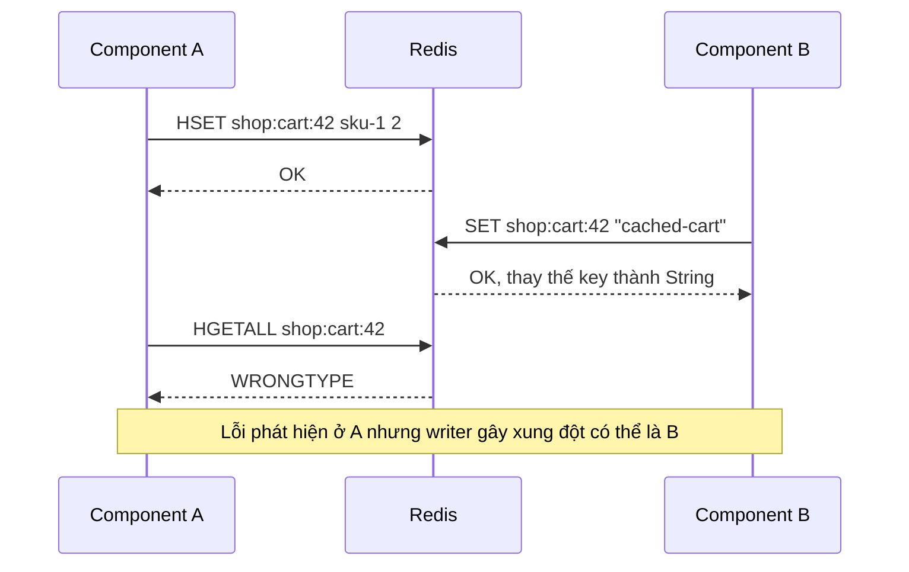
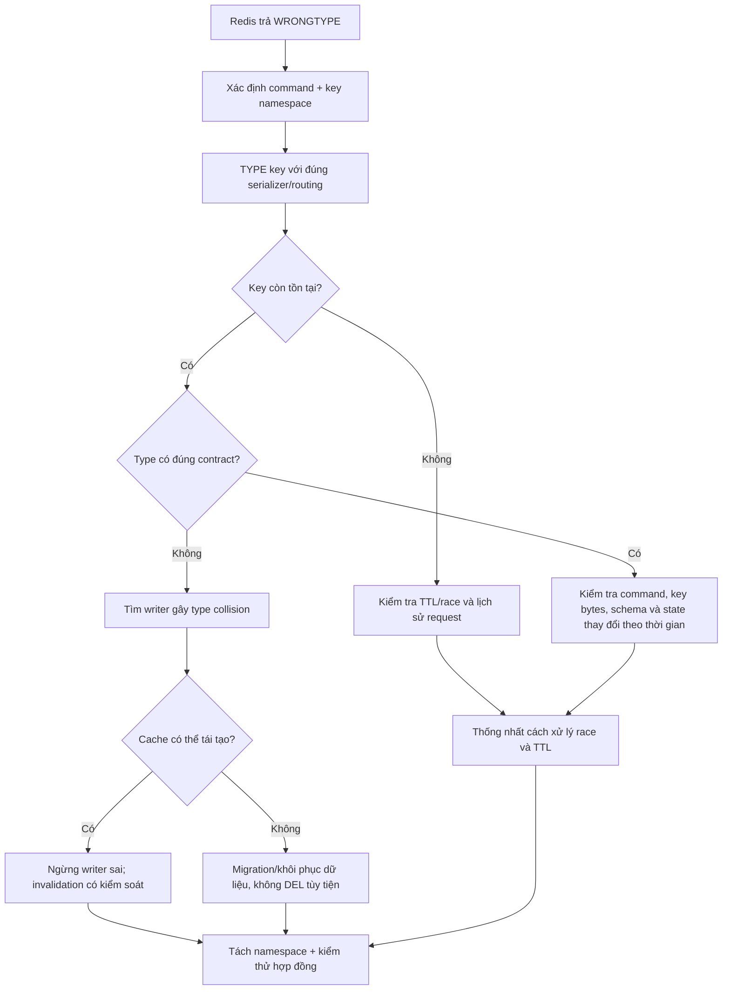

# Lỗi WRONGTYPE và kiểm tra hợp đồng kiểu dữ liệu

Trong **Spring Data Redis**, một tên khóa (*key*) có thể được dùng cho dữ liệu dạng String, Hash, List, Set, Sorted Set, Stream hoặc những kiểu do module Redis cung cấp. Redis phân biệt các cấu trúc này theo **kiểu dữ liệu thực của key trên server**, không theo kiểu generic khai báo trong Java.

Khi ứng dụng gửi lệnh không phù hợp với kiểu dữ liệu đang nằm tại một key, Redis thường trả lỗi:

```text
WRONGTYPE Operation against a key holding the wrong kind of value
```

Ví dụ, dùng `opsForHash().get(...)` để đọc một key vốn đã được lưu bằng `opsForValue().set(...)` có thể gây `WRONGTYPE`. Lỗi xuất hiện nhiều trong hệ thống sử dụng đồng thời `RedisTemplate`, Spring Cache, Redis Repository và những thao tác Redis trực tiếp, nhất là khi **hai thành phần vô tình dùng chung một tên key nhưng kỳ vọng hai kiểu dữ liệu khác nhau**.

Bài học tập trung vào cách tìm đúng nguyên nhân, kiểm tra **hợp đồng kiểu dữ liệu** (*data-type contract*) của một namespace, tránh sửa lỗi bằng cách xóa dữ liệu tùy tiện và xây dựng đường ghi an toàn trong Spring Data Redis.

## 1. Hợp đồng kiểu dữ liệu là gì?

Một hợp đồng kiểu dữ liệu quy định trước:

1. **Ai sở hữu key hoặc namespace?** Ví dụ `CartRedisStore`, Spring Cache hay Redis Repository.
2. **Key có tên theo quy tắc nào?** Ví dụ `shop:cart:v2:<cartId>`.
3. **Kiểu Redis logic là gì?** String, Hash, Set, ZSET, List, Stream, v.v.
4. **Cấu trúc payload ra sao?** Các field của Hash, kiểu của giá trị String, schema JSON, cách đánh số phiên bản.
5. **Serializer/encoding nào được dùng?** UTF-8, JSON, Java serialization, v.v.
6. **Ai có quyền cập nhật, xóa, gia hạn TTL?** Nếu nhiều writer cùng dùng key, hợp đồng phải thống nhất.
7. **Vòng đời key thế nào?** Tạo, cập nhật, expire, xóa, migration và khôi phục khi gặp lỗi.

Ví dụ một bảng hợp đồng:

| Key pattern | Owner | Redis type | Payload | TTL |
| --- | --- | --- | --- | --- |
| `shop:cart:v2:<cartId>` | Cart service | `hash` | `sku -> quantity` dưới dạng chuỗi số nguyên | 30 phút |
| `shop:session:v1:<sessionId>` | Session service | `string` | JSON chứa thông tin phiên đã giới hạn | 15 phút |
| `shop:inventory:v1:<sku>` | Inventory service | `string` | Số nguyên không âm | Không mặc định expire |
| `shop:online:v1` | Presence service | `zset` | Member=user ID, score=lastSeen epoch ms | Dọn theo score |
| `shop:events:orders:v1` | Event producer | `stream` | Field/value theo schema sự kiện | Retention theo stream |
| `shop:users:v1` | Repository infrastructure | Có thể là `set` metadata keyspace | Danh sách ID aggregate | Theo cơ chế Repository |

**Quy tắc:** đừng chỉ đặt tên có nghĩa về nghiệp vụ. Tên key còn phải đủ rõ để phân biệt **phiên bản định dạng**, **kiểu Redis** và **thành phần sở hữu**.

## 2. Redis có những kiểu dữ liệu nào?

Redis lệnh `TYPE key` cho biết **kiểu logic** đang lưu tại key:

```redis
TYPE shop:cart:v2:42
# hash
```

Những kiểu thường gặp:

| Kết quả `TYPE` | Lệnh điển hình | Mô hình |
| --- | --- | --- |
| `none` | — | Key không tồn tại tại thời điểm kiểm tra |
| `string` | `GET`, `SET`, `INCRBY` | Chuỗi byte, đôi khi chứa số hoặc dữ liệu nhị phân |
| `hash` | `HSET`, `HGET`, `HGETALL` | Tập field/value |
| `list` | `LPUSH`, `RPUSH`, `LRANGE` | Danh sách có thứ tự |
| `set` | `SADD`, `SISMEMBER`, `SMEMBERS` | Tập member duy nhất |
| `zset` | `ZADD`, `ZSCORE`, `ZRANGE` | Sorted Set, member kèm score |
| `stream` | `XADD`, `XRANGE`, `XREAD` | Log bản ghi có ID và các field |

Redis còn có những mô hình chuyên biệt:

- **Bitmap** dựa trên các bit của Redis String; `TYPE` thường vẫn là `string`.
- **HyperLogLog** được lưu bằng cấu trúc nội bộ dựa trên String; `TYPE` là `string`, nhưng không có nghĩa một String tùy ý hợp lệ cho `PFCOUNT`.
- Các **module** như RedisJSON có thể thêm kiểu dữ liệu riêng; kết quả `TYPE` phụ thuộc module và phiên bản.

Do đó, `TYPE` là lớp kiểm tra **đầu tiên**, không phải một phép kiểm tra schema đầy đủ.

### 2.1. Kiểu Redis khác với kiểu object Java

Ví dụ:

```java
String json = "{\"id\":\"42\",\"total\":150000}";
stringRedisTemplate.opsForValue()
        .set("shop:orders:json:42", json);
```

Redis nhìn thấy `shop:orders:json:42` là **String**, dù nội dung của nó là JSON. `HGETALL shop:orders:json:42` vẫn sai kiểu.

Ngược lại:

```java
stringRedisTemplate.opsForHash()
        .put("shop:orders:hash:42", "total", "150000");
```

Redis nhìn thấy key thứ hai là **Hash**, dù một giá trị field chứa chuỗi `"150000"` hoặc JSON. Serialization bên trong một field không tự đổi kiểu Redis của key.

## 3. Tái hiện WRONGTYPE với Redis CLI

Trên Redis dùng cho học tập:

```redis
SET lesson:cart:42 "{\"items\":[]}"
TYPE lesson:cart:42
# string
```

Sau đó dùng lệnh dành cho Hash:

```redis
HGETALL lesson:cart:42
# (error) WRONGTYPE Operation against a key holding the wrong kind of value
```

Vì key là String, Redis không thể coi toàn bộ chuỗi JSON là một Hash.

Tình huống ngược:

```redis
HSET lesson:profile:42 name "An" city "Da Nang"
TYPE lesson:profile:42
# hash

GET lesson:profile:42
# (error) WRONGTYPE Operation against a key holding the wrong kind of value
```

Muốn đọc Hash, dùng `HGET` hoặc `HGETALL`:

```redis
HGET lesson:profile:42 name
HGETALL lesson:profile:42
```

**Lưu ý:** lỗi `WRONGTYPE` không có nghĩa Redis bị hỏng dữ liệu. Nó thường cho biết **client đang dùng sai lệnh cho cấu trúc hiện có** hoặc **namespace bị writer khác chiếm dụng**.

## 4. Điều nguy hiểm hơn WRONGTYPE: lệnh ghi đè làm đổi kiểu key

Không phải mọi thao tác sai hợp đồng đều dẫn đến `WRONGTYPE`.

Ví dụ:

```redis
HSET lesson:profile:42 name "An"
TYPE lesson:profile:42
# hash

SET lesson:profile:42 "disabled"
TYPE lesson:profile:42
# string
```

`SET` thông thường có thể **thay thế giá trị hiện có bất kể kiểu cũ**, nên Hash trước đó biến mất. Một component khác sau đó gọi `HGETALL` sẽ thấy `WRONGTYPE`, nhưng nguyên nhân thực nằm ở lệnh `SET` trước đó.



Một lệnh `SET` ghi đè còn thường xóa TTL cũ nếu không dùng tùy chọn giữ TTL phù hợp. Vì vậy, cố “chữa lỗi” bằng `SET` hoặc `DEL` mà không kiểm tra nguồn dữ liệu có thể đồng thời phá schema, giá trị và vòng đời key.

Những lệnh có khả năng thay thế hoặc gây va chạm cấu trúc còn gồm `RENAME` vào destination đã có, restore/ghi đè một key, script tùy biến hoặc thao tác migration thiếu namespace riêng.

## 5. WRONGTYPE trong Spring Data Redis

Spring Data Redis có các API tách theo cấu trúc:

| API | Redis type mong đợi |
| --- | --- |
| `opsForValue()` | String |
| `opsForHash()` | Hash |
| `opsForList()` | List |
| `opsForSet()` | Set |
| `opsForZSet()` | Sorted Set |
| `opsForStream()` | Stream |
| `opsForHyperLogLog()` | HyperLogLog hợp lệ trên cấu trúc String nội bộ |

Ví dụ tạo sai hợp đồng bằng `StringRedisTemplate`:

```java
package com.example.redis;

import org.springframework.data.redis.core.StringRedisTemplate;
import org.springframework.stereotype.Service;

@Service
public class WrongTypeDemo {

    private final StringRedisTemplate redis;

    public WrongTypeDemo(StringRedisTemplate redis) {
        this.redis = redis;
    }

    public void createString() {
        redis.opsForValue()
                .set("lesson:cart:42", "{\"items\":[]}");
    }

    public Object readAsHash() {
        // Key đã là String; đây là cách truy cập sai.
        return redis.opsForHash()
                .entries("lesson:cart:42");
    }
}
```

`createString()` tạo Redis String, còn `readAsHash()` gọi đường Hash. Redis trả lỗi `WRONGTYPE`; Spring Data Redis/driver chuyển lỗi sang exception Java, thường thuộc hệ thống `DataAccessException` của Spring, với class cụ thể phụ thuộc phiên bản driver và tình huống.

**Không nên phụ thuộc hoàn toàn vào tên một subclass exception để nhận diện `WRONGTYPE`** trong mọi phiên bản Spring Data Redis. Khi chẩn đoán, đọc thông điệp lỗi Redis gốc, command, key/namespace và kiểu hiện tại. Không giả định mọi `DataAccessException` là sai kiểu.

## 6. Kiểm tra kiểu bằng `TYPE` trong Spring Data Redis

`RedisTemplate` cung cấp:

```java
DataType type(K key)
```

Với `StringRedisTemplate`:

```java
import org.springframework.data.redis.connection.DataType;
import org.springframework.data.redis.core.StringRedisTemplate;

String key = "shop:cart:v2:42";
DataType actual = stringRedisTemplate.type(key);

if (actual == DataType.HASH) {
    System.out.println("Key chứa Redis Hash");
} else if (actual == DataType.NONE) {
    System.out.println("Key chưa tồn tại");
} else {
    System.out.println("Kiểu không đúng: " + actual);
}
```

`DataType.NONE` tương ứng với Redis `TYPE` trả `none`: key không tồn tại ở thời điểm kiểm tra. Nếu thao tác nằm trong pipeline/transaction, một số method có thể chưa trả kết quả trực tiếp; ví dụ trên giả định lời gọi đồng bộ thông thường.

### 6.1. Service kiểm tra hợp đồng trước khi ghi

Giả sử giỏ hàng được lưu bằng Hash: mỗi field là SKU, mỗi value là số lượng. Ta muốn key có kiểu **`hash` nếu tồn tại**, hoặc **`none` nếu giỏ chưa được tạo**.

```java
package com.example.cart;

import org.springframework.data.redis.connection.DataType;
import org.springframework.data.redis.core.HashOperations;
import org.springframework.data.redis.core.StringRedisTemplate;
import org.springframework.stereotype.Service;

@Service
public class CartRedisStore {

    private static final String KEY_PREFIX = "shop:cart:v2:";

    private final StringRedisTemplate redis;

    public CartRedisStore(StringRedisTemplate redis) {
        this.redis = redis;
    }

    public void putQuantity(String cartId, String sku, long quantity) {
        if (cartId == null || !cartId.matches("[A-Za-z0-9_-]{1,64}")) {
            throw new IllegalArgumentException("Invalid cartId");
        }
        if (sku == null || !sku.matches("[A-Za-z0-9_-]{1,64}")) {
            throw new IllegalArgumentException("Invalid sku");
        }
        if (quantity < 0) {
            throw new IllegalArgumentException("Invalid quantity");
        }

        String key = KEY_PREFIX + cartId;
        DataType type = redis.type(key);

        if (type == null) {
            throw new IllegalStateException(
                    "TYPE result unavailable in this execution context");
        }
        if (type != DataType.NONE && type != DataType.HASH) {
            throw new IllegalStateException(
                    "Redis key contract violation. Expected hash or none; "
                            + "actual=" + type);
        }

        HashOperations<String, String, String> hashes =
                redis.opsForHash();
        hashes.put(key, sku, Long.toString(quantity));
    }
}
```

Điều kiện:

```text
TYPE == hash  -> có thể gọi HSET
TYPE == none  -> HSET sẽ tạo một Hash mới
TYPE == string/list/set/zset/stream -> dừng và báo vi phạm hợp đồng
```

Ví dụ giúp **phát hiện sớm và thông báo rõ** hơn thay vì để một exception khó hiểu nổi lên từ `HSET`.

Nhưng kiểm tra `TYPE` trước thao tác **không bảo đảm tránh được race condition**. Sau khi đọc `TYPE`, một writer khác có thể thay đổi key trước khi `HSET`. Đây là vấn đề *time-of-check to time-of-use* (TOCTOU):

```text
Client A: TYPE key -> hash
Client B: SET key "unexpected-string"
Client A: HSET key field value -> WRONGTYPE
```

Vì vậy, đoạn service trên chỉ nên được hiểu là **đường chẩn đoán / phát hiện sai hợp đồng sớm**, không phải khóa bảo vệ đồng thời. Nếu cần kiểm tra và ghi trong cùng một thao tác nguyên tử, dùng một command tự bảo vệ kiểu hoặc Lua script được thiết kế phù hợp.

## 7. Một lệnh đúng kiểu có thể đã là kiểm tra nguyên tử

Redis thực thi mỗi lệnh theo hợp đồng của nó. Nếu dùng:

```redis
HSET shop:cart:v2:42 sku-1 2
```

thì có hai kết quả thông thường:

1. Key chưa tồn tại: Redis tạo Hash và ghi field.
2. Key đã là Hash: Redis ghi/thay field.

Nếu key đang chứa String/List/Set/... không phù hợp, Redis trả `WRONGTYPE`, **không tự ép String thành Hash**.

Do đó, khi bài toán chỉ là “ghi một field vào Hash và tuyệt đối không được ghi đè cấu trúc khác”, lệnh `HSET` trực tiếp đã có hành vi an toàn hơn việc gọi `SET` để thay toàn bộ key.

Một quy tắc xử lý hợp lý:

```text
HSET thành công     -> Hash được tạo/cập nhật
HSET trả WRONGTYPE -> Không xóa key; ghi nhận lỗi hợp đồng
HSET timeout       -> Kết quả có thể chưa chắc chắn, không suy ra chưa ghi
```

Nếu nghiệp vụ phải kiểm tra thêm schema, version hoặc TTL trong cùng một lần ghi, mới cần cơ chế nguyên tử phức tạp hơn.

## 8. Kiểm tra `TYPE` và ghi trong cùng Lua script

Lua script chạy trên Redis có thể kiểm tra kiểu và ghi mà không có lệnh của client khác xen vào giữa các bước của script.

Ví dụ: chỉ cho phép key là `none` hoặc `hash`, validate field/value và đặt TTL lần đầu tạo:

```lua
-- KEYS[1] = shop:cart:v2:42
-- ARGV[1] = field SKU
-- ARGV[2] = số lượng dạng chuỗi số nguyên
-- ARGV[3] = TTL tính bằng giây, ví dụ 1800

local field = ARGV[1]
local quantity = tonumber(ARGV[2])
local ttl = tonumber(ARGV[3])

if not field or field == '' then
    return redis.error_reply('field required')
end
if not quantity or quantity < 0 or quantity % 1 ~= 0 then
    return redis.error_reply('invalid quantity')
end
if not ttl or ttl <= 0 or ttl % 1 ~= 0 then
    return redis.error_reply('invalid TTL')
end

local actual = redis.call('TYPE', KEYS[1]).ok
if actual ~= 'none' and actual ~= 'hash' then
    return redis.error_reply(
            'TYPE_CONTRACT_VIOLATION expected hash; actual ' .. actual)
end

local isNew = actual == 'none'
local updated = redis.call('HSET', KEYS[1], field, ARGV[2])

if isNew then
    redis.call('EXPIRE', KEYS[1], ttl)
end

return updated
```

**Ý nghĩa:**

- `TYPE` và `HSET` diễn ra trong cùng một script nên không có writer khác chen vào giữa hai bước.
- Nếu gặp kiểu không được phép, script trả lỗi và **không cố đổi kiểu key**.
- `HSET` ghi field vào Hash; nếu key chưa tồn tại, nó tạo Hash.
- Với key mới, `EXPIRE` tạo TTL ban đầu. Với Hash hiện có, script **không gia hạn TTL**.
- TTL 1.800 giây là ví dụ; chính sách cần gắn với hợp đồng giỏ hàng thật.

**Giới hạn quan trọng:** Lua không bảo đảm rollback những thao tác đã thực thi trước khi một lỗi runtime xảy ra. Ví dụ đã validate các tham số có thể dự đoán được trước phần ghi, nhưng production vẫn phải kiểm soát kiểu field, kích thước payload, số nguyên Redis, quyền, bộ nhớ và đường lỗi khác.

Trong Redis Cluster, script dùng nhiều key phải tuân thủ quy tắc cùng hash slot. Script trên chỉ thao tác một key, nên không cần ép các key khác cùng slot.

### 8.1. Gọi script bằng Spring Data Redis

```java
import java.util.List;
import org.springframework.data.redis.core.StringRedisTemplate;
import org.springframework.data.redis.core.script.DefaultRedisScript;

String lua = """
        local actual = redis.call('TYPE', KEYS[1]).ok
        if actual ~= 'none' and actual ~= 'hash' then
            return redis.error_reply('Expected hash')
        end
        local quantity = tonumber(ARGV[2])
        local ttl = tonumber(ARGV[3])
        if not quantity or quantity < 0 or quantity % 1 ~= 0 then
            return redis.error_reply('Invalid quantity')
        end
        if not ttl or ttl <= 0 or ttl % 1 ~= 0 then
            return redis.error_reply('Invalid TTL')
        end
        local created = actual == 'none'
        local result = redis.call('HSET', KEYS[1], ARGV[1], ARGV[2])
        if created then
            redis.call('EXPIRE', KEYS[1], ttl)
        end
        return result
        """;

DefaultRedisScript<Long> script =
        new DefaultRedisScript<>(lua, Long.class);

Long changed = stringRedisTemplate.execute(
        script,
        List.of("shop:cart:v2:42"),
        "sku-1", "2", "1800");
```

Kết quả `HSET` thường là số field mới được thêm, không phải “đã đặt giỏ hàng thành công đúng một lần theo nghiệp vụ”. Nếu cần tránh xử lý lặp sau timeout, phải bổ sung operation ID/idempotency theo yêu cầu riêng.

Đoạn Java minh họa cách gọi, còn trong ứng dụng nên lưu script thành resource riêng, quản lý phiên bản và không dựng script động từ input người dùng.

## 9. Quy trình chẩn đoán WRONGTYPE từ production

Khi log xuất hiện:

```text
WRONGTYPE Operation against a key holding the wrong kind of value
```

không nên bắt đầu bằng `DEL` hoặc `FLUSHDB`. Hãy xác định **key nào**, **command nào** và **ai ghi key đó**.

### Bước 1: Xác định thao tác và key

Ví dụ:

```text
service=cart-service
operation=HGETALL
keyPattern=shop:cart:v2:<cartId>
correlationId=req-72b
```

Nếu log không có key, hãy thêm log ở tầng service tại nơi key được tạo ra; tuyệt đối không đưa credential hoặc toàn bộ thông tin giỏ hàng nhạy cảm vào log.

### Bước 2: Kiểm tra kiểu hiện tại

```redis
TYPE shop:cart:v2:42
```

Nếu kết quả `string`, trong khi contract mong `hash`, đã xác định được **mismatch tại thời điểm kiểm tra**.

Với Redis Cluster, dùng client có khả năng định tuyến theo slot hoặc:

```sh
redis-cli -c -h redis-host -p 6379 TYPE 'shop:cart:v2:42'
```

`-c` cho phép redis-cli xử lý redirect khi kết nối Cluster. Tuy nhiên, `TYPE` trả `none` ngay lúc đó **không chứng minh** key không tồn tại khi lệnh bị lỗi: key có thể đã bị xóa/hết hạn trong khoảng giữa hai thao tác.

### Bước 3: Xem TTL và đặc tính cấu trúc

```redis
PTTL shop:cart:v2:42
MEMORY USAGE shop:cart:v2:42
```

`PTTL` thường trả:

| Kết quả | Ý nghĩa |
| --- | --- |
| Giá trị không âm | Còn từng ấy mili giây |
| `-1` | Key tồn tại nhưng không có TTL |
| `-2` | Key không tồn tại |

Không dùng `MEMORY USAGE` làm chỉ số suy ra kiểu Redis: nó cho biết bộ nhớ ước tính của key, không cho biết Hash hay String.

`OBJECT ENCODING key` có thể cho biết **biểu diễn nội bộ** như `embstr`, `raw`, `listpack`, `hashtable` tùy cấu trúc và phiên bản Redis. Đây **không phải** bản thay thế cho `TYPE`; một Hash có thể có encoding khác nhau khi lớn/nhỏ nhưng vẫn là kiểu `hash`.

### Bước 4: Chỉ đọc bằng lệnh phù hợp kiểu đang có

| `TYPE` thực tế | Cách quan sát mẫu dữ liệu |
| --- | --- |
| `string` | `GET key` khi đã biết dữ liệu không nhạy cảm/quá lớn |
| `hash` | `HSCAN key 0 COUNT 10` hoặc `HGET key field` |
| `list` | `LRANGE key 0 9` |
| `set` | `SSCAN key 0 COUNT 10` |
| `zset` | `ZSCAN key 0 COUNT 10` |
| `stream` | `XREVRANGE key + - COUNT 5` |

Không gọi `HGETALL` lên Hash hàng triệu field hoặc `SMEMBERS` lên Set cực lớn chỉ để chẩn đoán nhanh. Ưu tiên phương thức đọc có giới hạn và tránh làm tăng tải production.

### Bước 5: Tìm writer gây thay đổi

Từ namespace/key, truy ngược:

- Component nào dùng `opsForValue().set(key, ...)`?
- Component nào dùng `opsForHash().put(key, ...)`?
- Có migration đã đổi từ JSON String sang Hash mà giữ nguyên tên key?
- Có `@RedisHash`, `RedisCacheManager` hoặc script viết cùng tiền tố?
- Có job thao tác `RENAME`, `RESTORE REPLACE`, `DEL`, cache warm-up hoặc import dữ liệu?
- Có instance đang chạy phiên bản code cũ nhưng vẫn ghi theo schema cũ?

`WRONGTYPE` ở **reader hiện tại** chưa xác định reader là thành phần gây lỗi. Có thể writer khác đã ghi đè key trước đó.

### Bước 6: Chỉ sửa sau khi xác định nguồn dữ liệu

Nếu Redis chỉ là cache có thể tái tạo, có thể lên kế hoạch invalidation có chọn lọc sau khi đã loại bỏ writer sai và hiểu tác động. Nếu key là nguồn dữ liệu nghiệp vụ duy nhất, **không xóa hoặc ghi đè để “khôi phục” kiểu**; cần migration và backup theo quy trình riêng.

## 10. Phân biệt WRONGTYPE với lỗi serializer và schema

Ba nhóm lỗi thường bị gộp chung:

| Nhóm lỗi | Ví dụ | Bản chất |
| --- | --- | --- |
| **Sai kiểu Redis** | `HGETALL` trên `string` | Redis trả `WRONGTYPE` vì command không phù hợp với type |
| **Sai serializer/encoding** | Java đọc key/value bằng JDK serializer nhưng dữ liệu được ghi bằng UTF-8/JSON | Key không tìm thấy hoặc lỗi giải mã |
| **Sai schema bên trong cùng type** | Hash có field `quantity="two"` nhưng code mong số nguyên | Redis type đúng (`hash`), ứng dụng parse/validate sai |

### 10.1. JSON String không phải Redis Hash

```redis
SET shop:order:42 '{"id":"42","status":"PAID"}'
TYPE shop:order:42
# string
```

Dù JSON chứa các thuộc tính, `HGET shop:order:42 status` vẫn sai kiểu. Muốn `HGET`, phải lưu ở dạng Hash bằng `HSET`; nếu muốn lưu JSON nguyên chuỗi, dùng `GET` rồi parse JSON trong Java.

RedisJSON module cung cấp các lệnh `JSON.GET`/`JSON.SET` với kiểu dữ liệu module riêng. Không coi RedisJSON, String chứa JSON và Redis Hash là ba tên cho cùng một kiểu.

### 10.2. HyperLogLog là trường hợp TYPE chưa đủ

```redis
SET lesson:not-hll "hello"
TYPE lesson:not-hll
# string

PFCOUNT lesson:not-hll
# Có thể báo dữ liệu không phải HyperLogLog hợp lệ
```

Một HyperLogLog được biểu diễn trên cấu trúc String nội bộ, nhưng String bất kỳ **không phải** HLL hợp lệ. Do đó, `TYPE key == string` **không đủ** để cho phép các lệnh `PFADD`, `PFCOUNT` hay thao tác trên bitmap mang ý nghĩa nghiệp vụ.

Hợp đồng phải ghi rõ **mục đích và định dạng** của key, không chỉ giá trị `TYPE`.

### 10.3. Số nguyên trong String vẫn cần kiểm tra giá trị

```redis
SET stock:sku-42 "unknown"
TYPE stock:sku-42
# string

INCRBY stock:sku-42 1
# (error) ERR value is not an integer or out of range
```

Đây là lỗi **định dạng giá trị**, không nhất thiết là `WRONGTYPE`: Redis String đã đúng nhưng nội dung không thể dùng làm số nguyên hợp lệ.

Với các key numeric, phải ràng buộc định dạng số, miền giá trị và phương thức cập nhật để tránh writer khác lưu text tùy ý.

## 11. Serializer của RedisTemplate và tên key thực sự

`StringRedisTemplate` thuận tiện vì key và value chuỗi được mã hóa bằng serializer phù hợp với String. Với `RedisTemplate<K, V>` tự cấu hình, có thể có nhiều serializer khác:

```java
import org.springframework.data.redis.core.RedisTemplate;
import org.springframework.data.redis.serializer.StringRedisSerializer;
import org.springframework.data.redis.serializer.GenericJackson2JsonRedisSerializer;

RedisTemplate<String, Object> template = new RedisTemplate<>();
template.setConnectionFactory(connectionFactory);
template.setKeySerializer(new StringRedisSerializer());
template.setHashKeySerializer(new StringRedisSerializer());
template.setValueSerializer(
        new GenericJackson2JsonRedisSerializer());
template.setHashValueSerializer(
        new GenericJackson2JsonRedisSerializer());
template.afterPropertiesSet();
```

Đây là ví dụ minh họa tạo một template có serializer cụ thể; trong ứng dụng Spring nên cấu hình dưới dạng bean và kiểm soát nhiều template. JSON serializer còn có yêu cầu về kiểu dữ liệu, metadata và tương thích phiên bản cần được xử lý riêng.

### 11.1. Key không khớp byte thì không phải cùng key

Nếu một template dùng `StringRedisSerializer` còn template khác dùng serializer nhị phân cho **key**, hai lời gọi Java cùng truyền `"shop:cart:v2:42"` có thể tạo **hai key byte-level khác nhau** trong Redis.

Hệ quả có thể là:

- `redis-cli TYPE shop:cart:v2:42` trả `none` dù ứng dụng thấy key khác tồn tại dưới bytes do serializer nhị phân tạo.
- Một template không tìm thấy key mà template khác đã ghi.
- Khi migration chuyển serializer, dữ liệu cũ không tự được ánh xạ tới tên key mới.

Vì vậy khi chẩn đoán, cần kiểm tra **key serializer** trước khi kết luận Redis đã mất dữ liệu. Đây là lỗi về mã hóa key, khác với `WRONGTYPE` trên **cùng một key byte-level**.

### 11.2. Hash field serializer cũng là một phần của hợp đồng

Ngay cả khi key đã là `hash`, một `HGET` theo field `"status"` cũng có thể không tìm thấy dữ liệu nếu một writer mã hóa tên field thành bytes khác. `TYPE` vẫn là `hash`, nhưng kết quả `HGET` có thể `null`.

Tương tự, nếu `hashValueSerializer` thay đổi, đọc được field chưa có nghĩa deserialize được value. Cần quản lý cùng lúc **Redis type**, **hash key serializer**, **hash value serializer** và **schema**.

## 12. Va chạm giữa Spring Cache và thao tác thủ công

Spring Cache dùng `RedisCacheManager` để lưu dữ liệu có thể tái tạo theo key do cache configuration tạo ra. Với cấu hình mặc định, tên key thường bao gồm tên cache và tiền tố, chẳng hạn:

```text
products::42
```

Giả sử:

```java
@Cacheable(cacheNames = "products", key = "#id")
public Product find(String id) {
    return productRepository.findById(id).orElseThrow();
}
```

Một developer khác lại dùng:

```java
stringRedisTemplate.opsForHash()
        .put("products::42", "stock", "17");
```

Nếu cache đã lưu kết quả ở một Redis String, lời gọi Hash có thể trả `WRONGTYPE`. Nếu thao tác Hash chạy trước, đường Spring Cache có thể gặp lỗi tương ứng hoặc ghi đè kiểu tùy command và cách writer thực hiện.

**Bài học:** namespace cache **phải tách** khỏi namespace dữ liệu Redis được ứng dụng thao tác trực tiếp.

```text
cache:products:v1::42         -> Spring Cache sở hữu
domain:products:v1:42         -> Hash thủ công sở hữu
repository:products:v1:42     -> Redis Repository sở hữu
```

Các tên ở trên là một quy ước gợi ý; `RedisCacheConfiguration.computePrefixWith(...)` có thể được dùng để thiết kế prefix của Spring Cache. Không bắt các lớp nghiệp vụ truy cập trực tiếp vào key nội bộ do cache manager sinh.

### 12.1. Cache value serializer khác với kiểu Redis

Một Spring Cache entry có thể là Redis `string` chứa **byte array serialized**. Code gọi `GET` có thể nhận bytes thành công nhưng không deserialize được theo serializer đang dùng. Đây là lỗi **serializer/schema**, không phải `WRONGTYPE`.

Nếu cố gọi `HGETALL` chỉ vì dữ liệu Java được cache là một POJO có nhiều trường, mới tạo ra lỗi sai **Redis type**: POJO Java không tự có nghĩa rằng Cache entry phải là Redis Hash.

## 13. Va chạm với Redis Repository và `@RedisHash`

Spring Data Redis Repository có thể ánh xạ entity:

```java
import org.springframework.data.annotation.Id;
import org.springframework.data.redis.core.RedisHash;
import org.springframework.data.redis.core.index.Indexed;

@RedisHash("users")
public class UserDocument {

    @Id
    private String id;

    @Indexed
    private String email;

    // Constructor, getters, setters...
}
```

Repository có thể tạo nhiều cấu trúc Redis:

```text
users:42            -> Hash của entity
users               -> Set metadata các ID thuộc keyspace
users:email:...     -> Set phụ trợ của secondary index
```

Đây là các tên minh họa theo quy ước Repository. Không nên tự ghi bằng `SET` vào `users:42` hoặc dùng `HSET` lên key `users` nếu repository dùng key đó làm Set ID.

Một tình huống dễ gặp:

```redis
SADD users 42
TYPE users
# set

HSET users name "An"
# WRONGTYPE
```

Nếu một component không biết key `users` là **metadata Set** của Redis Repository, nó có thể tưởng `users` là Hash chứa thông tin người dùng và gây va chạm.

Các tác động có thể rộng hơn việc một lệnh thất bại:

- `repository.findById(...)` không đọc được hash nếu key đã bị writer khác chuyển thành String.
- `repository.findAll()` hoặc query index có thể sai nếu metadata/index Set bị ghi đè.
- TTL, shadow copy và index cleanup của repository có thể chịu ảnh hưởng nếu key lifecycle bị thay đổi từ bên ngoài.
- Khi một entity đổi giá trị được index, repository cần cập nhật các cấu trúc phụ; thao tác thủ công có thể bỏ qua quy tắc đó.

**Không coi Redis Repository chỉ quản lý một key duy nhất cho mỗi entity**. Một namespace Repository nên được bảo vệ khỏi writer thủ công và Spring Cache không tương thích.

## 14. WRONGTYPE khi có Redis Cluster

Redis Cluster định tuyến key theo hash slot. Lỗi `WRONGTYPE` vẫn liên quan tới **kiểu dữ liệu của một key**, không phải trực tiếp là lỗi định tuyến.

Phân biệt:

| Lỗi / phản hồi | Ý nghĩa thường gặp |
| --- | --- |
| `WRONGTYPE` | Lệnh không phù hợp kiểu dữ liệu key đang giữ |
| `CROSSSLOT` | Lệnh nhiều key yêu cầu chúng ở cùng slot, nhưng thực tế khác slot |
| `MOVED` / `ASK` | Cần định tuyến tới node/slot phù hợp trong Cluster |
| `READONLY` | Lệnh ghi được gửi đến node không chấp nhận ghi, ví dụ replica |
| Timeout/network failure | Chưa chắc biết Redis đã xử lý lệnh hay chưa |

Ví dụ:

```redis
TYPE shop:cart:v2:42
# hash

CLUSTER KEYSLOT shop:cart:v2:42
# Trả một slot trong khoảng 0..16383 trên Cluster
```

Nếu ứng dụng nhận `WRONGTYPE`, việc tăng số lượng redirect trong Lettuce **không sửa kiểu key**. Ngược lại, `CROSSSLOT` không tự có nghĩa key là Hash hay String sai.

Với nhiều writer ở nhiều ứng dụng, việc một key đổi chủ sau resharding cũng không đổi hợp đồng kiểu của key. Hãy kiểm tra các service dùng cùng namespace và xem khả năng phiên bản cũ tiếp tục ghi theo schema cũ.

## 15. Cảnh báo race và tính nguyên tử khi nhiều worker

Giả sử hai service triển khai song song:

```text
Service A (v1): SET session:42 JSON
Service B (v2): HSET session:42 status ACTIVE
```

Nếu v2 chạy trước và tạo Hash, v1 dùng `SET` có thể thay thế Hash bằng String. Nếu v1 chạy trước, v2 có thể gặp `WRONGTYPE`. Không có cách kiểm tra `TYPE` ở v2 nào ngăn được v1 tiếp tục ghi đè theo hợp đồng cũ.

**Giải pháp chính nằm ở ownership và migration**, không phải chỉ tăng retry.

Nếu cùng một key phải chuyển type, cần một giai đoạn mà các writer cũ đã ngừng ghi hoặc dùng cơ chế giao thức chuyển đổi có version rõ ràng. Dùng một key v2 độc lập thường dễ quản lý hơn ép nhiều phiên bản ứng dụng ghi hai định dạng vào cùng key.

### 15.1. Transaction không phải phép ép kiểu

```redis
MULTI
HSET lesson:cart:42 sku-1 2
EXPIRE lesson:cart:42 1800
EXEC
```

Nếu `lesson:cart:42` thực chất là String, `HSET` có thể trả lỗi thực thi khi `EXEC`, trong khi các lệnh khác trong transaction có thể vẫn chạy theo ngữ nghĩa Redis. Redis transaction không bảo đảm rollback toàn bộ lệnh đã thực thi khi một command lỗi runtime.

Đừng dùng `MULTI` với kỳ vọng `WRONGTYPE` sẽ khiến mọi thay đổi trước/sau tự động bị rollback như transaction của SQL.

## 16. Kế hoạch migration từ String JSON sang Hash

Giả sử phiên bản cũ lưu:

```text
shop:cart:v1:42 -> Redis String chứa JSON
```

Phiên bản mới muốn:

```text
shop:cart:v2:42 -> Redis Hash chứa sku -> quantity
```

Một quy trình an toàn hơn sửa trực tiếp key cũ:

1. **Định nghĩa schema v2**: tên key, type `hash`, trường được phép, TTL, serializer, owner.
2. **Tạo key v2 mới**, không dùng cùng tên `shop:cart:v1:42`.
3. **Đọc và parse dữ liệu v1** bằng đường đọc String; validate trước khi chuyển.
4. **Ghi v2** qua Hash API, với quy tắc giữ TTL/lifecycle phù hợp.
5. **Dùng dual-read có kiểm soát**: ưu tiên v2, chỉ fallback v1 trong thời gian migration và có cách đối soát.
6. **Ngăn writer v1 ghi trở lại** sau khi đã chuyển quyền sở hữu; có thể dùng feature flag/cắt chuyển phiên bản.
7. **Quan sát lỗi** và số key còn theo schema cũ trong giai đoạn chuyển.
8. **Xóa key v1 theo kế hoạch** chỉ khi đã có khả năng rollback/phục hồi và thời gian lưu cần thiết đã kết thúc.

Ví dụ đọc dữ liệu cũ:

```java
String legacyJson = stringRedisTemplate.opsForValue()
        .get("shop:cart:v1:42");

// Dùng Jackson để parse sang DTO được kiểm tra schema.
// Sau đó chuyển DTO sang Map<String, String> và HSET ở key v2.
```

Việc chuyển TTL cần tính riêng:

```redis
PTTL shop:cart:v1:42
```

Nếu còn 300.000 ms, key v2 không nên mặc nhiên nhận một TTL mới 30 phút mà không có quyết định nghiệp vụ rõ ràng. `-1` và `-2` cũng cần được xử lý tách biệt: key không expire và key không tồn tại là hai trạng thái khác nhau.

Một backfill chạy đồng thời với writer cũ cần có version hoặc cơ chế chống ghi đè dữ liệu mới bằng snapshot cũ. Nếu không, bước migration có thể tạo lỗi **mất cập nhật** ngay cả khi không có `WRONGTYPE`.

## 17. Không nên sửa lỗi bằng các thao tác nào?

### 17.1. `DEL` mọi key báo WRONGTYPE

```redis
DEL shop:cart:v2:42
```

`DEL` xóa key bất kể kiểu nào. Nếu đó là dữ liệu không thể tái tạo, thao tác này **mất dữ liệu**. Chỉ xóa khi đã xác định owner, nguồn sự thật, khả năng phục hồi và ảnh hưởng đến các writer khác.

### 17.2. `FLUSHDB`/`FLUSHALL` để “làm sạch”

Đây là thao tác xóa dữ liệu rộng, tuyệt đối không phù hợp để sửa một mismatch ở vài key.

### 17.3. Retry liên tục một lệnh sai kiểu

```java
// Không nên:
for (;;) {
    redis.opsForHash().put(key, field, value);
}
```

Nếu key vẫn là String, retry không thể làm `HSET` bỗng trở thành thao tác hợp lệ. Vòng retry chỉ tăng tải và spam lỗi. Retry nên dành cho lỗi tạm thời theo chính sách có giới hạn, không dành cho vi phạm hợp đồng cấu trúc.

### 17.4. Bắt DataAccessException rồi trả giá trị mặc định

```java
// Không nên:
try {
    return redis.opsForHash().entries(key);
} catch (org.springframework.dao.DataAccessException ex) {
    return java.util.Map.of();
}
```

Một lỗi sai type bị biến thành “giỏ hàng rỗng”, có thể dẫn đến mất đơn hàng hoặc cập nhật sai. Cần phân biệt key không tồn tại (có thể là giỏ rỗng theo hợp đồng) với **key có kiểu không tương thích**.

### 17.5. Đổi serializer ngẫu nhiên để thử

Thay `valueSerializer` không biến Redis String thành Hash, và có thể làm dữ liệu cũ trở nên không giải mã được. Chỉ đổi serializer sau khi đã xác định lỗi thuộc tầng encoding chứ không phải `WRONGTYPE`.

## 18. Xử lý lỗi trong service: không che giấu WRONGTYPE

Một mẫu thiết kế là để service giữ trách nhiệm về namespace và báo lỗi có ngữ cảnh, đồng thời không tự xóa key:

```java
package com.example.cart;

import org.springframework.dao.DataAccessException;
import org.springframework.data.redis.core.StringRedisTemplate;
import org.springframework.stereotype.Service;

@Service
public class SafeCartReader {

    private final StringRedisTemplate redis;

    public SafeCartReader(StringRedisTemplate redis) {
        this.redis = redis;
    }

    public java.util.Map<Object, Object> read(String cartId) {
        if (cartId == null || !cartId.matches("[A-Za-z0-9_-]{1,64}")) {
            throw new IllegalArgumentException("Invalid cartId");
        }

        String key = "shop:cart:v2:" + cartId;

        try {
            return redis.opsForHash().entries(key);
        } catch (DataAccessException cause) {
            // Không tự chuyển thành giỏ rỗng, không xóa key.
            // Tầng logging/observability có thể bổ sung correlation ID
            // và tên namespace (không log payload nhạy cảm).
            throw new IllegalStateException(
                    "Cannot read cart from Redis hash namespace", cause);
        }
    }
}
```

Ví dụ dùng `DataAccessException` để bảo tồn nguyên nhân sâu xa, nhưng không gán mọi ngoại lệ đó thành `WRONGTYPE`. Lỗi mạng, timeout và các tình huống transaction khác cần luồng xử lý riêng.

Nếu API cần trả mã lỗi chi tiết, hãy tạo `KeyTypeContractViolationException` riêng sau khi xác minh lỗi đúng loại, đồng thời giữ exception gốc làm `cause`. Không phân nhánh nghiệp vụ quan trọng chỉ bằng so sánh chuỗi thông báo Redis vốn có thể thay đổi.

## 19. Đề xuất kiểm thử hợp đồng kiểu dữ liệu

Đối với mỗi namespace trọng yếu, nên có những tình huống kiểm thử tích hợp sau:

| Tình huống | Kỳ vọng |
| --- | --- |
| Key chưa tồn tại | Phương thức tạo mới dùng đúng Redis type |
| Key đã đúng type | Đọc/ghi theo hợp đồng thành công |
| Key bị tạo sẵn với type sai | Gặp lỗi rõ ràng, không xóa/ghi đè tùy tiện |
| Cùng key có writer cũ dùng schema v1 | Phát hiện xung đột và có cơ chế cắt chuyển |
| Key hết TTL giữa `TYPE` và ghi | Không biến lỗi tạm thời thành xóa dữ liệu không kiểm soát |
| Hai writer cùng cập nhật | Không có chuyển type im lặng nếu hợp đồng không cho phép |
| Serializer/key prefix thay đổi | Dữ liệu mới/cũ được tách namespace hoặc migrate rõ ràng |
| Redis Cluster đang reshard | Driver định tuyến đúng; không gộp `MOVED` và `WRONGTYPE` |
| Lệnh timeout sau khi đã gửi | Không giả định chưa ghi; có idempotency nếu nghiệp vụ cần |

Một testcase minh họa:

```java
// Pseudocode kiểm thử tích hợp với Redis dành riêng cho test:
String key = "test:cart:v2:42";

redis.opsForValue().set(key, "legacy-json");

// Đường Hash không được phép ghi đè String kiểu cũ.
assertThrows(
        DataAccessException.class,
        () -> redis.opsForHash().put(key, "sku-1", "2"));

assertEquals(DataType.STRING, redis.type(key));
```

`assertThrows` và `assertEquals` là assertion của JUnit; `redis` ở đây là `StringRedisTemplate` trỏ tới môi trường test. Không chạy test ghi dữ liệu này trực tiếp trên key production.

Mục đích của test là bảo đảm **writer mới không âm thầm phá dữ liệu của writer cũ**. Các testcase khác nên dùng key riêng để không gây phụ thuộc thứ tự chạy.

## 20. Quan sát và cảnh báo trong production

Một ứng dụng nhiều module nên theo dõi:

| Tín hiệu | Giá trị điều tra |
| --- | --- |
| `redis_wrongtype_errors_total` | Có bao nhiêu lỗi sai type theo service/namespace |
| Tên command xảy ra lỗi | `HGETALL`, `HSET`, `GET`, `PFCOUNT`, v.v. |
| Redis type quan sát được | `string`, `hash`, `set`, `zset`, `none`, ... |
| Expected type theo hợp đồng | Phân biệt lỗi do client hay writer khác |
| Phiên bản ứng dụng | Phát hiện các instance dùng schema cũ |
| Serializer/key prefix | Phát hiện thay đổi tên key hoặc decoding |
| TTL/age của key | Gợi ý key mới, key legacy hoặc vòng đời bất thường |
| Tốc độ `SET`/`HSET` theo namespace | Tìm writer có khả năng ghi đè |
| Retry count | Phát hiện retry nóng trên lỗi không thể tự sửa |

Ví dụ log có ích nhưng không lộ payload:

```text
event=REDIS_KEY_TYPE_CONTRACT_VIOLATION
service=cart-api
operation=HGETALL
namespace=shop:cart:v2
expected=hash
actual=string
release=2026.11.13
correlationId=req-72b
```

Chỉ ghi `actual` sau khi có kết quả `TYPE` ở thời điểm chẩn đoán; nếu key đã hết hạn và hiện trả `none`, log phải phản ánh điều đó thay vì khẳng định chắc type ban đầu. Tránh log user ID thô, token, mật khẩu hoặc nội dung giỏ hàng.

Nếu tỷ lệ `WRONGTYPE` tăng đột biến sau một lần deploy, ưu tiên kiểm tra cấu hình key prefix, serializer, schema migration và xem có instance cũ lẫn mới cùng ghi một namespace không.

### 20.1. Redis MONITOR có nên dùng?

`MONITOR` có thể giúp thấy các command đang đến Redis, nhưng nó tạo chi phí và có thể phơi lộ dữ liệu nhạy cảm. **Không nên bật MONITOR tùy tiện trên production**. Ưu tiên structured logging tại service, metrics, tracing với dữ liệu đã được ẩn, và các công cụ quan sát được phê duyệt.

## 21. Quy trình quyết định khi gặp WRONGTYPE



Quy trình ưu tiên **chẩn đoán và xác định owner** trước khi sửa dữ liệu. Một lỗi `WRONGTYPE` có thể là dấu hiệu của thay đổi schema chưa được phối hợp, không phải một key “rác” nên xóa ngay.

## 22. Các quy tắc phòng ngừa

1. **Một namespace có một owner rõ ràng.** Tránh để Spring Cache, Repository và RedisTemplate thủ công cùng ghi một prefix không kiểm soát.
2. **Ghi type vào contract.** Không chỉ định dạng JSON/Java DTO, mà cả Redis `string`, `hash`, `set`, `stream`, v.v.
3. **Tách phiên bản schema vào key name khi cần.** Ví dụ `cart:v1` là String, `cart:v2` là Hash.
4. **Dùng đúng API thao tác dữ liệu.** `opsForHash` cho Hash, `opsForZSet` cho Sorted Set; không đoán Redis type từ kiểu class Java.
5. **Tạo và cập nhật nhất quán.** `HSET` tạo Hash khi key chưa có; tránh `SET` ghi đè Hash nếu không có chủ đích migration.
6. **Không coi `TYPE` là khóa đồng thời.** Check-then-act có race; khi cần, dùng một command hoặc Lua script kiểm tra và ghi nguyên tử.
7. **Quản lý serializer và TTL.** Hai key cùng kiểu vẫn có thể khác schema/encoding và vòng đời.
8. **Không retry vô hạn WRONGTYPE.** Đây thường là lỗi hợp đồng, không phải lỗi mạng tạm thời.
9. **Không xóa khi chưa đối soát.** Dữ liệu cache có thể tái tạo khác dữ liệu nghiệp vụ không thể tái tạo.
10. **Có kế hoạch migration và rollback.** Đặc biệt khi nhiều phiên bản ứng dụng chạy đồng thời.
11. **Quan sát loại lỗi và writer.** Log expected/actual type, command, namespace và phiên bản ứng dụng.
12. **Kiểm thử trên Redis thực.** Kiểu dữ liệu là hợp đồng của server; unit test mock không mô phỏng đầy đủ `WRONGTYPE`.

## 23. Tổng kết

**`WRONGTYPE` là lỗi Redis phát hiện khi một command không phù hợp với kiểu dữ liệu thực của key.** Trong Spring Data Redis, nguồn lỗi phổ biến là dùng nhầm `opsForValue`/`opsForHash`/`opsForSet`, hai component ghi đè cùng tên key, hoặc thay schema từ String sang Hash mà không có migration.

Lệnh **`TYPE key`** và API **`RedisTemplate.type(key)`** giúp xác minh kiểu logic. Tuy nhiên, `TYPE` không kiểm tra serializer, schema trong cùng type hoặc bảo đảm key không đổi sau lúc kiểm tra. Khi cần an toàn đồng thời, sử dụng thao tác Redis tự kiểm soát type hoặc Lua script với điều kiện rõ ràng.

Phòng ngừa bền vững nằm ở **hợp đồng namespace**: mỗi nhóm key có owner, kiểu Redis, cấu trúc payload, serializer, TTL và version được công bố. Khi gặp lỗi, hãy xác định writer gây va chạm trước, **không tự động `DEL`**, không che lỗi bằng giá trị rỗng và không retry vô hạn. Đối với thay đổi định dạng, tách key v2 và di chuyển dữ liệu có kiểm soát thường an toàn hơn ép hai phiên bản ghi vào cùng một key.

### Tài liệu tham khảo

- [Redis — TYPE](https://redis.io/docs/latest/commands/type/): xác định kiểu dữ liệu logic của key.
- [Redis — Data Types](https://redis.io/docs/latest/develop/data-types/): String, Hash, List, Set, Sorted Set, Stream và các cấu trúc khác.
- [Redis — HSET](https://redis.io/docs/latest/commands/hset/): ghi Hash field, tạo Hash nếu key chưa tồn tại.
- [Redis — SET](https://redis.io/docs/latest/commands/set/): ghi đè String và những tác động tới TTL/kiểu dữ liệu.
- [Redis — PTTL](https://redis.io/docs/latest/commands/pttl/): kiểm tra expiration còn lại của key.
- [Redis — Scripting with Lua](https://redis.io/docs/latest/develop/programmability/eval-intro/): phạm vi nguyên tử và giới hạn rollback của script.
- [Spring Data Redis — RedisTemplate](https://docs.spring.io/spring-data/redis/reference/redis/template.html): các operations theo kiểu dữ liệu, serializer và template.
- [Spring Data Redis — Redis Repositories](https://docs.spring.io/spring-data/redis/reference/redis/redis-repositories.html): keyspace, lưu aggregate và các key phụ trợ.
- [Spring Data Redis — Redis Cache](https://docs.spring.io/spring-data/redis/reference/redis/redis-cache.html): quy ước tên key cache, serializer và cấu hình CacheManager.
