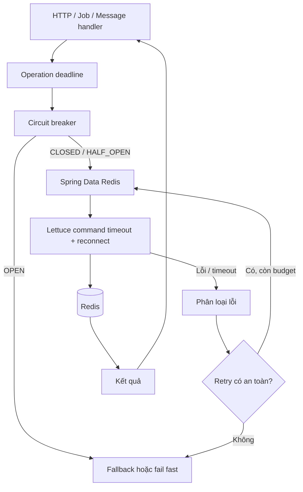
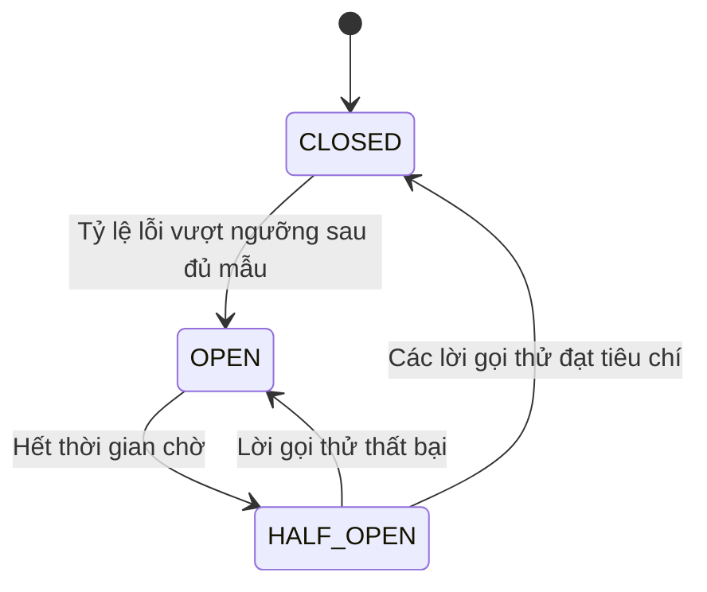
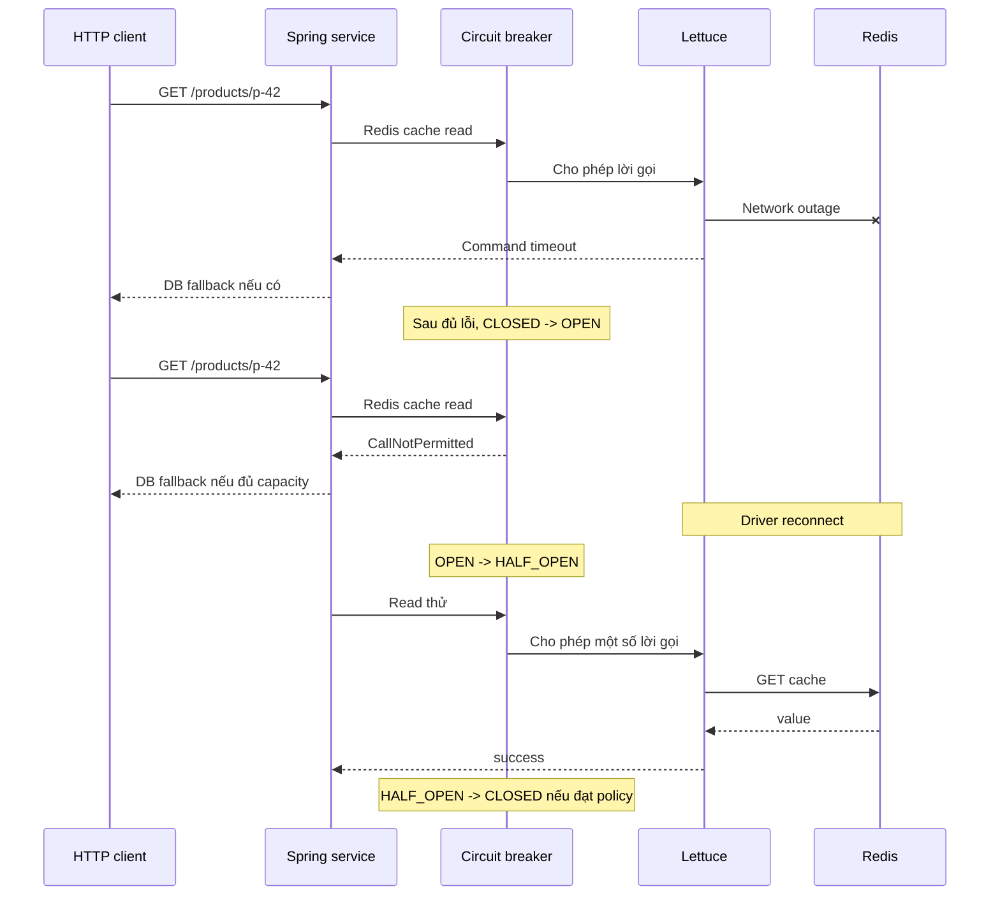
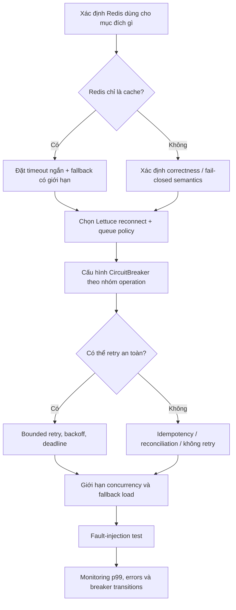

# Phối hợp timeout, reconnect và cơ chế ngắt mạch trong Spring Data Redis

## 1. Bài toán: Redis chậm hoặc mất kết nối làm cả ứng dụng chậm theo

Giả sử một dịch vụ Spring Boot dùng Redis làm cache cho API xem thông tin sản phẩm:

```java
@Service
public class ProductCache {

    private final StringRedisTemplate redis;

    public ProductCache(StringRedisTemplate redis) {
        this.redis = redis;
    }

    public String getName(String productId) {
        return redis.opsForValue()
            .get("product:name:" + productId);
    }
}
```

Khi Redis hoạt động bình thường, GET thường rất nhanh. Nhưng điều gì xảy ra nếu:

- Redis tạm mất kết nối trong vài giây?
- Một Redis node bị failover, client vẫn giữ connection tới node cũ?
- Mạng không đứt hẳn nhưng latency tăng cao?
- Redis đang quá tải, command queue dài và nhiều request đồng thời chờ?
- Ứng dụng retry quá mạnh, khiến một sự cố nhỏ trở thành bão request?

Nếu chỉ cấu hình một timeout rất lớn, mỗi HTTP request có thể bị giữ lâu; khi request tăng, số thread hoặc subscription đang chờ tăng theo. Nếu chỉ bật reconnect, lệnh đã timeout không tự trở thành an toàn để thực thi lại. Nếu chỉ thêm circuit breaker, ứng dụng vẫn có thể treo khi command chưa vượt deadline hoặc khi quá nhiều thao tác đang chạy.

Giải pháp đáng tin cậy cần **phối hợp nhiều tầng**:

```text
HTTP request deadline
    |
    +-- Redis connect timeout
    |
    +-- Redis command timeout
    |
    +-- Reactor/application operation timeout
    |
    +-- Lettuce reconnect + hàng đợi lệnh
    |
    +-- Circuit breaker: CLOSED / OPEN / HALF_OPEN
    |
    +-- Retry có giới hạn, chỉ khi an toàn
    |
    +-- Fallback + bulkhead + monitoring
```

Đây là các cơ chế phục vụ những mục đích **khác nhau**. Bài học này sẽ thiết kế chúng thành một chính sách xử lý lỗi thống nhất cho Spring Data Redis, kể cả khi ứng dụng dùng `RedisTemplate` hoặc `ReactiveRedisTemplate`.

Sau bài học, bạn có thể:

1. Phân biệt connect timeout, command timeout và request deadline.
2. Hiểu Lettuce reconnect, command queue và các trạng thái kết nối.
3. Dùng circuit breaker đúng phạm vi cho Redis cache hoặc Redis quan trọng.
4. Kết hợp Reactor `timeout` và Resilience4j CircuitBreaker.
5. Chọn retry theo **idempotency** và trạng thái kết quả không chắc chắn.
6. Thiết kế fallback, bulkhead, health/metrics và kịch bản kiểm thử sự cố.

## 2. Phân biệt ba trục: timeout, reconnect và circuit breaker

| Cơ chế | Câu hỏi nó giải quyết | Nó không tự giải quyết |
|---|---|---|
| **Timeout** | Một thao tác được phép chờ bao lâu? | Khôi phục kết nối và kiểm soát số request mới |
| **Reconnect** | Client làm gì khi socket tới Redis bị đứt? | Phân biệt lệnh cũ đã chạy hay chưa; bảo đảm retry an toàn |
| **Circuit breaker** | Có nên tiếp tục gọi Redis khi tỉ lệ lỗi đang quá cao? | Chặn một lệnh đang treo nếu không có timeout; thay thế retry/queue |
| **Retry** | Khi nào thử lại một lỗi có thể phục hồi? | Tính an toàn của thao tác không idempotent |
| **Fallback** | Ứng dụng làm gì khi không lấy được kết quả từ Redis? | Bảo đảm nguồn dự phòng đủ năng lực chịu toàn bộ tải |
| **Bulkhead** | Giới hạn bao nhiêu việc Redis có thể chiếm tài nguyên cùng lúc? | Khôi phục Redis hoặc sửa logic nghiệp vụ |

Sơ đồ tổng quát:



Thứ tự trong sơ đồ thể hiện ý nghĩa logic. Trên đường reactive, vị trí của các Reactor operators quyết định circuit breaker có ghi nhận một timeout hay không, và fallback có bị tính thành một lần Redis thành công giả hay không.

## 3. Các lớp timeout trong Spring Data Redis

### 3.1. Connection timeout

**Connect timeout** giới hạn thời gian thiết lập một kết nối tới Redis server. Nó liên quan các tình huống:

- Host không thể truy cập.
- TCP handshake bị chậm hoặc không hoàn tất.
- Địa chỉ Redis mới sau failover không reachable.
- Kết nối bị tắc trong quá trình khởi tạo.

Trong Spring Boot 3.x có thể khai báo:

```yaml
spring:
  data:
    redis:
      host: redis.internal
      port: 6379
      connect-timeout: 500ms
```

Giá trị 500 ms chỉ là ví dụ. Khi kết nối đi qua một vùng mạng có RTT cao hoặc dùng TLS, cần đo và chọn ngưỡng phù hợp.

**Connect timeout không phải timeout của mỗi lệnh GET.** Một connection đã tồn tại vẫn có thể gửi lệnh rồi chờ Redis response quá lâu, kể cả khi connect timeout rất thấp.

### 3.2. Command timeout

**Command timeout** giới hạn thời gian đợi một Redis command hoàn thành theo client/driver. Ví dụ:

```yaml
spring:
  data:
    redis:
      timeout: 300ms
```

Trong các dòng Spring Boot 3.x, `spring.data.redis.timeout` là cấu hình timeout cho Redis command ở đường client thông thường. Đặc tả chi tiết, thời điểm bắt đầu đếm và ngoại lệ nhận được còn phụ thuộc Lettuce/Spring Data Redis version và loại command.

Lệnh `GET` đang chờ có thể timeout vì:

- Redis thực sự chậm.
- Network lag/lost packet.
- Client đang trong trạng thái reconnect/disconnected.
- Lệnh bị giữ trong queue chưa được gửi hoặc chưa nhận response.
- Redis Cluster đang redirect hoặc failover.

**Command timeout không cam kết server chưa thực thi lệnh.** Nếu response bị mất sau khi Redis áp dụng một lệnh ghi, client vẫn có thể nhận timeout.

### 3.3. Operation timeout ở Reactor

Một ứng dụng reactive có thể giới hạn riêng một Publisher:

```java
Mono<String> cachedName =
    reactiveRedis.opsForValue()
        .get("product:name:p-42")
        .timeout(Duration.ofMillis(350));
```

`timeout(...)` giới hạn việc Publisher phát tín hiệu trong khoảng thời gian đã khai báo và báo lỗi nếu vượt ngưỡng. Nó rất hữu ích để giữ latency ở mức ứng dụng có thể chấp nhận.

Tuy nhiên:

- Timeout của Reactor không đồng nghĩa Redis server đã bị hủy lệnh.
- Cancellation có thể không thu hồi được một write đã gửi tới Redis.
- Nếu timeout chỉ bao quanh một phần của pipeline, các công đoạn trước hoặc sau có thể vẫn tiêu tốn thời gian.
- Một lỗi timeout từ Reactor và một lỗi timeout của Lettuce có thể có class/cause khác nhau.

### 3.4. HTTP/request deadline

Một request của ứng dụng có thể thực hiện:

```text
Auth check -> Redis cache GET -> Database fallback -> Build response
```

Nếu tổng SLA HTTP là 800 ms, việc cho Redis GET chờ 2 giây là vô lý. Redis phải chiếm **một phần** ngân sách thời gian, và còn thời gian cho nguồn dự phòng.

Một ví dụ phân bổ ban đầu:

| Giai đoạn | Ngưỡng minh họa |
|---|---:|
| Redis connect timeout | 500 ms khi cần thiết lập kết nối mới |
| Redis command timeout | 250 ms |
| Redis cache read deadline ở Reactor | 320 ms |
| Database fallback budget | Khoảng 400 ms còn lại, tùy thời điểm bắt đầu |
| Tổng request budget | 900 ms |

**Không cộng máy móc** các con số để suy ra request luôn hoàn tất dưới 900 ms: connect và command timeout có thể chồng lấn hoặc phát sinh ở các pha khác nhau; scheduler, queue, retries và ứng dụng downstream còn tạo overhead. Thay vì chỉ lập bảng thời gian tĩnh, hãy dùng **deadline tổng** và đo elapsed time thực tế.

## 4. Cách chọn timeout thực tế

Một chiến lược:

1. Đo latency Redis healthy ở p50, p95, p99 trong điều kiện tải bình thường.
2. Xác định request deadline theo SLO của API.
3. Dành ngân sách cho database hoặc nguồn authoritative nếu Redis thất bại.
4. Chọn Redis timeout đủ lớn cho biến thiên bình thường nhưng đủ nhỏ để không kéo sập request.
5. Giới hạn retry trong ngân sách còn lại.
6. Đo tỷ lệ timeout và false timeout dưới tải thật.

Ví dụ Redis p99 thường là 8 ms, nhưng mạng có occasional 50 ms. Đặt timeout 10 ms có thể tạo nhiều lỗi giả và kích hoạt circuit breaker không cần thiết. Ngược lại, đặt 5 giây cho một cache GET trong API có deadline 500 ms làm giảm giá trị của fallback.

### 4.1. Timeout quá ngắn cũng gây sự cố

```text
Timeout quá nhỏ
    -> lệnh hợp lệ bị timeout
    -> client retry
    -> Redis nhận nhiều traffic hơn
    -> latency tăng
    -> nhiều timeout hơn
```

Đây là một vòng phản hồi dương. Khi Redis có vấn đề, hệ thống cần giảm tải và hồi phục có kiểm soát, không tăng gấp nhiều lần số commands.

### 4.2. Timeout của lệnh blocking Redis

Các lệnh như `BLPOP`, `XREAD BLOCK` hoặc Pub/Sub subscription có ý nghĩa chờ dữ liệu khác với `GET`.

Nếu command timeout của client ngắn hơn thời gian Redis được yêu cầu block, ứng dụng có thể nhận timeout ngoài ý muốn dù không có lỗi Redis.

Ví dụ ý nghĩa:

```redis
XREAD BLOCK 5000 STREAMS events $
```

Lệnh có thể đợi tối đa 5 giây để có entry mới. Một command timeout 300 ms áp dụng cùng cách cho lệnh này không phản ánh business semantics của blocking read.

Cần dùng cấu hình timeout riêng hoặc API listener/receiver hỗ trợ polling và cancellation đúng contract, thay vì ép mọi Redis command dùng cùng một ngưỡng ngắn.

## 5. Lettuce tự reconnect hoạt động thế nào?

Spring Data Redis thường dùng **Lettuce** trong các dự án Spring Boot. Lettuce là Redis client hỗ trợ kết nối bất đồng bộ và có khả năng **tự reconnect**.

Khái quát:

```text
CONNECTED
   |
   | network/socket failure
   v
DISCONNECTED
   |
   | autoReconnect
   v
RECONNECTING
   |
   +-- thất bại -> thử tiếp theo policy
   |
   +-- thành công -> CONNECTED
```

Reconnect nhằm khôi phục **khả năng gửi lệnh về sau**, không phải một transaction recovery protocol cho mọi command đã bị mất response.

### 5.1. Reconnect không đồng nghĩa retry mọi lệnh

Các trường hợp khác nhau:

- Lệnh chưa được gửi và đang chờ trong client queue.
- Lệnh đã gửi nhưng Redis chưa thực thi.
- Lệnh đã thực thi nhưng response chưa tới client.
- Lệnh đã nhận response thành công.

Trong lúc mất kết nối, client có thể không phân biệt được hoàn toàn các tình huống này. Reconnect hỗ trợ thiết lập đường liên lạc mới, nhưng **không tự tạo tính đúng cho những thao tác ghi không idempotent**.

### 5.2. Trạng thái client và lệnh xếp hàng

Lettuce có chính sách xử lý command khi kết nối không sẵn sàng. Tùy cấu hình, lệnh có thể:

1. Bị từ chối sớm khi disconnected.
2. Được giữ trong queue để gửi khi reconnect.
3. Đợi rồi timeout trước khi kết nối phục hồi.

Chính sách nào tốt hơn phụ thuộc workload:

- Với cache GET, **fail fast** có thể tốt hơn việc giữ hàng nghìn request chờ Redis hồi phục.
- Với một tác vụ batch đã có queue bền vững riêng, có thể chấp nhận một khoảng chờ được kiểm soát.
- Với command có tác động tài chính, enqueue rồi thực thi muộn có thể làm side effect ngoài deadline request; cần thiết kế cẩn thận.

Không nên suy luận autoReconnect là một cam kết "mọi lệnh chờ đều an toàn và cuối cùng sẽ chạy".

## 6. Cấu hình Lettuce ClientOptions và hàng đợi

Ví dụ tạo `LettuceConnectionFactory` cho Redis standalone, chủ động bật reconnect và giới hạn queue:

```java
package com.example.redis.config;

import java.time.Duration;

import io.lettuce.core.ClientOptions;
import io.lettuce.core.SocketOptions;

import org.springframework.context.annotation.Bean;
import org.springframework.context.annotation.Configuration;
import org.springframework.data.redis.connection.RedisStandaloneConfiguration;
import org.springframework.data.redis.connection.lettuce.LettuceClientConfiguration;
import org.springframework.data.redis.connection.lettuce.LettuceConnectionFactory;

@Configuration
public class RedisClientConfig {

    @Bean
    LettuceConnectionFactory redisConnectionFactory() {
        RedisStandaloneConfiguration server =
            new RedisStandaloneConfiguration("redis.internal", 6379);

        SocketOptions socketOptions = SocketOptions.builder()
            .connectTimeout(Duration.ofMillis(500))
            .build();

        ClientOptions options = ClientOptions.builder()
            .autoReconnect(true)
            .disconnectedBehavior(
                ClientOptions.DisconnectedBehavior.REJECT_COMMANDS
            )
            .requestQueueSize(1_000)
            .socketOptions(socketOptions)
            .build();

        LettuceClientConfiguration client =
            LettuceClientConfiguration.builder()
                .commandTimeout(Duration.ofMillis(300))
                .clientOptions(options)
                .build();

        return new LettuceConnectionFactory(server, client);
    }
}
```

Ý nghĩa:

- `autoReconnect(true)`: Lettuce được phép thử kết nối lại.
- `REJECT_COMMANDS`: lệnh mới có thể bị từ chối khi connection không sẵn sàng, thay vì chờ trong queue khi disconnected.
- `requestQueueSize(1_000)`: giới hạn queue client theo cách driver hỗ trợ; mục đích là ngăn tích lũy vô hạn.
- `connectTimeout(500 ms)`: timeout để thiết lập kết nối socket.
- `commandTimeout(300 ms)`: timeout dành cho Redis commands.

Những giá trị trên chỉ là **ví dụ thiết kế fail-fast cho cache**, không phải cấu hình mặc định hay tối ưu cho mọi nghiệp vụ.

**Đây là cấu hình thay thế** cho Redis connection auto-configuration của Spring Boot. Nếu dự án đã có `RedisConnectionFactory` hoặc dùng Sentinel/Cluster, phải chọn kiểu configuration tương ứng thay vì sao chép cấu hình standalone vào hệ thống HA.

### 6.1. Queue phải có giới hạn nhưng không chỉ nhìn một con số

Giả sử HTTP server nhận 5.000 requests/s và Redis mất kết nối 10 giây. Nếu mọi request tiếp tục enqueue một GET, hàng đợi có thể tăng rất nhanh. Ngay cả khi Redis reconnect, nó có thể nhận một **burst** lớn các commands cũ; phần lớn HTTP requests ban đầu đã hết deadline.

Giới hạn queue và từ chối lệnh khi disconnected giúp giảm rủi ro này. Nhưng phải kiểm tra:

- Driver queue chính xác chứa những loại commands nào.
- Timeout có làm giải phóng request resources ngay lập tức không.
- Số kết nối Redis và số request đang in-flight.
- Có một queue khác tại HTTP server, scheduler hoặc connection pool không.

**Lettuce reconnect backoff và requestQueueSize không thay thế bulkhead ở tầng ứng dụng.** Mỗi tầng cần giới hạn tài nguyên tương ứng.

### 6.2. Không bật REJECT_COMMANDS một cách máy móc

Một số workload cần chấp nhận gián đoạn ngắn để xử lý commands theo thứ tự sau reconnect. Khi đó, việc giữ một hàng đợi **có giới hạn và deadline rõ** có thể phù hợp hơn từ chối ngay.

Ngược lại, cache đọc không quan trọng thường nên fail fast để giữ tài nguyên cho database fallback. Chính sách phải gắn với vai trò Redis trong hệ thống.

## 7. Reconnect và Redis Sentinel

Khi Redis chạy với Sentinel, client cần tìm primary hiện tại và kết nối lại nếu primary đổi sau failover:

```yaml
spring:
  data:
    redis:
      sentinel:
        master: mymaster
        nodes:
          - 10.0.0.11:26379
          - 10.0.0.12:26379
          - 10.0.0.13:26379
      connect-timeout: 500ms
      timeout: 300ms
```

Trong topology này:

1. Primary cũ có thể ngừng phản hồi.
2. Sentinel phối hợp chọn primary mới.
3. Driver khám phá primary mới, reconnect và tiếp tục gửi lệnh.
4. Các request trong cửa sổ chuyển đổi có thể timeout hoặc nhận lỗi kết nối.

Không nên coi việc client reconnect thành công là bằng chứng **mọi write đã ACK trên primary cũ đều hiện diện trên primary mới**. Redis replication thường bất đồng bộ; một replica được promote có thể chưa nhận những write gần thời điểm primary lỗi.

Circuit breaker giúp ứng dụng **giảm gọi Redis trong giai đoạn failover**, nhưng không tăng tính nhất quán của dữ liệu trên primary mới.

### 7.1. Hành vi cache và hành vi nguồn dữ liệu khác nhau

Khi Redis chỉ là cache, đọc từ database authoritative trong cửa sổ failover có thể là fallback hợp lý.

Khi Redis đang giữ session hoặc là thành phần điều phối khóa, mất kết nối có thể làm ứng dụng **không đủ thông tin để tiếp tục an toàn**. Không được fallback bằng cách tự tạo session/lock thành công giả.

## 8. Reconnect và Redis Cluster

Redis Cluster dùng hash slots và nhiều primary. Nếu slot owner đổi vì resharding hoặc failover, Lettuce có thể cần xử lý:

- `MOVED`: redirect tới node sở hữu slot theo topology mới.
- `ASK`: redirect tạm thời trong giai đoạn slot migration.
- `TRYAGAIN`: điều kiện tạm chưa thể thực hiện, ví dụ lệnh đa key khi key đang chuyển.
- `CLUSTERDOWN`: cluster không thể phục vụ theo trạng thái hiện tại.
- Redis connection timeout tới một node mới.

Với Lettuce Cluster, nên cân nhắc topology refresh:

```java
import java.time.Duration;

import io.lettuce.core.cluster.ClusterClientOptions;
import io.lettuce.core.cluster.ClusterTopologyRefreshOptions;

ClusterTopologyRefreshOptions refresh =
    ClusterTopologyRefreshOptions.builder()
        .enablePeriodicRefresh(Duration.ofSeconds(30))
        .enableAllAdaptiveRefreshTriggers()
        .build();

ClusterClientOptions options = ClusterClientOptions.builder()
    .topologyRefreshOptions(refresh)
    .build();
```

Đây là phần cấu hình cho **Redis Cluster client**, không ghép trực tiếp vào `ClientOptions` của Redis standalone.

**Reconnect và topology refresh là hai việc liên quan nhưng khác nhau:**

- Reconnect thử thiết lập lại đường kết nối.
- Refresh cập nhật bảng node/slot/role mà driver sử dụng để định tuyến.

Nếu Redis node quảng bá địa chỉ không reachable từ ứng dụng (ví dụ pod IP nội bộ), cả reconnect lẫn refresh đều không giải quyết được nguyên nhân. Cần sửa endpoint, DNS, TLS, network hoặc cấu hình cluster address.

## 9. Circuit breaker giải quyết vấn đề gì?

Circuit breaker theo dõi kết quả của những lời gọi qua một dependency. Khi lỗi vượt điều kiện đã cấu hình, breaker **OPEN** và từ chối một phần hoặc toàn bộ lời gọi mới trong một khoảng thời gian, thay vì tiếp tục đợi dependency đang hỏng.

Các trạng thái phổ biến:

| Trạng thái | Hành vi | Mục tiêu |
|---|---|---|
| `CLOSED` | Cho phép gọi Redis; ghi nhận tỉ lệ thành công/thất bại | Hoạt động bình thường |
| `OPEN` | Từ chối nhanh lời gọi mới qua breaker | Tránh dồn tải vào Redis đang lỗi và giải phóng tài nguyên ứng dụng |
| `HALF_OPEN` | Cho phép một số lời gọi thử để đánh giá hồi phục | Chuyển sang CLOSED nếu đủ tốt hoặc OPEN nếu vẫn lỗi |



Circuit breaker giúp hệ thống **không tiếp tục gây tải khi biết Redis có vấn đề**. Nó không có nhiệm vụ tự reconnect socket; đó vẫn là trách nhiệm của Lettuce.

### 9.1. Mở circuit không đồng nghĩa Redis mất kết nối hoàn toàn

Một breaker có thể mở vì:

- Nhiều command timeout.
- Lỗi connection.
- Redis trả lỗi server tạm thời.
- Cấu hình timeout quá ngắn, tạo false failures.

Vì vậy, breaker OPEN phản ánh chính sách bảo vệ đã kích hoạt từ dữ kiện ứng dụng, **không phải trạng thái vận hành tuyệt đối của Redis server**.

### 9.2. Không dùng một breaker cho mọi thứ

Ví dụ cùng Redis phục vụ:

- Cache sản phẩm, có thể fallback database.
- Session login, không thể tự bỏ qua.
- Distributed lock, lỗi có thể làm thao tác không an toàn.
- Redis Streams consumer, cần giữ pending/ack.

Một circuit breaker chung có thể khiến một cache read thất bại làm chặn cả Redis lock hoặc ngược lại. Nên phân tách theo **dependency và chính sách nghiệp vụ**, ví dụ:

```text
redis-cache-read-breaker
redis-session-breaker
redis-lock-breaker
redis-stream-worker-breaker
```

Không nhất thiết tạo breaker riêng cho mọi key hoặc mọi method. Mục tiêu là nhóm những thao tác có lỗi/fallback/SLO tương đồng.

## 10. Resilience4j là một lựa chọn circuit breaker cho Spring

Spring Data Redis không mặc định tự áp dụng một circuit breaker cho mọi lệnh Redis. Có thể sử dụng thư viện **Resilience4j** ở tầng service.

Ví dụ dependency Gradle cho Spring Boot 3.x, với version Resilience4j được quản lý phù hợp qua BOM hoặc dependency management của dự án:

```groovy
dependencies {
    implementation 'org.springframework.boot:spring-boot-starter-data-redis-reactive'
    implementation 'io.github.resilience4j:resilience4j-circuitbreaker'
    implementation 'io.github.resilience4j:resilience4j-reactor'
}
```

Nếu không có dependency management cung cấp version phù hợp, cần khai báo version cụ thể thay vì mặc định Gradle tự chọn được version. Bài học minh họa API cơ bản của Resilience4j; các phiên bản Spring Boot/Resilience4j có thể yêu cầu starter hoặc BOM khác nhau.

### 10.1. Tạo CircuitBreaker với ngưỡng có thể quan sát

```java
package com.example.redis.resilience;

import java.time.Duration;
import java.util.concurrent.TimeoutException;

import io.github.resilience4j.circuitbreaker.CircuitBreaker;
import io.github.resilience4j.circuitbreaker.CircuitBreakerConfig;

import org.springframework.context.annotation.Bean;
import org.springframework.context.annotation.Configuration;
import org.springframework.data.redis.RedisConnectionFailureException;

@Configuration
public class RedisResilienceConfig {

    @Bean
    CircuitBreaker redisCacheReadBreaker() {
        CircuitBreakerConfig config =
            CircuitBreakerConfig.custom()
                .failureRateThreshold(50f)
                .slidingWindowSize(20)
                .minimumNumberOfCalls(10)
                .waitDurationInOpenState(Duration.ofSeconds(10))
                .permittedNumberOfCallsInHalfOpenState(3)
                .recordExceptions(
                    RedisConnectionFailureException.class,
                    TimeoutException.class
                )
                .build();

        return CircuitBreaker.of("redis-cache-read", config);
    }
}
```

Ý nghĩa của các số liệu minh họa:

- `slidingWindowSize(20)`: tính toán thống kê trong cửa sổ 20 lời gọi theo chế độ đếm mặc định.
- `minimumNumberOfCalls(10)`: chỉ đánh giá điều kiện mở breaker sau khi đủ ít nhất 10 mẫu.
- `failureRateThreshold(50f)`: ngưỡng 50% thất bại.
- `waitDurationInOpenState(10s)`: khoảng chờ trước khi cho phép thăm dò hồi phục theo cơ chế breaker.
- `permittedNumberOfCallsInHalfOpenState(3)`: số lời gọi thử khi HALF_OPEN.

**Chính sách record exception phải phù hợp thực tế.** Một timeout từ Lettuce có thể được bọc trong exception khác, còn một Redis serialization error thường là lỗi dữ liệu/cấu hình, không nhất thiết được xử lý như sự cố Redis availability. Khi vận hành, cần phân loại toàn bộ exception chain và version cụ thể để tránh bỏ sót lỗi hoặc mở breaker vì bug không phải outage.

## 11. Kết hợp Reactor timeout và CircuitBreakerOperator

Ví dụ hệ thống dùng Redis như **cache** cho trạng thái sản phẩm; khi cache không thể truy cập, dùng nguồn authoritative:

```java
package com.example.redis.resilience;

import java.time.Duration;
import java.util.concurrent.TimeoutException;

import io.github.resilience4j.circuitbreaker.CallNotPermittedException;
import io.github.resilience4j.circuitbreaker.CircuitBreaker;
import io.github.resilience4j.reactor.circuitbreaker.operator.CircuitBreakerOperator;

import org.springframework.data.redis.RedisConnectionFailureException;
import org.springframework.data.redis.core.ReactiveStringRedisTemplate;
import org.springframework.stereotype.Service;

import reactor.core.publisher.Mono;

@Service
public class ProductNameLookup {

    private final ReactiveStringRedisTemplate redis;
    private final AuthoritativeProductSource source;
    private final CircuitBreaker cacheBreaker;

    public ProductNameLookup(
            ReactiveStringRedisTemplate redis,
            AuthoritativeProductSource source,
            CircuitBreaker redisCacheReadBreaker) {
        this.redis = redis;
        this.source = source;
        this.cacheBreaker = redisCacheReadBreaker;
    }

    public Mono<String> findName(String productId) {
        String key = "product:name:" + productId;

        return Mono.defer(() -> redis.opsForValue().get(key))
            .timeout(Duration.ofMillis(320))
            .transformDeferred(
                CircuitBreakerOperator.of(cacheBreaker)
            )
            .onErrorResume(error -> {
                if (isAvailabilityFailure(error)) {
                    return Mono.empty();
                }
                return Mono.error(error);
            })
            .switchIfEmpty(
                Mono.defer(() -> source.findName(productId))
            );
    }

    private boolean isAvailabilityFailure(Throwable error) {
        return error instanceof CallNotPermittedException
            || error instanceof TimeoutException
            || error instanceof RedisConnectionFailureException;
    }
}
```

Nguồn authoritative trong ví dụ có thể được mô tả bằng một interface nhỏ:

```java
import reactor.core.publisher.Mono;

public interface AuthoritativeProductSource {
    Mono<String> findName(String productId);
}
```

Các điểm quan trọng:

1. `Mono.defer(...)` đảm bảo công việc được tạo cho từng subscription thực tế.
2. `timeout(320ms)` biến việc không có response đúng deadline thành tín hiệu lỗi.
3. `CircuitBreakerOperator` bao quanh phần lookup đã có timeout, nên breaker có thể quan sát timeout từ Reactor.
4. `onErrorResume(...)` chỉ chuyển **lỗi availability được chọn** thành tín hiệu cache miss.
5. `switchIfEmpty(...)` dùng nguồn chính khi key không tồn tại **hoặc** cache lookup được phép fallback.
6. Lỗi khác, ví dụ dữ liệu sai kiểu hoặc logic bug, **không mặc định bị nuốt**.

**Đây là một ví dụ cache-read fail-open**. Đối với session, phân quyền, distributed lock hoặc dữ liệu chỉ có trong Redis, việc tùy tiện dùng `Mono.empty()` có thể nguy hiểm.

### 11.1. Thứ tự operator quyết định kết quả breaker

Nếu đặt fallback **trước** circuit breaker:

```java
redis.opsForValue().get(key)
    .onErrorResume(error -> Mono.empty())
    .transformDeferred(CircuitBreakerOperator.of(cacheBreaker));
```

breaker có thể chỉ thấy một completion thành công vì lỗi Redis đã bị fallback che đi. Khi đó breaker khó học từ sự cố.

Tương tự, nếu `timeout` nằm **sau** CircuitBreakerOperator, breaker có thể không ghi nhận timeout theo cách bạn kỳ vọng khi downstream hủy subscription. Trong ví dụ chính, timeout nằm trong phạm vi được breaker quan sát.

**Quy tắc:** đặt timeout và phân loại lỗi sao cho breaker nhìn thấy **kết quả thực sự của dependency**, sau đó mới thực hiện fallback.

### 11.2. Không biến mọi lỗi thành cache miss

Ví dụ cấu hình sai JSON serializer có thể phát `SerializationException`. Nếu xử lý:

```java
.onErrorResume(error -> Mono.empty())
```

cho mọi ngoại lệ, ứng dụng có thể che giấu lỗi triển khai trong nhiều ngày. Hãy phân loại lỗi:

- Key không tồn tại: `Mono.empty()` bình thường.
- Redis connection/command timeout: có thể fallback nếu cache là optional.
- Circuit breaker OPEN: có thể fallback ngay.
- Serializer sai hoặc dữ liệu cache hỏng: báo lỗi, đo metric, xử lý recovery theo quyền sở hữu key.
- Business validation: không coi là lỗi Redis availability.

## 12. Không được để fallback gây sập database

Giả sử bình thường:

```text
100.000 GET/s -> Redis cache
      |
      +-- khoảng 2.000 request/s cache miss -> Database
```

Redis gặp sự cố và circuit breaker mở. Nếu mọi request ngay lập tức chuyển sang database:

```text
100.000 request/s -> Database
```

database có thể bị quá tải dù Redis breaker đang bảo vệ đúng Redis.

Fallback chỉ thật sự an toàn khi nguồn dự phòng **chịu được tải** hoặc được giới hạn qua:

- Bulkhead/concurrency limit.
- Rate limit ở gateway/service.
- Caching cục bộ có TTL ngắn cho dữ liệu ít nhạy cảm.
- Stale-but-safe data theo chính sách nghiệp vụ.
- Admission control hoặc trả lỗi rõ ràng khi hệ thống quá tải.

Không xem fallback là một phép biến đổi miễn phí từ lỗi Redis thành HTTP 200.

## 13. Bulkhead: giới hạn số tác vụ cùng chiếm tài nguyên

Circuit breaker đánh giá tỷ lệ lỗi. Nó **không mặc nhiên giới hạn chặt chẽ tổng số Redis operations in-flight** khi dependency đang chậm nhưng chưa có nhiều lỗi.

Bulkhead có thể chặn quá nhiều thao tác cùng chạy, ví dụ chỉ cho phép 50 cache lookups đồng thời trong một instance.

```text
Incoming requests
      |
      v
Bulkhead capacity = 50
      |
      +-- Có permit -> Redis
      |
      +-- Hết permit -> fail fast / fallback / 429-503 theo policy
```

Với Resilience4j có thể dùng `Bulkhead` hoặc `BulkheadOperator` trên Reactor pipeline. Ở ứng dụng imperative, có thể sử dụng semaphore/thread pool phù hợp. Đây là **một lớp giới hạn tài nguyên riêng**, không thay thế client request queue hay connection pool.

Khi lựa chọn:

- Redis GET nhẹ, có fallback: thường ưu tiên fail fast hơn việc chờ queue dài.
- Redis Streams consumer: cần điều chỉnh concurrency với pending/ACK, không đơn thuần từ chối message.
- Session/lock critical: khi hết permit, phải trả lỗi an toàn, không âm thầm bỏ qua kiểm tra.

## 14. Retry: khi nào an toàn, khi nào nguy hiểm?

Đây là phần dễ gây lỗi nghiệp vụ nhất khi phối hợp timeout/reconnect.

### 14.1. Lệnh đọc thường có thể retry

Ví dụ:

```redis
GET product:name:p-42
HGET user:u-42 displayName
TTL session:s-42
```

Thử lại một lệnh đọc thường không tạo side effect trực tiếp lên dữ liệu nghiệp vụ. Tuy nhiên:

- Kết quả có thể thay đổi giữa các lần vì dữ liệu được cập nhật.
- Replica-read có thể trả dữ liệu cũ hơn.
- Mỗi lần retry làm tăng tải Redis.
- Tổng thời gian phải nằm trong deadline.

### 14.2. Lệnh ghi có thể không an toàn để retry sau timeout

Ví dụ:

```redis
INCR orders:counter
LPUSH queue:orders order-101
XADD orders.events * type CREATED orderId o-101
```

Giả sử Redis **đã thực hiện** `INCR`, nhưng response mất trên đường về. Client nhận timeout, retry `INCR` và counter tăng **hai lần**.

Tương tự, retry `LPUSH` hoặc `XADD *` có thể tạo phần tử/sự kiện trùng.

| Command | Độ an toàn khi retry | Ghi chú |
|---|---|---|
| `GET`, `HGET` | Thường an toàn về side effect | Có thể đọc giá trị mới/khác |
| `SET key fixedValue` | Có thể tương đối idempotent về value | `EX/PX` có thể reset TTL, điều kiện NX/XX có semantics khác |
| `DEL key` | Thường idempotent về trạng thái cuối | Giá trị return count có thể khác khi retry |
| `INCR`, `DECR` | **Không** idempotent | Retry có thể thay đổi counter thêm lần nữa |
| `LPUSH`, `RPUSH` | **Không** idempotent | Có thể tạo item trùng |
| `XADD ... *` | **Không** idempotent | Redis cấp ID mới mỗi lần |
| `SETNX` / `SET ... NX` | Có điều kiện | Lần retry có thể trả false dù lần đầu thành công |
| Lua script có side effect | Tùy logic script | Phải có request ID/idempotency nếu có thể retry |

**Không kết luận một thao tác an toàn chỉ vì Redis reply timeout hoặc circuit breaker báo thất bại.** Lệnh đã có thể thành công ở server.

## 15. Bounded retry với Reactor

Ví dụ retry cho một **cache GET** khi gặp lỗi kết nối tạm thời:

```java
import java.time.Duration;

import org.springframework.data.redis.RedisConnectionFailureException;

import reactor.core.publisher.Mono;
import reactor.util.retry.Retry;

public Mono<String> readWithBoundedRetry(String key) {
    return redis.opsForValue()
        .get(key)
        .retryWhen(
            Retry.backoff(2, Duration.ofMillis(40))
                .maxBackoff(Duration.ofMillis(120))
                .filter(
                    ex -> ex instanceof RedisConnectionFailureException
                )
        )
        .timeout(Duration.ofMillis(350));
}
```

Ở đây:

- Cho phép nhiều nhất hai lần retry bổ sung theo cấu hình.
- Retry có backoff, không gửi lại liên tục không nghỉ.
- Chỉ retry nhóm lỗi được chọn.
- Có deadline tổng 350 ms bao quanh cả chuỗi.

Vì `timeout` được đặt sau `retryWhen`, nó giới hạn thời gian **của toàn bộ nguồn cùng các lần thử lại**. Nếu chỉ đặt timeout bên trong từng lần retry mà không có deadline ngoài, tổng thời gian có thể tăng vượt SLO của request.

### 15.1. Không retry đồng thời ở tất cả các tầng

Nếu:

```text
HTTP client retry: 3 lần
Spring service retry: 3 lần
Redis wrapper retry: 3 lần
Driver reconnect/queue: có chờ riêng
```

thì từ một hành động người dùng, số request phía dưới có thể tăng lên rất nhiều. Đây là hiện tượng **retry amplification**.

Nên chọn một điểm chịu trách nhiệm retry có policy rõ ràng, cộng giới hạn attempts và deadline tổng. Các layer còn lại chỉ nên trả thông tin lỗi thích hợp, không tự động thử lại không giới hạn.

### 15.2. Jitter tránh đồng bộ hàng nghìn client

Khi Redis phục hồi, hàng nghìn JVM có thể cùng retry sau đúng 100 ms, 200 ms, 400 ms, tạo "thundering herd".

Retry backoff có **jitter** giúp phân tán các lần thử. Circuit breaker HALF_OPEN giới hạn số phép thử hồi phục cũng giúp giảm bão request. Tuy nhiên, phải đo mức độ cạnh tranh giữa toàn bộ fleet; một breaker per JVM không tự tạo giới hạn toàn cluster.

## 16. Phối hợp Retry và CircuitBreaker: thứ tự nào đúng?

Không có một thứ tự duy nhất cho mọi workload, vì metric muốn breaker học là **mỗi lần thử** hay **một operation gồm toàn bộ retries**.

### 16.1. Breaker bao ngoài toàn bộ retry

```text
CircuitBreaker
    -> Retry
        -> Redis attempt 1
        -> Redis attempt 2
```

Breaker nhìn thấy một operation thành công nếu retry cuối thành công. Ưu điểm là breaker đo kết quả người dùng nhận; nhược điểm là nhiều failed attempts bên trong không phản ánh trực tiếp trong tỷ lệ lỗi breaker.

### 16.2. Retry bao ngoài breaker

```text
Retry
    -> CircuitBreaker
        -> Redis attempt
```

Breaker có thể nhìn thấy nhiều failed attempts. Nếu breaker mở giữa các lần retry, retry không nên tiếp tục tấn công vào một circuit đang OPEN.

**Quy tắc thiết kế:** xác định rõ đơn vị thống kê của breaker, không đặt cả hai toán tử vào pipeline theo cảm tính. Với cache GET có deadline ngắn, thường không cần nhiều retry; một thử lại có backoff và fallback được giới hạn có thể đủ.

### 16.3. Đừng retry `CallNotPermittedException`

Khi circuit breaker OPEN, Resilience4j có thể phát `CallNotPermittedException`. Retry exception này chỉ lặp lại lời gọi bị từ chối và tiêu tốn thời gian vô ích.

Nên đưa nó thẳng tới fallback/fail-fast, không tạo retry loop.

## 17. Fallback phải khác nhau theo nghiệp vụ

### 17.1. Cache-aside đọc dữ liệu

Nếu Redis chỉ là cache:

```text
GET cache
   |
   +-- HIT -> trả value
   |
   +-- MISS -> đọc database
   |
   +-- Redis availability error -> đọc database nếu còn capacity
```

Đây thường là chiến lược **fail-open có điều kiện**. Nếu DB bị quá tải, gateway có thể phải trả lỗi thay vì cố chạy mọi request.

### 17.2. Session và xác thực

Nếu Redis là kho session authoritative tại thời điểm đó, không thể trả "session hợp lệ" khi Redis lỗi.

Một lựa chọn an toàn hơn:

```text
Redis session check lỗi
   -> không đủ bằng chứng xác thực
   -> trả lỗi tạm thời hoặc yêu cầu xác thực lại theo chính sách
```

**Không biến mọi Redis exception thành `true` hoặc một user session mặc định.** Với bảo mật, availability không được vượt qua yêu cầu kiểm tra quyền.

### 17.3. Distributed lock

Nếu không lấy được lock do Redis lỗi, **không tự coi như lock đã được cấp**. Nếu lock đã được cấp nhưng response timeout, client có thể không biết chắc nó sở hữu lock hay không.

Cần:

- Token/owner ID duy nhất.
- TTL và release có điều kiện.
- Cơ chế idempotency hoặc fencing token khi tài nguyên downstream yêu cầu.
- Chính sách fail-closed khi không thể chứng minh quyền sở hữu.

Circuit breaker của lock nên tách khỏi breaker của cache.

### 17.4. Redis Streams consumer

Nếu consumer đã xử lý side effect nhưng `XACK` timeout, message có thể vẫn pending và được giao lại sau recovery.

Vì vậy, phải có idempotency, quản lý PEL và quy trình claim/retry. Không xóa message khỏi nơi lưu bền chỉ vì circuit breaker hoặc kết nối báo lỗi.

## 18. Cơ chế ngắt mạch không thay thế connection pool

Khi dùng Lettuce, nhiều thao tác Redis thông thường có thể dùng shared native connection theo cấu hình Spring Data Redis; các connection dành cho blocking hoặc transaction có đường quản lý khác.

Một số ứng dụng bật pool:

```yaml
spring:
  data:
    redis:
      lettuce:
        pool:
          max-active: 16
          max-idle: 8
          min-idle: 2
          max-wait: 200ms
```

Các thuộc tính pool cần dependency và cấu hình pooling tương ứng (thường liên quan `commons-pool2`) và chỉ có ý nghĩa với những connection paths sử dụng pool.

**Không mặc định thêm pool sẽ làm mọi Redis command nhanh hơn.** Với Lettuce, multiplexed/shared connection có thể đã phù hợp cho nhiều thao tác; pool được dùng khi có nhu cầu connection isolation, blocking/transaction hoặc cấu hình riêng.

### 18.1. Pool wait khác Redis command timeout

Nếu mọi connection đã bận, một request có thể phải chờ để lấy connection **trước khi** Redis command bắt đầu theo từng API.

Khi đó:

```text
Wait for connection
    +
Redis command execution
    +
Fallback/retry time
    =
End-to-end operation time
```

Đừng chỉ đặt Redis command timeout rồi cho rằng toàn bộ operation luôn nằm dưới ngưỡng đó. Cần đo pool wait và deadline tổng.

## 19. Lỗi phải được phân loại trước khi ghi nhận vào breaker

Trong Spring Data Redis/Lettuce, lỗi có thể được chuyển đổi qua Spring DataAccessException hoặc wrapper của driver.

| Nhóm lỗi | Ví dụ biểu hiện | Xử lý thường phù hợp |
|---|---|---|
| Mất kết nối | `RedisConnectionFailureException`, connect refused | Breaker/reconnect, fallback hoặc fail fast |
| Command timeout | Lettuce RedisCommandTimeoutException, Reactor TimeoutException | Tính vào availability metrics nếu phù hợp |
| Redis unavailable trong failover | reconnect, read-only role lỗi, topology lỗi | Refresh/reconnect, retry giới hạn nếu an toàn |
| Sai Redis data type | `WRONGTYPE` | Sửa code/keyspace, không retry |
| Deserialize lỗi | `SerializationException` | Điều tra data/schema, không coi là outage |
| Lua script lỗi | Redis script command exception | Sửa logic hoặc dữ liệu đầu vào |
| Hết quyền | `NOAUTH` / `NOPERM` | Sửa cấu hình/ACL, không retry liên tục |
| Lỗi business | Validation, key sai, dữ liệu thiếu | Không tính như Redis outage |
| Circuit OPEN | `CallNotPermittedException` | Fallback/fail fast, không retry |

Chú ý wrapper exceptions: một command timeout có thể đến dưới dạng RedisSystemException với cause từ Lettuce. Vì vậy, một predicate chỉ kiểm tra `ex instanceof TimeoutException` có thể không bắt đủ lỗi timeout thực tế.

Trong production, hãy ghi nhận **exception class và root cause** (đã loại bỏ dữ liệu nhạy cảm) rồi điều chỉnh rule ghi nhận lỗi của breaker. Không gộp tất cả exceptions vào một metric "Redis down".

## 20. Cấu hình breaker theo nhóm lệnh

Một ví dụ ma trận:

| Nhóm | Deadline tham khảo | Retry | Breaker | Fallback |
|---|---|---|---|---|
| Cache GET | Ngắn, theo API SLO | 0–1 lần khi an toàn | Có | DB/cache local nếu đủ capacity |
| Cache SET | Ngắn | Thận trọng; SET TTL reset | Có thể tách | Bỏ cache write có kiểm soát |
| Session GET | Theo login/auth SLO | Giới hạn | Có | Fail closed/503 theo policy |
| Rate limit counter | Ngắn | Không retry mù INCR | Có | Fail-open/closed tùy chính sách bảo mật |
| Distributed lock | Nghiêm ngặt | Theo protocol có owner token | Tách biệt | Không cấp lock giả |
| Redis Streams XACK | Theo worker deadline | Có kiểm soát idempotency | Tách biệt | Giữ pending và phục hồi |
| Blocking XREAD | Phù hợp BLOCK/poll timeout | Theo consumer lifecycle | Có thể có | Không đánh đồng dữ liệu rỗng với lỗi |

Những số liệu deadline phải được đo theo ứng dụng. Mục tiêu của bảng là **không áp dụng một policy cache GET cho mọi command có tính đúng khác nhau**.

## 21. Điều gì xảy ra khi circuit OPEN nhưng Redis đã hồi phục?

Giả sử Redis bị lỗi 5 giây, breaker chuyển OPEN với khoảng chờ 20 giây. Redis phục hồi ở giây thứ 6 nhưng breaker vẫn OPEN đến thời điểm cho phép thử lại.

Đây là hành vi dự kiến: breaker cần một khoảng nghỉ để tránh gọi quá sớm và tạo tải. Nếu thời gian OPEN quá dài, ứng dụng có thể tiếp tục fallback dù Redis đã hoạt động tốt.

Điều chỉnh:

- `waitDurationInOpenState` theo thời gian sự cố điển hình và chi phí fallback.
- Số lời gọi thử ở HALF_OPEN.
- Ngưỡng lỗi/tối thiểu số calls để tránh mở breaker vì vài lỗi lẻ.
- Monitoring transition events và latency sau hồi phục.

Ở HALF_OPEN, chỉ nên cho phép một số request kiểm tra; nếu tất cả instance cùng thử lại với tải lớn, recovery có thể bị chậm.

## 22. Kịch bản Redis mất mạng và quy trình phục hồi

Một tình huống:



Khi outage xảy ra, nên quan sát ít nhất:

1. Redis connection/reconnect error.
2. Redis command timeout.
3. Circuit breaker state và số lời gọi rejected.
4. Số request chuyển sang fallback.
5. Database fallback latency/queue.
6. HTTP error rate và p99.
7. Thời gian hồi phục của Redis và thời gian breaker đóng lại.

Nếu Redis reconnect nhanh nhưng breaker vẫn OPEN, đó không nhất thiết là lỗi; cần đối chiếu thời gian nghỉ và chính sách HALF_OPEN.

## 23. Test một policy bằng Redis test và failure injection

Để xác minh cơ chế, dùng một Redis **riêng cho test**, không ngắt kết nối production.

### 23.1. Test Redis healthy

Mục tiêu:

```text
Redis OK:
  cache HIT -> trả dữ liệu
  fallback không chạy
  breaker CLOSED
  command timeout gần như không xuất hiện
```

Kiểm tra:

- Data đúng, key serializer đúng.
- Latency bình thường thấp hơn timeout.
- Không có false circuit OPEN.

### 23.2. Test Redis bị dừng

Trong môi trường cô lập, dừng Redis test bằng cách quản lý container/process phù hợp.

Quan sát:

- Connect/command failures.
- Breaker OPEN sau đủ mẫu.
- Fallback hoạt động trong thời gian đã định.
- Hàng đợi client không tăng vô hạn.
- Ứng dụng vẫn phản hồi trong deadline hoặc fail nhanh.

**Dừng process Redis khác với network partition.** Nếu muốn kiểm tra socket nửa mở hoặc packet bị drop, cần một network fault injector/test harness phù hợp, không chỉ gọi `docker stop`.

### 23.3. Test Redis phục hồi

Khởi động lại Redis test. Kiểm tra:

- Lettuce thiết lập kết nối mới.
- Circuit breaker đi từ OPEN sang HALF_OPEN rồi CLOSED theo policy.
- Không có burst retry lớn vượt năng lực Redis.
- Data cache hoặc session được khôi phục theo chính sách persistence thực tế.
- Không có một lượng lớn lệnh quá deadline vẫn tiếp tục gây side effect.

### 23.4. Test Redis trả chậm nhưng chưa mất kết nối

Đây là tình huống quan trọng hơn lỗi dừng process đơn giản. Khi Redis chậm:

- Connect timeout có thể không kích hoạt vì socket vẫn còn.
- Command timeout hoặc Reactor timeout mới là cơ chế giới hạn thời gian.
- Nếu ứng dụng giữ quá nhiều request in-flight, queue/thread/memory có thể tăng.
- Circuit breaker cần nhận diện timeout như failure.

Sử dụng test harness gây độ trễ mạng hoặc Redis test có fault injection, không tạo áp lực tùy tiện lên Redis production.

## 24. Test retry không tạo side effect trùng

Một test thiết kế đúng cần mô phỏng:

```text
Client gửi INCR counter
Redis thực thi INCR
Response bị mất
Client nhận timeout
Client có retry?
```

Kết quả mong muốn phụ thuộc hợp đồng nghiệp vụ. Nếu chỉ cho phép tăng counter đúng một lần cho một request ID, cần cơ chế deduplication đủ mạnh.

### 24.1. Ví dụ idempotency key theo request ID

Thay vì retry lệnh `INCR` đơn lẻ, có thể dùng Lua script trên **một Redis node/slot phù hợp** để kiểm tra request ID trước khi áp dụng:

```lua
-- KEYS[1] = counter key
-- KEYS[2] = processed request ID key (cùng slot nếu Redis Cluster)
-- ARGV[1] = TTL cho marker, đơn vị giây

if redis.call('EXISTS', KEYS[2]) == 1 then
    return redis.call('GET', KEYS[1])
end

local value = redis.call('INCR', KEYS[1])
redis.call('SET', KEYS[2], '1', 'EX', ARGV[1])
return value
```

Script thực thi các lệnh trong một đơn vị atomic execution ở Redis. Nếu request gửi lại cùng ID trong thời gian marker còn tồn tại, script không tăng counter lần nữa.

**Giới hạn cần nhớ:**

- Marker có TTL nên idempotency chỉ tồn tại trong cửa sổ đó.
- Nếu Redis mất dữ liệu marker sau failover/persistence failure, duplicate prevention có thể mất.
- Với Redis Cluster, counter và marker phải cùng hash slot.
- Hai request IDs khác nhau vẫn có thể cùng tăng counter; đó là ý nghĩa của unique request ID.
- Các hệ thống yêu cầu tính đúng cực cao cần lưu idempotency tại nguồn dữ liệu authoritative hoặc có cơ chế reconciliation.

Script cũng không khiến timeout từ client có nghĩa là "không thực thi"; nó chỉ làm **retry có cùng request ID** ít nguy hiểm hơn trong phạm vi bảo đảm của marker.

## 25. Phân biệt retry Redis với retry cả một business transaction

Giả sử logic:

```text
1. Ghi Order vào PostgreSQL
2. Tăng counter Redis
3. Gửi HTTP notification
```

Retry toàn bộ method khi bước 2 timeout có thể:

- Tạo Order trùng nếu bước 1 không idempotent.
- Tăng counter nhiều lần nếu Redis đã xử lý.
- Gửi notification nhiều lần.

Circuit breaker trên Redis chỉ biết tình trạng Redis request; nó không biết toàn bộ trạng thái của PostgreSQL và HTTP dependency.

Đối với giao dịch nhiều hệ thống, cân nhắc transactional outbox, idempotency keys và saga/reconciliation. Không đặt `@Retry` trên một method tổng hợp rồi mặc định cả quá trình sẽ an toàn.

## 26. Lưu ý khi dùng Spring Cache annotation

Một method:

```java
@Cacheable(cacheNames = "products", key = "#p0")
public ProductDto findById(String id) {
    return repository.findById(id);
}
```

khi Redis cache bị lỗi có thể ném exception trước khi method nguồn được gọi. Việc method có `@Cacheable` **không mặc nhiên có nghĩa cache failure sẽ trở thành cache miss**.

Spring Cache có cơ chế `CacheErrorHandler` để tùy biến cách xử lý exception từ cache lookup/put/evict, nhưng phải phân biệt:

- Lỗi cache GET: đôi khi có thể xem như miss rồi đi nguồn.
- Lỗi cache PUT: có thể bỏ qua nếu Redis chỉ là cache, nhưng phải ghi metric.
- Lỗi cache EVICT: bỏ qua có thể khiến dữ liệu cũ tiếp tục được trả — nguy hiểm với dữ liệu cần invalidation chính xác.
- Lỗi Redis dùng cho session/lock: không thể áp dụng chính sách cache optional.

### 26.1. Không nuốt mọi lỗi Redis trong CacheErrorHandler

Một handler kiểu:

```java
public void handleCacheGetError(
        RuntimeException exception,
        Cache cache,
        Object key) {
    // Cố tình bỏ qua mọi lỗi.
}
```

có thể làm ứng dụng không phát hiện serializer hỏng, Redis keyspace sai hoặc data corruption.

Nếu chọn fail-open cho cache GET, hãy xác định rõ loại lỗi được phép bỏ qua, đo metric và có cảnh báo. Cache write và evict có thể cần chính sách khác hẳn.

### 26.2. Reactive return type không tự cho non-blocking cache

Một method trả `Mono<T>` qua Spring Cache annotation trên các phiên bản hỗ trợ có thể cache giá trị mà Mono phát ra, nhưng khả năng truy cập Redis non-blocking còn phụ thuộc `Cache.retrieve(...)` và cache provider.

Do đó, nếu yêu cầu non-blocking end-to-end, đừng mặc định dùng `@Cacheable` sẽ kết hợp đúng với Reactor timeout/circuit breaker trên Redis I/O. Đường xử lý cần được kiểm tra riêng; đôi khi cache-aside bằng `ReactiveRedisTemplate` rõ ràng hơn.

## 27. Logging và metrics phải giúp phân biệt nguyên nhân

Một log tốt không chỉ ghi "Redis error":

```text
redis.operation=GET
redis.logical_role=cache-read
redis.result=timeout
redis.deadline_ms=320
redis.client_state=reconnecting
circuit_breaker=redis-cache-read
circuit_state=OPEN
fallback=authoritative-db
request_id=<redacted-or-safe-id>
```

Không ghi password, token, payload PII hoặc toàn bộ Redis key chứa thông tin nhạy cảm.

### 27.1. Những metric nên theo dõi

| Metric | Câu hỏi cần trả lời |
|---|---|
| Redis command latency p50/p95/p99 | Lệnh nào chậm? |
| Redis command timeout count | Timeout tăng ở lệnh/route nào? |
| Connection failures/reconnect attempts | Có sự cố mạng hay failover? |
| Queue length/in-flight commands | Lệnh có bị dồn trong client? |
| CircuitBreaker state/transitions | OPEN bao lâu, HALF_OPEN thành công không? |
| CircuitBreaker not-permitted calls | Bao nhiêu request được fail fast? |
| Retry attempt count | Retry có nhân lưu lượng không? |
| Fallback rate và latency | Nguồn dự phòng có bị quá tải? |
| HTTP p95/p99/error rate | Người dùng còn nhận response trong SLO không? |
| Redis CPU/memory/connected clients | Có quá tải Redis node? |
| Redis Cluster redirects/role changes | Topology có đang đổi? |

Khi dùng Spring Boot Actuator/Micrometer và Resilience4j metrics, có thể export các metric phù hợp với Prometheus/Grafana. Tên meter cụ thể phụ thuộc version và integration được bật; không nên hardcode một dashboard theo tên metric không có trong ứng dụng thực tế.

## 28. Kiểm tra Redis server song song với client

Trong `redis-cli` trên môi trường được phép:

```redis
PING
INFO stats
INFO clients
INFO memory
INFO replication
SLOWLOG GET 10
LATENCY LATEST
```

Tác dụng:

- `PING` kiểm tra server có phản hồi tại thời điểm gọi.
- `INFO stats` hỗ trợ quan sát các chỉ số lệnh/tổng quan.
- `INFO clients` cho thấy số client và một số thông tin connection.
- `INFO memory` hỗ trợ điều tra memory pressure.
- `INFO replication` hữu ích khi lỗi đi kèm replica lag/failover.
- `SLOWLOG` có thể phát hiện các lệnh chậm ở server.
- `LATENCY LATEST` xem các sự kiện latency mà Redis đã bật theo dõi.

**Không có một lệnh nào tự chứng minh toàn bộ đường application→network→client queue→Redis đều khỏe.**

Ví dụ `SLOWLOG` rỗng nhưng ứng dụng timeout vẫn có thể do network, connect/pool wait hoặc client queue. Ngược lại, Redis `PING` thành công không đảm bảo một Lua script chậm hoặc lệnh blocking có timeout phù hợp.

### 28.1. Đừng dùng lỗi Redis làm lý do tăng timeout vô hạn

Nếu `INFO clients` cho thấy nhiều connected clients và ứng dụng chờ connection pool, tăng command timeout có thể chỉ khiến nhiều request ở lại queue lâu hơn.

Cần xác định điểm nghẽn:

```text
DNS/connect?
    |
    +-- Network?
    |
    +-- Client pool/queue?
    |
    +-- Redis command execution?
    |
    +-- Replica/failover/topology?
    |
    +-- Application downstream?
```

Chẩn đoán có căn cứ giúp tránh cấu hình sai làm sự cố lan rộng.

## 29. Testing matrix cho timeout, reconnect và breaker

Một bộ kiểm thử tích hợp nên có các tình huống:

| Tình huống | Kỳ vọng kiểm tra |
|---|---|
| Redis khỏe, key tồn tại | GET trả đúng, breaker CLOSED |
| Redis khỏe, key không tồn tại | Trả cache miss bình thường, không tính failure |
| Redis không kết nối được | Connect timeout/fail fast, breaker OPEN sau đủ mẫu |
| Redis chậm nhưng connection còn | Command hoặc operation timeout hoạt động đúng |
| Redis phục hồi sau outage | Lettuce reconnect, breaker HALF_OPEN rồi CLOSED |
| Nhiều request đồng thời lúc Redis lỗi | Queue/bulkhead có giới hạn, HTTP không treo hàng loạt |
| Redis key sai type | Báo WRONGTYPE, không retry vô hạn |
| JSON serializer lỗi | Không âm thầm biến thành cache miss |
| Command GET timeout | Retry giới hạn trong deadline nếu policy cho phép |
| Command INCR response bị mất | Không tăng trùng sau retry |
| Redis Cluster MOVED/ASK | Driver cluster-aware refresh/redirect phù hợp |
| Redis Sentinel failover | Reconnect tới primary mới, đánh giá dữ liệu/timeout |
| Breaker OPEN | Redis call bị từ chối nhanh, fallback theo policy |
| Fallback DB quá tải | Admission control không gây sập DB |
| Request bị client hủy | Không giả định Redis command đã rollback |

### 29.1. Phép thử cần có deadline quan sát được

Nếu API có SLA 900 ms, test nên kiểm tra:

```text
Redis mất kết nối trong 10 giây
HTTP request không được chờ 10 giây
    -> fallback hoặc trả lỗi trong budget thiết kế
```

Không cần mọi request đều trả 200. Với nghiệp vụ critical, trả lỗi nhanh và rõ có thể đúng hơn giả vờ có dữ liệu.

### 29.2. Không mô phỏng outage trên production

Đừng restart Redis production, thay ACL hoặc drop network trên cụm live chỉ để test breaker. Dùng Redis test riêng, Testcontainers, proxy gây latency hoặc failure-injection harness trong một môi trường cô lập.

Các dạng lỗi cần được mô phỏng tách biệt: process crash, socket reset, packet drop, Redis CPU overload, failover và một lệnh trả WRONGTYPE. Chúng dẫn tới exception/recovery khác nhau.

## 30. Kế hoạch xử lý sự cố tại production

Khi Redis latency và error rate tăng:

1. **Xác nhận phạm vi:** chỉ cache GET, mọi commands, một node Cluster hay toàn bộ Redis?
2. **Xem deadline và queue:** request chờ ở Redis client, pool hay business fallback?
3. **Xem breaker state:** OPEN có đang giảm tải không, hay đang đóng/mở liên tục?
4. **Kiểm tra reconnect:** Lettuce có liên tục tạo kết nối mới và bị từ chối?
5. **Kiểm tra Redis server:** memory, clients, slowlog, replication và topology.
6. **Giảm tải retry:** tạm điều chỉnh policy/traffic theo kế hoạch sự cố nếu retries tạo amplification.
7. **Bảo vệ fallback:** xác nhận database hoặc service thay thế không bị thác tải.
8. **Phục hồi có kiểm soát:** cho phép HALF_OPEN probes, theo dõi success, tail latency.
9. **Kiểm tra tính đúng:** đặc biệt các writes có response timeout, locks và ACKs không chắc chắn.
10. **Sau sự cố:** đối chiếu request IDs, sửa cấu hình gây lỗi và bổ sung regression tests.

Một hệ thống có thể trở lại "healthy" về connectivity nhưng vẫn có **outstanding ambiguous writes** cần reconciliation. Không nên tuyên bố mọi giao dịch đúng chỉ vì Redis đã trả `PONG`.

## 31. Những hiểu nhầm thường gặp

### "Bật autoReconnect là Redis sẽ không timeout"

Không. Reconnect cần thời gian và có thể thất bại; những commands in-flight hoặc đang queue vẫn có thể timeout.

### "Command timeout đồng nghĩa Redis chưa thực hiện lệnh"

Không. Redis có thể đã xử lý lệnh rồi response bị mất. Điều này đặc biệt nguy hiểm với `INCR`, `LPUSH` và `XADD`.

### "Circuit breaker tự sửa network"

Không. Nó từ chối hoặc cho phép request theo điều kiện; Lettuce và hạ tầng vẫn phải khôi phục kết nối.

### "Một breaker OPEN nghĩa là Redis chắc chắn down"

Không. Breaker có thể mở vì timeout threshold quá thấp hoặc lỗi ứng dụng bị phân loại sai.

### "Fallback sang DB luôn tăng độ sẵn sàng"

Không nếu DB không chịu được toàn bộ lượng traffic từ cache.

### "Chỉ cần một timeout chung ở application.yml"

Không. Connect timeout, command timeout, pool wait, blocking read và request deadline cần được xem xét theo vai trò.

### "Retry GET vô hạn là vô hại"

Không. Nó làm tăng Redis traffic và chiếm deadline, có thể kéo dài sự cố.

### "Retry SET luôn idempotent"

Không hoàn toàn. `SET` với TTL có thể kéo dài thời hạn khi retry; điều kiện `NX/XX` có thể làm giá trị trả về thay đổi.

### "CircuitBreakerOperator đặt ở đâu trong Reactor cũng như nhau"

Không. Đặt `onErrorResume` trước breaker có thể che giấu lỗi; đặt timeout ngoài phạm vi breaker có thể khiến timeout không được ghi nhận.

### "Redis reconnect thành công là mọi write trước đó đã an toàn"

Không. Redis replication/failover có thể mất write chưa được sao chép, và timeout response không nói write trước đó đã chạy hay chưa.

### "Lettuce request queue có giới hạn là đủ để tránh quá tải"

Không. HTTP concurrency, connection pool, scheduler và database fallback còn có queue/budget riêng.

### "Một @Cacheable có Mono<T> nghĩa là Redis I/O chắc chắn non-blocking"

Không. Kiểu trả về reactive và khả năng async retrieval của cache provider là hai điều khác nhau.

### "Bỏ qua lỗi session hoặc lock giúp ứng dụng luôn online"

Như vậy có thể phá vỡ xác thực hoặc an toàn đồng bộ. Cần fail-closed hoặc một protocol dự phòng có tính đúng rõ ràng.

## 32. Quy trình lựa chọn chính sách



Checklist trước khi triển khai:

1. Đã phân biệt cache optional với Redis authoritative/lock/session.
2. Connect timeout, command timeout và deadline tổng đã được đo/đặt hợp lý.
3. Policy reconnect và disconnected command queue có giới hạn.
4. Cluster/Sentinel topology refresh được cấu hình nếu hạ tầng sử dụng.
5. Circuit breaker chỉ ghi nhận nhóm lỗi availability mong muốn.
6. Reactor timeout nằm trong phạm vi breaker cần theo dõi.
7. Retry có giới hạn attempts, backoff và tổng thời gian.
8. Không retry mù commands có side effects khi kết quả không chắc chắn.
9. Fallback có capacity protection/bulkhead hoặc trả lỗi an toàn.
10. Circuit breaker của cache không ảnh hưởng sai sang session/lock.
11. Có metric reconnect, command timeout, queue, breaker, fallback và HTTP latency.
12. Đã thử outage và recovery trên Redis test, bao gồm lỗi chậm nhưng vẫn connected.

## 33. Kết luận

Khi Spring Data Redis gặp sự cố, **timeout**, **reconnect** và **circuit breaker** là ba cơ chế hỗ trợ nhau nhưng không thay thế nhau:

- **Timeout** giữ một Redis operation không chiếm thời gian vượt ngân sách được phép.
- **Reconnect** giúp Lettuce khôi phục đường kết nối khi socket/server thay đổi.
- **Circuit breaker** ngừng gửi thêm nhiều request tới một dependency có tỷ lệ lỗi cao và thăm dò hồi phục có kiểm soát.

Để ba cơ chế đó thực sự giúp hệ thống ổn định, còn cần **bounded retry, idempotency, bulkhead, fallback theo nghiệp vụ và monitoring**. Cache GET có thể fail-open sang database trong giới hạn cho phép, nhưng session/lock hoặc Redis Streams ACK phải có chính sách tính đúng khác hẳn.

Điều quan trọng nhất cần ghi nhớ: **client timeout không chứng minh Redis chưa thực thi write**. Khi kết quả không chắc chắn, retry một thao tác không idempotent có thể làm dữ liệu sai ngay cả khi Redis đã reconnect thành công.

Một kiến trúc tốt không chỉ khôi phục kết nối nhanh, mà còn trả lời được: request nào đã chạy, request nào có thể thử lại, request nào cần fail fast, và người dùng sẽ thấy kết quả như thế nào trong suốt vòng đời sự cố.

## Tài liệu tham khảo

- [Spring Data Redis Reference — Redis Drivers](https://docs.spring.io/spring-data/redis/reference/redis/drivers.html)
- [Spring Data Redis Reference — Redis Connections](https://docs.spring.io/spring-data/redis/reference/redis/connection-modes.html)
- [Spring Data Redis Reference — Reactive Redis Support](https://docs.spring.io/spring-data/redis/reference/redis/reactive.html)
- [Spring Data Redis Reference — RedisTemplate](https://docs.spring.io/spring-data/redis/reference/redis/template.html)
- [Spring Framework Reference — Cache Error Handling](https://docs.spring.io/spring-framework/reference/integration/cache/annotations.html)
- [Spring Boot Reference — Connecting to Redis](https://docs.spring.io/spring-boot/reference/data/nosql.html)
- [Lettuce Reference — Client Options](https://redis.github.io/lettuce/advanced-usage/#client-options)
- [Lettuce Reference — Redis Cluster](https://redis.github.io/lettuce/advanced-usage/#cluster)
- [Resilience4j Documentation — CircuitBreaker](https://resilience4j.readme.io/docs/circuitbreaker)
- [Resilience4j Documentation — Retry](https://resilience4j.readme.io/docs/retry)
- [Resilience4j Documentation — Reactor](https://resilience4j.readme.io/docs/examples-1)
- [Project Reactor — Reference Guide](https://projectreactor.io/docs/core/release/reference/)
- [Redis Documentation — LATENCY](https://redis.io/docs/latest/commands/latency-latest/)
- [Redis Documentation — SLOWLOG](https://redis.io/docs/latest/commands/slowlog/)
- [Redis Documentation — Redis Replication](https://redis.io/docs/latest/operate/oss_and_stack/management/replication/)
