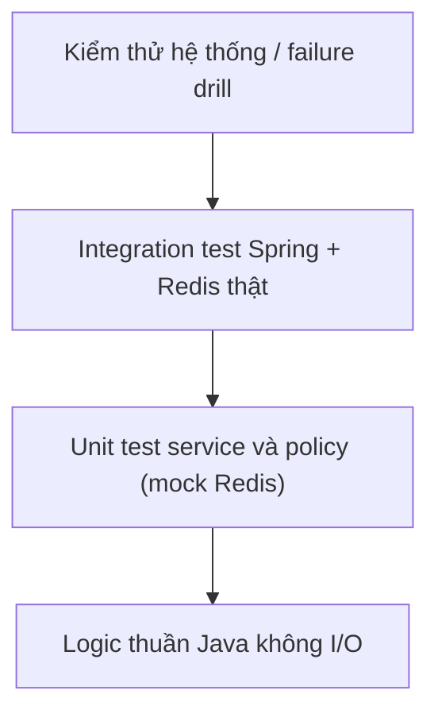
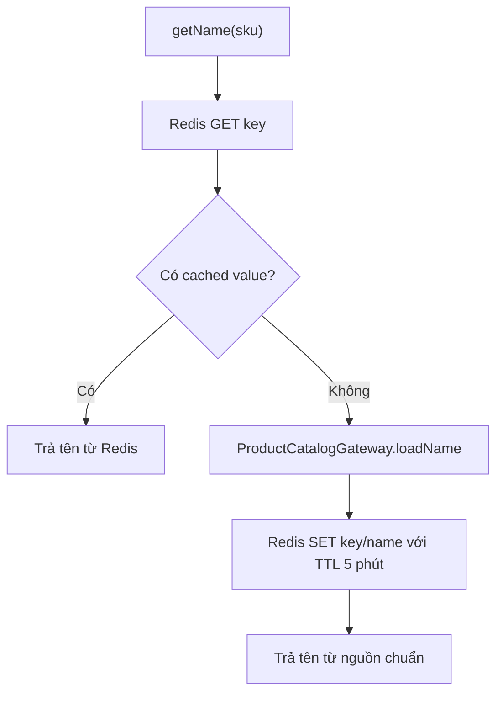

# Phân biệt kiểm thử đơn vị với kiểm thử tích hợp Redis trong Spring Data Redis

## 1. Mục tiêu của bài học

Một ứng dụng Spring Boot sử dụng Spring Data Redis có thể chứa rất ít mã liên quan đến Redis nhưng vẫn phụ thuộc vào nhiều hành vi thực tế: key được serialize ra sao, TTL được thiết lập đúng không, một Lua script có thực thi nguyên tử không, Redis Repository có duy trì secondary index không, hoặc một consumer Stream có đọc/ack đúng quy trình không.

Vì vậy, câu hỏi **“đã có test cho service dùng Redis chưa?”** chưa đủ. Cần biết test đó đang kiểm tra **logic Java với Redis giả lập** hay đang kiểm tra **tích hợp với một Redis server thật**.

Hai cấp độ quan trọng:

- **Kiểm thử đơn vị (unit test):** kiểm tra hành vi của một đơn vị mã, thường thay Redis hoặc lớp giao tiếp Redis bằng mock/stub/fake. Test nhanh, cô lập và kiểm tra được nhiều nhánh nghiệp vụ; nhưng không chứng minh Redis thực tế sẽ hoạt động đúng.
- **Kiểm thử tích hợp (integration test):** dùng một Redis server thật, thường chạy bằng Testcontainers hoặc môi trường thử nghiệm chuyên dụng, để kiểm tra lệnh, serializer, keyspace, TTL, transaction, repository và vòng đời kết nối theo hành vi Redis. Test cung cấp độ tin cậy cao hơn về tích hợp, đổi lại cần tài nguyên và quản lý môi trường.

Mục tiêu không phải chọn một loại để thay loại còn lại. Thiết kế tốt thường cần **nhiều unit test cho logic** và **integration test có chọn lọc cho hợp đồng Redis**.

Sau bài học, bạn có thể:

1. Xác định một test là unit hay integration theo **ranh giới hệ thống được thực thi thật**.
2. Dùng JUnit 5 và Mockito để test một service có `StringRedisTemplate` mà không cần Redis.
3. Dùng Spring Boot, JUnit 5 và Testcontainers để kiểm tra Redis thật.
4. Biết hành vi nào mock không thể xác nhận: TTL, serializer, transaction, Lua, secondary index, Streams, Pub/Sub, failover.
5. Thiết kế test có trạng thái độc lập, không gây dữ liệu rác và ít lỗi ngẫu nhiên.
6. Phân bổ test vào pipeline CI và xác định cách đọc kết quả khi chúng thất bại.

---

## 2. Định nghĩa unit test trong ngữ cảnh Spring Data Redis

Một **unit test** xác minh logic của một đơn vị cụ thể, chẳng hạn `ProductCacheService`, mà không khởi chạy toàn bộ hạ tầng phụ thuộc.

Ví dụ service cache-aside:

```text
ProductService
   |
   +--> Redis cache
   |
   +--> ProductCatalog (nguồn dữ liệu chuẩn)
```

Khi unit test `ProductService`, có thể thay cả Redis cache và ProductCatalog bằng mock. Test chỉ kiểm tra quyết định của service:

- Cache hit → dùng giá trị từ cache, không gọi nguồn dữ liệu.
- Cache miss → đọc nguồn chuẩn rồi yêu cầu ghi cache với TTL mong muốn.
- Nguồn dữ liệu lỗi → ném lỗi hoặc trả fallback theo chính sách.
- Redis có lỗi → xử lý fail-open/fail-closed theo quy tắc được định nghĩa.

Unit test không cần khởi động Redis, mở socket hay chạy Docker. Phần lớn test cũng không cần dựng `ApplicationContext` của Spring nếu các dependency được truyền qua constructor.

### Một định nghĩa thực dụng

Một test có `@SpringBootTest` nhưng mock toàn bộ Redis có thể đang kiểm tra Spring wiring hoặc tầng HTTP, **chưa chắc là integration test với Redis**. Ngược lại, một test không khởi động Spring nhưng dùng Redis thật qua một client cũng đã là integration test tại ranh giới Redis.

Vì thế, không phân loại chỉ dựa trên tên annotation. Hỏi: **Redis server và cơ chế giao tiếp thật có đang được sử dụng không?**

## 3. Định nghĩa integration test với Redis

Một **Redis integration test** thực hiện thao tác lên Redis server thật và xác minh kết quả quan sát được ở ranh giới tích hợp.

Ví dụ:

```text
JUnit test
  |
  v
Spring Boot / RedisTemplate
  |
  v
RedisConnectionFactory + Redis driver
  |
  v
Redis server (container)
  |
  v
Trạng thái key/TTL/hash/stream thực tế
```

Test có thể phát hiện những lỗi unit test không nhìn thấy:

- Serializer dùng JDK serialization trong khi hệ thống mong JSON.
- Prefix key bị ghép sai với `RedisCacheManager`.
- TTL không được đặt, bị đặt lại hoặc hết hạn khác dự kiến.
- Lua script sai cú pháp hay gọi sai lệnh Redis.
- Lỗi `WRONGTYPE` khi nhiều component dùng chung key với kiểu dữ liệu khác nhau.
- `@Indexed` chưa được lập chỉ mục đúng do cấu hình Redis Repository.
- `MULTI/EXEC`, pipelining hoặc Redis Stream consumer group bị dùng sai.
- Quyền Redis ACL, cấu hình Pub/Sub hoặc môi trường Cluster không đáp ứng tính năng sử dụng.

Integration test vẫn không đồng nghĩa với kiểm thử khả năng chịu tải, failover hoặc RPO/RTO toàn bộ deployment. Một Redis container đơn node không thể chứng minh hành vi của Sentinel/Cluster nhiều node.

---

## 4. So sánh theo các tiêu chí chính

| Tiêu chí | Unit test | Integration test với Redis |
|---|---|---|
| Redis server thật | Không cần | Có |
| Spring ApplicationContext | Thường không | Có thể có hoặc không, tùy ranh giới |
| Tốc độ chạy | Thường rất nhanh | Thường chậm hơn, có khởi tạo kết nối/container |
| Phụ thuộc Docker/network | Không | Có, nếu dùng Testcontainers/Docker |
| Kiểm tra business branching | Rất phù hợp | Có thể nhưng tốn kém hơn |
| Kiểm tra lệnh Redis thật | Không | Có |
| Kiểm tra serialize/deserialize | Chỉ nếu dùng serializer thật trong unit | Có, với luồng Redis thực tế |
| Kiểm tra TTL thực tế | Không | Có |
| Kiểm tra Lua script | Chỉ có thể kiểm tra lời gọi/mapping | Chạy script trên Redis thật |
| Kiểm tra Repository/index | Mock không đủ | Có thể xác minh |
| Kiểm tra timeout/failover | Có thể giả lập exception | Cần môi trường và kịch bản tích hợp phù hợp |
| Nguy cơ test flakiness | Thường thấp | Cao hơn nếu lệ thuộc thời gian, môi trường, dữ liệu chung |
| Khả năng chẩn đoán lỗi | Tập trung vào một đơn vị | Bao gồm Spring wiring, driver, Redis server, cấu hình |
| Vị trí phù hợp trong CI | Chạy thường xuyên ở mọi thay đổi | Chạy ở CI có môi trường thích hợp và quản lý thời gian |

**Cần cả hai:** unit test trả lời “mã của tôi sẽ quyết định thế nào nếu Redis trả X?”, integration test trả lời “Redis thật cùng cấu hình của tôi có trả X và lưu trạng thái đúng như dự kiến không?”.

## 5. Vị trí trong chiến lược kiểm thử nhiều tầng

Có thể tổ chức một mô hình thực dụng:



Phần nền gồm nhiều test nhanh cho mapping, policy, xử lý null/exception và các trường hợp biên. Phần tích hợp ít hơn nhưng đánh đúng những hợp đồng có nguy cơ vỡ khi thay Redis version, thay serializer, đổi cấu hình Spring hoặc thay cách lưu key.

Mỗi lớp có vai trò riêng:

| Lớp | Ví dụ |
|---|---|
| Pure unit | Hàm tạo key namespace, tính thời gian retry, chọn fail-open/fail-closed |
| Unit với Mockito | Cache hit/miss, phương thức nguồn được gọi đúng lần, lệnh SET có TTL đúng |
| Redis integration | Key được tạo thật, TTL dương, hash/index đúng, Lua trả kết quả và cập nhật state |
| Spring integration | Bean `RedisCacheManager` được dùng, annotation `@CacheEvict` thực sự xóa entry |
| System/resilience test | Redis restart, mất kết nối, replica failover, hiệu năng sau cache cold start |

Đừng yêu cầu tất cả kịch bản nghiệp vụ đều chạy với Redis thật. Cũng đừng chỉ dùng Mockito cho những tính năng hoàn toàn phụ thuộc semantics của Redis server.

---

## 6. Chuẩn bị ví dụ: một service dùng cache-aside

Giả sử ứng dụng có một nguồn dữ liệu chuẩn cung cấp tên sản phẩm:

**`ProductCatalogGateway.java`**

```java
package com.example.catalog;

public interface ProductCatalogGateway {
    String loadName(String sku);
}
```

Đây là interface của ứng dụng, **không phải class có sẵn của Spring Data Redis**.

Service dùng Redis làm cache:

**`ProductNameService.java`**

```java
package com.example.catalog;

import java.time.Duration;

import org.springframework.data.redis.core.StringRedisTemplate;
import org.springframework.stereotype.Service;

@Service
public class ProductNameService {

    private static final Duration CACHE_TTL =
            Duration.ofMinutes(5);

    private final StringRedisTemplate redis;
    private final ProductCatalogGateway catalog;

    public ProductNameService(
            StringRedisTemplate redis,
            ProductCatalogGateway catalog
    ) {
        this.redis = redis;
        this.catalog = catalog;
    }

    public String getName(String sku) {
        String key = "catalog:v1:name:" + sku;

        String cached = redis.opsForValue().get(key);
        if (cached != null) {
            return cached;
        }

        String name = catalog.loadName(sku);
        redis.opsForValue().set(key, name, CACHE_TTL);

        return name;
    }
}
```

Ví dụ giả định `catalog.loadName(...)` trả một chuỗi không null hoặc báo lỗi nếu sản phẩm không tồn tại. Nếu sản phẩm có thể thiếu, service thật cần quy định xử lý not-found và tránh ghi null với `StringRedisTemplate`.

Luồng điều khiển:



Trong unit test ta xác minh các nhánh này. Trong integration test ta xác minh Redis thật lưu và hết hạn key như thế nào.

## 7. Viết unit test bằng Mockito và JUnit 5

Với Gradle trên Spring Boot:

```kotlin
dependencies {
    implementation("org.springframework.boot:spring-boot-starter-data-redis")
    testImplementation("org.springframework.boot:spring-boot-starter-test")
}

tasks.test {
    useJUnitPlatform()
}
```

`spring-boot-starter-test` thường cung cấp JUnit Jupiter, AssertJ và Mockito theo BOM của Spring Boot.

### 7.1. Mock những dependency cần thiết

**`ProductNameServiceTest.java`**

```java
package com.example.catalog;

import static org.assertj.core.api.Assertions.assertThat;
import static org.mockito.Mockito.never;
import static org.mockito.Mockito.verify;
import static org.mockito.Mockito.verifyNoInteractions;
import static org.mockito.Mockito.when;

import java.time.Duration;

import org.junit.jupiter.api.Test;
import org.junit.jupiter.api.extension.ExtendWith;
import org.mockito.InjectMocks;
import org.mockito.Mock;
import org.mockito.junit.jupiter.MockitoExtension;
import org.springframework.data.redis.core.StringRedisTemplate;
import org.springframework.data.redis.core.ValueOperations;

@ExtendWith(MockitoExtension.class)
class ProductNameServiceTest {

    @Mock
    StringRedisTemplate redis;

    @Mock
    ValueOperations<String, String> values;

    @Mock
    ProductCatalogGateway catalog;

    @InjectMocks
    ProductNameService service;

    @Test
    void cacheHitSkipsDatabase() {
        when(redis.opsForValue()).thenReturn(values);
        when(values.get("catalog:v1:name:SKU-1001"))
                .thenReturn("Bút máy");

        String name = service.getName("SKU-1001");

        assertThat(name).isEqualTo("Bút máy");
        verifyNoInteractions(catalog);
        verify(values, never()).set(
                "catalog:v1:name:SKU-1001",
                "Bút máy",
                Duration.ofMinutes(5)
        );
    }

    @Test
    void cacheMissLoadsSourceAndCachesWithTtl() {
        when(redis.opsForValue()).thenReturn(values);
        when(values.get("catalog:v1:name:SKU-1002"))
                .thenReturn(null);
        when(catalog.loadName("SKU-1002"))
                .thenReturn("Sổ tay");

        String name = service.getName("SKU-1002");

        assertThat(name).isEqualTo("Sổ tay");
        verify(catalog).loadName("SKU-1002");
        verify(values).set(
                "catalog:v1:name:SKU-1002",
                "Sổ tay",
                Duration.ofMinutes(5)
        );
    }
}
```

Mỗi test đang chứng minh điều gì?

- `cacheHitSkipsDatabase`: business logic không truy vấn nguồn chuẩn khi cache có dữ liệu.
- `cacheMissLoadsSourceAndCachesWithTtl`: logic gọi nguồn chuẩn và **yêu cầu** ghi cache với TTL 5 phút.

Mỗi test **chưa chứng minh** Redis thật lưu key với TTL đó. Mockito chỉ ghi nhận lời gọi method `set(key, value, Duration)`.

### 7.2. Kiểm tra lỗi nguồn chính

Một unit test có thể xác minh không ghi cache khi nguồn chính thất bại:

```java
import static org.assertj.core.api.Assertions.assertThatThrownBy;
import static org.mockito.Mockito.verifyNoInteractions;
import static org.mockito.Mockito.when;

// Trong cùng class ProductNameServiceTest
@Test
void sourceFailureDoesNotPopulateCache() {
    when(redis.opsForValue()).thenReturn(values);
    when(values.get("catalog:v1:name:SKU-X"))
            .thenReturn(null);
    when(catalog.loadName("SKU-X"))
            .thenThrow(new IllegalStateException("Catalog unavailable"));

    assertThatThrownBy(() -> service.getName("SKU-X"))
            .isInstanceOf(IllegalStateException.class);

    // Ở test này muốn kiểm tra không có lệnh ghi;
    // cần verify trên mock ValueOperations, không phải Redis server.
    org.mockito.Mockito.verify(
            values,
            org.mockito.Mockito.never()
    ).set(
            org.mockito.ArgumentMatchers.anyString(),
            org.mockito.ArgumentMatchers.anyString(),
            org.mockito.ArgumentMatchers.any(Duration.class)
    );
}
```

Vì service dùng Redis và source dưới dạng dependency truyền qua constructor, test không cần `@SpringBootTest`. Đây là ưu điểm lớn của thiết kế **dependency injection rõ ràng**.

### 7.3. Mockito kiểm tra lời gọi, không kiểm tra Redis semantics

Nếu developer đổi service thành:

```java
redis.opsForValue().set(key, name, Duration.ofMinutes(5));
```

Mockito có thể xác minh chính xác đối số. Nhưng nếu Redis đang cấu hình serializer khác, key trùng namespace với một hash, hoặc lệnh lỗi trên server, unit test không phát hiện.

Tương tự, mock `RedisTemplate` không tự hiểu `MULTI/EXEC`, Redis transaction, cluster hash slot, TTL countdown hoặc keyspace notifications.

---

## 8. Unit test chính sách lỗi Redis

Giả sử nghiệp vụ quyết định:

- Redis cache đọc lỗi có thể fallback sang nguồn chuẩn.
- Nguồn chuẩn lỗi thì không bịa ra dữ liệu.
- Redis cache ghi lỗi nhưng kết quả nguồn chuẩn hợp lệ thì vẫn được trả về.

Dùng một service khác có xử lý lỗi được định nghĩa rõ:

**`ResilientProductNameService.java`**

```java
package com.example.catalog;

import java.time.Duration;

import org.springframework.dao.DataAccessException;
import org.springframework.data.redis.core.StringRedisTemplate;

public class ResilientProductNameService {

    private final StringRedisTemplate redis;
    private final ProductCatalogGateway catalog;

    public ResilientProductNameService(
            StringRedisTemplate redis,
            ProductCatalogGateway catalog
    ) {
        this.redis = redis;
        this.catalog = catalog;
    }

    public String getName(String sku) {
        String key = "catalog:v1:name:" + sku;

        try {
            String cached = redis.opsForValue().get(key);
            if (cached != null) {
                return cached;
            }
        } catch (DataAccessException ex) {
            // Redis là cache tùy chọn nên có thể bỏ qua lỗi đọc.
            // Ứng dụng thực cần metrics và logging phù hợp.
        }

        String name = catalog.loadName(sku);

        try {
            redis.opsForValue().set(
                    key,
                    name,
                    Duration.ofMinutes(5)
            );
        } catch (DataAccessException ex) {
            // Nguồn chuẩn vẫn đã trả kết quả hợp lệ.
            // Không được bỏ qua lỗi nguồn dữ liệu chính.
        }

        return name;
    }
}
```

Một test không cần Redis có thể giả lập lỗi:

```java
import static org.assertj.core.api.Assertions.assertThat;
import static org.mockito.Mockito.when;

import org.junit.jupiter.api.Test;
import org.mockito.Mockito;
import org.springframework.dao.DataAccessResourceFailureException;

@Test
void redisReadFailureFallsBackToSource() {
    StringRedisTemplate redis =
            Mockito.mock(StringRedisTemplate.class);

    @SuppressWarnings("unchecked")
    ValueOperations<String, String> values =
            Mockito.mock(ValueOperations.class);

    ProductCatalogGateway catalog =
            Mockito.mock(ProductCatalogGateway.class);

    when(redis.opsForValue()).thenReturn(values);

    when(values.get("catalog:v1:name:SKU-1003"))
            .thenThrow(
                    new DataAccessResourceFailureException(
                            "Redis is unavailable"
                    )
            );

    when(catalog.loadName("SKU-1003"))
            .thenReturn("Giấy ghi chú");

    ResilientProductNameService service =
            new ResilientProductNameService(redis, catalog);

    assertThat(service.getName("SKU-1003"))
            .isEqualTo("Giấy ghi chú");
}
```

Bài test chứng minh **nhánh fallback của service hoạt động khi dependency báo exception**. Nó không chứng minh Redis thực tế trả đúng loại exception trong mọi lỗi kết nối, hoặc khi Redis mất thì nguồn chuẩn đủ năng lực gánh tải.

### Phân biệt lỗi cache theo thao tác

Đối với `@Cacheable`/`@CacheEvict`, ứng dụng có thể cài `CacheErrorHandler`. Unit test handler riêng để xác minh chính sách:

- Lỗi `get` của cache tùy chọn được phép bỏ qua.
- Lỗi `put` có thể không chặn trả kết quả.
- Lỗi `evict` cần thông báo vì có thể để lại dữ liệu cũ.
- Lỗi `clear` có thể chỉ xóa một phần, không đồng nghĩa đã xóa sạch.

Nếu dùng `CacheErrorHandler`, unit test kiểm tra callback Java, còn integration test xác minh handler được Spring Cache interceptor sử dụng trong bean thực tế.

---

## 9. Khi nào mock Redis là đủ?

Mock phù hợp khi điều cần xác minh là **logic thuộc sở hữu của service**, ví dụ:

| Trường hợp | Kết luận |
|---|---|
| Cache hit không gọi database | Unit test đủ để kiểm tra logic nhánh |
| Cache miss gọi database đúng SKU | Unit test rất phù hợp |
| Đối số TTL gửi vào `set` là 5 phút | Unit test xác minh lời gọi; Redis thực tế cần integration nếu TTL quan trọng |
| Lỗi Redis được fallback đúng chính sách | Unit test giả lập exception |
| Tên key được tạo từ tenant/user/policy đúng quy tắc | Pure unit hoặc unit test với mock |
| Chọn cache nào theo loại yêu cầu | Unit test |
| Quy tắc không cache giá trị null | Unit test cho nhánh code; integration nếu cần kiểm tra serializer/cache manager |
| Số lần gọi service nguồn khi cache hit/miss | Unit test |
| Quy tắc business sau khi Redis cache trả dữ liệu | Unit test |
| Trả `429` khi rate limiter quyết định từ chối | Unit test của controller/filter |

Những vấn đề có thể test bằng mock không nhất thiết cần một Redis server ở mỗi test, vì làm vậy tăng thời gian và làm khó phân tích lỗi khi test thất bại.

Nhưng **số lượng unit test không bù được một hợp đồng Redis chưa được kiểm chứng**.

---

## 10. Khi nào phải dùng integration test với Redis thật?

| Hành vi cần bảo đảm | Vì sao mock không đủ |
|---|---|
| `SET` với TTL / `EXPIRE` / `PTTL` | Thời gian sống và semantics thực tế do Redis server thực hiện |
| Serializer của key/value/hash | Mock không đi qua bytes thật và conversion trên network |
| Redis Hash, Set, ZSET và kiểu dữ liệu | Mock không xác minh `WRONGTYPE` hoặc lệnh Redis cụ thể |
| Lua script và Redis Function | Cần parser/runtime Redis, nguyên tử và trạng thái thật |
| `MULTI/EXEC` và return value queued | Mock không biết transaction boundary của connection |
| Spring Cache annotation + `RedisCacheManager` | Cần Spring interceptor, cache manager và Redis writer thật |
| Redis Repository `@Indexed` | Cần hành vi ghi/xóa index và truy vấn thật |
| Redis Stream offset, pending/ack | Cần Redis Stream semantics |
| Redis Pub/Sub notification | Cần subscribe/channel thật và cấu hình server |
| Redis Cluster hash slot và routing | Cần topology phù hợp |
| Tương thích driver/version Redis | Cần chạy với Redis/driver mục tiêu |

Không nên cố viết một fake Redis tự cài mọi semantics trên. Khi fake ngày càng giống Redis, bạn đã phải bảo trì một Redis thứ hai nhưng vẫn không chắc nó tương thích server thật.

---

## 11. Tạo Redis thật cho integration test bằng Testcontainers

**Testcontainers** cho phép tạo container Redis trong vòng đời test, với dữ liệu tương đối cô lập và có thể sử dụng trong CI. Nó cần Docker hoặc runtime container tương thích mà môi trường chạy test có quyền truy cập.

Ví dụ dùng:

- JUnit Jupiter.
- Spring Boot test.
- Testcontainers.
- Redis image được lựa chọn cho bộ phiên bản dự án.

### 11.1. Dependency Gradle

```kotlin
dependencies {
    implementation("org.springframework.boot:spring-boot-starter-data-redis")

    testImplementation("org.springframework.boot:spring-boot-starter-test")
    testImplementation("org.testcontainers:junit-jupiter")
    testImplementation("org.testcontainers:testcontainers")
}

tasks.test {
    useJUnitPlatform()
}
```

Nếu đang dùng Spring Boot BOM hoặc dependency management của dự án, phiên bản starter/test được quản lý theo bộ dependency tương ứng. Nếu không có BOM quản lý Testcontainers, cần khai báo phiên bản tương thích trong build thay vì để dependency không có version.

### 11.2. Dependency Maven

```xml
<dependencies>
    <dependency>
        <groupId>org.springframework.boot</groupId>
        <artifactId>spring-boot-starter-data-redis</artifactId>
    </dependency>

    <dependency>
        <groupId>org.springframework.boot</groupId>
        <artifactId>spring-boot-starter-test</artifactId>
        <scope>test</scope>
    </dependency>

    <dependency>
        <groupId>org.testcontainers</groupId>
        <artifactId>junit-jupiter</artifactId>
        <scope>test</scope>
    </dependency>
</dependencies>
```

Ví dụ Maven giả định dự án đã quản lý phiên bản dependency; trong hệ thống thật, thêm version/BOM phù hợp và tránh kéo nhiều version Testcontainers xung đột.

### 11.3. Vì sao dùng cổng động?

Nếu hai job CI cùng chạy Redis trên cổng host 6379, chúng có thể tranh cổng và gây test fail ngẫu nhiên. Testcontainers có thể map cổng container `6379` sang **một cổng host ngẫu nhiên**:

```text
Redis container port: 6379
Host mapped port    : 49153 (ví dụ)
```

Test phải lấy cổng từ `getMappedPort(6379)` thay vì hard-code `localhost:6379`.

### 11.4. Ví dụ integration test hoàn chỉnh

**`RedisStringIntegrationTest.java`**

```java
package com.example.catalog;

import static org.assertj.core.api.Assertions.assertThat;

import java.time.Duration;
import java.util.UUID;
import java.util.concurrent.TimeUnit;

import org.junit.jupiter.api.BeforeEach;
import org.junit.jupiter.api.Test;
import org.springframework.beans.factory.annotation.Autowired;
import org.springframework.boot.SpringBootConfiguration;
import org.springframework.boot.autoconfigure.EnableAutoConfiguration;
import org.springframework.boot.test.context.SpringBootTest;
import org.springframework.data.redis.core.StringRedisTemplate;
import org.springframework.test.context.DynamicPropertyRegistry;
import org.springframework.test.context.DynamicPropertySource;
import org.testcontainers.containers.GenericContainer;
import org.testcontainers.junit.jupiter.Container;
import org.testcontainers.junit.jupiter.Testcontainers;
import org.testcontainers.utility.DockerImageName;

@Testcontainers
@SpringBootTest(
        classes = RedisStringIntegrationTest.TestApplication.class
)
class RedisStringIntegrationTest {

    private static final int REDIS_PORT = 6379;

    @Container
    static final GenericContainer<?> REDIS =
            new GenericContainer<>(
                    DockerImageName.parse("redis:7.4-alpine")
            ).withExposedPorts(REDIS_PORT);

    @DynamicPropertySource
    static void redisProperties(DynamicPropertyRegistry registry) {
        registry.add(
                "spring.data.redis.host",
                REDIS::getHost
        );
        registry.add(
                "spring.data.redis.port",
                () -> REDIS.getMappedPort(REDIS_PORT)
        );
    }

    @SpringBootConfiguration
    @EnableAutoConfiguration
    static class TestApplication {
    }

    @Autowired
    StringRedisTemplate redis;

    private String key;

    @BeforeEach
    void createIsolatedKey() {
        key = "it:product-name:" + UUID.randomUUID();
    }

    @Test
    void writesReadsAndDeletesRealRedisKey() {
        redis.opsForValue().set(key, "Bút máy");

        assertThat(redis.opsForValue().get(key))
                .isEqualTo("Bút máy");

        assertThat(redis.hasKey(key))
                .isTrue();

        redis.delete(key);

        assertThat(redis.opsForValue().get(key))
                .isNull();
    }

    @Test
    void setsActualRedisTtl() {
        redis.opsForValue().set(
                key,
                "Sổ tay",
                Duration.ofSeconds(30)
        );

        Long ttl = redis.getExpire(key, TimeUnit.SECONDS);

        assertThat(ttl)
                .isNotNull()
                .isPositive()
                .isLessThanOrEqualTo(30L);

        redis.delete(key);
    }
}
```

Điểm quan trọng:

- `@Testcontainers` và `@Container` quản lý vòng đời container.
- `@DynamicPropertySource` truyền host và cổng thực tế vào cấu hình Spring Boot.
- `@SpringBootTest` khởi tạo bean Spring Data Redis thông qua auto-configuration.
- `StringRedisTemplate` thực sự gửi lệnh tới Redis.
- UUID trong tên key giúp giảm xung đột giữa các test.
- Khi kiểm tra TTL, ta xác minh Redis có đặt thời hạn và TTL đang dương; không chờ đúng 30 giây để chứng minh điều đó.

**Cách chạy ví dụ:** ứng dụng dùng Spring Boot 3.x, JUnit 5 và Java phù hợp với phiên bản Spring Boot đã chọn; Docker phải khả dụng. Tên image/version trong ví dụ là một lựa chọn mẫu: dự án nên cố định và quản lý version Redis theo ma trận tương thích của hệ thống.

### 11.5. Không cần @SpringBootTest cho mọi integration test

Có thể kiểm tra Redis thật bằng một `LettuceConnectionFactory` hoặc client Redis được tạo trong test mà không khởi động Spring Boot. Đó vẫn là integration test đối với Redis, nhưng chưa kiểm tra wiring Spring.

Ngược lại, `@SpringBootTest` chạy được nhưng mock toàn bộ `StringRedisTemplate` chỉ chứng minh wiring và logic ứng dụng, **không kiểm tra lệnh Redis server**.

Chọn ranh giới tối thiểu cần xác minh thay vì luôn khởi tạo toàn bộ hệ thống.

---

## 12. Kiểm thử serializer: tình huống mock dễ bỏ sót

Redis lưu bytes, không lưu trực tiếp object Java. `RedisTemplate<K,V>` phải serialize key/value trước khi gửi và deserialize sau khi đọc.

Ví dụ một ứng dụng cấu hình RedisTemplate để lưu JSON. Khi đổi serializer từ chuỗi sang JDK serialization hoặc dùng hai service khác format, key có thể không còn tương thích.

Một unit test mock:

```java
when(redis.opsForValue().get("user:1"))
        .thenReturn(new UserView(...));
```

không đi qua serializer. Nó không phát hiện:

- Trường JSON bị đổi tên hoặc bị bỏ.
- Object cần constructor/mapping nhưng serializer không hỗ trợ.
- Key serializer khác khiến hai service tạo key bytes khác nhau.
- Một value cũ không thể đọc sau khi deployment mới chạy.
- Trường ngày giờ, enum, null hay polymorphic type không tương thích.

### Cách integration test serialization

1. Dựng **đúng RedisTemplate bean** mà ứng dụng sử dụng.
2. Ghi một object mẫu lên Redis thật.
3. Đọc lại bằng cùng template.
4. Xác minh các trường cần giữ.
5. Nếu hệ thống có nhiều service/version, đọc bằng template/version khác cần hỗ trợ.
6. Nếu cần contract của dữ liệu trên Redis, xem trực tiếp bytes/value qua serializer phù hợp.

Với dữ liệu phục vụ nhiều ứng dụng, cần test **format ổn định** chứ không chỉ test vòng ghi/đọc bằng cùng một serializer. Hai lỗi đối xứng của serializer đôi khi vẫn cho kết quả round-trip hợp lệ nhưng không đáp ứng hợp đồng liên dịch vụ.

---

## 13. Kiểm thử TTL: xác nhận hành vi thật, tránh test theo đồng hồ mong manh

TTL rất dễ test sai.

### Cách kiểm tra TTL ban đầu

Khi ghi với `Duration.ofSeconds(30)`, nên xác minh:

```java
Long ttlMs = redis.getExpire(
        key,
        TimeUnit.MILLISECONDS
);

assertThat(ttlMs)
        .isNotNull()
        .isGreaterThan(0L)
        .isLessThanOrEqualTo(30_000L);
```

Redis `TTL`/`PTTL` có các giá trị đặc biệt:

- `-2`: key không tồn tại.
- `-1`: key tồn tại nhưng không có expiration.
- Giá trị không âm: TTL còn lại, theo đơn vị của lệnh.

Không viết assertion `ttl == 30_000` một cách cứng nhắc; một khoảng thời gian đã trôi qua giữa lệnh SET và lệnh đọc TTL.

### Test key thực sự hết hạn

Nếu cần kiểm tra expiration, đặt TTL ngắn và dùng cơ chế polling có timeout giới hạn:

```java
redis.opsForValue().set(
        key,
        "temporary",
        Duration.ofSeconds(1)
);

// Ví dụ với Awaitility (nếu test dependency có thư viện này):
org.awaitility.Awaitility.await()
        .atMost(Duration.ofSeconds(5))
        .untilAsserted(() ->
                assertThat(redis.hasKey(key)).isFalse()
        );
```

Điều kiện này kiểm tra **trạng thái key**, không đòi keyspace notification phải xuất hiện đúng tại giây thứ nhất.

Để sử dụng Awaitility phải có dependency phù hợp trong test runtime. Nếu không dùng thư viện này, có thể viết polling giới hạn thời gian bằng JUnit/helper riêng.

### Vì sao không dùng Thread.sleep cứng?

`Thread.sleep(1000)` sau khi đặt TTL 1 giây vừa chậm, vừa có thể tạo test flakiness do lập lịch thread, GC, tải CI và độ trễ lệnh. Polling với deadline và assertion trạng thái thường ổn định hơn.

TTL cần được kiểm tra với Redis thật khi thời gian sống ảnh hưởng nghiệp vụ như session, cache invalidation, lock hay rate limiter.

---

## 14. Kiểm thử Spring Cache annotation với Redis thật

Ứng dụng dùng:

```java
@Cacheable(cacheNames = "products", key = "#p0")
public ProductView get(String sku) {
    return productGateway.load(sku);
}
```

Một unit test gọi trực tiếp method `get` sẽ **không kiểm tra interception** của `@Cacheable`. Caching annotation thường được kích hoạt khi lời gọi đi qua Spring proxy.

Vì vậy, để kiểm tra caching annotation thật cần một integration test có:

1. `@EnableCaching`.
2. CacheManager thực tế, ví dụ `RedisCacheManager`.
3. Service dưới dạng Spring bean được gọi qua proxy.
4. Redis server thật hoặc backend cache thật phù hợp với mục tiêu.
5. Source giả lập có bộ đếm để xác minh số lần gọi, nếu không muốn phụ thuộc database.

### Luồng test kỳ vọng

```text
Lần gọi 1: get("SKU-1")
    Redis miss
    ProductGateway.load("SKU-1") được gọi
    Redis nhận cache entry

Lần gọi 2: get("SKU-1")
    Redis hit
    ProductGateway không bị gọi thêm

Evict cache key "SKU-1"
    Redis key bị xóa

Lần gọi 3: get("SKU-1")
    Redis miss
    ProductGateway được gọi lần nữa
```

Ví dụ các assertion:

```java
ProductView first = service.get("SKU-1");
ProductView second = service.get("SKU-1");

assertThat(second).isEqualTo(first);
verify(productGateway, times(1)).load("SKU-1");

service.evict("SKU-1"); // Phải là lời gọi qua Spring proxy.
service.get("SKU-1");

verify(productGateway, times(2)).load("SKU-1");
```

Đoạn test này minh họa ý tưởng; cần có bean service/`ProductGateway` được cấu hình đúng và phương thức `evict` thực sự dùng `@CacheEvict`.

### Lỗi thường gặp trong Spring Cache test

- Gọi `this.get(...)` từ cùng bean, khiến proxy caching bị bỏ qua.
- Test trực tiếp object tạo bằng `new` mà không thông qua Spring.
- Ứng dụng có nhiều CacheManager nhưng test chọn manager khác production.
- Dùng mock cache thay vì Redis thật rồi kết luận prefix/TTL đã đúng.
- Hai test sử dụng chung cache name/key khiến test phụ thuộc thứ tự chạy.
- Cache giữ dữ liệu cũ từ lần chạy trước nếu trỏ nhầm tới Redis ngoài môi trường test.

Kiểm thử annotation thuộc ranh giới **Spring AOP + CacheManager + Redis**; đó là một hợp đồng integration quan trọng.

---

## 15. Kiểm thử Redis Repository và secondary index

Khi dùng Redis Repository:

```java
@RedisHash("accounts")
public class Account {

    @Id
    private String id;

    @Indexed
    private String status;

    // Constructors, getters, setters...
}
```

và:

```java
public interface AccountRepository
        extends CrudRepository<Account, String> {

    Iterable<Account> findByStatus(String status);
}
```

Unit test có thể mock `AccountRepository`:

```java
when(repository.findByStatus("ACTIVE"))
        .thenReturn(List.of(account));
```

Đây là test hợp lý nếu muốn xác minh service xử lý kết quả repository. Nhưng nó **không chứng minh** repository Redis thực sự tạo secondary index cho `status`.

Integration test phù hợp hơn:

1. Lưu entity với `status="ACTIVE"`.
2. Truy vấn `findByStatus("ACTIVE")` → thấy entity.
3. Đổi trạng thái sang `"SUSPENDED"` rồi `save`.
4. Truy vấn lại `"ACTIVE"` → không còn entity.
5. Truy vấn `"SUSPENDED"` → thấy entity.
6. Xóa entity qua repository.
7. Xác minh các truy vấn index không còn trả entity.

Các bước cần chạy với Redis server thật, serializer và repository configuration phù hợp. Nếu entity có TTL, cần cân nhắc event expiration và cleanup index; test TTL có thể có thời gian chờ bất định.

**Lưu ý:** Redis Repository không có cùng mô hình truy vấn như JPA/SQL. Không tự suy ra mọi method derived query được hỗ trợ như `JpaRepository`. Chỉ kiểm tra các query/index thực sự do Spring Data Redis Repository hỗ trợ.

---

## 16. Kiểm thử Redis transaction và Lua script

### 16.1. Unit test không chứng minh atomicity

Giả sử service dùng `RedisTemplate` gửi:

```java
redis.opsForValue().set("a", "1");
redis.opsForValue().set("b", "2");
```

Một Mockito test có thể `verify` cả hai lời gọi, nhưng không chứng minh rằng **không client khác chen giữa**, không chứng minh `MULTI/EXEC` và không kiểm tra Redis sẽ phản hồi thế nào khi một lệnh trong transaction gặp lỗi.

Khi dùng `setEnableTransactionSupport(true)` và `@Transactional`, integration test cần có:

- Transaction manager phù hợp.
- Spring transaction thực sự hoạt động qua interceptor.
- Template đã bật transaction support.
- Redis server thật.
- Quan sát trước commit/sau commit, rollback và giới hạn đọc trong transaction.

Không nhầm `@Transactional` với cam kết Redis và SQL commit nguyên tử.

### 16.2. Lua script cần chạy trên Redis thật

Ví dụ script tăng bộ đếm có điều kiện:

```lua
local current = tonumber(redis.call('GET', KEYS[1]) or '0')
local limit = tonumber(ARGV[1])

if current >= limit then
    return 0
end

redis.call('INCR', KEYS[1])
return 1
```

Trong Java, có thể dùng `DefaultRedisScript<Long>`:

```java
DefaultRedisScript<Long> script = new DefaultRedisScript<>();
script.setScriptText(
        "local n=tonumber(redis.call('GET',KEYS[1]) or '0') " +
        "if n>=tonumber(ARGV[1]) then return 0 end " +
        "redis.call('INCR',KEYS[1]) return 1"
);
script.setResultType(Long.class);

Long result = redis.execute(
        script,
        List.of(testKey),
        "3"
);
```

Integration test nên xác minh:

- Các lượt đầu được chấp nhận cho đến khi đạt limit.
- Lượt tiếp theo bị từ chối.
- Redis counter thật có giá trị mong đợi.
- Nhiều client đồng thời không vượt quá limit.
- Script xử lý key không tồn tại và key có kiểu không phù hợp theo hợp đồng đã thiết kế.

Lua chạy nguyên tử trên Redis không có nghĩa tự rollback các lệnh đã thực thi nếu script lỗi giữa chừng. Test cần bao phủ logic và các ràng buộc của script thay vì chỉ kiểm tra return value với một input.

### 16.3. Unit test cho wrapper quanh script vẫn có giá trị

Trong unit test, mock `redis.execute(...)` để kiểm tra:

- Service chuyển đúng tên key và các argument.
- Kết quả `Long 0/1` được ánh xạ đúng thành `allow/deny`.
- Lỗi Redis được chuyển thành policy HTTP thích hợp.
- Retry/idempotency ở tầng Java được quyết định đúng.

Integration test dùng Redis thật để chứng minh lệnh và state đúng. Hai loại bổ sung cho nhau.

---

## 17. Kiểm thử Redis Streams và Pub/Sub

Một service dùng Redis Streams có thể có logic thuần Java để xử lý event:

```java
public void onOrderEvent(OrderEvent event) {
    // Kiểm tra loại event, validate, cập nhật state...
}
```

Unit test logic xử lý này với event giả lập là hữu ích. Nhưng các semantics của Stream cần test tích hợp:

- `XADD` tạo ID và entry thật.
- `XRANGE`/`XREAD` đọc đúng biên ID.
- `XREAD BLOCK` chờ record mới và kết thúc theo timeout.
- Consumer group nhận entry mới bằng offset phù hợp.
- `XACK` làm thay đổi pending state.
- Consumer bị ngắt vẫn có pending, cần cơ chế reclaim.
- `XTRIM` có thể làm record biến mất theo retention.

### Ví dụ mục tiêu test consumer group

```text
1. XGROUP CREATE stream group 0-0 MKSTREAM.
2. XADD một message.
3. Consumer A XREADGROUP nhận message.
4. XPENDING xác nhận có entry pending.
5. Consumer A XACK message.
6. XPENDING xác nhận entry không còn pending.
```

Tất cả cần Redis server thật để kiểm tra PEL và ACK semantics.

### Pub/Sub khác Stream

Redis Pub/Sub không lưu message để replay khi subscriber vắng mặt. Unit test listener có thể gọi callback thủ công, nhưng không chứng minh:

- Subscription thực sự được thiết lập.
- Pattern topic đúng.
- Kết nối nhận message.
- Message tới đúng channel.
- Lỗi/reconnect trong môi trường thực.

Integration test Pub/Sub nên **đợi cho tới khi subscription sẵn sàng** rồi mới publish, nếu không test có thể mất message do race condition. Dùng synchronization/latch với deadline hữu hạn, tránh `Thread.sleep` tùy ý.

Tuy nhiên, một lần test nhận Pub/Sub thành công không chứng minh đảm bảo delivery bền vững; Pub/Sub về bản chất không replay.

---

## 18. Xác định ranh giới integration test: không phải tất cả cùng lúc

Có nhiều mức integration:

| Ranh giới | Test đang chứng minh |
|---|---|
| Redis client + Redis server | Lệnh/serializer/timeout cơ bản |
| Spring Data Redis template + Redis server | Template mapping và lệnh thật |
| Spring Cache + Redis | Annotation, CacheManager, writer, prefix/TTL |
| Redis Repository + Redis | Entity mapping, index, TTL repository |
| Spring service + Redis + database test | Luồng cache-aside và tương tác nguồn chuẩn |
| Toàn ứng dụng HTTP + Redis + DB | Hành vi end-to-end của API |
| Nhiều Redis node + failover | Khả năng chịu lỗi theo topology |

Không cần dùng toàn stack để chứng minh một trường hợp `SET/GET` cơ bản. Ngược lại, nếu bug nằm ở `@Cacheable` proxy hoặc thứ tự commit Redis/SQL, test chỉ gọi `StringRedisTemplate` sẽ chưa đủ.

**Một integration test tốt có ranh giới rõ:** đủ thật để quan sát điều cần xác minh, nhưng không thêm hạ tầng không liên quan.

---

## 19. Tính cô lập dữ liệu giữa các test

Redis là kho trạng thái có thể tồn tại qua nhiều test. Nếu không cô lập, hai test dễ vô tình phụ thuộc nhau.

Ví dụ không tốt:

```java
@Test
void testA() {
    redis.opsForValue().set("product:1", "A");
}

@Test
void testB() {
    assertThat(redis.opsForValue().get("product:1"))
            .isNull();
}
```

Kết quả test B phụ thuộc việc test A chạy trước hay sau.

### 19.1. Dùng key namespace riêng

Một cách đơn giản:

```java
String testPrefix = "it:" + UUID.randomUUID() + ":";
String key = testPrefix + "product:1";
```

Mỗi test có prefix riêng, tránh ghi đè dữ liệu. Khi test dùng nhiều key, lưu danh sách key đã tạo để xóa ở `@AfterEach`.

### 19.2. Cleanup an toàn

Ví dụ:

```java
private final List<String> createdKeys = new ArrayList<>();

private String nextKey(String suffix) {
    String key = testPrefix + suffix;
    createdKeys.add(key);
    return key;
}

@AfterEach
void cleanup() {
    if (!createdKeys.isEmpty()) {
        redis.delete(createdKeys);
    }
}
```

Nếu cả lớp test dùng một container riêng chỉ phục vụ test đó, có thể đặt chính sách cleanup khác. Nhưng nếu Redis được chia sẻ bởi nhiều test hoặc job, **không chạy `FLUSHALL` tùy tiện** vì nó xóa cả dữ liệu ngoài phạm vi test.

Đặc biệt không để test kết nối nhầm Redis production rồi chạy `FLUSHDB`.

### 19.3. Tránh `KEYS prefix:*` khi không cần

`KEYS` có thể tốn kém trên keyspace lớn. Trong môi trường integration test riêng với dữ liệu nhỏ, chi phí có thể chấp nhận; nhưng thiết kế test tốt thường biết rõ những key đã tạo và xóa trực tiếp.

Nếu cần cleanup theo prefix, cân nhắc `SCAN` với kiểm soát phạm vi; không viết logic dọn phá hủy nhầm key của các test khác.

### 19.4. Dùng database index riêng không phải bảo đảm tuyệt đối

Trên Redis standalone có thể chọn logical DB, ví dụ DB 1 cho test. Nhưng:

- Nhiều test cùng DB vẫn có thể đụng key.
- Redis Cluster chủ yếu dùng DB 0.
- DB index không bảo vệ khỏi `FLUSHALL`.
- Một số cấu hình/managed service có hạn chế.

Vì vậy, **container độc lập hoặc namespace độc lập** thường dễ kiểm soát hơn việc chỉ trông chờ `SELECT 1`.

---

## 20. Vì sao @Transactional không tự rollback trạng thái Redis của test?

Trong test JPA, nhiều nhóm quen với:

```java
@Transactional
@Test
void testSomething() {
    repository.save(entity);
    // Test kết thúc thì transaction rollback.
}
```

Với JPA và transaction manager phù hợp, đây có thể là cách cô lập trạng thái database. Nhưng **không được mặc định tương tự với Redis**.

Redis có những đặc tính:

- `RedisTemplate` mặc định không bật transaction support.
- Redis transaction `MULTI/EXEC` không rollback các lệnh đã thực thi thành công khi một lệnh khác lỗi runtime.
- Spring transaction manager có thể đồng bộ Redis theo vòng đời transaction, nhưng không biến Redis thành JPA database có rollback kiểu SQL.
- Những thao tác Redis thực hiện ngoài phạm vi transaction không tự bị hoàn tác bởi annotation của test.
- Pub/Sub message, lệnh đến service ngoài và event phát đi không tự được thu hồi khi test rollback.

Vì vậy, integration test Redis nên **tự quản lý state và cleanup**, không dựa vào `@Transactional` như cơ chế cô lập duy nhất.

### Với Spring Cache

Nếu integration test gọi một method có `@Cacheable`, cache entry có thể tồn tại sau test dù một database transaction được rollback. Cần xóa key/cache riêng hoặc sử dụng Redis container/namespace riêng.

---

## 21. Kiểm thử có yếu tố thời gian: tránh flaky test

Các tính năng Redis dễ phụ thuộc thời gian:

- TTL và expiration.
- Token bucket/refill.
- Redis Stream blocking read.
- Keyspace notifications.
- Lock expiration.
- Retry/backoff.
- Failover và reconnect.

### Không so sánh thời điểm tuyệt đối quá chặt

Ví dụ không tốt:

```java
redis.opsForValue().set(key, value, Duration.ofSeconds(1));
Thread.sleep(1000);
assertThat(redis.hasKey(key)).isFalse();
```

Việc ngủ đúng 1 giây có thể không đồng bộ với thời điểm Redis nhận lệnh, thread scheduling, GC và network. Thay bằng polling có thời hạn:

```text
Deadline = 5 giây
Trong deadline:
  đọc trạng thái
  nếu đạt điều kiện → test pass
  nếu chưa đạt → thử lại sau khoảng ngắn
Hết deadline → test fail
```

### Không dựa vào keyspace notification để đo thời điểm TTL

Redis phát `expired` khi xử lý expiration, không nhất thiết đúng khoảnh khắc TTL về 0. Test state bằng `EXISTS` khi cần xác minh key hết hạn; chỉ test notification nếu chính yêu cầu của ứng dụng là nhận notification.

### Tách clock trong unit test

Với logic Java tính deadline/quota, inject `Clock` thay vì gọi `System.currentTimeMillis()` trực tiếp:

```java
public class DeadlinePolicy {

    private final Clock clock;

    public DeadlinePolicy(Clock clock) {
        this.clock = clock;
    }

    public boolean expired(Instant expiresAt) {
        return !Instant.now(clock).isBefore(expiresAt);
    }
}
```

Unit test có thể dùng:

```java
Clock fixed = Clock.fixed(
        Instant.parse("2030-01-01T00:00:00Z"),
        ZoneOffset.UTC
);
```

Đây là unit test thuần Java, không cần Redis. Tuy nhiên, nếu Redis server tự tính TTL, một `Clock` giả trong JVM **không thay đổi đồng hồ của Redis**; vẫn cần integration test cho phần TTL thực.

---

## 22. Kiểm thử truy cập đồng thời và tính nguyên tử

Unit test có thể giả lập kết quả lệnh nhưng không thể chứng minh một chuỗi nhiều lệnh không bị race khi chạy trên Redis thật.

Ví dụ một rate limiter:

```text
Quota còn 1 lượt.
Hai request đồng thời kiểm tra.
Chỉ một request được phép đi tiếp.
```

Nếu dùng `GET → if → SET` ở Java, cả hai request có thể đọc cùng state cũ. Nếu chuyển sang Lua script nguyên tử, integration test nên tạo nhiều caller đồng thời và đếm kết quả.

Ý tưởng test:

1. Xóa key limiter riêng của test.
2. Thiết lập quota = 1.
3. Tạo 20 worker bắt đầu gần cùng thời điểm bằng `CountDownLatch`.
4. Mỗi worker gọi script thực.
5. Chờ tất cả kết thúc bằng timeout hữu hạn.
6. Assert chỉ **một** kết quả ALLOW.
7. Assert state cuối cùng của Redis không vượt limit.

Đây là integration/concurrency test; một mock trả `ALLOW` cho một lời gọi và `DENY` cho lời gọi khác chỉ chứng minh mapping kết quả được kiểm tra, không chứng minh atomicity.

### Cẩn trọng với bộ lập lịch CI

Một test concurrency có thể chạy trên máy CI ít CPU hơn môi trường local. Không nên phụ thuộc vào thứ tự thread hoặc một thời gian chờ cực ngắn. Dùng barrier, timeout rộng có giới hạn và kiểm tra **invariant cuối cùng**, không kiểm tra thread nào luôn thắng.

Dù integration test chứng minh một trường hợp cạnh tranh, nó không thay thế stress test hoặc đánh giá khả năng chịu tải trong production.

---

## 23. Khi nào cần môi trường Sentinel hoặc Redis Cluster thật?

Một Redis standalone container phù hợp để xác minh lệnh và mapping cơ bản. Nhưng những tính năng phụ thuộc topology cần môi trường test gần với deployment thật.

Ví dụ:

| Chức năng | Redis standalone đủ không? |
|---|---|
| SET/GET, TTL, serializer | Thường đủ |
| Lua script chỉ tác động một key | Thường đủ |
| Redis Repository cơ bản | Thường đủ |
| Keyspace notifications của một node | Có thể đủ cho semantics cơ bản |
| Cluster hash slot và CROSSSLOT | Không |
| Multi-key script trên các slot khác nhau | Không |
| Sentinel failover | Không |
| Replica promotion và replication lag | Không |
| Pub/Sub theo nhiều node của cluster | Không |
| RPO/RTO xuyên node/zone | Không |

Nếu môi trường production là Redis Cluster, cần ít nhất một nhóm test chạy trên topology Cluster khi thay đổi thao tác đa key, cache clearing, Pub/Sub hoặc Stream nhiều key.

Không nên làm mọi unit test phụ thuộc cluster nhiều node. Các kiểm thử topology có thể chạy trong pipeline riêng hoặc trước release quan trọng, tùy rủi ro.

### Điều cần ghi chú trong báo cáo test

```text
Redis version:
Driver: Lettuce/Jedis + version
Topology: standalone/Sentinel/Cluster
TLS/ACL: enabled/disabled
Persistence: RDB/AOF settings
Data size:
Test scope: unit / Redis integration / failover drill
```

Một test pass trên Redis standalone không phải lời hứa rằng nó pass với Redis Cluster hay một managed service có ACL/cấu hình khác.

---

## 24. Testcontainers và Spring test context: tối ưu thời gian

`@SpringBootTest` có thể tốn thời gian do khởi tạo nhiều bean. Redis container cũng cần thời gian khởi động. Có thể tối ưu mà vẫn giữ test đáng tin:

1. **Unit test không khởi động Spring context** khi không cần kiểm tra wiring.
2. **Integration test dùng một Redis container cho nhóm test phù hợp**, nhưng luôn cô lập key/data.
3. **Tránh tạo container mới cho từng assertion** không cần thiết.
4. **Dùng cấu hình Spring test tối thiểu** để chỉ khởi tạo những bean liên quan Redis.
5. **Không gọi Docker trong mọi module unit test**, tách nhóm integration tests.
6. **Pin Redis image version** cho CI có tính tái lập; nâng phiên bản chủ động theo kế hoạch.
7. **Phân biệt lỗi môi trường với lỗi chức năng** khi Docker/port/network không khả dụng.

### Context caching

Spring Test có thể cache `ApplicationContext` giữa những test có cấu hình tương đồng. Điều này giúp giảm thời gian, nhưng nếu state được đặt trong singleton bean hoặc Redis chung thì test vẫn có thể ảnh hưởng nhau.

Đừng xem context caching như isolation. Dữ liệu Redis phải được làm sạch độc lập với vòng đời context.

### Testcontainers reuse

Một số môi trường hỗ trợ tái sử dụng container để tăng tốc phát triển. Cơ chế reuse cần được quản lý riêng và không nên khiến CI phụ thuộc vào trạng thái còn lại từ lần chạy trước. Trong CI, cách thông dụng là dùng container có vòng đời được quản lý rõ cho job/test suite.

---

## 25. Kiểm thử cấu hình Redis thực tế

Không ít lỗi production đến từ cấu hình chứ không từ code service:

- Spring Boot trỏ nhầm host/port/database.
- Redis yêu cầu password/TLS nhưng test chỉ dùng Redis local không xác thực.
- Serializer bean khác với bean mà service nhận được.
- Có nhiều `RedisTemplate` hoặc `CacheManager` và chọn nhầm.
- Redis Cluster keyspace/slot khác standalone.
- Managed Redis cấm `CONFIG SET`, làm listener khởi động lỗi.
- Timeout cấu hình quá ngắn khi dùng blocking reads.

Unit test bằng Mockito không đi qua bean configuration hoặc connection factory, nên sẽ không phát hiện những lỗi này.

Integration test với Spring context kiểm tra được **phần cấu hình test đang sử dụng**. Tuy nhiên, test container chạy Redis không TLS với password rỗng không chứng minh cấu hình production TLS/ACL sẽ hoạt động. Khi rủi ro cao, cần môi trường staging/compatibility test có cấu hình gần production.

### Không hard-code Redis endpoint của developer

Đừng để test đọc `localhost:6379` từ `application.yml` rồi vô tình trỏ đến một Redis cá nhân đang chạy.

Dùng property injection từ container hoặc profile integration riêng, có assertion bảo vệ rằng endpoint test không phải địa chỉ production. Cấu hình container nên được ưu tiên so với cấu hình môi trường không kiểm soát.

---

## 26. Đặt tên và phân nhóm test

Tên test nên phản ánh **hành vi** và **cấp độ**:

```text
ProductNameServiceTest
  - cacheHitSkipsDatabase
  - cacheMissLoadsSourceAndCachesWithTtl

RedisStringIntegrationTest
  - writesReadsAndDeletesRealRedisKey
  - setsActualRedisTtl

RedisCacheIntegrationTest
  - cacheableUsesConfiguredKeyPrefix
  - evictRemovesRedisEntry

AccountRepositoryIntegrationTest
  - indexedQueryChangesAfterUpdate
  - deleteRemovesEntityFromIndex

RateLimiterConcurrencyIntegrationTest
  - exactlyOneRequestUsesLastAvailableToken
```

Không nhất thiết phải thêm hậu tố `IT` ở mọi dự án, nhưng nên có quy ước để CI phân biệt unit/integration tests.

### Ví dụ tách Gradle test task theo cấu hình dự án

Một dự án có thể dùng source set `integrationTest` riêng hoặc dùng JUnit tags. Với JUnit 5:

```java
import org.junit.jupiter.api.Tag;

@Tag("integration")
class RedisStringIntegrationTest {
    // ...
}
```

Cấu hình Gradle có thể loại tag integration khỏi task unit:

```kotlin
tasks.test {
    useJUnitPlatform {
        excludeTags("integration")
    }
}
```

Để chạy integration tests, dự án cần một task khác được cấu hình bao gồm tag `integration` hoặc một source set riêng. Đừng chỉ exclude tag rồi quên thiết lập job thực sự chạy nhóm integration.

Trong CI có thể tổ chức:

```text
Pull request:
  compile
  unit tests
  Redis integration tests (Testcontainers)
  static analysis

Main/release:
  unit + integration
  contract tests theo dependency versions
  optional Redis Cluster/ACL/TLS compatibility
  performance/resilience theo kế hoạch
```

Phạm vi thực tế tùy thời gian và rủi ro; Redis integration test quan trọng không nên bị loại bỏ hoàn toàn chỉ vì chạy chậm.

---

## 27. Kỹ thuật chọn test khi sửa một tính năng

Một thay đổi có thể cần các cấp test khác nhau.

| Thay đổi | Unit test nên có | Integration test nên có |
|---|---|---|
| Đổi format key từ `user:<id>` sang `app:v2:user:<id>` | Tạo key đúng quy tắc | Redis key/serializer tương thích, không đụng namespace |
| Thêm TTL cho cache | Service truyền đúng `Duration` | Key thật có TTL và hết hạn theo mong muốn |
| Đổi logic fallback Redis lỗi | Mock exception và xác minh nhánh | Có thể kiểm tra timeout/connection thật nếu rủi ro cao |
| Thêm `@Cacheable` | Logic source và DTO | Spring proxy, CacheManager, hit/miss Redis |
| Thêm field `@Indexed` | Service dùng repository đúng | Query/index với save-update-delete |
| Sửa Lua rate limiter | Mapping policy/argument | Redis script và concurrency atomic |
| Thêm consumer group | Business handler theo event | `XREADGROUP`, pending, ack, retry |
| Chuyển Jedis sang Lettuce | Logic service không đổi | Driver connection, serialization, streaming, topology |
| Bật TLS/ACL | Cấu hình mapping | Integration/staging với security tương tự |
| Chuyển Redis standalone sang Cluster | Key naming và phân vùng | Hash slot, routing, multi-key command, failover |

Một thay đổi không chạm Redis behavior vẫn có thể chỉ cần unit test; một thay đổi nhỏ ở serializer hoặc key prefix lại nên có integration test ngay vì phạm vi ảnh hưởng lớn.

---

## 28. Những điều Redis mock không nên giả vờ bảo đảm

Mock rất hữu ích khi **hợp đồng được kiểm tra là lời gọi và quyết định của code Java**. Nhưng không nên viết test như:

```java
when(redis.opsForValue().get("k")).thenReturn("v");

assertThat(service.get("k")).isEqualTo("v");

// Kết luận sai:
// "Đã chứng minh dữ liệu được ghi, đọc và hết hạn đúng trên Redis."
```

Kết luận đúng chỉ là:

> Khi dependency trả về "v", service trả "v" theo logic đã thiết kế.

Cũng vậy:

- Mock `RedisScript` trả `1` không chứng minh script cú pháp đúng.
- Mock `StreamOperations` trả record không chứng minh offset/PEL đúng.
- Mock `CacheManager` không chứng minh annotation proxy chạy và key lưu đúng.
- Mock `RedisConnectionFactory` không chứng minh failover/reconnect.
- Fake in-memory không chứng minh Redis Cluster routing.
- Mock lệnh `SET` không chứng minh Redis key type, TTL hoặc serializer đúng.

Cấp độ bằng chứng phải tương ứng với cấp độ hành vi đã thực thi.

---

## 29. Kiểm thử lỗi Redis có thực tế hơn mock hay không?

Cần phân biệt hai mục tiêu:

**Mục tiêu A: logic xử lý exception**

Có thể unit test bằng:

```java
when(cache.read(key))
        .thenThrow(new CacheUnavailableException());
```

Rất nhanh, dễ tái hiện từng nhánh.

**Mục tiêu B: ứng dụng thực sự phản ứng thế nào khi Redis ngừng hoặc network đứt**

Cần integration/resilience test:

1. Tạo Redis container và khởi chạy ứng dụng.
2. Xác minh đọc/ghi bình thường.
3. Gây lỗi kết nối có kiểm soát trong môi trường test.
4. Gửi request và đo timeout, fallback hoặc trạng thái HTTP.
5. Khởi động/kết nối lại Redis.
6. Xác minh ứng dụng phục hồi và không bị kẹt connection.
7. Đối soát tác động của những write có thể đã được thực thi trước khi timeout.

Không dùng một mock `RedisConnectionFailureException` rồi tuyên bố “đã test Redis reconnect” — mock đó chỉ xác minh service xử lý loại exception được giả lập.

### Chú ý retry ghi

Một timeout có thể xảy ra **sau khi Redis đã thực hiện write nhưng trước khi client nhận kết quả**. Retry `INCR` hoặc `XADD` có thể tạo side effect trùng. Một resilience integration test cần quan sát kết quả cuối và yêu cầu idempotency, không chỉ kiểm tra status HTTP.

---

## 30. Các bẫy thường gặp khi dùng Testcontainers

| Triệu chứng | Nguyên nhân có thể | Hướng xử lý |
|---|---|---|
| Test local pass nhưng CI không chạy | CI không có Docker/runtime container phù hợp | Cấu hình CI runner hoặc job integration riêng |
| Không thể kết nối Redis container | Hard-code `localhost:6379` hoặc dùng sai cổng mapped | Lấy `getHost()` và `getMappedPort(6379)` |
| Test trỏ vào Redis thật của developer | Không override properties | Dùng `@DynamicPropertySource`/profile riêng |
| Lỗi sau khi chạy cùng nhiều test | Key trùng hoặc state không cleanup | Namespace UUID, delete key riêng |
| Test TTL fail ngẫu nhiên | Assert đúng mili giây hoặc sleep cứng | Assert khoảng, polling với deadline |
| Mỗi test khởi động container quá lâu | Vòng đời container quá nhỏ | Tái sử dụng theo lớp/suite có cô lập state |
| Integration context chưa thấy bean Redis | Thiếu starter/auto-configuration hoặc cấu hình test quá hẹp | Kiểm tra test application và bean import |
| Spring Cache test không cache | Chưa bật `@EnableCaching`, gọi self-invocation | Dùng Spring proxy đúng cách |
| Test kết nối thành công nhưng dữ liệu đọc sai | Serializer mismatch | Dùng đúng template, kiểm tra raw format |
| Test dùng Redis bản mới hơn production | Image không pin/không đúng version | Ma trận version và cập nhật có kiểm soát |
| Redis ACL/TLS không được kiểm tra | Container mặc định không yêu cầu security | Dùng staging/contract test với security phù hợp |
| Integration test phụ thuộc thứ tự chạy | State hoặc container dùng chung không reset | Unique namespace và cleanup |
| Test pass trên standalone nhưng lỗi Cluster | Chưa test hash slot/topology | Thêm test Cluster khi thay đổi command liên quan |
| Mock trả dữ liệu không thể xuất hiện trong Redis thật | Test chỉ xác minh giả định tự tạo | Bổ sung Redis integration cho contract quan trọng |

---

## 31. Thiết kế test ít rò rỉ trạng thái và ít flakiness

Một chiến lược ổn định kết hợp các nguyên tắc:

### 31.1. Test độc lập

Một test không phụ thuộc kết quả test khác, không dựa vào thứ tự JUnit chạy và không giả định Redis trống trừ khi container được tạo riêng với vòng đời rõ ràng.

### 31.2. Seed tối thiểu

Chỉ tạo những key cần kiểm tra. Không cần tải một dataset lớn để xác minh `SET/GET` hoặc một query secondary index đơn giản.

### 31.3. Cleanup theo phạm vi

Xóa key test đã tạo, không xóa toàn bộ Redis dùng chung. Nếu test tạo nhiều key từ repository hoặc cache manager, có thể cô lập bằng prefix riêng và dọn nhóm key đó có kiểm soát.

### 31.4. Không ngủ tùy ý

Dùng signal/latch và deadline cho Pub/Sub/Stream, dùng polling có thời hạn cho TTL.

### 31.5. Không phụ thuộc dịch vụ ngoài không cần thiết

Nếu chỉ cần Redis, không phải khởi động toàn bộ Kafka, PostgreSQL, S3 và HTTP mock server trong cùng test. Mỗi hạ tầng thêm vào tăng nguyên nhân thất bại không liên quan.

### 31.6. Thất bại có thông điệp rõ

Khi assertion fail, nên thấy key, expected state, actual state hoặc operation đã thực hiện, nhưng tránh log giá trị có chứa secret.

Ví dụ:

```java
assertThat(redis.opsForValue().get(testKey))
        .as("Value read back from test Redis key")
        .isEqualTo("Sổ tay");
```

### 31.7. Giới hạn thời gian

Mỗi integration test phải có giới hạn chờ. Một test block vô hạn ở `XREAD BLOCK 0` hoặc `SUBSCRIBE` có thể khiến cả CI job kẹt lâu.

---

## 32. Câu hỏi luyện tập

### Câu 1: Unit test `StringRedisTemplate` bằng Mockito có chứng minh Redis đã đặt TTL đúng không?

Không. Nó chứng minh Java gọi method với đối số TTL đúng. Muốn kiểm tra TTL trên server, cần integration test đọc `TTL` hoặc `PTTL` từ Redis thật.

### Câu 2: `@SpringBootTest` có tự động biến test thành Redis integration test không?

Không. Nếu bean Redis bị mock và không gửi lệnh tới Redis server thật, test chưa kiểm tra hợp đồng Redis.

### Câu 3: Tại sao test cache-aside nên có cả unit và integration?

Unit test nhanh, kiểm tra các nhánh hit/miss/fallback. Integration test xác minh Redis key, serializer, TTL và cấu hình cache thật sự đúng. Hai mục tiêu khác nhau.

### Câu 4: Test `@Cacheable` bằng cách `new ProductService(...)` rồi gọi method hai lần có đủ không?

Không nếu mục tiêu là kiểm tra annotation caching. Lời gọi qua object Java bình thường có thể không được Spring Cache interceptor xử lý; cần test Spring bean/proxy và CacheManager.

### Câu 5: Khi nào nên dùng Redis Container thay vì Redis server chạy sẵn trên máy developer?

Khi cần isolation, tái lập version/configuration và tránh phụ thuộc cổng/dữ liệu máy cá nhân. Redis server riêng có thể dùng trong môi trường thử nghiệm nhưng cần quản lý lifecycle/isolation tương đương.

### Câu 6: Hai integration test cùng dùng key `product:1` có nguy cơ gì?

Chúng có thể đọc hoặc ghi đè state của nhau, tạo kết quả phụ thuộc thứ tự và thất bại ngẫu nhiên khi chạy song song. Dùng namespace/UUID riêng và cleanup đúng phạm vi.

### Câu 7: Test Redis Repository bằng Mockito có chứng minh `@Indexed` hoạt động sau update/delete không?

Không. Mock repository không chạy secondary index của Spring Data Redis. Cần integration test với Redis thật và repository configuration thật.

### Câu 8: Đặt `@Transactional` lên integration test có tự rollback tất cả key Redis sau test không?

Không. Redis không có cơ chế rollback như SQL cho mọi lệnh; `RedisTemplate` không mặc định tham gia transaction Spring. Cần cleanup/cô lập state riêng.

### Câu 9: Một Redis test đơn node có chứng minh thao tác multi-key hoạt động trên Redis Cluster không?

Không. Redis Cluster có hash slot và routing; một số thao tác đa key bị giới hạn. Cần test topology tương ứng với production nếu hành vi đó quan trọng.

### Câu 10: Tại sao test TTL 1 giây không nên chỉ `Thread.sleep(1000)`?

Vì thời gian chạy lệnh, network và scheduling không chính xác tuyệt đối. Nên polling với deadline và kiểm tra trạng thái thực tế.

### Câu 11: Khi nào nên dùng fake Redis in-memory?

Khi fake giúp test nhanh một contract đơn giản của adapter hoặc business logic; nhưng phải hiểu fake không thể thay thế Redis thật cho serializer, Lua, transaction, expiration và cluster semantics.

### Câu 12: Redis thực chạy được Lua script trong integration test, vậy đã đủ để chứng minh rate limiter đúng khi có nhiều request đồng thời chưa?

Chưa chắc. Cần kiểm tra các tình huống cạnh tranh và invariant cuối, ví dụ quota còn một lượt chỉ cấp cho một caller. Integration test đơn luồng chưa bao phủ concurrency.

### Câu 13: Có thể dùng Redis Pub/Sub integration test để chứng minh message không bao giờ mất không?

Không. Pub/Sub không lưu lại message cho subscriber vắng mặt. Test chỉ chứng minh luồng publish/subscribe hoạt động trong điều kiện đã thử.

### Câu 14: CI không có Docker nên có nên thay toàn bộ Redis integration tests bằng Mockito không?

Không nên coi hai loại tương đương. Có thể cấu hình runner hỗ trợ Testcontainers, một Redis service container trong CI hoặc một job integration riêng với môi trường test được quản lý; unit tests vẫn chạy độc lập.

---

## 33. Checklist lựa chọn cấp độ test khi triển khai tính năng

Khi thêm một chức năng dùng Spring Data Redis, có thể dùng những câu hỏi sau:

1. **Tính năng có business branching?** Viết unit test cho logic điều kiện, nhánh lỗi và fallback.
2. **Có key schema/serializer?** Viết integration test cho format thực.
3. **Có TTL hoặc expiration?** Viết integration test với Redis thật và polling có giới hạn.
4. **Có Spring caching annotation?** Kiểm tra qua proxy Spring và CacheManager.
5. **Có Lua/transaction/multi-key atomicity?** Chạy lệnh trên Redis thật, test concurrency nếu phù hợp.
6. **Có Redis Repository và index?** Test save/update/delete và query index thật.
7. **Có Stream/consumer group?** Test offset, pending, ack và retention trên server.
8. **Có Pub/Sub?** Test subscribe/publish và startup ordering, hiểu giới hạn mất message.
9. **Production dùng Cluster/Sentinel/TLS/ACL?** Bổ sung integration/compatibility test theo topology và security.
10. **Có yêu cầu chịu lỗi?** Dùng resilience drill/test riêng, không chỉ mock exception.
11. **Test có state?** Cô lập key và cleanup an toàn.
12. **Test phụ thuộc thời gian?** Giới hạn chờ, tránh sleep tuyệt đối.
13. **Test được chạy trong CI thật không?** Đảm bảo job và Docker/runtime hỗ trợ, không chỉ test local.

Checklist này phục vụ **chọn công cụ kiểm thử**, không phải thay thế review logic và đánh giá yêu cầu nghiệp vụ.

---

## 34. Kết luận

**Kiểm thử đơn vị** và **kiểm thử tích hợp Redis** giải quyết hai câu hỏi khác nhau:

- Unit test: *“Với kết quả Redis hoặc exception được giả lập, service Java của tôi có đưa ra quyết định đúng không?”*
- Integration test: *“Khi dùng Spring Data Redis, driver, serializer, cấu hình và Redis server thực, dữ liệu và lệnh có vận hành đúng hợp đồng không?”*

Unit test nên được dùng rộng rãi cho logic cache-aside, mapping, fallback, xác định key và policy. Integration test cần dùng cho những phần thật sự phụ thuộc Redis: TTL, serializer, `RedisCacheManager`, Redis Repository/index, Lua, transaction, Stream, Pub/Sub và topology.

Một bộ kiểm thử đáng tin cậy thường có **nhiều test nhanh với Mockito**, **một nhóm Redis integration test được cô lập bằng Testcontainers**, và **một số test hệ thống/failover** cho rủi ro mà một Redis container đơn node không thể đại diện.

Điều quan trọng nhất là không nhầm kết quả test: **mock pass không chứng minh Redis thật đúng**, và **Redis integration pass cũng không thay thế kiểm thử logic nghiệp vụ, tải, độ bền hay hành vi khi mất cả cụm**.

### Tài liệu tham khảo

- [Spring Data Redis — Reference Documentation](https://docs.spring.io/spring-data/redis/reference/)
- [Spring Data Redis — RedisTemplate](https://docs.spring.io/spring-data/redis/reference/redis/template.html)
- [Spring Data Redis — Redis Cache](https://docs.spring.io/spring-data/redis/reference/redis/redis-cache.html)
- [Spring Data Redis — Redis Repositories](https://docs.spring.io/spring-data/redis/reference/redis/redis-repositories.html)
- [Spring Data Redis — Redis Scripting](https://docs.spring.io/spring-data/redis/reference/redis/scripting.html)
- [Spring Data Redis — Redis Streams](https://docs.spring.io/spring-data/redis/reference/redis/redis-streams.html)
- [Spring Boot — Testing](https://docs.spring.io/spring-boot/reference/testing/index.html)
- [Spring Framework — Testing](https://docs.spring.io/spring-framework/reference/testing.html)
- [Testcontainers for Java](https://java.testcontainers.org/)
- [JUnit 5 User Guide](https://junit.org/junit5/docs/current/user-guide/)
- [Mockito](https://site.mockito.org/)
- [Redis — EXPIRE](https://redis.io/docs/latest/commands/expire/)
- [Redis — MULTI](https://redis.io/docs/latest/commands/multi/)
