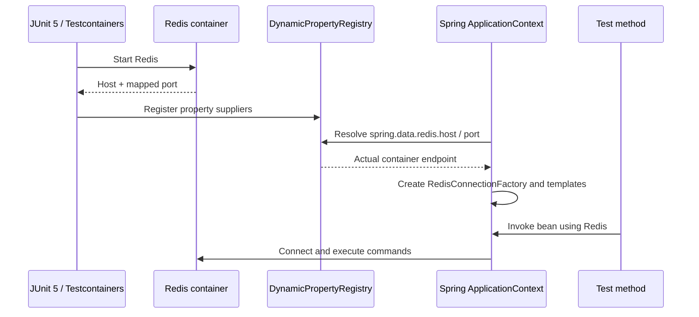
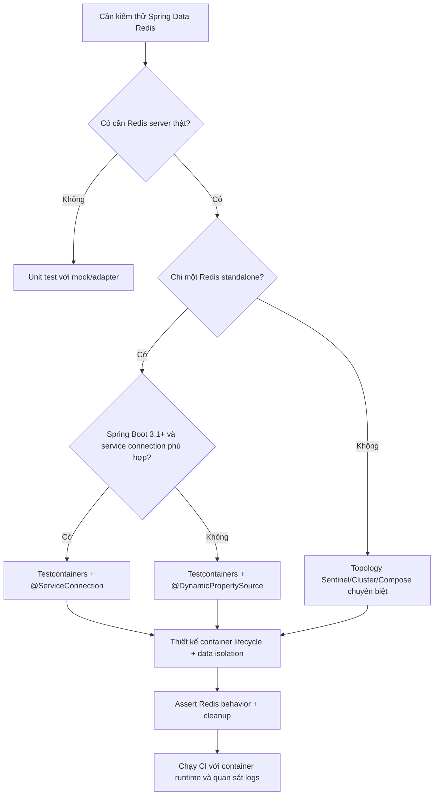

# Khởi tạo cấu hình Redis động trong Spring Boot test

## 1. Vì sao cấu hình Redis của integration test cần được khởi tạo động?

Một kiểm thử tích hợp Spring Data Redis phải kết nối đến **Redis thật hoặc một Redis test instance có hành vi phù hợp**, chứ không chỉ khởi tạo được Spring context. Trong môi trường phát triển, một cấu hình cố định như `localhost:6379` có vẻ tiện lợi:

```yaml
spring:
  data:
    redis:
      host: localhost
      port: 6379
```

Nhưng nó tạo ra nhiều rủi ro khi chạy test trên máy khác hoặc trên CI:

- Máy phát triển không có Redis chạy trên cổng 6379.
- Cổng 6379 đang được một ứng dụng khác sử dụng.
- Hai bộ test chạy song song và vô tình cùng ghi vào một database Redis.
- Pipeline CI có Docker hoặc network khác với máy local.
- Container Redis được cấp một **host port ngẫu nhiên** mỗi lần chạy.
- Mật khẩu, TLS, database index hay cấu hình Redis của test khác môi trường mặc định.
- Test vô tình kết nối Redis dùng chung hoặc thậm chí endpoint production do môi trường đã xuất biến cấu hình.

**Cấu hình động** là cách cấp cho Spring Boot những thuộc tính kết nối Redis **sau khi test resource được khởi tạo và biết endpoint thật, nhưng trước khi Spring tạo các bean cần kết nối**.

Ví dụ với Testcontainers, Redis trong container vẫn nghe cổng `6379`, nhưng host port bên ngoài có thể là `49173` trong lần chạy này và `49218` trong lần chạy sau. Spring phải nhận đúng port vừa được ánh xạ thay vì giả định 6379 trên host.

> Cấu hình Redis động trong test không có nghĩa ứng dụng có khả năng tự đổi kết nối lúc đang chạy. Nó chủ yếu giải quyết bài toán **discovery và property binding lúc khởi tạo test ApplicationContext**.

## 2. Ranh giới giữa unit test và integration test

Không phải test nào có liên quan Redis cũng cần Testcontainers.

| Loại test | Redis thật? | Điều cần kiểm chứng | Cách cấu hình |
|---|---|---|---|
| Unit test logic nghiệp vụ thuần túy | Không | Nhánh xử lý và quy tắc domain | Mock interface/adapter |
| Unit test một service sử dụng Redis | Thường không | Service xử lý kết quả và exception ra sao | Mock repository hoặc template |
| Spring Redis slice test | Có nếu muốn thực sự chạy Redis commands | Mapping, repository, serializer, Redis operations | `@DataRedisTest` + endpoint động |
| Full integration test | Có | Toàn bộ bean wiring, cache/template và Redis thực | `@SpringBootTest` + Redis test resource |
| Test Sentinel/Cluster/failover | Có nhiều node và topology thật | Authentication, routing, failover, consistency | Test topology chuyên biệt với cấu hình động |
| End-to-end test nhiều dịch vụ | Có | Luồng ứng dụng qua network, Redis và nguồn dữ liệu khác | Docker Compose/Testcontainers/hạ tầng test |

Nếu mục tiêu chỉ là kiểm thử hàm tính toán không dùng Redis, việc khởi chạy container làm test chậm và khó chẩn đoán hơn. Ngược lại, mock `StringRedisTemplate` không chứng minh được việc serialize, key prefix, TTL hoặc kết nối Redis thật hoạt động.

### 2.1. Những điều mock thường không phát hiện

Khi mock Redis operations, test có thể bỏ qua:

- Redis serializer không tương thích với dữ liệu đã lưu.
- Sai prefix hoặc database index.
- Sai kiểu key: lệnh Hash trên key String bị `WRONGTYPE`.
- TTL không được đặt hoặc đã hết sớm.
- Thao tác atomic như `SET NX EX` hay `INCR` cho kết quả thật khác kỳ vọng.
- Spring Boot chưa tạo `RedisConnectionFactory` đúng.
- Redis lỗi auth/network nhưng test vẫn giả lập trả dữ liệu bình thường.

Dùng Redis test container giúp bắt lỗi ở những ranh giới này; nó không thay thế test Redis production topology khi có Sentinel, Cluster, TLS hoặc ACL đặc biệt.

## 3. Ba thành phần chính của cơ chế khởi tạo động

Với Spring Boot hiện đại, một mô hình dễ áp dụng gồm:

1. **Testcontainers** khởi động một Redis container bằng Docker-compatible runtime.
2. **`@DynamicPropertySource`** đăng ký supplier cấp host, mapped port và các thông số kết nối cho Spring test context.
3. **Spring Boot auto-configuration** dùng những property đó tạo `RedisConnectionFactory`, `StringRedisTemplate`, `RedisTemplate` hoặc `RedisCacheManager`.



Thứ tự logic quan trọng:

- Không thể gọi `getMappedPort(6379)` trước khi container đã started.
- Các property phải được đăng ký trước khi Spring tạo connection factory.
- Test method chỉ chạy sau khi context được tạo thành công.
- Cần quản lý vòng đời container và việc tái sử dụng Spring test context khi có nhiều class.

## 4. Chuẩn bị dự án Spring Boot và các dependency

Ví dụ dùng Java 17+, JUnit Jupiter, Spring Boot 3.x hoặc phiên bản hỗ trợ các API tương ứng, Spring Data Redis và Testcontainers.

### 4.1. Gradle Groovy DSL

```groovy
dependencies {
    implementation 'org.springframework.boot:spring-boot-starter-data-redis'

    testImplementation 'org.springframework.boot:spring-boot-starter-test'
    testImplementation 'org.testcontainers:testcontainers'
    testImplementation 'org.testcontainers:junit-jupiter'
}
```

Nếu dự án dùng Spring Boot dependency management/BOM phù hợp, nhiều dependency đã có phiên bản do BOM quản lý. Nếu không sử dụng BOM, phải khai báo phiên bản tương thích một cách rõ ràng thay vì sao chép ví dụ không có version.

Đối với bài kiểm thử `@Cacheable` cần thêm Spring Cache:

```groovy
dependencies {
    implementation 'org.springframework.boot:spring-boot-starter-cache'
}
```

Đối với `@ServiceConnection` trong Spring Boot 3.1+ (trình bày sau), cần thêm:

```groovy
dependencies {
    testImplementation 'org.springframework.boot:spring-boot-testcontainers'
}
```

Không cần `spring-boot-testcontainers` nếu chỉ dùng `@DynamicPropertySource` cùng `GenericContainer`.

### 4.2. Docker hoặc container runtime

Testcontainers yêu cầu một môi trường Docker-compatible **hoạt động từ nơi chạy test**. Trước khi áp dụng, xác định:

- Docker daemon hoặc runtime tương thích có thể truy cập.
- Runner CI có quyền tạo container và expose ports.
- Image Redis có thể kéo từ registry hoặc từ mirror được phê duyệt.
- Architecture image phù hợp máy phát triển/CI.
- Firewall cho phép JVM kết nối tới địa chỉ và port do Testcontainers cung cấp.
- Quy trình dọn container sau test hoạt động đúng.

Không cần khởi động Redis thủ công trên host port 6379. Testcontainers sẽ cấp host port phù hợp và giúp cách ly tài nguyên test.

## 5. Ví dụ hoàn chỉnh: @SpringBootTest + Testcontainers + @DynamicPropertySource

Mẫu này minh họa đường phổ biến nhất: khởi tạo Redis trong Docker rồi đăng ký endpoint động trước khi Spring Boot tạo `StringRedisTemplate`.

```java
package com.example.demo;

import static org.assertj.core.api.Assertions.assertThat;

import java.time.Duration;
import java.util.UUID;

import org.junit.jupiter.api.Test;
import org.springframework.beans.factory.annotation.Autowired;
import org.springframework.boot.test.context.SpringBootTest;
import org.springframework.data.redis.core.StringRedisTemplate;
import org.springframework.test.context.DynamicPropertyRegistry;
import org.springframework.test.context.DynamicPropertySource;
import org.testcontainers.containers.GenericContainer;
import org.testcontainers.junit.jupiter.Container;
import org.testcontainers.junit.jupiter.Testcontainers;
import org.testcontainers.utility.DockerImageName;

@SpringBootTest
@Testcontainers
class RedisIntegrationTest {

    private static final int REDIS_PORT = 6379;

    @Container
    static final GenericContainer<?> REDIS =
            new GenericContainer<>(
                    DockerImageName.parse("redis:7.4-alpine"))
                    .withExposedPorts(REDIS_PORT);

    @DynamicPropertySource
    static void redisProperties(DynamicPropertyRegistry registry) {
        registry.add("spring.data.redis.host", REDIS::getHost);

        registry.add(
                "spring.data.redis.port",
                () -> REDIS.getMappedPort(REDIS_PORT)
        );
    }

    @Autowired
    StringRedisTemplate redis;

    @Test
    void shouldRoundTripStringViaRedis() {
        String key = "it:redis:" + UUID.randomUUID();

        try {
            redis.opsForValue().set(
                    key,
                    "hello",
                    Duration.ofSeconds(30)
            );

            assertThat(redis.opsForValue().get(key))
                    .isEqualTo("hello");

            Long ttl = redis.getExpire(key);
            assertThat(ttl).isNotNull();
            assertThat(ttl).isPositive();
        } finally {
            redis.delete(key);
        }
    }
}
```

Đây là **tệp Java test hoàn chỉnh ở mức minh họa**, giả định dự án có `@SpringBootApplication` được Spring tìm thấy theo quy tắc package của `@SpringBootTest`. Nếu lớp test nằm ngoài package tree của ứng dụng, có thể cần chỉ định `@SpringBootTest(classes = YourApplication.class)`.

### 5.1. Giải thích từng thành phần

- `@SpringBootTest`: nạp Spring ApplicationContext để kiểm tra bean wiring thật.
- `@Testcontainers`: bật JUnit Jupiter Testcontainers extension.
- `@Container` trên field `static`: container được quản lý **theo test class**, không start lại ở mỗi test method.
- `GenericContainer<?>`: một container tổng quát chạy image Redis cụ thể.
- `withExposedPorts(6379)`: expose cổng Redis ở trong container và ánh xạ sang host port được runtime cấp.
- `REDIS.getHost()`: địa chỉ host kết nối được từ JVM; không tự hardcode `localhost`.
- `REDIS.getMappedPort(6379)`: **port phía host** vừa được cấp; không phải cổng 6379 bên trong container.
- `@DynamicPropertySource`: đăng ký supplier cấp property khi Spring cần resolve.
- `StringRedisTemplate`: bean của Spring Data Redis, sử dụng connection factory được Boot auto-configure từ properties.
- `UUID` trong key: giảm nguy cơ test khác đụng tên key.
- `finally`: dọn key test ngay cả khi assertion thất bại.

### 5.2. Vì sao @DynamicPropertySource cần static?

Trong cơ chế được dùng ở ví dụ, Spring Test tìm một method **static** gắn `@DynamicPropertySource` và truyền vào một `DynamicPropertyRegistry`. Spring có thể dùng nó trong giai đoạn chuẩn bị context trước khi tạo instance của test class.

Vì vậy phương thức thường có chữ ký:

```java
@DynamicPropertySource
static void configureProperties(DynamicPropertyRegistry registry) {
    registry.add("spring.data.redis.host", REDIS::getHost);
    registry.add(
            "spring.data.redis.port",
            () -> REDIS.getMappedPort(6379)
    );
}
```

Không chuyển method này sang `@BeforeEach` để set `System.setProperty`. Lúc `@BeforeEach` chạy, Spring context và `RedisConnectionFactory` thường đã khởi tạo; việc sửa system property sau đó không khiến những bean đang tồn tại tự kết nối lại.

### 5.3. Supplier được đánh giá khi cần

Lời gọi:

```java
registry.add(
    "spring.data.redis.port",
    () -> REDIS.getMappedPort(6379)
);
```

đăng ký một supplier, không phải ép Spring lấy một giá trị cố định ngay tại thời điểm method được gọi. Tuy nhiên, một khi property được resolve trong lúc khởi tạo bean, connection factory thường giữ cấu hình đã lấy. Nếu container sau đó thay port, Spring context cũ **không tự refresh**.

Không nên tạo một Redis container mới bên trong callback supplier cho mỗi lần resolve property. Container phải có lifecycle ổn định và được khởi động đúng giai đoạn.

## 6. Host port động không phải container port

Đây là một lỗi phổ biến khi mới dùng Testcontainers.

```text
JVM test (máy host / CI runner)
   |
   | TCP tới REDIS.getHost():REDIS.getMappedPort(6379)
   v
Container runtime published port, ví dụ 49173
   |
   v
Redis trong container nghe 6379
```

Ba giá trị khác nhau:

| Thành phần | Ví dụ | Nên lấy từ đâu? |
|---|---|---|
| Internal Redis port | `6379` | Cổng server trong image |
| Host port | `49173` | `getMappedPort(6379)` |
| Địa chỉ host của container runtime | `localhost` hoặc host khác | `getHost()` |

**Sai:**

```java
registry.add("spring.data.redis.port", () -> 6379);
```

Khi Redis container thực sự được publish lên host port ngẫu nhiên, cấu hình này sẽ trỏ sai.

**Sai trong một số môi trường remote Docker:**

```java
registry.add("spring.data.redis.host", () -> "localhost");
```

`localhost` chỉ đúng khi JVM có thể kết nối tới published port của container runtime ở local host. Khi Docker daemon chạy trên máy khác, cần để Testcontainers cung cấp địa chỉ phù hợp.

**Đúng:**

```java
registry.add("spring.data.redis.host", REDIS::getHost);
registry.add(
        "spring.data.redis.port",
        () -> REDIS.getMappedPort(6379)
);
```

## 7. Property được ưu tiên ra sao?

Spring có hệ thống nhiều `PropertySource` như cấu hình YAML, environment variables, command-line arguments, `@TestPropertySource` và dynamic properties. Đối với Spring Test, properties đăng ký bằng `@DynamicPropertySource` có **độ ưu tiên cao** hơn nhiều nguồn thường dùng trong test, bao gồm `@TestPropertySource`, environment và system properties theo hợp đồng của Spring Framework.

Ví dụ:

```yaml
# src/test/resources/application-test.yml
spring:
  data:
    redis:
      host: localhost
      port: 6379
```

và:

```java
@DynamicPropertySource
static void dynamicRedis(DynamicPropertyRegistry registry) {
    registry.add("spring.data.redis.host", REDIS::getHost);
    registry.add(
            "spring.data.redis.port",
            () -> REDIS.getMappedPort(6379)
    );
}
```

Các giá trị động cho **cùng property key** sẽ được dùng trong context test tương ứng. Tuy vậy, giữ cả hai cấu hình cố định và động mà không có mục đích rõ ràng gây khó chẩn đoán; nên bỏ host/port cố định khỏi test profile nếu container luôn cấp endpoint.

### 7.1. Spring Boot 2.x và Spring Boot 3.x

Property prefix phải khớp phiên bản Boot:

| Dòng Spring Boot | Prefix Redis thường dùng |
|---|---|
| Spring Boot 2.x | `spring.redis.host`, `spring.redis.port`, `spring.redis.password` |
| Spring Boot 3.x | `spring.data.redis.host`, `spring.data.redis.port`, `spring.data.redis.password` |

Không được chỉ đổi file test từ Boot 2 sang Boot 3 rồi giữ các property cũ mà không xác nhận compatibility. Một property không được bind có thể khiến `RedisConnectionFactory` tiếp tục trỏ tới `localhost:6379`.

Ví dụ khi **dự án thực sự chạy Boot 2.x**:

```java
@DynamicPropertySource
static void redisProperties(DynamicPropertyRegistry registry) {
    registry.add("spring.redis.host", REDIS::getHost);
    registry.add(
            "spring.redis.port",
            () -> REDIS.getMappedPort(6379)
    );
}
```

Các cấu hình về authentication, Sentinel và SSL cũng có thể khác về naming giữa phiên bản; cần giữ một bộ property nhất quán.

### 7.2. Tránh trộn Redis URL với host/port động

Nếu đặt đồng thời:

```yaml
spring:
  data:
    redis:
      url: redis://some-redis.internal:6379
```

và `@DynamicPropertySource` chỉ ghi đè `host` cùng `port`, thì URL có thể được ưu tiên cho connection details theo cơ chế Boot version đang dùng. Kết quả là test vẫn kết nối endpoint không mong muốn.

Một bài test dùng Redis container nên chọn **một cách định danh endpoint** rõ ràng, thường là host + mapped port. Gỡ hoặc override cả `spring.data.redis.url` nếu nó tồn tại trong cấu hình gốc. Với test mang quyền truy cập network thật, luôn tránh vô tình kế thừa Redis production URL/password.

## 8. Khởi tạo thêm mật khẩu, database index và các property khác

Cấu hình động không giới hạn ở host/port.

### 8.1. Redis test có requirepass

Nếu muốn test tình huống xác thực bằng password-only:

```java
@Testcontainers
@SpringBootTest
class PasswordProtectedRedisTest {

    private static final int PORT = 6379;

    private static final String TEST_PASSWORD =
            "only-for-local-integration-tests";

    @Container
    static final GenericContainer<?> REDIS =
            new GenericContainer<>(
                    DockerImageName.parse("redis:7.4-alpine"))
                    .withExposedPorts(PORT)
                    .withCommand(
                            "redis-server",
                            "--requirepass",
                            TEST_PASSWORD
                    );

    @DynamicPropertySource
    static void redisProps(DynamicPropertyRegistry registry) {
        registry.add("spring.data.redis.host", REDIS::getHost);
        registry.add(
                "spring.data.redis.port",
                () -> REDIS.getMappedPort(PORT)
        );
        registry.add(
                "spring.data.redis.password",
                () -> TEST_PASSWORD
        );
    }
}
```

Đoạn này minh họa **phần cấu hình**, chưa có test method; thêm assertion cho Redis command để có một integration test thực sự. Password trong ví dụ **không phải secret production**; trong CI, nếu dùng credential nhạy cảm hơn phải lấy từ secret store.

Không tự thêm `spring.data.redis.username` với một tên user ACL bất kỳ khi Redis container chỉ cấu hình `requirepass`. Với Redis ACL, cần tạo user/password ở server và cung cấp **cả username/password** phù hợp.

### 8.2. Chọn database Redis cho test

Nếu cần database index:

```java
registry.add("spring.data.redis.database", () -> 0);
```

Việc đặt database 0 hay 1 không thay thế isolation giữa các test khi chúng vẫn truy cập **cùng Redis instance**. Cấu hình database index trong Redis Cluster cũng không tương đương standalone Redis; Redis Cluster thường chỉ hỗ trợ database 0.

Cách ly đáng tin cậy hơn là container riêng theo test scope hoặc key prefix duy nhất kèm cleanup. Không mặc định số database index là vô hạn.

### 8.3. Dynamic properties cho timeout

```java
registry.add("spring.data.redis.connect-timeout", () -> "2s");
registry.add("spring.data.redis.timeout", () -> "3s");
```

Những thông số này giúp test không treo quá lâu khi kết nối lỗi, nhưng không cần đặt quá thấp khiến test flaky trên CI tải cao. Timeout chỉ điều chỉnh mức chờ; nó không khắc phục container chưa khởi động hoặc sai endpoint.

## 9. Dùng @DataRedisTest thay vì @SpringBootTest khi phù hợp

`@SpringBootTest` khởi tạo context ứng dụng rộng. Nếu mục đích chỉ kiểm chứng Redis mapping, serializer hoặc Repository, Spring Boot có `@DataRedisTest` để nạp phần cấu hình liên quan Redis.

Ví dụ:

```java
package com.example.demo.repository;

import static org.assertj.core.api.Assertions.assertThat;

import java.util.UUID;
import org.junit.jupiter.api.Test;
import org.springframework.beans.factory.annotation.Autowired;
import org.springframework.boot.test.autoconfigure.data.redis.DataRedisTest;
import org.springframework.data.redis.core.StringRedisTemplate;
import org.springframework.test.context.DynamicPropertyRegistry;
import org.springframework.test.context.DynamicPropertySource;
import org.testcontainers.containers.GenericContainer;
import org.testcontainers.junit.jupiter.Container;
import org.testcontainers.junit.jupiter.Testcontainers;
import org.testcontainers.utility.DockerImageName;

@DataRedisTest
@Testcontainers
class RedisSliceTest {

    @Container
    static final GenericContainer<?> REDIS =
            new GenericContainer<>(
                    DockerImageName.parse("redis:7.4-alpine"))
                    .withExposedPorts(6379);

    @DynamicPropertySource
    static void properties(DynamicPropertyRegistry registry) {
        registry.add("spring.data.redis.host", REDIS::getHost);
        registry.add(
                "spring.data.redis.port",
                () -> REDIS.getMappedPort(6379)
        );
    }

    @Autowired
    StringRedisTemplate redis;

    @Test
    void shouldSaveString() {
        String key = "it:slice:" + UUID.randomUUID();
        try {
            redis.opsForValue().set(key, "value");
            assertThat(redis.opsForValue().get(key))
                    .isEqualTo("value");
        } finally {
            redis.delete(key);
        }
    }
}
```

Đặc điểm:

- `@DataRedisTest` không nạp tất cả service/controller giống full `@SpringBootTest`.
- Redis connection vẫn là kết nối thật tới container.
- Nếu service cần kiểm thử không được slice scan mặc định, có thể thêm `@Import(YourService.class)` khi thiết kế test phù hợp.
- Slice test vẫn yêu cầu Docker/container và không tự sinh Redis server nếu thiếu container setup.
- Với custom `RedisConnectionFactory`/serializer, phải xác nhận slice đã include đúng bean cần kiểm thử.

Chọn slice test khi muốn kiểm chứng phần data access một cách nhanh và cô lập hơn, không dùng slice để tuyên bố đã kiểm chứng toàn bộ web/security/cache routing của ứng dụng.

## 10. @ServiceConnection: hướng đơn giản trong Spring Boot 3.1+

Spring Boot 3.1 trở lên có cơ chế **Testcontainers service connections**. Thay vì đăng ký host/port thủ công, `@ServiceConnection` có thể tạo connection details cho một service đã biết.

Với `GenericContainer`, cần cho Boot biết container đại diện cho loại service nào. Ví dụ Redis:

```groovy
dependencies {
    testImplementation 'org.springframework.boot:spring-boot-starter-test'
    testImplementation 'org.springframework.boot:spring-boot-testcontainers'
    testImplementation 'org.testcontainers:junit-jupiter'
    testImplementation 'org.testcontainers:testcontainers'
}
```

```java
package com.example.demo;

import static org.assertj.core.api.Assertions.assertThat;

import java.util.UUID;
import org.junit.jupiter.api.Test;
import org.springframework.beans.factory.annotation.Autowired;
import org.springframework.boot.test.context.SpringBootTest;
import org.springframework.boot.testcontainers.service.connection.ServiceConnection;
import org.springframework.data.redis.core.StringRedisTemplate;
import org.testcontainers.containers.GenericContainer;
import org.testcontainers.junit.jupiter.Container;
import org.testcontainers.junit.jupiter.Testcontainers;
import org.testcontainers.utility.DockerImageName;

@SpringBootTest
@Testcontainers
class RedisServiceConnectionTest {

    @Container
    @ServiceConnection(name = "redis")
    static final GenericContainer<?> REDIS =
            new GenericContainer<>(
                    DockerImageName.parse("redis:7.4-alpine"))
                    .withExposedPorts(6379);

    @Autowired
    StringRedisTemplate redis;

    @Test
    void shouldConnectThroughServiceConnection() {
        String key = "it:service-connection:" + UUID.randomUUID();

        try {
            redis.opsForValue().set(key, "connected");
            assertThat(redis.opsForValue().get(key))
                    .isEqualTo("connected");
        } finally {
            redis.delete(key);
        }
    }
}
```

Ở đây:

- `@ServiceConnection(name = "redis")` giúp Spring Boot nhận diện `GenericContainer` là Redis service.
- Boot tạo `RedisConnectionDetails` từ container, rồi Redis auto-configuration dùng connection details thích hợp.
- Không cần tự gọi `registry.add("spring.data.redis.host", ...)` và `registry.add("spring.data.redis.port", ...)` cho cùng kết nối.
- `spring-boot-testcontainers` cung cấp integration này; JUnit Jupiter extension vẫn quản lý container lifecycle.

### 10.1. Khi nào vẫn chọn @DynamicPropertySource?

`@DynamicPropertySource` phù hợp khi:

- Dự án chưa dùng Spring Boot 3.1+ hoặc không có service connection factory tương ứng.
- Có **property tùy biến của ứng dụng**, ví dụ `app.redis.external-host`.
- Có nhiều endpoint/port do nhiều container cung cấp.
- Cần ánh xạ thông tin của một dịch vụ ít phổ biến mà `@ServiceConnection` chưa nhận diện được.
- Muốn kiểm soát rõ những property được đưa vào context.

`@ServiceConnection` phù hợp khi:

- Dùng Spring Boot có hỗ trợ cơ chế đó.
- Kết nối được mô tả bởi một service connection factory phù hợp.
- Muốn tránh tự quản lý tên host/port/password property.
- Cấu hình test chỉ cần các connection details tiêu chuẩn.

**Không nên trộn cả hai cách cho cùng một connection mà không chủ đích**, vì service connection details và properties có cơ chế ưu tiên riêng. Nếu test vẫn kết nối nhầm endpoint, kiểm tra có Bean `RedisConnectionFactory` tùy chỉnh hoặc thêm property URL/host từ nguồn khác hay không.

## 11. Cách khởi tạo container và Spring context phải tương thích về lifecycle

### 11.1. Per-class container

Trong ví dụ `@Testcontainers` + `@Container static`, container được quản lý trong phạm vi JUnit test class.

```text
Test class begins
    -> JUnit extension starts container
    -> Spring creates ApplicationContext
    -> Test methods run
    -> JUnit extension stops container
Test class ends
```

Điều này phù hợp nếu mỗi class có context/container riêng. Vấn đề xuất hiện khi Spring **cache và tái sử dụng ApplicationContext** giữa các test classes, nhưng container được dừng ở cuối class đầu.

Ví dụ:

```text
Class A:
  Redis mapped port = 49173
  Spring cached context -> connection factory port 49173
  Class A finishes -> container A stops

Class B:
  Redis mapped port = 49251
  Spring reuses context from A (trong một cấu hình test giống nhau)
  Connection factory vẫn trỏ tới 49173 -> connection refused
```

Không phải mọi bộ test đều gặp tình huống này: việc context được reuse phụ thuộc cấu hình Spring Test cache key và cách đăng ký dynamic properties. Nhưng đây là lỗi thực tế cần dự phòng khi có một base class chung chứa `@DynamicPropertySource`.

### 11.2. Shared container cho nhiều test classes

Nếu nhiều class cần dùng cùng Redis và muốn Spring context được reuse, có thể tạo một test base class khởi động container một lần cho toàn JVM test process:

```java
package com.example.demo.testinfra;

import org.springframework.test.context.DynamicPropertyRegistry;
import org.springframework.test.context.DynamicPropertySource;
import org.testcontainers.containers.GenericContainer;
import org.testcontainers.utility.DockerImageName;

public abstract class SharedRedisTestBase {

    protected static final GenericContainer<?> REDIS =
            new GenericContainer<>(
                    DockerImageName.parse("redis:7.4-alpine"))
                    .withExposedPorts(6379);

    static {
        REDIS.start();
    }

    @DynamicPropertySource
    static void registerRedis(DynamicPropertyRegistry registry) {
        registry.add("spring.data.redis.host", REDIS::getHost);
        registry.add(
                "spring.data.redis.port",
                () -> REDIS.getMappedPort(6379)
        );
    }
}
```

Lớp test kế thừa:

```java
@SpringBootTest
class ProductCacheIntegrationTest extends SharedRedisTestBase {

    @Autowired
    StringRedisTemplate redis;

    @Test
    void canStoreValue() {
        String key = "it:product:" + UUID.randomUUID();
        try {
            redis.opsForValue().set(key, "ready");
            assertThat(redis.opsForValue().get(key))
                    .isEqualTo("ready");
        } finally {
            redis.delete(key);
        }
    }
}
```

Ở mẫu này:

- Container được start trong static initializer của base class.
- Không đánh dấu container đó bằng `@Container` của JUnit extension, tránh extension dừng nó ở cuối mỗi test class.
- Testcontainers vẫn chịu trách nhiệm cleanup tài nguyên container theo cơ chế runtime, khi process test kết thúc bình thường.
- Các class sử dụng cùng Redis endpoint, nên có thể reuse context nếu các yếu tố cấu hình khác phù hợp.

**Đánh đổi:** chia sẻ Redis giữa class khiến test data có thể can thiệp nhau. Dùng namespace riêng, cleanup có giới hạn và tránh `FLUSHALL`/`FLUSHDB` trong test chạy song song.

### 11.3. Container khác nhau trên mỗi subclass

Nếu một base class có `@DynamicPropertySource` nhưng mỗi subclass dùng container khác nhau, Spring có thể reuse một context trước đó dù actual dynamic values đã đổi vì test context cache không tự so sánh giá trị supplier tại mọi thời điểm.

Một biện pháp có thể là dùng:

```java
@DirtiesContext(classMode = DirtiesContext.ClassMode.AFTER_CLASS)
```

trên những class cần tránh context reuse, hoặc cấu trúc cấu hình test để mỗi class thực sự có context cache key riêng. `@DirtiesContext` khiến Spring đóng/rebuild context và tăng chi phí chạy test, nên không dùng bừa bãi cho mọi test nếu một shared container ổn định là đủ.

## 12. Cách ly dữ liệu giữa các bài test

Có endpoint Redis động chưa có nghĩa các test **độc lập về dữ liệu**. Hai method vẫn có thể ghi vào cùng key.

### 12.1. Dùng key riêng theo test

```java
String key = "it:cart:" + UUID.randomUUID();
```

Ưu điểm: xác suất xung đột rất thấp, phù hợp với nhiều test đọc/ghi độc lập. Nên cleanup trong `finally` hoặc `@AfterEach` với danh sách key thuộc về test.

### 12.2. Không dùng FLUSHDB trên Redis chia sẻ giữa tests

```java
redis.getConnectionFactory()
        .getConnection()
        .serverCommands()
        .flushDb();
```

Lệnh này có thể xóa **toàn bộ database Redis được connection sử dụng**, bao gồm key của test class khác đang chạy song song. Đừng dùng nó làm cleanup mặc định trong một Redis container chung.

Nếu thực sự cần database trống tuyệt đối để kiểm chứng tính năng toàn keyspace, cân nhắc container riêng cho test class đó, không dùng chung với các test khác.

### 12.3. Key prefix không luôn đủ nếu Redis commands mang tính toàn cục

Đối với test đơn giản `GET`/`SET`/`DEL`, prefix riêng giúp cô lập tốt. Nhưng có những lệnh tác động rộng hơn một prefix:

- `FLUSHDB`/`FLUSHALL` xóa dữ liệu rộng.
- `CONFIG SET` ảnh hưởng Redis instance.
- `SCRIPT FLUSH` tác động script cache.
- `CLIENT KILL` có thể tác động connections khác.
- Pub/Sub notifications được phát trên phạm vi node/channel.
- Redis Stream consumer group trùng tên/key có thể tác động cùng pending state.

Các test như vậy nên có container riêng, hoặc chạy tuần tự trong môi trường cô lập với reset strategy rõ ràng.

### 12.4. Đừng dựa vào rollback @Transactional để xóa mọi ghi Redis

Một test `@Transactional` có thể rollback giao dịch JDBC sau test, nhưng Redis operations qua `StringRedisTemplate` không tự trở thành một phần của transaction JDBC. Ngay cả khi Spring Data Redis có transaction support riêng, việc phối hợp với database và Redis không tự bảo đảm distributed atomicity.

**Cleanup Redis phải được thiết kế độc lập**, không giả định JUnit/Spring tự rollback Redis như Hibernate EntityManager.

## 13. Kiểm thử cache Redis thực bằng @SpringBootTest

Cấu hình động có thể được sử dụng để kiểm tra `RedisCacheManager` và Spring Cache annotations.

Ví dụ:

```java
package com.example.demo;

import static org.assertj.core.api.Assertions.assertThat;

import java.util.UUID;
import org.junit.jupiter.api.Test;
import org.springframework.beans.factory.annotation.Autowired;
import org.springframework.boot.test.context.SpringBootTest;
import org.springframework.cache.Cache;
import org.springframework.cache.CacheManager;
import org.springframework.test.context.DynamicPropertyRegistry;
import org.springframework.test.context.DynamicPropertySource;
import org.testcontainers.containers.GenericContainer;
import org.testcontainers.junit.jupiter.Container;
import org.testcontainers.junit.jupiter.Testcontainers;
import org.testcontainers.utility.DockerImageName;

@SpringBootTest(properties = "spring.cache.type=redis")
@Testcontainers
class RedisCacheManagerIntegrationTest {

    @Container
    static final GenericContainer<?> REDIS =
            new GenericContainer<>(
                    DockerImageName.parse("redis:7.4-alpine"))
                    .withExposedPorts(6379);

    @DynamicPropertySource
    static void redisProps(DynamicPropertyRegistry registry) {
        registry.add("spring.data.redis.host", REDIS::getHost);
        registry.add(
                "spring.data.redis.port",
                () -> REDIS.getMappedPort(6379)
        );
    }

    @Autowired
    CacheManager cacheManager;

    @Test
    void shouldPutAndReadFromRedisCache() {
        Cache cache = cacheManager.getCache("itProductCache");
        assertThat(cache).isNotNull();

        String key = "product-" + UUID.randomUUID();

        try {
            cache.put(key, "summary");
            assertThat(cache.get(key, String.class))
                    .isEqualTo("summary");
        } finally {
            cache.evict(key);
        }
    }
}
```

Để chạy ví dụ này, dự án phải có `spring-boot-starter-cache` và Spring Boot tạo một `RedisCacheManager` thích hợp, không bị một cache manager khác thay thế. Ví dụ chủ yếu chứng minh **vùng Spring Cache thực sự lưu và đọc được qua Redis connection của test**.

Nếu mục tiêu là kiểm tra `@Cacheable` trên service, test phải gọi method qua Spring-managed proxy, không tự gọi method trong cùng instance. Có thể dùng spy hoặc bộ đếm số lần load ở source giả lập để phân biệt hit/miss, nhưng phải chú ý việc `@MockBean`/`@MockitoBean` và proxy cache tương tác với phiên bản Spring Boot đang dùng.

## 14. Test TTL: tránh điều kiện thời gian gây flaky

Trong integration test Redis, TTL là một trong những thuộc tính quan trọng. Một cách kiểm tra tương đối ổn định là đọc TTL vừa đặt:

```java
@Test
void shouldSetPositiveTtl() {
    String key = "it:ttl:" + UUID.randomUUID();

    try {
        redis.opsForValue().set(
                key, "value", Duration.ofSeconds(30));

        Long ttl = redis.getExpire(key);

        assertThat(ttl).isNotNull();
        assertThat(ttl).isBetween(1L, 30L);
    } finally {
        redis.delete(key);
    }
}
```

Không nên viết:

```java
Thread.sleep(1000);
assertThat(redis.hasKey(key)).isFalse();
```

với TTL đúng 1 giây rồi giả định test sẽ luôn ổn định trên mọi runner. Scheduling, latency của CI và thời điểm Redis expiration có thể khiến assertion đúng/sai theo race condition.

Nếu cần kiểm tra **key thực sự biến mất**, hãy dùng thời gian chờ có giới hạn và polling, ví dụ Awaitility (nếu được thêm dependency), hoặc một vòng chờ hợp lý. Không dùng timeout vô hạn hoặc sleep cố định quá ngắn.

Khi kiểm thử keyspace notifications, nhớ rằng event expired dựa trên Pub/Sub và chỉ phát khi Redis thực sự xóa key đã hết hạn. Test đó cần thêm listener sẵn sàng trước lúc đặt TTL và không nên đòi event tới đúng mili-giây.

## 15. Test Redis Repository, serializer và schema

Redis test container không chỉ giúp test kết nối. Nó còn giúp kiểm chứng representation thật của dữ liệu.

### 15.1. Chọn API đúng mục tiêu

| Test target | API Spring Data Redis | Điều cần kiểm tra |
|---|---|---|
| String key/value | `StringRedisTemplate` | Round-trip, TTL |
| Domain object serialization | `RedisTemplate<K,V>` | Serializer key/value/hash và version schema |
| Redis Repository | Repository interface, `@RedisHash` | ID, Hash mapping, TTL, secondary index |
| Spring Cache | `CacheManager`/`@Cacheable` | Cache prefix, serializer, miss/hit, eviction |
| Streams | `opsForStream()` | Record fields, consumer group, ack/pending |
| Transactions | `execute(SessionCallback)` với `MULTI/EXEC` | Isolation và lỗi, không rollback runtime tự động |

### 15.2. Không thay serializer test thành loại khác production nếu đang kiểm chứng compatibility

Ví dụ production dùng JSON serializer tùy chỉnh trong `RedisTemplate`, nhưng test lại inject `StringRedisTemplate` rồi chỉ kiểm tra String. Test có thể pass dù production không deserialize được object.

Muốn kiểm chứng schema thật, nạp đúng bean configuration và dùng cùng serializer/mapper. Nếu refactor kiểu object, cần xét cache entry cũ, type metadata và compatibility giữa các phiên bản ứng dụng.

### 15.3. Redis image version ảnh hưởng hành vi

Một số command Redis Streams, ACL, Pub/Sub, JSON module hoặc Redis Cluster có hỗ trợ khác nhau tùy version/edition. Việc pin Redis image như:

```java
DockerImageName.parse("redis:7.4-alpine")
```

giúp test có môi trường ổn định hơn so với `redis:latest`. Tuy nhiên, nếu production chạy phiên bản khác, test không bao quát được những khác biệt đó. Nên chọn image version tương thích production và có kế hoạch kiểm tra migration khi nâng Redis/Valkey engine.

Nếu ứng dụng sử dụng Redis Stack module, image Redis OSS thông thường sẽ không có các module đó. Cần container image tương ứng và startup readiness thích hợp.

## 16. Dynamic properties cho Sentinel hoặc Redis Cluster

Trong một integration test đơn giản, một `GenericContainer` Redis standalone chỉ kiểm chứng kết nối một node. Nó **không mô phỏng đầy đủ**:

- Sentinel master discovery/failover.
- Redis Cluster hash-slot routing và `MOVED`/`ASK`.
- Replication lag hoặc read from replica.
- TLS/ACL của managed Redis.
- Thay đổi master address sau failover.

Có thể vẫn dùng `@DynamicPropertySource` khi dựng nhiều container Sentinel/Cluster, nhưng cần cung cấp **đúng property và endpoint** tương ứng.

Ví dụ ý tưởng cấu hình Sentinel cho Spring Boot 3.x:

```java
registry.add(
    "spring.data.redis.sentinel.master",
    () -> "mymaster"
);

registry.add(
    "spring.data.redis.sentinel.nodes",
    () -> sentinelEndpointsCsv
);
```

Ở đây `sentinelEndpointsCsv` là chuỗi host:port đã được tạo từ các container và endpoint truy cập được **từ JVM test**. Không được chỉ thay host/port standalone bằng một Sentinel port rồi hy vọng mọi chức năng hoạt động.

Một topology Sentinel/Cluster được dựng bằng container có thêm thách thức:

- Redis/Sentinel có thể **advertise** IP nội bộ không route được từ host JVM.
- Mỗi Redis/ Sentinel container phải nhìn thấy peer qua Docker network.
- Client cần kết nối endpoint mà Sentinel/Cluster trả về, không chỉ seed endpoint.
- Startup order, quorum, replica sync và health readiness phức tạp hơn.
- Credentials cho Sentinel và Redis data nodes có thể độc lập.
- Cần teardown/cleanup hợp lý khi test mô phỏng failover.

Trong nhiều hệ thống, nên dùng một topology test resource chuyên biệt hoặc môi trường staging cho các scenario này; không dùng Redis standalone test làm bằng chứng Sentinel/Cluster đã được kiểm chứng.

## 17. Testcontainers và Docker Compose: lựa chọn theo quy mô kiểm thử

### 17.1. Testcontainers trực tiếp

Ưu điểm:

- Code test quản lý resource.
- Endpoint lấy được qua container object.
- Có thể chạy container riêng cho class.
- Dễ pin image và truyền dynamic properties.

Phù hợp với bài test Redis standalone hoặc vài dependency tương đối độc lập.

### 17.2. Docker Compose được quản lý trong test

Khi ứng dụng có Redis, PostgreSQL và một số service hỗ trợ, Docker Compose giúp mô tả network và healthcheck. Có thể kết hợp cơ chế Docker Compose support của Spring Boot hoặc Testcontainers Compose container theo version tương ứng.

Nhưng không nên suy luận một Compose file đang chạy sẽ tự cấp cấu hình Redis đúng cho mọi test. Cần biết:

- Ai start/stop Compose stack.
- JVM kết nối qua host published port nào.
- Service connection details được Boot cung cấp hay phải đăng ký thủ công.
- Profile và namespace test có tách biệt môi trường phát triển không.
- CI runner có hỗ trợ Docker Compose và quyền network phù hợp không.

Dù dùng cách nào, điều quan trọng vẫn là **cấu hình Redis được tạo từ endpoint thực của test resource**, không hardcode địa chỉ mà chỉ đúng trên máy một developer.

## 18. CI: chạy integration test ở môi trường tái lập

Một pipeline CI cần kiểm tra:

1. Docker-compatible runtime khả dụng.
2. Có quyền kéo image Redis hoặc image đã được cache/mirror.
3. JVM có thể kết nối tới host/port được Testcontainers publish.
4. Thời gian startup container nằm trong giới hạn runner.
5. Không dùng Redis production credentials.
6. Test cleanup/teardown có hiệu lực dù assertion thất bại.
7. Log không ghi secret hoặc dữ liệu nhạy cảm.
8. Test được chạy riêng với unit test nếu chi phí container lớn.

### 18.1. Phân biệt test fails và test bị skip

Nếu môi trường CI bắt buộc chạy Redis integration tests, **không nên âm thầm skip** chúng chỉ vì không có Docker. Có thể dùng cấu hình skip có chủ đích ở môi trường không hỗ trợ Docker, nhưng pipeline xác nhận release phải có một stage chạy thật và báo fail nếu container không khởi tạo được.

Ví dụ:

```text
Unit tests:
  - Không cần Redis hoặc Docker
  - Nhanh, chạy trên mỗi thay đổi

Redis integration tests:
  - Có Docker-compatible runtime
  - Khởi động Redis Testcontainers
  - Đăng ký @DynamicPropertySource / @ServiceConnection
  - Kiểm tra Redis commands thật
  - Báo fail khi Redis không sẵn sàng

Topology tests:
  - Redis Sentinel/Cluster/ACL/TLS
  - Có thể chạy trên stage riêng vì chi phí cao
```

Sự tách biệt này tránh biến một lỗi Docker environment thành "unit test logic thất bại", đồng thời vẫn bảo đảm những phần cần Redis thật được kiểm chứng trong pipeline.

### 18.2. Startup readiness

Redis container `withExposedPorts(6379)` dùng cơ chế chờ của Testcontainers phù hợp cho trường hợp thông thường, nhưng khi thay image, custom command, init script hoặc bật TLS/auth, cần quan tâm tới readiness.

```text
Container running != Redis server sẵn sàng trả AUTH/PING
Redis PING thành công != schema/index/module init hoàn tất
```

Với image hoặc topology tùy chỉnh, có thể cấu hình wait strategy thích hợp, ví dụ lắng nghe cổng hoặc log startup. Đừng dùng `Thread.sleep(5000)` làm cơ chế đồng bộ duy nhất. Wait strategy phải phản ánh điều kiện thực tế cần cho ứng dụng và có timeout hợp lý.

## 19. Lỗi thường gặp và cách chẩn đoán

| Hiện tượng | Nguyên nhân có thể | Hướng xử lý |
|---|---|---|
| `Connection refused: localhost:6379` | Test vẫn dùng cấu hình cố định | Kiểm tra dynamic property key, test profile, Redis URL và Boot version |
| `getMappedPort(...)` báo container chưa started | Đọc mapped port quá sớm | Đảm bảo container start trước khi resolve supplier; dùng lifecycle hợp lý |
| Test pass local, fail CI | Docker không khả dụng hoặc network khác | Kiểm tra container runtime, `getHost()`, logs |
| Kết nối sai port dù container running | Dùng internal port 6379 thay mapped host port | Đăng ký `getMappedPort(6379)` |
| Boot 3.x không nhận `spring.redis.host` | Prefix property của Boot khác | Dùng `spring.data.redis.host/port` |
| Boot 2.x không nhận `spring.data.redis.*` | Dùng prefix mới trên app cũ | Đối chiếu Boot version và prefix tương ứng |
| `@DynamicPropertySource` không được chạy | Method không static, thiếu annotation hoặc không nằm trong test context được load | Kiểm tra signature và Spring Test bootstrap |
| `NOAUTH` / `WRONGPASS` | Redis container bật password nhưng app không cấu hình đúng | Đăng ký password/username đúng bên client |
| `WRONGTYPE` hoặc deserialize lỗi | Dữ liệu cũ/serializer khác test | Kiểm tra serializer, key namespace và cleanup |
| Test đầu pass, test thứ hai connection refused | Container per-class đã stop nhưng cached ApplicationContext còn dùng | Dùng shared container hoặc buộc context rebuild đúng phạm vi |
| Test chạy song song thất bại ngẫu nhiên | Nhiều test dùng cùng key/`FLUSHDB` | Dùng key riêng, cleanup và isolate destructive tests |
| TTL test flaky | Assert đúng vào ranh giới hết hạn | Đọc TTL với khoảng hợp lý hoặc polling có timeout |
| `@ServiceConnection` không tạo Redis connection | Thiếu Boot dependency hoặc `GenericContainer` chưa có service name | Thêm `spring-boot-testcontainers`, `@ServiceConnection(name="redis")` |
| Có `@ServiceConnection` nhưng app dùng endpoint khác | Custom factory hoặc configuration khác được ưu tiên | Kiểm tra bean `RedisConnectionFactory` và connection details |
| Docker image pull thất bại | Registry/network/rate limit | Dùng mirror/cache image được chấp thuận |
| Sentinel test standalone pass nhưng production fail | Test không có Sentinel/Cluster topology | Bổ sung topology integration test đúng mức |
| Test bị chặn khi Spring context start | Redis chưa sẵn sàng, auth/TLS mismatch hoặc connect timeout | Xem root exception và container logs |
| Test pass nhưng dữ liệu Redis còn lại sau test | Cleanup thiếu hoặc context/container shared | Dọn key theo ownership và tạo prefix riêng |
| Redis cache test không dùng Redis | Một CacheManager khác được auto-configure hoặc bean riêng | Kiểm tra `spring.cache.type=redis` và actual CacheManager |

### 19.1. Đừng chỉ đọc exception lớp ngoài

Ví dụ `Failed to load ApplicationContext` có thể che một nguyên nhân gốc bên dưới:

```text
Failed to load ApplicationContext
  BeanCreationException
    RedisConnectionFailureException
      ConnectException: Connection refused
```

Hướng xử lý đúng là:

1. Tìm root cause.
2. Ghi nhận container có start thành công không.
3. Xem host/port đã đăng ký, tránh in credential.
4. Kiểm tra có Redis URL hoặc custom factory override không.
5. Xác minh test context có bị reuse từ container đã dừng không.

Không sửa Spring service business logic chỉ để che một lỗi bootstrap test infrastructure.

## 20. Tổ chức test configuration để dễ bảo trì

Một dự án lớn nên tránh copy nguyên mảng `@Container` + `@DynamicPropertySource` vào hàng trăm class. Có thể chọn một trong các mô hình:

| Mô hình | Phù hợp khi | Đánh đổi |
|---|---|---|
| Mỗi class khai báo container riêng | Test độc lập, số class ít | Startup chậm hơn |
| Base class có shared static container | Nhiều class dùng cùng Redis | Dễ rò trạng thái giữa class |
| `@ServiceConnection` field với test container | Boot 3.1+ và service được hỗ trợ | Theo conventions của Boot |
| Test configuration / custom extension chuyên trách | Nhiều dependency, wiring đặc biệt | Cần quản lý context cache và lifecycle |
| Docker Compose test environment | Có nhiều service kết nối nhau | Startup và mapping phức tạp hơn |
| Staging topology chuyên biệt | Sentinel/Cluster/failover với yêu cầu thực tế | Chi phí và orchestration lớn |

### 20.1. Nguyên tắc không phụ thuộc thứ tự test

Một Redis integration test tốt nên:

- Tự tạo dữ liệu cần thiết trước khi assertion.
- Không giả định test khác đã chạy tạo key.
- Không giả định database index trống nếu dùng shared Redis.
- Không yêu cầu test khác đã đăng ký consumer group hoặc script.
- Cleanup đúng key mà chính nó sở hữu.
- Không phụ thuộc thời điểm TTL chính xác từng mili-giây.
- Không sửa cấu hình Redis instance global mà test khác đang dùng.

Khi cần test các thao tác gây thay đổi toàn cục, dùng resource riêng để bảo đảm isolation.

### 20.2. Một base class chung nên có hợp đồng rõ

Nếu dùng `SharedRedisTestBase`, nên ghi rõ:

```text
- Spring Boot version và property prefix
- Redis image version
- Container lifecycle (per JVM hay per class)
- Các Spring test contexts được phép reuse
- Quy ước namespace key test
- Cleanup và parallel test policy
- Có/không bật password hoặc TLS
- Những Redis commands được test, những gì chưa được test
```

Điều này giúp tránh tình trạng một test class thay đổi container hoặc cấu hình shared mà làm vỡ những class khác một cách khó truy nguyên.

## 21. Quy trình chọn giải pháp



Một thứ tự triển khai thực tế:

1. **Xác định loại test** và Redis behavior cần xác nhận.
2. **Tạo Redis resource riêng** bằng Testcontainers hoặc topology test phù hợp.
3. **Đăng ký endpoint động** trước Spring context qua `@DynamicPropertySource` hoặc `@ServiceConnection`.
4. **Giữ đúng property prefix** theo Spring Boot version.
5. **Kiểm tra bean thực sự kết nối Redis test**, không phải một host cố định còn sót lại.
6. **Cách ly test data** bằng key namespace/UUID và cleanup có giới hạn.
7. **Xác định lifecycle/context reuse** khi có nhiều class.
8. **Chạy trong CI có Docker**, đừng cho integration tests âm thầm skip ở release pipeline.
9. **Mở rộng sang Sentinel/Cluster/ACL/TLS** khi nghiệp vụ cần những behavior ấy.

## 22. Tổng kết

**Khởi tạo cấu hình Redis động trong Spring Boot test** giải quyết sự khác biệt giữa endpoint Redis thật do môi trường test cung cấp và cấu hình connection mà Spring Data Redis cần trong lúc dựng ApplicationContext.

Với Testcontainers, giải pháp phổ biến là khởi động Redis container, lấy `getHost()` và `getMappedPort(6379)`, rồi đăng ký `spring.data.redis.host/port` bằng `@DynamicPropertySource`. Spring Boot 3.1+ còn hỗ trợ `@ServiceConnection(name="redis")` để tự tạo Redis connection details, giúp giảm cấu hình thủ công.

Cấu hình động chỉ là **nền tảng** của integration test. Test đáng tin cậy còn phải quản lý vòng đời container, Spring context cache, isolation dữ liệu, serializer, TTL, quyền truy cập và môi trường Docker/CI. Một bài test pass với Redis standalone không chứng minh Sentinel, Cluster hoặc failover đã đúng; và một bài test sử dụng mock không chứng minh Redis server thật đã được cấu hình chính xác.

Khi giữ ranh giới này rõ ràng, ứng dụng Spring Data Redis có thể kiểm chứng các Redis commands và mapping thực tế trong một môi trường **tái lập, độc lập và không phụ thuộc cổng Redis cố định trên máy lập trình**.

## Tài liệu tham khảo

- [Spring Framework — DynamicPropertySource](https://docs.spring.io/spring-framework/reference/testing/annotations/integration-spring/annotation-dynamicpropertysource.html)
- [Spring Framework — Context caching](https://docs.spring.io/spring-framework/reference/testing/testcontext-framework/ctx-management/caching.html)
- [Spring Boot — Testcontainers](https://docs.spring.io/spring-boot/reference/testing/testcontainers.html)
- [Spring Boot — Service connections](https://docs.spring.io/spring-boot/reference/testing/testcontainers.html#testing.testcontainers.service-connections)
- [Testcontainers — JUnit 5](https://java.testcontainers.org/test_framework_integration/junit_5/)
- [Testcontainers — Networking and exposing ports](https://java.testcontainers.org/features/networking/)
- [Spring Boot — Redis auto-configuration properties](https://docs.spring.io/spring-boot/appendix/application-properties/)
- [Spring Data Redis — RedisTemplate](https://docs.spring.io/spring-data/redis/reference/redis/template.html)
