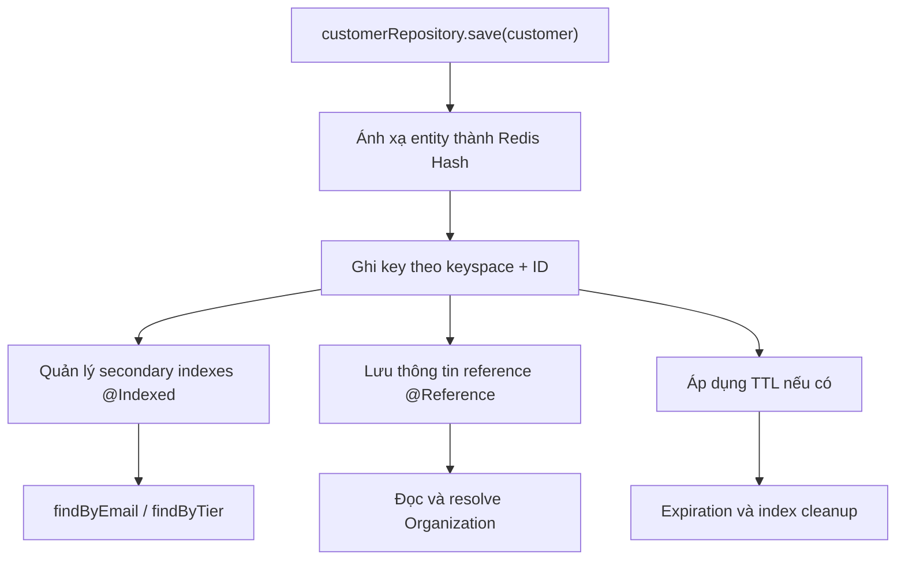
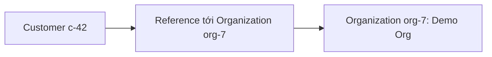

# Kiểm thử Repository, chỉ mục, tham chiếu và TTL trong Spring Data Redis

Khi dùng **Spring Data Redis Repositories**, ứng dụng không chỉ gọi `GET`/`SET`. Framework còn ánh xạ đối tượng Java thành Redis Hash, quản lý định danh, ghi các **secondary index** cho thuộc tính có `@Indexed`, lưu và giải tham chiếu `@Reference`, đồng thời hỗ trợ giới hạn thời gian sống qua `@TimeToLive` hoặc `@RedisHash(timeToLive = ...)`.

Chính vì vậy, một bài kiểm thử chỉ xác nhận “`repository.save(entity)` rồi `findById(id)` trả về đối tượng” **chưa đủ**. Một hệ thống có thể lưu và đọc entity thành công nhưng truy vấn bằng trường được đánh index không trả kết quả, quan hệ tham chiếu không được lưu đúng thứ tự, hoặc TTL làm entity biến mất ngay khi test đang kiểm tra.

Bài học này tập trung vào **kiểm thử hành vi của Redis Repository**, đặc biệt bốn lớp:

1. **Repository mapping:** lưu, tìm theo ID, cập nhật, xóa và phân biệt dữ liệu sau khi tải lại.
2. **Secondary index:** truy vấn bằng thuộc tính `@Indexed`, cập nhật giá trị được index và dọn index khi entity bị xóa hoặc hết hạn.
3. **Reference:** lưu một entity tham chiếu đến entity khác bằng `@Reference`; kiểm tra việc resolve và các tình huống dangling reference.
4. **TTL:** thiết lập thời gian sống, kiểm tra expiration, tránh test phụ thuộc thời gian tuyệt đối và hiểu vai trò của keyspace notifications.

Ta sẽ dùng **JUnit 5, Spring Boot, Spring Data Redis, Testcontainers và AssertJ/Awaitility** để chạy kiểm thử tích hợp với một Redis server thật. Những đoạn code được xây dựng quanh cùng một mô hình `Customer`–`Organization` để quan sát rõ các hành vi.

> Lưu ý: ví dụ tập trung vào Redis Repositories của Spring Data Redis. Các API và cách auto-configuration cụ thể có thể thay đổi giữa các bản Spring Boot/Spring Data Redis; khi đưa vào dự án, cần sử dụng dependency tương thích với phiên bản hiện tại.

## 1. Vì sao phải kiểm thử Repository trên Redis thật?

Spring Data Redis hỗ trợ `CrudRepository` cho đối tượng được ánh xạ bằng `@RedisHash`. Ví dụ:

```java
Customer saved = customerRepository.save(customer);
Optional<Customer> found = customerRepository.findById(saved.getId());
```

Nhưng đằng sau lời gọi có nhiều việc:



Một mock `CustomerRepository` chỉ chứng minh service đã gọi method mong đợi. Nó **không chứng minh** Spring Data Redis đã tạo index, serialize đúng reference hoặc đặt TTL đúng trên Redis.

Do đó, chia kiểm thử thành hai tầng:

| Tầng | Công cụ | Mục tiêu |
|---|---|---|
| Unit test | JUnit + Mockito/fake | Kiểm tra nhánh nghiệp vụ, validation, method interaction |
| Integration test | JUnit + Redis thật, thường qua Testcontainers | Kiểm tra mapping, index, reference, TTL, hành vi Redis command |

Với nội dung bài này, **integration test là tầng chính**.

### 1.1. Những thứ mock Redis khó tái tạo chính xác

- Redis Hash và serializer/mapping metadata.
- Các key/index do repository infrastructure tạo.
- Hành vi `EXPIRE`, `TTL` và expiration.
- Keyspace notifications và xử lý cleanup không đồng bộ.
- Tính nguyên tử của Redis command/script.
- Trạng thái reference khi entity đích chưa được lưu hoặc đã bị xóa.
- Thứ tự thực tế của các lần thao tác khi nhiều request chạy đồng thời.

Không cần bắt mọi unit test khởi động Redis, nhưng nên có **một bộ kiểm thử tích hợp** bao phủ đúng những hành vi này.

## 2. Mô hình dữ liệu dùng xuyên suốt bài

Giả sử ứng dụng lưu khách hàng và tổ chức mà họ trực thuộc:

```text
Organization
    id
    name

Customer
    id
    email       (@Indexed)
    tier        (@Indexed)
    organization (@Reference -> Organization)
    ttlSeconds  (@TimeToLive)
```

Yêu cầu:

- Tìm `Customer` theo `id`.
- Tìm theo `email` hoặc `tier` qua secondary index.
- Tải một `Customer` và lấy được `Organization` tham chiếu.
- Một số `Customer` chỉ tồn tại tạm thời, có TTL.
- Xóa hoặc hết hạn entity không được khiến các truy vấn tiếp tục trả entity không còn tồn tại.

### 2.1. Lớp Organization

```java
package com.example.redis.model;

import org.springframework.data.annotation.Id;
import org.springframework.data.redis.core.RedisHash;

@RedisHash("lesson:organizations")
public class Organization {

    @Id
    private String id;

    private String name;

    public Organization() {
    }

    public Organization(String id, String name) {
        this.id = id;
        this.name = name;
    }

    public String getId() {
        return id;
    }

    public void setId(String id) {
        this.id = id;
    }

    public String getName() {
        return name;
    }

    public void setName(String name) {
        this.name = name;
    }
}
```

`@RedisHash("lesson:organizations")` xác định keyspace của entity. Ví dụ một organization có ID `org-7` thường được ánh xạ vào key dạng:

```text
lesson:organizations:org-7
```

Tuy nhiên, những key phụ do repository tạo là chi tiết triển khai cần kiểm tra theo phiên bản, không nên tự suy ra toàn bộ cấu trúc index từ một ví dụ.

### 2.2. Lớp Customer

```java
package com.example.redis.model;

import java.util.concurrent.TimeUnit;

import org.springframework.data.annotation.Id;
import org.springframework.data.redis.core.RedisHash;
import org.springframework.data.redis.core.TimeToLive;
import org.springframework.data.redis.core.index.Indexed;
import org.springframework.data.redis.core.index.Reference;

@RedisHash("lesson:customers")
public class Customer {

    @Id
    private String id;

    @Indexed
    private String email;

    @Indexed
    private String tier;

    @Reference
    private Organization organization;

    @TimeToLive(unit = TimeUnit.SECONDS)
    private Long ttlSeconds;

    public Customer() {
    }

    public Customer(String id, String email, String tier) {
        this.id = id;
        this.email = email;
        this.tier = tier;
    }

    public String getId() {
        return id;
    }

    public void setId(String id) {
        this.id = id;
    }

    public String getEmail() {
        return email;
    }

    public void setEmail(String email) {
        this.email = email;
    }

    public String getTier() {
        return tier;
    }

    public void setTier(String tier) {
        this.tier = tier;
    }

    public Organization getOrganization() {
        return organization;
    }

    public void setOrganization(Organization organization) {
        this.organization = organization;
    }

    public Long getTtlSeconds() {
        return ttlSeconds;
    }

    public void setTtlSeconds(Long ttlSeconds) {
        this.ttlSeconds = ttlSeconds;
    }
}
```

Trong ví dụ:

- `@Id` cung cấp định danh entity.
- `@Indexed` báo repository infrastructure duy trì secondary index cho các truy vấn equality phù hợp.
- `@Reference` diễn đạt rằng `Organization` là một entity riêng được liên kết bằng tham chiếu; nó không tự có semantics cascade-save như quan hệ JPA.
- `@TimeToLive` cho phép thuộc tính `ttlSeconds` ảnh hưởng expiration của key Customer.

Khi tải entity có `@TimeToLive`, giá trị thuộc tính có thể phản ánh **TTL còn lại** thay vì hằng số ban đầu đã lưu. Vì thế, không nên viết test cố định rằng `getTtlSeconds()` luôn bằng giá trị lúc `save`.

### 2.3. Repository interfaces

```java
package com.example.redis.repository;

import java.util.List;
import org.springframework.data.repository.CrudRepository;
import com.example.redis.model.Customer;

public interface CustomerRepository
        extends CrudRepository<Customer, String> {

    List<Customer> findByEmail(String email);

    List<Customer> findByTier(String tier);
}
```

```java
package com.example.redis.repository;

import org.springframework.data.repository.CrudRepository;
import com.example.redis.model.Organization;

public interface OrganizationRepository
        extends CrudRepository<Organization, String> {
}
```

Hai finder `findByEmail`/`findByTier` sẽ hoạt động theo cơ chế query derivation và index mà Spring Data Redis hỗ trợ. **Chúng không tương đương quét tùy ý mọi Hash trong Redis**. Khi muốn truy vấn theo một thuộc tính, hãy xác định nó có secondary index phù hợp.

## 3. Kích hoạt Redis Repositories

Một application cấu hình tường minh:

```java
package com.example.redis;

import org.springframework.boot.SpringApplication;
import org.springframework.boot.autoconfigure.SpringBootApplication;
import org.springframework.data.redis.core.RedisKeyValueAdapter;
import org.springframework.data.redis.repository.configuration.EnableRedisRepositories;

@SpringBootApplication
@EnableRedisRepositories(
        enableKeyspaceEvents =
                RedisKeyValueAdapter.EnableKeyspaceEvents.ON_STARTUP,
        shadowCopy = RedisKeyValueAdapter.ShadowCopy.OFF
)
public class RedisRepositoryDemoApplication {

    public static void main(String[] args) {
        SpringApplication.run(
                RedisRepositoryDemoApplication.class, args);
    }
}
```

Ở đây:

- `@EnableRedisRepositories` cho phép Spring tạo implementation cho các repository phù hợp.
- `enableKeyspaceEvents = ON_STARTUP` yêu cầu listener expiration liên quan repository được khởi tạo khi application startup.
- `shadowCopy = OFF` tắt cơ chế shadow copy cho những entity có TTL trong mẫu thử này, tránh bản sao phụ chỉ phục vụ việc mang payload trong expiration event.

**Những lựa chọn trên cần phù hợp môi trường.** Bật expiration event handling đòi hỏi Redis được cấu hình phát notification thích hợp. Một số managed Redis không cho ứng dụng tự gọi `CONFIG SET`; phải cấu hình `notify-keyspace-events` qua cơ chế của nhà cung cấp.

### 3.1. ON_STARTUP không biến event thành durable message

Ngay cả khi listener đã được khởi động:

- Redis keyspace events vận chuyển qua Pub/Sub.
- Event có thể bị mất khi ứng dụng offline.
- Không có replay event đã bị bỏ lỡ.
- Việc dọn index dựa vào expiration events có thể bị ảnh hưởng nếu listener không hoạt động hoặc kết nối không đúng Redis node.

Vì thế, test expiration cần phân biệt **entity key đã hết hạn** với **index metadata đã được cleanup**. Hai điều này không nên bị coi là một khẳng định duy nhất.

## 4. Dependency cho kiểm thử tích hợp

Maven dependency tối thiểu ở tầng ứng dụng:

```xml
<dependency>
    <groupId>org.springframework.boot</groupId>
    <artifactId>spring-boot-starter-data-redis</artifactId>
</dependency>
```

Với test:

```xml
<dependency>
    <groupId>org.springframework.boot</groupId>
    <artifactId>spring-boot-starter-test</artifactId>
    <scope>test</scope>
</dependency>

<dependency>
    <groupId>org.testcontainers</groupId>
    <artifactId>junit-jupiter</artifactId>
    <scope>test</scope>
</dependency>

<dependency>
    <groupId>org.awaitility</groupId>
    <artifactId>awaitility</artifactId>
    <scope>test</scope>
</dependency>
```

Nếu dự án dùng Gradle, cùng ý tưởng:

```gradle
implementation("org.springframework.boot:spring-boot-starter-data-redis")
testImplementation("org.springframework.boot:spring-boot-starter-test")
testImplementation("org.testcontainers:junit-jupiter")
testImplementation("org.awaitility:awaitility")
```

Quản lý version theo BOM/platform tương ứng của Spring Boot và Testcontainers. Các phiên bản Testcontainers mới có thể thay đổi cách nhóm module hoặc package; cần sử dụng đúng artifact và version mà dự án đã chọn.

### 4.1. Vì sao dùng Testcontainers thay cho Redis trên máy cá nhân?

Mỗi lần chạy bộ test, Testcontainers có thể khởi động một Redis container với phiên bản rõ ràng:

- Không phụ thuộc Redis localhost của người phát triển.
- Không làm bẩn dữ liệu Redis dùng chung.
- Dễ chạy lại trên CI có môi trường container tương thích.
- Có thể cố định Redis version để tái hiện lỗi.
- Kiểm thử được Redis TTL, secondary index và Pub/Sub trên server thực.

Testcontainers vẫn cần một container runtime phù hợp trên máy chạy kiểm thử. Nếu CI không có runtime đó, bộ test phải được triển khai trong một môi trường tích hợp Redis tương đương; không nên tự đổi sang mock rồi coi coverage giống nhau.

## 5. Spring Boot integration test với một Redis container

Một test class nền:

```java
package com.example.redis;

import org.junit.jupiter.api.Test;
import org.springframework.beans.factory.annotation.Autowired;
import org.springframework.boot.test.context.SpringBootTest;
import org.springframework.test.context.DynamicPropertyRegistry;
import org.springframework.test.context.DynamicPropertySource;
import org.testcontainers.containers.GenericContainer;
import org.testcontainers.junit.jupiter.Container;
import org.testcontainers.junit.jupiter.Testcontainers;
import org.testcontainers.utility.DockerImageName;

import com.example.redis.repository.CustomerRepository;

@Testcontainers
@SpringBootTest(classes = RedisRepositoryDemoApplication.class)
class CustomerRepositoryIntegrationTest {

    @Container
    static final GenericContainer<?> REDIS =
            new GenericContainer<>(
                    DockerImageName.parse("redis:7.2-alpine"))
                    .withExposedPorts(6379);

    @DynamicPropertySource
    static void redisProperties(DynamicPropertyRegistry registry) {
        registry.add(
                "spring.data.redis.host", REDIS::getHost);
        registry.add(
                "spring.data.redis.port",
                () -> REDIS.getMappedPort(6379));
    }

    @Autowired
    CustomerRepository customers;

    @Test
    void contextLoads() {
        // Các test về mapping/index/reference/TTL sẽ thêm ở sau.
    }
}
```

Với Spring Boot 3.x, các thuộc tính Redis thường nằm ở `spring.data.redis.*`. Với Boot cũ, cần dùng đúng property namespace cho phiên bản đó.

### 5.1. Tại sao dùng DynamicPropertySource?

Port được container runtime cấp thường là port động. Đừng hardcode `localhost:6379` rồi hy vọng container luôn được map đúng.

`@DynamicPropertySource` đăng ký host/port cho Spring context từ container:

```text
Redis container :6379
        |
        v
Host mapped port (ví dụ 49153)
        |
        v
spring.data.redis.host / port
        |
        v
LettuceConnectionFactory -> Repositories
```

Khi kiểm thử môi trường nhiều profile, cũng cần xác nhận không có bean `RedisConnectionFactory` tự tạo ghi đè các property dynamic này.

### 5.2. Khởi tạo listener expiration trước khi phát TTL key

Với một test kiểm tra **keyspace notification**, application context và subscription phải được khởi tạo trước khi test lưu entity có TTL. Nếu app chỉ đăng ký listener sau khi key đã hết hạn, thông báo cũ không được Redis Pub/Sub replay.

Với test chỉ kiểm tra “`findById` không trả entity quá hạn”, không nhất thiết phải chờ expiration event, vì Redis tự xác định key còn hiệu lực khi đọc.

## 6. Kiểm tra lưu và đọc Repository theo ID

Kiểm thử cơ bản:

```java
@Test
void saveThenFindByIdRestoresMappedFields() {
    String id = "customer-" + UUID.randomUUID();
    Customer customer = new Customer(
            id,
            "user-" + id + "@example.test",
            "STANDARD");

    customers.save(customer);

    Customer loaded = customers.findById(id).orElseThrow();

    assertThat(loaded.getId()).isEqualTo(id);
    assertThat(loaded.getEmail()).isEqualTo(
            "user-" + id + "@example.test");
    assertThat(loaded.getTier()).isEqualTo("STANDARD");
}
```

Ví dụ dùng `UUID` và AssertJ; trong file test thực tế cần các import:

```java
import java.util.UUID;
import static org.assertj.core.api.Assertions.assertThat;
```

Việc gọi lại `findById` kiểm tra repository mapping, không chỉ object Java đã có sẵn trong memory.

### 6.1. Kiểm tra tồn tại và không tồn tại

```java
assertThat(customers.existsById(id)).isTrue();

customers.deleteById(id);

assertThat(customers.existsById(id)).isFalse();
assertThat(customers.findById(id)).isEmpty();
```

Test cần dùng ID riêng để không xóa data của test khác. Nếu app có cache bên ngoài Redis repository, phải xác định đúng lớp đang kiểm tra.

### 6.2. Vì sao không assert toàn bộ object bằng ==

```java
assertThat(loaded).isSameAs(customer); // Không phải mục tiêu.
```

Repository tải entity từ storage có thể tạo một Java object khác. Test nên so sánh **field nghiệp vụ** hoặc `equals` được định nghĩa có ý nghĩa, không yêu cầu cùng object identity.

Tương tự, không cần biết framework lưu thêm bao nhiêu key phụ để chứng minh entity được round-trip thành công.

## 7. Test isolation: không để dữ liệu của test A làm hỏng test B

Redis Repositories có thể tạo key chính, keyspace set, secondary index set và metadata phục vụ TTL. Chỉ xóa một key trực tiếp bằng Redis `DEL` có thể **bỏ qua cơ chế cleanup repository**.

Các chiến lược:

1. Mỗi test dùng ID/email duy nhất (`UUID`) và keyspace riêng.
2. Mỗi test suite dùng Redis container riêng hoặc một namespace được quản lý rõ.
3. Với entity do repository tạo, ưu tiên `repository.deleteById` / `deleteAll` khi phù hợp để framework dọn metadata liên quan.
4. Nếu test cần `FLUSHDB`, chỉ thực hiện trên **Redis disposable dành riêng cho test**, tuyệt đối không trên Redis shared.
5. Không cho các test cùng keyspace chạy song song nếu chúng dùng cleanup toàn cục.

### 7.1. Một mẫu cleanup rõ ràng

Ví dụ trong test class:

```java
private final List<String> customerIds = new ArrayList<>();
private final List<String> organizationIds = new ArrayList<>();

@AfterEach
void cleanup() {
    customerIds.forEach(customers::deleteById);
    organizationIds.forEach(organizations::deleteById);
}
```

Khi tạo fixture, thêm ID vào các danh sách:

```java
String id = "customer-" + UUID.randomUUID();
customerIds.add(id);
customers.save(new Customer(id, uniqueEmail(), "STANDARD"));
```

Đây là pattern minh họa; một test class thực tế cần inject cả `OrganizationRepository` và import các lớp collection/JUnit. Nếu muốn test riêng hành vi cleanup sau expiration, không nên dùng cleanup thủ công quá sớm làm mất tín hiệu cần quan sát.

### 7.2. Vì sao tránh mock repository trong test index?

Mock dễ viết:

```java
when(customers.findByEmail("a@example.test"))
        .thenReturn(List.of(customer));
```

Nhưng nó chỉ chứng minh mock đã được lập trình như vậy. Nó **không** chứng minh `@Indexed` được tạo, cập nhật hoặc xóa đúng trên Redis.

## 8. Secondary index của Spring Data Redis hoạt động thế nào?

Redis không phải một cơ sở dữ liệu quan hệ tự có index cho mọi thuộc tính Hash. Spring Data Redis hỗ trợ **secondary indexes** thông qua metadata mapping và những cấu trúc Redis được framework quản lý.

Ví dụ:

```java
@Indexed
private String email;
```

Khi repository lưu một Customer, framework lưu entity và tạo/cập nhật thông tin index phục vụ query theo `email`.

Ở mức khái niệm:

```text
Customer(id=c1, email=a@example.test)
       |
       +-> Entity Hash cho c1
       |
       +-> Secondary index: email=a@example.test -> tham chiếu c1
```

Cách đặt tên key index và dữ liệu phụ thuộc Spring Data Redis version và mapping configuration. **Không viết production code dựa vào tên index key nội bộ** nếu chưa có hợp đồng ổn định.

### 8.1. Derived finder cần index phù hợp

Repository:

```java
List<Customer> findByEmail(String email);
List<Customer> findByTier(String tier);
```

Entity:

```java
@Indexed private String email;
@Indexed private String tier;
```

Đây là cách kết nối giữa thuộc tính được index và truy vấn equality.

Nếu chỉ tạo method `findByEmail` mà không có secondary index tương ứng, đừng giả định Spring Data Redis sẽ scan mọi Hash để tự lọc như SQL table. Khả năng query dựa trên các chỉ mục được hỗ trợ và cách chúng được duy trì.

## 9. Kiểm thử index sau khi save

Một test:

```java
@Test
void findByIndexedEmailReturnsSavedCustomer() {
    String id = "c-" + UUID.randomUUID();
    String email = id + "@example.test";

    Customer customer = new Customer(id, email, "GOLD");
    customers.save(customer);

    List<Customer> matches = customers.findByEmail(email);

    assertThat(matches)
            .extracting(Customer::getId)
            .containsExactly(id);
}
```

Test này xác minh **hành vi truy vấn index**, không cần tự đọc Redis Set nội bộ.

Kiểm tra tier:

```java
@Test
void findByTierReturnsMatchingCustomers() {
    String suffix = UUID.randomUUID().toString();

    customers.save(new Customer(
            "c1-" + suffix, "c1-" + suffix + "@example.test", "GOLD"));
    customers.save(new Customer(
            "c2-" + suffix, "c2-" + suffix + "@example.test", "GOLD"));

    List<Customer> matches = customers.findByTier("GOLD");

    assertThat(matches)
            .extracting(Customer::getId)
            .contains("c1-" + suffix, "c2-" + suffix);
}
```

**Chú ý test isolation:** nếu cùng Redis container còn Customer GOLD từ test khác, `containsExactlyInAnyOrder(...)` hoặc `hasSize(2)` có thể sai. Dùng keyspace/test data riêng hoặc assert tối thiểu hai ID do chính test tạo và cleanup rõ ràng.

## 10. Kiểm thử cập nhật một thuộc tính được index

Một tình huống quan trọng:

```text
Customer c1:
    email = old@example.test

Update:
    email = new@example.test

Kỳ vọng:
    findByEmail(old) -> không có c1
    findByEmail(new) -> có c1
```

Test:

```java
@Test
void changingIndexedEmailUpdatesRepositoryQueries() {
    String id = "c-" + UUID.randomUUID();
    String oldEmail = id + "-old@example.test";
    String newEmail = id + "-new@example.test";

    Customer customer = new Customer(
            id, oldEmail, "STANDARD");
    customers.save(customer);

    customer.setEmail(newEmail);
    customers.save(customer);

    assertThat(customers.findByEmail(oldEmail))
            .extracting(Customer::getId)
            .doesNotContain(id);

    assertThat(customers.findByEmail(newEmail))
            .extracting(Customer::getId)
            .contains(id);
}
```

Đây là test nhằm kiểm tra **maintenance của secondary index** khi đối tượng thay đổi. Để có kết luận rõ, giữ email của test là duy nhất.

### 10.1. Sai lầm: cập nhật Hash trực tiếp và kỳ vọng index tự đồng bộ

Ví dụ ý tưởng:

```text
Repository.save(customer) tạo entity Hash và secondary index

Sau đó:
Redis HSET entityKey email "new@example.test"

Repository.findByEmail("new@example.test") ?
```

Nếu bạn chỉnh Hash trực tiếp bằng Redis command/`opsForHash()`, **repository infrastructure có thể không biết** để cập nhật index. Vì vậy, test nên dùng đúng đường ghi mà production dùng:

- Nếu production chỉ dùng Repository, kiểm thử repository save/update.
- Nếu production trộn Repository với RedisTemplate và Lua, cần kiểm thử sự nhất quán index sau những đường ghi đó.
- Nếu đường ghi trực tiếp là bắt buộc, phải có chính sách tự cập nhật index hoặc thiết kế lại cách query.

Không viết test dựa trên `findByEmail` rồi giả định lệnh `HSET` ngoài repository tự cập nhật index như database trigger.

## 11. Kiểm thử xóa entity và index

Test:

```java
@Test
void deletingCustomerRemovesItFromIndexedQuery() {
    String id = "c-" + UUID.randomUUID();
    String email = id + "@example.test";

    customers.save(new Customer(id, email, "STANDARD"));
    assertThat(customers.findByEmail(email))
            .extracting(Customer::getId)
            .contains(id);

    customers.deleteById(id);

    assertThat(customers.findById(id)).isEmpty();
    assertThat(customers.findByEmail(email))
            .extracting(Customer::getId)
            .doesNotContain(id);
}
```

Điều mà test khẳng định:

1. Entity đã được lưu và query qua index tìm thấy.
2. Xóa bằng Repository.
3. `findById` không còn entity.
4. Truy vấn `findByEmail` không trả Customer đã xóa.

Nếu chỉ kiểm tra `findById` rỗng, chưa xác nhận hành vi của index.

### 11.1. Không nhầm kết quả finder rỗng với index key đã được dọn hoàn toàn

Một query dựa trên index có thể không trả entity đã bị xóa ngay cả khi một số metadata index tạm thời còn tồn tại. Nếu muốn chứng minh **không còn stale membership**, cần một test quan sát metadata được framework quản lý, có tính đến version và cơ chế cleanup.

Nên tách:

- **Black-box test:** finder không trả entity đã xóa/hết hạn.
- **White-box/diagnostic test:** inspect những index key/sets cụ thể của phiên bản đang dùng.

Không ghép hai kết luận thành một khi chỉ đo black-box result.

## 12. Secondary index không phải full-text search

`@Indexed` hỗ trợ các truy vấn nhất định, thường equality. Nó không tự biến Redis thành SQL engine hay công cụ tìm kiếm văn bản.

Ví dụ cần phân biệt:

| Nhu cầu | Cách tiếp cận |
|---|---|
| Tìm Customer có email đúng bằng một chuỗi | Secondary index thích hợp |
| Tìm theo tier đúng giá trị | Secondary index thích hợp |
| Tìm email có chứa chuỗi bất kỳ | Không mặc định là tính năng của `@Indexed` |
| Tìm theo nhiều điều kiện phức tạp, sort, pagination lớn | Đánh giá giới hạn repository query và thiết kế index phù hợp |
| Full-text search | Cân nhắc công cụ tìm kiếm chuyên dụng hoặc Redis Search nếu được triển khai |

Vì vậy, test `findByEmail` thành công không chứng minh mọi biến thể của `findByEmailContaining` hoặc các phép so sánh khác được hỗ trợ.

## 13. Reference trong Redis Repository là gì?

Giả sử mỗi Customer liên kết tới một Organization:

```java
@Reference
private Organization organization;
```

Mục tiêu: tránh nhúng toàn bộ nội dung Organization vào Customer. Redis Repository lưu một **tham chiếu tới entity khác** theo cơ chế mapping của Spring Data Redis.



Đây không phải foreign key trong database quan hệ:

- Redis không tự bảo đảm Organization còn tồn tại.
- Không có cascade-save/cascade-delete như một giả định mặc định.
- Các lần `save` của hai repository không tự ở trong một transaction ACID chung.
- Secondary index của Customer không tự trở thành index trên các field nội bộ của Organization.

### 13.1. Lưu entity đích trước

```java
Organization org = new Organization(
        "org-" + UUID.randomUUID(), "Demo Organization");

organizations.save(org);

Customer customer = new Customer(
        "c-" + UUID.randomUUID(),
        "customer@example.test",
        "GOLD");
customer.setOrganization(org);

customers.save(customer);
```

Khi load Customer, repository mapping có cơ hội resolve Organization dựa trên reference đã lưu.

### 13.2. Reference không có nghĩa tự lưu toàn bộ object graph

Nếu chỉ:

```java
Organization org = new Organization("org-unknown", "Not Saved");

Customer customer = new Customer(
        "c-1", "c1@example.test", "STANDARD");
customer.setOrganization(org);
customers.save(customer);
```

đừng mặc định Organization được repository tạo tự động. `@Reference` không phải lời hứa cascade persistence. Với workflow cần cả hai, hãy gọi OrganizationRepository `save` tường minh trước.

## 14. Kiểm thử reference được resolve khi đọc lại

Test:

```java
@Test
void customerReferenceResolvesSavedOrganization() {
    String suffix = UUID.randomUUID().toString();

    Organization org = new Organization(
            "org-" + suffix, "ACME Test Organization");
    organizations.save(org);

    Customer customer = new Customer(
            "c-" + suffix,
            "c-" + suffix + "@example.test",
            "GOLD");
    customer.setOrganization(org);
    customers.save(customer);

    Customer loaded = customers
            .findById(customer.getId())
            .orElseThrow();

    assertThat(loaded.getOrganization()).isNotNull();
    assertThat(loaded.getOrganization().getId())
            .isEqualTo(org.getId());
    assertThat(loaded.getOrganization().getName())
            .isEqualTo("ACME Test Organization");
}
```

Điểm quan trọng là **tải Customer qua Repository sau khi đã save**, thay vì chỉ assert `customer.getOrganization()` trên object Java ban đầu. Đối tượng gốc đã có trường được set trong memory và không chứng minh Redis reference hoạt động.

### 14.1. Kiểm tra mapping không tự cascade save

Một hướng test khác:

```java
Organization unsaved = new Organization(
        "org-" + UUID.randomUUID(), "Not Persisted");

Customer customer = new Customer(
        "c-" + UUID.randomUUID(),
        "no-cascade@example.test",
        "STANDARD");
customer.setOrganization(unsaved);
customers.save(customer);

assertThat(organizations.existsById(unsaved.getId()))
        .isFalse();
```

Mục tiêu là làm rõ **trách nhiệm lưu Organization thuộc OrganizationRepository**. Khi áp dụng vào phiên bản cụ thể, còn cần xác định hành vi giải tham chiếu nếu entity đích không tồn tại và không đặt giả định quá mạnh vào cách exception/null của mapper.

## 15. Dangling reference: entity đích bị xóa

Một tình huống:

```text
T1: Organization org-7 tồn tại
T2: Customer c-42 tham chiếu org-7
T3: Organization org-7 bị xóa
T4: Đọc lại Customer c-42
```

Redis không có foreign key constraint tự động ngăn T3. Trạng thái lúc T4 phụ thuộc cách mapper resolve missing reference và phiên bản đang dùng.

Vì thế, một integration test nên xác nhận **policy ứng dụng**:

- Nếu Organization thiếu, API có từ chối không?
- Có trả Customer với reference vắng mặt không?
- Có phát cảnh báo dữ liệu không nhất quán không?
- Có cleanup reference trước khi xóa Organization không?

Ví dụ test dạng khung:

```java
@Test
void deletingReferencedOrganizationHasDefinedPolicy() {
    // Arrange: lưu org, lưu customer trỏ tới org.
    // Act: organizations.deleteById(orgId).
    // Assert: ứng dụng xử lý missing reference theo policy.
    // Không giả định Redis tự cascade-delete customer.
}
```

Đừng phụ thuộc vào một kiểu exception cố định của mapper nếu version của Spring Data Redis chưa được xác nhận. Điều bất biến cần hiểu là **reference không có relational integrity như RDBMS**.

### 15.1. Reference không phải công cụ join theo field

Không nên suy ra rằng:

```java
List<Customer> findByOrganizationName(String name);
```

tự được thực hiện như một SQL JOIN chỉ nhờ `@Reference`. Nếu cần tìm tất cả Customer thuộc Organization, thường phù hợp hơn là lưu một field scalar được index như `organizationId` trên Customer, hoặc duy trì một index riêng theo mô hình truy vấn thực tế.

Khi thêm field `organizationId`, test phải xác minh đồng bộ giữa field ID và reference, tránh hai nguồn thông tin mâu thuẫn.

## 16. TTL trong Spring Data Redis Repositories

Có hai cách phổ biến thể hiện TTL:

**TTL cố định cho loại entity:**

```java
@RedisHash(value = "temporary:customers", timeToLive = 60)
public class TemporaryCustomer {
    @Id
    private String id;
}
```

Ở ví dụ này, mỗi entity dùng keyspace tương ứng có TTL cấu hình ở annotation.

**TTL động trên thuộc tính:**

```java
@TimeToLive(unit = TimeUnit.SECONDS)
private Long ttlSeconds;
```

Trước khi save:

```java
Customer customer = new Customer(id, email, "STANDARD");
customer.setTtlSeconds(5L);
customers.save(customer);
```

TTL được áp lên Redis key chính của Customer theo mapping.

### 16.1. Không phối hợp hai nguồn TTL tùy tiện

Khi entity có cả `@RedisHash(timeToLive = ...)` và `@TimeToLive`, cần hiểu cách Spring Data Redis chọn expiration effective. Đừng đặt hai giá trị xung đột rồi viết test dựa vào dự đoán.

Trong bài này, dùng một field `ttlSeconds` để kiểm thử từng entity. Nếu code production chọn TTL cố định ở annotation, nên có bộ test riêng tương ứng.

### 16.2. @TimeToLive khi đọc lại có thể là thời gian còn lại

Giả sử:

```java
customer.setTtlSeconds(30L);
customers.save(customer);
```

Sau 5 giây:

```java
Customer loaded = customers.findById(id).orElseThrow();
Long ttl = loaded.getTtlSeconds();
```

Giá trị `ttl` có thể nhỏ hơn `30` vì framework đọc lại TTL hiện tại. Do đó, assertion:

```java
assertThat(loaded.getTtlSeconds()).isEqualTo(30L);
```

là một kiểu test dễ bị flaky. Nên kiểm tra giá trị nằm trong khoảng có ý nghĩa, hoặc kiểm tra trực tiếp TTL trên Redis key.

## 17. Kiểm thử TTL ngay sau khi lưu

`StringRedisTemplate.getExpire(...)` giúp quan sát thời gian sống của key.

```java
@Autowired
StringRedisTemplate redis;

@Test
void savingCustomerWithTtlSetsRedisExpiration() {
    String id = "c-" + UUID.randomUUID();
    Customer customer = new Customer(
            id, id + "@example.test", "TEMP");
    customer.setTtlSeconds(10L);

    customers.save(customer);

    String key = "lesson:customers:" + id;
    Long ttlMillis = redis.getExpire(
            key, TimeUnit.MILLISECONDS);

    assertThat(ttlMillis).isNotNull();
    assertThat(ttlMillis).isPositive();
    assertThat(ttlMillis)
            .isLessThanOrEqualTo(10_000L);
}
```

Kiểm thử dùng keyspace `lesson:customers` đã khai báo. Với cấu hình keyspace customization hoặc serializer đặc biệt, key thực tế có thể khác; xác nhận mapping của dự án khi dùng cách kiểm tra TTL trực tiếp.

### 17.1. Các giá trị đặc biệt của TTL

Lệnh Redis:

```redis
TTL lesson:customers:c-42
PTTL lesson:customers:c-42
```

Kết quả:

| Giá trị | Ý nghĩa |
|---|---|
| Số không âm | Thời gian còn lại theo giây/ms |
| `-1` | Key tồn tại nhưng không có expiration |
| `-2` | Key không tồn tại hoặc đã hết hạn |

Nếu test cho một entity phải có TTL nhưng nhận `-1`, đó là dấu hiệu cần điều tra mapping hoặc đường ghi.

Không cần assert TTL bằng đúng `10_000L`, vì thời gian trôi giữa `save` và `PTTL`.

### 17.2. TTL dương không có nghĩa entity chắc chắn tồn tại đến cuối

Redis key có thể bị xóa bằng repository, `DEL`, eviction hoặc mất khi hạ tầng có vấn đề. TTL là giới hạn trên về lifetime theo server, không phải bảo đảm giữ tồn tại đủ số giây đã cấu hình.

## 18. Kiểm thử entity tự biến mất sau TTL

Đừng dùng một lời gọi `Thread.sleep(2000)` rồi khẳng định Redis chắc chắn đã phát expiration event đúng thời điểm. Sự kiện expiration và thời điểm GC nội bộ của Redis có thể không trùng chính xác với deadline.

Với mục tiêu “Repository không còn đọc được entity sau TTL”, dùng polling có timeout:

```java
import static org.awaitility.Awaitility.await;
import static org.assertj.core.api.Assertions.assertThat;

import java.time.Duration;

@Test
void customerBecomesUnavailableAfterTtl() {
    String id = "c-" + UUID.randomUUID();
    Customer customer = new Customer(
            id, id + "@example.test", "TEMP");
    customer.setTtlSeconds(2L);

    customers.save(customer);

    await()
            .atMost(Duration.ofSeconds(10))
            .pollInterval(Duration.ofMillis(100))
            .untilAsserted(() ->
                    assertThat(customers.findById(id)).isEmpty());
}
```

Tác dụng:

- Test chờ tối đa một khoảng có dư địa.
- Không phụ thuộc vào một thời điểm callback cụ thể.
- Kết luận về behavior của Repository khi Redis key đã quá hạn.

Đây là **test timeout có điều kiện**, không phải thay thế cho kiểm thử đầy đủ quy trình keyspace event/index cleanup.

### 18.1. Tránh assert trước expiration khi TTL quá ngắn

Với TTL 1 giây, hệ CI chậm có thể để key hết hạn trước khi assertion `findById(id).isPresent()` chạy. Nếu muốn vừa chứng minh tồn tại ban đầu vừa chứng minh hết hạn:

1. Dùng TTL đủ dài cho kiểm thử ban đầu.
2. Kiểm tra key có TTL dương ngay sau save.
3. Poll đến khi key vắng.
4. Chọn timeout có dư địa cho CI.

Không thiết kế một test dựa trên giả định mọi máy chạy đúng lịch của từng thread ở mức millisecond.

## 19. Kiểm thử index sau khi TTL hết hạn

Giả sử Customer được index theo email:

```text
Customer c1
    email = temp@example.test
    TTL = 2 giây
```

Sau TTL:

- Entity Hash đã hết hạn.
- Query `findById(c1)` không trả entity.
- Query `findByEmail(temp@example.test)` không được trả một Customer hợp lệ đã hết hạn.
- Index metadata có thể cần **cleanup qua expiration listener**.

Một test black-box:

```java
@Test
void expiredCustomerIsNotReturnedByIndexedFinder() {
    String id = "c-" + UUID.randomUUID();
    String email = id + "@example.test";

    Customer customer = new Customer(id, email, "TEMP");
    customer.setTtlSeconds(2L);
    customers.save(customer);

    assertThat(customers.findByEmail(email))
            .extracting(Customer::getId)
            .contains(id);

    await()
            .atMost(Duration.ofSeconds(10))
            .untilAsserted(() ->
                    assertThat(customers.findByEmail(email))
                            .extracting(Customer::getId)
                            .doesNotContain(id));
}
```

**Điều test này chứng minh:** finder không trả entity đã hết hạn khi quan sát trong thời gian chờ.

**Điều nó chưa chứng minh:** mọi secondary index set đã được cleanup hoàn toàn. Một stale index reference có thể vẫn tồn tại nhưng không resolve ra entity. Nếu yêu cầu kiểm tra metadata, cần test riêng ở tầng nội bộ hoặc dùng cơ chế quan sát phù hợp.

### 19.1. Vì sao index cleanup khi TTL khác với delete qua Repository?

Khi gọi:

```java
customers.deleteById(id);
```

Spring Data Redis có cơ hội chủ động cập nhật metadata/index theo code path repository.

Khi Redis **tự xóa key vì TTL**, việc xóa xảy ra ở server. Repository infrastructure không thực thi `deleteById` tại thời điểm đó. Cơ chế theo dõi keyspace expiration events giúp framework phản ứng để dọn metadata.

Nếu event mất do subscriber offline hoặc Redis không bật notification, một số index references có thể tồn tại lâu hơn mong muốn.

## 20. Keyspace notifications liên quan đến TTL và index

Redis hỗ trợ:

```redis
CONFIG GET notify-keyspace-events
```

Để phát những **keyevent expired** thông thường:

```redis
CONFIG SET notify-keyspace-events Ex
```

Ở đó:

- `E` chọn keyevent channel.
- `x` chọn expiration events.
- Kênh thường có dạng `__keyevent@0__:expired`.

Trong Spring Data Redis Repositories, listener expiration có thể sử dụng sự kiện này để publish Spring application event và hỗ trợ cleanup index metadata liên quan.

### 20.1. Đừng bật nhầm notification chỉ trên máy local

Một test chạy trên Redis container do `Testcontainers` quản lý có thể được quyền `CONFIG SET`, còn Redis managed production có thể cấm cấu hình runtime.

Điều này có nghĩa:

- Test pass không tự bảo đảm production có notify flags giống test.
- Nếu production không cho `CONFIG SET`, cấu hình notification phải được bật qua provider.
- Không cấp quyền quản trị rộng cho application user chỉ để cho test/config chạy.

### 20.2. Mất keyspace event khi app offline

```text
T1: Customer c1 được lưu với TTL
T2: Tất cả app instance/listener offline
T3: Redis xóa key c1 do TTL, phát expired notification
T4: App khởi động lại
```

Thông báo ở T3 **không được phát lại** chỉ vì subscriber quay lại T4. Vì vậy, nếu metadata index tồn tại và phụ thuộc cleanup event, có nguy cơ stale metadata.

Đây là giới hạn quan trọng của việc sử dụng Redis Pub/Sub làm tín hiệu, không phải lỗi riêng của JUnit.

## 21. Shadow copy / phantom copy khi entity có TTL

Trong một số cấu hình, Spring Data Redis Repositories lưu thêm một **shadow copy** của entity có TTL, thường sống lâu hơn bản gốc một khoảng thời gian, để event expiration vẫn có thể mang dữ liệu entity sau khi key chính đã bị Redis xóa.

Ví dụ:

```text
Customer key (TTL 120 giây)
    |
    +-- hết hạn ở T+120

Shadow copy
    |
    +-- còn thêm một khoảng thời gian để hỗ trợ event payload
```

Vì vậy, quan sát Redis key count có thể thấy thêm dữ liệu phụ ngoài entity key chính.

### 21.1. ShadowCopy.OFF trong bài học có tác dụng gì?

Trong cấu hình:

```java
@EnableRedisRepositories(
        enableKeyspaceEvents =
                RedisKeyValueAdapter.EnableKeyspaceEvents.ON_STARTUP,
        shadowCopy = RedisKeyValueAdapter.ShadowCopy.OFF
)
```

ta tắt shadow copy vì các test chỉ cần ID/index/reference/TTL, không cần payload đầy đủ trong Spring expiration event.

Không nên kết luận “không có shadow copy” đồng nghĩa “không còn listener” hoặc “index chắc chắn không cleanup”. Đây là những cấu hình liên quan nhưng có vai trò khác nhau.

### 21.2. Khi cần test event có payload

Nếu app thật sử dụng `RedisKeyExpiredEvent<Customer>` và cần nhận toàn bộ Customer đã hết hạn, phải chọn cách cấu hình shadow copy phù hợp, rồi kiểm thử event handler. Không được kỳ vọng một expired notification Redis thuần chứa các field của Customer: message Redis thường chỉ chứa **tên key**.

Điều này cũng làm tăng tiêu thụ bộ nhớ vì shadow copy được duy trì thêm; production cần đánh giá tài nguyên.

## 22. Kiểm thử expiration event: không đồng nhất với TTL test

Một test quan sát sự kiện hết hạn có thể dùng một listener Spring:

```java
import org.springframework.context.event.EventListener;
import org.springframework.data.redis.core.RedisKeyExpiredEvent;

@Component
public class ExpiredCustomerEventSink {

    private final BlockingQueue<String> expiredKeys =
            new LinkedBlockingQueue<>();

    @EventListener
    public void onExpired(RedisKeyExpiredEvent<?> event) {
        expiredKeys.offer(
                new String(
                        event.getId(),
                        StandardCharsets.UTF_8));
    }

    public String poll(long timeout, TimeUnit unit)
            throws InterruptedException {
        return expiredKeys.poll(timeout, unit);
    }
}
```

Đây là **mẫu observer**: API accessor của ID/payload và cách diễn giải bytes cần khớp phiên bản Spring Data Redis cụ thể. Listener còn có thể nhận event từ các entity/keyspace khác; test phải lọc ID/prefix thực tế.

Một test có thể:

1. Đảm bảo Redis server bật expired notifications.
2. Đảm bảo Spring listener đã subscribe.
3. Tạo Customer với TTL đủ ngắn.
4. Chờ event trong một khoảng thời gian có dư địa.
5. So sánh ID/key của event.

### 22.1. Event không phải bảo đảm delivery

Ngay cả khi integration test nhận được event nhiều lần liên tiếp, **production không có durable replay** của Pub/Sub. Không dùng event duy nhất này để xử lý nghiệp vụ bắt buộc như thanh toán hoặc xóa dữ liệu theo quy định.

Nếu logic yêu cầu không bỏ sót, phải có nguồn dữ liệu bền và reconciliation theo deadline, hoặc một event pipeline chuyên dụng.

## 23. Reference và TTL cùng tồn tại: chuyện gì xảy ra?

Giả sử:

```text
Organization org-7: không TTL

Customer c1:
    organization -> org-7
    TTL = 60 giây
```

Sau khi Customer hết hạn:

- Customer key không còn hợp lệ.
- Organization vẫn có thể tồn tại.
- Repository không mặc định xóa Organization chỉ vì một Customer tham chiếu đến nó đã hết hạn.

Test:

```java
@Test
void customerExpiryDoesNotDeleteReferencedOrganization() {
    String suffix = UUID.randomUUID().toString();
    Organization org = new Organization(
            "org-" + suffix, "Persisted Organization");
    organizations.save(org);

    Customer customer = new Customer(
            "c-" + suffix,
            "ttl-" + suffix + "@example.test",
            "TEMP");
    customer.setOrganization(org);
    customer.setTtlSeconds(2L);
    customers.save(customer);

    await()
            .atMost(Duration.ofSeconds(10))
            .untilAsserted(() ->
                    assertThat(customers.findById(customer.getId()))
                            .isEmpty());

    assertThat(organizations.findById(org.getId()))
            .isPresent();
}
```

Test này nhấn mạnh **không có cascade delete mặc định từ Customer sang Organization**.

Ngược lại, nếu Organization có TTL ngắn và hết hạn trước Customer, reference từ Customer có thể trở thành dangling. Hãy kiểm thử chính sách đọc và xử lý missing reference thay vì mặc định dữ liệu sẽ tự nhất quán.

## 24. Một Entity thay đổi TTL sau khi save

Thử:

```java
Customer customer = new Customer(
        id, email, "TEMP");
customer.setTtlSeconds(30L);
customers.save(customer);

Customer loaded = customers.findById(id).orElseThrow();
loaded.setTtlSeconds(60L);
customers.save(loaded);
```

Đây là hành động **thay đổi TTL theo thiết kế ứng dụng**. Test cần xác nhận:

- Redis TTL sau save thứ hai là khoảng tương ứng.
- Index query vẫn hoạt động.
- Reference vẫn được load.
- Hành vi của việc refresh TTL đúng policy.

Không vô tình `save(loaded)` sau một thao tác cập nhật khác nếu `loaded.getTtlSeconds()` đang biểu diễn **TTL còn lại**, vì thao tác đó có thể áp lại một expiration khác với ý định ban đầu.

### 24.1. Redis SET và Redis Hash khác nhau về TTL

Một lệnh `SET key value` thông thường có thể xóa TTL đang có của String key nếu không kèm tùy chọn giữ TTL.

Repository dựa trên Redis Hash với mapping riêng; đừng suy diễn hành vi TTL của mọi thao tác hash từ `SET`. Cần test đường cập nhật thực tế (repository save, direct hash update, script...) của dự án.

## 25. Dọn index khi xóa trực tiếp Redis key: tình huống cần tránh

Giả sử:

```text
CustomerRepository.save(c1)
    -> tạo entity Hash
    -> tạo index cho email

stringRedisTemplate.delete("lesson:customers:c1")
    -> xóa entity Hash trực tiếp
    -> repository không nhất thiết thực hiện cleanup index
```

Nếu dự án có cả repository và RedisTemplate, cần quy định:

- Đường ghi/xóa chính của entity là gì?
- Khi nào được phép gọi `DEL` trực tiếp?
- Cách đồng bộ secondary index ra sao nếu bypass repository?
- Có công cụ rebuild index khi metadata lệch không?

Trên production, việc stale index làm tăng chi phí truy vấn, gây kết quả không mong đợi hoặc tích lũy metadata. Test black-box và diagnostic cần phản ánh cách ghi/xóa thật.

## 26. Kiểm thử serializer và schema mapping

Redis repository ánh xạ dữ liệu qua Spring Data Redis mapping infrastructure. Nếu ứng dụng tự cấu hình converters hoặc serializer, test phải bao phủ kiểu dữ liệu thực:

- Chuỗi Unicode trong tên.
- Chuỗi rỗng hoặc field vắng mặt.
- Enum hoặc scalar được convert.
- ID chứa ký tự đặc biệt.
- Nested object không phải `@Reference`.
- Field mới sau khi thay đổi phiên bản model.

Ví dụ:

```java
@Test
void repositoryRoundTripsUnicode() {
    String id = "c-" + UUID.randomUUID();
    Customer customer = new Customer(
            id, "unicode-" + id + "@example.test", "VIP");

    customers.save(customer);

    Customer loaded = customers.findById(id).orElseThrow();
    assertThat(loaded.getEmail()).isEqualTo(
            "unicode-" + id + "@example.test");
}
```

Nếu muốn kiểm tra Unicode một cách thực sự có ích, thêm một field như `displayName` chứa `"Nguyễn Thị Lan"` rồi assert sau readback. Test tên hiển thị thuộc entity là một kiểm tra mapping; không cần trộn việc nó có được index hay không với mục tiêu serializer.

### 26.1. Không khẳng định key Redis là Java serialized bytes khi chưa xem mapper

`StringRedisTemplate` và `RedisTemplate<Object,Object>` có serializer khác nhau. `RedisRepository` dùng mapping riêng. Một test kiểm tra storage nội bộ bằng `StringRedisTemplate.opsForHash()` có thể không giải mã được một số trường tùy cấu hình.

Ưu tiên repository-level assertion cho hành vi hợp đồng. Chỉ khi cần white-box mới đọc trực tiếp Redis Hash và xử lý serializer đúng với production.

## 27. Những rủi ro về thời gian trong test TTL

TTL test rất dễ flaky nếu bị viết như một phép đo đồng hồ chính xác.

### 27.1. Sai: sleep đúng bằng TTL

```java
customer.setTtlSeconds(1L);
customers.save(customer);

Thread.sleep(1000);
assertThat(customers.findById(id)).isEmpty();
```

Lý do không ổn:

- Thời điểm `save` hoàn tất và thời điểm thread sleep bắt đầu không phải cùng mốc.
- Thread scheduler và container runtime có jitter.
- Test có thể bị tạm dừng khi CI bận.
- Spring listener expiration có thời gian nhận callback riêng.

### 27.2. Tốt hơn: await assertion về trạng thái mong muốn

```java
await()
        .atMost(Duration.ofSeconds(10))
        .pollInterval(Duration.ofMillis(100))
        .untilAsserted(() ->
                assertThat(customers.findById(id)).isEmpty());
```

Điều kiện được kiểm tra nhiều lần trong một deadline có giới hạn.

### 27.3. Đừng biến mọi sự chậm trễ thành tăng sleep cố định

Nếu test thường xuyên timeout:

- Redis container có đang khỏe không?
- TTL có thực sự được đặt?
- Key có đang bị ghi lại làm mới TTL không?
- Test đang chờ entity biến mất hay chờ expiration event?
- Listener đã subscribe chưa?
- CI có độ trễ quá lớn không?

Tăng `Thread.sleep` lên 30 giây đôi khi chỉ che lỗi; một test tốt phải có điều kiện chờ cụ thể và thông báo hữu ích khi thất bại.

## 28. Một ma trận test cho Repository, index, reference và TTL

| Tình huống | Hành động | Assertion chính |
|---|---|---|
| Save/read | Save Customer rồi findById | Các field được round-trip |
| Not found | findById ID chưa tạo | Optional.empty |
| Indexed query | Save với email duy nhất | findByEmail trả Customer |
| Update index | Đổi email qua repository.save | Old email không còn ID, new email có ID |
| Delete index | repository.deleteById | findById rỗng và finder không trả ID |
| Reference | Save Organization trước Customer | Load Customer resolve Organization |
| No cascade | Save Customer reference tới org chưa lưu | OrganizationRepository không tự có org |
| Dangling reference | Xóa Organization được tham chiếu | App xử lý theo policy |
| TTL assigned | Save Customer có ttlSeconds | Redis PTTL dương |
| TTL expiration | Chờ hết TTL | Repository không trả Customer |
| Expired indexed entity | Chờ hết TTL | Finder không trả Customer hết hạn |
| TTL/reference | Customer hết hạn | Organization vẫn còn |
| Listener | Bật keyspace events và chờ expired | Observer nhận event theo điều kiện |
| Isolation | Nhiều test khác ID/prefix | Không ảnh hưởng kết quả nhau |

Không cần đưa tất cả tình huống vào một `@Test` duy nhất. Các bài test nhỏ độc lập giúp đọc báo cáo thất bại dễ hơn và xác định rõ lớp đang lỗi.

## 29. So sánh kiểm thử repository và kiểm thử raw RedisTemplate

| Mục tiêu | Repository test | RedisTemplate test |
|---|---|---|
| Ánh xạ `@RedisHash` | Phù hợp | Không trực tiếp kiểm tra toàn bộ framework mapping |
| Tìm bằng `@Indexed` | Bắt buộc có integration test | Có thể inspect index nội bộ để debug |
| `@Reference` resolve | Phù hợp | Không tự resolve như repository mapping |
| `@TimeToLive` | Phù hợp | Có thể kiểm tra `TTL` trên physical key |
| Redis command cụ thể | Có thể cần bổ sung | Phù hợp |
| Script nguyên tử | Không phải focus của repository | RedisTemplate.execute(script) phù hợp |
| Kiểm soát serializer byte | Gián tiếp | Thuận tiện hơn |

Hai hướng kiểm thử bổ sung nhau. Không nên chỉ dựa vào một phía và suy ra phía kia chắc chắn đúng.

## 30. Redis Cluster ảnh hưởng đến kiểm thử thế nào?

Testcontainers một Redis standalone rất phù hợp để chứng minh mapping, index, reference và TTL cơ bản. Nhưng nếu production dùng Redis Cluster, còn cần một **bộ integration test theo cluster** cho các ràng buộc:

- Keyspace và index key có thể thuộc slot khác nhau.
- Một số thao tác repository/index có thể cần nhiều lệnh Redis.
- Lua/multi-key operations có thể gặp `CROSSSLOT`.
- Keyspace expiration notifications phát theo node, subscription không tự broadcast toàn cluster.
- Topology/resharding/failover có thể làm gián đoạn listener.

Đừng kết luận “test standalone pass nên chắc chắn cluster-safe”. Nên tách:

1. Test chức năng repository trên Redis standalone.
2. Test cluster compatibility với deployment topology gần production.
3. Test lỗi mạng/failover nếu yêu cầu độ tin cậy cao.

Một Redis container đơn lẻ **không mô phỏng được** 16.384 slot phân phối qua nhiều primary.

## 31. Kiểm thử sự kiện hết hạn và chỉ mục trong Redis Cluster

Giả sử index cleanup dựa vào expired notifications:

```text
Primary A -> expiration của Customer A
Primary B -> expiration của Customer B

Spring listener chỉ subscribe tới Primary A
```

Khi đó, event ở B có thể không đến listener trên A. Một integration test với standalone không phát hiện được vấn đề này.

Vì thế, nếu production dùng Cluster:

- Xác minh driver/listener subscription topology.
- Kiểm tra khi primary failover hoặc slot di chuyển.
- Kiểm tra khả năng dọn metadata khi application restart.
- Xây cơ chế reconciliation hoặc policy index rebuild nếu nghiệp vụ phụ thuộc metadata sạch.

Không thiết kế một kiểm thử chỉ pass vì tất cả key tình cờ nằm trên một node.

## 32. Không nhầm Repository với JPA Repository

Hai interface có thể cùng tên method `save`/`findById` nhưng semantics khác nhau.

Redis Repositories:

- Ánh xạ vào Redis data structures.
- Secondary indexing do Spring Data Redis quản lý.
- `@Reference` không phải foreign key với constraint.
- Không mặc định cascade transactions như JPA mapping.
- TTL có thể làm entity biến mất mà app không gọi repository.delete.
- Cross-key/cross-node consistency phụ thuộc thiết kế Redis và driver.

Vì vậy, một bài test dựa trên giả định JPA như “lưu parent thì child tự cascade” hoặc “xóa parent thì child tự xóa” không có cơ sở nếu chỉ thêm `@Reference`.

## 33. Khi test fail: phân loại nguyên nhân

### 33.1. findById không thấy sau save

Kiểm tra:

- Ứng dụng có inject đúng repository/connection factory không?
- Redis test container đã sẵn sàng trước khi context dùng Redis chưa?
- Keyspace/entity ID có đúng không?
- Có TTL quá ngắn khiến entity hết hạn ngay không?
- Có test khác xóa dữ liệu cùng namespace không?
- Có serializer/mapping mismatch không?

### 33.2. findById thấy nhưng findByEmail rỗng

Kiểm tra:

- Field `email` có `@Indexed` không?
- Finder có đúng tên property không?
- Entity được ghi bằng repository hay bằng direct Redis command?
- Có giá trị email khác do normalize/case-change không?
- Index metadata có bị xóa/sai do một test khác không?

### 33.3. Cập nhật email nhưng old index vẫn trả Customer

Kiểm tra:

- Code có gọi `repository.save(updatedEntity)` không?
- Có ghi trực tiếp Hash bypass repository không?
- Test có đang query một entity khác cùng email không?
- Mapping index có thay đổi giữa các phiên bản app không?

### 33.4. Reference là null hoặc không resolve

Kiểm tra:

- Entity Organization đã được lưu riêng chưa?
- Organization có `@RedisHash` và `@Id` đúng không?
- ID/reference key có khớp không?
- Entity đích đã hết hạn hoặc bị xóa chưa?
- Các repository có dùng cùng Redis instance/serializer/mapping không?

### 33.5. TTL không được đặt

Kiểm tra:

- `@TimeToLive` có đúng field/getter và unit không?
- Field TTL có thực sự được gán trước save không?
- Có thao tác khác ghi đè key làm thay đổi expiration không?
- Physical key được `getExpire` có đúng không?
- Có dùng `@RedisHash(timeToLive)` cùng `@TimeToLive` gây hiểu nhầm không?

### 33.6. Entity hết hạn nhưng event listener không thấy

Kiểm tra:

- Redis có bật expired keyspace notifications không?
- Listener `ON_STARTUP` đã subscribe trước khi key hết hạn chưa?
- App có đang kết nối cùng Redis node/database không?
- Redis managed có chặn `CONFIG SET` không?
- Event có bị mất khi reconnect/restart không?

### 33.7. Index còn stale sau expiration

Kiểm tra:

- Event cleanup có hoạt động không?
- Subscriber có offline lúc key hết hạn không?
- Redis Cluster có nhiều node và listener không bao phủ đủ không?
- Có delete trực tiếp key bypass repository không?
- Test đang nhìn internal index key đúng với phiên bản framework không?

## 34. Mẫu kiểm thử đầy đủ có thể tái sử dụng

Sau khi có model, repositories và `RedisRepositoryDemoApplication`, có thể tổ chức test class:

```java
package com.example.redis;

import static org.assertj.core.api.Assertions.assertThat;
import static org.awaitility.Awaitility.await;

import java.time.Duration;
import java.util.UUID;
import java.util.concurrent.TimeUnit;

import org.junit.jupiter.api.Test;
import org.springframework.beans.factory.annotation.Autowired;
import org.springframework.boot.test.context.SpringBootTest;
import org.springframework.data.redis.core.StringRedisTemplate;
import org.springframework.test.context.DynamicPropertyRegistry;
import org.springframework.test.context.DynamicPropertySource;
import org.testcontainers.containers.GenericContainer;
import org.testcontainers.junit.jupiter.Container;
import org.testcontainers.junit.jupiter.Testcontainers;
import org.testcontainers.utility.DockerImageName;

import com.example.redis.model.Customer;
import com.example.redis.model.Organization;
import com.example.redis.repository.CustomerRepository;
import com.example.redis.repository.OrganizationRepository;

@Testcontainers
@SpringBootTest(classes = RedisRepositoryDemoApplication.class)
class RedisRepositoryBehaviorIT {

    @Container
    static final GenericContainer<?> REDIS =
            new GenericContainer<>(
                    DockerImageName.parse("redis:7.2-alpine"))
                    .withExposedPorts(6379);

    @DynamicPropertySource
    static void redisProperties(DynamicPropertyRegistry registry) {
        registry.add(
                "spring.data.redis.host", REDIS::getHost);
        registry.add(
                "spring.data.redis.port",
                () -> REDIS.getMappedPort(6379));
    }

    @Autowired
    CustomerRepository customers;

    @Autowired
    OrganizationRepository organizations;

    @Autowired
    StringRedisTemplate redis;

    @Test
    void indexedFieldIsQueryableAfterSave() {
        String id = "c-" + UUID.randomUUID();
        String email = id + "@example.test";

        customers.save(new Customer(id, email, "STANDARD"));

        assertThat(customers.findByEmail(email))
                .extracting(Customer::getId)
                .contains(id);
    }

    @Test
    void changingIndexValueUpdatesQuery() {
        String id = "c-" + UUID.randomUUID();
        String oldEmail = id + "-old@example.test";
        String newEmail = id + "-new@example.test";

        Customer customer =
                new Customer(id, oldEmail, "GOLD");
        customers.save(customer);

        customer.setEmail(newEmail);
        customers.save(customer);

        assertThat(customers.findByEmail(oldEmail))
                .extracting(Customer::getId)
                .doesNotContain(id);
        assertThat(customers.findByEmail(newEmail))
                .extracting(Customer::getId)
                .contains(id);
    }

    @Test
    void savedReferenceCanBeResolved() {
        String suffix = UUID.randomUUID().toString();
        Organization org =
                new Organization("org-" + suffix, "Example Org");
        organizations.save(org);

        Customer customer = new Customer(
                "c-" + suffix,
                "customer-" + suffix + "@example.test",
                "GOLD");
        customer.setOrganization(org);
        customers.save(customer);

        Customer loaded = customers
                .findById(customer.getId())
                .orElseThrow();

        assertThat(loaded.getOrganization()).isNotNull();
        assertThat(loaded.getOrganization().getId())
                .isEqualTo(org.getId());
    }

    @Test
    void ttlIsStoredAndEntityExpires() {
        String id = "c-" + UUID.randomUUID();
        Customer customer = new Customer(
                id, id + "@example.test", "TEMP");
        customer.setTtlSeconds(2L);
        customers.save(customer);

        Long ttl = redis.getExpire(
                "lesson:customers:" + id,
                TimeUnit.MILLISECONDS);

        assertThat(ttl).isPositive();

        await()
                .atMost(Duration.ofSeconds(10))
                .pollInterval(Duration.ofMillis(100))
                .untilAsserted(() ->
                        assertThat(customers.findById(id))
                                .isEmpty());
    }
}
```

Đoạn này mô tả một **nhóm test integration** có thể được tách thành các class theo mục tiêu, dùng Redis container disposable. Khi mở rộng, nên thêm cleanup rõ ràng hoặc chính sách container isolation để các test có chỉ mục cùng giá trị (ví dụ `tier=GOLD`) không ảnh hưởng nhau.

### 34.1. Vì sao test không kiểm tra raw Redis key index?

Các assertion dùng API repository, nên tập trung vào **hợp đồng ứng dụng**. Nếu sau này framework thay tên index key nội bộ mà vẫn duy trì query đúng, test không thất bại vô cớ.

Khi cần bắt regression về cleanup metadata hoặc memory usage, bổ sung một bộ **white-box test chuyên biệt**, với các key được xác định theo version thực tế và được ghi chú là coupling vào implementation.

## 35. Bài tập thực hành

### Bài 1 — Save và reload

Tạo một `Customer` có ID, email, tier. Lưu bằng `CustomerRepository` rồi tải lại bằng `findById`. Assert các field giống nhau và giải thích vì sao không dùng `isSameAs`.

### Bài 2 — Truy vấn secondary index

Thêm `@Indexed` cho `tier`. Lưu hai Customer `GOLD` và một Customer `STANDARD`. Viết test `findByTier("GOLD")` trả đúng các ID của hai Customer, đồng thời tránh bị ảnh hưởng từ dữ liệu test khác.

### Bài 3 — Đổi giá trị được index

Đổi email của Customer bằng `repository.save`. Kiểm tra ID không còn xuất hiện dưới email cũ và có xuất hiện dưới email mới.

### Bài 4 — Xóa và dọn index

Lưu Customer có email duy nhất, xác nhận finder tìm được, gọi `deleteById` rồi kiểm tra finder không trả Customer đã xóa.

### Bài 5 — Reference được resolve

Lưu `Organization` trước, lưu `Customer` có `@Reference` tới Organization, sau đó tải Customer mới từ repository và assert Organization ID/name.

### Bài 6 — Không có cascade persistence

Thử lưu Customer tham chiếu tới Organization chưa được lưu. Xác nhận bản ghi Organization không tự xuất hiện do tác động của `CustomerRepository.save`. Thảo luận cách xử lý dangling reference khi đọc.

### Bài 7 — TTL bằng @TimeToLive

Gán `ttlSeconds = 5L`, lưu Customer, gọi `getExpire` rồi assert TTL dương. Chờ entity biến mất bằng Awaitility thay vì sleep chính xác 5 giây.

### Bài 8 — TTL và index

Lưu Customer có email được index và TTL ngắn. Sau expiration, xác nhận `findById` và `findByEmail` không trả Customer. Giải thích vì sao điều đó **chưa tự chứng minh index key đã được cleanup hoàn toàn**.

### Bài 9 — Keyspace notifications

Bật Redis expired events trên Redis container dành cho test và cấu hình listener `ON_STARTUP`. Dùng listener ghi nhận event vào queue, chờ một Customer hết hạn và xác nhận event liên quan; chỉ dùng test này cho hành vi notification, không gán nó là bằng chứng durable delivery.

### Bài 10 — Cluster production

Mô tả vì sao những test với standalone Redis chưa đủ nếu production dùng Redis Cluster. Nêu cách kiểm tra routing, cross-slot và expiration listener trên nhiều primary.

### Bài 11 — Test isolation

Thiết kế một strategy để hai test cùng có `tier=GOLD` không ảnh hưởng nhau. Có thể dùng test container riêng, ID duy nhất, keyspace riêng hoặc cleanup đúng API.

### Bài 12 — Debug stale index

Một test `findById` thành công nhưng `findByEmail` rỗng sau khi ứng dụng update Redis Hash trực tiếp bằng `HSET`. Hãy giải thích nguyên nhân và viết lại đường cập nhật sao cho repository index được duy trì.

## 36. Những điểm cần ghi nhớ

| Câu hỏi | Trả lời |
|---|---|
| Vì sao không chỉ dùng mock Repository? | Mock không kiểm tra mapping, index, reference, TTL thật |
| Công cụ phù hợp cho integration test? | JUnit 5 + Spring Boot + Redis thật/Testcontainers |
| `@RedisHash` dùng để làm gì? | Ánh xạ entity vào Redis Hash/keyspace |
| `@Id` dùng để làm gì? | Định danh entity |
| `@Indexed` kiểm thử thế nào? | Save qua repository rồi query theo field đã index |
| Thay đổi indexed field cần test gì? | Finder cũ không còn ID, finder mới có ID |
| Xóa entity bằng gì để index được quản lý? | Ưu tiên repository delete path |
| `@Reference` có tự cascade-save không? | Không nên giả định có |
| Kiểm thử reference bằng gì? | Save entity đích trước, reload source, assert reference được resolve |
| Reference có foreign-key constraint không? | Không như RDBMS |
| TTL đặt bằng gì? | `@RedisHash(timeToLive=...)` hoặc `@TimeToLive` |
| TTL khi đọc lại có luôn như lúc save không? | Không; có thể là thời gian còn lại |
| Vì sao không assert TTL chính xác? | Có thời gian trôi và scheduling jitter |
| Kiểm tra expiration bằng gì? | Awaitility/poll trạng thái key/repository |
| Hết TTL có thể ảnh hưởng index không? | Có; cleanup có thể phụ thuộc expiration notifications |
| Redis keyspace event có replay không? | Không; vận chuyển qua Pub/Sub |
| Shadow copy dùng để làm gì? | Hỗ trợ payload entity cho expiration event trong cấu hình phù hợp |
| Test finder rỗng có chứng minh index metadata sạch không? | Không hoàn toàn |
| Test standalone có đủ cho Redis Cluster không? | Không, cần test bổ sung theo topology |
| Có nên FLUSHDB Redis dùng chung để cleanup test? | Không |

**Kết luận:** kiểm thử Spring Data Redis Repositories cần đi xa hơn việc gọi `save` và `findById`. Các hành vi **secondary index**, **`@Reference`** và **TTL** đều phụ thuộc vào mapping infrastructure cùng Redis server thực, nên một bộ integration test với Testcontainers là lựa chọn hiệu quả. Hãy kiểm tra truy vấn sau khi lưu/cập nhật/xóa, giải tham chiếu sau readback và hiệu lực TTL qua những assertion chịu được độ trễ thực tế.

Quan trọng nhất, phải phân biệt **entity hết hạn** với **secondary index đã được dọn**, **reference được lưu** với **entity đích được persist**, và **TTL test thành công** với **keyspace event được nhận**. Các khái niệm khác nhau này chính là những chỗ khiến ứng dụng Redis Repository chạy đúng trong kiểm thử đơn giản nhưng gặp dữ liệu sai lệch hoặc khó debug khi vận hành.

### Tài liệu tham khảo

- [Spring Data Redis — Redis Repositories](https://docs.spring.io/spring-data/redis/reference/redis/redis-repositories.html)
- [Spring Data Redis — Object-to-Hash Mapping](https://docs.spring.io/spring-data/redis/reference/redis/redis-repositories/mapping.html)
- [Spring Data Redis — Indexes](https://docs.spring.io/spring-data/redis/reference/redis/redis-repositories/indexes.html)
- [Spring Data Redis — Object References](https://docs.spring.io/spring-data/redis/reference/redis/redis-repositories/references.html)
- [Spring Data Redis — Time To Live / Expirations](https://docs.spring.io/spring-data/redis/reference/redis/redis-repositories/expirations.html)
- [Spring Data Redis — Repository Queries](https://docs.spring.io/spring-data/redis/reference/redis/redis-repositories/queries-and-query-methods.html)
- [Spring Data Redis — RedisKeyValueAdapter API](https://docs.spring.io/spring-data/redis/reference/api/java/org/springframework/data/redis/core/RedisKeyValueAdapter.html)
- [Spring Boot — Testing](https://docs.spring.io/spring-boot/reference/testing/index.html)
- [Testcontainers for Java — JUnit 5](https://java.testcontainers.org/test_framework_integration/junit_5/)
- [Awaitility](https://github.com/awaitility/awaitility)
- [Redis — EXPIRE](https://redis.io/docs/latest/commands/expire/)
- [Redis — TTL](https://redis.io/docs/latest/commands/ttl/)
- [Redis — Keyspace notifications](https://redis.io/docs/latest/develop/pubsub/keyspace-notifications/)
