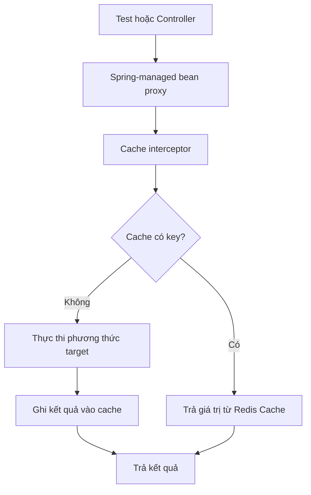
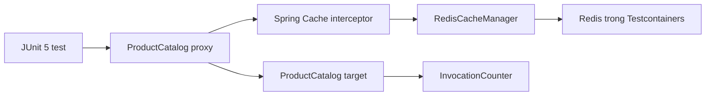
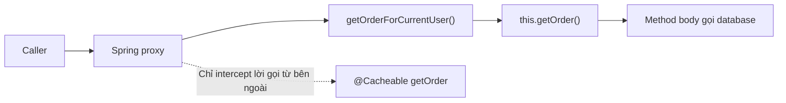
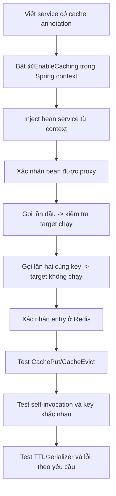

# Kiểm thử Spring Cache qua proxy thực

Khi dùng **Spring Data Redis** làm backend cho **Spring Cache**, các annotation như `@Cacheable`, `@CachePut` và `@CacheEvict` thường hoạt động nhờ **Spring AOP proxy**. Đây là chi tiết quyết định cách viết kiểm thử. Nếu tạo service bằng `new`, gọi trực tiếp vào target object hoặc dùng một unit test không khởi động Spring context, annotation có thể hiện diện trên source code nhưng **không có interceptor thực thi**, nên không phát sinh hành vi cache.

Để kiểm tra đúng một luồng ứng dụng, cần gọi phương thức thông qua **bean do Spring quản lý**, xác nhận bean thực sự được proxy, và dùng `CacheManager` có backend Redis được cấu hình. Khi đó, bài test mới quan sát được cả hai phần:

1. **Tầng proxy và annotation:** Spring có chặn lời gọi phương thức, tạo cache key, đọc cache, bỏ qua thân phương thức khi cache hit, ghi và xóa cache đúng lúc không?
2. **Tầng Redis:** cache entry có thực sự nằm trên Redis, có key prefix/TTL/serializer đúng không, và có được đọc lại bởi một lời gọi đi qua proxy không?

Bài học này trình bày cách thiết kế kiểm thử có giá trị, ví dụ JUnit 5 + Spring Boot + Testcontainers, cách chứng minh cache hit/miss bằng counter, xử lý self-invocation, và cách phân biệt lỗi proxy với lỗi kết nối hoặc serialization của Redis.

## 1. Hiểu đường đi thực tế của @Cacheable

Một lời gọi qua bean được Spring quản lý thường đi qua chuỗi sau:



Với:

```java
@Cacheable(cacheNames = "products", key = "#p0")
public Product findById(String id) {
    return repository.findById(id).orElseThrow();
}
```

Khi gọi lần đầu với `id = "P-101"`:

```text
Controller -> proxy -> cache miss -> repository -> cache put -> return
```

Khi gọi lần hai với cùng key và entry còn hợp lệ:

```text
Controller -> proxy -> cache hit -> return
                                      ^
                                      |
                              repository không chạy
```

**Điều cần kiểm chứng không chỉ là hai lần gọi trả cùng một giá trị.** Một service không có cache cũng có thể trả cùng kết quả. Bài test nên quan sát một tín hiệu cho biết **thân phương thức đã chạy bao nhiêu lần**, ví dụ counter hoặc một repository giả có thể đếm số lần gọi.

## 2. Vì sao unit test tạo service trực tiếp dễ cho kết quả sai?

Ví dụ:

```java
ProductService service = new ProductService(repository);
service.findById("P-101");
service.findById("P-101");
```

Nếu `service` được tạo bằng `new`, đây là đối tượng Java thuần túy. Dù `findById` có `@Cacheable`, không có Spring Cache interceptor đi qua lời gọi này. Cả hai lần vẫn có thể gọi repository.

Các dạng kiểm thử thường gặp:

| Dạng kiểm thử | Có Spring AOP proxy? | Có Redis thật? | Kiểm chứng được gì? |
| --- | --- | --- | --- |
| `new ProductService(...)` | Không | Không, trừ khi tự gọi Redis bên trong | Logic Java của target, không phải annotation cache |
| `@InjectMocks` trên target thuần | Thường không | Tùy mock | Logic target và tương tác mock, không chứng minh proxy |
| `@SpringBootTest` nhưng cache bị tắt/NoOpCacheManager | Có thể có proxy | Không nhất thiết | Cần xác minh cấu hình manager thực tế |
| Spring context với `ConcurrentMapCacheManager` | Có thể có | Không | Logic annotation, key, hit/miss bằng cache trong RAM |
| Spring context + `RedisCacheManager` + Redis thật | **Có, nếu bật caching đúng** | **Có** | Proxy, Redis read/write, TTL, serializer và lifecycle thực |

Không phải unit test thuần là vô ích. Nó rất phù hợp để test tính toán nghiệp vụ. Nhưng nếu mục tiêu là **“`@Cacheable` có thực sự được áp dụng trong ứng dụng không?”**, cần test ở ranh giới Spring proxy.

### 2.1. Kiểm thử qua proxy khác với mock chính proxy

Nếu mock cả bean service:

```java
// Ví dụ diễn đạt ý tưởng: service là mock thay vì bean thực.
when(productService.findById("P-101")).thenReturn(product);
```

Lần gọi tới mock có thể không chạy phương thức thật và cũng không chứng minh interceptor cache đang hoạt động. Khi muốn quan sát số lần truy vấn dữ liệu, nên **giữ service được Spring proxy**, còn mock/fake lớp phụ thuộc phía sau như repository, hoặc dùng một `AtomicInteger` trong một bean test.

## 3. Proxy mode: điều kiện để cache annotation có tác dụng

Spring Cache thường dùng proxy mode. Những điều kiện cơ bản:

- Có `@EnableCaching` (hoặc một cơ chế cấu hình tương đương đã bật annotation-based caching).
- Service được tạo và quản lý bởi **Spring ApplicationContext**.
- Lời gọi đi **qua proxy** lấy từ context, thay vì gọi trực tiếp qua `this` của cùng object.
- Phương thức cần được interceptor hỗ trợ. Trong cấu hình proxy phổ biến, nên dùng **public instance method** có thể được proxy; tránh `private`, `final` hoặc các cách gọi không đi qua proxy.
- Có `CacheManager` phù hợp và tên cache đúng.
- Cache key được tạo nhất quán giữa các lời gọi.

Ví dụ bật caching:

```java
import org.springframework.cache.annotation.EnableCaching;
import org.springframework.context.annotation.Configuration;

@Configuration
@EnableCaching
public class CacheEnablingConfiguration {
}
```

Spring Boot có thể tự cấu hình CacheManager dựa trên classpath và properties, nhưng **không nên suy ra rằng chỉ thêm Redis starter là mọi annotation tự hoạt động**. Test phải xác nhận caching đã được bật và manager đang được chọn thực sự là Redis.

### 3.1. JDK proxy và class-based proxy

Hai loại proxy thường gặp:

| Loại | Đặc điểm |
| --- | --- |
| **JDK dynamic proxy** | Proxy thông qua interface; lời gọi qua interface là đường đi tự nhiên |
| **Class-based proxy (CGLIB)** | Tạo subclass của class; cần class/method có thể override theo điều kiện proxy |

Không nên viết assertion phụ thuộc tên class proxy được sinh. Thay vào đó, dùng:

```java
import org.springframework.aop.support.AopUtils;

assertThat(AopUtils.isAopProxy(service)).isTrue();
```

Đây là tín hiệu bean có AOP proxy, chưa phải chứng minh cache advice cụ thể đã hoạt động. Phải kết hợp với **test hit/miss và Redis storage**. Nếu môi trường test có nhiều advisor (security, transaction, v.v.), chỉ kiểm tra `isAopProxy` có thể tạo false confidence.

## 4. Mô hình kiểm thử tích hợp: gọi service qua Spring context

Ta xây dựng một service giả có phương thức thực thi được đếm bằng `AtomicInteger`. Cache dùng Redis thật qua Testcontainers. Cách này không cần kết nối database bên ngoài và vẫn giúp phân biệt **lần gọi đi qua cache** với **lần thực sự chạy body**.



Những thứ cần kiểm thử:

1. Lần đầu gọi `load(id)`: counter tăng và kết quả được cache.
2. Lần hai gọi `load(id)`: kết quả giữ nguyên, counter **không tăng**.
3. Gọi `refresh(id)` có `@CachePut`: method body vẫn chạy, cache được cập nhật.
4. Gọi `evict(id)` có `@CacheEvict`: key bị xóa; lần `load` sau gọi target.
5. Gọi một method trong **cùng class** mà bên trong gọi `this.load(id)`: cache advice có thể bị bỏ qua.
6. Một Redis key thật tồn tại sau lần cache miss để xác minh backend.

## 5. Dependencies cho Spring Boot và Testcontainers

Với dự án **Spring Boot 3.1+**, JUnit 5 và Java 17+, ví dụ Gradle:

```groovy
dependencies {
    implementation 'org.springframework.boot:spring-boot-starter-cache'
    implementation 'org.springframework.boot:spring-boot-starter-data-redis'

    testImplementation 'org.springframework.boot:spring-boot-starter-test'
    testImplementation 'org.testcontainers:junit-jupiter'
}

test {
    useJUnitPlatform()
}
```

Ví dụ giả định dự án đã áp dụng Spring Boot dependency management để quản lý version của các thư viện. Testcontainers cần một **Docker-compatible container runtime** có thể khởi chạy image Redis. Nếu CI không có container runtime, bài test sẽ không chạy được; không nên lặng lẽ thay Redis bằng mock rồi vẫn tuyên bố đã kiểm thử Redis thật.

Redis container là **một Redis instance chỉ phục vụ test**. Không dùng Redis production, không gọi `FLUSHALL` trên một Redis chia sẻ và không phụ thuộc vào dữ liệu của máy developer.

## 6. Service minh họa có các annotation cache

Trong cùng ví dụ, service có ba phương thức annotation và một method cố ý self-invoke:

```java
package com.example.cache;

import java.util.concurrent.atomic.AtomicInteger;
import org.springframework.cache.annotation.CacheEvict;
import org.springframework.cache.annotation.CachePut;
import org.springframework.cache.annotation.Cacheable;

public class ProductCatalog {

    private final InvocationCounter counter;

    public ProductCatalog(InvocationCounter counter) {
        this.counter = counter;
    }

    @Cacheable(cacheNames = "productCards", key = "#p0")
    public String load(String id) {
        return id + "|loaded#" + counter.next();
    }

    @CachePut(cacheNames = "productCards", key = "#p0")
    public String refresh(String id) {
        return id + "|loaded#" + counter.next();
    }

    @CacheEvict(cacheNames = "productCards", key = "#p0")
    public void evict(String id) {
        // Spring Cache thực hiện eviction thông qua proxy.
    }

    public String internallyLoad(String id) {
        // Cố ý gọi trực tiếp trong cùng object: bypass proxy mode.
        return load(id);
    }
}

public class InvocationCounter {

    private final AtomicInteger calls = new AtomicInteger();

    public int next() {
        return calls.incrementAndGet();
    }

    public int calls() {
        return calls.get();
    }

    public void reset() {
        calls.set(0);
    }
}
```

Đoạn trên trình bày **hai class riêng** trong cùng package (`ProductCatalog.java` và `InvocationCounter.java`), không đặt hai `public class` vào cùng một file `.java`.

Ta cố ý dùng `#p0` để lấy tham số đầu tiên, giúp tránh phụ thuộc vào việc tên tham số Java có được giữ bằng `-parameters` hay không. Nếu dùng `key = "#id"`, hãy bảo đảm Spring có thể phát hiện tên tham số hoặc cấu hình build phù hợp.

Định dạng `id|loaded#N` chỉ để test thấy số lần chạy target, không phải payload sản phẩm thực tế. Trong ứng dụng thật, thân phương thức sẽ gọi repository, API hoặc nguồn dữ liệu được cache.

## 7. Cấu hình test dùng RedisCacheManager và proxy thực

Một cấu hình test rõ ràng:

```java
package com.example.cache;

import java.time.Duration;
import org.springframework.boot.SpringBootConfiguration;
import org.springframework.boot.autoconfigure.EnableAutoConfiguration;
import org.springframework.cache.annotation.EnableCaching;
import org.springframework.context.annotation.Bean;
import org.springframework.data.redis.cache.RedisCacheConfiguration;
import org.springframework.data.redis.cache.RedisCacheManager;
import org.springframework.data.redis.connection.RedisConnectionFactory;

@SpringBootConfiguration
@EnableAutoConfiguration
@EnableCaching(proxyTargetClass = true)
public class CacheTestApplication {

    @Bean
    public InvocationCounter invocationCounter() {
        return new InvocationCounter();
    }

    @Bean
    public ProductCatalog productCatalog(InvocationCounter counter) {
        return new ProductCatalog(counter);
    }

    @Bean
    public RedisCacheManager cacheManager(
            RedisConnectionFactory connectionFactory) {

        RedisCacheConfiguration defaults =
                RedisCacheConfiguration.defaultCacheConfig()
                        .entryTtl(Duration.ofMinutes(5))
                        .disableCachingNullValues();

        return RedisCacheManager.builder(connectionFactory)
                .cacheDefaults(defaults)
                .build();
    }
}
```

Các quyết định trong cấu hình:

| Cấu hình | Lý do |
| --- | --- |
| `@SpringBootConfiguration` + `@EnableAutoConfiguration` | Tạo ngữ cảnh Spring Boot có auto-config cho Redis |
| `@EnableCaching(proxyTargetClass = true)` | Bật cache advice và dùng class-based proxy cho ví dụ |
| `@Bean ProductCatalog` | Service được Spring quản lý thay vì tạo `new` trong test |
| `@Bean RedisCacheManager` | Tường minh chọn backend Redis, không vô tình chọn cache provider trong RAM |
| TTL 5 phút | Có entry expiration có thể quan sát trong Redis |
| `disableCachingNullValues()` | Không lưu `null`; ví dụ trả String khác null |

Vì `@EnableCaching(proxyTargetClass = true)`, `ProductCatalog` và phương thức `load` cần có khả năng được subclass/override. Không khai báo service hoặc method là `final` trong ví dụ này.

Chúng ta **chỉ dùng cấu hình `CacheTestApplication` trong test**, không thêm một bean `CacheManager` khác xung đột tên. Nếu dự án có `CacheManager` riêng hoặc nhiều manager, phải cấu hình cách chọn bean rõ ràng.

## 8. Test tích hợp hoàn chỉnh với Redis Testcontainers

Lớp test sau dùng `@SpringBootTest` để tạo **Spring ApplicationContext thật** và `@Testcontainers` để chạy Redis độc lập.

```java
package com.example.cache;

import java.util.concurrent.TimeUnit;

import org.junit.jupiter.api.BeforeEach;
import org.junit.jupiter.api.Test;
import org.springframework.aop.support.AopUtils;
import org.springframework.beans.factory.annotation.Autowired;
import org.springframework.boot.test.context.SpringBootTest;
import org.springframework.cache.Cache;
import org.springframework.cache.CacheManager;
import org.springframework.data.redis.core.StringRedisTemplate;
import org.springframework.test.context.DynamicPropertyRegistry;
import org.springframework.test.context.DynamicPropertySource;
import org.testcontainers.containers.GenericContainer;
import org.testcontainers.junit.jupiter.Container;
import org.testcontainers.junit.jupiter.Testcontainers;
import org.testcontainers.utility.DockerImageName;

import static org.assertj.core.api.Assertions.assertThat;

@SpringBootTest(classes = CacheTestApplication.class)
@Testcontainers
class CacheProxyIntegrationTest {

    @Container
    static final GenericContainer<?> redisContainer =
            new GenericContainer<>(
                    DockerImageName.parse("redis:7.4-alpine"))
                    .withExposedPorts(6379);

    @DynamicPropertySource
    static void redisProperties(DynamicPropertyRegistry properties) {
        properties.add("spring.data.redis.host",
                redisContainer::getHost);
        properties.add("spring.data.redis.port",
                () -> redisContainer.getMappedPort(6379));
    }

    @Autowired
    ProductCatalog catalog;

    @Autowired
    InvocationCounter counter;

    @Autowired
    CacheManager cacheManager;

    @Autowired
    StringRedisTemplate redis;

    @BeforeEach
    void isolateCache() {
        Cache cache = cacheManager.getCache("productCards");
        assertThat(cache).isNotNull();
        cache.clear();
        counter.reset();
    }

    @Test
    void beanIsSpringAopProxy() {
        assertThat(AopUtils.isAopProxy(catalog)).isTrue();
    }

    @Test
    void secondCallIsCacheHitAndDoesNotRunBody() {
        String first = catalog.load("p-101");
        String second = catalog.load("p-101");

        assertThat(first).isEqualTo("p-101|loaded#1");
        assertThat(second).isEqualTo(first);
        assertThat(counter.calls()).isEqualTo(1);
    }

    @Test
    void differentCacheKeysExecuteIndependently() {
        String one = catalog.load("p-101");
        String two = catalog.load("p-102");
        String oneAgain = catalog.load("p-101");

        assertThat(one).isEqualTo("p-101|loaded#1");
        assertThat(two).isEqualTo("p-102|loaded#2");
        assertThat(oneAgain).isEqualTo(one);
        assertThat(counter.calls()).isEqualTo(2);
    }

    @Test
    void cachePutAlwaysRunsMethodAndReplacesEntry() {
        String initial = catalog.load("p-101");
        String updated = catalog.refresh("p-101");
        String cachedAfterUpdate = catalog.load("p-101");

        assertThat(initial).isEqualTo("p-101|loaded#1");
        assertThat(updated).isEqualTo("p-101|loaded#2");
        assertThat(cachedAfterUpdate).isEqualTo(updated);
        assertThat(counter.calls()).isEqualTo(2);
    }

    @Test
    void cacheEvictMakesNextLoadExecuteAgain() {
        String before = catalog.load("p-101");
        catalog.evict("p-101");
        String after = catalog.load("p-101");

        assertThat(before).isEqualTo("p-101|loaded#1");
        assertThat(after).isEqualTo("p-101|loaded#2");
        assertThat(counter.calls()).isEqualTo(2);
    }

    @Test
    void selfInvocationBypassesCacheAdvice() {
        String first = catalog.internallyLoad("p-self");
        String second = catalog.internallyLoad("p-self");

        assertThat(first).isEqualTo("p-self|loaded#1");
        assertThat(second).isEqualTo("p-self|loaded#2");
        assertThat(counter.calls()).isEqualTo(2);

        // Lời gọi qua proxy ở ngoài class bắt đầu tạo cache entry.
        String externalFirst = catalog.load("p-self");
        String externalAgain = catalog.load("p-self");

        assertThat(externalFirst).isEqualTo("p-self|loaded#3");
        assertThat(externalAgain).isEqualTo(externalFirst);
        assertThat(counter.calls()).isEqualTo(3);
    }

    @Test
    void entryReallyExistsInRedisWithTtl() {
        catalog.load("p-redis");

        // Prefix mặc định RedisCacheConfiguration: cacheName::key.
        String redisKey = "productCards::p-redis";

        assertThat(redis.hasKey(redisKey)).isTrue();
        Long ttl = redis.getExpire(redisKey, TimeUnit.SECONDS);
        assertThat(ttl).isNotNull();
        assertThat(ttl).isBetween(1L, 300L);
    }
}
```

Đây là các class **riêng** trong package `com.example.cache`: `ProductCatalog`, `InvocationCounter`, `CacheTestApplication` và `CacheProxyIntegrationTest`. Các import, annotation và test dùng API Spring Boot 3.x, JUnit 5 và Testcontainers tương ứng; nếu dự án dùng dòng Spring Boot/Testcontainers khác cần điều chỉnh dependency/API.

### 8.1. Những gì test này thực sự xác nhận

| Test | Bằng chứng |
| --- | --- |
| `beanIsSpringAopProxy` | `catalog` là bean AOP proxy lấy từ Spring context |
| `secondCallIsCacheHitAndDoesNotRunBody` | Lần gọi thứ hai cùng key không tăng counter |
| `differentCacheKeysExecuteIndependently` | Hai cache key khác nhau không vô tình dùng chung kết quả |
| `cachePutAlwaysRunsMethodAndReplacesEntry` | `@CachePut` thực thi body và thay giá trị cache |
| `cacheEvictMakesNextLoadExecuteAgain` | Evict khiến lần đọc tiếp theo trở thành cache miss |
| `selfInvocationBypassesCacheAdvice` | Gọi nội bộ không đi qua interceptor, gọi bên ngoài thì có |
| `entryReallyExistsInRedisWithTtl` | Có key Redis theo prefix test và TTL 5 phút |

Tất cả được quan sát qua lời gọi bean thực tế. Một assertion chỉ kiểm tra `catalog.load(...).equals(...)` mà không kiểm tra counter, Redis key hay proxy sẽ yếu hơn đáng kể.

### 8.2. Vì sao không cần `Thread.sleep` để chứng minh TTL?

Test chỉ muốn xác nhận cấu hình **đã đặt TTL**, nên đọc:

```java
Long seconds = redis.getExpire(
        "productCards::p-redis", TimeUnit.SECONDS);
```

Nếu Redis trả `-1`, key tồn tại nhưng **không có TTL**; `-2` là key **không tồn tại**. Kiểm tra TTL dương và không vượt 300 giây tránh phải đợi 5 phút.

Muốn test việc **entry thực sự hết hạn**, có thể tạo một cấu hình riêng với TTL rất ngắn và chờ có điều kiện bằng Awaitility hoặc polling với deadline. Tuy nhiên, test phụ thuộc thời gian có thể flaky do scheduling, CPU/CI và thời điểm đọc. Không nên dùng `Thread.sleep(300_000)` trong suite hàng ngày.

## 9. Vì sao kiểm thử với CacheManager giả có thể bỏ sót lỗi Redis?

Spring Boot có nhiều loại CacheManager: `ConcurrentMapCacheManager`, `RedisCacheManager`, `CaffeineCacheManager`, `NoOpCacheManager`, v.v.

Một test với cache trong RAM có thể xác nhận:

```text
@Cacheable tạo cache hit
SpEL key được đánh giá
@CachePut/evict chạy qua proxy
```

Nhưng không xác nhận:

- Redis đang kết nối đúng host/database hay Cluster.
- Key prefix có tạo đúng namespace không.
- Value serializer có deserialize được object giữa các lần gọi không.
- Redis TTL có được áp dụng đúng không.
- Backend có trả lỗi `WRONGTYPE` hoặc `SerializationException` không.
- `Cache.clear()` trên Redis có dọn đúng các key thuộc cache không.

Do đó có thể tổ chức **hai tầng test bổ sung cho nhau**:

1. **Nhanh:** Spring context + `ConcurrentMapCacheManager` để kiểm tra advice, key và luồng annotation.
2. **Tích hợp:** Spring context + RedisCacheManager + Redis thật để kiểm tra serializing, key prefix, TTL và tương tác backend.

Không cần chạy mọi tổ hợp nghiệp vụ dưới Redis Testcontainers nếu chi phí test quá lớn; nhưng những đường cache quan trọng nên có tối thiểu một bộ kiểm thử tích hợp chứng minh thực sự hoạt động.

## 10. Self-invocation: lỗi phổ biến nhất khi cache annotation “không chạy”

Xét:

```java
@Service
public class OrderViewService {

    @Cacheable(cacheNames = "orders", key = "#p0")
    public String getOrder(String id) {
        return loadFromDatabase(id);
    }

    public String getOrderForCurrentUser(String id) {
        return this.getOrder(id);
    }
}
```

Khi client gọi:

```java
orderViewService.getOrder("O-101");
```

đường gọi đi qua Spring proxy nên cache advice có thể hoạt động. Nhưng khi client gọi:

```java
orderViewService.getOrderForCurrentUser("O-101");
```

thì proxy chỉ intercept phương thức `getOrderForCurrentUser` (phương thức này không có `@Cacheable`). Từ bên trong target, lời gọi `this.getOrder(id)` **không đi qua proxy** nên `@Cacheable` trên `getOrder` không được áp dụng trong chế độ proxy thông thường.



### 10.1. Cách kiểm thử self-invocation

Không cần suy đoán từ việc annotation có mặt. Test bằng counter:

```java
String first = catalog.internallyLoad("p-self");
String second = catalog.internallyLoad("p-self");

assertThat(first).isNotEqualTo(second);
assertThat(counter.calls()).isEqualTo(2);
```

Sau đó gọi cùng `load` từ **bean proxy**:

```java
String first = catalog.load("p-self");
String again = catalog.load("p-self");

assertThat(again).isEqualTo(first);
```

### 10.2. Sửa self-invocation như thế nào?

Giải pháp thường đơn giản nhất là tách phương thức có caching sang một bean riêng:

```java
@Service
public class CachedOrderReader {

    @Cacheable(cacheNames = "orders", key = "#p0")
    public OrderView find(String id) {
        return loadFromDatabase(id);
    }
}

@Service
public class OrderFacade {

    private final CachedOrderReader cachedReader;

    public OrderFacade(CachedOrderReader cachedReader) {
        this.cachedReader = cachedReader;
    }

    public OrderView getForCurrentUser(String id) {
        return cachedReader.find(id);
    }
}
```

`OrderView` và `loadFromDatabase` là thành phần domain được lược bớt trong ví dụ minh họa. Khi `OrderFacade` gọi bean `cachedReader` do Spring inject, lời gọi có thể đi qua proxy.

Có những phương án như tự inject proxy của chính mình, dùng `AopContext.currentProxy()` hoặc AspectJ weaving, nhưng chúng tăng coupling và cấu hình. Không nên chọn chỉ để làm một unit test pass nếu thiết kế tách bean rõ ràng hơn.

## 11. Kiểm thử @Cacheable với condition và unless

`@Cacheable` có thể áp điều kiện trước và sau khi thực thi:

```java
@Cacheable(
        cacheNames = "productCards",
        key = "#p0",
        condition = "#p0.length() >= 3",
        unless = "#result == null"
)
public String find(String id) {
    return source.find(id);
}
```

Sự khác biệt:

| Thuộc tính | Thời điểm quyết định | Hệ quả |
| --- | --- | --- |
| `condition` | Được đánh giá trước khi caching theo điều kiện | Nếu false, lời gọi không tham gia cache |
| `unless` | Được đánh giá sau khi có kết quả phương thức | Nếu true, không lưu kết quả vào cache |

Test cần gọi **đúng bean proxy** và kiểm tra số lần nguồn dữ liệu chạy.

Ví dụ ý tưởng:

```java
// Khi id quá ngắn, condition=false:
service.find("x");
service.find("x");
assertThat(source.invocationsFor("x")).isEqualTo(2);

// Khi find("abc") trả non-null, cache được phép lưu:
service.find("abc");
service.find("abc");
assertThat(source.invocationsFor("abc")).isEqualTo(1);
```

Nếu `unless="#result == null"`, mọi lần trả `null` đều không được cache theo điều kiện này, kể cả khi provider cho phép lưu null. **Cần test rõ chính sách null**; không mặc định mọi RedisCacheConfiguration có cùng hành vi.

## 12. Kiểm thử @CachePut: method phải chạy

`@CachePut` khác `@Cacheable`: nó **không bỏ qua thân phương thức để trả kết quả cache sẵn**.

```java
@CachePut(cacheNames = "products", key = "#result.id")
public Product update(Product product) {
    return repository.save(product);
}
```

Một test có giá trị cần xác nhận:

1. Method `update` đã gọi repository/handler và tạo kết quả mới.
2. Cache entry ở key phù hợp đã thay đổi.
3. Lời gọi `@Cacheable` tiếp theo với key tương ứng dùng **kết quả mới**, không gọi nguồn dữ liệu cũ.

Nếu test chỉ assert `update()` trả object đúng, không chứng minh cache đã được cập nhật.

**Lưu ý SpEL key:** `@CachePut` có thể dùng `#result` vì kết quả phương thức đã có. `@Cacheable` khi lookup cache trước thực thi thường không có `#result` để tạo key cho lần đọc. Đừng dùng một biểu thức key thiếu nhất quán giữa put và get, dẫn đến cảm giác cache “không chạy” dù interceptor thực sự đã chạy.

## 13. Kiểm thử @CacheEvict và thời điểm xóa

Mặc định:

```java
@CacheEvict(cacheNames = "products", key = "#p0")
public void invalidate(String id) {
    // Thực hiện công việc cần thiết.
}
```

Eviction xảy ra sau khi phương thức hoàn tất thành công theo hợp đồng của cache interceptor. Có thể đổi:

```java
@CacheEvict(
        cacheNames = "products",
        key = "#p0",
        beforeInvocation = true
)
public void invalidateBefore(String id) {
    // Entry đã được yêu cầu xóa trước khi target chạy.
}
```

Khi test:

| Kịch bản | Với `beforeInvocation=false` mặc định | Với `beforeInvocation=true` |
| --- | --- | --- |
| Method chạy thành công | Eviction sau khi thành công | Eviction trước khi chạy |
| Method ném exception | Thường không evict vì target chưa hoàn tất thành công | Eviction đã được yêu cầu trước target |

Để chứng minh khác biệt, tạo method cố ý ném exception **trong một bean được Spring proxy**, preload cache rồi gọi method qua proxy, sau đó kiểm tra key/nguồn dữ liệu.

Không dùng `this.invalidate(...)` trong cùng class để thử annotation vì đó lại là self-invocation, làm test sai mục tiêu.

### 13.1. allEntries = true

```java
@CacheEvict(cacheNames = "products", allEntries = true)
public void invalidateAll() {
}
```

Khi `allEntries = true`, Spring Cache yêu cầu clear toàn bộ cache tên `products`, không chỉ một key. Test nên tạo hai hoặc ba entry khác nhau, gọi `invalidateAll()` qua proxy rồi xác nhận chúng được nạp lại.

Trên Redis, clear có thể thực hiện nhiều lệnh và phụ thuộc `RedisCacheWriter`/batch strategy. Không dùng một test gọi clear để khẳng định thao tác xóa toàn bộ key của cache là giao dịch nguyên tử trong mọi cấu hình.

## 14. Kiểm thử việc tạo cache key

Hai request có kết quả nghiệp vụ như nhau vẫn có thể tạo **hai cache key khác nhau** nếu biểu thức key thay đổi. Cần test logic key ở proxy:

```java
@Cacheable(cacheNames = "products", key = "#p0 + ':' + #p1")
public String load(String tenantId, String productId) {
    return source.load(tenantId, productId);
}
```

Ví dụ:

```text
load("tenant-1", "P-101") -> key tenant-1:P-101
load("tenant-2", "P-101") -> key tenant-2:P-101
```

Nếu chỉ dùng `key = "#p1"` thì hai tenant có thể chia sẻ sai cache entry. Một test chỉ chạy với một tenant sẽ không phát hiện được lỗi **cache key collision**.

Các trường hợp nên có test:

- Hai ID khác nhau tạo hai entry.
- Hai tenant khác nhau không chia sẻ dữ liệu ngoài ý muốn.
- Các tham số không ảnh hưởng kết quả có thể được loại khỏi key một cách có chủ đích.
- Object key phức tạp có `equals/hashCode` phù hợp hoặc được chuyển sang key ổn định.
- Giá trị `null`, chuỗi rỗng và các ký tự đặc biệt được xử lý theo hợp đồng.
- Prefix/version của cache được áp dụng nhất quán giữa các môi trường.

Với RedisCacheManager mặc định, tên key vật lý thường có dạng:

```text
cacheName::convertedKey
```

Nhưng khi cấu hình `computePrefixWith(...)`, serializer hoặc `KeyGenerator` tùy chỉnh, tên key thật sẽ khác. Test key Redis nên dựa trên **cấu hình đang dùng**, không hard-code quy ước mặc định vào mọi module.

## 15. Dữ liệu cache: serializer và TTL cũng cần test

Spring Cache nhận một object Java rồi RedisCache thường serialize nó để lưu vào Redis. Một test dùng `ConcurrentMapCacheManager` có thể pass nhưng test với Redis lỗi vì object không phù hợp serializer.

Ví dụ cấu hình giá trị JSON:

```java
import org.springframework.data.redis.cache.RedisCacheConfiguration;
import org.springframework.data.redis.serializer.RedisSerializationContext;
import org.springframework.data.redis.serializer.GenericJackson2JsonRedisSerializer;

RedisCacheConfiguration defaults =
        RedisCacheConfiguration.defaultCacheConfig()
                .serializeValuesWith(
                        RedisSerializationContext.SerializationPair
                                .fromSerializer(
                                        new GenericJackson2JsonRedisSerializer()));
```

Khi dùng serializer JSON, cần kiểm tra kiểu object, constructor, polymorphism và các yêu cầu bảo mật/schema tương ứng. Đổi serializer giữa những phiên bản đang cùng đọc một cache có thể khiến dữ liệu cũ không deserialize được dù Redis key tồn tại.

Những assertion có giá trị:

1. Lần đầu gọi qua proxy tạo entry.
2. Cache entry được đọc lại trong lần gọi thứ hai hoặc từ một Spring context khác cùng cấu hình serializer.
3. Key thật có TTL phù hợp.
4. Khi serialization lỗi, test không che exception thành một cache hit giả.
5. Khi thay schema, dữ liệu cũ được bỏ qua/invalidate/migrate theo chiến lược.

Không dùng `GET` rồi cố decode giá trị theo UTF-8 nếu cache đang dùng JDK serialization hoặc binary serializer. Có thể kiểm tra key tồn tại và để `Cache.get()` hoặc một lời gọi proxy xác nhận deserialization.

## 16. Khi Spring Cache đi cùng @Transactional

Một service có thể vừa lưu database vừa cập nhật hoặc xóa cache:

```java
@Transactional
@CacheEvict(cacheNames = "products", key = "#p0")
public void updateProduct(String id, ProductUpdate update) {
    repository.update(id, update);
}
```

Cần đặc biệt thận trọng: hai advisor transaction và cache có thể có **thứ tự áp dụng** khác nhau theo cấu hình. Việc `@CacheEvict` chạy “sau khi phương thức Java trả về” không tự bảo đảm nó luôn chạy **sau khi transaction database thực sự commit**.

Ví dụ vấn đề:

```text
Transaction bắt đầu
UPDATE database
Evict cache trước lúc commit
Request khác cache miss, đọc dữ liệu cũ từ DB
Request khác cache lại dữ liệu cũ
Transaction đầu tiên commit
```

Một kiểm thử chỉ gọi hai method nối tiếp nhau trong cùng thread không phát hiện đầy đủ race này.

Nếu hệ thống yêu cầu cache chỉ invalidated **sau commit**, cần cấu hình transaction-aware cache manager, sử dụng callback sau commit hoặc một cơ chế invalidation/outbox phù hợp. Cũng cần đánh giá trường hợp commit thành công nhưng Redis tạm thời không thể evict; `@Transactional` của database không làm Redis và SQL trở thành một giao dịch nguyên tử chung.

**Đối với kiểm thử:** phân biệt test correctness của cache advice và test ordering của giao dịch. Khi cần kiểm tra ordering, dùng integration test có database thực, transaction manager thực và điều phối cạnh tranh thay vì chỉ một mock repository trả kết quả.

## 17. Kiểm thử lỗi và cache fallback

Những lỗi liên quan Redis có thể xuất hiện khi:

- Redis chưa sẵn sàng hoặc mất kết nối.
- Key có type không tương thích (`WRONGTYPE`).
- Serializer không đọc được giá trị cũ.
- Cache key quá lớn hoặc được tạo sai.
- Backend từ chối lệnh vì ACL, cấu hình hoặc trạng thái node.
- Có timeout sau khi lệnh có thể đã được Redis thực thi.

Tùy thiết kế ứng dụng, lỗi cache có thể được ném ra ngoài hoặc được xử lý bởi `CacheErrorHandler`. Nếu ứng dụng muốn **cache miss fallback** khi Redis lỗi, cần kiểm thử rõ lúc nào cho phép:

```text
GET cache lỗi -> có thể đọc nguồn dữ liệu thật
PUT cache lỗi -> nghiệp vụ có được coi thành công không?
EVICT cache lỗi -> có nguy cơ dữ liệu cũ còn tồn tại sau cập nhật nguồn
```

Không đặt một `CacheErrorHandler` luôn nuốt mọi lỗi rồi mặc định hệ thống vẫn nhất quán. Đặc biệt, xóa cache thất bại sau khi cập nhật database có thể để lại **stale cache**; test phải thể hiện chính sách xử lý và đối soát.

Trong bài test kiểm chứng proxy, trước tiên hãy dùng Redis sẵn sàng để xác nhận hit/miss rõ ràng. Sau đó thêm bài kiểm thử lỗi kết nối riêng nếu đó là yêu cầu sản phẩm.

## 18. Kiểm thử concurrency và cache stampede

Nếu nhiều request đồng thời đều gặp cache miss, chúng có thể cùng chạy phương thức nguồn:

```text
Thread A -> cache miss -> database
Thread B -> cache miss -> database
Thread C -> cache miss -> database
```

Spring Cache có tùy chọn:

```java
@Cacheable(cacheNames = "products", key = "#p0", sync = true)
public Product find(String id) {
    return repository.findById(id).orElseThrow();
}
```

`sync = true` yêu cầu cache provider đồng bộ việc tải giá trị cho cùng key theo API hỗ trợ. Nhưng **không được suy ra** rằng với RedisCacheManager, cấu hình này cung cấp một distributed mutex chính xác một lần xuyên mọi process hoặc node.

Một bài test concurrency tại **một Spring context** có thể dùng `CountDownLatch` để cho nhiều thread cùng bắt đầu và một counter để quan sát số lần gọi nguồn. Tuy nhiên, test đó chỉ nói lên hành vi của **provider/phiên bản dưới điều kiện đã thử**.

Muốn xác nhận hành vi phân tán, cần thử với **nhiều application context hoặc process** cùng kết nối một Redis, có đồng hồ đo riêng cho từng instance và xử lý trường hợp failover/network timeout. Đừng dùng test single JVM để tuyên bố đã giải quyết cache stampede toàn cluster.

### 18.1. Một bài test đơn giản có thể không phát hiện race

Nếu cache warm trước khi chạy các thread:

```java
catalog.load("p-101");
```

thì mọi thread đều chỉ đọc cache hit; test không kiểm chứng tình huống **nhiều cache miss đồng thời**. Cần tạo cùng một key **chưa tồn tại** rồi cho các thread bắt đầu gần cùng lúc qua một điểm đồng bộ.

Ngoài ra, test concurrency không được mặc định rằng số lần gọi nguồn bắt buộc bằng một nếu ứng dụng không có hợp đồng single-flight. Kỳ vọng phải gắn với cơ chế và phạm vi đồng bộ đã chọn.

## 19. Cẩn thận với AOP target, spy và mock

Trong một test, các thao tác sau có thể vô tình bỏ qua proxy:

```java
// Tạo service bằng new:
var direct = new ProductCatalog(counter);
direct.load("p-101");

// Lấy target bên trong proxy rồi gọi trực tiếp (mô tả anti-pattern):
// var target = AopTestUtils.getTargetObject(catalog);
// target.load("p-101");
```

Gọi target trực tiếp sẽ không qua cache interceptor dù bean proxy trong context tồn tại. Đây là một cách test **logic target**, không phải test **Spring Cache qua proxy**.

Với Mockito, nguyên tắc:

- Mock/fake **repository hoặc nguồn dữ liệu** phía dưới service là hợp lý để đếm lần tải dữ liệu.
- Nếu replace chính service bằng mock, có thể bỏ mất logic annotation/cache mà test muốn kiểm chứng.
- Khi dùng spy trên bean proxy, hành vi verify/spying phụ thuộc kỹ thuật proxy, phiên bản Spring Test và cách wrap spy. Không mặc định `verify(service, times(1)).load(...)` luôn đo số lần thân target chạy.
- Một counter trong target hoặc fake repository thường làm mục tiêu test rõ ràng hơn.

Trong các phiên bản Spring Framework mới, annotation `@MockitoBean` hỗ trợ override bean trong context. Các ví dụ Spring Boot cũ hay dùng `@MockBean`; API và deprecation có thể khác giữa các dòng version. Bài này không phụ thuộc vào chúng để test proxy, vì `InvocationCounter` là bean nhỏ có hành vi xác định.

## 20. Cách ly dữ liệu giữa các lần test

Caching tạo **trạng thái ngoài method test**, nên test có thể phụ thuộc lẫn nhau nếu không dọn dữ liệu. Ví dụ test A cache `p-101`, test B mong cache miss cũng dùng `p-101` nhưng lại nhận cache hit.

Trong ví dụ đã dùng:

```java
@BeforeEach
void isolateCache() {
    Cache cache = cacheManager.getCache("productCards");
    assertThat(cache).isNotNull();
    cache.clear();
    counter.reset();
}
```

Đây là cách ly hợp lý khi **Redis container chỉ dành riêng cho suite test**. Nếu Redis được chia sẻ với suite khác chạy song song, `cache.clear()` có thể xóa entry của test khác. Những lựa chọn:

| Cách ly | Ưu điểm | Lưu ý |
| --- | --- | --- |
| Redis container riêng cho test class/suite | Kết quả dễ dự đoán | Chi phí khởi động container |
| Cache name có prefix/namespace riêng theo suite | Giảm va chạm key | Cleanup phải dùng đúng namespace |
| ID duy nhất cho mỗi test | Hạn chế trùng key | Dữ liệu cũ vẫn phải được dọn theo chính sách |
| `@DirtiesContext` | Làm mới Spring context | Không tự xóa dữ liệu còn trong Redis; tốn chi phí |
| `FLUSHDB`/`FLUSHALL` | Xóa rộng | **Không dùng trên Redis chia sẻ/production** |

Tốt nhất là test tích hợp có **backend riêng**, và chỉ clear những cache thuộc phạm vi test. Không dùng một Redis thật dùng chung với người dùng hoặc dịch vụ khác chỉ vì tiện kết nối từ môi trường phát triển.

### 20.1. Context cache của Spring Test khác cache ứng dụng

Spring Test có thể **tái sử dụng ApplicationContext** giữa các test class có cấu hình tương đương để giảm thời gian khởi động. Điều này khác với **Spring Cache lưu dữ liệu trong Redis**.

`@DirtiesContext` chỉ yêu cầu TestContext framework loại bỏ/tạo lại context khi cần; nó không đảm bảo Redis key đã được xóa. Nếu vấn đề là cache entry tồn đọng trong Redis, phải kiểm soát dữ liệu tại Redis hoặc namespace.

## 21. RedisCacheManager, cache name và nhiều CacheManager

Trong một ứng dụng lớn có thể đồng thời:

```text
redisCacheManager  -> cache chung, chia sẻ nhiều instance
localCacheManager  -> cache trong RAM
```

Một annotation:

```java
@Cacheable(cacheNames = "products", key = "#p0")
```

cần được resolve tới manager đúng theo cấu hình Spring. Nếu có nhiều manager mà không chỉ rõ cách chọn, ứng dụng có thể lỗi cấu hình hoặc chọn manager khác dự định.

Khi có nhiều manager, có thể xác định:

```java
@Cacheable(
        cacheManager = "redisCacheManager",
        cacheNames = "products",
        key = "#p0"
)
```

hoặc có `CacheResolver`/cấu hình chọn mặc định riêng. Test nên xác nhận RedisCacheManager đã được dùng:

```java
assertThat(cacheManager).isInstanceOf(RedisCacheManager.class);
```

Trong ví dụ đầy đủ, bean `cacheManager` được khai báo tường minh và không có manager thứ hai.

### 21.1. Redis key name cần được hiểu cùng prefix

`RedisCacheConfiguration.defaultCacheConfig()` thường áp dụng prefix `cacheName::`. Nếu đổi thành:

```java
RedisCacheConfiguration defaults =
        RedisCacheConfiguration.defaultCacheConfig()
                .computePrefixWith(name -> "tests:cache:" + name + "::");
```

thì một cache key của `productCards` đổi từ:

```text
productCards::p-101
```

sang:

```text
tests:cache:productCards::p-101
```

Assertion `redis.hasKey(...)` phải đổi theo. Việc test trực tiếp tên key vật lý nên dành cho những trường hợp muốn kiểm chứng **storage contract**; còn phần lớn kiểm thử business cache nên xác nhận qua `CacheManager` và proxy để giảm phụ thuộc vào format nội bộ.

## 22. Lỗi phổ biến và cách nhận diện

### 22.1. Hai lần gọi vẫn chạy thân phương thức

Kiểm tra:

1. Bean có được inject từ Spring context không?
2. Có bật `@EnableCaching` không?
3. Có self-invocation hoặc gọi target thay vì proxy không?
4. Method/class có `final`, `private` hoặc visibility không phù hợp không?
5. Hai lần gọi có thực sự dùng cùng cache key không?
6. `condition`/`unless` có vô hiệu hóa caching không?
7. Cache entry có TTL quá ngắn hoặc bị evict giữa hai lần không?
8. CacheManager có đang trả NoOpCache hoặc một cache tên khác không?

Đừng bắt đầu bằng việc tăng Redis timeout nếu thực tế phương thức đang được gọi trực tiếp qua `this`.

### 22.2. Test pass với ConcurrentMap nhưng fail với Redis

Các nguyên nhân thường gặp là serializer, Redis connection, TTL, tên cache/key prefix hoặc key bị type khác chiếm dụng. Unit test trong RAM không xác nhận các hợp đồng này.

### 22.3. `@CachePut` chạy nhưng đọc lại vẫn thấy giá trị cũ

Kiểm tra `cacheNames` và biểu thức `key` trên `@CachePut` có trùng với `@Cacheable` không; có hai CacheManager khác nhau không; sau put có writer khác ghi đè hoặc có transaction/TTL/serializer khác không.

### 22.4. `@CacheEvict` được gọi nhưng key vẫn tồn tại

Kiểm tra lời gọi có đi qua proxy không, method có ném exception trước khi eviction mặc định xảy ra không, `key`/`allEntries` có đúng không và Redis eviction có thực sự thành công không.

### 22.5. `AopUtils.isAopProxy(bean)` đúng nhưng cache vẫn không chạy

Bean có thể được proxy vì transaction, security hoặc một advisor khác. Cần test hành vi cache bằng counter và Redis, hoặc kiểm tra các advisor phù hợp. Chỉ `isAopProxy` là điều kiện gợi ý, không phải bằng chứng đủ.

### 22.6. Dùng `@SpringBootTest` nhưng cache vẫn bị bypass

`@SpringBootTest` chỉ tạo context, **không bảo đảm service được gọi qua proxy đúng cách**. Tạo bean bằng `new` trong method test sau khi context chạy vẫn bypass.

### 22.7. Test phụ thuộc thứ tự chạy

Một test để lại key cho test khác. Dùng Redis container riêng, cache namespace riêng và `@BeforeEach` cleanup có chủ đích; không dựa vào thứ tự chạy JUnit.

### 22.8. Dùng Redis thật nhưng vô tình trỏ tới production

Test nên dùng dynamic properties từ Testcontainers hoặc một endpoint test được xác định rõ. Không dựa vào `localhost:6379` nếu máy developer/CI có nhiều Redis với dữ liệu quan trọng.

### 22.9. Kỳ vọng `sync=true` là distributed lock mạnh

`sync=true` là hợp đồng Spring Cache để đồng bộ việc tải giá trị theo khả năng provider. Bài test một process không chứng minh bảo đảm distributed exactly-once trên nhiều instance.

### 22.10. Gọi `flushDb()` trong `@AfterEach`

Nếu dùng Redis chia sẻ, lệnh này có thể xóa dữ liệu không thuộc test. Hạn chế cleanup theo namespace của bài test hoặc dùng Redis container riêng.

## 23. Chiến lược kiểm thử theo tầng

Một dự án thực tế thường kết hợp:

| Tầng | Mục đích | Ví dụ |
| --- | --- | --- |
| Unit test target | Kiểm tra tính toán và xử lý lỗi nghiệp vụ | Tạo service bằng `new` |
| Spring proxy test | Kiểm tra `@Cacheable`, `@CachePut`, `@CacheEvict`, key và self-invocation | Context có `@EnableCaching`, bean được inject |
| Redis integration test | Kiểm tra kết nối, serializer, prefix, TTL và dữ liệu cache | `@SpringBootTest` + Testcontainers |
| Transaction integration test | Kiểm tra ordering commit/invalidation | Database thật + Redis + giao dịch |
| Multi-instance test | Kiểm tra hành vi dưới nhiều process/nodes | Nhiều Spring context/process cùng Redis |
| Resilience test | Kiểm tra timeout, Redis outage, recovery | Môi trường test có mô phỏng lỗi có kiểm soát |

Không bắt buộc một bài test phải bao phủ tất cả tầng. Ví dụ test `secondCallIsCacheHitAndDoesNotRunBody` tập trung vào proxy và backend; không chứng minh cache đúng dưới Redis Cluster failover.

### 23.1. Test nào nên chạy ở CI?

Một bộ test cân bằng có thể gồm:

- Unit tests chạy nhanh trên mọi lần commit.
- Một nhóm integration tests Redis Testcontainers cho những luồng cache quan trọng.
- Các bài kiểm thử đồng thời, timeout/failover nhiều instance chạy riêng khi có môi trường và cơ chế điều phối phù hợp.

Không nên đánh đổi tính đúng đắn bằng cách bỏ hẳn kiểm thử proxy và chỉ giữ `@InjectMocks` test. Một test tích hợp nhỏ nhưng kiểm tra thật lần chạy target và Redis key có thể bắt được nhiều lỗi cấu hình khó thấy.

## 24. Quy trình kiểm chứng thực tế



Cách tiếp cận này đi từ bằng chứng **phương thức có bị chặn không** tới bằng chứng **cache có lưu dữ liệu thật không**. Nếu một bước thất bại, việc tìm nguyên nhân dễ hơn so với một end-to-end test chỉ báo sai kết quả cuối cùng.

## 25. Tổng kết

**Kiểm thử Spring Cache qua proxy thực** nghĩa là gọi những phương thức có `@Cacheable`, `@CachePut` và `@CacheEvict` **thông qua bean do Spring ApplicationContext quản lý**, với `@EnableCaching` và `CacheManager` được cấu hình. Kiểm thử bằng `new` hoặc gọi `this.cachedMethod()` không đại diện cho đường đi đó trong proxy mode thông thường.

Một bài test tốt không chỉ kiểm tra giá trị trả về. Nó nên xác nhận **số lần thân phương thức chạy**, **cache hit/miss theo key**, **hành vi update/evict**, **self-invocation bypass**, và khi dùng Redis, **entry/TTL thực sự được lưu trên Redis**.

Spring Boot Test kết hợp **Testcontainers Redis** là một cách thiết lập backend độc lập cho kiểm thử tích hợp. Cần cách ly cache giữa các test, xác nhận `RedisCacheManager` thay vì cache trong RAM, và tránh dọn dữ liệu toàn Redis khi backend được chia sẻ. Các bài test transaction, concurrency và failover nên bổ sung riêng khi sản phẩm có yêu cầu tương ứng.

**Nguyên tắc cốt lõi:** để kiểm thử cache annotation, hãy **gọi proxy và quan sát target có được bỏ qua đúng lúc hay không**. Đừng chỉ nhìn annotation trên source code hoặc việc hai lời gọi trả cùng một kết quả.

### Tài liệu tham khảo

- [Spring Framework — Declarative Annotation-based Caching](https://docs.spring.io/spring-framework/reference/integration/cache/annotations.html): `@Cacheable`, `@CachePut`, `@CacheEvict`, `sync=true` và giới hạn proxy.
- [Spring Framework — Proxying Mechanisms](https://docs.spring.io/spring-framework/reference/core/aop/proxying.html): proxy JDK/CGLIB, self-invocation và những trường hợp bỏ qua advice.
- [Spring Framework — Cache Abstraction](https://docs.spring.io/spring-framework/reference/integration/cache.html): cache interceptor, key generation và CacheManager.
- [Spring Data Redis — Redis Cache](https://docs.spring.io/spring-data/redis/reference/redis/redis-cache.html): `RedisCacheManager`, TTL, serialization, writer và key prefix.
- [Spring Boot — Testing](https://docs.spring.io/spring-boot/reference/testing/index.html): `@SpringBootTest`, context và kiểm thử tích hợp.
- [Spring Framework — DynamicPropertySource](https://docs.spring.io/spring-framework/reference/testing/annotations/integration-spring/annotation-dynamicpropertysource.html): truyền host/port Redis container vào Spring Test context.
- [Testcontainers — JUnit 5](https://java.testcontainers.org/test_framework_integration/junit_5/): `@Testcontainers` và `@Container`.
- [Spring Framework — AopUtils API](https://docs.spring.io/spring-framework/docs/current/javadoc-api/org/springframework/aop/support/AopUtils.html): xác nhận bean có AOP proxy.
