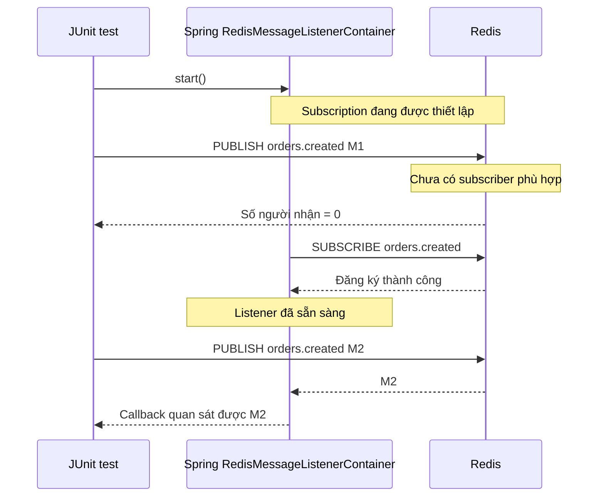
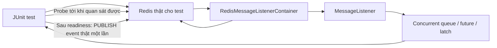

# Kiểm thử Pub/Sub mà không phụ thuộc chờ cố định trong Spring Data Redis

## 1. Bài toán: test Pub/Sub có lúc xanh, có lúc đỏ

Redis Pub/Sub hoạt động bất đồng bộ: publisher gửi thông điệp bằng `PUBLISH`, còn subscriber cần có kết nối và đăng ký channel trước khi thông điệp được phát. Trong Spring Data Redis, quá trình đăng ký thường được quản lý bởi `RedisMessageListenerContainer`, còn callback xử lý thông điệp được thực hiện qua `MessageListener` hoặc một listener adapter.

Một bài kiểm thử có vẻ đơn giản:

```java
container.start();
redisTemplate.convertAndSend("orders.created", "order-42");

Thread.sleep(1000);

assertThat(receivedMessages).contains("order-42");
```

Bài test này tiềm ẩn hai vấn đề:

1. **Race khi đăng ký:** `start()` bắt đầu lifecycle của container, nhưng không được suy từ đó rằng mọi subscription đã được Redis xác nhận và sẵn sàng đúng lúc câu `PUBLISH` chạy. Redis Pub/Sub **không phát lại** thông điệp được gửi khi subscriber chưa đăng ký.
2. **Chờ cố định:** `Thread.sleep(1000)` vừa làm bài test chậm khi message đến ngay, vừa thất bại ngẫu nhiên nếu CI, máy ảo, CPU hoặc lịch chạy thread khiến callback đến muộn hơn 1 giây.

Thay vì đợi một số mili giây rồi hy vọng hệ thống đã sẵn sàng, nên xây phép thử dựa vào **tín hiệu quan sát được**:

- Biết listener thực sự nhận được một thông điệp probe.
- Phát sự kiện nghiệp vụ cần test **sau** khi nhận tín hiệu sẵn sàng.
- Đợi callback hoặc trạng thái đích đạt điều kiện kỳ vọng, có **timeout tối đa**.
- Dùng kênh và event ID riêng cho test để không nhận nhầm thông điệp của test khác.
- Dọn listener và tài nguyên sau test, tránh rò rỉ subscription sang lần sau.

Bài này tập trung vào cách làm trên Spring Data Redis, từ unit test listener đến integration test dùng Redis thật, Testcontainers, `Awaitility`, `CountDownLatch` và `CompletableFuture`.

## 2. Redis Pub/Sub không phải queue có lưu lại message

Sự khác biệt đầu tiên phải hiểu:



M1 bị mất đối với subscriber này. Tăng `Thread.sleep(...)` **sau khi đã phát M1** không thể làm nó xuất hiện trở lại.

Với Redis Pub/Sub thông thường:

- Subscriber chỉ nhận message khi subscription đang hoạt động và đường truyền không làm mất message.
- Redis không giữ lịch sử message cho subscriber kết nối muộn.
- Không có ACK nghiệp vụ và retry tự động giống một hệ thống queue có pending.
- Nhiều subscriber cùng channel có thể cùng nhận một message; không phải cơ chế chia công việc giữa các worker.
- Một lần `PUBLISH` thành công không có nghĩa callback Java đã xử lý xong.

Vì vậy phải giải quyết **hai đồng bộ hóa độc lập**:

1. **Subscription readiness:** subscriber đã sẵn sàng trước khi gửi message cần kiểm thử chưa?
2. **Processing completion:** handler đã thực hiện xong hiệu ứng mà bài kiểm thử muốn xác nhận chưa?

Chờ callback sau publish chỉ giải quyết câu hỏi thứ hai **nếu message không bị mất trước khi listener subscribe**. Đó là lý do handshake trước khi publish quan trọng.

## 3. Vì sao `Thread.sleep` gây flaky test?

Giả sử một bài test chạy ở ba môi trường:

| Môi trường | Thời gian để subscription sẵn sàng | Thời gian callback hoàn tất |
| --- | ---: | ---: |
| Laptop ít tải | 30 ms | 10 ms |
| CI dùng container vừa khởi động | 350 ms | 80 ms |
| CI bị tranh chấp CPU/GC/network | 1.500 ms | 400 ms |

Nếu hardcode `Thread.sleep(500)`:

- Laptop mất 500 ms dù chỉ cần vài chục ms.
- CI vừa khởi động có thể qua, nhưng không có bằng chứng subscription đã sẵn sàng.
- CI bị chậm có thể fail, dù ứng dụng hoạt động đúng.
- Tăng lên 5.000 ms có thể che race ở phần lớn lượt chạy nhưng làm suite kiểm thử chậm mà vẫn không có một cam kết chắc chắn.

Cần phân biệt ba kỹ thuật:

| Kỹ thuật | Đang làm gì? | Mức phù hợp |
| --- | --- | --- |
| `Thread.sleep(1000)` | Chờ vô điều kiện dù không biết điều gì xảy ra | Tránh dùng để đồng bộ hóa bài test Pub/Sub |
| `latch.await(5, SECONDS)` | Chờ một tín hiệu thực sự, thất bại nếu quá 5 giây | Phù hợp để chờ callback có bằng chứng |
| `await().atMost(5s).until(condition)` | Kiểm tra điều kiện cho đến khi đúng, tối đa 5 giây | Phù hợp với trạng thái bất đồng bộ |
| Probe/handshake | Chứng minh listener đã nhận một message trước khi phát event chính | Phù hợp để loại race đăng ký |

**Timeout tối đa không phải “chờ cố định”.** Một test có timeout 5 giây vẫn kết thúc ngay khi tín hiệu đến, và thời hạn 5 giây là ngân sách xác định failure, không phải lịch ngủ cố định.

## 4. Kiến trúc một bài integration test đáng tin cậy

Một bài integration test Pub/Sub nên có các thành phần:



Các bước đề xuất:

1. Chuẩn bị Redis test độc lập, ví dụ Testcontainers.
2. Tạo tên channel riêng cho bài test, chứa UUID.
3. Đăng ký một `MessageListener` có khả năng ghi nhận probe và event.
4. Khởi động `RedisMessageListenerContainer`.
5. **Phát probe có ID duy nhất lặp lại có giới hạn** cho đến khi chính listener đó nhìn thấy probe.
6. Chỉ sau bước 5 mới phát **một lần** sự kiện nghiệp vụ cần kiểm thử.
7. Đợi điều kiện kiểm tra thành công qua future/latch/queue hoặc Awaitility.
8. Dọn container và những dữ liệu test đã tạo.

Trong môi trường test ổn định, bước probe đóng vai trò hàng rào thực tế: listener đã nhận thông điệp trên chính channel đó. Nếu kết nối rớt **sau probe**, event thật vẫn có thể mất; đó là lỗi giao hàng hợp lệ của Pub/Sub và nên được xử lý theo chính sách test, không che bằng retry event nghiệp vụ vô hạn.

### Vì sao phải dùng kênh test riêng?

Giả sử hai test chạy song song đều sử dụng:

```text
channel = orders.created
payload = order-42
```

Callback của test A có thể nhận message do test B phát và vô tình làm assertion của A thành công, dù đường gửi của A đang lỗi.

Tốt hơn:

```text
channel = it:pubsub:order-created:a872cf0d...
probe   = probe:4b82a6...
event   = event:8fd18c...
```

Test so khớp **đúng channel + đúng event ID/payload**, thay vì chỉ kiểm tra “đã nhận một message nào đó”.

## 5. Cách 1: handshake bằng probe trên chính channel cần kiểm thử

Đây là kỹ thuật thực dụng, không phụ thuộc một API callback subscription chuyên biệt của driver.

### Quy trình

```text
Test                        Redis                  Listener
  |                           |                        |
  |--- start container ------>|                        |
  |--- PUBLISH probe-1 ------>|   (chưa subscribe)      |
  |--- PUBLISH probe-1 ------>|   (chưa subscribe)      |
  |--- PUBLISH probe-1 ------>|--- callback probe-1 --->|
  |<------------------------ tín hiệu nhận probe --------|
  |                           |                        |
  |--- PUBLISH event-42 ----->|--- callback event-42 -->|
  |<--------------------- tín hiệu đã xử lý event --------|
  |                           |                        |
  |                assert event-42 đã nhận               |
```

Điểm then chốt là **có thể phát lặp probe** vì probe chỉ phục vụ kiểm thử readiness và **không mang side effect nghiệp vụ**. Ngược lại, event thật được phát **một lần** để bài test phản ánh đúng hành vi gửi.

### Triển khai cùng ConcurrentLinkedQueue

```java
import java.nio.charset.StandardCharsets;
import java.util.Queue;
import java.util.concurrent.ConcurrentLinkedQueue;

import org.springframework.data.redis.connection.MessageListener;

Queue<String> seenProbes = new ConcurrentLinkedQueue<>();
Queue<String> seenEvents = new ConcurrentLinkedQueue<>();

MessageListener listener = (message, pattern) -> {
    String payload = new String(
            message.getBody(), StandardCharsets.UTF_8);

    if (payload.startsWith("probe:")) {
        seenProbes.add(payload);
    } else if (payload.startsWith("event:")) {
        seenEvents.add(payload);
    }
};
```

Đưa cả hai loại thông điệp qua **cùng channel và cùng listener** giúp probe chứng minh đúng subscription phục vụ bài test.

Sử dụng Awaitility để phát probe có điều kiện:

```java
String probe = "probe:" + UUID.randomUUID();

await()
        .atMost(Duration.ofSeconds(10))
        .pollInterval(Duration.ofMillis(100))
        .until(() -> {
            redisTemplate.convertAndSend(channel, probe);
            return seenProbes.contains(probe);
        });
```

Ở đây:

- Polling có giới hạn dùng để lặp **probe** khi subscriber chưa sẵn sàng.
- `until(...)` trả true chỉ khi callback đã thật sự đưa probe vào queue.
- Không có `Thread.sleep` chờ một thời gian dự đoán.
- Khi callback nhanh, điều kiện hoàn thành ngay trong những lần poll đầu.
- Khi subscriber không bao giờ hoạt động, bài test thất bại sau thời hạn tối đa.

**Không dùng cùng mẫu phát lại cho event nghiệp vụ cần assert**, vì chính việc phát lặp có thể che lỗi lost event và tạo duplicate.

### Sau probe, phát event thật đúng một lần

```java
String event = "event:" + UUID.randomUUID();

redisTemplate.convertAndSend(channel, event);

await()
        .atMost(Duration.ofSeconds(5))
        .untilAsserted(() ->
                assertThat(seenEvents).contains(event));
```

Kết quả là bài test chờ callback thông qua một điều kiện quan sát được, không chờ theo một khoảng cố định.

## 6. Ví dụ integration test đầy đủ: Spring Boot, Testcontainers và Awaitility

Một bài test có thể tự tạo container listener để quản lý lifecycle và có Redis test độc lập. Ví dụ sau dùng Spring Boot, JUnit 5, Testcontainers và Awaitility.

### 6.1. Các dependency liên quan

Đối với Maven, ngoài starter chính của ứng dụng:

```xml
<dependency>
    <groupId>org.springframework.boot</groupId>
    <artifactId>spring-boot-starter-data-redis</artifactId>
</dependency>
<dependency>
    <groupId>org.springframework.boot</groupId>
    <artifactId>spring-boot-starter-test</artifactId>
    <scope>test</scope>
</dependency>
<dependency>
    <groupId>org.testcontainers</groupId>
    <artifactId>junit-jupiter</artifactId>
    <scope>test</scope>
</dependency>
<dependency>
    <groupId>org.testcontainers</groupId>
    <artifactId>testcontainers</artifactId>
    <scope>test</scope>
</dependency>
<dependency>
    <groupId>org.awaitility</groupId>
    <artifactId>awaitility</artifactId>
    <scope>test</scope>
</dependency>
```

Khi sử dụng Spring Boot dependency management, phiên bản của một số thư viện được quản lý theo BOM; nếu không, dự án phải cung cấp version tương thích. Testcontainers yêu cầu Docker hoặc runtime container được CI hỗ trợ.

### 6.2. Test hoàn chỉnh

```java
package com.example.redis;

import static org.assertj.core.api.Assertions.assertThat;
import static org.awaitility.Awaitility.await;

import java.nio.charset.StandardCharsets;
import java.time.Duration;
import java.util.Queue;
import java.util.UUID;
import java.util.concurrent.ConcurrentLinkedQueue;

import org.junit.jupiter.api.Test;
import org.springframework.beans.factory.annotation.Autowired;
import org.springframework.boot.SpringBootConfiguration;
import org.springframework.boot.autoconfigure.EnableAutoConfiguration;
import org.springframework.boot.test.context.SpringBootTest;
import org.springframework.data.redis.connection.RedisConnectionFactory;
import org.springframework.data.redis.connection.MessageListener;
import org.springframework.data.redis.core.StringRedisTemplate;
import org.springframework.data.redis.listener.ChannelTopic;
import org.springframework.data.redis.listener.RedisMessageListenerContainer;
import org.springframework.test.context.DynamicPropertyRegistry;
import org.springframework.test.context.DynamicPropertySource;
import org.testcontainers.containers.GenericContainer;
import org.testcontainers.junit.jupiter.Container;
import org.testcontainers.junit.jupiter.Testcontainers;
import org.testcontainers.utility.DockerImageName;

@Testcontainers
@SpringBootTest(classes = RedisPubSubIntegrationTest.TestApplication.class)
class RedisPubSubIntegrationTest {

    @SpringBootConfiguration
    @EnableAutoConfiguration
    static class TestApplication {
    }

    @Container
    static final GenericContainer<?> REDIS =
            new GenericContainer<>(
                    DockerImageName.parse("redis:7.4-alpine"))
                    .withExposedPorts(6379);

    @DynamicPropertySource
    static void redisProperties(DynamicPropertyRegistry registry) {
        registry.add("spring.data.redis.host", REDIS::getHost);
        registry.add("spring.data.redis.port",
                () -> REDIS.getMappedPort(6379));
    }

    @Autowired
    RedisConnectionFactory connectionFactory;

    @Autowired
    StringRedisTemplate redisTemplate;

    @Test
    void receivesPublishedEventAfterSubscriptionIsReady() throws Exception {
        String channel = "it:pubsub:" + UUID.randomUUID();

        Queue<String> probes = new ConcurrentLinkedQueue<>();
        Queue<String> events = new ConcurrentLinkedQueue<>();

        MessageListener listener = (message, pattern) -> {
            String payload = new String(
                    message.getBody(),
                    StandardCharsets.UTF_8);

            if (payload.startsWith("probe:")) {
                probes.add(payload);
            } else if (payload.startsWith("event:")) {
                events.add(payload);
            }
        };

        RedisMessageListenerContainer container =
                new RedisMessageListenerContainer();

        container.setConnectionFactory(connectionFactory);
        container.addMessageListener(
                listener,
                new ChannelTopic(channel));

        // Bean tạo thủ công: chủ động quản lý init/start/destroy.
        container.afterPropertiesSet();
        container.start();

        try {
            // Bước 1: readiness barrier bằng chính listener cần test.
            String probe = "probe:" + UUID.randomUUID();

            await()
                    .atMost(Duration.ofSeconds(10))
                    .pollInterval(Duration.ofMillis(100))
                    .until(() -> {
                        redisTemplate.convertAndSend(channel, probe);
                        return probes.contains(probe);
                    });

            // Bước 2: phát event nghiệp vụ CHỈ MỘT LẦN.
            String expectedEvent = "event:" + UUID.randomUUID();
            redisTemplate.convertAndSend(channel, expectedEvent);

            // Bước 3: chờ đến khi callback đã thật sự nhận event.
            await()
                    .atMost(Duration.ofSeconds(5))
                    .untilAsserted(() ->
                            assertThat(events).contains(expectedEvent));

        } finally {
            container.stop();
            container.destroy();
        }
    }
}
```

Test thực hiện các hành động theo thứ tự quan sát được:

1. Redis Testcontainers được khởi động và Spring Data Redis kết nối tới địa chỉ/cổng đã map.
2. Listener container được cấu hình channel riêng cho test.
3. `start()` bắt đầu đăng ký, **nhưng test không coi đó là đủ**.
4. Probe được phát cho đến khi callback của listener nhận.
5. Event thật được phát đúng một lần.
6. Assertion đợi callback, có deadline rõ ràng.
7. `finally` dọn subscription và container ngay cả khi test fail.

Hàm `afterPropertiesSet()` được gọi vì trong ví dụ container được **tạo thủ công ngoài Spring bean lifecycle**. Nếu container đã là Spring-managed bean, framework thường gọi các hook khởi tạo và quản lý start/stop; không nên gọi thủ công lặp lại vô tội vạ.

Image tag `redis:7.4-alpine` chỉ là ví dụ cho test. Dự án thực tế nên pin một phiên bản/image digest phù hợp chính sách CI và phiên bản Redis production cần kiểm tra, để tránh test tự đổi hành vi khi image tag thay đổi.

### Điều bài test thật sự chứng minh

Bài test xác nhận rằng trong điều kiện Redis thử nghiệm hoạt động và listener đang subscribe, một message được publish **sau readiness barrier** đã tới callback Java.

Nó **không** chứng minh:

- Pub/Sub sẽ lưu message khi subscriber offline.
- Event luôn tới mọi subscriber dưới mọi lỗi mạng.
- Handler nghiệp vụ nhiều bước đã commit database, nếu test chỉ kiểm tra queue nội bộ.
- Mỗi message sẽ được xử lý exactly-once trong môi trường nhiều instance.
- Redis Cluster với nhiều primary có cùng semantics subscription như standalone test.

Mỗi bảo đảm bổ sung cần một bài test và thiết kế nghiệp vụ riêng.

## 7. Cách 2: dùng `CountDownLatch` để chờ callback

Khi chỉ có một sự kiện cần nhận, `CountDownLatch` là primitive gọn và dễ hiểu:

```java
CountDownLatch eventHandled = new CountDownLatch(1);
AtomicReference<String> received = new AtomicReference<>();

MessageListener listener = (message, pattern) -> {
    String payload = new String(
            message.getBody(), StandardCharsets.UTF_8);

    if (payload.equals(expectedEvent)) {
        received.set(payload);
        eventHandled.countDown();
    }
};
```

Sau khi đảm bảo subscriber đã sẵn sàng bằng một trong các cách phù hợp:

```java
redisTemplate.convertAndSend(channel, expectedEvent);

boolean completed = eventHandled.await(5, TimeUnit.SECONDS);

assertThat(completed).isTrue();
assertThat(received.get()).isEqualTo(expectedEvent);
```

`await(5, TimeUnit.SECONDS)` có thể trở về ngay khi callback gọi `countDown()`; không phải bắt buộc ngủ đủ 5 giây.

**Nhưng latch không thay thế readiness barrier.** Nếu message bị mất trước khi subscribe, latch sẽ đợi hết timeout rồi test fail. Nếu mục tiêu là test callback khi subscriber đang online, cần đồng bộ đăng ký trước.

### Nhiều sự kiện hoặc nhiều subscriber

Có thể dùng `CountDownLatch(n)` nếu kỳ vọng **n callback cụ thể**. Tuy nhiên nên kèm dữ liệu định danh để tránh một message trùng bị đếm thành hai:

```java
Set<String> receivedIds = ConcurrentHashMap.newKeySet();
CountDownLatch allHandled = new CountDownLatch(3);

void onEvent(String eventId) {
    if (expectedIds.contains(eventId) &&
            receivedIds.add(eventId)) {
        allHandled.countDown();
    }
}
```

Trong ví dụ, `expectedIds` là tập ID kỳ vọng do test tạo, còn `receivedIds.add(eventId)` chỉ trả true lần đầu thấy ID ấy. Đây là cách giảm false positive khi có callback trùng.

Không dùng số lần gọi handler đơn thuần thay thế số lượng **event ID khác nhau** nếu yêu cầu test là mỗi event một lần.

## 8. Cách 3: dùng `CompletableFuture` để trả về kết quả xử lý

Khi muốn lấy một object thay vì chỉ biết callback đã xảy ra, có thể sử dụng `CompletableFuture`:

```java
CompletableFuture<OrderEvent> result = new CompletableFuture<>();

MessageListener listener = (message, pattern) -> {
    String json = new String(
            message.getBody(), StandardCharsets.UTF_8);

    try {
        OrderEvent event =
                objectMapper.readValue(json, OrderEvent.class);

        if (expectedEventId.equals(event.eventId())) {
            result.complete(event);
        }
    } catch (Exception exception) {
        result.completeExceptionally(exception);
    }
};
```

Sau khi readiness:

```java
redisTemplate.convertAndSend(channel, eventJson);

OrderEvent actual = result.get(5, TimeUnit.SECONDS);

assertThat(actual.eventId()).isEqualTo(expectedEventId);
assertThat(actual.orderId()).isEqualTo("42");
```

Ví dụ giả định có record:

```java
public record OrderEvent(String eventId, String orderId) {
}
```

`CompletableFuture.get(timeout, unit)` dừng chờ khi callback hoàn tất hoặc báo timeout, không cần `Thread.sleep`.

### Khi nào dùng Future thay vì Queue?

| Nhu cầu | Primitive phù hợp |
| --- | --- |
| Một callback xảy ra | `CountDownLatch(1)` |
| Một kết quả/DTO cụ thể | `CompletableFuture<T>` |
| Nhiều message cần giữ để inspect | `BlockingQueue<T>` hoặc concurrent collection |
| Chờ trạng thái cuối trong repository/cache | Awaitility kiểm tra điều kiện |
| Một luồng phản ứng `Mono/Flux` | `StepVerifier` và Reactor Test |

Nếu callback có thể nhận probe và event, chỉ hoàn tất future khi **event ID đúng**. Nếu future bị complete bởi probe, bài test có thể pass sai.

## 9. Cách 4: `BlockingQueue.poll(timeout)` cho message payload

Một lựa chọn khác:

```java
BlockingQueue<String> received = new LinkedBlockingQueue<>();

MessageListener listener = (message, pattern) ->
        received.offer(new String(
                message.getBody(), StandardCharsets.UTF_8));
```

Sau readiness:

```java
redisTemplate.convertAndSend(channel, expectedEvent);

String payload = received.poll(5, TimeUnit.SECONDS);
assertThat(payload).isEqualTo(expectedEvent);
```

Điểm thuận tiện: có thể lấy từng message để kiểm tra nội dung và thứ tự quan sát tại callback.

**Cạm bẫy:** nếu queue còn probe, lần `poll(...)` đầu có thể lấy probe thay vì event. Có hai cách:

1. Dùng queue riêng cho probe và event như ví dụ integration test.
2. Chờ/đọc có lọc chính xác `eventId` trong ngân sách thời gian tổng, không giả định phần tử đầu tiên luôn là event chính.

Nếu có nhiều publisher, message từ test khác hay các thông báo nền có thể chen vào. Kênh test riêng và payload độc nhất giúp test không phụ thuộc thứ tự của message không liên quan.

## 10. Test xử lý nghiệp vụ: chờ side effect, không chỉ chờ `onMessage`

Trong ứng dụng thật, listener có thể:

1. Nhận message.
2. Deserialize JSON.
3. Chạy service.
4. Ghi database hoặc cập nhật cache.
5. Phát metric/log.

Nếu callback **đẩy việc vào executor khác** rồi trở về, việc callback được gọi không chứng minh nghiệp vụ đã hoàn tất.

Ví dụ:

```java
@Override
public void onMessage(Message message, byte[] pattern) {
    OrderEvent event = decode(message.getBody());
    CompletableFuture.runAsync(() -> orderProjection.apply(event));
}
```

Test chỉ đếm `onMessage` sẽ pass trước khi `orderProjection.apply(...)` hoàn thành.

Thay vào đó, chờ **trạng thái đầu ra**:

```java
redisTemplate.convertAndSend(channel, eventJson);

await()
        .atMost(Duration.ofSeconds(5))
        .untilAsserted(() -> {
            OrderView view =
                    orderViewRepository.findByOrderId("42");

            assertThat(view).isNotNull();
            assertThat(view.status()).isEqualTo("CREATED");
        });
```

Cách này chờ điều kiện nghiệp vụ, không cần đoán ứng dụng cần bao nhiêu mili giây để xử lý.

**Lưu ý về event ordering:** nếu có nhiều worker cập nhật cùng bản ghi, assertion phải kiểm tra version hoặc event ID của projection, không chỉ một value dễ trùng với trạng thái trước test.

### Thử nguyên nhân lỗi chính xác

Nếu listener deserialize thất bại, Awaitility có thể timeout mà không cho biết vì sao. Nên kết hợp:

- Error handler của container.
- Future hoàn tất exceptionally khi lỗi callback.
- Log/metric theo event ID.
- Kiểm tra channel và serializer.
- Quan sát kết nối Redis test và trạng thái subscription.

Nhờ đó lỗi test có thông tin hành động được, thay vì chỉ báo “expected event not found”.

## 11. Vì sao `container.isRunning()` chưa đủ?

`RedisMessageListenerContainer` quản lý lifecycle nội bộ và subscription. Một API như `isRunning()` chủ yếu nói về trạng thái lifecycle ở mức container; nó không mặc nhiên chứng minh tất cả channel đã được Redis xác nhận subscribe, callback đã được dispatch hoặc listener vẫn kết nối sau đó.

Cần phân biệt:

```text
Container object được tạo
    |
    v
Container đã start theo lifecycle
    |
    v
Redis connection được mở
    |
    v
SUBSCRIBE/PSUBSCRIBE được gửi
    |
    v
Redis xác nhận subscription
    |
    v
MessageListener có thể nhận message
```

Một boolean lifecycle không bao quát mọi mốc.

### Có thể dựa vào subscription acknowledgment không?

Ở tầng Redis protocol có response xác nhận `SUBSCRIBE`/`PSUBSCRIBE`. Một số driver/API có hỗ trợ callback subscription hoặc trạng thái đăng ký để ứng dụng biết lúc nào subscription sẵn sàng.

Nếu dự án đang dùng một callback acknowledgment được tài liệu driver/Spring Data Redis **phiên bản hiện tại** hỗ trợ, có thể dùng nó làm readiness signal. Nhưng cần hiểu:

- Ack phải gắn với **channel/pattern cụ thể** mà test cần.
- Ack chỉ chứng minh đăng ký ở thời điểm đó, không bảo đảm kết nối sẽ tồn tại mãi.
- Không coi `container.start()` hoặc một flag chung là thay thế acknowledgment.
- Không tự giả định mọi phiên bản driver có cùng API callback.

Probe trên chính channel là kỹ thuật hữu ích khi muốn một bài test độc lập với những khác biệt API ở tầng driver.

## 12. Giá trị trả về của `convertAndSend` có đủ để làm readiness barrier?

Spring Data Redis cho phép:

```java
Long subscriptions = redisTemplate.convertAndSend(
        channel, probe);
```

Giá trị này tương ứng với kết quả lệnh Redis `PUBLISH`: số subscription/client được Redis tính là nhận message theo phạm vi lệnh và topology.

Có thể dùng nó như **tín hiệu chẩn đoán**, nhưng không nên coi:

```java
assertThat(subscriptions).isGreaterThan(0);
```

là bằng chứng hoàn chỉnh của bài test.

Vì:

1. Một subscriber **khác** trong môi trường test có thể đang subscribe channel.
2. Redis đếm message được định tuyến, **không đợi callback Java hoàn thành**.
3. Callback có thể lỗi deserialize sau khi Redis chuyển message.
4. Khi dùng Redis Cluster, phạm vi đếm của `PUBLISH` cần hiểu theo node/topology.
5. Container của ứng dụng có thể đang bị reconnect ngay sau lượt đếm.

Đối với test một listener cụ thể, tín hiệu đáng tin hơn là **listener đó thực sự nhận probe có ID riêng**.

Nếu muốn tối ưu thời gian test, có thể log giá trị trả về của `PUBLISH` để chẩn đoán trường hợp không có subscriber; vẫn phải dùng callback hoặc trạng thái nghiệp vụ cho assertion chính.

## 13. `ChannelTopic` và `PatternTopic` cần test khác nhau ra sao?

Spring Data Redis hỗ trợ:

```java
new ChannelTopic("orders.created");
new PatternTopic("orders.*");
```

- `ChannelTopic` đăng ký **tên channel chính xác**.
- `PatternTopic` đăng ký **glob pattern** phù hợp nhiều channel.

Đối với pattern test, nên lưu cả tên channel thực tế:

```java
record ReceivedMessage(String channel, String payload) {}

Queue<ReceivedMessage> received = new ConcurrentLinkedQueue<>();

MessageListener listener = (message, pattern) -> {
    String actualChannel = new String(
            message.getChannel(), StandardCharsets.UTF_8);
    String payload = new String(
            message.getBody(), StandardCharsets.UTF_8);

    received.add(new ReceivedMessage(actualChannel, payload));
};
```

Đăng ký:

```java
container.addMessageListener(
        listener,
        new PatternTopic("it:orders:*"));
```

Probe phải phát đến **một channel thực tế khớp pattern**, ví dụ `it:orders:probe`, và test xác minh listener nhận được message đó.

Sau handshake, phát event tới `it:orders:created` và kiểm tra cả:

```text
channel = it:orders:created
payload = event:<ID riêng>
```

Không chỉ kiểm tra body vì body trùng có thể được gửi trên channel khác.

### Đăng ký chồng lấn

Nếu một client đăng ký cả `orders.created` và `orders.*`, một lần publish có thể dẫn đến nhiều thông báo phù hợp. Khi test số lượng callback, phải xác định trước có đăng ký chồng lấn hay không.

Nếu hệ thống thực tế sử dụng nhiều listener, có thể test mỗi listener theo event ID riêng, tránh giả định “một lần PUBLISH chắc chắn bằng một lần gọi callback trong toàn bộ ứng dụng”.

## 14. Kiểm thử nhiều subscriber: mỗi subscriber phải có readiness riêng

Redis Pub/Sub mang tính broadcast. Giả sử hai instance cùng subscribe một channel:

```text
Publisher
    |
    v
Redis
    |-------------------|
    v                   v
Listener A          Listener B
```

Để chứng minh cả A và B cùng nhận một event, không đủ nếu chỉ thấy **một** probe:

```text
Probe được Listener A nhận
Listener B vẫn đang đăng ký
Test phát event ngay
Listener B có thể bỏ lỡ
```

Thay vào đó:

1. Tạo observer/latch/future riêng cho A.
2. Tạo observer/latch/future riêng cho B.
3. Phát probe có ID cố định cho tới khi **cả hai observer** xác nhận đã nhận.
4. Phát event nghiệp vụ một lần.
5. Đợi cả A và B ghi nhận đúng event ID.

Ví dụ ý tưởng:

```java
Set<String> readyListeners = ConcurrentHashMap.newKeySet();

await()
    .atMost(Duration.ofSeconds(10))
    .until(() -> {
        redisTemplate.convertAndSend(channel, probe);
        return readyListeners.contains("A")
                && readyListeners.contains("B");
    });
```

Mỗi listener chỉ đánh dấu ready khi chính nó nhận được `probe`. Với listener thực tế phức tạp, có thể dùng một observer phụ hoặc adapter test để không làm thay đổi business handler.

Sau đó:

```java
redisTemplate.convertAndSend(channel, event);

await()
    .atMost(Duration.ofSeconds(5))
    .untilAsserted(() -> {
        assertThat(eventsReceivedByA).contains(event);
        assertThat(eventsReceivedByB).contains(event);
    });
```

Khi test load balancing, Redis Pub/Sub thường **không phải công cụ phù hợp** vì các subscriber cùng channel đều có thể nhận event; nếu muốn chia công việc trong một group, cân nhắc Redis Streams consumer group.

## 15. Test một handler đơn vị không cần Redis thật

Không phải mọi hành vi của subscriber đều cần integration test. Phần **parse, validate, dispatch và gọi service** có thể kiểm thử nhanh bằng unit test thuần Java.

Ví dụ listener:

```java
import java.nio.charset.StandardCharsets;

import org.springframework.data.redis.connection.Message;
import org.springframework.data.redis.connection.MessageListener;

public final class OrderCreatedListener implements MessageListener {

    private final OrderEventHandler handler;

    public OrderCreatedListener(OrderEventHandler handler) {
        this.handler = handler;
    }

    @Override
    public void onMessage(Message message, byte[] pattern) {
        String channel = new String(
                message.getChannel(), StandardCharsets.UTF_8);
        String payload = new String(
                message.getBody(), StandardCharsets.UTF_8);

        if (!"orders.created".equals(channel)) {
            return;
        }

        handler.handle(payload);
    }
}

interface OrderEventHandler {
    void handle(String payload);
}
```

Unit test bằng Mockito:

```java
import static org.mockito.Mockito.*;

import java.nio.charset.StandardCharsets;
import org.junit.jupiter.api.Test;
import org.springframework.data.redis.connection.Message;

class OrderCreatedListenerTest {

    @Test
    void dispatchesMatchingChannel() {
        OrderEventHandler handler =
                mock(OrderEventHandler.class);

        OrderCreatedListener listener =
                new OrderCreatedListener(handler);

        Message message = mock(Message.class);
        when(message.getChannel()).thenReturn(
                "orders.created".getBytes(StandardCharsets.UTF_8));
        when(message.getBody()).thenReturn(
                "event-42".getBytes(StandardCharsets.UTF_8));

        listener.onMessage(message, null);

        verify(handler).handle("event-42");
    }
}
```

Bài test này:

- Không cần Redis server.
- Không cần subscription lifecycle.
- Không có race do network hoặc thread listener.
- Kiểm tra nhanh logic mapping/dispatch.

Nhưng nó **không xác nhận** cấu hình `RedisMessageListenerContainer`, kết nối Redis hay tên topic được đăng ký đúng. Vì vậy vẫn nên có một số integration test chọn lọc, sử dụng readiness barrier.

### Tách unit và integration test theo trách nhiệm

| Muốn kiểm tra | Loại test ưu tiên |
| --- | --- |
| JSON parse hợp lệ và không hợp lệ | Unit test parser/listener |
| Listener gọi đúng service theo channel | Unit test |
| Container đăng ký và nhận message qua Redis | Integration test có Redis |
| Nhiều subscriber đều nhận event | Integration test nhiều listener |
| Ứng dụng xử lý event rồi cập nhật database | Integration test kiểm tra side effect |
| Hành vi khi Redis restart/failover | Fault-injection test riêng |
| Subscriber offline có bỏ lỡ message không | Integration test theo thời gian/lifecycle, chấp nhận giới hạn chứng minh |

Tách đúng trách nhiệm giúp giảm thời gian CI và làm nguyên nhân lỗi rõ ràng.

## 16. Kiểm thử logic bất đồng bộ có thể dùng `StepVerifier` không?

Nếu business service trả `Mono` hoặc `Flux`, `StepVerifier` là công cụ tốt để kiểm tra pipeline Reactor:

```java
StepVerifier.create(service.process(event))
        .expectNextMatches(result -> result.success())
        .verifyComplete();
```

Tuy nhiên `MessageListener.onMessage(...)` là callback được kích hoạt bởi Redis Pub/Sub, **không tự trả một `Mono` cho bài test**. Nếu listener trực tiếp ghi vào repository, StepVerifier trên một publisher khác không tự chứng minh callback đã nhận message.

Một mô hình hợp lý:

1. Integration test dùng handshake để bảo đảm listener đã subscribe.
2. Publish event một lần.
3. Dùng Awaitility hoặc future quan sát kết quả xử lý.
4. Unit test riêng Reactor service bằng StepVerifier khi muốn kiểm tra operator, lỗi và completion.

Nếu ứng dụng xây một adapter từ callback Pub/Sub thành `Flux` bằng sink, có thể kiểm thử adapter với StepVerifier, nhưng cần tạo subscription **trước khi phát event** và đánh giá cách sink buffer hoặc drop message. Không dùng `Flux.fromIterable(...)` của một collection đã lấy snapshot để giả làm live event stream.

## 17. Kiểm thử với `@SpringBootTest`: tránh false positive từ context tái sử dụng

Spring Test có thể tái sử dụng application context giữa các test class. Nếu test để lại một `RedisMessageListenerContainer` hoặc dynamic listener chưa được hủy:

- Test sau nhận message từ subscription cũ.
- Một publish có thể kích hoạt callback thừa.
- `PUBLISH` trả số subscribers lớn hơn dự kiến.
- Test “nhận ít nhất một message” vẫn pass dù listener cần test chưa sẵn sàng.
- Resource/thread còn chạy làm suite khó kết thúc.

Để tránh:

- Dùng channel chứa UUID riêng cho mỗi test.
- Dọn subscription qua lifecycle của container hoặc hủy listener đã thêm động.
- Không dùng collection tĩnh ghi nhận message qua nhiều test trừ khi xóa và đồng bộ rõ ràng.
- Nếu dùng application context chung và bean container thật, tránh gọi `stop()` bean toàn ứng dụng trong một test có thể ảnh hưởng test khác chạy song song.
- Nếu test thay đổi cấu hình bean hay context dùng chung, cân nhắc tách context hoặc quản lý isolation rõ ràng.
- Tránh tạo client/Redis connection mới mỗi lần polling probe; tái sử dụng `StringRedisTemplate` đã cấu hình.

Testcontainers hỗ trợ môi trường Redis tách biệt, nhưng không tự ngăn hai test class cùng dùng một channel hoặc cùng bean listener.

## 18. Giới hạn thời gian chờ: bao nhiêu là hợp lý?

Không tồn tại một timeout phù hợp với mọi CI. Có thể bắt đầu từ ngân sách của hệ thống test:

| Hành động | Ví dụ timeout tối đa | Lý do |
| --- | --- | --- |
| Redis container sẵn sàng | Do Testcontainers wait strategy quản lý | Chờ process/service chấp nhận kết nối |
| Subscription readiness với probe | 5–15 giây | Bao gồm startup context, kết nối, subscribe |
| Callback cho message nhẹ | 2–5 giây | Cho phép scheduling và I/O vừa phải |
| Xử lý có ghi database | Theo latency thật và môi trường CI | Chờ side effect, không chỉ callback |
| Fault injection/recovery | Deadline riêng cao hơn | Phục hồi mạng/node không cùng độ trễ callback đơn giản |

Đây là **ví dụ về ngân sách kiểm thử**, không phải mức bảo đảm của Redis. Điều quan trọng:

- Không dùng timeout thấp đến mức thất bại thường xuyên trong CI bình thường.
- Không dùng timeout quá lớn để che lỗi readiness hoặc listener không còn chạy.
- Khi timeout, báo được **bước nào** thất bại: Redis readiness, subscription handshake, callback hay side effect.
- Dùng deadline có giới hạn tổng thay vì nhiều lần chờ nối tiếp vô hạn.
- Không thêm `Thread.sleep` trước một lần thử lại để “ổn định” test; thay bằng tín hiệu hoặc điều kiện.

## 19. Kiểm thử lỗi: listener không subscribe hoặc topic sai

Một bài kiểm thử nên thất bại **nhanh và có ý nghĩa** khi listener không nhận được probe.

Ví dụ tình huống sai topic:

```java
container.addMessageListener(
        listener,
        new ChannelTopic("orders.cancelled"));

// Test vẫn publish tới "orders.created"
redisTemplate.convertAndSend("orders.created", probe);
```

Nếu handshake yêu cầu listener nhận probe trên `orders.created`, nó sẽ không thành công trong giới hạn thời gian. Đây là failure đúng: subscription không phù hợp bài test.

Phân tích nên theo thứ tự:

1. Test Redis container đã hoạt động chưa?
2. Publisher và subscriber có dùng cùng Redis instance/DB không?
3. `ChannelTopic` có đúng tên không?
4. Có `PatternTopic` nào khác tình cờ nhận probe và làm test pass sai không?
5. Listener có được gắn vào đúng container đang start không?
6. Callback có lỗi exception không?
7. Key/serializer/channel body có cùng encoding không?
8. Subscriber đã mất kết nối/reconnect giữa probe và event thật chưa?

Không giải quyết lỗi topic sai bằng cách tăng thời gian ngủ từ 1 giây lên 30 giây.

## 20. Test subscriber bị ngắt kết nối: không giả định Pub/Sub có replay

Redis Pub/Sub thường có semantics **at-most-once delivery**: message được phát khi subscriber offline không tự lưu để phát lại.

Một kịch bản thử nghiệm:

```text
1. Start listener, đợi probe xác nhận ready.
2. Publish event A, đợi xác nhận A đã xử lý.
3. Stop listener và xác minh subscription thực sự không còn hoạt động.
4. Publish event B khi listener offline.
5. Start lại listener và thực hiện handshake mới.
6. Publish event C, đợi xác nhận C được xử lý.
7. Kiểm tra event B không có đường replay mặc định.
```

Các bước 1, 2, 5 và 6 có điều kiện quan sát rõ. Bước 3 phải xác nhận lifecycle/disconnection phù hợp trước khi publish B; nếu chỉ gọi stop rồi không đồng bộ, test có thể vô tình publish B trong lúc subscriber còn hoạt động.

**Khó khăn của assertion “không nhận event”:** trong hệ thống bất đồng bộ, việc không thấy event trong một khoảng thời gian không chứng minh nó sẽ không bao giờ đến. Một bài test phải nêu rõ **cửa sổ quan sát** và phạm vi kết luận. Nên ưu tiên xác minh semantics bằng thiết kế/lifecycle và các kiểm thử hành vi có bằng chứng dương tính; không coi một `Thread.sleep(100)` rồi `assertFalse` là bằng chứng mạnh.

Nếu nghiệp vụ cần không mất event lúc offline, đó là tín hiệu cần chọn **Redis Streams, queue bền vững hoặc outbox**, chứ không phải làm test Pub/Sub đợi lâu hơn.

## 21. Kiểm thử các pattern notification do Redis tự phát

Keyspace notifications khác business Pub/Sub ở chỗ **Redis server** phát notification khi key thay đổi, ví dụ:

```text
__keyevent@0__:set     payload = demo:profile:42
__keyevent@0__:expired payload = demo:session:42
```

Bài test cần có:

1. Redis test được bật `notify-keyspace-events` đúng nhóm cờ.
2. Listener subscribe đúng channel/pattern và logical DB.
3. Phép đồng bộ readiness **cho đúng notification channel**.
4. Thao tác ghi/xóa/expire trên key có tên riêng.
5. Đợi đúng notification bằng điều kiện, không đợi fixed sleep.

### 21.1. Dùng sự kiện `set` làm readiness probe

Nếu test listener đang subscribe `__keyevent@0__:set`, có thể tạo nhiều key probe riêng:

```redis
CONFIG SET notify-keyspace-events E$
```

Đăng ký:

```java
new ChannelTopic("__keyevent@0__:set")
```

Trong vòng đợi readiness, test tạo hoặc cập nhật key:

```java
String probeKey = "it:notification:probe:" + UUID.randomUUID();

await()
    .atMost(Duration.ofSeconds(10))
    .until(() -> {
        redisTemplate.opsForValue().set(probeKey, "READY");
        return seenKeys.contains(probeKey);
    });
```

Nếu listener ghi nhận payload là tên key, test biết **Redis đã phát notification và listener nhận được**. Đây là handshake dựa trên sự kiện thật do Redis sinh ra.

Không cần tạo hàng trăm key khác nhau trong vòng poll; có thể cập nhật cùng key probe đã tạo nếu notification vẫn được Redis phát cho mỗi `SET`. Khi kết thúc, xóa key test bằng cleanup có kiểm soát.

### 21.2. Event `expired` không xảy ra chính xác tại deadline TTL

Nếu muốn test hết hạn:

```redis
CONFIG SET notify-keyspace-events Ex
```

Cần hiểu Redis phát `expired` khi nó thực sự xóa key do expiration, **không bảo đảm đúng mili giây mà TTL đạt 0**. Test không nên:

```java
redisTemplate.opsForValue().set(
        key, "TEMP", Duration.ofSeconds(1));
Thread.sleep(1000);
assertThat(expiredSeen).isTrue();
```

Thay bằng:

- Tạo key có TTL phù hợp.
- Bảo đảm listener đã sẵn sàng trước khi đặt TTL.
- Chờ notification `expired` qua future/latch/Awaitility với timeout tối đa đủ rộng.
- Không đo deadline TTL như một đồng hồ chính xác.
- Không nhầm `expire` (đặt expiration) với `expired` (key thực sự bị xóa).

Nếu listener chỉ nghe `expired` và không có callback xác nhận subscription, có thể dùng **một probe expiration riêng** được tạo/lặp theo chính sách kiểm soát cho tới khi listener quan sát được một event `expired`, rồi mới thử sự kiện chính. Điều này có thể tốn thời gian vì Redis expiration bất đồng bộ; với test đơn vị listener, nên mock message thay vì buộc dùng TTL thật.

Nếu test vừa nghe `set` vừa nghe `expired`, probe ở channel `set` không tự chứng minh rằng **subscription `expired`** cũng đã được đăng ký. Cần xác minh cụ thể các subscription hoặc dùng một probe `expired`.

### 21.3. Redis Cluster cần theo dõi node

Trong Redis Cluster, keyspace notification gắn với node xử lý thao tác. Bài test standalone chỉ kiểm tra một Redis instance, không chứng minh một subscription đang bao phủ mọi primary của cluster. Integration test cluster cần kiểm tra subscription per-node, cấu hình notification từng node và hành vi khi reshard/failover.

## 22. Kiểm thử serializer và hợp đồng payload

Với `StringRedisTemplate`, message thường được truyền dưới dạng String/UTF-8 theo serializer. Listener nhận `Message.getBody()` là bytes.

Ví dụ:

```java
String payload = new String(
        message.getBody(), StandardCharsets.UTF_8);
```

Trong ứng dụng có thể dùng:

- String text.
- JSON text.
- Protobuf hoặc format nhị phân.
- Serializer tùy biến của `RedisTemplate`.

Test cần xác minh **publisher và subscriber dùng cùng hợp đồng serialization**. Nếu publisher dùng JDK serializer còn listener giải mã UTF-8, callback có thể nhận bytes nhưng nội dung không hợp lệ.

### Payload chứa event ID

Một envelope hợp lý:

```json
{
  "eventId": "c4f6bd93-2a63-4b7d-81c2-c8479ca5d9de",
  "eventType": "OrderCreated",
  "schemaVersion": 1,
  "orderId": "42"
}
```

Test đối chiếu `eventId` để không nhận nhầm message cũ hoặc từ test khác. `schemaVersion` giúp test kiểm tra version hóa hợp đồng. Với sự kiện nghiệp vụ, có thể thêm `occurredAt` nhưng không nên phụ thuộc vào thời gian hệ thống chính xác từng mili giây để chứng minh listener hoạt động.

### Tránh assert theo log

Log là công cụ chẩn đoán, nhưng assertion như “đợi đến khi thấy một dòng chứa OrderCreated” thường yếu hơn việc quan sát một future/event ID hoặc database state cụ thể. Log có thể bị buffer, lọc theo level, format khác giữa môi trường hoặc chứa dòng do test trước tạo.

## 23. Kiểm thử bằng application bean thật hay listener tạo riêng?

Có hai mục tiêu khác nhau.

### Listener tạo riêng trong test

Ví dụ integration test ở trên tạo `RedisMessageListenerContainer` thủ công rồi gắn một lambda listener.

Ưu điểm:

- Ít phụ thuộc vào wiring của ứng dụng.
- Dễ tạo channel UUID.
- Dễ gắn queue/latch và cleanup.
- Phù hợp kiểm tra kết nối Spring Data Redis tới Redis và semantics subscription.

Giới hạn: **không xác minh chắc chắn bean listener thật của ứng dụng đã được wiring đúng**.

### Bean subscriber thật của ứng dụng

Khi cần kiểm tra luồng end-to-end:

- Khởi động Spring Boot context thật.
- Dùng container listener thật và topic thật hoặc topic test được cấu hình qua property.
- Bổ sung observer thích hợp để biết subscription ready.
- Phát message qua publisher thật.
- Chờ side effect nghiệp vụ rõ ràng.

Ví dụ nếu ứng dụng dùng channel từ cấu hình:

```yaml
app:
  events:
    orders-created-channel: it:orders:created
```

Test có thể override property bằng giá trị riêng cho test và không để production listener subscribe một channel chung với test.

Tùy mục đích, nên có **một vài integration test wiring thật**, còn phần lớn logic validation/dispatch nên là unit test.

## 24. Lỗi thường gặp và cách giải quyết

| Triệu chứng | Nguyên nhân có thể | Cách tiếp cận |
| --- | --- | --- |
| Test pass trên máy cá nhân, fail CI | Subscription chưa sẵn sàng hoặc callback chậm | Handshake probe + Awaitility/latch có timeout |
| `Thread.sleep(5s)` vẫn đôi khi fail | Message phát trước subscribe và đã mất | Không chờ sau publish; đồng bộ trước publish |
| `isRunning() == true` nhưng không nhận message | Lifecycle start chưa đủ hoặc topic sai | Xác nhận probe nhận bởi đúng listener |
| Publish trả số dương nhưng assertion timeout | Subscriber khác nhận, callback lỗi hoặc handler chậm | Dùng event ID/observer riêng, kiểm tra error handler |
| Assertion nhận nhầm event | Dùng channel/payload chung giữa test | Dùng UUID channel và payload |
| Test event bị nhận hai lần | Listener/topic chồng lấn hoặc context cũ chưa cleanup | Dọn listener, kiểm tra topology và registration |
| Test nhận probe nhưng chưa có business effect | Handler async chưa hoàn tất | Chờ trạng thái đích, không chỉ `onMessage` |
| Queue đầu tiên trả probe | Probe/event trộn cùng queue | Tách queue hoặc lọc theo event ID |
| Listener đọc ký tự lạ | Serializer không khớp | Cùng serializer/encoding, kiểm tra bytes |
| Test key expiration timeout | Thiếu `notify-keyspace-events`, sai DB, TTL chưa thật sự expired | Bật cờ đúng, readiness và chờ điều kiện |
| Sau test còn thread/connection | Quên stop/destroy container hoặc subscriber | Cleanup trong `finally`/lifecycle |
| Redis Cluster có node nhận, node không | Keyspace notifications node-local | Test subscription từng primary và topology |
| Một test “không nhận event” thỉnh thoảng fail | Assertion âm tính quá sớm, thiếu điều kiện xác định | Định nghĩa cửa sổ quan sát; ưu tiên unit test filter |
| Test bị treo không kết thúc | `await()` không timeout hoặc task không cleanup | Luôn có timeout và cleanup |
| Đôi khi event mất khi failover | Pub/Sub không replay, kết nối gián đoạn | Kiểm thử failure model riêng, dùng cơ chế bền vững nếu cần |

## 25. Nguyên tắc đặt assertion: quan sát đúng điều cần chứng minh

Một số assertion dễ gây hiểu sai:

```java
assertThat(redisTemplate.convertAndSend(channel, msg))
        .isGreaterThan(0);
```

Câu này chỉ kiểm tra Redis báo có subscription được tính là nhận; nó **không** xác nhận handler của ứng dụng đã hoàn tất.

```java
assertThat(container.isRunning()).isTrue();
```

Câu này chỉ kiểm tra trạng thái container, không chứng minh một event có thể tới listener.

```java
Thread.sleep(1000);
assertThat(received).isNotEmpty();
```

Câu này có thể nhận probe hoặc event của test khác và phụ thuộc tốc độ máy.

Tốt hơn:

```java
await()
    .atMost(Duration.ofSeconds(5))
    .untilAsserted(() -> {
        assertThat(receivedEventIds).contains(expectedEventId);
        assertThat(persistedOrder.status()).isEqualTo("CREATED");
    });
```

Trong code thật, `persistedOrder` phải được **đọc mới bên trong lambda điều kiện**, không giữ object đã chụp trước khi handler cập nhật:

```java
await()
    .atMost(Duration.ofSeconds(5))
    .untilAsserted(() -> {
        OrderView fresh =
                orderViewRepository.findByOrderId("42");
        assertThat(fresh.status()).isEqualTo("CREATED");
    });
```

Đây là khác biệt giữa polling một **trạng thái sống** và polling một object đã lấy snapshot.

## 26. Tài nguyên, parallel test và khả năng tái lập

### Test isolation

- Dùng channel riêng cho mỗi test.
- Dùng key prefix riêng nếu test kết hợp Redis keyspace notifications.
- Không dùng Redis production hoặc môi trường chia sẻ dữ liệu người dùng.
- Không để thread callback ghi vào một static list không được dọn.
- Dùng immutable event ID và tránh dựa vào timestamp làm duy nhất.
- Dọn listener trong `finally` hoặc hook teardown.
- Chỉ chạy song song những test có isolation thật sự; nếu cùng thao tác một bean container toàn cục, cần kiểm soát concurrency.

### Resource cleanup

Với container tạo thủ công:

```java
RedisMessageListenerContainer container =
        new RedisMessageListenerContainer();

try {
    container.setConnectionFactory(connectionFactory);
    container.addMessageListener(listener, new ChannelTopic(channel));
    container.afterPropertiesSet();
    container.start();

    // Handshake và các assertion.
} finally {
    container.stop();
    container.destroy();
}
```

Nếu code thất bại trước khi `afterPropertiesSet()` hoàn tất, cần cân nhắc lifecycle phù hợp cho từng resource. Trong test đơn giản, một container có thể được quản lý bởi `@BeforeEach`/`@AfterEach`; trong test có nhiều resource, dùng cấu trúc teardown bảo đảm mỗi phần được đóng.

### Tách readiness và event thật trong log

Log có ích khi test fail:

```text
testId=... stage=redis-ready
testId=... stage=listener-created channel=...
testId=... stage=probe-observed probeId=...
testId=... stage=event-published eventId=...
testId=... stage=event-handled eventId=...
```

Tránh log secret/PII. Không đưa `testId` có số lượng vô hạn vào nhãn Prometheus metrics của hệ thống production; log phục vụ CI có phạm vi khác.

## 27. Test trong hệ thống nhiều instance và độ tin cậy thực tế

Bài integration test một node Redis và một listener đủ kiểm tra wiring cơ bản. Nhưng hệ thống phân tán có nhiều trạng thái hơn:

- Redis reconnect trong khi event được phát.
- Listener được thêm hoặc xóa động.
- Hai instance cùng subscribe, mỗi instance có thread pool khác nhau.
- Redis Cluster hoặc Sentinel thay đổi primary/topology.
- Testcontainers đang khởi động Redis với persistence/ACL/config chưa hoàn tất.
- Callback chuyển việc sang executor hoặc message broker thứ hai.
- Mạng chậm, GC pause hoặc bị hủy request.

Cần phân loại test:

| Loại test | Mục đích | Cách đồng bộ |
| --- | --- | --- |
| Unit | Logic handler | Gọi trực tiếp listener và assert |
| Integration đơn giản | Redis + subscriber + publisher | Probe, sau đó event và await |
| Integration với database | End-to-end side effect | Probe, publish, chờ database state |
| Multi-subscriber | Broadcast tới nhiều instance | Readiness riêng cho từng listener |
| Fault injection | Hành vi khi connection bị gián đoạn | Lifecycle/network barrier và deadline rõ |
| Load/performance | Throughput và event loss khi tải lớn | Metrics có phân tích, không chỉ assert một event |

Không phải mọi test cần Docker hay Redis thật. Dùng đúng lớp test giúp suite nhanh, ít flaky và lỗi dễ điều tra.

## 28. Câu hỏi tự kiểm tra

1. Vì sao `RedisMessageListenerContainer.start()` không nên tự được xem là bằng chứng đã subscribe xong?
2. Tại sao một message được `PUBLISH` trước lúc subscriber sẵn sàng không thể cứu bằng `Thread.sleep` sau đó?
3. Timeout 5 giây ở `CountDownLatch.await(...)` khác gì chờ cố định 5 giây?
4. Vì sao probe có thể được phát lặp, còn event nghiệp vụ cần kiểm thử nên chỉ publish một lần?
5. Khi có hai subscriber, cần bao nhiêu tín hiệu readiness để bảo đảm cả hai đã sẵn sàng?
6. Nếu `convertAndSend(...)` trả 1, có chắc Java business handler đã hoàn tất không?
7. `Queue.poll(timeout)` có thể trả probe thay cho event thật trong điều kiện nào?
8. Vì sao nên dùng channel UUID và event ID UUID?
9. Khi handler thực hiện tác vụ async, nên assert `onMessage` đã chạy hay assert side effect đích đã hình thành?
10. Khi test một `PatternTopic`, vì sao cần đối chiếu tên channel thực tế?
11. Một test dựa vào `@SpringBootTest` có thể bị ảnh hưởng thế nào bởi listener còn sống từ test khác?
12. Khi listener đang offline, Redis Pub/Sub có lưu message để phát lại sau reconnect không?
13. Vì sao assertion “không có message nào đến” luôn cần định nghĩa cửa sổ quan sát?
14. Tại sao test keyspace notification `expired` không nên `sleep` đúng bằng TTL rồi assert?
15. Unit test listener và integration test container chứng minh hai phạm vi khác nhau ra sao?
16. `StepVerifier` có tự chứng minh callback Pub/Sub đã được Redis gọi nếu nó chỉ kiểm tra một service `Mono` riêng không?
17. Nếu CI báo timeout ngay ở probe stage, nên kiểm tra những lớp cấu hình nào trước?
18. Nếu probe đã nhận nhưng event thật mất vì reconnect giữa hai bước, đó là bug bài test hay giới hạn đúng của Pub/Sub?
19. Khi test Redis Cluster, tại sao subscription trên một node chưa chứng minh đã bao phủ keyspace notification của mọi node?
20. Khi nào nên dùng Redis Streams thay vì cố làm Pub/Sub bảo đảm nhận event không mất?

**Ghi nhớ:** Kiểm thử Spring Data Redis Pub/Sub đáng tin cậy không dựa vào `Thread.sleep` để đoán thời điểm subscription hoặc callback hoàn thành. Hãy **đồng bộ sự sẵn sàng bằng probe/ack có thể quan sát**, **publish event thật đúng một lần**, rồi **chờ điều kiện nghiệp vụ bằng Awaitility, latch, future hoặc queue với timeout tối đa**. Dùng channel và event ID riêng cho từng bài, dọn listener sau test, và không nhầm những gì bài test chứng minh với một bảo đảm durability/at-least-once mà Redis Pub/Sub vốn không cung cấp.

## Tài liệu tham khảo

- [Spring Data Redis — Pub/Sub Messaging](https://docs.spring.io/spring-data/redis/reference/redis/pubsub.html): `RedisMessageListenerContainer`, `MessageListener`, `ChannelTopic` và `PatternTopic`.
- [Spring Data Redis — RedisMessageListenerContainer API](https://docs.spring.io/spring-data/redis/docs/current/api/org/springframework/data/redis/listener/RedisMessageListenerContainer.html): lifecycle, registration và quản lý listener.
- [Redis — Pub/Sub](https://redis.io/docs/latest/develop/pubsub/): subscribe/publish, phạm vi phát và at-most-once.
- [Redis — Keyspace Notifications](https://redis.io/docs/latest/develop/pubsub/keyspace-notifications/): thông báo keyevent/keyspace và sự kiện expired.
- [Awaitility — Usage](https://github.com/awaitility/awaitility/wiki/Usage): kiểm tra điều kiện bất đồng bộ với thời hạn tối đa.
- [Testcontainers — Java](https://java.testcontainers.org/): Redis test isolation qua container.
- [Project Reactor — Testing](https://projectreactor.io/docs/core/release/reference/testing.html): `StepVerifier` và các chiến lược kiểm thử pipeline phản ứng.
