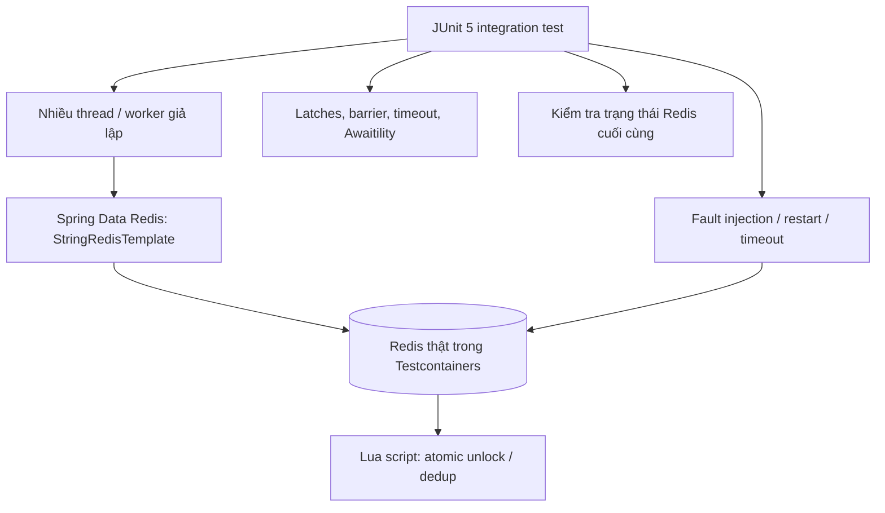
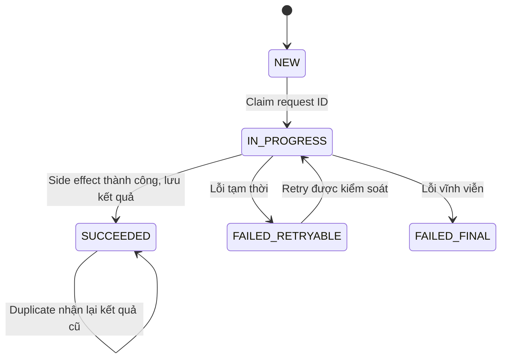

# Kiểm thử đồng thời, idempotency và hết hạn khóa với Spring Data Redis

## 1. Vì sao test CRUD thành công vẫn chưa chứng minh được hệ thống đúng?

Giả sử một ứng dụng Spring Boot thực hiện công việc chỉ được chạy bởi một worker tại một thời điểm: xử lý đơn hàng, tạo hóa đơn, đồng bộ dữ liệu hoặc lập lịch gửi thông báo. Ứng dụng dùng Redis để lưu khóa phân tán (*distributed lock*) và dấu vết của request đã xử lý (*idempotency marker*).

Trong bài kiểm thử đơn giản:

```text
Worker A lấy khóa -> thành công
Worker A làm việc -> thành công
Worker A trả khóa -> thành công
```

Mọi thứ trông ổn. Nhưng khi hai hoặc nhiều instance cùng chạy, các trường hợp sau có thể xảy ra:

```text
Worker A                         Redis                    Worker B
   | SET lock tokenA NX PX 3000     |                         |
   |------------------------------->|                         |
   |<-------------------------------| OK                      |
   |                                |                         |
   | xử lý bị chậm > 3 giây         |                         |
   |                                | khóa A hết TTL           |
   |                                |<------------------------| SET lock tokenB NX PX 3000
   |                                |------------------------>| OK
   |                                |                         | bắt đầu xử lý
   | DEL lock                        |                         |
   |------------------------------->|                         |
   |                                | khóa B bị xóa sai!        |
```

Ví dụ này có **race condition**: khóa hết hạn trong khi worker A vẫn đang làm việc. Nếu A đơn giản gọi `DEL` khi kết thúc, nó có thể xóa khóa hợp lệ của B. Thậm chí khi sửa bước unlock, A vẫn có thể tiếp tục ghi dữ liệu sau thời hạn khóa và gây side effect trùng.

Một tình huống khác:

```text
Client gửi request payment-101
  -> Redis đã ghi dấu hoặc tăng counter
  -> Response bị mất
Client retry payment-101
  -> ứng dụng xử lý thêm một lần nữa nếu không có idempotency
```

Các vấn đề này **không xuất hiện đầy đủ trong test tuần tự**. Muốn đánh giá hành vi, cần kiểm thử đồng thời thực sự, sự kiện khóa hết TTL, kết quả Redis không chắc chắn và quá trình khôi phục.

Bài học tập trung vào ba chủ đề trong Spring Data Redis:

1. **Concurrency:** nhiều thread/instance tranh chấp khóa và dữ liệu cùng lúc.
2. **Idempotency:** cùng một yêu cầu được gửi lại vẫn không tạo side effect ngoài ý muốn.
3. **Lock expiration:** TTL ngăn khóa tồn tại mãi, nhưng tạo ra tình huống chủ khóa cũ vẫn đang chạy.

## 2. Phân biệt atomicity, mutual exclusion và idempotency

| Khái niệm | Câu hỏi cần trả lời | Redis hỗ trợ bằng cách nào? |
|---|---|---|
| **Atomic command** | Một lệnh đơn lẻ có thực thi không bị chen ngang bởi lệnh khác? | Các lệnh Redis như `SET NX PX`, `INCR` có tính nguyên tử ở phạm vi lệnh |
| **Mutual exclusion** | Có bao nhiêu worker được quyền vào critical section cùng lúc? | Có thể dùng lock bằng `SET ... NX PX ...`, nhưng phải xét TTL và stale owner |
| **Idempotency** | Gửi cùng request hai lần có tạo thêm side effect không? | Marker, Redis Lua, uniqueness constraint hoặc idempotency ở hệ thống đích |
| **Durability** | Dấu vết đã xử lý có còn sau crash/failover? | Redis persistence/replication hoặc lưu ở nguồn authoritative |
| **Ordering** | Các thao tác xảy ra theo đúng phiên bản mong muốn? | Version/CAS/fencing token hoặc serial processing phù hợp |
| **At-least-once delivery** | Một event có thể được giao lại để tránh bỏ sót? | Redis Streams + consumer group/PEL và quy trình recovery |

Ba điều hay bị nhầm:

- Một `INCR` **nguyên tử** không làm toàn bộ quy trình "đọc DB → gửi email → ACK" tự nguyên tử.
- Một lock có TTL không bảo đảm worker cũ **ngừng thực thi** đúng thời điểm Redis xóa khóa.
- Một marker idempotency trong Redis không tự bảo đảm exactly-once đối với side effect nằm ở PostgreSQL, email gateway hoặc payment provider.

## 3. Kiến trúc kiểm thử phù hợp



Một test đáng tin cần phân biệt:

**Unit test:** kiểm tra việc xây key, chuẩn hóa request ID, lựa chọn fallback hoặc logic handler mà không cần Redis.

**Integration test:** chạy command thật trên Redis để kiểm chứng tính nguyên tử, TTL, Lua script và kiểu dữ liệu.

**Concurrency test:** tạo nhiều lời gọi xuất phát gần như đồng thời bằng barrier/latch, sau đó xác nhận invariant ở trạng thái cuối.

**Failure-injection test:** mô phỏng mất response, Redis restart, lock hết hạn và timeout để đánh giá tính đúng khi kết quả không chắc chắn.

Không nên dùng một Redis mock có `Map<String,String>` thông thường để kết luận `SET NX PX` hay Lua script có đúng semantics thực tế. Mock hữu ích cho logic Java, nhưng không thay thế một Redis server khi kiểm tra khóa phân tán.

## 4. Môi trường thử nghiệm: JUnit 5, Testcontainers và Spring Data Redis

Ví dụ sử dụng Spring Boot 3.x, Java 17+, JUnit 5, Spring Data Redis và Redis OSS chạy qua Testcontainers:

```groovy
dependencies {
    implementation 'org.springframework.boot:spring-boot-starter-data-redis'

    testImplementation 'org.springframework.boot:spring-boot-starter-test'
    testImplementation 'org.testcontainers:junit-jupiter'
    testImplementation 'org.testcontainers:testcontainers'
    testImplementation 'org.awaitility:awaitility'
}
```

Version của Testcontainers và các thư viện khác phải được quản lý tương thích qua BOM/dependency management của dự án. Không mặc định mọi project đã có những version cần thiết.

Một cấu hình integration test:

```java
import org.junit.jupiter.api.Test;
import org.springframework.beans.factory.annotation.Autowired;
import org.springframework.boot.test.context.SpringBootTest;
import org.springframework.data.redis.core.StringRedisTemplate;
import org.springframework.test.context.DynamicPropertyRegistry;
import org.springframework.test.context.DynamicPropertySource;
import org.testcontainers.containers.GenericContainer;
import org.testcontainers.junit.jupiter.Container;
import org.testcontainers.junit.jupiter.Testcontainers;
import org.testcontainers.utility.DockerImageName;

@Testcontainers
@SpringBootTest
class RedisConcurrencyIntegrationTest {

    @Container
    static final GenericContainer<?> redisContainer =
        new GenericContainer<>(
            DockerImageName.parse("redis:7.2-alpine")
        ).withExposedPorts(6379);

    @DynamicPropertySource
    static void redisProperties(DynamicPropertyRegistry registry) {
        registry.add("spring.data.redis.host", redisContainer::getHost);
        registry.add(
            "spring.data.redis.port",
            () -> redisContainer.getMappedPort(6379)
        );
    }

    @Autowired
    StringRedisTemplate redis;

    @Test
    void redisIsReachable() {
        String key = "test:health:redis";
        redis.opsForValue().set(key, "ready");
        // Một assertion bằng AssertJ sẽ kiểm tra GET trả "ready".
        redis.delete(key);
    }
}
```

Các test tiếp theo có thể dùng chung cấu hình kết nối hoặc một lớp test fixture tương đương. **Mỗi test cần keyspace riêng** để các lượt chạy song song không làm ảnh hưởng nhau.

Testcontainers yêu cầu môi trường Docker/container runtime khả dụng. Nếu CI không hỗ trợ Docker, cần một Redis test server được cấp riêng và có chính sách reset phù hợp. Không sử dụng Redis production để kiểm thử khóa và failure injection.

### 4.1. Vì sao không dùng Redis giả lập in-memory?

Các hành vi cần kiểm tra phụ thuộc Redis server:

- Thời hạn TTL do Redis xác định.
- `SET NX PX` có một điểm thực thi nguyên tử.
- Lua script thực thi nguyên tử trên Redis node.
- Các giá trị `PTTL`/`TTL` đặc biệt.
- Phản hồi command khi connection timeout hoặc restart.
- Redis Cluster hash slot và giới hạn multi-key.

Một mock Java không mô phỏng chính xác các yếu tố này nếu không triển khai lại rất nhiều semantics Redis.

## 5. Khóa phân tán tối thiểu: SET NX PX

Để một worker lấy khóa, dùng một lệnh Redis có cả điều kiện chỉ tạo key khi chưa tồn tại và TTL:

```redis
SET lock:job:daily-report worker-token-123 NX PX 30000
```

Ý nghĩa:

- `lock:job:daily-report`: tên khóa.
- `worker-token-123`: giá trị nhận dạng chủ khóa.
- `NX`: chỉ tạo key nếu key chưa tồn tại.
- `PX 30000`: đặt TTL 30.000 mili giây trong cùng lệnh.

Lệnh trả thành công khi worker lấy được khóa; nếu khóa đang tồn tại, Redis không ghi đè key. Với người học, nên xem response thực tế qua `redis-cli` vì chi tiết reply có thể được driver chuyển đổi sang Boolean/nullable value khác nhau.

**Tại sao không dùng `SETNX` rồi `PEXPIRE` thành hai lệnh?**

```text
SETNX lock token     -> thành công
Process crash
PEXPIRE lock 30000   -> chưa chạy
```

Kết quả là khóa không có TTL, có thể còn mãi nếu không có cleanup. `SET ... NX PX ...` tránh cửa sổ lỗi giữa hai lệnh này.

### 5.1. Spring Data Redis dùng setIfAbsent với Duration

```java
import java.time.Duration;

import org.springframework.data.redis.core.StringRedisTemplate;

public final class RedisLockService {

    private final StringRedisTemplate redis;

    public RedisLockService(StringRedisTemplate redis) {
        this.redis = redis;
    }

    public boolean acquire(
            String lockKey, String ownerToken, Duration lease) {
        if (lease.isZero() || lease.isNegative()) {
            throw new IllegalArgumentException("Lease must be positive");
        }
        if (ownerToken == null || ownerToken.isBlank()) {
            throw new IllegalArgumentException("Owner token required");
        }

        Boolean acquired = redis.opsForValue()
            .setIfAbsent(lockKey, ownerToken, lease);

        return Boolean.TRUE.equals(acquired);
    }
}
```

`StringRedisTemplate.opsForValue().setIfAbsent(key, value, duration)` là API phù hợp để biểu đạt yêu cầu lấy khóa bằng một thao tác có TTL.

Một lưu ý nhỏ: `null` có thể xuất hiện trong một số ngữ cảnh thực thi Redis đặc biệt như pipeline/transaction. Đừng coi `null` là đã lấy khóa; đoạn code chỉ xem `Boolean.TRUE` là thành công.

### 5.2. Token phải khác nhau giữa các lần lấy khóa

Không nên dùng giá trị cố định `"locked"` làm owner token:

```text
Worker A: token "locked"
Worker B: token "locked"
```

Khi khóa A hết hạn rồi B lấy được, A không thể phân biệt khóa mới do B sở hữu vì cả hai đều có cùng value. Nên tạo token mới cho **mỗi lần acquire**, ví dụ:

```java
String token = java.util.UUID.randomUUID().toString();
```

Token ở đây dùng để xác nhận quyền unlock của **đúng lần acquire**, không phải user ID, session ID hay một fencing sequence có tính thứ tự tăng.

## 6. Vì sao GET rồi DEL không phải unlock an toàn?

Một cách sai thường gặp:

```java
if (token.equals(redis.opsForValue().get(lockKey))) {
    redis.delete(lockKey);
}
```

Hai lệnh `GET` và `DEL` **không nguyên tử**:

```text
Worker A: GET lock -> tokenA
Redis:    khóa A hết TTL
Worker B: SET lock tokenB NX PX ... -> thành công
Worker A: DEL lock -> xóa nhầm khóa B
```

Dù Java có `synchronized`, nó chỉ bảo vệ một vùng mã trong một JVM; worker ở JVM khác vẫn có thể xen vào.

Giải pháp là so sánh token và xóa **trong một Redis Lua script nguyên tử**.

## 7. Unlock nguyên tử bằng Lua script

Script:

```lua
-- KEYS[1]: lock key
-- ARGV[1]: owner token cần xác nhận
if redis.call('GET', KEYS[1]) == ARGV[1] then
    return redis.call('DEL', KEYS[1])
end
return 0
```

Ngữ nghĩa:

- Nếu key vẫn có token của worker gọi unlock, Redis xóa khóa.
- Nếu key đã hết hạn, không xóa gì.
- Nếu một worker mới đã lấy khóa với token khác, không xóa khóa mới.

Áp dụng với Spring Data Redis:

```java
import java.time.Duration;
import java.util.List;

import org.springframework.data.redis.core.StringRedisTemplate;
import org.springframework.data.redis.core.script.DefaultRedisScript;

public final class RedisLockService {

    private static final DefaultRedisScript<Long> UNLOCK_SCRIPT;

    static {
        UNLOCK_SCRIPT = new DefaultRedisScript<>();
        UNLOCK_SCRIPT.setScriptText("""
            if redis.call('GET', KEYS[1]) == ARGV[1] then
                return redis.call('DEL', KEYS[1])
            end
            return 0
            """);
        UNLOCK_SCRIPT.setResultType(Long.class);
    }

    private final StringRedisTemplate redis;

    public RedisLockService(StringRedisTemplate redis) {
        this.redis = redis;
    }

    public boolean acquire(
            String lockKey, String ownerToken, Duration ttl) {
        if (ttl.isNegative() || ttl.isZero()) {
            throw new IllegalArgumentException("TTL must be positive");
        }

        return Boolean.TRUE.equals(
            redis.opsForValue().setIfAbsent(lockKey, ownerToken, ttl)
        );
    }

    public boolean release(String lockKey, String ownerToken) {
        Long removed = redis.execute(
            UNLOCK_SCRIPT,
            List.of(lockKey),
            ownerToken
        );
        return Long.valueOf(1L).equals(removed);
    }
}
```

Đây là một implementation minh họa cho **một Redis primary**. Nó không tự cung cấp fencing, linearizability qua failover, gia hạn khóa hoặc bảo đảm rằng work luôn kết thúc trước TTL.

**Đừng xóa khóa vô điều kiện trong `finally`.** Dùng `release(lockKey, ownerToken)` để một worker chỉ xóa khóa mà nó còn thực sự sở hữu.

### 7.1. Khi Redis command timeout trong lúc unlock

Giả sử Redis đã chạy Lua và xóa khóa, nhưng response không đến client. Worker có thể nhận timeout và không biết unlock đã thực hiện hay chưa.

Script unlock có tính chất an toàn khi gọi lại bằng cùng token: nếu khóa đã bị xóa hoặc thuộc chủ khác, script trả 0 chứ không xóa nhầm. Tuy nhiên, việc gọi lại vẫn phải nằm trong chính sách retry và deadline chung; không nên tạo vòng retry vô hạn.

## 8. Kiểm thử tranh chấp khóa đồng thời với CountDownLatch

Mục tiêu đầu tiên: nhiều thread cùng cố lấy **một lock key**, nhưng đúng **một thread** thành công khi chưa có thread nào release.

Nếu lần lượt gọi mỗi worker trong một vòng for, test vẫn là tuần tự và không tạo tranh chấp thực sự. Dùng `CountDownLatch` để các worker bắt đầu cùng một thời điểm kiểm soát được.

Ví dụ JUnit 5 dưới đây giả định đã có `StringRedisTemplate redis` kết nối Redis Testcontainers và `RedisLockService` ở mục trước:

```java
import static org.assertj.core.api.Assertions.assertThat;

import java.time.Duration;
import java.util.ArrayList;
import java.util.List;
import java.util.Objects;
import java.util.UUID;
import java.util.concurrent.CountDownLatch;
import java.util.concurrent.ExecutorService;
import java.util.concurrent.Executors;
import java.util.concurrent.Future;
import java.util.concurrent.TimeUnit;

import org.junit.jupiter.api.Test;

class LockRaceTest {

    // RedisLockService lockService: fixture kết nối Redis test thật.

    @Test
    void onlyOneWorkerAcquiresTheSameLiveLock() throws Exception {
        int contenders = 12;
        String lockKey = "test:lock:" + UUID.randomUUID();
        RedisLockService lockService = new RedisLockService(redis);

        ExecutorService pool = Executors.newFixedThreadPool(contenders);
        CountDownLatch ready = new CountDownLatch(contenders);
        CountDownLatch start = new CountDownLatch(1);
        List<Future<String>> futures = new ArrayList<>();
        String winningToken = null;

        try {
            for (int i = 0; i < contenders; i++) {
                futures.add(pool.submit(() -> {
                    String token = UUID.randomUUID().toString();
                    ready.countDown();
                    if (!start.await(5, TimeUnit.SECONDS)) {
                        throw new IllegalStateException("Start gate timed out");
                    }
                    return lockService.acquire(
                        lockKey, token, Duration.ofSeconds(30)
                    ) ? token : null;
                }));
            }

            assertThat(ready.await(5, TimeUnit.SECONDS)).isTrue();
            start.countDown();

            List<String> winners = new ArrayList<>();
            for (Future<String> future : futures) {
                String token = future.get(5, TimeUnit.SECONDS);
                if (token != null) {
                    winners.add(token);
                }
            }

            assertThat(winners).hasSize(1);
            winningToken = winners.get(0);
            assertThat(redis.opsForValue().get(lockKey))
                .isEqualTo(winningToken);
        } finally {
            start.countDown();
            if (winningToken != null) {
                lockService.release(lockKey, winningToken);
            }
            pool.shutdownNow();
        }
    }
}
```

Để biên dịch nguyên ví dụ, đưa method test vào integration-test class chứa field `redis` hoặc inject fixture đó vào test class; đoạn `LockRaceTest` tập trung thể hiện phần **rào bắt đầu và assertion đồng thời**.

### 8.1. Tại sao test này tránh release trong mỗi worker?

Nếu thread thắng vừa lấy khóa vừa release ngay, một thread khác có thể lấy được khóa ở thời điểm sau. Khi ấy test thấy hai lần acquire thành công dù **không có hai owner đồng thời**. Assertion "chỉ một worker thành công" sẽ sai mục tiêu.

Trong test trên, worker thắng giữ khóa đến khi tất cả contenders đã trả kết quả. Nhờ vậy, tại cùng một lượt tranh chấp với khóa chưa release, ta kỳ vọng chỉ một lần acquire.

### 8.2. Vì sao phải có timeout cho latches và futures?

Nếu một thread không bao giờ đến barrier hoặc Redis bị treo, test không nên chờ vô hạn. `ready.await(5, SECONDS)` và `future.get(5, SECONDS)` làm lỗi xuất hiện rõ ràng.

Một test timeout có thể cần thông số lớn hơn trên CI chậm; điều quan trọng là có **ngưỡng hữu hạn**, không phải chọn 5 giây cho mọi môi trường.

## 9. Test mutual exclusion ở cấp critical section

Test "chỉ một worker acquire" xác nhận tính nguyên tử của lệnh lấy khóa trong một thời điểm, nhưng chưa kiểm tra toàn bộ **critical section**.

Một invariant mạnh hơn:

```text
activeWorkersInsideCriticalSection <= 1
```

Trong một JVM, có thể dùng `AtomicInteger` để phát hiện thời điểm hai thread cùng đi vào vùng được bảo vệ:

```java
AtomicInteger active = new AtomicInteger();
AtomicBoolean overlapDetected = new AtomicBoolean(false);

Runnable protectedWork = () -> {
    int concurrent = active.incrementAndGet();
    try {
        if (concurrent > 1) {
            overlapDetected.set(true);
        }
        // Công việc ngắn, có kiểm soát.
    } finally {
        active.decrementAndGet();
    }
};
```

Nhưng `AtomicInteger` này chỉ quan sát các thread **trong một tiến trình test**. Nó không chứng minh tính đúng giữa hai JVM/container khác nhau.

Đối với **multi-instance test**, có thể dùng một shared audit sink hoặc Redis script riêng để ghi nhận lần vào/ra critical section, rồi kiểm tra có khoảng thời gian overlap hay không. Việc thu thập phải đủ tin cậy, không dùng một phép kiểm tra `GET` rồi `SET` vốn tự chứa race.

### 9.1. Kiểm tra invariant khi khóa còn hiệu lực khác khi TTL đã hết

Trong điều kiện mỗi worker làm việc **ngắn hơn TTL**, ta có thể kỳ vọng không có hai owner hợp lệ tại cùng một thời điểm.

Nhưng nếu worker A vượt quá TTL, Redis sẽ cho worker B acquire. Khi ấy cả A và B có thể cùng chạy business logic dù Redis chỉ còn công nhận B là chủ khóa. **Lock có TTL không hủy được thread A.**

Đây là lý do phải test hết hạn khóa riêng, không chỉ test happy path.

## 10. Kiểm thử TTL bằng PTTL và Awaitility

Redis có:

```redis
TTL lock:key
PTTL lock:key
```

`TTL` trả thời gian còn lại theo giây; `PTTL` theo mili giây. Những giá trị đặc biệt:

| `PTTL` | Ý nghĩa |
|---|---|
| Số dương | Key còn thời gian sống |
| `-1` | Key có tồn tại nhưng **không có expiry** |
| `-2` | Key **không tồn tại** |

Một test TTL không nên chỉ `Thread.sleep(500)` rồi giả định máy test sẽ lập lịch đúng. Dùng **chờ điều kiện có timeout**:

```java
import static org.assertj.core.api.Assertions.assertThat;
import static org.awaitility.Awaitility.await;

import java.time.Duration;
import java.util.UUID;

import org.junit.jupiter.api.Test;

@Test
void lockExpiresAndCanBeAcquiredAgain() {
    String key = "test:lock:ttl:" + UUID.randomUUID();
    RedisLockService lock = new RedisLockService(redis);

    String tokenA = UUID.randomUUID().toString();
    String tokenB = UUID.randomUUID().toString();

    assertThat(lock.acquire(
        key, tokenA, Duration.ofMillis(250)
    )).isTrue();

    Long initialTtl = redis.getExpire(
        key, java.util.concurrent.TimeUnit.MILLISECONDS
    );
    assertThat(initialTtl).isNotNull().isPositive();

    await()
        .atMost(Duration.ofSeconds(5))
        .until(() -> Boolean.FALSE.equals(redis.hasKey(key)));

    assertThat(lock.acquire(
        key, tokenB, Duration.ofSeconds(5)
    )).isTrue();
    assertThat(redis.opsForValue().get(key)).isEqualTo(tokenB);

    assertThat(lock.release(key, tokenB)).isTrue();
}
```

Ví dụ dùng Awaitility để chờ **Redis thực sự hết hạn khóa**. Nó không phụ thuộc hoàn toàn vào clock của JVM để quyết định TTL đã hết hay chưa. Tuy nhiên, nếu Redis test/CI quá tải, điều kiện 5 giây vẫn có thể timeout và cần điều tra latency môi trường.

Không viết một assertion cứng kiểu "sau đúng 250 ms, PTTL phải bằng -2 tại thời điểm nano tuyệt đối". Scheduler, network và Redis expiration có độ trễ quan sát được.

## 11. Test quan trọng: chủ khóa cũ không được xóa khóa mới

Đây là test bảo vệ khỏi race đặc trưng của distributed lock có TTL.

Kịch bản:

1. Worker A acquire `tokenA` với TTL ngắn.
2. Đợi Redis xác nhận khóa A đã hết hạn.
3. Worker B acquire cùng key với `tokenB`.
4. Worker A kết thúc muộn và cố release bằng `tokenA`.
5. Redis **phải giữ khóa B**.

```java
import static org.assertj.core.api.Assertions.assertThat;
import static org.awaitility.Awaitility.await;

import java.time.Duration;
import java.util.UUID;

@Test
void expiredOwnerMustNotDeleteNewOwnersLock() {
    String key = "test:lock:handoff:" + UUID.randomUUID();
    RedisLockService lock = new RedisLockService(redis);

    String tokenA = UUID.randomUUID().toString();
    String tokenB = UUID.randomUUID().toString();

    assertThat(lock.acquire(
        key, tokenA, Duration.ofMillis(200)
    )).isTrue();

    await()
        .atMost(Duration.ofSeconds(5))
        .until(() -> Boolean.FALSE.equals(redis.hasKey(key)));

    assertThat(lock.acquire(
        key, tokenB, Duration.ofSeconds(10)
    )).isTrue();

    // A là owner cũ, không còn được quyền xóa lock.
    assertThat(lock.release(key, tokenA)).isFalse();

    // Lock mới vẫn tồn tại với đúng token của B.
    assertThat(redis.opsForValue().get(key))
        .isEqualTo(tokenB);

    assertThat(lock.release(key, tokenB)).isTrue();
}
```

Test này phân biệt rõ hai cách unlock:

| Cách unlock | Kết quả khi A release sau khi B acquire |
|---|---|
| `DEL key` không điều kiện | **Sai**: có thể xóa khóa của B |
| `GET key` rồi `DEL key` bằng hai lệnh | **Vẫn có race** giữa GET và DEL |
| Lua compare-token-and-delete | **Đúng theo điều kiện token**: không xóa khóa B |

**Giới hạn:** Lua unlock an toàn không ngăn worker A tiếp tục làm side effect. Muốn kiểm tra tính đúng toàn bộ nghiệp vụ còn phải xem fencing/versioning ở phần sau.

## 12. Khóa hết hạn không phải tín hiệu dừng worker cũ

Khi một Redis key hết TTL:

```text
Redis: lock không còn.
Worker A: Java thread có thể vẫn chạy.
Worker B: đã acquire lock mới.
```

Redis không có khả năng ép một JVM dừng thread, rollback một câu SQL hoặc hủy yêu cầu đã gửi đến payment gateway.

Ví dụ:

```text
T0  A acquire khóa 2 giây.
T1  A gọi external API, response bị giữ 5 giây.
T2  Redis xóa khóa A.
T3  B acquire khóa và cập nhật dữ liệu.
T4  A nhận response rồi tiếp tục cập nhật dữ liệu cũ.
```

Ngay cả khi A gọi Lua unlock ở T4 và nhận `0`, side effect của A có thể đã xảy ra trước đó. Do đó, **không thể chứng minh critical section được bảo vệ an toàn lâu dài chỉ bằng kiểm tra giá trị lock ngay khi bắt đầu**.

### 12.1. Test stale owner bằng barrier có chủ đích

Một bài test có thể dùng hai `CountDownLatch`:

```text
A lấy khóa
A báo "đã vào vùng xử lý" (entered.countDown)
A chờ allowFinish
Main test đợi khóa A hết TTL
B lấy khóa, ghi phiên bản mới
Main mở allowFinish
A hoàn tất muộn
Test kiểm tra phiên bản dữ liệu cuối
```

Đây là một **điều phối sự kiện có chủ đích**, dễ giải thích và ít flaky hơn tạo race bằng `Thread.sleep` ngẫu nhiên. Cần đặt timeout cho mọi bước chờ để test không treo khi lỗi.

Kỳ vọng của test không nên là "A tự động dừng khi TTL hết": điều đó không phải hành vi Redis hỗ trợ. Kỳ vọng phải là **A không được ghi đè phiên bản của B** nhờ cơ chế kiểm tra version/fencing ở hệ thống lưu dữ liệu.

## 13. Fencing token: bảo vệ tài nguyên khỏi stale owner

Một **owner token ngẫu nhiên** giúp unlock đúng khóa. Nhưng nó không cho hệ thống đích biết owner nào **mới hơn**.

Để bảo vệ một tài nguyên trước thao tác từ worker cũ, có thể dùng **fencing token tăng dần**:

```text
Worker A acquire -> fencing = 41
Worker A bị pause, khóa hết TTL
Worker B acquire -> fencing = 42
Worker B ghi tài nguyên với fencing 42
Worker A quay lại, cố ghi với fencing 41
Storage từ chối vì 41 < 42
```

Ví dụ bộ lưu dữ liệu có thể chấp nhận cập nhật có điều kiện theo generation:

```sql
UPDATE protected_resource
SET payload = :new_payload,
    last_fencing = :new_fencing
WHERE resource_id = :resource_id
  AND last_fencing < :new_fencing;
```

Các token của từng acquisition phải tăng theo một nguồn **đủ tin cậy cho yêu cầu consistency**, và việc kiểm tra/thay đổi `last_fencing` phải nguyên tử tại nơi tạo side effect.

### 13.1. Có thể lấy fencing từ Redis INCR không?

Một lệnh `INCR` trên một Redis primary tạo ra số tăng dần trong điều kiện node hoạt động ổn định:

```redis
INCR lock:fence:daily-report
```

Nhưng **không nên mặc định Redis primary–replica failover bất đồng bộ bảo đảm số fencing không bao giờ quay lùi**. Một primary mới có thể thiếu các lần tăng gần nhất nếu replication chưa hoàn tất.

Với yêu cầu chống stale writes nghiêm ngặt qua failover, cần đánh giá nguồn tạo fencing token có thuộc tính monotonic/linearizable phù hợp; có thể dùng sequence/transaction trong một database authoritative hoặc hệ thống coordinator có cam kết mạnh hơn.

**Fencing token không đồng nghĩa owner token.** Owner token thường dùng so sánh giá trị lock khi release; fencing token dùng chứng minh thứ tự thế hệ đối với tài nguyên được bảo vệ.

## 14. Có nên gia hạn TTL của khóa?

Nếu công việc đôi khi dài hơn TTL ban đầu, ứng dụng có thể cân nhắc **lease renewal**. Tuy nhiên, chỉ gia hạn nếu caller **vẫn sở hữu khóa**:

```lua
-- KEYS[1]: lock key
-- ARGV[1]: current owner token
-- ARGV[2]: new lease in milliseconds
if redis.call('GET', KEYS[1]) == ARGV[1] then
    return redis.call('PEXPIRE', KEYS[1], ARGV[2])
end
return 0
```

Script dùng `GET` và `PEXPIRE` nguyên tử trong Redis. Nếu key đã thuộc worker B, worker A không được kéo dài TTL khóa của B.

### 14.1. Test renewal

Các trường hợp nên kiểm tra:

1. Đúng token và khóa chưa hết TTL: renew trả thành công, PTTL tăng tương ứng.
2. Sai token: renew trả 0, không đổi TTL của owner hiện tại.
3. Key đã hết hạn: renew trả 0, không tự tái tạo một khóa cũ.
4. Redis timeout ở lần renew: worker phải xử lý tình trạng **không biết còn giữ lease hay không**.
5. Worker bị pause quá lâu: không thể renew đúng thời hạn, owner khác có thể acquire.

### 14.2. Renewal không giải quyết mọi rủi ro

Một watchdog dùng scheduler có thể không chạy đúng thời gian do:

- Stop-the-world GC pause.
- Process bị đóng băng hoặc host quá tải.
- Network partition.
- Redis failover.
- Executor starvation hoặc scheduler bị dừng.

Vì vậy, gia hạn TTL giúp giảm số lần lease hết hạn không mong muốn nhưng **không bảo đảm stale owner không bao giờ tiếp tục làm việc**. Với công việc có hệ quả nghiêm trọng, vẫn cần version/fencing/idempotency ở tài nguyên đích.

## 15. Idempotency: cùng request được xử lý nhiều lần thì sao?

Gọi một operation là *idempotent* nếu việc thực hiện lại cùng yêu cầu với cùng ý định không tạo thêm tác động nghiệp vụ ngoài điều đã được cho phép.

Ví dụ:

```text
Request ID = pay-101
Action = "capture payment for order o-101"

Lần 1: Payment captured
Lần 2: Trả lại kết quả lần 1, không capture thêm
Lần 3: Trả lại kết quả lần 1, không capture thêm
```

Điều này khác "mọi request đều được xử lý một lần duy nhất ở tầng network". Trong hệ phân tán, cùng message/request có thể được giao lại, và hệ thống phải khiến việc xử lý lặp **an toàn về tác động quan sát được**.

### 15.1. Idempotency key nên xác định theo nghiệp vụ

Ví dụ:

```text
tenant:t-7 / order:o-101 / action:capture / request:pay-101
```

Một key tốt cần:

- Ổn định giữa các lần retry của cùng logical operation.
- Không dùng lại cho các operation khác nhau.
- Có phạm vi tenant/resource nếu hệ thống đa khách hàng.
- Được kiểm tra với request payload: cùng ID nhưng payload khác phải bị từ chối hoặc xử lý theo policy rõ ràng.
- Có retention đủ dài so với khoảng retry/redelivery tối đa.

Không nên tạo UUID mới cho mỗi lần retry rồi gọi đó là idempotency key. UUID mới làm mất khả năng nhận diện hai request thuộc cùng một operation.

## 16. Một sai lầm: SETNX marker trước rồi xử lý nghiệp vụ

Ví dụ:

```text
SET idempotency:pay-101 IN_PROGRESS NX EX 600
  -> thành công
Gọi payment gateway
  -> process crash trước khi lưu kết quả
```

Lần retry tiếp theo thấy marker đã tồn tại:

```text
Idempotency marker tồn tại
  -> bỏ qua xử lý
```

Nhưng thực tế không chắc payment đã thành công hay thất bại. Việc **đánh dấu "đã xử lý" trước khi side effect hoàn tất** có thể làm mất công việc hoặc trả kết quả sai.

Một giải pháp cần trạng thái rõ hơn:



Cần xác định:

1. Ai sở hữu trạng thái `IN_PROGRESS`?
2. Sau crash, khi nào một worker khác được phép tiếp tục?
3. Kết quả thành công được lưu ở đâu?
4. Nếu payment đã chạy nhưng việc ghi result lỗi, hệ thống đối soát thế nào?
5. Khi một request dùng cùng ID nhưng payload khác, có bị reject không?

Một Redis marker có thể là thành phần hữu ích, **nhưng không thay thế một business transaction/idempotency ở hệ thống đích**.

## 17. Atomic idempotency khi side effect nằm hoàn toàn trong Redis

Trường hợp đơn giản hơn là toàn bộ thao tác cần bảo vệ được thực hiện **nguyên tử trong một Lua script** trên Redis.

Giả sử cùng request ID chỉ được tăng counter **một lần**, và kết quả của lần đầu phải được trả cho mọi lần retry:

```lua
-- KEYS[1]: counter key
-- KEYS[2]: dedup marker key
-- ARGV[1]: marker TTL, milliseconds

local previous = redis.call('GET', KEYS[2])
if previous then
    return tonumber(previous)
end

local nextValue = redis.call('INCR', KEYS[1])
redis.call('SET', KEYS[2], tostring(nextValue), 'PX', ARGV[1])
return nextValue
```

Kết quả:

```text
Request pay-101 lần 1 -> INCR counter thành 1; marker = "1"; trả 1
Request pay-101 lần 2 -> đọc marker "1"; không INCR; trả 1
Request pay-101 lần 3 -> đọc marker "1"; không INCR; trả 1
```

Trong Redis Cluster, hai key của script phải được đặt ở **cùng hash slot**:

```text
idem:{order-101}:counter
idem:{order-101}:request:pay-101
```

Hash tag chung `{order-101}` cho phép một script đa key tuân thủ yêu cầu slot chung của Redis Cluster. Trong thực tế, cần validate/escape ID để dữ liệu đầu vào không phá vỡ quy ước key hoặc gây trùng namespace.

### 17.1. Spring Data Redis gọi script

```java
import java.time.Duration;
import java.util.List;

import org.springframework.data.redis.core.StringRedisTemplate;
import org.springframework.data.redis.core.script.DefaultRedisScript;

public final class IdempotentRedisCounter {

    private static final DefaultRedisScript<Long> SCRIPT;

    static {
        SCRIPT = new DefaultRedisScript<>();
        SCRIPT.setScriptText("""
            local previous = redis.call('GET', KEYS[2])
            if previous then
                return tonumber(previous)
            end

            local nextValue = redis.call('INCR', KEYS[1])
            redis.call(
                'SET', KEYS[2], tostring(nextValue), 'PX', ARGV[1]
            )
            return nextValue
            """);
        SCRIPT.setResultType(Long.class);
    }

    private final StringRedisTemplate redis;

    public IdempotentRedisCounter(StringRedisTemplate redis) {
        this.redis = redis;
    }

    public long incrementOnce(
            String operationId,
            String requestId,
            Duration dedupTtl) {

        if (dedupTtl.isZero() || dedupTtl.isNegative()) {
            throw new IllegalArgumentException("dedupTtl must be positive");
        }

        String tag = "{" + operationId + "}";
        String counterKey = "idem:" + tag + ":counter";
        String markerKey =
            "idem:" + tag + ":request:" + requestId;

        Long result = redis.execute(
            SCRIPT,
            List.of(counterKey, markerKey),
            String.valueOf(dedupTtl.toMillis())
        );

        if (result == null) {
            throw new IllegalStateException("No result from Redis script");
        }
        return result;
    }
}
```

Ví dụ cho phép marker sống 24 giờ:

```java
long result = counter.incrementOnce(
    "order-101",
    "pay-101",
    Duration.ofHours(24)
);
```

Với cùng `operationId` và `requestId`, script trả lại kết quả đã ghi trong marker khi marker còn tồn tại.

**Giới hạn:** ví dụ chỉ bảo vệ **increment bên trong Redis**. Nếu sau script còn gửi email hoặc charge payment bên ngoài, side effect ấy không được script Redis bảo vệ theo một transaction chung.

## 18. Test nhiều thread cùng một idempotency key

Mục tiêu: dù 20 thread đồng thời gọi `incrementOnce("order-101", "pay-101", ...)`, Redis counter chỉ tăng đúng một lần, và tất cả nhận cùng kết quả.

```java
import static org.assertj.core.api.Assertions.assertThat;

import java.time.Duration;
import java.util.ArrayList;
import java.util.List;
import java.util.UUID;
import java.util.concurrent.CountDownLatch;
import java.util.concurrent.ExecutorService;
import java.util.concurrent.Executors;
import java.util.concurrent.Future;
import java.util.concurrent.TimeUnit;

@Test
void duplicateRequestsOnlyIncrementOnce() throws Exception {
    String operationId = "test-" + UUID.randomUUID();
    String requestId = "same-logical-request";
    IdempotentRedisCounter counter =
        new IdempotentRedisCounter(redis);

    int callers = 20;
    ExecutorService pool = Executors.newFixedThreadPool(callers);
    CountDownLatch ready = new CountDownLatch(callers);
    CountDownLatch start = new CountDownLatch(1);

    try {
        List<Future<Long>> futures = new ArrayList<>();

        for (int i = 0; i < callers; i++) {
            futures.add(pool.submit(() -> {
                ready.countDown();
                if (!start.await(5, TimeUnit.SECONDS)) {
                    throw new IllegalStateException("Start gate timeout");
                }
                return counter.incrementOnce(
                    operationId,
                    requestId,
                    Duration.ofMinutes(5)
                );
            }));
        }

        assertThat(ready.await(5, TimeUnit.SECONDS)).isTrue();
        start.countDown();

        for (Future<Long> future : futures) {
            assertThat(future.get(10, TimeUnit.SECONDS))
                .isEqualTo(1L);
        }

        String counterKey =
            "idem:{" + operationId + "}:counter";
        assertThat(redis.opsForValue().get(counterKey))
            .isEqualTo("1");
    } finally {
        start.countDown();
        pool.shutdownNow();
    }
}
```

Ví dụ dùng operation ID ngẫu nhiên để tránh xung đột test. Khi chạy thực tế, các test scripts có thể được gắn vào class Testcontainers ở mục 4 và dọn key sau khi hoàn tất nếu cần.

Test này kiểm chứng tính nguyên tử của script trên **một Redis instance/slot**, không chứng minh marker bền qua mọi Redis primary failover hoặc retention vô hạn.

### 18.1. Cần kiểm tra "cùng ID, khác payload"

Nếu idempotency key được dùng cho payment, không thể nhận cùng key nhưng amount khác rồi trả kết quả cũ mà không cảnh báo:

```text
Request ID pay-101, amount = 100
Request ID pay-101, amount = 100 -> duplicate hợp lệ
Request ID pay-101, amount = 999 -> phải coi là xung đột
```

Trong một hệ thống hoàn chỉnh, marker nên gắn với **hash của request payload đã chuẩn hóa** và trạng thái/kết quả. Khi nhận cùng ID:

- Payload khớp: trả kết quả cũ hoặc trạng thái đang xử lý.
- Payload khác: trả conflict/validation error theo hợp đồng API.

Script counter đơn giản ở trên không kiểm tra payload; đó là bước mở rộng cần thiết trước khi áp dụng cho tác vụ nghiệp vụ nhạy cảm.

## 19. Test marker hết TTL: idempotency không còn hiệu lực mãi

Giả sử marker sống 500 ms:

```text
T0: request A -> counter tăng 1, marker tồn tại
T1: retry A trước TTL -> trả 1, counter không tăng
T2: marker hết TTL
T3: retry A sau TTL -> counter tăng 2
```

Đây là hành vi đúng với thiết kế **idempotency có thời hạn**, nhưng có thể sai yêu cầu nghiệp vụ nếu retries đến sau khi marker đã hết.

Một test phù hợp:

```java
import static org.assertj.core.api.Assertions.assertThat;
import static org.awaitility.Awaitility.await;

import java.time.Duration;
import java.util.UUID;

@Test
void idempotencyExpiresAccordingToRetentionPolicy() {
    String op = "test-" + UUID.randomUUID();
    IdempotentRedisCounter counter =
        new IdempotentRedisCounter(redis);

    assertThat(counter.incrementOnce(
        op, "request-A", Duration.ofMillis(300)
    )).isEqualTo(1L);

    assertThat(counter.incrementOnce(
        op, "request-A", Duration.ofMillis(300)
    )).isEqualTo(1L);

    String marker = "idem:{" + op + "}:request:request-A";

    await().atMost(Duration.ofSeconds(5))
        .until(() -> Boolean.FALSE.equals(redis.hasKey(marker)));

    assertThat(counter.incrementOnce(
        op, "request-A", Duration.ofMinutes(1)
    )).isEqualTo(2L);
}
```

**Bài học:** TTL của idempotency marker phải được chọn từ **cửa sổ retry/redelivery tối đa có thể xảy ra**, không chỉ từ thời gian HTTP timeout trung bình. Với giao dịch cần chống trùng lâu dài, marker ở Redis có TTL ngắn có thể không phù hợp; một unique constraint tại database nguồn sự thật thường an toàn hơn.

## 20. Idempotency khi side effect ở database

Một lệnh Redis Lua **không thể atomically commit** đồng thời với một lệnh `INSERT` vào PostgreSQL theo nghĩa một transaction duy nhất thông thường.

Ví dụ luồng xử lý:

```text
1. SETNX marker trong Redis.
2. INSERT payment vào PostgreSQL.
3. Cập nhật marker = SUCCEEDED.
```

Nếu process chết giữa bước 2 và 3:

- PostgreSQL có thể đã commit.
- Redis marker vẫn `IN_PROGRESS` hoặc hết hạn.
- Một worker khác nhận retry và có thể tiếp tục INSERT.

Cách bảo vệ phù hợp là đưa idempotency vào **cùng transactional boundary với side effect**. Ví dụ PostgreSQL:

```sql
CREATE TABLE payment_request (
    request_id VARCHAR(120) PRIMARY KEY,
    payload_hash VARCHAR(128) NOT NULL,
    status VARCHAR(24) NOT NULL,
    result_json TEXT
);
```

Business transaction có thể kiểm tra/tạo record theo request ID bằng unique constraint, thực hiện thay đổi nghiệp vụ và lưu kết quả thành công trong cùng transaction khi mô hình dữ liệu cho phép.

Redis lúc này có thể giữ cache hoặc một trạng thái nhanh để giảm truy cập DB, nhưng **DB unique constraint/transaction** mới là lớp bảo vệ chính cho payment record.

### 20.1. Test hai request cùng insert một ID

Test nên:

1. Tạo hai transaction đồng thời với cùng request ID.
2. Đưa chúng tới cùng một unique constraint.
3. Xác nhận chỉ một transaction tạo bản ghi nghiệp vụ.
4. Xác nhận request còn lại nhận kết quả cũ/conflict có kiểm soát.
5. Kiểm tra một request khác payload nhưng cùng ID bị từ chối.

Không dùng `Thread.sleep` để "đợi transaction A trước". Dùng barrier và constraint thật của database test, rồi assert trạng thái cuối.

### 20.2. External APIs cần hợp đồng idempotency riêng

Nếu ứng dụng gọi payment provider, cần dùng **idempotency key do provider hỗ trợ** hoặc cơ chế reconciliation theo giao dịch. Marker ở Redis không bảo đảm provider chỉ xử lý một lần khi network mất response.

Ngay cả một hệ thống dùng Redis lock + DB marker vẫn có thể có trạng thái:

```text
Payment provider đã charge
App timeout trước khi ghi kết quả vào DB
```

Vì vậy, kế hoạch recovery cần đối soát bằng transaction/reference ID bên phía provider, thay vì gửi lại charge vô điều kiện.

## 21. Kiểm thử kết quả write không chắc chắn sau timeout

Một test quan trọng phải mô phỏng được:

```text
Client gửi Redis INCR
Redis thực thi INCR
Response bị mất trên network
Client nhận timeout
Client retry operation
```

Nếu chỉ test Redis trả lỗi **trước khi nhận lệnh**, bạn chưa tái hiện tình huống khó nhất: **server đã làm side effect nhưng client không biết**.

Để mô phỏng, có thể dùng một TCP proxy/fault injection layer trong môi trường test (ví dụ Toxiproxy), hoặc một test harness kiểm soát phản hồi client.

Mục tiêu là phân biệt:

- Lệnh không gửi tới Redis.
- Lệnh đã gửi nhưng chưa được thực thi.
- Lệnh đã thực thi nhưng response bị drop.
- Lệnh thực thi và response tới client bình thường.

**Không thể kết luận từ timeout rằng thao tác chưa diễn ra.**

### 21.1. Kết quả mong muốn của test

Nếu operation có request ID và idempotency marker đủ bền:

```text
Lần thử đầu: Redis INCR + lưu result marker nguyên tử
Response bị mất
Retry cùng request ID
Redis script trả result đã lưu
Counter vẫn chỉ tăng một lần
```

Nếu dùng `INCR` thô không có marker:

```text
Lần thử đầu: INCR -> 1
Response bị mất
Retry: INCR -> 2
```

Đó là một **lỗi tính đúng do retry**, không phải lỗi Redis vi phạm atomicity.

## 22. Các thao tác nào dễ được retry và thao tác nào không?

| Redis command/operation | Rủi ro khi retry sau timeout | Gợi ý kiểm thử |
|---|---|---|
| `GET`, `HGET` | Không tạo side effect trực tiếp; dữ liệu có thể đã đổi | So sánh kết quả với version tại thời điểm đọc |
| `SET key fixedValue` | Thường idempotent về value, nhưng TTL có thể được đặt lại | Kiểm tra TTL trước/sau retry |
| `DEL key` | Trạng thái cuối thường giống nhau, return count có thể khác | Kiểm tra không xóa khóa owner mới |
| `INCR` / `DECR` | Dễ tăng/giảm nhiều lần | Test request ID + dedup |
| `LPUSH` / `RPUSH` | Có thể tạo list item trùng | Test số phần tử và ID nghiệp vụ |
| `XADD ... *` | Redis cấp entry ID mới mỗi lần | Test số events và marker |
| `SET ... NX PX` | Retry có thể fail vì khóa do chính lần đầu tạo | Test owner token và trạng thái không chắc chắn |
| `XACK` | Gọi lại ACK có thể trả số khác vì entry đã ACK | Test trạng thái PEL, không coi return 0 là chưa từng thành công |
| Lua script idempotent | Có thể an toàn trong phạm vi script và marker | Test retry sau mất response và hết TTL marker |

Đừng viết một `@Retry` chung cho tất cả method Redis. Policy phải biết **ngữ nghĩa của command**, không chỉ exception type.

## 23. Khi acquire lock timeout: có thể đã lấy được khóa

Một tình huống riêng:

```text
Worker A gửi SET lock tokenA NX PX 30000
Redis thực thi và tạo lock
Response bị mất
Worker A nhận timeout
```

Worker A không biết chắc đã lấy khóa. Nếu trả "không lấy được" và bỏ mặc, key có thể tồn tại tới hết TTL, khiến các worker khác chờ. Nếu retry bằng **token mới**, tình trạng càng khó hiểu.

Khi có thể kiểm tra theo chính sách:

- Giữ lại **owner token của lần acquire**.
- Sau lỗi, đọc lại key để xem token có khớp hay không.
- Nếu token khớp và lease còn hiệu lực, có thể xác định lại trạng thái sở hữu cục bộ theo protocol đã thiết kế.
- Nếu token khác hoặc key không còn, không tự coi mình là owner.
- Mọi kiểm tra vẫn chịu race với expiry/renewal và failover; khi không đủ bằng chứng, fail safely.

**Cảnh báo:** một lần `GET` thấy token của mình không bảo đảm lock sẽ còn hiệu lực trong toàn bộ critical section. Luôn xét deadline lease và fencing của thao tác bên ngoài.

## 24. Kiểm thử nhiều JVM/container thay vì chỉ nhiều thread

Một test với 20 thread trong cùng JVM có thể bỏ sót các lỗi:

- Dùng static/synchronized làm "lock" chỉ có tác dụng trong một JVM.
- Các instance có Redis client config khác nhau.
- Clock/timer khác nhau giữa các process.
- Một instance chết giữa thao tác.
- Có reconnect/failover hoặc container restart.

Với test đa instance:

```text
Docker network test
   |
   +-- Redis test
   |
   +-- Worker A container
   |
   +-- Worker B container
   |
   +-- Test coordinator / shared audit
```

Test coordinator có thể gửi cùng request tới A và B, dùng một message/barrier để cùng bắt đầu, thu kết quả và đối chiếu **trạng thái cuối ở hệ thống nguồn sự thật**.

### 24.1. Không chỉ đếm log

Nếu mỗi worker in:

```text
"I have lock"
```

thì log có thể thiếu, trễ hoặc bị trùng. Một test concurrency cần assert:

- Số thay đổi dữ liệu thật.
- Owner token cuối cùng.
- Version/fencing tại resource.
- Số duplicate side effects.
- Số request được trả kết quả idempotent.

Log hỗ trợ điều tra, nhưng **trạng thái hậu điều kiện** mới là bằng chứng mạnh hơn.

## 25. Test theo dõi TTL bằng Redis time, không chỉ đồng hồ JVM

TTL của một Redis key được Redis quản lý. Vì thế, khi test, tham chiếu:

```redis
PTTL lock:job:daily-report
GET lock:job:daily-report
```

Ví dụ:

```text
PTTL = 29500 -> key còn khoảng 29,5 giây
PTTL = -1    -> key tồn tại nhưng không có expire; nguy hiểm với lock
PTTL = -2    -> key không tồn tại
```

### 25.1. Vì sao clock mocking ở JVM chưa đủ?

Nếu test chỉ gọi:

```java
clock.advance(Duration.ofSeconds(31));
```

để giả lập thời gian bên Java, Redis server không tự nhận một đồng hồ giả đó. Khóa Redis vẫn dựa trên thời gian của Redis server; test phải chờ hoặc điều khiển một Redis test instance với thời gian phù hợp.

Các trường hợp đáng kiểm tra:

- Tạo khóa với TTL dương.
- Không để khóa có `PTTL=-1` sau acquire.
- Renew chỉ khi owner token đúng.
- Expiration dẫn tới owner B có thể acquire.
- A không được release/renew của B.

### 25.2. Không dùng TTL quá nhỏ trong test tranh chấp

Nếu test có 30 thread, Redis CI chịu tải, nhưng lock TTL chỉ 10 ms, khóa có thể hết trước khi tất cả contenders thử acquire. Test có thể báo nhiều winner, nhưng thực ra các winner xuất hiện **khác thời điểm**.

Hãy chọn TTL đủ dài cho test acquisition race và dùng một test TTL ngắn riêng để xác minh expiration. Hai test có mục tiêu khác nhau.

## 26. Các trạng thái lỗi cần mô phỏng

| Fault injection | Điều cần kiểm chứng |
|---|---|
| Redis process restart | Khóa/marker có được phục hồi theo persistence policy? |
| Redis server unreachable | Acquire fail/timeout trong deadline, không coi là đã có khóa |
| Packet drop sau write | Retry không nhân đôi side effect |
| Network partition | Worker cũ có tiếp tục chạy sau lease expiration? |
| Long GC pause | Gia hạn khóa thất bại, fencing chặn stale write |
| Redis command timeout | Trạng thái kết quả không chắc chắn được xử lý đúng |
| Replica failover | Lock/marker có thể mất nếu chưa replicate; ứng dụng phải biết giới hạn |
| Redis Cluster reshard | Lua đa key cùng slot, tránh `CROSSSLOT` |
| Clock/time skew | Không dựa hoàn toàn vào thời gian local để kết luận lease còn |
| Dedup marker TTL expiration | Retry sau retention có thể tạo tác động mới |
| Concurrent request khác payload cùng ID | Bị reject/conflict theo hợp đồng |
| Redis disk full/persistence error | Không giả định marker durable chỉ vì đã ACK write |
| Worker crash trước unlock | Khóa tự hết TTL để worker khác có thể tiếp tục |
| Worker crash sau side effect trước ACK | Recovery xử lý duplicate idempotently |

**Không thực hiện fault injection lên Redis production.** Một test cô lập cần mô phỏng đúng loại lỗi muốn đánh giá, không phá hỏng các session hoặc keys đang dùng bởi người thật.

## 27. Kiểm thử Redis Sentinel/Cluster và giới hạn của khóa

Redis primary–replica replication thông thường là bất đồng bộ:

```text
Primary P: SET lock tokenA -> OK
Write chưa tới replica R
Primary P lỗi
Replica R được promote
Lock tokenA có thể không tồn tại trên R
Worker B lấy lock
Worker A vẫn đang chạy
```

Đây là nguy cơ **lock mất qua failover** ngay cả khi TTL còn dài trên primary cũ.

Một test failover nên:

1. Khởi tạo Redis topology test có primary, replica và failover.
2. Acquire khóa trên primary.
3. Mô phỏng thời điểm replication chưa bắt kịp nếu test harness cho phép.
4. Thực hiện failover trong môi trường test.
5. Kiểm tra worker cũ và worker mới có thể cùng tin rằng mình sở hữu quyền thao tác hay không.
6. Xác nhận nguồn dữ liệu được bảo vệ không chấp nhận stale write, nhờ fencing/version/transaction phù hợp.

### 27.1. WAIT không thay thế fencing

Redis `WAIT` cho phép đợi một số replica xác nhận replication offset, nhưng không cung cấp đầy đủ strong consistency hoặc một giao thức distributed lock linearizable qua mọi kiểu failover.

Tương tự, bật AOF và fsync ở primary không tự bảo đảm replica được promote đã có lock.

Nếu công việc cần **mutual exclusion nghiêm ngặt trong mọi phân vùng/failover**, phải đánh giá một distributed coordinator hoặc cơ chế fencing tại resource có hợp đồng mạnh hơn. Đừng tuyên bố single-instance Redis lock là bằng chứng exactly-once tuyệt đối.

## 28. Redis Cluster: khóa và idempotency keys phải tính hash slot

Lua script có nhiều key yêu cầu tuân thủ quy tắc slot của Redis Cluster.

Ví dụ **sai**:

```text
lock:order-101
counter:order-101
request:pay-101
```

Các key này không nhất thiết cùng slot.

Ví dụ dùng hash tag phù hợp:

```text
lock:{order-101}
counter:{order-101}
request:{order-101}:pay-101
```

Kiểm tra bằng:

```redis
CLUSTER KEYSLOT lock:{order-101}
CLUSTER KEYSLOT counter:{order-101}
CLUSTER KEYSLOT request:{order-101}:pay-101
```

Cả ba phải có cùng slot. Tuy nhiên, **không dùng một hash tag chung cho toàn bộ ứng dụng**: dồn tất cả keys vào một slot tạo hotspot và làm mất lợi ích sharding.

### 28.1. Cluster routing không thay đổi semantics timeout

Trong resharding, client có thể gặp `MOVED`/`ASK`, retry hoặc command timeout. Nếu một lệnh ghi đã được thực thi nhưng response mất, một lần retry thiếu idempotency vẫn nguy hiểm.

Không kết luận "driver đã tự redirect" nghĩa là business operation có exactly-once semantics.

## 29. Test Redis Streams consumer và idempotency

Redis Streams có thể giao record lại nếu entry còn pending và được claim/recover. Ví dụ:

```text
Worker A nhận stream record 100-0
Worker A ghi kết quả nghiệp vụ
Worker A chết trước XACK
Worker B claim record 100-0
Worker B xử lý lại nếu không có dedup
```

Một integration test nên:

1. Dùng consumer group test riêng.
2. Tạo một record với `XADD`.
3. Để worker A đọc record nhưng chưa `XACK`.
4. Mô phỏng worker A bị dừng.
5. Cho worker B claim pending bằng cơ chế phù hợp.
6. Chạy lại handler với cùng business event ID.
7. Xác nhận side effect chỉ xảy ra một lần theo idempotency policy.
8. Chỉ `XACK` sau khi kết quả được ghi nhận đúng.

**Lưu ý:** Redis Streams có ACK cho consumer group nhưng `XACK` không phải transaction chung với database hoặc external API. Test cần mô phỏng crash sau side effect trước ACK.

### 29.1. Idempotency key không nhất thiết chính là Redis Stream ID

Redis Stream ID giúp xác định một entry trong một stream, nhưng một business event có thể xuất hiện **hai lần với hai Stream IDs khác nhau** nếu producer retry `XADD *` sau mất response.

Khi nghiệp vụ muốn chống trùng theo logical event, nên có một **business event ID** được producer giữ ổn định và consumer dùng để dedup, thay vì chỉ dựa vào ID vật lý của entry.

## 30. Kiểm thử khóa trong reactive pipeline

Spring Data Redis cũng cung cấp `ReactiveRedisTemplate` và `ReactiveStringRedisTemplate`. Ví dụ acquire bằng API reactive:

```java
import java.time.Duration;

import org.springframework.data.redis.core.ReactiveStringRedisTemplate;

import reactor.core.publisher.Mono;

public Mono<Boolean> acquireReactive(
        ReactiveStringRedisTemplate redis,
        String key,
        String token) {

    return redis.opsForValue()
        .setIfAbsent(key, token, Duration.ofSeconds(10))
        .map(Boolean.TRUE::equals);
}
```

Đây chỉ là **bước acquire**, chưa phải một implementation lock hoàn chỉnh.

Một pipeline khóa reactive thường cần xử lý cleanup ở các đường:

- Business Publisher thành công.
- Business Publisher phát `onError`.
- Subscriber cancel.
- Timeout giữa chừng.

Reactor có `Mono.usingWhen(...)` để gắn resource cleanup bất đồng bộ theo success/error/cancellation. Nhưng release vẫn phải dùng **compare-owner-and-delete nguyên tử**, không gọi `DEL` vô điều kiện.

### 30.1. Cancellation không rollback Redis command

Ví dụ:

```java
return redis.opsForValue()
    .setIfAbsent(key, token, Duration.ofSeconds(10))
    .timeout(Duration.ofMillis(100));
```

Nếu command đã tới Redis và tạo khóa, nhưng Mono timeout trước khi nhận response, phía Java có thể không biết khóa đã tồn tại. Reactor cancellation không tự gửi một transaction rollback tới Redis.

Một test reactive cần kiểm tra **trạng thái Redis sau timeout** và có chính sách xử lý unknown acquisition outcome. Không giả định test StepVerifier thấy `TimeoutException` có nghĩa key không tồn tại.

### 30.2. Không dùng block() trên event-loop WebFlux để lấy lock

Tránh:

```java
boolean acquired = acquireReactive(redis, key, token).block();
```

trong handler chạy trên Reactor event-loop. Việc block có thể gây nghẽn thread và làm mất lợi ích non-blocking.

Hãy compose Publisher, giới hạn deadline và quản lý cleanup theo lifecycle subscription. Tuy vậy, Reactor không tự nâng semantics Redis thành distributed transaction hoặc bảo đảm fencing.

## 31. Đo concurrency và tính đúng, không chỉ throughput

Một hệ thống có thể xử lý 50.000 operations/s nhưng vẫn sai vì chỉ một phần nhỏ requests bị duplicate hoặc lock bị xóa nhầm.

Các metric nên thu:

| Metric | Ý nghĩa |
|---|---|
| Lock acquire success/failure | Mức độ tranh chấp và khả năng lấy khóa |
| Lock acquisition latency p95/p99 | Worker phải chờ bao lâu |
| Lock TTL remaining lúc bắt đầu/kết thúc | Có nguy cơ lease sắp hết không |
| Expired-owner unlock attempts | Có nhiều worker kết thúc sau TTL không |
| Token mismatch khi release/renew | Có tình huống owner cũ hoặc sai token |
| Overlapping critical sections | Số vi phạm mutual exclusion theo test audit |
| Duplicate request count | Tỷ lệ request cùng idempotency key |
| Replayed-result count | Bao nhiêu retry nhận lại kết quả cũ |
| Idempotency conflict count | Cùng ID nhưng payload khác |
| Marker expiration/reuse | Cửa sổ dedup có quá ngắn không |
| Redis timeout/reconnect | Có kết quả command không chắc chắn không |
| Business duplicate side effects | Tính đúng thực tế ở hệ thống nguồn |
| Fencing/version rejection | Stale writer đã bị chặn bao nhiêu lần |

Không nên ghi raw lock token, payment credentials hoặc payload nhạy cảm vào log. Một correlation ID an toàn và mã lỗi có cấu trúc thường đủ để chẩn đoán.

### 31.1. Một lần test pass chưa đủ để loại bỏ race

Concurrency bugs phụ thuộc scheduling, latency và tải. Cần:

- Chạy lặp nhiều lượt với **key độc lập**.
- Tăng số contenders theo khả năng test cluster.
- Thử nhiều mức TTL và thời gian critical section.
- Chạy trong CI dưới tải phù hợp, nhưng không dựa vào sleep ngẫu nhiên.
- Bổ sung failure injection thay vì chỉ stress happy path.
- Ghi lại seed, request IDs và timeline khi test thất bại.

Lưu ý: tăng số lượt test không tạo một chứng minh hình thức về mutual exclusion. Khi yêu cầu tính đúng cao, cần **review protocol, bất biến và khả năng xảy ra lỗi phân tán**, bên cạnh test.

## 32. Checklist các invariant cần có trong bộ test

| Invariant | Cách quan sát |
|---|---|
| Chỉ một owner acquire khóa đang còn hiệu lực | Nhiều contenders cùng barrier, owner không release trước khi mọi attempt hoàn tất |
| Acquire có TTL dương | `PTTL > 0` sau lệnh thành công |
| Chủ cũ không xóa khóa mới | A hết TTL → B acquire → A release không tác động B |
| Sai token không renew | Lua check token + `PEXPIRE`, PTTL của B không bị kéo dài ngoài ý muốn |
| Khóa hết hạn giúp worker khác tiếp tục | Await key absent rồi acquire B |
| Worker cũ không ghi đè trạng thái mới | Fencing/version check tại storage đích |
| Một request ID chỉ tăng Redis counter một lần | Lua dedup + 20 callers concurrent |
| Duplicate nhận lại kết quả cũ | Kết quả script giống nhau khi marker còn |
| Cùng ID, khác payload bị reject | Kiểm tra payload hash/conflict |
| Marker hết TTL đúng retention | Await key expiry, xác nhận semantics sau retention |
| Response timeout không tạo double write | Fault injection drop reply + retry cùng request ID |
| Crash giữa side effect và ACK không tạo duplicate | Test Redis Streams pending recovery + idempotency |
| Failover không bị coi là an toàn tuyệt đối | Test primary change và đánh giá fencing/durability |
| Key đa lệnh cùng slot khi dùng Cluster | `CLUSTER KEYSLOT` hoặc assertion routing |
| Test không chờ vô hạn | Timeout cho latch/future/Awaitility/HTTP calls |

Một bộ test nên **trình bày rõ expected invariant**, không chỉ assert service trả `true`. Khi thiếu một invariant, việc thêm code retry hoặc tăng TTL có thể làm symptom tạm biến mất mà không khắc phục nguyên nhân.

## 33. Các anti-pattern cần tránh

### 33.1. Dùng Java synchronized thay cho distributed lock

`synchronized` có thể đảm bảo trong một JVM, không bảo vệ giữa những Spring Boot instances khác nhau.

### 33.2. Tách SETNX và EXPIRE thành hai lệnh

Nếu process chết giữa hai lệnh, key có thể sống mãi. Dùng `SET NX PX` hoặc API tương đương trong một thao tác.

### 33.3. Unlock bằng DEL không kiểm tra owner

Worker cũ có thể xóa khóa của worker mới. Dùng compare-token-and-delete nguyên tử.

### 33.4. Tưởng TTL khiến worker cũ không thể ghi nữa

TTL chỉ làm key Redis hết hạn, không dừng thread hoặc request đã gửi tới bên thứ ba.

### 33.5. Chỉ test acquire nhưng không test release

Một lock acquire đúng vẫn có thể hỏng ở bước release khi TTL đã hết và owner đã đổi.

### 33.6. Kiểm thử concurrency bằng for loop tuần tự

Nếu không có barrier hoặc concurrency thực tế, test có thể bỏ sót race.

### 33.7. Dùng sleep như chứng minh khóa hết hạn đúng thời điểm

Ưu tiên polling trạng thái Redis bằng Awaitility với timeout, và kiểm tra PTTL/owner token.

### 33.8. Cho rằng idempotency key có TTL 30 giây đủ cho mọi hệ thống

Một message có thể redeliver sau nhiều phút/giờ, hoặc client có retry muộn. Retention phải dựa vào nghiệp vụ.

### 33.9. Đánh dấu SUCCEEDED trước side effect

Crash giữa marker và side effect có thể tạo một request bị bỏ qua dù chưa hoàn tất.

### 33.10. Retry INCR hoặc XADD sau timeout mà không có dedup

Server có thể đã chạy lệnh rồi response mất; retry tạo side effect trùng.

### 33.11. Coi Redis Lua là transaction xuyên PostgreSQL/payment gateway

Lua nguyên tử trong Redis, không tự commit với một hệ thống bên ngoài.

### 33.12. Dùng một UUID random làm fencing token

UUID xác nhận owner nhưng không biểu diễn thế hệ tăng dần; stale write cần ordering/check ở resource.

### 33.13. Tin rằng một primary mới sau failover luôn có lock cũ

Redis replication bất đồng bộ có thể chưa mang lock tới replica được promote.

### 33.14. Dùng cùng hash tag cho mọi operation trong Cluster

Có thể tránh CROSSSLOT nhưng tạo hotspot; dùng tag theo resource hoặc transaction boundary cần thiết.

### 33.15. Chỉ assert log hoặc HTTP 200

Một API có thể trả 200 hai lần trong khi nguồn dữ liệu đã bị tính tiền/gửi email hai lần. Kiểm tra trạng thái business cuối cùng.

## 34. Quy trình thực hành từng bước

Làm trên Redis Testcontainers hoặc một Redis server cô lập.

**Bước 1 — Tạo một khóa với TTL ngắn.**

```redis
SET test:lock:demo tokenA NX PX 3000
PTTL test:lock:demo
GET test:lock:demo
```

Quan sát key có token A và thời gian sống còn lại.

**Bước 2 — Thử tranh khóa khi key còn tồn tại.**

```redis
SET test:lock:demo tokenB NX PX 3000
```

Lệnh phải không ghi đè khóa đang tồn tại.

**Bước 3 — Thử owner token khi unlock.**

Chạy Lua compare-and-delete trên Redis test bằng code Spring Data Redis ở mục 7. Nếu token không khớp, script trả 0 và key phải còn nguyên.

**Bước 4 — Đợi khóa hết hạn.**

```redis
PTTL test:lock:demo
```

Khi PTTL trở thành `-2`, thử acquire token B. Không phụ thuộc vào một lần sleep cứng.

**Bước 5 — Thử old-owner release.** A gọi release bằng token A sau khi B acquire. Xác nhận lock của B vẫn còn.

**Bước 6 — Chạy concurrency test.** Dùng JUnit/CountDownLatch cho ít nhất 10 contenders cùng thử acquire, không release ngay khi thắng.

**Bước 7 — Chạy idempotency script.** Dùng nhiều thread gọi cùng request ID. Xác nhận counter chỉ tăng một lần.

**Bước 8 — Đợi marker hết TTL.** Gửi lại cùng request ID sau retention. Quan sát operation có thể được thực hiện lại và đánh giá liệu retention có đủ cho nghiệp vụ.

**Bước 9 — Mô phỏng lost response.** Redis thực thi một write, nhưng client timeout. So sánh kết quả giữa lệnh thô và lệnh có dedup script.

**Bước 10 — Mô phỏng stale owner.** A giữ công việc lâu hơn lease, B acquire rồi ghi version mới, A quay lại cố ghi. Test phải xác nhận storage đích chặn stale write.

**Bước 11 — Thử recovery.** Redis restart/worker crash trong môi trường cô lập; đối chiếu điều kiện còn/mất của lock và marker theo persistence policy.

**Bước 12 — Ghi nhận giới hạn.** Nêu rõ test đã xác minh được điều gì trong môi trường một Redis primary, và điều gì cần thêm kiểm thử HA/failover hoặc nguồn dữ liệu authoritative.

## 35. Khi nào nên dùng Redis lock, khi nào dùng cơ chế khác?

| Nhu cầu | Hướng cân nhắc | Giới hạn phải kiểm tra |
|---|---|---|
| Tránh hai job background ít quan trọng chạy đồng thời trong điều kiện bình thường | Redis lock có TTL + owner-token unlock | Có thể overlap khi lease hết hạn |
| Chống trùng request cache/counter nằm hoàn toàn trong Redis | Lua atomic dedup + marker | Retention và durability của marker |
| Đảm bảo không gửi payment hai lần | Provider idempotency key + DB transaction/unique constraint | Trường hợp kết quả external không chắc chắn |
| Phân phối công việc cần retry | Redis Streams consumer group + ACK/idempotent handler | Pending recovery, retention và duplicate |
| Chống stale worker ghi đè tài nguyên | Fencing token/version check tại resource | Nguồn tạo token phải có thứ tự tin cậy |
| Mutual exclusion nghiêm ngặt qua network partition/failover | Coordinator/transactional storage phù hợp yêu cầu consistency | Phải kiểm chứng failure model và cấp độ bảo đảm |
| Chỉ cần cập nhật counter nguyên tử | `INCR` | Không cần lock nếu chỉ một lệnh, nhưng retry cần dedup |
| Thay đổi nhiều field trên cùng Redis key atomically | Lua script hoặc transaction phù hợp | Multi-key slot/timeout và tính đúng |

Đôi khi giải pháp đơn giản nhất là **không dùng khóa**: nếu nghiệp vụ có thể được mô tả bằng một thao tác Redis nguyên tử hoặc một câu SQL cập nhật có điều kiện, cơ chế đó thường dễ kiểm thử và ít race hơn một lock phân tán tự xây.

## 36. Kết luận

Kiểm thử **đồng thời, idempotency và hết hạn khóa** trong Spring Data Redis không chỉ là kiểm tra một lần `SET` hoặc `GET` thành công. Những lỗi nguy hiểm thường xuất hiện ở ranh giới giữa các thao tác:

- Nhiều worker tranh cùng tài nguyên.
- Redis lock vừa hết hạn trong khi worker cũ vẫn xử lý.
- Một request đã thực hiện side effect nhưng response mất.
- Redis hoặc worker crash giữa bước ghi business và bước xác nhận.
- Marker idempotency hết TTL hoặc biến mất sau failover.

Các nguyên tắc quan trọng:

1. **Acquire nguyên tử:** dùng `SET ... NX PX ...` hoặc `setIfAbsent(key, token, ttl)`.
2. **Unlock an toàn:** so sánh owner token và `DEL` trong cùng một Lua script.
3. **Test concurrent thật:** dùng latches/barriers, futures có timeout và assertion trạng thái cuối.
4. **Test TTL riêng:** chờ key hết hạn bằng quan sát Redis, sau đó cho owner mới acquire và xác nhận owner cũ không xóa khóa mới.
5. **Không đánh đồng TTL với quyền ngừng side effect:** stale owner có thể còn chạy; dùng fencing/versioning hoặc nguồn dữ liệu transactional phù hợp.
6. **Idempotency có phạm vi và thời hạn:** atomic dedup trong Redis chỉ bảo vệ những thay đổi Redis trong script; side effect ngoài Redis cần hợp đồng riêng.
7. **Giải quyết ambiguous outcome:** timeout không chứng minh lệnh chưa chạy, nên retry phải an toàn theo request ID và ngữ nghĩa command.
8. **Kiểm chứng sự cố thật:** Redis test, multi-instance, failure injection và HA/failover là những lớp bổ sung cần thiết nếu yêu cầu độ tin cậy cao.

Một hệ thống đáng tin không chỉ có tỷ lệ test pass cao, mà còn có các **invariant nghiệp vụ được định nghĩa rõ**, rồi được kiểm chứng khi đồng thời, timeout, crash và recovery cùng xuất hiện.

## Tài liệu tham khảo

- [Redis Documentation — Distributed locks](https://redis.io/docs/latest/develop/use/patterns/distributed-locks/)
- [Redis Documentation — SET](https://redis.io/docs/latest/commands/set/)
- [Redis Documentation — PTTL](https://redis.io/docs/latest/commands/pttl/)
- [Redis Documentation — EVAL](https://redis.io/docs/latest/commands/eval/)
- [Redis Documentation — Lua scripting](https://redis.io/docs/latest/develop/programmability/eval-intro/)
- [Redis Documentation — INCR](https://redis.io/docs/latest/commands/incr/)
- [Redis Documentation — Replication](https://redis.io/docs/latest/operate/oss_and_stack/management/replication/)
- [Redis Documentation — Redis Streams](https://redis.io/docs/latest/develop/data-types/streams/)
- [Spring Data Redis Reference — RedisTemplate](https://docs.spring.io/spring-data/redis/reference/redis/template.html)
- [Spring Data Redis Reference — Redis Scripting](https://docs.spring.io/spring-data/redis/reference/redis/scripting.html)
- [Spring Data Redis Reference — Reactive Redis Support](https://docs.spring.io/spring-data/redis/reference/redis/reactive.html)
- [Spring Data Redis API — ValueOperations](https://docs.spring.io/spring-data/redis/docs/current/api/org/springframework/data/redis/core/ValueOperations.html)
- [Spring Data Redis API — RedisScript](https://docs.spring.io/spring-data/redis/docs/current/api/org/springframework/data/redis/core/script/RedisScript.html)
- [Testcontainers — Java documentation](https://java.testcontainers.org/)
- [JUnit 5 — User Guide](https://junit.org/junit5/docs/current/user-guide/)
- [Awaitility — Documentation](https://github.com/awaitility/awaitility/wiki/Usage)
- [Project Reactor — Reference Guide](https://projectreactor.io/docs/core/release/reference/)
