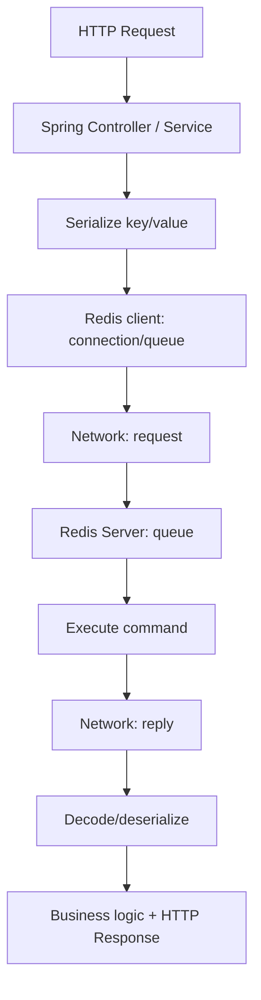

# Phân biệt điểm nghẽn mạng, ứng dụng và Redis Server trong Spring Data Redis

> **Module:** Spring Data Redis  
> **Chương:** Hiệu năng  
> **Bài học:** Phương pháp phân rã thời gian truy cập Redis, đo ở tầng ứng dụng, Redis client, network và Redis Server; nhận diện nút thắt và tối ưu đúng chỗ mà không làm mất tính đúng đắn dữ liệu.

## 1. Redis chậm ở đâu?

Một service Spring Boot gọi:

```java
String json = stringRedisTemplate.opsForValue()
        .get("cache:product:101");
```

Nếu log ghi lời gọi mất **120 ms**, chưa thể kết luận Redis Server mất 120 ms để thực thi `GET`. Có thể:

- 80 ms chờ Redis connection pool.
- 20 ms network round-trip.
- 0,2 ms server thực thi.
- 10 ms xử lý serializer và callback.
- Phần còn lại là thread scheduling, CPU contention hoặc GC.

Một tình huống khác: `HGETALL` trên Hash rất lớn thực thi 90 ms phía Redis; lúc đó tăng connection pool không giúp bao nhiêu.

**Nguyên tắc:** Thời gian tại `RedisTemplate` là thời gian *quan sát ở client*, không phải thời gian *Redis Server thực thi command*. Phải đo theo tầng mới phân biệt được nguồn gốc.

### 1.1. Ba nhóm điểm nghẽn chính

| Nhóm | Nguồn gây chậm | Công cụ quan sát |
|---|---|---|
| **Mạng** | RTT, cross-region/cross-AZ, retransmission, bandwidth, DNS/TLS/connection setup | PING từ pod, `redis-cli --latency`, TCP/cloud network telemetry |
| **Ứng dụng/Redis client** | GC, serialization, thread/event-loop blocking, pool/queue, commands tuần tự, retries | Micrometer, JFR, thread dumps, Lettuce/Jedis command/pool metrics |
| **Redis Server** | Big keys, expensive commands, Lua, CPU/queue, eviction, persistence, hot shard | `INFO`, `SLOWLOG`, `LATENCY`, commandstats, per-node monitoring |

Nhiều bottlenecks có thể xảy ra đồng thời. GET một JSON 5 MiB có thể tốn network transfer, Redis output handling **và** JVM deserialization.

### 1.2. Câu hỏi trước khi tối ưu

1. Mọi HTTP endpoints đều chậm hay chỉ endpoints gọi Redis?
2. Mọi Redis commands chậm hay chỉ `HGETALL`, `SMEMBERS`, `MGET` với nhiều keys?
3. Tất cả pods chậm hay chỉ một pod/AZ?
4. Chậm theo traffic, sau deploy, khi failover hay theo lịch backup?
5. Redis và ứng dụng có ở cùng region/AZ không?
6. Một HTTP request gọi bao nhiêu Redis commands?
7. Có cache miss tăng vì TTL hoặc eviction không?
8. Redis Cluster có một primary node nóng hơn các node còn lại không?

Câu trả lời giúp chọn đo đạc thay vì đo tất cả một cách ngẫu nhiên.

## 2. Phân rã đường đi của một Redis command



Mô hình gần đúng:

\[
T_{\text{redis-call}} \approx
T_{\text{serialize}}+T_{\text{client-queue}}
+T_{\text{network-out}}+T_{\text{server-queue}}
+T_{\text{server-execute}}+T_{\text{network-back}}
+T_{\text{deserialize}}
\]

Và:

\[
T_{\text{HTTP}} \approx T_{\text{application-before}}
+T_{\text{redis-call}}+T_{\text{application-after}}
+T_{\text{other-dependencies}}
\]

Mô hình là để suy luận; với async I/O, các giai đoạn có thể chồng lấp. Không tự cộng *p99* của nhiều operations để ra p99 tổng.

### 2.1. Các phép đo không có cùng ý nghĩa

| Phép đo | Thể hiện | Không thể tự suy ra |
|---|---|---|
| HTTP timer | End-to-end request | Redis là bottleneck |
| Timer quanh `RedisTemplate.get()` | Serialization + client + network + server + decode | Riêng Redis execution |
| Lettuce command metrics | Thời gian command theo định nghĩa recorder | Không mặc định là server CPU |
| `SLOWLOG` | Thời gian server thực thi commands vượt threshold | Network RTT, client queue |
| `LATENCY` | Các sự kiện latency phía server được monitor | HTTP request latency |
| `redis-cli --latency` | Redis PING request–reply từ nơi chạy CLI | TCP RTT thuần túy |
| JVM GC pause | Thời gian JVM bị pause | Server execution |
| TCP RTT/retransmissions | Chất lượng transport | Serializer/server command cost |

**Ví dụ:** `RedisTemplate GET = 85 ms` nhưng `SLOWLOG GET = 0,15 ms` không có nghĩa phép đo sai. Phần thời gian lớn có thể nằm ở queue, network hoặc decode.

## 3. Hiểu latency, throughput, queueing và saturation

- **Latency:** thời gian hoàn thành một operation.
- **Throughput:** số operations xử lý mỗi giây.
- **Concurrency:** số requests/commands tồn tại đồng thời.
- **Saturation:** tài nguyên gần chạm giới hạn, công việc chờ trong queue.

Redis có thể thực thi một GET trong 0,1 ms khi chạy riêng nhưng client vẫn thấy 50 ms lúc hệ thống quá tải vì chờ.

### 3.1. Queueing và tail latency

Ví dụ khái niệm:

```text
Mức tải thấp:
  Client queue:         0,1 ms
  Network:              1,0 ms
  Server execute:       0,2 ms
  Decode:               0,1 ms
  Total:                1,4 ms

Mức tải cao:
  Client queue:        45,0 ms
  Network:              1,0 ms
  Server execute:       0,2 ms
  Decode:               0,1 ms
  Total:               46,3 ms
```

Một lệnh vẫn thực thi nhanh trên Redis Server nhưng call chậm ở client.

### 3.2. Little's Law

Ở trạng thái ổn định:

\[
L=\lambda W
\]

Trong đó \(L\) là số operations trung bình trong hệ, \(\lambda\) là operations/giây và \(W\) là thời gian ở trong hệ (giây).

Nếu throughput là 5.000 operations/giây:

```text
W = 2 ms:  L ≈ 5.000 × 0,002 = 10 operations in-flight
W = 20 ms: L ≈ 5.000 × 0,020 = 100 operations in-flight
```

Khi latency tăng 10 lần, số công việc chờ có thể tăng tương ứng, làm queue/memory tăng và tạo vòng lặp overload.

### 3.3. Phải đo p50/p95/p99

Ví dụ:

```text
Average = 4 ms
p50     = 1 ms
p95     = 14 ms
p99     = 90 ms
max     = 500 ms
```

Average 4 ms có thể che dấu p99 rất cao. Khi HTTP SLO xét tail latency, p95/p99 quan trọng hơn mean. Không cộng các *percentiles* độc lập để suy ra p99 của tổng: phải đo tổng hoặc dùng spans của cùng một trace.

## 4. Khởi đầu bằng HTTP trace và metrics của ứng dụng

Một endpoint:

```text
GET /products/101          320 ms
├─ Authentication           10 ms
├─ Redis GET                 2 ms
├─ Database fallback       260 ms
├─ Build DTO                25 ms
└─ HTTP serialization       18 ms
```

Tối ưu Redis không giải quyết vấn đề chính. Ở đây phải xem cache miss và database latency.

Ngược lại:

```text
GET /products/101          320 ms
├─ Authentication            9 ms
├─ Redis GET               280 ms
└─ Other                    31 ms
```

Lúc này cần phân rã đường Redis tiếp.

### 4.1. Spring Boot Actuator và Micrometer

Ví dụ Gradle Kotlin DSL:

```kotlin
dependencies {
    implementation("org.springframework.boot:spring-boot-starter-actuator")
    implementation("io.micrometer:micrometer-registry-prometheus")
    implementation("org.springframework.boot:spring-boot-starter-data-redis")
}
```

Cấu hình minh họa:

```yaml
management:
  endpoints:
    web:
      exposure:
        include: health,info,metrics,prometheus
  metrics:
    distribution:
      percentiles-histogram:
        http.server.requests: true
        app.redis.lookup.duration: true
```

Metrics tự động phụ thuộc Spring Boot/Micrometer/driver version. Không khẳng định bật Actuator là mọi Lettuce command timer sẽ sẵn có. Phải kiểm tra instrumentation và exporter. Không công khai actuator endpoints ra Internet nếu không có bảo vệ.

### 4.2. Timer bao quanh RedisTemplate

```java
import java.util.concurrent.TimeUnit;

import io.micrometer.core.instrument.MeterRegistry;
import io.micrometer.core.instrument.Timer;
import org.springframework.data.redis.core.StringRedisTemplate;

public class MeasuredRedisReader {

    private final StringRedisTemplate redis;
    private final MeterRegistry registry;

    public MeasuredRedisReader(
            StringRedisTemplate redis,
            MeterRegistry registry) {
        this.redis = redis;
        this.registry = registry;
    }

    public String get(String key) {
        long start = System.nanoTime();
        boolean success = false;

        try {
            String value = redis.opsForValue().get(key);
            success = true;
            return value;
        } finally {
            Timer.builder("app.redis.lookup.duration")
                    .tag("operation", "GET")
                    .tag("outcome", success ? "success" : "error")
                    .register(registry)
                    .record(
                            System.nanoTime() - start,
                            TimeUnit.NANOSECONDS);
        }
    }
}
```

Ý nghĩa:

- Đo thời gian **wall clock** từ lúc gọi template tới khi method hoàn tất.
- `success=true` dù Redis trả null: cache miss là GET thành công.
- Không gắn `key`, `userId`, `eventId` thô vào metric labels.
- Cần histogram/percentiles phù hợp backend để đọc p95/p99.
- Trong ứng dụng tải cao, có thể chuẩn bị Timer ở initialization thay vì tạo builder mỗi lần.

Timer này **không** tách riêng network và Redis execution.

### 4.3. Đo serialization tách biệt

Nếu lưu JSON bằng `StringRedisTemplate`:

```java
String json = redis.opsForValue().get(key);
ProductView product =
        objectMapper.readValue(json, ProductView.class);
```

Đo:

```text
redis.get.duration
json.decode.duration
business.transform.duration
```

Nếu GET 2 ms và JSON decode 45 ms, nút thắt thuộc ứng dụng. Nếu dùng `RedisTemplate<String, ProductView>` với JSON serializer, decode xảy ra *bên trong* `get()`, nên cần đo serializer riêng hoặc dùng profiler.

### 4.4. Cache hit, miss và error

Ba trạng thái khác nhau:

1. **Hit:** Redis GET trả value.
2. **Miss:** Redis GET trả nil/null.
3. **Error:** Redis GET lỗi timeout, connection, codec, command.

Cache miss tăng làm database fallback tăng; HTTP chậm không đồng nghĩa Redis Server chậm.

## 5. Lettuce/Jedis: chờ connection và client queue

Một Redis command có thể mất thời gian ngay khi chưa tới server:

```text
Application
  -> Serialize
  -> Acquire/reuse connection
  -> Queue command
  -> Netty/driver scheduling
  -> Network
  -> Redis
  -> Decode response
```

### 5.1. Lettuce command latency metrics

Lettuce có command latency collector/recorder, các phiên bản phù hợp hỗ trợ Micrometer. Metrics có thể phân theo command type, connection context, duration/percentile tùy recorder.

Dùng để:

- Xem GET/SET/HGETALL/XREAD latency tại client.
- Đối chiếu RedisTemplate timer.
- So latency từ một pod với pod khác.
- So với Redis Server SLOWLOG/INFO.
- Phát hiện pending command backlog.

**Đọc phạm vi metric của đúng phiên bản Lettuce.** Command latency đo ở client không tự đồng nghĩa Redis Server execution time.

### 5.2. JedisPool chờ connection

Ví dụ:

```text
RedisTemplate GET wall time: 130 ms
Pool borrow wait:            112 ms
Command after borrowing:       2 ms
Other overhead:               16 ms
```

Đây là **client resource contention**.

Kiểm tra:

- Active, idle, waiting connections.
- Borrow timeout, pool size.
- Connection leaks.
- Blocking commands giữ connection lâu.
- Transaction duration.
- Tải hiện tại so với `maxclients`.
- Redis còn headroom CPU/memory hay không.

Tăng pool không tự giải quyết mạng RTT hoặc server CPU saturation. Pool quá lớn có thể làm Redis bị dồn thêm requests.

### 5.3. Lettuce connection sharing

Lettuce hỗ trợ shared connections cho nhiều thao tác thông thường, tùy API/config. Không mặc định “một HTTP request cần một Redis connection”. Một số workload như blocking commands hoặc transaction cần connection/session handling riêng.

### 5.4. Không tạo connection mới mỗi request

Nếu code tự tạo Redis client/factory/connection liên tục:

```text
DNS -> TCP connect -> TLS handshake -> AUTH -> GET -> close
```

thời gian setup có thể vượt chính GET. Dấu hiệu: cold call chậm, warm call nhanh, `total_connections_received` tăng mạnh, TIME_WAIT hoặc TLS handshakes tăng.

Dùng Spring-managed `RedisConnectionFactory`/template và reuse connections theo thiết kế.

## 6. Ứng dụng Spring Boot: CPU, GC, threads và event loops

### 6.1. JVM GC pause

GC pause có thể chặn thread/callback, khiến RedisTemplate và HTTP timers tăng dù Redis Server đã xử lý command nhanh.

Kiểm tra:

- JVM GC pause distribution.
- Heap used/old generation.
- Allocation rate.
- JFR (Java Flight Recorder).
- Thread dump.
- CPU/process/container quota.

Nếu p99 HTTP spikes trùng GC pauses, tăng Redis CPU không phải giải pháp chính.

### 6.2. Serializer lớn

Một Redis GET trả JSON 5 MiB có thể kéo theo:

- Network transfer nhiều bytes.
- JVM cấp phát byte arrays/String.
- Jackson parse object graph.
- Heap pressure và GC.
- Response serialization thêm lần nữa.

Giảm payload theo access pattern, chỉ đọc field cần thiết và profile codec thay vì chỉ tăng connection pool.

### 6.3. Spring MVC thread blocking

`RedisTemplate` synchronous đợi kết quả. Nếu nhiều request threads cùng chờ I/O, server-side HTTP thread pool có thể bão hòa.

Dấu hiệu:

- Nhiều threads WAITING/BLOCKED.
- HTTP queued requests tăng.
- Redis CPU không tăng tương ứng.
- Redis command riêng vẫn nhanh.

Tăng HTTP worker threads có thể chỉ làm nhiều lời gọi Redis đồng thời hơn. Cần điều chỉnh theo công suất toàn chuỗi.

### 6.4. WebFlux event loop bị chặn

Sai:

```java
public Mono<String> get(String key) {
    String value =
            stringRedisTemplate.opsForValue().get(key);
    return Mono.justOrEmpty(value);
}
```

Lời gọi blocking đã chạy trước khi Mono được tạo.

Cũng sai khi gọi `.block()` trên WebFlux event-loop:

```java
String v = reactiveRedisTemplate
        .opsForValue().get(key).block();
```

Đúng hướng với native reactive Redis:

```java
public Mono<String> get(String key) {
    return reactiveRedisTemplate.opsForValue().get(key);
}
```

Reactive không giúp Redis Server thực thi command nhanh hơn; nó giảm nhu cầu giữ thread chờ I/O khi toàn pipeline được viết non-blocking.

### 6.5. BoundedElastic là bridge

Khi bắt buộc dùng imperative Redis API từ reactive flow:

```java
Mono<String> result =
        Mono.fromCallable(
                () -> stringRedisTemplate.opsForValue().get(key))
            .subscribeOn(Schedulers.boundedElastic());
```

Cách này tránh chặn Netty event-loop nhưng vẫn tiêu thụ blocking worker threads. Scheduler queue cũng có thể bão hòa; đây không phải native reactive Redis I/O.

## 7. Network bottleneck: RTT và đường truyền

### 7.1. Dấu hiệu

- Redis server SLOWLOG không cho thấy commands nặng.
- CPU Redis không cao.
- GET value nhỏ vẫn có client latency lớn.
- PING từ pod ứng dụng cao, host gần Redis thấp.
- Cross-AZ/cross-region hoặc VPN/proxy.
- TCP retransmissions/loss.
- Large value chậm theo kích thước payload.
- Một subnet/pod chậm hơn các nơi khác.

**Cẩn trọng:** Redis PING có thể chậm khi server đang queue commands, nên PING cao không tự chứng minh mạng là nguyên nhân duy nhất.

### 7.2. Đo từ nơi ứng dụng chạy

```bash
redis-cli -h redis.example.internal -p 6379 PING
redis-cli -h redis.example.internal -p 6379 --latency
```

Chạy từ cùng pod/host/network tương đương Spring service. Với TLS/ACL, cấu hình phù hợp và tránh lộ credentials trong shell history.

`redis-cli --latency` đo request–reply của Redis PING, gồm network cùng server/client scheduling, không phải TCP RTT thuần.

### 7.3. So sánh ba vị trí

| Vị trí đo | Mục tiêu |
|---|---|
| Pod đang chậm | Đường network thực |
| Pod khác cùng hệ thống | Xem có vấn đề pod/host-specific |
| Host gần Redis | Baseline gần server |

Ví dụ giả định:

```text
Pod A -> Redis PING p95: 45 ms
Pod B -> Redis PING p95: 44 ms
Máy gần Redis:          0,8 ms
Redis command exec:     0,2 ms
```

Nghi network path hoặc khoảng cách app–Redis. Cần xác nhận thêm bằng TCP metrics và topology.

Nếu chỉ Pod A chậm, điều tra Pod A CPU/GC/network trước.

### 7.4. Bandwidth và value lớn

Với payload 4 MiB và throughput hiệu dụng 100 MiB/s:

\[
T_{\text{transfer}} \gtrsim
\frac{4\ \mathrm{MiB}}{100\ \mathrm{MiB/s}}
=0.04s=40ms
\]

Đây là **cận lý tưởng minh họa**; thực tế còn RTT, TCP, TLS, server/client overhead.

Nếu network transfer đã chiếm phần lớn latency, nâng Redis CPU chưa chắc cải thiện đáng kể.

### 7.5. Packet loss

Đo TCP retransmission, packet drop, network interface throughput, MTU/proxy, cloud flow telemetry và host networking. Packet loss nhỏ có thể làm p99 rất cao dù p50 tốt.

## 8. Redis Server bottleneck

Redis chủ yếu thực thi commands trên đường xử lý tuần tự tại mỗi shard/node; Redis versions mới có thể dùng I/O threads cho một phần network. Một command tốn thời gian có thể khiến commands khác chờ.

Nguồn gây chậm:

- `HGETALL` trên Hash lớn.
- `SMEMBERS` trên Set lớn.
- `LRANGE 0 -1` trên List dài.
- `ZRANGE` trả hàng nghìn/hàng triệu members.
- `KEYS *` trên keyspace lớn.
- Lua/Redis Function chạy lâu.
- Big key deletion.
- CPU saturation hoặc Redis Cluster hot shard.
- Memory pressure/eviction.
- RDB/AOF fork, disk I/O.
- Replication/failover/resharding.
- Client output buffers và network bandwidth.

### 8.1. Lệnh O(N) và big keys

Ví dụ:

```redis
HGETALL cache:catalog:all-products
```

Nếu Hash có 200.000 fields, server và network phải xử lý lượng dữ liệu lớn, JVM lại phải deserialize nhiều objects.

Nếu chỉ cần vài fields:

```redis
HMGET cache:catalog:all-products name price stock
```

Ngoài ra có thể chia key theo aggregate hoặc pagination. `HSCAN` với cursor có thể giảm blocking mỗi lượt nhưng không cung cấp snapshot nhất quán khi có concurrent writes.

### 8.2. Redis CPU tổng thấp vẫn có thể nghẽn

Nếu Redis command thread saturate một core trên VM nhiều cores, mức CPU **trung bình toàn máy** có thể trông thấp. Đo per-process/per-thread CPU và per-shard workloads. Disk/persistence/network output cũng có thể nghẽn khi CPU thấp.

## 9. Redis INFO: đọc số liệu server

```bash
redis-cli INFO server
redis-cli INFO stats
redis-cli INFO commandstats
redis-cli INFO cpu
redis-cli INFO memory
redis-cli INFO clients
redis-cli INFO persistence
redis-cli INFO replication
redis-cli INFO keyspace
```

Trên Redis Cluster, thu thập đúng node/shard; một node không đại diện toàn cluster. Redis managed service có thể giới hạn một số commands; dùng provider metrics tương ứng.

### 9.1. INFO stats

Fields phổ biến (tùy Redis version):

- `instantaneous_ops_per_sec`.
- `total_commands_processed`.
- `total_connections_received`.
- `rejected_connections`.
- `evicted_keys`, `expired_keys`.
- `keyspace_hits`, `keyspace_misses`.
- `instantaneous_input_kbps`, `instantaneous_output_kbps`.

Nhiều counters là **tích lũy từ khi Redis start**. Muốn biết rate hiện tại, lấy delta giữa hai samples chia cho thời gian; không suy throughput trực tiếp từ tổng.

### 9.2. INFO commandstats

```bash
redis-cli INFO commandstats
```

Có thể thấy kiểu dữ liệu:

```text
cmdstat_get:calls=100000,usec=12000,usec_per_call=0.12
cmdstat_hgetall:calls=100,usec=150000,usec_per_call=1500.00
```

Các số minh họa. `usec_per_call` là average Redis command execution metric, **không** phải p99 end-to-end tại ứng dụng. Kết hợp SLOWLOG/histograms để tìm tail.

### 9.3. INFO cpu

`used_cpu_sys`, `used_cpu_user` và một số main-thread counters là thời gian CPU tích lũy. Lấy delta và chia wall-time; kết hợp CPU quota và per-thread monitoring.

### 9.4. INFO memory

Theo dõi:

- `used_memory`, `used_memory_rss`.
- `maxmemory`, `maxmemory_policy`.
- Fragmentation ratios.
- Memory dành cho clients/replication.
- Eviction rate và pending lazyfree objects khi có.

RAM cao không tự là lỗi; cần xem có capacity pressure, swap, eviction hoặc allocation bottleneck.

### 9.5. INFO clients

Xem `connected_clients`, `blocked_clients`, output buffers và connection limits. Các blocked clients có thể là bình thường với `BLPOP`/`XREAD BLOCK`; đặt trong bối cảnh workload.

### 9.6. INFO persistence

Xem `rdb_bgsave_in_progress`, `aof_rewrite_in_progress`, `latest_fork_usec` nếu có cùng disk/fsync metrics. Spike p99 trùng fork/AOF rewrite cần kiểm tra host resources.

Không tự tắt persistence trên production chỉ để nhanh hơn nếu Redis giữ dữ liệu cần durability.

## 10. SLOWLOG: thời gian command thực thi trên server

```bash
redis-cli SLOWLOG LEN
redis-cli SLOWLOG GET 20
redis-cli CONFIG GET slowlog-log-slower-than
redis-cli CONFIG GET slowlog-max-len
```

SLOWLOG ghi commands có thời gian thực thi vượt threshold. Nó **không bao gồm thời gian gửi request/response trên network hoặc chờ client connection**.

Ví dụ:

```text
RedisTemplate GET p99: 85 ms
Redis SLOWLOG GET:     0,1 ms
Redis commandstats:    0,2 ms average
```

Cần tìm client queue, network, server queue trước command, output transfer hoặc deserialization.

### 10.1. Slowlog rỗng không chứng minh server rảnh

Nếu server nhận rất nhiều GET nhanh nhưng không kịp xử lý, các GET có thể xếp hàng. Từng GET vẫn dưới slowlog threshold nên không xuất hiện. Kết hợp CPU/ops, client latency, throughput và Redis histograms.

### 10.2. Dữ liệu nhạy cảm

SLOWLOG có thể chứa command arguments/key names. Không chia sẻ raw output nếu có PII, tokens hoặc dữ liệu riêng.

## 11. Redis LATENCY: tìm server stalls

```bash
redis-cli LATENCY LATEST
redis-cli LATENCY DOCTOR
```

Latency monitoring theo sự kiện có thể cần `latency-monitor-threshold` được bật (>0) theo Redis version. Không có events không tự chứng minh server không bị pause.

Các nguồn:

- Fork/background persistence.
- AOF fsync.
- Commands/Lua dài.
- Eviction, lazyfree/defrag.
- Host scheduling pause.
- Memory allocator pressure.

Một số Redis versions cung cấp `INFO latencystats` hoặc histograms theo command. Chúng đo server-side latencies, **không** trực tiếp tương đương với client p99.

### 11.1. Intrinsic latency

```bash
redis-cli --intrinsic-latency 100
```

Lệnh này đo scheduling pauses trên **máy đang chạy CLI**, không đo mạng tới Redis. Chỉ dùng trên Redis host khi được phép; có thể gây CPU overhead. Chạy trên laptop chỉ phản ánh laptop.

## 12. Memory pressure, eviction và cache hit ratio

Một vòng lặp phổ biến:

```text
Redis gần maxmemory
  -> eviction tăng
  -> cache hit giảm
  -> DB fallback tăng
  -> HTTP latency tăng
  -> retries tăng
  -> Redis và DB tiếp tục quá tải
```

Redis GET vẫn có thể nhanh nhưng endpoint chậm vì **cache hiệu quả kém**.

Theo dõi:

- `evicted_keys` delta.
- `used_memory`/maxmemory.
- Cache hit/miss.
- TTL và key churn.
- DB QPS/latency.
- Value size.

Một biện pháp là giảm payload, tăng cache hit hiệu quả hoặc thay TTL/eviction policy theo workload, thay vì chỉ tăng Redis command timeout.

### 12.1. Big key deletion

`DEL` key chứa collection rất lớn có thể làm server tốn CPU khi giải phóng bộ nhớ. `UNLINK` thường giúp tách key và xử lý reclaim memory bất đồng bộ khi phù hợp. Nhưng reclaim không tức thì và vẫn có chi phí; kiểm tra Redis version/semantics.

## 13. Redis Cluster: hot slot và topology

Redis Cluster sử dụng **16.384 hash slots**. Một hot key hoặc nhiều key chung hash tag có thể dồn tải vào một primary node.

Ví dụ:

```text
order:{all}:101
order:{all}:102
order:{all}:103
```

Cả ba cùng hash tag `all`, nên cùng slot. Thêm nodes không phân chia riêng slot đó.

Dấu hiệu:

- Một Redis primary có CPU cao.
- Latency tăng chủ yếu trên keys của shard đó.
- Các primary khác còn headroom.
- Metrics toàn cluster trung bình có thể che vấn đề.

Hướng xử lý:

- Tag theo aggregate nhỏ nhất cần atomic multi-key operations.
- Tránh hash tag toàn cục.
- Tối ưu access pattern hot keys.
- Xem per-node CPU/memory/network.
- Không phá atomicity nếu nghiệp vụ cần nhiều keys cùng slot.

### 13.1. MOVED/ASK vs CROSSSLOT

- `MOVED`: Redis báo slot đã được route tới node khác.
- `ASK`: redirection tạm trong migration.
- `TRYAGAIN`: một điều kiện transient.
- `CROSSSLOT`: native multi-key command dùng keys khác slots.

Cluster-aware client có xử lý redirects/topology refresh. Nhưng tăng timeout không sửa `CROSSSLOT`; cần sửa data model hoặc tách commands nếu không cần atomicity.

### 13.2. High-level multiGet scatter/gather

Một số client APIs có thể tách multi-key reads theo slots rồi ghép kết quả. Khi đó một Java method có thể thực hiện nhiều Redis commands, không phải một transaction/snapshot nguyên tử xuyên shards.

Benchmark phải hiểu client method được triển khai bằng **native command hay nhiều sub-requests**.

## 14. Tối ưu network: giảm round trips

### 14.1. Vấn đề GET tuần tự

```text
GET A -> reply A -> GET B -> reply B -> GET C -> reply C
```

Với RTT cao, thời gian chờ chồng lên nhau.

### 14.2. Pipelining

```text
GET A, GET B, GET C -> replies A, B, C
```

Pipelining cho phép gửi nhiều commands trước khi chờ từng reply. Nó giảm request–reply waiting nhưng **không tự tạo transaction**.

Ví dụ Spring Data Redis:

```java
import java.nio.charset.StandardCharsets;
import java.util.List;
import org.springframework.data.redis.core.StringRedisTemplate;

public List<Object> readBatch(StringRedisTemplate redis) {
    return redis.executePipelined(connection -> {
        connection.stringCommands().get(
                "cache:1".getBytes(StandardCharsets.UTF_8));
        connection.stringCommands().get(
                "cache:2".getBytes(StandardCharsets.UTF_8));
        connection.stringCommands().get(
                "cache:3".getBytes(StandardCharsets.UTF_8));
        return null;
    });
}
```

Mẫu API minh họa; phải bảo đảm key serialization và cách đọc kết quả đúng template, driver/Cluster behavior tương thích.

### 14.3. Trade-offs pipeline

- Giảm RTT overhead.
- Có thể tăng throughput.
- Tăng pending commands và buffer memory.
- Không atomic.
- Không vượt qua multi-key Redis Cluster `CROSSSLOT`.
- Nếu Redis CPU bão hòa, pipeline có thể làm server queue dài hơn.
- Cần xử lý partial failures.

### 14.4. MGET, HMGET, Hash hoặc batch

| Kỹ thuật | Khi hữu ích | Giới hạn |
|---|---|---|
| GET tuần tự | Ít keys | Nhiều round trips |
| Pipeline GET | Nhiều commands độc lập | Không atomic, buffers |
| Native MGET | Redis standalone hoặc keys cùng hash slot | Cross-slot constraints |
| HMGET | Một Hash, chỉ cần vài fields | Data model cần phù hợp |
| HGETALL | Cần toàn Hash nhỏ | Big response nếu Hash lớn |
| Cluster scatter/gather | Các keys khác slots | Không atomic, nhiều requests |
| Lua/Redis Function | Logic atomic trên shard | Script dài gây blocking |

Không ép tất cả keys chung một tag để dùng MGET; hot slot có thể làm Cluster kém hiệu quả.

## 15. Application N+1 Redis commands

Ví dụ:

```java
for (String id : ids) {
    String json = redis.opsForValue().get("product:" + id);
    process(json);
}
```

Với 100 GET/request và 1.000 HTTP requests/giây, Redis có thể phải xử lý 100.000 GET/giây. RTT tuần tự có thể gây latency lớn ngay cả khi Redis thực thi mỗi GET rất nhanh.

Cách cải thiện:

- Đếm Redis commands per HTTP request.
- Batch/pipeline khi phù hợp.
- Dùng HMGET hoặc cache aggregate theo access pattern.
- Giới hạn số IDs và response size.
- Tránh N+1 ở service/repository helper.
- Theo dõi Redis Server QPS sau thay đổi.

Giảm số round trips thường hiệu quả hơn tăng raw Redis command throughput.

## 16. Reactive concurrency và backpressure

Trong Reactive Redis:

```java
Flux<ProductView> products =
        Flux.fromIterable(productIds)
                .flatMap(this::loadFromRedis, 16);
```

`16` là concurrency minh họa, không có một con số tối ưu cho mọi hệ thống.

- `flatMap`: nhiều inner publishers có thể cùng chạy; output order không đảm bảo theo input.
- `concatMap`: tuần tự, giữ thứ tự.
- `flatMapSequential`: xử lý inner cùng lúc nhưng phát theo thứ tự input.

Concurrency cao có thể tăng throughput tới điểm saturation, sau đó chỉ làm p99 và pending queues tăng.

**Backpressure không hủy side effect của một Redis command đã được server thực hiện.** Cần timeout, idempotency và capacity planning.

### 16.1. Không tự subscribe trong service

Không tốt:

```java
public Mono<Void> cachePut(String key, String value) {
    redis.opsForValue().set(key, value).subscribe();
    return Mono.empty();
}
```

Tốt hơn:

```java
public Mono<Void> cachePut(String key, String value) {
    return redis.opsForValue().set(key, value).then();
}
```

Caller/WebFlux quản lý subscription, cancellation và lỗi của thao tác ghi.

## 17. Benchmark tách từng tầng

Một thí nghiệm có đối chứng:

### Bước 1. Baseline HTTP không Redis

```java
@GetMapping("/diagnostics/baseline")
public ResponseEntity<String> baseline() {
    return ResponseEntity.ok("ok");
}
```

Nếu baseline endpoint đã p99 cao, vấn đề không phải Redis command execution. Endpoint diagnostics phải được bảo vệ, không mở công khai.

### Bước 2. GET key nhỏ

Đo GET của một key chứa vài bytes, từ đúng Spring pod:

- RedisTemplate timer.
- Lettuce command timer.
- Redis Server SLOWLOG/INFO.
- Redis PING từ pod.
- JVM/thread/pool metrics.

### Bước 3. GET key lớn

Giữ app/Redis cùng topology, thay value size. Nếu small GET nhanh, large GET chậm, xem network transfer, output buffer và deserialization.

### Bước 4. Tăng concurrency

Ví dụ giả định:

| Concurrency | Throughput | p99 |
|---:|---:|---:|
| 1 | 500 ops/s | 3 ms |
| 8 | 3.500 ops/s | 5 ms |
| 32 | 5.000 ops/s | 20 ms |
| 128 | 5.100 ops/s | 200 ms |

Throughput gần plateau sau 32 nhưng p99 tăng mạnh: một thành phần đã saturated. Phải tìm nó bằng pool waiting, Redis CPU, network throughput, server queues, không suy chỉ từ bảng.

### Bước 5. Thử batching

So sánh 20 GET tuần tự với pipelining/concurrency hạn chế hoặc native MGET same-slot. Đo lại p95/p99, CPU, payload, throughput và số errors.

### Bước 6. So từ nhiều vị trí

So test từ:

- Pod chậm.
- Pod nhanh.
- Host gần Redis.

Tránh lấy benchmark từ laptop qua VPN làm đại diện đường network ứng dụng.

## 18. Redis benchmark

Ví dụ **môi trường test**:

```bash
redis-benchmark -h redis-test.internal -p 6379 -t get,set -n 100000 -c 50 -d 128 -q
```

Pipelining:

```bash
redis-benchmark -h redis-test.internal -p 6379 -t get -n 100000 -c 50 -P 16 -q
```

Các flags:

- `-t`: command types.
- `-n`: tổng số requests benchmark.
- `-c`: số clients.
- `-d`: payload size.
- `-P`: pipeline depth.
- `-q`: output ngắn.

Benchmark có thể ghi dữ liệu và tạo tải cao, **không chạy tùy tiện trên production**. Đối chiếu TLS/auth, payload, location và concurrency với môi trường thật. Raw benchmark không gồm Spring serialization, controller, DB fallback hoặc business logic, nên không thay HTTP load test. Với tail latency, chú ý arrival-rate model và coordinated omission.

## 19. Năm tình huống đọc số đo

### 19.1. Mạng chậm

| Metric | Ví dụ |
|---|---:|
| HTTP p95 | 150 ms |
| RedisTemplate GET p95 | 95 ms |
| PING từ app pod | 80 ms |
| PING gần Redis | 0,8 ms |
| Redis command execution | 0,2 ms |
| Redis CPU | Thấp |

Ưu tiên kiểm tra network path, cross-region, TLS/connection reuse, retransmission. Chưa có bằng chứng cần nâng Redis CPU.

### 19.2. Pool chờ connection

| Metric | Ví dụ |
|---|---:|
| RedisTemplate GET p95 | 130 ms |
| Pool borrow wait | 115 ms |
| Redis PING | 1 ms |
| Redis execution | 0,2 ms |
| Redis CPU | Thấp |

Ưu tiên sửa connection leak/blocking operations, tuning pool có điều kiện.

### 19.3. Server command nặng

| Metric | Ví dụ |
|---|---:|
| HGETALL RedisTemplate p95 | 220 ms |
| SLOWLOG HGETALL | 150–180 ms |
| Redis primary CPU | Rất cao |
| Hash cardinality | Rất lớn |

Ưu tiên chia big Hash, chỉ đọc fields cần, giảm command complexity và kiểm tra hot slot.

### 19.4. Cache miss nhiều

| Metric | Ví dụ |
|---|---:|
| HTTP p95 | 600 ms |
| Redis GET p95 | 4 ms |
| DB fallback p95 | 480 ms |
| Cache hit ratio | 20% |

Ưu tiên TTL/eviction, cache stampede, nguồn chuẩn. Redis GET vẫn nhanh.

### 19.5. JVM GC pause

| Metric | Ví dụ |
|---|---:|
| HTTP p99 | 800 ms |
| GC pause | 700 ms |
| Redis execution | Dưới 1 ms |
| Redis PING từ pod khác | 1 ms |

Ưu tiên JVM heap/allocation/JFR và codec, không tăng Redis connections.

Các con số chỉ minh họa. Muốn chốt root cause phải dùng evidence **cùng thời gian và workload**.

## 20. Runbook xử lý một incident

1. **Khoanh vùng SLO:** endpoint nào, p99 bao nhiêu, bắt đầu lúc nào, affected pods?
2. **Phân rã HTTP:** Redis-related spans chiếm bao nhiêu, DB/WebClient chiếm bao nhiêu?
3. **Đọc client metrics:** command latency, pool waiting, retries, pending commands.
4. **Đọc Redis Server:** INFO cpu/stats/memory/commandstats, SLOWLOG, LATENCY, persistence.
5. **Đo network:** PING từ pod, so pod tốt/xấu, TCP retransmissions.
6. **Xem application:** GC, thread states, event loop, serialization, commands/request.
7. **Tạo giả thuyết có thể kiểm chứng.**
8. **Thay một yếu tố có kiểm soát**: data model, pool, payload, placement, batching hoặc command.
9. **Đo trước/sau:** p50/p95/p99, throughput, errors, resource usage.
10. **Kiểm tra hiệu ứng phụ**: correctness, memory, retry và latency của endpoints khác.

Một giả thuyết tốt:

> “GET mất 120 ms do chờ connection pool 100 ms. Khi sửa connection leak và chờ pool giảm, RedisTemplate time phải giảm tương ứng mà không cần thay Redis Server.”

Giả thuyết kém:

> “Có Redis trong stack nên tăng maxmemory và timeout.”

## 21. Giữ tính đúng đắn khi tối ưu

### 21.1. Pipeline không atomic

Pipeline gồm `DECRBY stock 1` và `INCR orders 1` không đảm bảo tất cả commands cùng thành công hoặc rollback. Nếu cần atomic business operation, dùng Redis Lua/transaction hợp lệ hoặc nguồn chuẩn có transaction thích hợp.

### 21.2. Retry sau timeout có thể lặp side effects

Redis `INCR`, `LPUSH`, `XADD` hay Lua write có thể đã thực hiện trước khi client timeout. Retry mù có thể tăng/append hai lần. Cần idempotency key hoặc reconciliation.

### 21.3. Cache invalidation

Lấy stale cache để giảm latency cần có freshness policy. Với số dư/tồn kho/checkout, cache stale có thể không phù hợp.

### 21.4. Cluster hash tags

Đặt mọi key trong một tag toàn cục để tránh `CROSSSLOT` có thể tạo hot shard. Tag theo aggregate nhỏ nhất cần atomicity.

### 21.5. Metrics không được làm lộ dữ liệu

Không ghi raw Redis keys chứa user identifiers, tokens hoặc PII vào metric labels. Sử dụng low-cardinality tags, redaction và sampling.

## 22. Những hiểu lầm thường gặp

**“RedisTemplate GET 50 ms tức Redis execution 50 ms.”** Sai: cần tách client, network và server.

**“SLOWLOG rỗng tức Redis Server không thể là bottleneck.”** Sai: queueing và nhiều commands nhanh vẫn có thể saturate server.

**“PING cao chứng minh network chậm.”** Chưa đủ: server queue cũng có thể làm PING cao.

**“Tăng pool connections luôn làm nhanh hơn.”** Sai: chỉ hợp lý nếu pool waiting là bottleneck và server còn headroom.

**“ReactiveRedisTemplate tự làm Redis Server nhanh.”** Sai: thay đổi mô hình chờ I/O, không giảm Redis command cost.

**“Tăng timeout giúp tăng throughput.”** Không chắc: có thể khiến backlog tăng và tail latency xấu hơn.

**“Pipelining biến nhiều commands thành transaction.”** Sai: không tự atomic.

**“Redis CPU thấp loại trừ server bottleneck.”** Sai: một core nóng, disk/network output, persistence hoặc một shard nóng vẫn có thể nghẽn.

**“Cache hit giảm nghĩa Redis GET chậm.”** Sai: GET nhanh nhưng nguồn fallback phải chịu nhiều tải.

**“MGET luôn tốt hơn GET.”** Không tuyệt đối; xem Cluster hash slots, payload và data consistency.

**“Một benchmark Redis bằng redis-benchmark đủ đánh giá p99 HTTP.”** Sai: không bao gồm Spring/JSON/DB/business.

**“Tối ưu latency bằng cách tắt TLS/persistence luôn được.”** Không nếu vi phạm security/durability requirements.

## 23. Câu hỏi thường gặp

**1. Khi nào nghi network nhất?**

Khi Redis Server execution thấp, latency từ app pod cao khác biệt với host gần Redis và network telemetry có dấu hiệu RTT/retransmission/throughput bottleneck.

**2. Khi nào nghi ứng dụng nhất?**

Khi Redis Server và PING nhanh nhưng RedisTemplate/HTTP chậm, có GC pause, serializer CPU, pool waiting, event-loop blocking hoặc nhiều GET tuần tự.

**3. Khi nào nghi Redis Server nhất?**

Khi SLOWLOG, LATENCY, commandstats, CPU, big keys hoặc per-shard metrics cùng chỉ về command execution/server saturation.

**4. SLOWLOG có tính network transfer không?**

Không. Nó tập trung vào thời gian command execution.

**5. redis-cli --latency có đo TCP RTT không?**

Không hoàn toàn. Nó đo Redis PING request–reply, gồm server/client scheduling.

**6. Vì sao p99 cao nhưng p50 thấp?**

Có thể do rare stalls: GC, retransmission, queueing, persistence, big keys hoặc failover.

**7. Redis Cluster CPU trung bình thấp nhưng một node chậm thì sao?**

Kiểm tra hot shard/hot hash tag và phân phối tải theo node.

**8. Vì sao GET payload lớn chậm hơn nhỏ?**

Do bandwidth, server output handling, client deserialization và GC.

**9. Có nên chạy redis-benchmark trên production?**

Không tùy tiện. Dùng test/staging hoặc controlled canary được phép.

**10. Có thể dùng MGET để giảm RTT không?**

Có khi keys cùng Redis hash slot hoặc Redis standalone và semantics phù hợp; với Cluster khác slots cần xem scatter/gather hoặc thiết kế lại.

**11. Pipelining có tăng Redis throughput mãi không?**

Không. Khi server hoặc network đã saturated, nó có thể chỉ tăng queue và p99.

**12. Đổi sang reactive có thay thế benchmark không?**

Không. Phải đo network, Redis Server, client scheduling và workload thực.

**13. Timeout Redis có nghĩa write chưa xảy ra?**

Không. Nếu Redis đã chạy lệnh nhưng reply mất, retry có thể lặp side effect.

**14. Big key có tác động tới app không?**

Có. Response lớn tiêu thụ bandwidth, decode CPU và heap allocations, không chỉ Redis Server.

**15. Cache miss là Redis error không?**

Không. Key không tồn tại là kết quả hợp lệ; lỗi connection/timeout phải được đếm riêng.

**16. Làm sao biết đang nghẽn connection pool?**

Theo dõi borrow wait, active/idle/waiting, timeout và connection lifetime; đối chiếu Redis PING/execution.

## 24. Checklist đo đạc và tối ưu

1. **Đặt SLO:** p50/p95/p99, throughput và error budget.
2. **Đo HTTP end-to-end** và các dependency spans.
3. **Đo RedisTemplate timer** theo operation/outcome.
4. **Tách serialization/JSON decode** khi cần.
5. **Bật Lettuce/Jedis metrics** theo phiên bản thực tế.
6. **Đo Redis PING từ đúng pod**, không lấy laptop làm đại diện.
7. **So network path giữa pods/AZs** và xem TCP retransmissions.
8. **Xem Redis INFO stats/cpu/memory/clients/commandstats**.
9. **Xem SLOWLOG** cho command execution.
10. **Xem LATENCY/persistence** cho server stalls.
11. **Kiểm tra per-shard Cluster metrics** và hot tags.
12. **Xem JVM GC/CPU/thread/event-loop**.
13. **Theo dõi pool borrow wait và pending commands**.
14. **Đếm Redis commands per HTTP request** để phát hiện N+1.
15. **Kiểm tra big keys và payload bytes**.
16. **Theo dõi cache hit/miss/eviction** và DB fallback load.
17. **Benchmark concurrency theo mức**, nhìn throughput plateau và p99.
18. **Dùng batching/pipelining/MGET/HMGET có điều kiện**.
19. **Không retry mù non-idempotent writes**.
20. **Đo trước/sau, kiểm tra toàn hệ thống và correctness**.

## 25. Tổng kết

Một Redis operation “chậm” có thể bị giới hạn bởi **network RTT/transfer**, **application/Redis client queue/CPU/GC** hoặc **Redis Server execution/queue/resources**. Chúng không thể được phân biệt chỉ bằng một RedisTemplate timer hay một Redis PING.

Cách làm đáng tin là:

- Đo HTTP và Redis client latency trước.
- So với Redis Server INFO/SLOWLOG/LATENCY.
- Đo PING và network từ đúng pod/host.
- Xem JVM, serializers, connection pools, số commands/request.
- Đưa ra giả thuyết và kiểm chứng bằng thí nghiệm có đối chứng.
- Tối ưu đúng tầng, sau đó đo lại p95/p99, throughput, errors và tính đúng dữ liệu.

**Tối ưu hiệu năng Redis phải dựa trên chứng cứ và không được đánh đổi atomicity, idempotency, security hoặc durability chỉ để giảm vài milliseconds.**

## Tài liệu tham khảo

- Redis — [Latency monitoring](https://redis.io/docs/latest/operate/oss_and_stack/management/optimization/latency-monitor/).
- Redis — [Latency troubleshooting](https://redis.io/docs/latest/operate/oss_and_stack/management/optimization/latency/).
- Redis — [SLOWLOG](https://redis.io/docs/latest/commands/slowlog/).
- Redis — [INFO](https://redis.io/docs/latest/commands/info/).
- Redis — [Pipelining](https://redis.io/docs/latest/develop/using-commands/pipelining/).
- Redis — [Benchmarking](https://redis.io/docs/latest/operate/oss_and_stack/management/optimization/benchmarks/).
- Redis — [Cluster specification](https://redis.io/docs/latest/operate/oss_and_stack/reference/cluster-spec/).
- Redis — [Memory optimization](https://redis.io/docs/latest/operate/oss_and_stack/management/optimization/memory-optimization/).
- Spring Data Redis — [RedisTemplate](https://docs.spring.io/spring-data/redis/reference/redis/template.html).
- Spring Data Redis — [Pipelining](https://docs.spring.io/spring-data/redis/reference/redis/pipelining.html).
- Spring Data Redis — [Reactive Redis](https://docs.spring.io/spring-data/redis/reference/redis/reactive.html).
- Spring Boot — [Actuator metrics](https://docs.spring.io/spring-boot/reference/actuator/metrics.html).
- Lettuce — [Advanced usage](https://redis.github.io/lettuce/advanced-usage/).
- Micrometer — [Timer concepts](https://docs.micrometer.io/micrometer/reference/concepts/timers.html).
- Project Reactor — [Reference Guide](https://projectreactor.io/docs/core/release/reference/).
