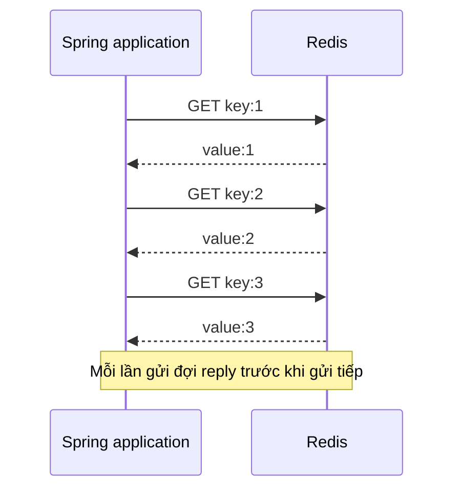
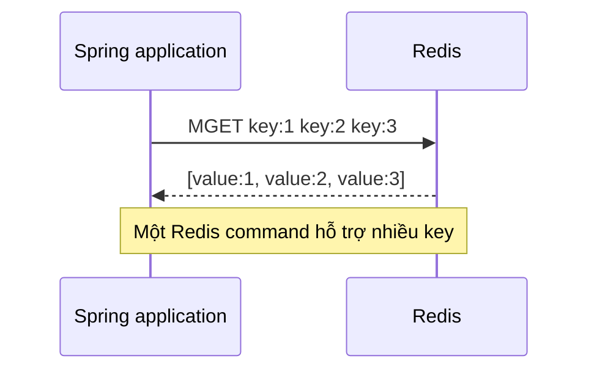
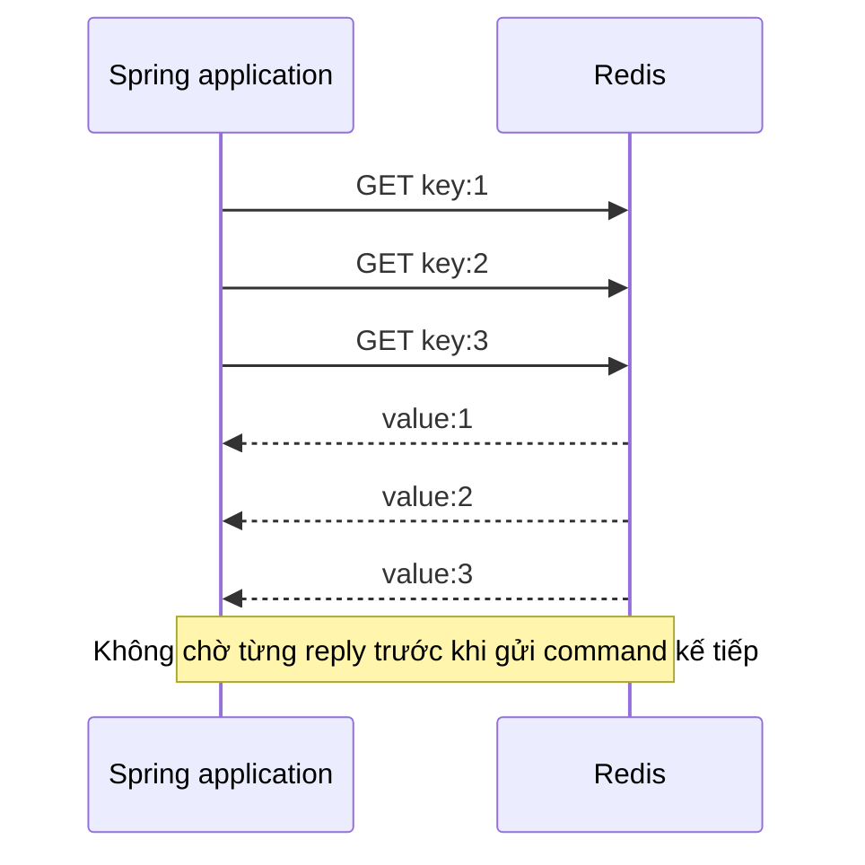
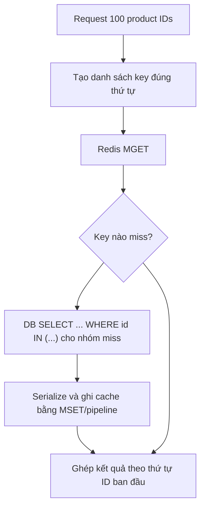
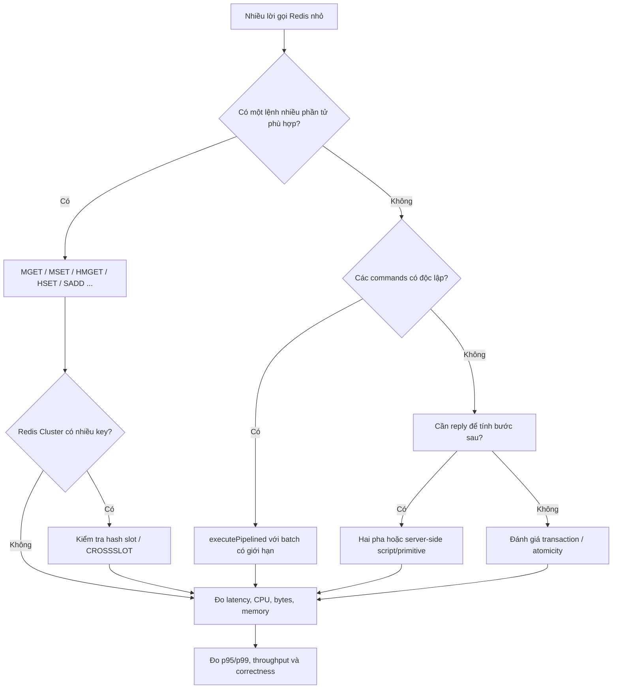

# Giảm số lượt mạng bằng lệnh nhiều phần tử hoặc pipeline trong Spring Data Redis

## 1. Vì sao nhiều lệnh Redis nhỏ có thể gây chậm?

Redis xử lý nhiều thao tác đọc/ghi đơn giản rất nhanh, nhưng một ứng dụng Java không chạy ngay trong cùng tiến trình Redis. Mỗi lần gọi `RedisTemplate` hoặc `StringRedisTemplate` phải đi qua những lớp chi phí nhất định:

1. Ứng dụng tạo key, value và serialize dữ liệu.
2. Client/driver gửi Redis command qua socket, có thể qua TLS.
3. Redis xử lý command và ghi phản hồi.
4. Driver nhận phản hồi, deserialize, trả kết quả cho Spring service.
5. Ứng dụng tiếp tục gửi command kế tiếp.

Nếu cứ **gửi một lệnh rồi chờ trả lời xong mới gửi lệnh khác**, thời gian chờ mạng có thể lớn hơn rất nhiều chi phí xử lý một lệnh `GET` hay `SET` bên Redis.

Ví dụ một service cần đọc tên của 100 sản phẩm:

```java
Map<String, String> result = new LinkedHashMap<>();

for (String productId : productIds) {
    String value = stringRedisTemplate.opsForValue()
            .get("product:name:" + productId);
    result.put(productId, value);
}
```

Vòng lặp trên rất dễ hiểu, nhưng thường sẽ tạo 100 lần đọc Redis theo kiểu tuần tự. Nếu đường mạng có round-trip time (RTT) đáng kể, tổng độ trễ tăng rõ rệt.

Có hai hướng giảm ảnh hưởng này:

- **Lệnh nhiều phần tử (multi-key/multi-field command):** thay nhiều lệnh riêng bằng một lệnh Redis hỗ trợ nhiều key, field hoặc member, ví dụ `MGET`, `MSET`, `HMGET`, `HSET` nhiều field.
- **Pipeline (pipelining):** giữ nhiều lệnh riêng nhưng gửi chúng liên tiếp mà không đợi từng reply rồi mới gửi lệnh sau.

> Điểm cần nhớ: **ít lần trao đổi mạng hơn không nhất thiết đồng nghĩa ít Redis command hơn**. `MGET` thay nhiều `GET` bằng một Redis command; pipeline vẫn gồm nhiều `GET`, chỉ giảm việc client phải chờ qua lại giữa chúng.

Bài học này tập trung vào lựa chọn giữa hai kỹ thuật trong Spring Data Redis, cách lập trình, giới hạn về tính nguyên tử, Redis Cluster và đo đạc hiệu quả thực tế.

## 2. RTT, bandwidth và chi phí xử lý lệnh

Ba khái niệm thường bị gộp thành một chữ "latency":

| Thành phần | Ý nghĩa | Tối ưu thường phù hợp |
|---|---|---|
| Network RTT | Thời gian một vòng gửi request và nhận response | Multi-key hoặc pipeline |
| Redis command execution | Thời gian Redis xử lý các thao tác dữ liệu | Chọn command tốt, giới hạn kích thước dữ liệu |
| Serialization / deserialization | Chuyển đổi Java object ↔ bytes | Serializer phù hợp, payload nhỏ |
| Network bandwidth | Số byte truyền giữa ứng dụng và Redis | Projection, gom lệnh hợp lý, tránh trả dữ liệu không cần |
| Client scheduling / connection | Chờ connection, flush, thread và callback | Pool/concurrency tuning, giới hạn pipeline |
| Origin access | Đọc database/API khi cache miss | Cache design, negative caching, batch load |

Cách ước lượng rất đơn giản cho **N request tuần tự**, bỏ qua phần không liên quan:

\[
T_{\text{sequential}} \approx N \times (RTT + T_{\text{command}})
\]

Nếu chạy N lệnh qua pipeline theo B phần tử mỗi batch, chi phí chờ mạng có thể gần hơn với:

\[
T_{\text{pipelined}} \approx \left\lceil\frac{N}{B}\right\rceil \times RTT
+ T_{\text{commands}}
+ T_{\text{transfer}}
+ T_{\text{client}}
\]

Đây là **mô hình định tính**, không phải công thức SLA: số packet, cách flush socket, concurrency, Redis Cluster routing, TCP/TLS, output buffering và tình trạng tải của Redis có thể làm kết quả khác đáng kể.

Ví dụ minh họa một hệ thống có RTT trung bình 2 ms:

```text
Đọc 100 khóa qua 100 GET chờ tuần tự:
  Chỉ chi phí chờ RTT xấp xỉ 100 × 2 ms = 200 ms.

Đọc 100 khóa bằng một MGET:
  Một lệnh và một lượt phản hồi, cộng thời gian xử lý 100 key.

Pipeline 100 GET:
  Vẫn 100 Redis GET, nhưng không cần chờ hết từng RTT
  mới gửi GET tiếp theo; thường giảm phần chờ mạng.
```

Ví dụ không có nghĩa cả `MGET` và pipeline đều luôn hoàn thành đúng 2 ms. Nếu tổng dữ liệu trả về hàng trăm MB, chi phí truyền/deserialize có thể trở thành phần lớn độ trễ.

## 3. Hai mô hình giao tiếp nhìn qua sơ đồ

### 3.1. Gửi từng lệnh tuần tự



### 3.2. Multi-key command



### 3.3. Pipeline nhiều command riêng



Pipeline chủ yếu giảm thời gian rảnh khi client đợi phản hồi; Redis vẫn phải thực thi tất cả những command đó.

## 4. Bảng chọn nhanh: multi-key hay pipeline?

| Tình huống | Lựa chọn đầu tiên | Lý do |
|---|---|---|
| Đọc nhiều String key độc lập | `MGET` / `multiGet` | Một Redis command trả theo thứ tự key |
| Ghi nhiều String key không cần TTL riêng | `MSET` / `multiSet` | Một Redis command |
| Đọc nhiều field trong **một Redis Hash** | `HMGET` / `HashOperations.multiGet` | Một key, nhiều field |
| Ghi nhiều field vào **một Redis Hash** | `HSET` nhiều field / `putAll` | Gộp nhiều field |
| Thêm nhiều member vào một Set | `SADD` nhiều member / `SetOperations.add` | Một lệnh cho nhiều member |
| Thêm nhiều member và score vào Sorted Set | `ZADD` nhiều member / `ZSetOperations.add` | Một lệnh với nhiều cặp score/value |
| Nhiều lệnh khác loại trên các key độc lập | Pipeline | Không có một Redis command thay thế tất cả |
| Mỗi lệnh có TTL/option riêng | Pipeline nhiều `SET ... EX/PX` | Mỗi command vẫn giữ option của riêng nó |
| Phải dựa vào kết quả lệnh trước để tạo lệnh sau | Gọi tuần tự hoặc thiết kế atomic server-side | Pipeline không cung cấp reply tức thời trong callback |
| Cần tính nguyên tử trên nhiều thao tác | Một primitive atomic, `MULTI/EXEC` hoặc Lua/Function phù hợp | Pipeline đơn thuần không atomic |
| Nhiều key thuộc các hash slot khác nhau trong Cluster | Pipeline/routing theo key hoặc thiết kế key cùng slot | Multi-key command có thể bị `CROSSSLOT` |
| Payload cực lớn | Chia batch, projection hoặc thay đổi data model | Một batch quá lớn vẫn gây tải |

**Không có quy tắc "pipeline luôn nhanh hơn multi-key".** Thường nên thử command nhiều phần tử phù hợp trước vì code đơn giản và Redis xử lý một command. Pipeline có ích khi thao tác không thể biểu diễn bằng một command, nhưng muốn tránh nhiều lượt đợi mạng.

## 5. MGET: đọc nhiều String key trong một command

Redis hỗ trợ:

```redis
SET product:name:P100 "Keyboard"
SET product:name:P101 "Mouse"
SET product:name:P102 "Monitor"

MGET product:name:P100 product:name:P101 product:name:P102
```

Kết quả là một danh sách có giá trị tương ứng **đúng thứ tự key đầu vào**.

Nếu một key không tồn tại, phần tử kết quả ở vị trí đó là null/Nil tương ứng. Nếu key tồn tại nhưng không có kiểu String, Redis `MGET` trả null cho vị trí đó thay vì bắt buộc làm cả lệnh thất bại; vì thế phải phân biệt "key không tồn tại" với "key không phải String" khi logic cần biết nguyên nhân.

### 5.1. Spring Data Redis: ValueOperations.multiGet

```java
package com.example.catalog;

import java.util.ArrayList;
import java.util.LinkedHashMap;
import java.util.List;
import java.util.Map;

import org.springframework.data.redis.core.StringRedisTemplate;
import org.springframework.stereotype.Service;

@Service
public class ProductNameBatchReader {

    private final StringRedisTemplate redis;

    public ProductNameBatchReader(StringRedisTemplate redis) {
        this.redis = redis;
    }

    public Map<String, String> getNames(List<String> productIds) {
        if (productIds.isEmpty()) {
            return Map.of();
        }

        List<String> keys = new ArrayList<>(productIds.size());

        for (String id : productIds) {
            keys.add("product:name:" + id);
        }

        List<String> values =
                redis.opsForValue().multiGet(keys);

        if (values == null || values.size() != keys.size()) {
            throw new IllegalStateException(
                    "Unexpected Redis MGET response"
            );
        }

        Map<String, String> output = new LinkedHashMap<>();

        for (int i = 0; i < productIds.size(); i++) {
            // Map cho phép null value; biểu thị key không có dữ liệu.
            output.put(productIds.get(i), values.get(i));
        }

        return output;
    }
}
```

Giải thích:

- `multiGet(keys)` dùng chức năng đọc nhiều key của Redis, thường là `MGET`.
- Kết quả được ánh xạ theo **thứ tự danh sách key**, không phải theo thứ tự Redis Hash hoặc thứ tự ngẫu nhiên của một Set.
- Với ví dụ dùng `Map`, nếu product ID đầu vào lặp lại thì key Map trùng và kết quả sau ghi đè kết quả trước. Nếu cần giữ từng lần xuất hiện, trả `List` thay vì Map.
- `null` trong kết quả cần được giải thích theo data contract; có thể là cache miss hoặc key có kiểu khác.
- `StringRedisTemplate` dùng serialization dạng String, phù hợp khi dữ liệu thực sự được lưu theo định dạng đó.

**Đừng sử dụng `Set<String>` chỉ vì muốn loại key trùng nếu code sau đó cần ánh xạ theo index.** Nếu cần deduplicate, hãy tạo một danh sách đã loại trùng có thứ tự ổn định, rồi map lại theo ID.

### 5.2. MGET không tự nạp từ database cho cache miss

`multiGet` chỉ đọc Redis. Khi cần cache-aside cho nhiều ID:

1. `MGET` tất cả key.
2. Phân loại key hit và key miss.
3. Gọi **một batch query** ở database cho tập ID còn thiếu nếu nguồn hỗ trợ.
4. Dùng `MSET` hoặc pipeline để bổ sung những kết quả cần cache.
5. Ghép kết quả theo thứ tự input.

Nếu sau `MGET` lại gọi database từng ID miss, bottleneck chỉ chuyển từ Redis sang database. **Batch Redis và batch source nên được thiết kế cùng nhau.**

## 6. MSET và MSETNX: ghi nhiều key bằng một lệnh

Ví dụ Redis CLI:

```redis
MSET product:name:P100 "Keyboard" product:name:P101 "Mouse"
```

Ở Redis standalone, `MSET` thực hiện ghi nhiều String key trong **một command nguyên tử đối với các client khác**: các client khác không quan sát được trạng thái một nửa tập key trước khi MSET hoàn thành. Nhưng điều đó không đồng nghĩa nhóm ghi này được fsync bền vững hoặc đồng bộ tới replica ngay khi Redis trả reply.

Trong Spring Data Redis:

```java
package com.example.catalog;

import java.util.LinkedHashMap;
import java.util.Map;

import org.springframework.data.redis.core.StringRedisTemplate;
import org.springframework.stereotype.Service;

@Service
public class ProductNameBatchWriter {

    private final StringRedisTemplate redis;

    public ProductNameBatchWriter(StringRedisTemplate redis) {
        this.redis = redis;
    }

    public void putAll(Map<String, String> productNames) {
        if (productNames.isEmpty()) {
            return;
        }

        Map<String, String> redisKeys = new LinkedHashMap<>();

        for (var item : productNames.entrySet()) {
            redisKeys.put(
                    "product:name:" + item.getKey(),
                    item.getValue()
            );
        }

        redis.opsForValue().multiSet(redisKeys);
    }
}
```

### 6.1. Điểm yếu: MSET không đặt TTL riêng cho mỗi key

`MSET` không có option kiểu `EX 300` cho từng key. Nếu cần key được tự hết hạn sau 5 phút, chỉ dùng `MSET` rồi cho rằng TTL đã có là sai.

Ngoài ra, ghi bằng `SET` hoặc `MSET` vào một key thường thay thế nội dung String và ảnh hưởng TTL hiện có theo semantics command. Không giả định TTL từ lần ghi trước sẽ được giữ nếu không có option phù hợp.

Một mẫu dễ gây rủi ro:

```redis
MSET cache:a A cache:b B
EXPIRE cache:a 300
EXPIRE cache:b 300
```

Đây là ba commands. Nếu ứng dụng chết sau `MSET` nhưng trước `EXPIRE`, key có thể không còn TTL như mong muốn.

Khi mỗi key cần TTL và không đòi transaction nhiều key, thường dùng pipeline nhiều `SET key value EX ttl` để **mỗi thao tác ghi có TTL nằm trong cùng command**. Đừng gọi `multiSet` rồi pipeline `EXPIRE` nếu yêu cầu "không bao giờ tồn tại key không TTL" là bắt buộc.

### 6.2. MSETNX không phải pipeline SETNX

Redis còn có:

```redis
MSETNX job:1 pending job:2 pending
```

`MSETNX` chỉ ghi **nếu không key nào trong danh sách đã tồn tại**; trên server đơn/nhóm key hợp lệ, thao tác có tính nguyên tử theo toàn bộ tập key. Nó khác với pipeline nhiều `SETNX`: từng lệnh trong pipeline có thể thành công hoặc thất bại độc lập.

Trong Spring Data Redis, `ValueOperations.multiSetIfAbsent(map)` tương ứng ý tưởng này. Kết quả boolean cần được diễn giải theo API; nếu đang ở pipeline, kết quả trực tiếp của thao tác không có sẵn như khi gọi bình thường.

MSETNX không tự có TTL và cũng chịu ràng buộc multi-key Redis Cluster.

## 7. Multi-field Hash: HMGET, HSET và mô hình dữ liệu

Nếu dữ liệu nhóm theo **một Redis key**, Hash là một cấu trúc thường giúp gom nhiều field vào ít command hơn.

Ví dụ:

```redis
HSET product:P100 name "Keyboard" category "Accessories" stock "12"
HMGET product:P100 name stock
```

`HSET` ở đây ghi nhiều field của một Hash. `HMGET` đọc đúng những field cần, tránh `HGETALL` nếu Hash rất lớn.

### 7.1. Spring HashOperations.multiGet

```java
package com.example.catalog;

import java.util.List;

import org.springframework.data.redis.core.StringRedisTemplate;
import org.springframework.stereotype.Service;

@Service
public class ProductHashReader {

    private final StringRedisTemplate redis;

    public ProductHashReader(StringRedisTemplate redis) {
        this.redis = redis;
    }

    public List<Object> getSummaryFields(String productId) {
        return redis.opsForHash().multiGet(
                "product:" + productId,
                List.of("name", "stock")
        );
    }
}
```

Kết quả được trả theo thứ tự danh sách field, có thể có `null` nếu field không tồn tại.

Để ghi nhiều field:

```java
Map<String, String> fields = Map.of(
        "name", "Keyboard",
        "category", "Accessories",
        "stock", "12"
);

stringRedisTemplate.opsForHash()
        .putAll("product:P100", fields);
```

Điều này thường tương ứng với một `HSET` nhiều field.

### 7.2. Từ nhiều key thành một Hash có phải luôn tốt?

Không. Gộp tất cả dữ liệu vào một Hash có thể:

- Giảm số lượng key và hỗ trợ đọc nhiều field bằng một command.
- Tạo **big key** nếu một Hash có hàng triệu field.
- Tạo **hot key** nếu mọi request cùng truy cập một Hash.
- Làm TTL của toàn bộ Hash ảnh hưởng nhiều phần dữ liệu; khả năng TTL per-field phụ thuộc Redis version và API hỗ trợ.
- Khi dùng Redis Cluster, toàn bộ field của một Hash nằm tại slot/node sở hữu key đó.

Chọn độ hạt key theo pattern đọc/ghi; đừng gom toàn bộ dữ liệu chỉ để giảm round-trip mà làm mất khả năng phân tán tải.

## 8. Các thao tác nhiều phần tử khác

Redis có nhiều lệnh nhận một danh sách phần tử trong một command:

| Nhu cầu | Redis command | Spring Data Redis |
|---|---|---|
| Đọc nhiều String key | `MGET` | `opsForValue().multiGet(keys)` |
| Ghi nhiều String key | `MSET` | `opsForValue().multiSet(map)` |
| Ghi tất cả khi chưa key nào tồn tại | `MSETNX` | `multiSetIfAbsent(map)` |
| Đọc nhiều field một Hash | `HMGET` | `opsForHash().multiGet(key, fields)` |
| Ghi nhiều field một Hash | `HSET key field value ...` | `opsForHash().putAll(key, map)` |
| Thêm nhiều member vào Set | `SADD key m1 m2 ...` | `opsForSet().add(key, values...)` |
| Thêm nhiều phần tử vào List | `RPUSH key v1 v2 ...` | `opsForList().rightPushAll(key, values)` |
| Thêm nhiều member có score vào ZSet | `ZADD key score member ...` | `opsForZSet().add(key, tuples)` |
| Xóa nhiều key | `DEL key1 key2 ...` | `redisTemplate.delete(keys)` |
| Xóa key không chặn theo lệnh thích hợp | `UNLINK key1 ...` | API unlink theo phiên bản Spring Data Redis |
| Tính nhiều field của một key | `HMGET`, `HINCRBY` theo field | Chọn primitive theo dữ liệu |

Các command khác nhau về atomicity, độ phức tạp và phản hồi. Ví dụ:

- `SADD` nhiều member là một Redis command cho một Set key.
- `DEL` nhiều key có thể giảm round trips nhưng xóa nhiều dữ liệu lớn có thể gây tác động đáng kể; `UNLINK` là lựa chọn không chặn cho phần giải phóng bộ nhớ phù hợp.
- `MGET` trên rất nhiều key có thể trả một phản hồi cực lớn; không nên gom vô hạn chỉ vì muốn "một command".
- `HGETALL` là một command nhưng đọc toàn bộ Hash, có thể **chậm hơn** nhiều field được chọn bằng `HMGET` nếu payload không cần thiết.

**Tối ưu số command nhưng làm payload tăng 100 lần có thể khiến toàn bộ endpoint chậm hơn.**

## 9. Pipeline: giữ nhiều command, giảm thời gian chờ phản hồi

Pipelining cho phép client gửi một nhóm Redis commands liên tiếp, rồi nhận phản hồi sau. Mỗi command vẫn được Redis thực thi theo semantics riêng.

Ví dụ:

```text
GET product:name:P100
GET product:stock:P100
TTL product:name:P100
GET product:name:P101
GET product:stock:P101
TTL product:name:P101
```

Không có một `MGET` thay thế tất cả vì trong danh sách có cả `GET` lẫn `TTL`. Pipeline giúp giảm thời gian chờ RTT giữa từng lệnh.

### 9.1. Pipeline có phải một Redis command?

**Không.** `pipeline` là cách gửi và nhận command của client/protocol, không phải một command Redis tương đương `MGET` hay `MULTI`.

Với 100 `GET`:

- Pipeline vẫn làm Redis xử lý 100 `GET`.
- Redis vẫn tạo 100 replies tương ứng.
- Những command đó có thể tạo tải CPU, server output buffer và network.
- Client không phải chờ từng reply trước khi gửi command tiếp theo.

Nếu Redis bị giới hạn CPU, đang trả payload rất lớn hoặc phải xử lý lệnh phức tạp, pipeline không xóa được công việc đó. Nó chỉ giảm đáng kể một loại overhead: **thời gian chờ giao tiếp tuần tự**.

### 9.2. Pipeline không phải transaction

| Thuộc tính | Pipeline | `MULTI/EXEC` | Một lệnh nhiều phần tử |
|---|---|---|---|
| Giảm round trip khi nhiều command? | Có | Có thể tùy cách gửi | Có, nếu thao tác được hỗ trợ |
| Redis xử lý nhiều command? | Có | Có | Không: một command |
| Có bảo đảm nhóm command không bị client khác chen giữa? | **Không** | Có trong pha EXEC theo semantics Redis | Có, vì một command |
| Có rollback toàn nhóm khi một lệnh runtime lỗi? | Không | **Không tự rollback runtime writes đã thành công** | Theo semantics của command |
| Có kết quả từng lệnh? | Có sau pipeline | Có qua EXEC | Có cấu trúc reply của lệnh |
| Có cần nhiều key cùng slot ở Cluster? | Phụ thuộc từng command và routing | Thường có ràng buộc slot | Có ràng buộc đối với multi-key command |

Đặc biệt: nếu pipeline gửi `SET a 1` rồi `SET b 2`, một client khác có thể chen command vào giữa các lần xử lý trên Redis, dù client pipeline gửi rất nhanh. Đừng dùng pipeline làm cơ chế bảo đảm invariant giao dịch.

## 10. Spring Data Redis: executePipelined với RedisCallback

Spring Data Redis cung cấp các API như:

- `RedisTemplate.executePipelined(RedisCallback<?>)`
- `RedisTemplate.executePipelined(SessionCallback<?>)`
- Một số overload nhận serializer để kiểm soát giải mã kết quả.

`StringRedisTemplate` tiện cho ví dụ vì key/value được diễn giải dưới dạng String.

### 10.1. Pipeline GET nhiều key

```java
package com.example.catalog;

import java.util.ArrayList;
import java.util.LinkedHashMap;
import java.util.List;
import java.util.Map;

import org.springframework.data.redis.core.RedisCallback;
import org.springframework.data.redis.core.StringRedisTemplate;
import org.springframework.data.redis.serializer.RedisSerializer;
import org.springframework.stereotype.Service;

@Service
public class PipelinedProductReader {

    private final StringRedisTemplate redis;

    public PipelinedProductReader(StringRedisTemplate redis) {
        this.redis = redis;
    }

    public Map<String, String> fetchNames(List<String> productIds) {
        if (productIds.isEmpty()) {
            return Map.of();
        }

        RedisSerializer<String> serializer =
                redis.getStringSerializer();

        List<String> keys = new ArrayList<>();

        for (String id : productIds) {
            keys.add("product:name:" + id);
        }

        List<Object> replies =
                redis.executePipelined(
                        (RedisCallback<Object>) connection -> {
                            for (String key : keys) {
                                connection.stringCommands().get(
                                        serializer.serialize(key)
                                );
                            }

                            // Hợp đồng executePipelined:
                            // callback PHẢI trả null.
                            return null;
                        }
                );

        if (replies.size() != keys.size()) {
            throw new IllegalStateException(
                    "Unexpected pipeline response size"
            );
        }

        Map<String, String> output = new LinkedHashMap<>();

        for (int i = 0; i < productIds.size(); i++) {
            output.put(
                    productIds.get(i),
                    (String) replies.get(i)
            );
        }

        return output;
    }
}
```

Giải thích:

1. Tạo key ứng với từng product ID.
2. Sử dụng serializer tương thích với `StringRedisTemplate`.
3. Gửi nhiều `GET` trong callback, **không chờ kết quả từng lệnh**.
4. Callback trả `null`.
5. Sau khi pipeline kết thúc và phản hồi được giải mã, `executePipelined` trả `List<Object>`.
6. Ánh xạ reply theo **đúng thứ tự command đã phát**.

**Khi tất cả command đều là GET String key, thường nên dùng `multiGet` trước.** Ví dụ pipeline nhằm minh họa cơ chế, không có ý nói pipeline GET là lựa chọn luôn tốt hơn MGET.

### 10.2. Vì sao callback trả null?

Khi pipeline đang mở, những lời gọi command không hoạt động như request–response tuần tự thông thường. Spring có trách nhiệm thu thập và trả kết quả của pipeline **sau callback**.

Sai:

```java
List<Object> replies = redis.executePipelined(
        (RedisCallback<Object>) connection -> {
            byte[] value = connection.stringCommands().get(
                    redis.getStringSerializer().serialize("key")
            );

            // Sai ý tưởng: coi value là reply ngay tại đây.
            return value;
        }
);
```

Callback của `executePipelined` được yêu cầu trả `null`; trả giá trị không-null có thể gây exception do vi phạm hợp đồng Spring. Dù một API command có return type, kết quả trong pipeline **không được sử dụng ngay để điều khiển những command kế tiếp**.

Nếu lệnh thứ hai cần giá trị do lệnh thứ nhất trả về, phải chuyển sang một quy trình nhiều pha, hoặc dùng Redis primitive/script/Function xử lý điều kiện phía server nếu phù hợp.

## 11. executePipelined với SessionCallback

`SessionCallback` cho phép viết nhiều thao tác qua Spring RedisOperations trong một phiên callback, thay vì gọi trực tiếp `RedisConnection`. Ví dụ:

```java
package com.example.catalog;

import java.util.List;

import org.springframework.data.redis.core.RedisOperations;
import org.springframework.data.redis.core.SessionCallback;
import org.springframework.data.redis.core.StringRedisTemplate;

public final class PipelineExample {

    private final StringRedisTemplate redis;

    public PipelineExample(StringRedisTemplate redis) {
        this.redis = redis;
    }

    public List<Object> readThreeKeys() {
        return redis.executePipelined(
                new SessionCallback<Object>() {
                    @Override
                    public Object execute(
                            RedisOperations operations) {

                        operations.opsForValue()
                                .get("product:name:P100");
                        operations.opsForValue()
                                .get("product:name:P101");
                        operations.opsForValue()
                                .get("product:name:P102");

                        return null;
                    }
                }
        );
    }
}
```

Chữ ký generic của `SessionCallback` và các overload có thể thay đổi theo phiên bản Spring Data Redis; trong code production nên ưu tiên typed callback phù hợp với `RedisOperations<String,String>` và kiểu trả kết quả thực tế của API. Điều cốt lõi vẫn là **không lấy value của `opsForValue().get(...)` ngay trong callback để tính điều kiện**.

### 11.1. Cẩn thận với kết quả khi đang pipeline

Ví dụ sai logic:

```java
redis.executePipelined(
        (SessionCallback<Object>) operations -> {
            Object value = operations.opsForValue().get("counter");

            // Không được suy luận value là dữ liệu đã trả về
            // trong lúc pipeline chưa kết thúc.
            if ("10".equals(value)) {
                operations.opsForValue().set("flag", "yes");
            }

            return null;
        }
);
```

Vì `get(...)` không trả ngay giá trị bình thường trong pipeline, nhánh điều kiện này không thực hiện đúng ý định.

Thay vào đó, có thể:

- Đọc bằng `multiGet` hoặc pipeline thứ nhất.
- Xử lý trong Java.
- Ghi bằng pipeline thứ hai.
- Nếu cần tính nguyên tử trong một bước, chọn command nguyên tử hoặc script/Function đúng phạm vi.

## 12. Pipeline nhiều SET với TTL: giải quyết hạn chế của MSET

Một tình huống thực tế: cần ghi 200 cache entries, mỗi entry TTL 5 phút và các key độc lập.

`MSET` không hỗ trợ thời hạn riêng cho từng key. Có thể dùng pipeline các lệnh `SET key value EX 300`.

Ví dụ với `RedisCallback`:

```java
package com.example.catalog;

import java.time.Duration;
import java.util.Map;

import org.springframework.data.redis.core.RedisCallback;
import org.springframework.data.redis.core.StringRedisTemplate;
import org.springframework.data.redis.serializer.RedisSerializer;
import org.springframework.stereotype.Service;

@Service
public class PipelinedCacheWriter {

    private static final Duration TTL = Duration.ofMinutes(5);

    private final StringRedisTemplate redis;

    public PipelinedCacheWriter(StringRedisTemplate redis) {
        this.redis = redis;
    }

    public void putNames(Map<String, String> names) {
        if (names.isEmpty()) {
            return;
        }

        RedisSerializer<String> serializer =
                redis.getStringSerializer();

        redis.executePipelined(
                (RedisCallback<Object>) connection -> {
                    for (var entry : names.entrySet()) {
                        String key =
                                "cache:product:name:" + entry.getKey();

                        // Mỗi SET dùng một command với TTL nguyên tử
                        // tại từng key, không tách SET và EXPIRE.
                        connection.stringCommands().set(
                                serializer.serialize(key),
                                serializer.serialize(entry.getValue()),
                                org.springframework.data.redis.core.types.Expiration
                                        .from(TTL),
                                org.springframework.data.redis.connection.RedisStringCommands.SetOption
                                        .UPSERT
                        );
                    }

                    return null;
                }
        );
    }
}
```

Trong các phiên bản Spring Data Redis hiện đại, `RedisStringCommands.set(byte[], byte[], Expiration, SetOption)` cho phép gộp value và TTL vào một Redis command. `SetOption.UPSERT` biểu thị cho phép ghi dù key đã tồn tại. API/enum cụ thể cần được đối chiếu với version của dự án.

Điểm quan trọng về tính đúng:

- Mỗi key có một thao tác `SET` cùng TTL.
- Toàn batch vẫn là **nhiều commands độc lập**, không phải transaction.
- Nếu connection bị đứt giữa pipeline, có thể một phần key đã ghi và một phần chưa.
- Không tự động retry toàn batch nếu side effect không idempotent.
- Với cache data có thể tái tạo, việc một số key chưa được ghi thường chỉ tạo cache miss sau đó.

Nếu cần cùng một TTL nhưng đồng thời bắt buộc **all-or-nothing giữa nhiều key**, pipeline không đáp ứng; phải đánh giá Redis Cluster slot, `MULTI/EXEC` hoặc Lua/Function với cả rủi ro lỗi runtime.

## 13. Serialize đúng: kết quả pipeline không phải luôn cùng kiểu

`RedisTemplate` và `StringRedisTemplate` có serializer cho:

- Key.
- Value.
- Hash key.
- Hash value.
- Một số operation-specific reply.

Ví dụ, `StringRedisTemplate` dùng String serialization theo thiết kế, nhưng một `RedisTemplate<String, ProductDto>` có thể dùng JSON hoặc serializer khác. Khi gọi trực tiếp `RedisConnection`, bạn làm việc với `byte[]` cho key/value; cần serialize theo đúng cấu hình đang được sử dụng.

### 13.1. Lỗi phổ biến: key serializer không nhất quán

Giả sử Spring Cache lưu key với prefix/serializer:

```text
productSummary::P100
```

Nhưng pipeline gọi:

```text
GET P100
```

thì Redis trả miss dù cache entry vẫn tồn tại. **Cấu trúc key ở Spring Cache abstraction** không đương nhiên giống key mà bạn tự tạo qua `RedisTemplate`.

Nếu có nhiều template hoặc cache manager:

1. Xác định namespace/prefix đúng.
2. Kiểm tra key serializer.
3. Kiểm tra value serializer.
4. Kiểm tra database index, TTL và version của format.
5. Tránh đọc thẳng payload của `RedisCacheManager` bằng String template nếu nó được serialize ở dạng khác.

### 13.2. Reply types

Pipeline có thể chứa cả:

```text
GET key:1          -> String/nil
EXISTS key:1       -> integer/boolean tùy adapter
TTL key:1          -> integer
SET key:2 value    -> status/boolean tùy adapter
HGET hash field    -> String/nil
```

Danh sách `List<Object>` không nhất thiết gồm toàn String. Nếu code ép mọi reply về `String` như ví dụ GET-only, một pipeline có nhiều command khác loại có thể ném `ClassCastException`.

Một thiết kế dễ bảo trì là:

- Tạo một danh sách **metadata về command đã gửi**.
- Lưu loại command và key liên quan ở cùng index.
- Sau pipeline, giải mã/đối chiếu reply theo loại command.
- Kiểm tra kích thước danh sách và xử lý command error/driver error.

Không nên ghi một pipeline gồm 150 lệnh khác nhau rồi dùng các magic index như `replies.get(127)` mà không có ánh xạ rõ ràng.

## 14. Pipeline có bảo đảm thứ tự kết quả không?

Redis gửi reply của các command trên cùng connection theo **thứ tự command đã nhận/thực thi trên connection**. Với Spring Data Redis `executePipelined`, danh sách kết quả được dùng để ánh xạ vào các command đã phát.

Ví dụ:

```text
Command 0: GET a
Command 1: GET b
Command 2: TTL a

Reply 0:  "A"
Reply 1:  nil
Reply 2:  300
```

Tuy nhiên, sự bảo đảm về thứ tự phản hồi **không đồng nghĩa**:

- Có transaction nhiều command.
- Các client khác không chen lệnh giữa pipeline.
- Mỗi reply đã được ứng dụng nhận thành công nếu connection đứt.
- Mọi command đã được thực hiện khi pipeline ném exception.
- Cả batch có thể retry an toàn.

Trong Redis Cluster, driver có thể gửi lệnh tới nhiều node/connection khác nhau. Cần xem hợp đồng của driver khi gom phản hồi và không mặc định một pipeline là một chuỗi duy nhất có global ordering trên nhiều node.

## 15. Khi nào multi-key command không thể dùng trong Redis Cluster?

Redis Cluster chia key theo **hash slot**. Nhiều Redis commands nhận nhiều key yêu cầu các key đó nằm **trong cùng hash slot**.

Ví dụ:

```redis
MGET product:P100 product:P101
```

Nếu hai key rơi vào các slot khác nhau, Redis Cluster có thể trả:

```text
CROSSSLOT Keys in request don't hash to the same slot
```

Điều này không phải lỗi serializer hay password. Đây là giới hạn semantics của multi-key command trong Redis Cluster.

### 15.1. Dùng hash tag khi cần cùng slot

Redis Cluster dùng phần trong cặp dấu ngoặc nhọn hợp lệ để tính hash slot:

```text
product:{P100}:name
product:{P100}:stock
product:{P100}:price
```

Ba key trên có cùng hash tag `{P100}` và sẽ được định tuyến về cùng slot.

```redis
MGET product:{P100}:name product:{P100}:price
```

Dùng hash tag có ích khi các key trong một nhóm nhỏ bắt buộc thực hiện multi-key command hoặc transaction cùng slot.

**Không dùng chung hash tag `{all}` cho hàng triệu key chỉ để mọi `MGET` chạy được.** Điều đó dồn toàn bộ nhóm key vào một slot/node, tạo hot spot và phá lợi ích phân tán Redis Cluster.

### 15.2. Pipeline cross-slot thì sao?

Một pipeline gồm nhiều `GET` riêng lẻ có thể hoạt động trên các key thuộc nhiều slot **nếu Spring Data Redis/driver/Redis Cluster connection hỗ trợ routing đúng cho từng command**. Nhưng:

- Không thể chắc chắn mọi command cùng đi qua một connection.
- Không thể chắc chỉ có một mạng RTT cho toàn cluster.
- Driver có thể phải gửi tới nhiều node và xử lý redirect/retry.
- Mỗi node có pipeline/output buffer riêng.
- Topology có thể đổi trong lúc batch đang chạy.

Một phương án là nhóm key theo node/slot và thực hiện các batch phù hợp, nhưng phải tránh thêm logic cluster routing phức tạp khi driver đã có khả năng này.

### 15.3. MGET, pipeline hay một Hash?

| Dữ liệu | Phương án | Cân nhắc |
|---|---|---|
| Nhiều field của một product | `HMGET` trên một Hash | Đơn giản, cùng một key |
| Một số key thuộc một product, cần MGET atomic | Hash tag theo product | Cùng slot nhưng có rủi ro tập trung |
| Nhiều product khác nhau rải trên Cluster | Pipeline GET với driver hỗ trợ routing, hoặc batch per slot | Không cần ép tất cả về cùng slot |
| Truy vấn 10.000 product ở nhiều node | Chia batch, giới hạn concurrency và payload | Tránh response quá lớn và client memory pressure |

## 16. Pipeline size: nhiều hơn không luôn nhanh hơn

Một pipeline có 10 command có thể không tiết kiệm nhiều RTT, còn pipeline 1.000.000 command có thể gây:

- Tăng memory vì Redis phải giữ replies cho đến khi client đọc.
- Tăng memory ứng dụng vì `executePipelined` thường gom replies thành một danh sách.
- Tăng thời gian chờ của một request lớn, làm p99 latency xấu.
- Độc chiếm connection trong thời gian đáng kể, ảnh hưởng các request khác.
- Khó chẩn đoán command nào thất bại.
- Timeout nếu tổng batch quá lớn so với command timeout của client.
- Tăng traffic và CPU dù số round trip thấp hơn.

### 16.1. Chọn kích thước theo dữ liệu thực

Không có một batch size "chuẩn" cho mọi ứng dụng. Có thể bắt đầu bằng một vài mức đo thử, ví dụ **50, 100, 250, 500** command/batch, rồi so sánh.

Đây là **các giá trị thử nghiệm minh họa**, không phải ngưỡng chính thức Redis hoặc Spring khuyến nghị.

Đo cùng lúc:

- Tổng thời gian một batch.
- Số command/giây và số byte/giây.
- Latency p50/p95/p99 của endpoint.
- CPU Redis/client.
- Redis output buffer và network throughput.
- GC/heap của JVM.
- Số connection đang bận/chờ.
- Timeout/error rate.

Nếu mỗi reply chỉ 20 byte, một batch 500 có thể nhẹ. Nếu mỗi reply là JSON 500 KB, một batch 500 có thể kéo về khoảng 250 MB dữ liệu, chưa tính overhead. Vì vậy **giới hạn tổng byte** thường quan trọng không kém giới hạn số command.

### 16.2. Chia danh sách thành từng batch

Ví dụ Java:

```java
package com.example.catalog;

import java.util.ArrayList;
import java.util.List;

public final class BatchPartitioner {

    private BatchPartitioner() {
    }

    public static <T> List<List<T>> partition(
            List<T> source, int batchSize) {

        if (batchSize <= 0) {
            throw new IllegalArgumentException(
                    "batchSize must be positive"
            );
        }

        List<List<T>> result = new ArrayList<>();

        for (int from = 0; from < source.size(); from += batchSize) {
            int to = Math.min(source.size(), from + batchSize);

            // Sao chép để tránh phụ thuộc view của List gốc.
            result.add(
                    new ArrayList<>(source.subList(from, to))
            );
        }

        return result;
    }
}
```

Dùng từng batch:

```java
for (List<String> batch : BatchPartitioner.partition(keys, 200)) {
    // Gọi một MGET nếu phù hợp, hoặc một executePipelined
    // chỉ cho batch hiện tại, rồi xử lý và giải phóng replies.
}
```

Trong production, không nhất thiết phải tạo toàn bộ danh sách batch trong bộ nhớ trước khi chạy; có thể iterate bằng offset hoặc stream dữ liệu có kiểm soát. Quan trọng là **không gửi mọi command vô hạn vào một pipeline**.

## 17. Connection và concurrency: pipeline không phải license để gửi vô hạn

Một số hệ thống đã đủ nhanh với 10 pipeline batches/giây nhưng trở nên chậm khi 100 request cùng đồng thời tạo pipeline dài.

Những yếu tố:

1. **Connection acquisition:** nhiều request tranh connection sẽ phải chờ.
2. **Driver flush:** thời điểm gửi commands thực tế qua socket.
3. **Backpressure:** client có kịp đọc reply không?
4. **Redis server CPU:** Redis vẫn thực thi từng command, không tăng vô hạn vì thêm threads client.
5. **Network bandwidth:** nhiều pipeline có thể làm nghẽn đường truyền.
6. **Cluster routing:** mỗi node có tải/connection riêng.
7. **Request deadline:** một batch cần hoàn thành trước timeout của endpoint.

Với Lettuce, connection management và việc có cần pooling phụ thuộc kiểu thao tác (blocking, transactions, connection sharing) và cấu hình driver. Không mặc định một pool càng lớn sẽ càng nhanh; tăng pool quá mức có thể chỉ thêm concurrency và memory pressure.

Đối với workload cao, thiết kế **bounded concurrency**: giới hạn số batch đang chạy, kích thước mỗi batch, timeout và retry budget. Nếu request vượt quá ngân sách, trả backpressure hoặc degrade theo mục tiêu dịch vụ thay vì làm Redis quá tải.

## 18. Pipeline và tính đúng: lỗi từng lệnh, partial success, kết quả không chắc chắn

Pipeline không phải transaction nên cần suy nghĩ về lỗi.

### 18.1. Có command trả lỗi nhưng command sau vẫn chạy

Ví dụ:

```redis
SET cache:ok "value"
HGET cache:ok field
GET cache:ok
```

`HGET` trên String key có thể trả `WRONGTYPE`. Điều đó không có nghĩa `GET` sau nó bị rollback hoặc tự động hủy. Redis xử lý các command theo semantics riêng.

Trong Spring Data Redis, tùy driver/serializer và phiên bản, khi pipeline có reply lỗi thì `executePipelined` có thể ném exception và đường trả `List<Object>` không cung cấp đầy đủ một bảng trạng thái từng command như bạn mong đợi. Không giả định cứ gọi `get(i)` sẽ lấy được cả lỗi của command thứ i trong mọi phiên bản.

Nếu cần audit outcome per-command, thiết kế cơ chế ghi nhận riêng hoặc chia batch nhỏ để dễ đối soát.

### 18.2. Đứt kết nối không cho biết batch đã chạy đến đâu

```text
Client gửi:
  SET key:a A
  INCR counter:views
  SET key:b B

Redis có thể đã thực thi:
  SET key:a A
  INCR counter:views

Connection đứt trước khi client nhận reply.
```

Client không chắc:

- `key:a` đã ghi hay chưa.
- `counter:views` đã tăng hay chưa.
- `key:b` đã ghi hay chưa.
- Có bao nhiêu reply đã được Redis gửi nhưng chưa đến ứng dụng.

**Retry toàn bộ pipeline có thể nhân đôi các side effect không idempotent**, như `INCR`, `LPUSH` hoặc `XADD`.

### 18.3. Phân loại command trước khi retry

| Thao tác | Retry khi unknown outcome | Lý do |
|---|---|---|
| `GET` / `MGET` | Thường an toàn về side effect | Chỉ đọc |
| `SET key value` với cùng value | Thường idempotent về giá trị cuối | Ghi lặp cùng giá trị, nhưng vẫn phải xét TTL/version |
| `DEL key` | Thường idempotent về trạng thái cuối | Xóa lặp không tạo thêm dữ liệu |
| `SADD key member` | Thường idempotent cho cùng member | Set không lưu trùng member |
| `INCR` | **Không retry mù** | Có thể tăng hai lần |
| `LPUSH` | **Không retry mù** | Có thể thêm phần tử trùng |
| `XADD ... *` | **Không retry mù** | Có thể tạo event ID mới và event duplicate |
| `SET key value EX 300` | Cần xét TTL | Retry làm mới TTL từ thời điểm retry |
| `MSETNX` | Cần xác minh outcome | Retry có thể trả false vì batch trước đã ghi |

Với operation quan trọng, cần **operation ID** và idempotency trong cùng ranh giới cập nhật phù hợp, hoặc một cơ chế đối soát state từ nguồn có thẩm quyền. Trường hợp "không biết lệnh đã chạy" không thể sửa chỉ bằng tăng timeout hoặc retry 3 lần.

### 18.4. Pipeline tối ưu throughput, không phải bảo đảm durability

Một reply `OK` cho biết Redis đã xử lý command theo semantics của nó. Điều đó không tự bảo đảm:

- Mọi replica đã nhận write.
- Write đã được fsync theo RPO mong muốn.
- Backup đã bao gồm thay đổi.
- Side effect trên database khác đã commit.

Nếu Redis là nguồn dữ liệu chính chứ không chỉ cache, cần đánh giá AOF/RDB, replication, failover và mô hình ghi riêng. Pipeline không thay thế transaction hay backup.

## 19. MULTI/EXEC, Lua script và Redis Functions so với pipeline

Khi giảm round trip nhưng vẫn cần kiểm soát tính nguyên tử:

### 19.1. MULTI/EXEC

```redis
MULTI
SET account:{42}:status active
INCR account:{42}:version
EXEC
```

`MULTI/EXEC` bảo đảm các command trong transaction được thực thi như một nhóm không bị command của client khác chen giữa giai đoạn `EXEC`, nhưng **Redis không rollback các write đã thành công trước một lỗi runtime của lệnh khác**.

Có thể gửi transaction bằng pipeline để giảm round trips ở một số tình huống/client API, nhưng **pipelining và transaction là hai khái niệm khác nhau**.

### 19.2. Lua script

Ví dụ đọc, kiểm tra rồi ghi trong một lần server-side execution:

```lua
-- KEYS[1]: key chứa số lượng tồn kho.
-- ARGV[1]: số lượng muốn trừ.
local stock = tonumber(redis.call('GET', KEYS[1]))
local quantity = tonumber(ARGV[1])

if stock == nil or quantity == nil or quantity <= 0 then
    return redis.error_reply('INVALID_INPUT')
end

if stock < quantity then
    return 0
end

redis.call('DECRBY', KEYS[1], quantity)
return 1
```

Script tránh việc client phải `GET` rồi tự quyết định `DECRBY` ở hai lượt mạng và có thể giữ check/update trong một lần thực thi atomic. Nhưng:

- Script có thể chặn Redis khi chạy quá lâu; không dùng để xử lý batch rất lớn vô hạn.
- Script gây lỗi runtime sau một số write không tự rollback những write đó.
- Trong Cluster, các Redis keys do script truy cập phải tuân theo quy tắc key declaration/slot.
- Bảo mật, versioning và deployment script phải được quản lý.

**Chọn Lua/Function khi cần logic server-side và tính nguyên tử phù hợp**, không chọn chỉ vì pipeline trả về không thuận tiện.

## 20. Spring Cache annotation có tự gộp nhiều GET không?

Không nên mặc định. Ví dụ:

```java
@Cacheable(cacheNames = "productSummary", key = "#p0")
public ProductSummary findSummary(String productId) {
    return repository.loadSummary(productId);
}
```

Nếu controller gọi:

```java
for (String id : ids) {
    service.findSummary(id);
}
```

thì mỗi lần method đi qua Spring Cache interceptor có thể phát một cache lookup độc lập. Spring Cache abstraction không tự nhận ra 100 method calls trong loop rồi **biến thành một `MGET`**.

Muốn tận dụng batch:

1. Thiết kế service có method nhận danh sách ID.
2. Chọn cách đọc cache hàng loạt qua `StringRedisTemplate`/`RedisTemplate` hoặc adapter tùy biến.
3. Xử lý miss theo batch ở nguồn.
4. Ghi cache theo multi-key hoặc pipeline.
5. Giữ cùng key prefix/serializer/schema/TTL của vùng cache đã có.
6. Đảm bảo kết quả trả đúng thứ tự và có cách xử lý key không tồn tại.

Nếu dùng trực tiếp template mà bỏ qua `RedisCacheManager`, bạn đang nhận thêm trách nhiệm về cache semantics: prefix, TTL, null representation, serialization và invalidation.

### 20.1. Batch cache-aside với multiGet và fallback theo nhóm

Mô hình:



Vì `MGET` trả null theo từng key, hãy phân biệt:

- Không có key.
- Cache value tương ứng với kết quả không tồn tại (*negative caching*) nếu hệ thống dùng marker.
- Có key nhưng serializer không đọc được.
- Key type sai.
- Redis lỗi hạ tầng.

Một bộ batch loader không nên coi mọi lỗi deserialize là cache miss bình thường rồi âm thầm ghi đè dữ liệu có thể thuộc namespace khác.

## 21. Quan sát hiệu năng sau khi tối ưu

Bật pipeline không phải bằng chứng endpoint nhanh hơn. Hãy so sánh cùng dataset và cùng mức concurrency.

### 21.1. Các số liệu cần thu

| Chỉ số | Vì sao cần |
|---|---|
| Endpoint latency p50/p95/p99 | Người dùng có thực sự nhanh hơn? |
| Redis command rate theo loại | MGET thay GET có giảm lệnh không? |
| Network bytes in/out | Pipeline có tạo burst payload lớn không? |
| RTT từ ứng dụng tới Redis | Ước lượng cơ hội tối ưu |
| CPU Redis | Server có bị giới hạn xử lý lệnh không? |
| CPU/GC JVM | Deserialize list lớn có gây allocation không? |
| Connection wait / active connections | Pipeline có giữ connection quá lâu không? |
| Cache hit/miss rate | Batch loader có bỏ cache do key mismatch không? |
| Error/timeout/retry rate | Batch quá lớn có làm lỗi nhiều hơn? |
| Total origin query count | Redis batch có thật sự giảm tải database? |
| Server slowlog / latency | Có command nặng bất thường không? |
| Payload size distribution | Một số key quá lớn có làm p99 xấu không? |

CLI hỗ trợ điều tra có kiểm soát:

```redis
INFO stats
INFO commandstats
INFO memory
SLOWLOG GET 20
LATENCY LATEST
```

`INFO commandstats` cho thống kê theo loại Redis command, không tự phân biệt traffic theo từng Spring method. `SLOWLOG` theo dõi thời gian command được Redis xử lý, không đo đầy đủ network RTT; pipeline chậm do mạng/JVM có thể không xuất hiện trong slowlog.

Đối với Spring Boot, có thể sử dụng Micrometer/Actuator và instrumentation của driver để đo latency Redis client. Những metric cụ thể phụ thuộc cấu hình và phiên bản; không nên tự giả định một tên metric bất biến.

### 21.2. Một thử nghiệm so sánh hợp lý

Giả sử cùng workload 1000 product IDs, thử:

| Phương án | Mô tả |
|---|---|
| A | 1000 `GET` tuần tự |
| B | Chia thành 10 batch `MGET`, mỗi batch 100 key |
| C | Chia thành 10 pipeline, mỗi pipeline 100 `GET` |
| D | Một `MGET` 1000 key nếu topology và payload cho phép |
| E | Chia nhỏ Hash theo product và chỉ `HMGET` field cần |

Kết luận phải dựa trên số liệu, vì:

- Redis Cluster có thể không cho `MGET` trên key khác slot.
- Dữ liệu lớn có thể khiến D tạo reply quá lớn.
- Khi RTT thấp, sự khác biệt giữa A và B có thể không nhiều như ở mạng xa.
- Client/Redis CPU có thể là bottleneck chính.
- Backend query và serialize có thể còn chiếm phần lớn thời gian tổng.

Không chỉ chạy một lần rồi quyết định. Nên warmup JVM, ổn định connection, thử ở nhiều mức concurrency, ghi nhận phân vị và phân phối payload đại diện.

## 22. Tình huống thực tế: 200 sản phẩm cho một trang danh sách

### 22.1. Phiên bản ban đầu

Một API cần lấy tên, giá, số lượng tồn kho của 200 sản phẩm:

```text
200 × GET product:name:id
200 × GET product:price:id
200 × GET product:stock:id

Tổng: 600 GET tuần tự
```

Vấn đề chính có thể là 600 lượt chờ RTT nếu code gọi từng method Redis đồng bộ và chờ kết quả.

### 22.2. Phương án A: MGET theo trường

```text
MGET product:name:P1 ... P200
MGET product:price:P1 ... P200
MGET product:stock:P1 ... P200

Tổng: 3 Redis commands nếu cùng deployment hỗ trợ multi-key
```

Đơn giản, nhưng với Redis Cluster, các product keys khác slot sẽ gây `CROSSSLOT` nếu không thiết kế key hợp lệ.

### 22.3. Phương án B: Hash per product + pipeline HMGET

```text
HMGET product:P1 name price stock
HMGET product:P2 name price stock
...
HMGET product:P200 name price stock
```

Đây là 200 Redis commands, nhưng có thể pipeline để tránh 200 RTT. Mỗi command chỉ đọc 3 field trong một Hash key; cluster client có thể route theo product key khi hỗ trợ.

Trade-off:

- Cần thay đổi data model hoặc có sẵn Hash.
- Các field chung một product cập nhật thuận tiện hơn.
- Hash lớn hoặc một product quá nóng vẫn có vấn đề riêng.
- TTL có thể áp dụng cho cả Hash key; việc giữ TTL per-field phải kiểm tra Redis version/API.

### 22.4. Phương án C: hybrid

Có thể ghép:

1. `MGET` các key có cùng slot trong một nhóm nhỏ hợp lệ.
2. Pipeline những command còn lại theo node/slot.
3. Chỉ batch database cho cache misses.
4. Giới hạn số request đồng thời và tổng payload.

Mục tiêu không phải "ít command tuyệt đối" mà là **độ trễ thấp hơn, tải Redis/DB hợp lý và đúng ngữ nghĩa nghiệp vụ**.

## 23. Khi nào không nên batch hoặc pipeline?

Không phải thao tác nào cũng đáng gom:

- Endpoint chỉ đọc **một key**; batch không giúp gì.
- Command đã có payload lớn khiến network bandwidth là giới hạn chính.
- Redis server CPU đang quá tải; pipeline có thể đẩy lệnh nhanh hơn nhưng không làm server xử lý ít công việc.
- Phải kiểm tra và phản ứng theo từng reply trước khi gửi command kế tiếp.
- Cần transaction/atomicity mạnh hơn những gì pipeline cung cấp.
- Multi-key trong Redis Cluster không thỏa cùng slot.
- Một batch quá lớn làm latency tăng và request timeout.
- Những thao tác mang side effect không idempotent cần ack/xác minh riêng.
- Ứng dụng có rất nhiều keys hiếm dùng; thêm một prefetch khổng lồ có thể gây cache pollution.
- Một đường đọc đang sử dụng `@Cacheable` với cache hit rất cao và không có loop Redis thừa; thay đổi sang tự quản lý template có thể tăng độ phức tạp hơn lợi ích.

**Tối ưu đúng thứ tự:** xác định số command, RTT, payload, bottleneck và yêu cầu đúng dữ liệu trước; sau đó mới chọn multi-key, pipeline, data model, connection tuning hoặc server-side logic.

## 24. Những lỗi và ngộ nhận thường gặp

| Ngộ nhận / lỗi | Thực tế |
|---|---|
| "Pipeline là một lệnh Redis" | Pipeline vẫn gửi nhiều Redis commands |
| "Pipeline luôn atomic" | Không; các client khác có thể xen lệnh |
| "MULTI/EXEC rollback mọi lỗi runtime" | Redis không tự rollback các write đã thực hiện thành công trước lỗi runtime |
| "MGET và pipeline GET giống hệt nhau" | MGET là một command; pipeline GET là nhiều commands |
| "MultiGet trả Map keyed theo key" | Thường trả List theo đúng thứ tự key đầu vào |
| "MGET mất key thì tất cả lỗi" | Có thể trả null tại vị trí tương ứng |
| "MSET tự gắn TTL" | Không; cần chiến lược TTL riêng |
| "MSET rồi EXPIRE trong pipeline luôn atomic" | Không; đó là các command khác nhau |
| "executePipelined callback trả replies" | Callback phải trả null; replies có sau khi pipeline hoàn thành |
| "Dùng response trong pipeline callback để if/else" | Kết quả chưa khả dụng theo semantics bình thường |
| "Mọi replies là String" | Có thể gồm String, number, boolean, null hoặc lỗi qua exception |
| "Một Redis Cluster pipeline luôn một RTT" | Commands có thể đi nhiều node/connection |
| "Hash tag càng rộng càng tốt" | Dồn key vào một slot có thể tạo hot spot |
| "Batch 10.000 command chắc nhanh hơn 100 command" | Phụ thuộc byte, memory, timeout và CPU |
| "Đứt mạng nghĩa là batch chưa chạy" | Outcome có thể không chắc chắn và partial success |
| "Retry INCR sau timeout luôn an toàn" | Có thể tăng hai lần |
| "Spring Cache tự gộp @Cacheable calls" | Không được tự động giả định có batching |
| "Redis SLOWLOG không báo chậm nên mạng không chậm" | Slowlog không bao gồm toàn bộ network RTT/client time |

## 25. Quy trình quyết định dành cho Spring Data Redis



Một trình tự triển khai ngắn:

1. **Đếm command thật** tại endpoint, không ước lượng chỉ từ số dòng Java.
2. **Đo RTT và payload** để biết tối ưu round-trip có ý nghĩa không.
3. **Ưu tiên Redis command nhiều phần tử** cho những thao tác cùng kiểu và cùng ràng buộc slot.
4. **Dùng pipeline** cho các command độc lập mà không gộp được.
5. **Chia batch có giới hạn**, kiểm soát số byte và số tác vụ đồng thời.
6. **Phân biệt throughput với atomicity**; nếu cần tính đúng xuyên nhiều key, chọn primitive/transaction/script phù hợp.
7. **Thiết kế exception, retry và reconciliation**, nhất là các write có side effect.
8. **Giữ serializer và key naming nhất quán** với Spring Cache/Template/Repository.
9. **Đo lại p95/p99 và tải Redis/DB** trước khi rollout rộng.

## 26. Tổng kết

Giảm lượt trao đổi mạng là một trong những cách cải thiện hiệu năng hiệu quả nhất khi ứng dụng Spring Data Redis thực hiện nhiều lệnh nhỏ qua network có RTT đáng kể.

**Lệnh nhiều phần tử** như `MGET`, `MSET`, `HMGET` và `HSET` nhiều field thường là lựa chọn đầu tiên nếu bài toán khớp semantics của một command. **Pipeline** phù hợp khi cần gửi nhiều Redis commands riêng biệt liên tiếp mà không chờ từng reply; Spring Data Redis hỗ trợ qua `RedisTemplate.executePipelined` với `RedisCallback` hoặc `SessionCallback`, trong đó callback trả `null` và danh sách replies có sau khi kết thúc.

Nhưng tối ưu không dừng ở câu hỏi "ít RTT hơn bao nhiêu". Redis Cluster áp đặt giới hạn hash slot cho multi-key commands; pipeline **không tạo transaction**, có thể thành công một phần khi lỗi kết nối; một batch lớn vẫn gây quá tải CPU, memory và network. Tối ưu tốt là tối ưu **đúng thao tác, đúng batch size, đúng serializer và đúng mức nhất quán**, rồi xác nhận bằng latency, throughput, tài nguyên và độ chính xác của kết quả.

## Tài liệu tham khảo

- [Redis — Pipelining](https://redis.io/docs/latest/develop/using-commands/pipelining/)
- [Redis — MGET](https://redis.io/docs/latest/commands/mget/)
- [Redis — MSET](https://redis.io/docs/latest/commands/mset/)
- [Redis — HMGET](https://redis.io/docs/latest/commands/hmget/)
- [Redis — HSET](https://redis.io/docs/latest/commands/hset/)
- [Redis — Transactions](https://redis.io/docs/latest/develop/using-commands/transactions/)
- [Redis — Cluster specification](https://redis.io/docs/latest/operate/oss_and_stack/reference/cluster-spec/)
- [Spring Data Redis — Pipelining](https://docs.spring.io/spring-data/redis/reference/redis/pipelining.html)
- [Spring Data Redis — RedisTemplate](https://docs.spring.io/spring-data/redis/reference/redis/template.html)
- [Spring Data Redis — Redis cache](https://docs.spring.io/spring-data/redis/reference/redis/redis-cache.html)
