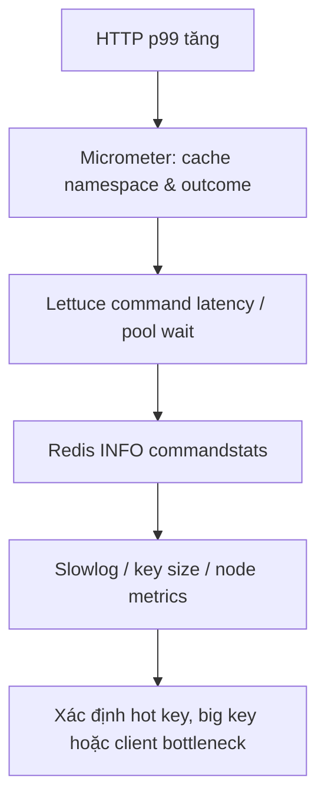
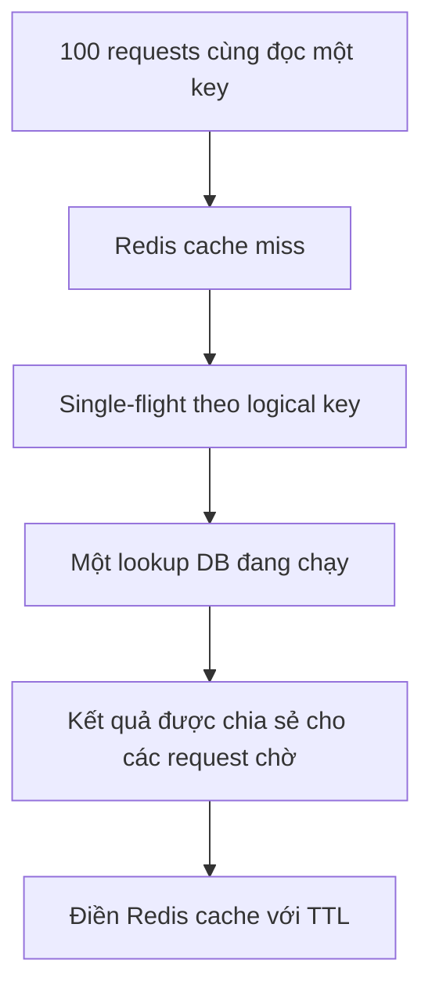

# Phân tích khóa nóng và khóa lớn trong Spring Data Redis

Một ứng dụng dùng Spring Data Redis có thể gặp tình trạng Redis CPU tăng mạnh, latency từ vài mili-giây lên hàng trăm mili-giây, network bão hòa hoặc một node trong Redis Cluster liên tục quá tải dù các node khác gần như rảnh. Không phải tất cả sự cố đó đều đến từ “Redis chậm”. Hai nguyên nhân thường gặp là **khóa nóng (hot key)** và **khóa lớn (big key)**.

- **Hot key** là key bị truy cập với tần suất hoặc cường độ cao bất thường. Một String chỉ vài byte vẫn có thể trở thành hot key nếu hàng chục nghìn request mỗi giây cùng đọc hoặc ghi nó.
- **Big key** là key có kích thước bộ nhớ, payload hoặc số lượng phần tử bên trong quá lớn so với ngân sách vận hành. Một Hash có hàng triệu field hoặc một String nhiều megabyte có thể là big key ngay cả khi chỉ được truy cập vài lần mỗi giờ.
- **Hot slot/hot node** là điểm nóng ở cấp phân vùng Redis Cluster: một slot hoặc primary nhận phần lớn tải. Nó có thể xuất phát từ một hot key, nhiều key được gom bằng hash tag hoặc phân phối lưu lượng lệch.

Hai đặc điểm **khác nhau nhưng có thể đồng thời xuất hiện**. Một big key bị gọi `HGETALL` liên tục thường tệ hơn nhiều so với một big key chỉ cập nhật vài field mỗi ngày.

Bài học xây dựng một quy trình phân tích hiệu năng theo ngữ cảnh **Spring Data Redis**: thu thập triệu chứng, nhận diện key/pattern đáng ngờ, đo tải và kích thước với Redis CLI, đối chiếu metric của `RedisTemplate`/`ReactiveRedisTemplate`, phân biệt tải lệch trên Cluster, sau đó lựa chọn phương án giảm kích thước hoặc giảm truy cập mà vẫn bảo đảm tính đúng nghiệp vụ.

> Nguyên tắc: **đo bằng chứng trước khi thay đổi dữ liệu**. Các lệnh như `SCAN`, `MEMORY USAGE` và chế độ phân tích của `redis-cli` vẫn tiêu thụ tài nguyên. Tránh chạy những phép quét sâu hoặc lệnh phá hủy trên production mà chưa có giới hạn tác động và kế hoạch khôi phục.

## 1. Nhìn nhanh: hot key, big key và hot slot

| Tiêu chí | Hot key | Big key | Hot slot/node |
|---|---|---|---|
| Bản chất | Cường độ truy cập tập trung | Kích thước dữ liệu lớn | Phân phối tải không đều trên Cluster |
| Đơn vị phân tích | Lệnh/giây, CPU và network theo key | Byte, số field/member/entry, độ lớn phản hồi | CPU, ops/s, bandwidth theo node/slot |
| Ví dụ | `homepage:config` được đọc 80.000 lần/giây | `user:events` chứa hàng triệu entry | Nhiều key cùng hash tag `{global}` |
| Triệu chứng | P99 tăng, một điểm đọc/ghi quá tải | Lệnh O(N) chậm, memory/replication/eviction tốn kém | Một primary chậm trong khi primary khác nhàn |
| Cách điều tra | App metrics, LFU frequency, traffic sampling | `--bigkeys`, `--memkeys`, `MEMORY USAGE`, cardinality | Metric từng node, topology và hash slot |
| Hướng xử lý | Near-cache, coalescing, sharding writes, hạn chế fan-out | Phân mảnh dữ liệu, pagination, retention, batch cleanup | Phân bổ lại keys/slots, thiết kế hash tag hợp lý |

Không tồn tại một ngưỡng “big key = trên 1 MB” đúng cho mọi hệ thống. Với một Redis nhỏ, một Hash vài trăm nghìn field đã đáng báo động; với workload khác, một String vài trăm KB có thể bình thường nếu rất ít được đọc. Ngưỡng phải dựa vào **memory budget, latency SLO, loại command và tần suất truy cập**.

### 1.1. Ba tình huống đối chiếu

**Tình huống A – key nhỏ nhưng rất nóng**

```text
Key: cache:homepage:feature-flags
Type: String
Memory: khoảng 2 KiB
Access: rất nhiều GET mỗi giây
```

Vấn đề không phải kích thước 2 KiB, mà là lượng `GET`, số kết nối, throughput network và tải tại node chứa key.

**Tình huống B – key rất lớn nhưng ít truy cập**

```text
Key: analytics:session:2026-11
Type: Hash
Fields: nhiều triệu field
Access: một vài HGET mỗi giây
```

`HGET` một field thường ít gây vấn đề hơn `HGETALL` toàn bộ Hash. Tuy vậy, big key làm tăng memory footprint, thời gian replication/fork hoặc chi phí dọn dẹp khi cần xóa, tùy tình huống.

**Tình huống C – không có một key nổi bật nhưng một slot nóng**

```text
cart:{tenant-global}:customer:1
cart:{tenant-global}:customer:2
cart:{tenant-global}:customer:3
...
```

Nhiều key chứa cùng hash tag `{tenant-global}` sẽ nằm trên **cùng hash slot**. Khi tổng lưu lượng đủ lớn, một primary vẫn bị quá tải dù từng key riêng lẻ không đặc biệt nóng.

## 2. Redis xử lý lệnh và vì sao một key có thể ảnh hưởng toàn node

Redis thực thi nhiều thao tác dữ liệu trên một execution path chính theo cơ chế event-loop. Một số tác vụ có thể được tách ra background hoặc I/O threads tùy phiên bản/cấu hình, nhưng **lệnh CPU nặng hoặc thao tác dữ liệu O(N)** vẫn có khả năng chiếm thời gian xử lý và làm những lệnh khác chờ.

Ví dụ:

```text
Client A: HGETALL enormous:hash
Client B: GET tiny:flag
Client C: INCR counter
```

Nếu lệnh `HGETALL` phải đi qua một Hash khổng lồ, xử lý và gửi response lớn, client B/C có thể thấy latency tăng dù chúng truy cập các key nhỏ.

Khía cạnh tác động:

1. **CPU:** chạy lệnh, deserialize/marshal data, xử lý cấu trúc dữ liệu.
2. **Memory:** giá trị và metadata của big key, allocator fragmentation, bộ đệm mạng.
3. **Network:** response lớn hoặc fan-out GET gây bandwidth cao.
4. **Latency:** queueing, blocking bởi lệnh nặng, GC ở phía JVM, retries.
5. **Replication/persistence:** ghi lớn và trạng thái bộ nhớ ảnh hưởng quá trình đồng bộ/persistence.
6. **Cluster balance:** mọi lệnh với một key phải đến nơi giữ slot của key đó, không thể tự chia một key lên nhiều primary.

Redis nhanh với rất nhiều thao tác nhỏ không có nghĩa mọi kiểu thao tác lên mọi kích thước key đều có latency ổn định.

### 2.1. Đừng quy mọi latency cho Redis server

Một request chậm có thể do:

- Connection pool hết slot hoặc client chờ kết nối.
- JVM GC, serialization hoặc callback nặng.
- Network RTT và retransmission.
- Lệnh Redis thực sự chạy chậm.
- Payload lớn khiến đọc/ghi socket kéo dài.
- Truy vấn fallback database khi cache miss.

Do đó, cần so sánh **client-side latency**, **Redis command execution time** và **thời gian xử lý nghiệp vụ**.

## 3. Dấu hiệu vận hành đáng nghi

Một số biểu hiện thường thấy:

| Quan sát | Giả thuyết cần kiểm tra |
|---|---|
Redis node CPU cao, `GET` chiếm nhiều command count | Có thể có hot read key hoặc tổng tải read lớn |
P99 tăng vọt mỗi khi tải trang report | Có thể có `HGETALL`/`SMEMBERS`/`LRANGE 0 -1` trên big key |
Redis `used_memory`/fragmentation cao | Có thể có big values, tăng số key hoặc fragmentation |
Một primary CPU 95%, các primary khác 20% | Hot key, hot slot hoặc hash tag lệch |
Network outgoing cao, CPU vừa phải | Response lớn hoặc read fan-out |
Evictions tăng trong giờ cao điểm | Memory pressure, TTL/eviction policy, dữ liệu không được giới hạn |
Cache miss burst dẫn đến DB quá tải | Cache stampede sau khi key hot hết hạn |
Latency tăng khi xóa một collection lớn | Lệnh xóa hoặc xử lý giải phóng bộ nhớ gây spike |
Ứng dụng có nhiều timeout, Redis `SLOWLOG` ít bản ghi | Có thể là queueing/network/client bottleneck; không loại trừ Redis |

Mỗi biểu hiện là **tín hiệu điều tra**, không phải bằng chứng kết luận. Ví dụ CPU cao không tự chứng minh hot key; có thể do tổng lượng key bình thường, Lua script nặng hoặc background work.

## 4. Bắt đầu bằng một baseline, không bằng KEYS *

Trước khi truy tìm một key cụ thể, cần biết trạng thái bình thường và trạng thái khi có sự cố.

Nên đo trên từng node liên quan:

- Ops/s theo thời gian và theo nhóm command.
- CPU Redis process và CPU host.
- P50/P95/P99 client latency theo operation/namespace.
- Used memory, maxmemory, fragmentation.
- Network inbound/outbound.
- Slowlog count và những command đáng chú ý.
- Hit rate/miss rate của cache.
- Evictions, expired keys, connected clients.
- Với Cluster: chênh lệch CPU, network, ops/s và phân bố slot giữa các primary.

Ví dụ bản ghi sự cố:

```text
Thời gian quan sát: 10:00–10:15
Triệu chứng: p99 cache lookup tăng từ 8 ms lên 130 ms
Ảnh hưởng: endpoint /products/{id} bị timeout một phần
Redis: primary B CPU cao, outgoing network tăng
Ứng dụng: cache namespace product-detail có 1 ID được đọc quá nhiều
```

Các số ở đây chỉ **minh họa một cách ghi nhận hiện tượng**, không phải ngưỡng sản xuất hay dữ liệu đo từ một hệ thống cụ thể.

### 4.1. Cần đối chiếu cùng time window

Nếu lấy Redis metrics lúc 10:00 nhưng application logs lúc 12:00, có thể bỏ lỡ nguyên nhân thực. Ghi timestamp, timezone, node và khoảng quan sát cho các dấu vết.

Đặc biệt, hot key có thể chỉ xuất hiện trong vài phút sau một campaign/đợt traffic. Một lần quét nhiều giờ sau đó có thể không tái hiện được.

## 5. Các lệnh Redis an toàn để bắt đầu quan sát

Redis cung cấp những nguồn dữ liệu quan trọng:

```redis
INFO stats
INFO commandstats
INFO memory
INFO cpu
INFO keyspace
SLOWLOG LEN
SLOWLOG GET 20
LATENCY LATEST
```

Không phải managed Redis service nào cũng cho phép mọi lệnh quản trị; cần ACL và phương pháp quan sát được nhà cung cấp hỗ trợ.

### 5.1. INFO stats

Những chỉ số thường hữu ích:

| Trường | Ý nghĩa cần quan sát |
|---|---|
| `instantaneous_ops_per_sec` | Tốc độ xử lý lệnh tức thời xấp xỉ |
| `total_commands_processed` | Tổng command kể từ khi server khởi động/reset thống kê |
| `keyspace_hits` / `keyspace_misses` | Thống kê hit/miss cho các thao tác liên quan key lookup; không luôn tương đương cache hit rate nghiệp vụ |
| `expired_keys` | Số key đã hết hạn được Redis loại bỏ |
| `evicted_keys` | Số key bị evict do chính sách bộ nhớ |
| Network bytes/instantaneous bandwidth | Đọc/ghi network của server |

Counter thường là **tích lũy**, nên muốn biết tốc độ tăng phải lấy chênh lệch giữa hai snapshot theo thời gian, tránh dùng giá trị tổng để suy ra hiện tại đang nóng.

### 5.2. INFO commandstats

```redis
INFO commandstats
```

Có thể thấy thông tin dạng:

```text
cmdstat_get:calls=...,usec=...,usec_per_call=...
cmdstat_hgetall:calls=...,usec=...,usec_per_call=...
cmdstat_zrange:calls=...,usec=...,usec_per_call=...
```

`INFO commandstats` là **số liệu theo command**, không cho biết key nào gây ra lệnh. Nó giúp thu hẹp phạm vi: ví dụ trong khoảng sự cố `HGETALL` tăng mạnh, ta nên tìm đường code đang gọi nó và Hash tương ứng.

### 5.3. INFO memory

```redis
INFO memory
```

Quan sát:

- `used_memory`: bộ nhớ Redis dùng cho dữ liệu và overhead theo phép đo của server.
- `used_memory_rss`: resident memory ở cấp hệ điều hành.
- `maxmemory` và chính sách eviction.
- Các metric fragmentation/allocator khi được phiên bản Redis xuất ra.

Lưu ý, một Redis dùng nhiều memory không chứng minh có big key; nó có thể chứa rất nhiều small keys. Phải kết hợp thống kê số lượng key và kích thước từng key.

### 5.4. INFO keyspace

```redis
INFO keyspace
```

Các trường như `keys`, `expires` và `avg_ttl` theo database là điểm khởi đầu để hiểu tổng số key và tỷ lệ có expiration. Chúng **không phải** phân tích size hoặc access frequency từng key.

## 6. SLOWLOG: tìm lệnh thực thi chậm

`SLOWLOG` lưu những lệnh có **thời gian thực thi trên Redis server** vượt ngưỡng cấu hình; nó không đo toàn bộ network RTT hoặc thời gian một request nằm chờ trong connection pool của Spring.

```redis
SLOWLOG LEN
SLOWLOG GET 20
```

Cấu hình ngưỡng thường dựa trên `slowlog-log-slower-than`, tính bằng **microseconds**. Mức ngưỡng và số entry giữ lại được thiết lập tại server và có thể bị managed provider hạn chế.

Khi phân tích:

1. Ghi timestamp của slowlog entry.
2. Xác định command (`HGETALL`, `SMEMBERS`, `ZRANGE`, `EVAL`...).
3. Xác định key/namespace nếu an toàn để xem và có quyền.
4. Đối chiếu với code Spring Data Redis sinh ra command.
5. So với p99 của ứng dụng trong cùng thời điểm.

### 6.1. Bẫy: không có SLOWLOG không có nghĩa Redis không ảnh hưởng latency

Ví dụ:

```text
Server command execution: 150 µs
Connection pool wait:    20 ms
Network transfer:        40 ms
Application deserialize: 15 ms
```

Lệnh có thể **không vào slowlog** nhưng request vẫn mất hàng chục mili-giây. Với hot key được gọi quá nhiều, nhiều command nhanh cũng có thể tạo hàng đợi và tăng tổng latency.

### 6.2. Rủi ro lộ dữ liệu

`SLOWLOG GET` có thể hiển thị command arguments, bao gồm key và một phần dữ liệu nhạy cảm tùy command/logging. Không đưa output chứa token, PII hoặc payload bí mật trực tiếp lên ticket/chat không được kiểm soát.

## 7. LATENCY: xem spike của Redis server

Những lệnh hữu ích tùy Redis version:

```redis
LATENCY LATEST
LATENCY DOCTOR
LATENCY HISTOGRAM
```

`LATENCY LATEST`/`DOCTOR` khai thác latency monitoring khi được bật và có dữ liệu. `LATENCY HISTOGRAM` có khả năng thống kê độ trễ theo command trong Redis version hỗ trợ.

Chúng giúp đặt câu hỏi:

- Có spike vì lệnh O(N), expire cycle, persistence hoặc allocator không?
- `GET` đơn giản có bị tăng server execution time không?
- Spike có trùng thời gian với batch job hay việc xóa big key không?

Không nên dựa vào một lệnh LATENCY rồi kết luận được **key cụ thể**; phần lớn nguồn này tổng hợp ở cấp command/server.

## 8. Đo kích thước của một key: MEMORY USAGE

Với một key nghi ngờ:

```redis
TYPE cache:product:42
MEMORY USAGE cache:product:42
PTTL cache:product:42
```

`MEMORY USAGE` trả về ước lượng số byte RAM mà dữ liệu key chiếm trong Redis, bao gồm các overhead liên quan theo implementation. Đây là **kích thước bộ nhớ**, không phải kích thước JSON đã giải mã ở Java hay byte truyền qua network trong một response.

Ví dụ hai key:

```redis
MEMORY USAGE cache:homepage:config
MEMORY USAGE user:large:profile
```

Kết quả cần được ghi kèm tên namespace, loại Redis data type và thời điểm đo.

### 8.1. MEMORY USAGE SAMPLES

Với các kiểu dữ liệu có nhiều phần tử, Redis có tham số `SAMPLES` để kiểm soát số phần tử được lấy mẫu khi ước lượng overhead:

```redis
MEMORY USAGE huge:hash SAMPLES 5
```

Có thể dùng:

```redis
MEMORY USAGE huge:hash SAMPLES 0
```

để yêu cầu xem xét **toàn bộ các phần tử lồng nhau** theo cơ chế lệnh. Với big key thật sự, cấu hình toàn bộ mẫu có thể rất tốn tài nguyên; không dùng `SAMPLES 0` trên production chỉ vì muốn có một con số “chính xác hơn”.

Ngay cả phép đo có sampling cũng nên dùng ngân sách tần suất, vì hàng nghìn lệnh `MEMORY USAGE` liên tiếp tạo thêm tải.

### 8.2. Cardinality không phải byte size

Một Hash 100.000 field tên ngắn, value nhỏ có thể khác đáng kể về RAM so với Hash 10.000 field chứa JSON lớn.

Vì vậy cần quan sát đồng thời:

```text
TYPE
HLEN / LLEN / SCARD / ZCARD / XLEN
STRLEN
MEMORY USAGE
```

Không xếp hạng big keys chỉ theo `HLEN` rồi cho rằng chúng có memory footprint lớn nhất.

## 9. Đo kích thước logic theo Redis data type

| Kiểu dữ liệu | Lệnh kích thước | Ý nghĩa | Lưu ý |
|---|---|---|---|
| String | `STRLEN key` | Byte length của String | Không đồng nghĩa heap size của Java object |
| Hash | `HLEN key` | Số field | Không nói value mỗi field dài bao nhiêu |
| List | `LLEN key` | Số phần tử | Không nói kích thước từng element |
| Set | `SCARD key` | Số member | Không có thứ tự ổn định |
| Sorted Set | `ZCARD key` | Số member | ZSET member/score có overhead |
| Stream | `XLEN key` | Số entry hiện có | Cần xét retention, pending entries, consumer groups |

Ví dụ:

```redis
TYPE analytics:users
SCARD analytics:users
MEMORY USAGE analytics:users
```

Nếu `TYPE` không phải Set, không nên gọi `SCARD` rồi diễn giải lỗi hoặc `0` thành “tập rỗng”. Công cụ phân tích phải biết loại dữ liệu thực tế.

### 9.1. O(1) cardinality không có nghĩa lệnh đọc toàn bộ cũng O(1)

Ví dụ:

```redis
HLEN very:large:hash
HGETALL very:large:hash
```

`HLEN` lấy số field. `HGETALL` phải trả toàn bộ field–value pairs, chi phí tăng theo số phần tử và kích thước payload.

Tương tự:

```redis
LLEN very:large:list
LRANGE very:large:list 0 -1
```

`LLEN` chỉ lấy chiều dài. `LRANGE 0 -1` có thể trả tất cả phần tử của List khổng lồ.

## 10. Redis CLI --bigkeys

Một tiện ích Redis CLI thường dùng:

```bash
redis-cli -h redis-host -p 6379 --bigkeys
```

Nó quét keyspace theo cơ chế incremental scan, phân loại kiểu dữ liệu và tìm các key có kích thước logic lớn dựa trên phép đo theo type.

Một phần kết quả có thể được diễn giải như:

```text
Largest string by length
Largest list by number of elements
Largest hash by number of fields
Largest set by cardinality
Largest sorted set by cardinality
Largest stream by entries
```

Đừng hiểu là nó xếp hạng chính xác **RAM bytes** của mọi key. Một String dài nhất chưa chắc là key tốn bộ nhớ nhất, và một Hash nhiều field có thể ít byte hơn Hash ít field nhưng value lớn.

### 10.1. Redis CLI --memkeys

Khi Redis CLI/version hỗ trợ:

```bash
redis-cli -h redis-host -p 6379 --memkeys
```

Chế độ này quan tâm tới footprint bộ nhớ của key, thường dựa trên `MEMORY USAGE`. Nó hữu ích khi mục tiêu là **RAM consumption**, không chỉ số field/member.

Với Redis CLI khác phiên bản hoặc môi trường managed bị hạn chế command, hãy kiểm tra options được công cụ hỗ trợ.

### 10.2. Quét vẫn là tải thật

`--bigkeys`/`--memkeys` không biến việc đọc hàng triệu key thành thao tác miễn phí:

- Redis phải duyệt keyspace qua nhiều lần SCAN.
- Các lệnh đo cardinality/memory vẫn chiếm CPU.
- Mạng và client CLI vẫn truyền kết quả.
- Một số key có thể được cập nhật hoặc hết hạn giữa quá trình.

Chạy trong **maintenance window hoặc với tốc độ hạn chế** khi production đang nhạy cảm. Không để một lần phân tích khiến hệ thống đang chậm càng chậm hơn.

## 11. SCAN thay cho KEYS * khi khám phá key

Lệnh:

```redis
KEYS *
```

có độ phức tạp tăng theo toàn bộ keyspace và có thể làm Redis bận trong một command lớn. Trên môi trường production có nhiều key, tránh dùng `KEYS *` để tìm big keys.

Thay bằng `SCAN`:

```redis
SCAN 0 MATCH cache:product:* COUNT 100
```

Redis trả:

- Một **cursor** mới.
- Một tập key có thể ít hơn, nhiều hơn hoặc bằng con số `COUNT` gợi ý.

Lặp với cursor Redis trả cho đến khi cursor trở về `0`.

### 11.1. SCAN không phải snapshot ổn định

Trong lúc quét:

- Key có thể được thêm/xóa.
- Kết quả có thể chứa trùng key.
- Một key có thể đổi type hoặc TTL giữa các lần đọc.
- `COUNT 100` là hint, không phải cam kết mỗi response có đúng 100 key.

Nếu viết công cụ kiểm kê để thống kê, cần xử lý duplicate/changes và nhận thức rằng con số là **ước lượng tại một khoảng thời gian**, không phải snapshot giao dịch toàn Redis.

### 11.2. Quét theo namespace

```redis
SCAN 0 MATCH cache:product:* COUNT 100
SCAN 0 MATCH session:* COUNT 100
SCAN 0 MATCH analytics:* COUNT 100
```

Pattern giúp giảm lượng kết quả cần ứng dụng xử lý, nhưng không biến một SCAN trên keyspace thành index query có độ phức tạp độc lập số key.

### 11.3. redis-cli --scan

Để quan sát từng key theo pattern:

```bash
redis-cli -h redis-host -p 6379 --scan --pattern 'cache:product:*'
```

Lệnh này có thể phát rất nhiều tên key. Không redirect danh sách chứa PII/token vào log công khai. Nếu muốn đo size, viết công cụ lấy mẫu có giới hạn, không gọi `MEMORY USAGE` vô hạn trên mọi key trong giờ cao điểm.

## 12. Phân tích phần tử bên trong big key

Khi key là một collection quá lớn, không nên dùng lệnh “lấy hết” để xem thử nội dung.

Ví dụ cần tránh:

```redis
HGETALL giant:hash
SMEMBERS giant:set
LRANGE giant:list 0 -1
ZRANGE giant:zset 0 -1
XRANGE giant:stream - +
```

Với hàng triệu entry, response có thể gây:

- Lệnh server tốn thời gian O(N).
- TCP buffer và network lớn.
- JVM tạo nhiều object, tăng GC.
- Request timeout hoặc out-of-memory ở client.

Ưu tiên đọc **một phần** theo cấu trúc dữ liệu và mục đích:

| Type | Cách đọc có giới hạn |
|---|---|
| Hash | `HSCAN key cursor COUNT n` hoặc `HGET` đúng field |
| Set | `SSCAN key cursor COUNT n` |
| List | `LRANGE key start stop` theo page hợp lý |
| Sorted Set | `ZRANGE key start stop` theo page/rank hoặc score range có giới hạn |
| Stream | `XRANGE key start end COUNT n`, consumer sử dụng offset |
| String | `GETRANGE key start end` khi semantics hỗ trợ cắt byte |

### 12.1. HSCAN không trả một snapshot

```redis
HSCAN giant:hash 0 COUNT 100
```

Cần lặp cursor đến `0`. Như `SCAN`, `COUNT` chỉ là gợi ý và kết quả có thể chịu ảnh hưởng của thay đổi dữ liệu.

Đừng dùng `HSCAN` làm một cơ chế giao dịch nguyên tử để lập hóa đơn/tính số dư trên một Hash đang thay đổi liên tục. Nó phù hợp với duyệt từng phần và công cụ bảo trì có xử lý eventual consistency.

### 12.2. Phân trang theo rank có caveat

```redis
ZRANGE leaderboard:global 0 99 REV WITHSCORES
```

phù hợp hơn lấy toàn bộ sorted set khi UI chỉ cần top 100.

Nếu ứng dụng dùng offset pagination sâu, các request cho page lớn vẫn có thể tốn tài nguyên và gặp thay đổi thứ hạng giữa các page. Với nhu cầu lớn, cân nhắc keyset/score pagination và chấp nhận semantics thích hợp.

### 12.3. GETRANGE không làm String lớn tự biến mất

Đọc 1 KB từ String lớn có thể giảm network cho từng request, nhưng Redis vẫn giữ **toàn bộ String lớn** trong RAM. Nếu mục tiêu là giảm memory footprint, phải thay mô hình lưu trữ, chunk, nén hoặc đẩy payload lớn sang hệ thống phù hợp.

## 13. Khóa nóng: Redis không có một bảng “top key” mặc định cho mọi cấu hình

Nhiều người mong đợi:

```text
SHOW HOT KEYS ORDER BY requests_per_second
```

Nhưng Redis core không duy trì một bảng truy cập chi tiết theo key với timestamps/rate cố định phù hợp mọi workload. Việc đo hot key thường cần kết hợp:

1. Metrics ở application: namespace và logical ID nào được truy cập nhiều?
2. Client instrumentation/sampling traffic.
3. Redis LFU frequency khi cấu hình hỗ trợ.
4. Lưu lượng và latency theo node/slot.
5. Phân tích lệnh đáng nghi từ `SLOWLOG` hoặc trace có chọn lọc.

Không nên kết luận `GET` chiếm 80% command nghĩa là chỉ có một hot key; có thể là hàng triệu key phân phối đều.

## 14. redis-cli --hotkeys và điều kiện LFU

Redis CLI có chế độ:

```bash
redis-cli -h redis-host -p 6379 --hotkeys
```

Chế độ này dựa trên **LFU access frequency metadata** khi Redis sử dụng chính sách eviction phù hợp. Nó **không** phải công cụ đo request/second chính xác cho từng key và không dùng được giống nhau dưới mọi eviction policy.

Ví dụ các policy LFU:

```text
allkeys-lfu
volatile-lfu
```

Khi server không ở policy LFU phù hợp, `--hotkeys` hoặc `OBJECT FREQ` có thể không hỗ trợ đo như mong đợi. Không thay chính sách eviction của production chỉ để chạy công cụ chẩn đoán mà chưa đánh giá tác động, vì eviction policy ảnh hưởng trực tiếp đến hành vi cache.

### 14.1. OBJECT FREQ

Với Redis đang dùng LFU metadata:

```redis
OBJECT FREQ cache:homepage:config
```

Kết quả là một **frequency counter được Redis quản lý**, có cơ chế logarithmic increment/decay theo cấu hình LFU. Nó không phải con số “đã có đúng N request trong một giây”.

Do đó:

- Dùng để tìm ứng viên nổi bật tương đối.
- Đối chiếu với metrics ứng dụng và thời điểm tải tăng.
- Không so trực tiếp tần suất từ hai cluster có cấu hình LFU khác nhau mà coi đó là số đo tuyệt đối.
- Không dựa vào một snapshot duy nhất để đánh giá hot key ngắn hạn.

### 14.2. OBJECT IDLETIME không thay thế OBJECT FREQ

Trong những cấu hình lưu metadata kiểu LRU, `OBJECT IDLETIME key` có thể cung cấp thông tin về thời gian key không được truy cập. Nhưng đó là **recency**, không phải **frequency**:

```text
Key A: được truy cập một lần cách đây 1 giây
Key B: được truy cập 50.000 lần trong giây vừa rồi
```

Cả hai có thể có idle time rất nhỏ. Điều đó không chứng minh mức nóng như nhau.

## 15. Có nên dùng MONITOR để bắt hot key?

`MONITOR` cho phép quan sát luồng lệnh Redis đang thực thi:

```redis
MONITOR
```

Đây là công cụ có khả năng gây **overhead đáng kể**, nhất là trên server có lưu lượng lớn. Nó còn có thể xuất hiện dữ liệu nhạy cảm trong command arguments. Vì vậy, không nên bật MONITOR kéo dài trên production để “đếm từng key”.

Nếu thực sự cần:

- Ưu tiên staging hoặc replica/instance có workload tái hiện được.
- Dùng khoảng thu thập ngắn và ngân sách tác động đã được thống nhất.
- Xử lý/redact dữ liệu nhạy cảm theo chính sách.
- Dừng ngay khi đủ dữ liệu.
- Không đưa output nguyên văn lên dashboard nhãn key.

Trong nhiều hệ thống, **instrumentation tại application** cho một số namespace nghi ngờ an toàn và có giá trị hơn MONITOR toàn server.

## 16. Spring Data Redis: hiểu lệnh Java tương ứng lệnh Redis

Một số lời gọi thường gặp:

| Java Spring Data Redis | Redis command khái niệm | Rủi ro |
|---|---|---|
| `opsForValue().get(key)` | `GET` | Hot read; payload String lớn |
| `opsForHash().get(key, field)` | `HGET` | Hot field/key nếu gọi quá nhiều |
| `opsForHash().entries(key)` | `HGETALL` | Trả cả Hash, nguy hiểm với big Hash |
| `opsForSet().members(key)` | `SMEMBERS` | Trả toàn bộ Set lớn |
| `opsForList().range(key, 0, -1)` | `LRANGE ... 0 -1` | Trả toàn bộ List |
| `opsForZSet().range(key, 0, -1)` | `ZRANGE ...` | Có thể trả toàn bộ Sorted Set |
| `opsForValue().increment(key)` | `INCR` | Hot write contention về node/slot |
| `delete(key)` | `DEL` | Xóa big key có thể gây latency spike |

Điều quan trọng không phải chỉ tên method, mà còn **số lượng và kích thước dữ liệu trả về**.

### 16.1. Một dòng Java có thể tạo response rất lớn

```java
Map<Object, Object> all = redis.opsForHash()
        .entries("customer:attributes:global");
```

Về mặt code, đây là một dòng. Về Redis, nó có thể dẫn đến việc đọc **toàn bộ Hash** vào JVM. Khi Hash có nhiều triệu field, chi phí nằm ở Redis, network, deserialization và Java heap.

Nếu chỉ cần một thuộc tính:

```java
Object email = redis.opsForHash()
        .get("customer:attributes:global", "email");
```

Đây là mô hình truy cập khác hẳn, dù cùng key.

### 16.2. API repository có thể tạo nhiều lệnh ẩn

`RedisRepository.save(entity)` có thể thao tác Redis Hash, keyspace/index metadata, TTL hoặc references. Nếu có nhiều index và entity lớn, tổng số command/payload có thể lớn hơn một lần `SET`.

Khi tìm hot key, đừng chỉ nhìn code `StringRedisTemplate`; kiểm tra cả:

- Spring Cache/`RedisCacheManager`.
- Redis Repositories và secondary indexes.
- Session store.
- Distributed locks.
- Redis Pub/Sub/Streams.
- Lua scripts hoặc transactions/pipelines.

Một hot index key do repository duy trì có thể không xuất hiện như một string literal trong code nghiệp vụ.

## 17. Đo tần suất theo namespace tại ứng dụng

Để tìm hot read pattern, một chiến lược là **ghi metric với label có cardinality thấp**:

```text
redis_cache_lookup_total{
  namespace="product-detail",
  outcome="hit"
}
```

Không:

```text
redis_cache_lookup_total{
  key="product:123456789:private-email@example.test"
}
```

vì mỗi key tạo một time series mới, có thể làm monitoring tốn bộ nhớ và làm lộ dữ liệu.

Nên gắn nhãn:

| Label phù hợp | Ví dụ |
|---|---|
| namespace | `product-detail`, `session`, `rate-limit` |
| operation | `get`, `set`, `hget` |
| outcome | `hit`, `miss`, `error` |
| client role | `api`, `batch-worker` |

Nếu cần tìm **ID cụ thể** đang nóng, có thể thực hiện sampling có giới hạn, mã hóa ID thành fingerprint không đảo ngược theo chính sách và lưu trong hệ thống phân tích chuyên dụng có retention ngắn. Không đặt raw key/PII vào metric label của Prometheus.

### 17.1. Đo hit/miss không giống đo access frequency

Một namespace có hit rate 99% vẫn có thể tạo hot key: 100.000 GET/s cho một key, phần lớn đều hit.

Ngược lại, một namespace có hit rate thấp có thể gây **cache stampede** khi nhiều request cùng fallback DB. Cần theo dõi cả throughput, latency, hit/miss và hình dạng lưu lượng theo key pattern.

## 18. Ví dụ đo latency trong ReactiveStringRedisTemplate

Với WebFlux, có thể đo latency của thao tác Redis bằng Micrometer tại ranh giới service. Ví dụ đơn giản:

```java
package com.example.redis.metrics;

import java.util.concurrent.TimeUnit;

import io.micrometer.core.instrument.MeterRegistry;
import org.springframework.data.redis.core.ReactiveStringRedisTemplate;
import org.springframework.stereotype.Service;
import reactor.core.publisher.Mono;

@Service
public class InstrumentedProductCache {

    private final ReactiveStringRedisTemplate redis;
    private final MeterRegistry registry;

    public InstrumentedProductCache(
            ReactiveStringRedisTemplate redis,
            MeterRegistry registry) {
        this.redis = redis;
        this.registry = registry;
    }

    public Mono<String> readProduct(String productId) {
        String key = "cache:product:" + productId;

        return Mono.defer(() -> {
            long started = System.nanoTime();

            return redis.opsForValue().get(key)
                    .doOnSuccess(value ->
                            record(started, value == null
                                    ? "miss" : "hit"))
                    .doOnError(error ->
                            record(started, "error"));
        });
    }

    private void record(long started, String outcome) {
        long elapsed = System.nanoTime() - started;

        registry.timer(
                "cache.redis.lookup.duration",
                "namespace", "product-detail",
                "outcome", outcome)
                .record(elapsed, TimeUnit.NANOSECONDS);
    }
}
```

Điểm cần hiểu:

- `Mono.defer` tạo mốc thời gian **cho mỗi subscription**, tránh đo từ lúc pipeline được tạo tới lúc nó được chạy.
- `doOnSuccess` của **Mono** có thể nhận tham số `null` khi publisher **hoàn tất rỗng**; đây không phải tín hiệu `onNext(null)`.
- Ba outcome chỉ có `hit`, `miss` và `error`: cardinality thấp.
- Timer ở đây đo thời gian trong pipeline của Redis call từ góc nhìn client, bao gồm ảnh hưởng của client/network; nó không bằng `SLOWLOG` server execution time.
- Tính toán là **mẫu instrumentation**, không phải một cơ chế tự nhận diện hot key cụ thể.

Nếu service cần thu số lượng theo logical ID, phải có sampling/aggregation riêng và bảo vệ dữ liệu. Không đổi `namespace` thành `productId` trong metric label.

### 18.1. Không ghi kích thước payload vào label

Khi đo response:

```text
response_bytes histogram
namespace="product-detail"
```

phù hợp hơn label `size="1948392"` trên mỗi request. Histogram cho phép phân tích độ phân bố kích thước mà không tạo time series mới cho từng byte count.

## 19. Instrumentation của Lettuce và Spring Boot Actuator

Ngoài metric nghiệp vụ, có thể khai thác:

- Redis/Lettuce command latency theo các metric mà driver/framework hỗ trợ.
- Connection/pool utilization khi dùng connection pooling.
- Application HTTP latency qua Spring Boot Actuator + Micrometer.
- Redis server metrics từ exporter/monitoring của Redis deployment.

Sơ đồ phân tích:



Chỉ thêm `spring-boot-starter-actuator` không có nghĩa **mọi Redis command đều tự động có per-key metrics**. Mức độ instrumentation của Lettuce phụ thuộc cách client resources, metrics/observation được cấu hình và phiên bản dependency. Xác nhận loại metric thực sự được xuất ra trước khi xây dashboard.

### 19.1. Tách queueing khỏi server latency

Nếu:

```text
Application p99 = 180 ms
Redis command server p99 = 2 ms
```

thì nên xem:

- Client-side connection pool wait.
- TCP/network.
- JVM GC/deserialization.
- Số request pending.
- Downstream DB fallback.

Không thể kết luận “Redis bị big key” chỉ vì endpoint p99 tăng.

## 20. Redis Cluster: hot key khác hot slot

Trong Cluster, mỗi key được ánh xạ tới một trong 16.384 hash slot:

```text
slot = CRC16(key) mod 16384
```

Ngoại lệ quan trọng là **hash tag**: nếu tên key có phần `{...}` hợp lệ, Redis hash theo nội dung tag.

Ví dụ:

```text
cart:{customer-42}:items
cart:{customer-42}:total
```

Hai key cùng slot để phục vụ thao tác liên quan. Nhưng nếu app dùng một tag toàn cục:

```text
cache:{global}:product:1
cache:{global}:product:2
cache:{global}:product:3
```

mọi key sẽ dồn vào **một slot**, dù số lượng key rất lớn.

### 20.1. Xác định hash slot

```redis
CLUSTER KEYSLOT cache:product:42
CLUSTER KEYSLOT cache:{global}:product:42
CLUSTER KEYSLOT cache:{global}:product:43
```

Hai key cuối dùng cùng tag `{global}` và do đó có cùng slot.

### 20.2. Đo CPU/ops/s trên từng primary

Các lệnh topology:

```redis
CLUSTER INFO
CLUSTER NODES
CLUSTER SHARDS
```

Đối chiếu thông tin cluster ownership với metric CPU/network/commandstats theo node. `CLUSTER INFO` không tự tạo bảng “hot slot”; nó giúp biết trạng thái/tập node và phân bổ slot.

Nếu Primary B luôn có CPU cao, cần tìm:

1. Một hot key ở các slot thuộc B?
2. Rất nhiều key cùng hash tag thuộc một slot?
3. Phân phối các key/traffic không đều giữa B và các primary khác?
4. Node B đang chạy background task hoặc có network/host bottleneck riêng?
5. Client có đang đọc từ replica/primary khác nhau theo policy?

### 20.3. SCAN trong Cluster

Một `SCAN` tới một Redis node có phạm vi của node đó, không mặc định quét **tất cả primary trong Cluster**. Các công cụ CLI hoặc abstraction client có hành vi cluster-aware riêng cần được xác nhận.

Muốn tìm big keys/hot candidates toàn Cluster:

- Lấy danh sách những primary hiện hữu.
- Chạy phép đo phù hợp trên từng primary được phép truy cập.
- Gộp kết quả có ghi rõ node/slot/time window.
- Tính tới topology đổi trong quá trình quét.

Không suy ra rằng một lần chạy `redis-cli --bigkeys` kết nối một node sẽ tự cho danh sách toàn bộ key trên mọi primary.

## 21. Hot key do đọc quá nhiều: những hướng xử lý

Giả sử một key:

```text
cache:homepage:config
```

được rất nhiều instance API đọc liên tục.

### 21.1. In-process near-cache

Thay vì request nào cũng gọi Redis:

```text
API instance
    |
    +-- local in-memory cache (TTL ngắn)
    |
    +-- miss -> Redis GET
```

Một local cache như Caffeine có thể giảm mạnh số request đến Redis cho dữ liệu ít đổi.

Đánh đổi:

- Dữ liệu giữa các instance có thể khác nhau trong thời gian TTL local.
- Invalidation qua Pub/Sub có thể mất sự kiện.
- Cần giới hạn memory local và TTL.
- Không phù hợp nếu yêu cầu đọc dữ liệu vừa ghi ngay lập tức và nhất quán mạnh.

Với cấu hình hiển thị ít đổi, near-cache 1–5 giây có thể chấp nhận được; với quyền truy cập hoặc số dư, phải đánh giá kỹ tính nhất quán.

### 21.2. Request coalescing / single-flight

Nếu 100 request cùng miss một key hot, đừng cho cả 100 cùng truy vấn DB.



Trong một JVM, có thể quản lý in-flight lookup bằng một map có lifecycle rõ ràng. Nhưng **single-flight local không phối hợp tất cả instance**. Nếu cần chống stampede xuyên instance, cân nhắc lock/lease và fallback có jitter, chú ý fencing, timeout và cách xử lý lock-holder crash.

### 21.3. TTL jitter

Nhiều cache entries hết hạn cùng một giây có thể gây load spike:

```text
cache:product:1 TTL=300
cache:product:2 TTL=300
cache:product:3 TTL=300
...
```

Nếu chúng được tạo đồng thời, có thể cùng hết hạn và gây stampede.

Một TTL với jitter nhỏ:

```java
long baseSeconds = 300;
long jitterSeconds = ThreadLocalRandom.current()
        .nextLong(0, 31);

Duration ttl = Duration.ofSeconds(
        baseSeconds + jitterSeconds);

redis.opsForValue().set(key, value, ttl);
```

Phân tán expiration trong cửa sổ 300–330 giây. Đây là giải pháp cho workload cache cho phép độ tươi khác nhau một chút, **không** dùng bừa cho token bảo mật có deadline nghiêm ngặt.

### 21.4. Read replicas

Nếu dữ liệu cho phép stale reads, có thể cấu hình Lettuce đọc từ replica theo policy `ReadFrom` phù hợp.

Nhưng nếu một key hot do **ghi**, replica read không giải quyết nguồn tải ghi trên primary. Và Redis replication là bất đồng bộ: dữ liệu đọc từ replica có thể cũ.

### 21.5. Pre-warming và staggered refresh

Với những key biết trước sẽ được đọc nhiều (configuration, menu, product launch):

- Nạp cache trước đợt traffic dự đoán được.
- Tránh tất cả instance refresh cùng lúc.
- Áp dụng TTL jitter hoặc background refresh có lease.
- Có fallback khi refresh thất bại.
- Không cho refresh worker làm thundering herd lên DB.

## 22. Hot key do ghi quá nhiều: sharded counter

Một key:

```text
views:campaign:2026
```

nhận hàng trăm nghìn lệnh `INCR` mỗi giây sẽ dồn tất cả writes tới primary giữ slot đó.

Nếu nghiệp vụ **không cần đọc tổng tuyệt đối mới nhất trong một Redis command**, có thể chia bộ đếm thành nhiều shard:

```text
views:campaign:2026:part:0
views:campaign:2026:part:1
...
views:campaign:2026:part:15
```

Mỗi request tăng một shard ngẫu nhiên. Vì tên key khác nhau, các shard có thể được phân tán trên nhiều hash slot/primary.

### 22.1. Ví dụ Spring Data Redis

```java
import java.util.concurrent.ThreadLocalRandom;
import org.springframework.data.redis.core.StringRedisTemplate;

public class ShardedViewCounter {

    private static final int SHARD_COUNT = 16;
    private final StringRedisTemplate redis;

    public ShardedViewCounter(StringRedisTemplate redis) {
        this.redis = redis;
    }

    public void increment(String campaignId) {
        // campaignId phải được validate hoặc map thành opaque ID.
        int shard = ThreadLocalRandom.current()
                .nextInt(SHARD_COUNT);

        String key = "views:campaign:" + campaignId
                + ":part:" + shard;

        redis.opsForValue().increment(key);
    }
}
```

Code trên chỉ thể hiện **chiến lược phân phối write**. Đọc tổng cần đọc tất cả shard và tính tổng:

```text
total = part0 + part1 + ... + part15
```

Cần cân nhắc:

- Tổng không được đọc nguyên tử trên nhiều slot trong Redis Cluster.
- Đọc tuần tự 16 key tạo nhiều round trip; có thể dùng pipeline/batch/aggregate theo nhu cầu.
- Shard count thay đổi làm thay đổi danh sách key cần đọc.
- TTL/retention của shard phải cùng chính sách.
- Nếu request timeout sau `INCR`, retry có thể đếm hai lần.
- Không dùng cho số dư, inventory, hạn mức tài chính cần cập nhật nguyên tử toàn bộ.

### 22.2. Lưu ý hash tag

Đừng đặt:

```text
views:{campaign-2026}:part:0
views:{campaign-2026}:part:1
```

nếu mục tiêu là **phân tải cross-slot**, vì hai key có cùng hash tag sẽ lại nằm một slot.

Hash tag hữu ích cho atomic multi-key trong Cluster, nhưng có thể phá tác dụng sharding nếu dùng không đúng mục tiêu.

## 23. Big String: chunking, compression và external storage

Ví dụ một String chứa JSON lớn:

```text
report:export:daily -> JSON nhiều MB
```

Mỗi lần `GET` có thể kéo toàn bộ payload qua network và tạo object lớn trong JVM.

Các lựa chọn:

1. Nếu client chỉ cần vài trường, chuyển sang Hash hoặc dữ liệu lưu theo phần có thể truy vấn riêng.
2. Nếu cần đọc từng page, chia record theo page/chunk có ID ổn định.
3. Nếu chỉ cần tải toàn bộ file lớn, cân nhắc object storage và lưu pointer/metadata trong Redis.
4. Nén payload nếu network/bộ nhớ là bottleneck và CPU nén/giải nén còn dư.
5. Có giới hạn tối đa payload được phép cache.

### 23.1. Compression không phải thuốc chữa mọi trường hợp

Nén giảm byte mạng/RAM trong một số loại payload, nhưng tăng CPU encode/decode và có thể làm mỗi request vẫn cần đọc toàn bộ String.

Đo:

- Dung lượng trước/sau nén.
- CPU nén/giải nén.
- Latency p95/p99.
- Tần suất truy cập.
- Tỷ lệ dữ liệu thực sự cần mỗi request.

Nếu chỉ cần một field, **đổi mô hình dữ liệu** thường có ích hơn nén một JSON khổng lồ.

### 23.2. Chunking có trade-off

Ví dụ:

```text
report:42:chunk:0
report:42:chunk:1
report:42:chunk:2
report:42:manifest
```

Ưu điểm: chỉ đọc phần cần thiết. Nhược điểm: tăng số key, quản lý TTL giữa chunks, xử lý missing chunk, version consistency và cleanup.

Nếu dữ liệu cần một snapshot nguyên tử, nhiều key trên các slot khác nhau không tự tạo transaction thống nhất. Cân nhắc versioned manifest/publish-then-swap hoặc một storage chuyên dụng cho large immutable objects.

## 24. Big Hash: tránh HGETALL và tách theo nhóm

Giả sử:

```text
user:profiles:global
  field=user-1 -> JSON
  field=user-2 -> JSON
  ...
  field=user-2000000 -> JSON
```

Với `HGETALL`, một lần đọc tạo response rất lớn.

Nếu truy cập theo user ID:

```text
user:profile:user-1
user:profile:user-2
...
```

mỗi user là một key riêng có thể giảm kích thước của một Hash và cho phép TTL/eviction độc lập. Tuy vậy, nó tăng số key và overhead per-key, nên cần đo trade-off.

Một phương án trung gian là **bucketed Hash**:

```text
user:profiles:bucket:0
user:profiles:bucket:1
...
user:profiles:bucket:255
```

Mỗi bucket chứa một tập field có giới hạn tương đối. Cần:

- Hàm phân bucket ổn định.
- Kế hoạch chuyển bucket count khi scale.
- Tránh lấy `entries()` toàn bucket lớn nếu chỉ cần một field.
- Đo `HLEN` và `MEMORY USAGE` từng bucket.
- Không chọn bucket dựa vào một hash tag chung khiến tất cả vẫn về một slot.

### 24.1. Ví dụ chỉ đọc một field

```java
Object json = redis.opsForHash()
        .get("user:profiles:bucket:17", "user-42");
```

Khác với:

```java
Map<Object, Object> all =
        redis.opsForHash()
                .entries("user:profiles:bucket:17");
```

Lệnh thứ hai có thể làm tốn RAM và network, dù ứng dụng chỉ cần tìm `user-42`.

### 24.2. SCAN Hash từ Spring Data Redis

Với Hash lớn cần bảo trì hoặc duyệt incrementally:

```java
import java.util.Map;
import org.springframework.data.redis.core.Cursor;
import org.springframework.data.redis.core.ScanOptions;
import org.springframework.data.redis.core.StringRedisTemplate;

public void inspectSomeFields(
        StringRedisTemplate redis,
        String hashKey,
        int maxFields) {

    ScanOptions options = ScanOptions.scanOptions()
            .count(100)
            .build();

    int seen = 0;
    try (Cursor<Map.Entry<Object, Object>> cursor =
                 redis.opsForHash().scan(hashKey, options)) {

        while (cursor.hasNext() && seen < maxFields) {
            Map.Entry<Object, Object> entry = cursor.next();

            // Chỉ xử lý thống kê có giới hạn.
            // Không ghi giá trị nhạy cảm ra log.
            seen++;
        }
    }
}
```

Đây là ví dụ **duyệt có giới hạn**, không phải một endpoint nên gọi trên mỗi HTTP request. Cursor phải được đóng. `COUNT` là hint, và thay đổi dữ liệu trong lúc scan có thể ảnh hưởng kết quả.

## 25. Big List: phân trang hoặc đổi mô hình

Một List có thể phát triển vô hạn:

```redis
LPUSH notifications:user-42 event1
LPUSH notifications:user-42 event2
...
```

Nguy cơ:

```redis
LRANGE notifications:user-42 0 -1
```

Mỗi lần tải toàn bộ lịch sử vào JVM.

Giải pháp:

- Chỉ trả page gần nhất: `LRANGE key 0 49`.
- Đặt giới hạn bằng `LTRIM` nếu chỉ cần N phần tử mới nhất.
- Xem xét Redis Streams nếu cần entry ID, consumer tracking và retention theo event log.
- Chuyển dữ liệu lịch sử dài hạn sang storage phù hợp thay vì giữ vô hạn trong Redis RAM.

### 25.1. Giới hạn N phần tử

```redis
LPUSH notifications:user-42 "event-new"
LTRIM notifications:user-42 0 999
```

Hai lệnh riêng có khoảng xen kẽ nếu nhiều producer cùng ghi. Nếu nghiệp vụ yêu cầu thao tác push+trim nguyên tử, dùng Lua hoặc cách tổ chức producer phù hợp.

`LTRIM` giúp giữ danh sách có giới hạn, nhưng cần hiểu thứ tự phần tử và retention trước khi cắt dữ liệu.

## 26. Big Set và Sorted Set

Set:

```redis
SCARD online:users
SSCAN online:users 0 COUNT 100
```

Tránh:

```redis
SMEMBERS online:users
```

khi lượng member quá lớn và chỉ cần kiểm tra một user:

```redis
SISMEMBER online:users user-42
```

Sorted Set:

```redis
ZCARD leaderboard:global
ZRANGE leaderboard:global 0 99 REV WITHSCORES
```

Tránh tải toàn bộ leaderboard nếu UI chỉ cần top 100.

### 26.1. Phân vùng theo ngữ nghĩa

Nếu một leaderboard toàn cầu quá lớn:

```text
leaderboard:region:apac
leaderboard:region:emea
leaderboard:region:amer
```

có thể giảm kích thước từng ZSet và phân tán tải. Nhưng **top toàn cầu** lúc này không còn một `ZRANGE` đơn giản; cần merge/ranking phù hợp và quy tắc nhất quán.

Không chia dữ liệu bằng một tiêu chí tùy tiện nếu nghiệp vụ vẫn yêu cầu truy vấn tổng liên tục với độ chính xác mạnh.

## 27. Big Stream: đặt retention rõ ràng

Redis Streams dễ phát triển rất lớn nếu producer liên tục `XADD` mà không có retention.

Đo:

```redis
XLEN orders:events
XINFO STREAM orders:events
```

Giới hạn theo số entry:

```redis
XADD orders:events MAXLEN ~ 100000 * type OrderCreated orderId 42
```

Hoặc dọn theo chính sách retention, tùy nhu cầu dùng `XTRIM`, `MAXLEN`/`MINID` và Redis version.

### 27.1. Không trim chỉ vì muốn nhỏ hơn

Nếu consumer group còn pending entries hoặc một consumer bị chậm, trim quá sớm có thể làm mất payload mà consumer chưa xử lý.

Phải xác định:

- Retention tối thiểu theo SLA tiêu thụ.
- Lag và pending entries của consumer groups.
- Chính sách replay.
- Nguồn event bền khác có tồn tại không.

Big Stream có thể là vấn đề dữ liệu lịch sử/retention, không chỉ Redis hiệu năng.

## 28. Xóa big key: DEL và UNLINK

Redis cung cấp:

```redis
DEL huge:key
UNLINK huge:key
```

`DEL` xóa key và có thể gây spike khi giải phóng cấu trúc dữ liệu rất lớn, tùy loại key/encoding và Redis configuration.

`UNLINK` **tách key khỏi keyspace nhanh** và cho phép giải phóng bộ nhớ ở background theo cơ chế lazy freeing, thường giảm thời gian command trực tiếp phải chiếm execution path chính.

### 28.1. UNLINK không miễn phí

- Bộ nhớ có thể chưa được trả ngay sau response.
- Background thread vẫn tiêu thụ CPU/memory bandwidth.
- Nhiều big keys bị UNLINK cùng lúc có thể làm tăng áp lực background work.
- Replication/persistence/cluster vẫn có khía cạnh vận hành cần cân nhắc.
- Nó không sửa nguyên nhân khiến key tăng vô hạn.

Đừng đo `UNLINK` xong rồi kết luận memory được thu hồi ngay tại thời điểm client nhận `1`.

### 28.2. Xóa theo batch

Nếu muốn dọn nhiều key:

1. Dùng scan có giới hạn để tìm candidates.
2. Chia thành batch nhỏ.
3. Dùng `UNLINK` khi phù hợp với server/version/driver.
4. Đặt rate limit cho cleanup.
5. Theo dõi Redis CPU, memory và p99 trong khi chạy.
6. Dừng nếu các chỉ số vượt ngưỡng bảo vệ.

Không dùng:

```redis
KEYS *
DEL tất cả trong một lượt
```

trên production. Và không chạy `FLUSHDB`/`FLUSHALL` như một giải pháp big key.

### 28.3. Spring Data Redis

Spring Data Redis cung cấp các thao tác xóa key thông thường qua `RedisTemplate.delete(...)`; một số phiên bản/API hỗ trợ unlink tương ứng. Khi muốn dùng unlink, cần xác nhận method và Redis server đang triển khai hỗ trợ đúng lệnh:

```java
Boolean removed = redis.unlink("huge:key");
```

Với Cluster, các lệnh nhiều key có giới hạn slot/routing riêng tùy driver. Tránh xây batch xóa nhiều key khác slot rồi giả định một command sẽ thực hiện nguyên tử trên toàn cluster.

## 29. Đọc big key qua pipeline có giải quyết được không?

**Pipelining** giảm chi phí round trip khi có nhiều lệnh độc lập. Nhưng nó **không** làm một `HGETALL` trên Hash khổng lồ trở thành thao tác nhẹ.

Ví dụ:

```text
Một lệnh HGETALL trả 100 MB:
    Pipeline không làm payload 100 MB nhỏ đi.

100 lệnh HGET nhỏ độc lập:
    Pipeline có thể giảm round-trip overhead.
```

Cẩn trọng:

- Một pipeline quá lớn có thể tăng server/client buffer memory.
- Spring Data Redis pipeline callback trả danh sách kết quả có thể chiếm heap lớn.
- Lệnh ghi vẫn cần idempotency khi timeout.
- Cluster routing và multi-key semantics không tự thay đổi vì pipeline.

Nên đo số lệnh, kích thước response và heap trước khi tăng pipeline batch size.

### 29.1. Batch đúng nghĩa là có ngân sách

Ví dụ chọn batch đọc 100 key rồi tạm dừng quan sát memory/latency, không phải 100.000 key trong một pipeline duy nhất.

Đặt ngân sách theo:

- Số lệnh trên batch.
- Tổng byte response kỳ vọng.
- Deadline của request.
- Client heap.
- Redis server throughput.

Không có một batch size “tốt nhất” không phụ thuộc workload.

## 30. TTL và eviction ảnh hưởng hot key thế nào?

Một hot key hết hạn trong thời điểm traffic cao có thể tạo **cache stampede**:

```text
T0: Cache hot key hết TTL
T1: 5.000 requests cùng GET -> cache miss
T2: 5.000 fallback queries tới DB
T3: DB quá tải, cache fill chậm
```

Redis server đôi khi vẫn nhanh; bottleneck chính lại chuyển sang database.

Giải pháp:

- TTL jitter để giảm trùng thời điểm expiration.
- Stale-while-revalidate nếu chấp nhận dữ liệu cũ.
- Single-flight/request coalescing.
- Prewarm key quan trọng.
- Negative caching cho missing result có TTL ngắn theo policy.
- Giới hạn concurrency của cache fill.

### 30.1. Đừng dùng TTL ngẫu nhiên cho dữ liệu bảo mật

Token xác minh, distributed lock lease hoặc deadline nghiệp vụ cần **hạn hiệu lực chính xác theo chính sách**. TTL jitter phù hợp với **cache dữ liệu có thể chấp nhận độ tươi biến động**, không phải mặc định cho mọi key.

### 30.2. Eviction không đồng nghĩa expiration

Key có thể bị evict do memory pressure trước khi TTL kết thúc. Kiểm tra `INFO stats` và chính sách `maxmemory-policy`, đừng chỉ nhìn `TTL` rồi nghĩ cache chắc chắn tồn tại đến hết hạn.

## 31. Hash tag có thể làm lệch tải Redis Cluster

Trong Cluster, dùng hash tag để đặt nhiều key liên quan vào cùng slot là cần thiết khi có Lua/transaction multi-key:

```text
order:{42}:status
order:{42}:total
```

Nhưng lạm dụng có hại:

```text
cache:{all}:product:1
cache:{all}:product:2
...
cache:{all}:product:1000000
```

Tất cả key có tag `{all}` đi về cùng slot, vô hiệu tác dụng phân phối tải của Cluster.

### 31.1. Thiết kế tag theo aggregate

Hợp lý khi cần atomicity theo một đơn hàng:

```text
order:{42}:status
order:{42}:items

order:{43}:status
order:{43}:items
```

Mỗi order có thể được ánh xạ slot khác, trong khi các key của một order vẫn cùng slot.

Tuy vậy, một aggregate đặc biệt nóng (ví dụ một tenant rất lớn) vẫn có thể gây điểm nóng. Khi đó cần thay đổi **ranh giới aggregate** hoặc phương pháp tổng hợp, không chỉ thêm node vào cluster.

### 31.2. Resharding không chia một key

Chuyển slot sang primary khác có thể giảm tải tạm thời cho node cũ, nhưng **một key vẫn thuộc một slot**. Nếu một key đơn lẻ cần throughput vượt khả năng một primary, reshard slot sang node mới không làm key được thực thi song song trên nhiều primary.

Giải pháp sâu hơn cần sharding dữ liệu hoặc giảm yêu cầu truy cập lên key đó.

## 32. Điều tra một hot read key trong Spring Cache

Giả sử:

```java
@Cacheable(cacheNames = "product-detail", key = "#id")
public ProductDto findById(String id) {
    return repository.findById(id).orElseThrow();
}
```

Spring Cache có thể lưu key vật lý theo prefix:

```text
product-detail::42
```

hoặc một format khác tùy `RedisCacheConfiguration`.

Trong một đợt flash sale, `id=42` được truy vấn rất nhiều. Hot key này có thể nhỏ, nhưng tất cả instance cùng GET trên Redis.

Quy trình:

1. Xác định endpoint/namespace tăng request count.
2. Kiểm tra cache key prefix và serializer thực tế.
3. Đo read latency, byte response và hit rate.
4. Xem node nào sở hữu slot của key.
5. Tính khả năng dùng near-cache TTL ngắn.
6. Nếu cùng lúc nhiều cache miss, thêm coalescing.
7. Theo dõi p99 sau thay đổi trong cùng mức traffic.

### 32.1. Không dùng key name được đoán để kết luận

Với `RedisCacheManager`, key có thể đi qua key converter/serializer/prefix tùy cấu hình. Trong Redis Repositories, index keys khác keys cache.

Khi đo một hot key từ log hoặc Redis, phải ánh xạ **đúng physical Redis key** về logical operation, tránh nhầm một namespace tương tự.

## 33. Điều tra big key do Redis Repository secondary index

Spring Data Redis Repositories có thể tạo các cấu trúc chỉ mục cho field có `@Indexed`:

```java
@RedisHash("customer")
public class Customer {
    @Id String id;
    @Indexed String status;
}
```

Nếu nhiều triệu khách hàng đều có `status="ACTIVE"`, secondary index tương ứng có thể có cardinality rất lớn.

Ngay cả khi entity keys nhỏ, **index key** theo một giá trị phổ biến cũng có thể là big key/hot key.

Ví dụ truy vấn:

```java
List<Customer> findByStatus(String status);
```

Nếu nó trả hàng triệu entity, vấn đề không chỉ bộ nhớ Redis index; ứng dụng còn phải tạo một `List` rất lớn, có thể gây JVM GC/OOM.

### 33.1. Hướng giảm tải

- Tránh truy vấn “tất cả ACTIVE” rồi lọc trong Java.
- Chia namespace/partition theo tenant, thời gian hoặc thuộc tính nghiệp vụ phù hợp.
- Xây read model riêng cho UI cần phân trang.
- Xem xét cơ chế query/index thích hợp với workload thực tế.
- Giới hạn lượng entity được load cùng lúc.
- Kiểm tra update/delete index và cleanup sau TTL nếu index metadata tích lũy.

Lưu ý: Redis Repositories không có SQL planner tự động tối ưu mọi truy vấn lớn. Phải hiểu các index và dữ liệu thực mà code sử dụng.

## 34. Hot key do distributed lock hoặc global rate limiter

Không phải mọi hot key đều là cache.

Ví dụ:

```text
lock:global:scheduled-job
rate:global:api
leader:current
```

Một khóa lock toàn cục có thể được rất nhiều worker thử `SET NX`/`GET`/retry. Một global rate-limit counter có thể nhận `INCR` từ mọi request.

### 34.1. Với distributed lock

Tăng số replica đọc không giảm contention ghi trên một lock key. Các hướng:

- Giảm số worker cạnh tranh một tài nguyên.
- Chia phạm vi lock theo aggregate nếu không cần global mutual exclusion.
- Giới hạn polling frequency và dùng backoff có jitter.
- Cân nhắc queue/partition ownership thay vì tất cả instance spin trên một lock.
- Giữ TTL/lease, token và unlock đúng contract để không xóa lock của owner khác.

### 34.2. Với rate limiter toàn cục

Sharding counter có thể giảm tải nhưng **thay đổi semantics** nếu limiter cần quyết định quota nguyên tử. Một limiter chính xác trên một quota toàn cục có thể phải chấp nhận điểm tuần tự, hoặc chuyển sang kiến trúc phân quyền/allocate quota theo shard với độ phức tạp cao hơn.

Không đánh đổi tính đúng của bảo mật/quota chỉ để có throughput đẹp.

## 35. Một quy trình điều tra thực tế, từ triệu chứng đến giải pháp

Giả sử application báo P99 tăng trong giờ peak.

### Bước 1 — Xác nhận phạm vi

Ghi:

```text
timeWindow  = 14:00–14:10
endpoint    = GET /catalog/search
redisNodes  = primary A, B, C
symptom     = P99 tăng + một node outgoing network cao
```

### Bước 2 — Kiểm tra tổng tải và command mix

Trên node có vấn đề:

```redis
INFO stats
INFO commandstats
INFO memory
SLOWLOG GET 20
```

Nếu `HGETALL` tăng, tìm code gọi `opsForHash().entries(...)`. Nếu `GET` nhiều nhưng SLOWLOG ít, tìm hot read pattern và network.

### Bước 3 — Tìm candidates

Theo namespace ứng dụng:

```text
catalog:facets:global
catalog:result:query:popular
catalog:product:42
```

Dùng `MEMORY USAGE`/`TYPE`/cardinality trên **một số candidates**, không quét mọi key ngay lập tức.

### Bước 4 — Phân biệt nguyên nhân

| Kết quả đo | Khả năng |
|---|---|
Key ~2 KiB, GET rất nhiều | Hot read key |
Hash có ~1 triệu field, HGETALL lặp lại | Big key + heavy operation |
Nhiều key vừa phải cùng một slot | Hot slot do hash tag/traffic |
Server nhanh nhưng app deserialize chậm | Client-side payload/GC |
Cache miss burst và DB timeout | Stampede/fallback bottleneck |

### Bước 5 — Thay đổi nhỏ có thể đo lại

Ví dụ:

- Đổi `HGETALL` thành `HGET` hoặc `HSCAN` có giới hạn.
- Thêm local cache TTL ngắn cho cấu hình ít thay đổi.
- Chia Redis Set/Hash theo bucket.
- Giới hạn Redis Stream retention.
- Thay global counter bằng sharded counter **nếu business cho phép**.

### Bước 6 — So sánh trước và sau

So cùng điều kiện traffic:

```text
Before:
  P99 Redis GET ~ ?
  Redis primary CPU ~ ?
  Outgoing bandwidth ~ ?
  JVM heap/GC ~ ?

After:
  P99 Redis GET ~ ?
  Redis primary CPU ~ ?
  Outgoing bandwidth ~ ?
  JVM heap/GC ~ ?
```

Không kết luận thành công chỉ vì test local nhanh. Kiểm tra cả **độ đúng của dữ liệu, TTL, cache hit/miss và cluster balance**.

## 36. Những sai lầm thường gặp

### 36.1. “Big key = hot key”

Không đúng. Một key có thể lớn nhưng ít truy cập, hoặc rất nhỏ nhưng bị GET hàng trăm nghìn lần/giây.

### 36.2. “MEMORY USAGE càng lớn thì command càng chậm”

Không luôn đúng. `HGET` một field trong Hash lớn có chi phí khác `HGETALL` toàn bộ Hash; cần xét command và pattern.

### 36.3. Chạy KEYS * trên production

Lệnh có thể ảnh hưởng latency của toàn node. Dùng SCAN có ngân sách; ưu tiên metric và candidates trước khi quét rộng.

### 36.4. Chạy MONITOR suốt giờ peak

Tạo overhead và có thể làm lộ dữ liệu nhạy cảm. Chỉ thu thập có kiểm soát trong khoảng thời gian ngắn khi thật sự cần.

### 36.5. Dùng --hotkeys mà không kiểm tra LFU

`--hotkeys` dựa trên metadata/policy phù hợp; không phải bảng requests/s và không dùng được như nhau với mọi eviction policy.

### 36.6. Tăng Redis node để giải quyết một hot key

Một key vẫn nằm trên một hash slot. Thêm primary không tự phân tán một key sang nhiều node.

### 36.7. Dồn mọi key vào hash tag {global}

Một slot sẽ chịu toàn bộ workload của nhiều key, tạo hot slot.

### 36.8. Đọc toàn bộ collection trong mỗi request

`HGETALL`, `SMEMBERS`, `LRANGE 0 -1` hoặc `ZRANGE 0 -1` trên dữ liệu lớn làm tăng network/heap/latency.

### 36.9. Dùng pipeline cho một response khổng lồ

Pipelining không làm giảm byte payload của `HGETALL`.

### 36.10. Coi SCAN là snapshot nguyên tử

Kết quả có thể trùng, thiếu/chênh do mutation trong lúc quét. Không dùng để thực hiện tính toán tài chính yêu cầu snapshot nhất quán.

### 36.11. Xóa big key bằng DEL hàng loạt không giới hạn

Có thể làm latency tăng vọt. Cân nhắc UNLINK, batch và rate limit; đo background freeing.

### 36.12. Chuyển mọi cache thành local cache không có TTL

Có thể giảm hot read nhưng gây dữ liệu stale và memory leak trên từng JVM. Dùng bounded cache và chính sách invalidation/TTL.

### 36.13. Cho rằng slowlog đo toàn bộ request latency

SLOWLOG phản ánh server execution threshold, không bao gồm toàn bộ network/client pool/serialization.

### 36.14. Gắn raw key vào Micrometer label

Tạo high-cardinality time series và rủi ro PII/token. Dùng namespace/op/outcome có cardinality thấp.

### 36.15. Chia một counter chính xác thành nhiều shard không xét semantics

Tổng không còn được đọc nguyên tử trên nhiều slot. Không áp dụng bừa cho quota/tiền/tồn kho.

### 36.16. Dùng Redis expiration event làm đồng hồ chính xác

Expired notification là Pub/Sub best-effort, không có replay. Không dựa vào nó để quyết định các deadline nghiệp vụ chính xác.

### 36.17. Chỉ đo một primary trong Cluster

Có thể bỏ qua big key/hot node khác, hoặc nhầm một node đang khỏe là toàn cluster khỏe.

### 36.18. Chỉ xem Redis server mà không xem JVM

Deserialize JSON lớn, heap allocations và GC có thể chiếm phần lớn latency của request.

## 37. Chính sách vận hành khi phải quét Redis production

Một kế hoạch điều tra nên làm rõ:

| Khía cạnh | Quyết định cần có |
|---|---|
| Mục tiêu | Tìm big keys theo RAM hay hot keys theo access? |
| Phạm vi | Một namespace, một node, hay mọi primary? |
| Khoảng thời gian | Giờ peak cần sampling hay maintenance window? |
| Công cụ | INFO, SLOWLOG, MEMORY USAGE, SCAN, --bigkeys, --memkeys |
| Tần suất | Số lệnh đo mỗi giây, batch size, pause |
| Quyền | ACL cho lệnh chẩn đoán, không dùng quyền admin thường trực |
| Bảo mật | Redact key name/payload và retention của output |
| Guardrail | CPU/p99 threshold để dừng scan |
| Rollback | Có thể hoàn tác thay đổi key naming/TTL/retention không? |
| Xác nhận | Dashboard so sánh trước/sau trên tải tương đương |

Đây là quy trình chẩn đoán kỹ thuật, không phải yêu cầu chạy một bộ content QA cho tài liệu.

### 37.1. Tránh dùng lệnh nguy hiểm để “kiểm tra nhanh”

Không chạy:

```redis
FLUSHDB
FLUSHALL
DEBUG SLEEP 10
KEYS *
```

trên Redis production dùng chung để tạo tình huống tái hiện. Mọi thao tác tạo tải, dọn dữ liệu hoặc thay eviction policy phải được thiết kế cho môi trường kiểm thử/canary hoặc quy trình vận hành có kiểm soát.

## 38. Bài tập thực hành

### Bài 1 — Phân biệt hot và big

Cho ba key:

```text
A: String 1 KiB, 100.000 GET/s
B: Hash 1.000.000 field, 1 HGET/s
C: Sorted Set 200.000 member, 5.000 ZRANGE 0 -1/s
```

Phân loại từng key là hot, big hay cả hai. Giải thích vì sao C có thể gây vấn đề nghiêm trọng hơn A dù access count thấp hơn.

### Bài 2 — Đo footprint và cardinality

Trong Redis test:

```redis
SET demo:small "hello"
HSET demo:hash a 1 b 2 c 3
LPUSH demo:list x y z
```

Chạy `TYPE`, `MEMORY USAGE`, `HLEN`, `LLEN` và `STRLEN` đúng với từng type. Ghi rõ đại lượng nào tính bằng byte và đại lượng nào là số phần tử.

### Bài 3 — Tìm big keys bằng redis-cli

Tạo dữ liệu test nhiều loại Redis key, sau đó sử dụng `--bigkeys` hoặc `--memkeys` theo công cụ được hỗ trợ. Giải thích vì sao key nhiều field nhất không chắc tốn RAM nhiều nhất.

### Bài 4 — Đổi HGETALL thành HGET

Một service dùng:

```java
Map<Object, Object> all =
        redis.opsForHash().entries("customer:attributes:global");
String email = (String) all.get("email");
```

Viết lại để chỉ lấy một field; đo payload và latency trước/sau trên một Hash test đủ lớn.

### Bài 5 — Duyệt Hash có giới hạn

Dùng `opsForHash().scan(...)` với `ScanOptions` và đóng `Cursor` đúng cách. Giải thích vì sao `COUNT` là hint và vì sao cursor không nên được giữ quá lâu trong một HTTP request.

### Bài 6 — Phân tích một Redis Cluster hot slot

Cho:

```text
views:{global}:part:0
views:{global}:part:1
views:{global}:part:2
```

Hãy dùng `CLUSTER KEYSLOT` giải thích vì sao cả ba shard vẫn nằm cùng slot và sửa lại key naming để phân tải theo mục tiêu.

### Bài 7 — Xử lý cache stampede

Một cache key hot có TTL năm phút và 5.000 request cùng miss trong một giây. Đề xuất một thiết kế kết hợp coalescing, TTL jitter và giới hạn fallback DB. Nêu trường hợp nào không nên dùng stale cache.

### Bài 8 — Sharded counter

Triển khai 16 shard cho bộ đếm lượt xem, tăng ngẫu nhiên một shard trong mỗi request. Thiết kế method đọc tổng, nêu rõ sự đánh đổi về số lệnh và tính nhất quán khi chạy Redis Cluster.

### Bài 9 — Giới hạn Stream retention

Một Redis Stream tăng 1 triệu entry/ngày. Đề xuất retention theo số entry hoặc thời gian, nhưng phải xem xét consumer lag và pending entries trước khi trim.

### Bài 10 — Quan sát bằng Micrometer

Đo latency `ReactiveStringRedisTemplate.opsForValue().get(...)` theo `namespace` và outcome `hit/miss/error`. Giải thích tại sao không đưa `productId` vào metric label.

### Bài 11 — Xóa big key an toàn

Trên môi trường Redis thử nghiệm, tạo một collection lớn. So sánh tác động latency của `DEL` và `UNLINK` có đo CPU/memory, đồng thời giải thích vì sao `UNLINK` có thể chưa giải phóng toàn bộ RAM ngay khi trả response.

### Bài 12 — Viết báo cáo điều tra

Giả sử P99 tăng, SLOWLOG nhiều `HGETALL`, một Hash có `HLEN` rất lớn, nhưng `MEMORY USAGE` của một key khác mới là cao nhất. Hãy xác định:

1. Key nào là ứng viên big key theo cardinality.
2. Key nào là ứng viên tốn RAM nhất.
3. Lệnh nào giải thích request latency.
4. Nên đổi API Spring Data Redis nào đầu tiên.
5. Chỉ số nào để đo sau khi sửa.

## 39. Bảng ghi nhớ

| Câu hỏi | Trả lời |
|---|---|
| Hot key là gì? | Key nhận lưu lượng truy cập tập trung, không nhất thiết lớn |
| Big key là gì? | Key lớn theo RAM/payload/cardinality so với workload |
| Hot slot là gì? | Hash slot/primary nhận tải lớn, có thể do nhiều key cùng slot |
| Lệnh đo RAM của một key? | `MEMORY USAGE key` |
| Lệnh đo String length? | `STRLEN key`, tính bằng byte |
| Lệnh đếm field Hash? | `HLEN key` |
| Lệnh đếm List/Set/ZSet/Stream? | `LLEN` / `SCARD` / `ZCARD` / `XLEN` |
| Redis CLI tìm key lớn theo logical size? | `--bigkeys` |
| Redis CLI tìm key chiếm RAM? | `--memkeys` trên phiên bản hỗ trợ |
| Redis CLI tìm hot key? | `--hotkeys` khi LFU metadata phù hợp |
| OBJECT FREQ có phải requests/s? | Không; LFU counter là ước lượng tương đối |
| Có nên dùng KEYS * để scan production? | Không; ưu tiên SCAN có kiểm soát |
| SCAN có bảo đảm snapshot? | Không; có thể trùng và thay đổi trong lúc quét |
| SLOWLOG đo network RTT? | Không; tập trung server command execution |
| Lệnh nào nguy hiểm với big Hash? | `HGETALL` hoặc Spring `opsForHash().entries` |
| Giải pháp đọc một field Hash? | `HGET`/`opsForHash().get` |
| Lệnh xóa big key nhẹ hơn trực tiếp? | Thường cân nhắc `UNLINK`, nhưng vẫn có overhead |
| Pipeline có làm HGETALL nhỏ hơn? | Không |
| Thêm cluster node có chia một hot key không? | Không; một key thuộc một slot |
| Hash tag global có rủi ro gì? | Dồn nhiều key cùng một slot gây hot slot |
| Cách giảm hot read ít thay đổi? | Near-cache, coalescing, TTL jitter, prewarm |
| Cách giảm hot write counter? | Sharding khi semantics cho phép |
| Có nên đặt raw key làm metric label? | Không; cardinality và rủi ro bảo mật |

**Kết luận:** phân tích khóa nóng và khóa lớn trong Spring Data Redis phải dựa vào **hai trục độc lập: cường độ truy cập và kích thước dữ liệu**. Dùng metric ứng dụng/Lettuce để nhận diện workload, `INFO`/`SLOWLOG` để hiểu command và node, `MEMORY USAGE` cùng type-specific cardinality để tìm big keys, và những công cụ như `--bigkeys`/`--memkeys`/`--hotkeys` trong phạm vi điều kiện thích hợp.

Khi đã biết nguyên nhân, hướng xử lý mới rõ ràng: **hot read** thường cần giảm lượt truy cập tập trung; **hot write** có thể cần phân chia key nếu nghiệp vụ chấp nhận; **big key** cần giới hạn dữ liệu, đọc theo phần và retention; **hot slot** cần xem lại phân phối hash tag và Cluster topology. Tránh giải pháp chỉ tăng timeout, thêm node hoặc bật pipeline mà không thay đổi bản chất workload. Mọi tối ưu cần được đo lại bằng p95/p99, CPU, network, memory và tính đúng dữ liệu ở cùng mức tải.

### Tài liệu tham khảo

- [Redis — MEMORY USAGE](https://redis.io/docs/latest/commands/memory-usage/)
- [Redis — SCAN](https://redis.io/docs/latest/commands/scan/)
- [Redis — SLOWLOG](https://redis.io/docs/latest/commands/slowlog/)
- [Redis — INFO](https://redis.io/docs/latest/commands/info/)
- [Redis — LATENCY](https://redis.io/docs/latest/commands/latency/)
- [Redis — OBJECT FREQ](https://redis.io/docs/latest/commands/object-freq/)
- [Redis — UNLINK](https://redis.io/docs/latest/commands/unlink/)
- [Redis — Key eviction](https://redis.io/docs/latest/develop/reference/eviction/)
- [Redis — Redis Cluster specification](https://redis.io/docs/latest/operate/oss_and_stack/reference/cluster-spec/)
- [Spring Data Redis — Redis Templates](https://docs.spring.io/spring-data/redis/reference/redis/template.html)
- [Spring Data Redis — Cluster](https://docs.spring.io/spring-data/redis/reference/redis/cluster.html)
- [Spring Data Redis — Pipelines and Transactions](https://docs.spring.io/spring-data/redis/reference/redis/pipelining.html)
- [Spring Data Redis — Redis Repositories](https://docs.spring.io/spring-data/redis/reference/redis/redis-repositories.html)
- [Spring Boot — Actuator Metrics](https://docs.spring.io/spring-boot/reference/actuator/metrics.html)
- [Lettuce — Advanced Usage](https://redis.github.io/lettuce/advanced-usage/)
