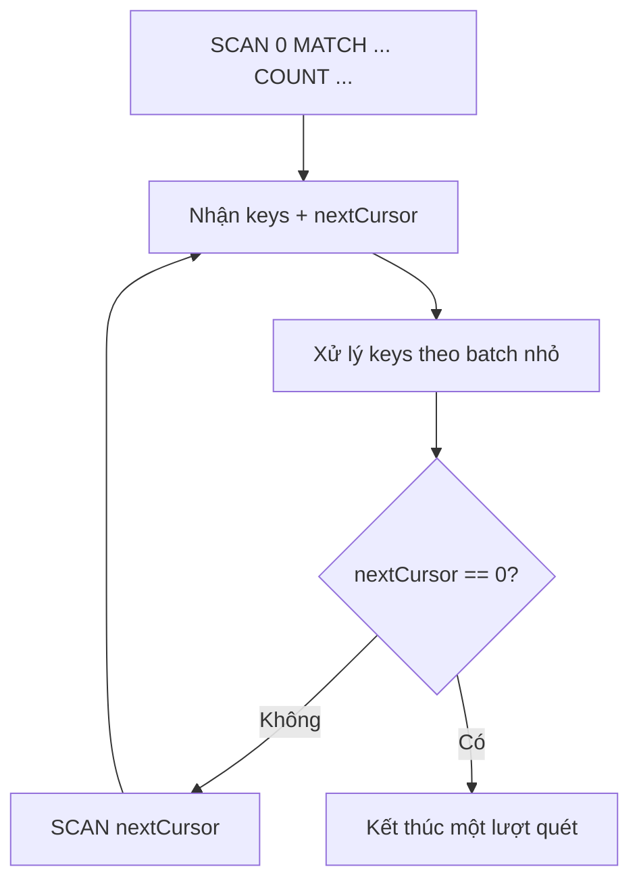
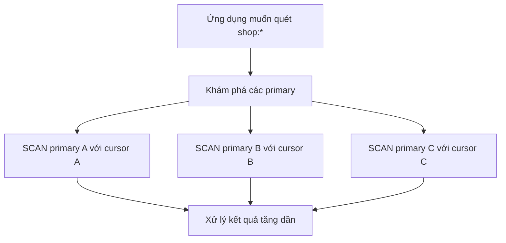

# Giới hạn SCAN, thao tác toàn collection và lệnh có chi phí lớn

Redis thường có độ trễ thấp khi ứng dụng dùng các lệnh truy cập theo **key cụ thể** hoặc theo **member/field cụ thể**. Tuy nhiên, một số thao tác tưởng như tiện lợi — tìm tất cả key khớp mẫu, đọc toàn bộ Hash, lấy hết Set, xóa một collection rất lớn hoặc giao các phép hợp/giao tập không giới hạn — có thể khiến CPU Redis bận trong thời gian dài, phản hồi mạng phình to và JVM phải giữ quá nhiều dữ liệu trong bộ nhớ.

Trong **Spring Data Redis**, rủi ro này xuất hiện qua những API quen thuộc như `RedisTemplate.keys(...)`, `HashOperations.entries(...)`, `SetOperations.members(...)`, `ListOperations.range(key, 0, -1)` hoặc một lệnh `Cache.clear()` dùng chiến lược quét/xóa mặc định. Thay một lệnh tải toàn bộ bằng `SCAN` là một cải tiến quan trọng, nhưng **SCAN không phải phép phân trang snapshot và không làm tổng chi phí duyệt toàn bộ dữ liệu biến mất**.

Bài học phân biệt chi phí ở **Redis Server**, **mạng**, **client Java** và **toàn bộ job**, rồi hướng dẫn dùng `SCAN`, `HSCAN`, `SSCAN`, `ZSCAN`, thiết kế giới hạn số lượng trả về, dọn dữ liệu bằng batch có kiểm soát, vận hành trên Redis Cluster và quan sát các lệnh gây tải cao.

## 1. Vì sao một lệnh Redis có thể gây độ trễ lớn?

Redis thực thi phần lớn các thao tác dữ liệu bằng một luồng xử lý lệnh chính. Một command phải duyệt nhiều phần tử, sao chép một payload lớn hoặc xử lý thuật toán tốn CPU có thể làm các request khác chờ lâu hơn. Redis hiện đại có thêm cơ chế xử lý I/O và giải phóng bộ nhớ ở luồng phụ, nhưng **không vì vậy mà mọi command tốn CPU đều được thực thi song song mà không ảnh hưởng latency**.

Chi phí cần đánh giá ở nhiều tầng:

| Tầng | Ví dụ chi phí | Hậu quả |
| --- | --- | --- |
| **Redis CPU / event loop** | `KEYS *`, `HGETALL` Hash lớn, phép `SINTER` tập lớn | Các lệnh khác có thể phải chờ |
| **Redis memory** | Tạo kết quả trung gian, tập hợp hoặc sort lớn | Memory pressure, eviction/OOM |
| **Mạng** | Trả hàng triệu member qua một response | Băng thông, hàng đợi socket, timeout |
| **JVM** | Deserialize toàn bộ `Map`, `Set`, `List` | Heap tăng, GC pause, `OutOfMemoryError` |
| **Toàn hệ thống** | Nhiều request cùng chạy full scan | Throughput giảm và latency của workload khác tăng |

Ví dụ một Hash có 2 triệu field:

```redis
HGETALL users:properties
```

Lệnh này có thể phải duyệt toàn bộ Hash và truyền tất cả field/value về client. `HashOperations.entries(key)` trong Spring Data Redis trả một `Map`, nên ứng dụng dễ vô tình giữ cả kết quả trong heap. Nếu một request HTTP gọi như vậy, nó có thể ảnh hưởng cả Redis lẫn JVM dù business logic chỉ cần vài field.

### 1.1. Độ phức tạp không phải toàn bộ câu chuyện

Một command `O(N)` trên 20 phần tử có thể hoàn toàn chấp nhận được. Cùng command đó trên hàng triệu phần tử có thể rất đắt. Kích thước mỗi value cũng quan trọng: 1.000 phần tử x 20 byte khác xa 1.000 phần tử x 1 MB.

Vì vậy, khi đánh giá một lệnh, cần biết ít nhất:

1. **Số phần tử N** mà lệnh có thể duyệt.
2. **Số phần tử M** và tổng số byte trả về.
3. **Tần suất gọi** và số client gọi đồng thời.
4. **Kiểu dữ liệu và encoding** của collection.
5. **SLO/latency budget** của những request khác dùng Redis chung.

## 2. Bảng các thao tác thường gây chi phí lớn

| Lệnh Redis / Spring API | Điểm cần lưu ý | Lựa chọn phù hợp hơn khi dữ liệu lớn |
| --- | --- | --- |
| `KEYS pattern` / `redisTemplate.keys(pattern)` | Duyệt toàn bộ keyspace trong một command; trả toàn bộ key khớp | `SCAN`, nhưng vẫn cần giới hạn và kế hoạch duyệt |
| `HGETALL key` / `opsForHash().entries(key)` | Trả mọi field/value của Hash; chi phí tỉ lệ số field | `HGET`, `HMGET`, `HSCAN` |
| `HKEYS`, `HVALS` | Trả toàn bộ tên field hoặc value | `HSCAN`, chỉ đọc field cần dùng |
| `SMEMBERS` / `opsForSet().members(key)` | Trả toàn bộ member Set | `SISMEMBER`, `SMISMEMBER`, `SSCAN` |
| `ZRANGE key 0 -1` / `opsForZSet().range(key,0,-1)` | Trả toàn bộ Sorted Set | `ZRANGE` giới hạn, `ZSCAN`, range theo score có giới hạn |
| `LRANGE key 0 -1` / `opsForList().range(key,0,-1)` | Tải toàn bộ List | `LRANGE` trang nhỏ, hoặc pop theo batch nếu là queue |
| `XRANGE key - +` | Đọc toàn bộ lịch sử Stream | `XRANGE ... COUNT n`, consumer group, cursor theo Record ID |
| `SUNION`, `SINTER`, `SDIFF` | Duyệt nhiều tập, có thể tạo kết quả lớn | Thiết kế index/candidate set nhỏ, kiểm tra membership |
| `SORT` trên collection lớn | Có thể sắp xếp và tạo kết quả trung gian | Dùng ZSET đã có thứ tự hoặc phân trang theo model dữ liệu |
| `DEL` một key rất lớn | Có thể phải giải phóng nhiều allocation đồng bộ | `UNLINK` nếu phù hợp và được hỗ trợ |
| `FLUSHDB`, `FLUSHALL` | Phạm vi xóa rất rộng, ảnh hưởng nặng | Xóa theo namespace có kiểm soát; không dùng làm cleanup request |
| `MGET` hàng chục nghìn key | Nhiều key + response lớn | Batch nhỏ, giới hạn concurrency, cân nhắc thiết kế dữ liệu |

Không có nghĩa những lệnh trên **luôn bị cấm**. `HGETALL` trên một Hash có 5 field là hợp lý. Điều cần tránh là **một endpoint, job hoặc thư viện không có ranh giới kích thước** nhưng lại tải toàn bộ dữ liệu theo thói quen.

## 3. `KEYS` và `SCAN`: khác nhau ở đâu?

### 3.1. `KEYS` trả kết quả trong một lần gọi

```redis
KEYS shop:cache:*
```

Redis xét keyspace và trả toàn bộ key khớp glob pattern. Nếu database có rất nhiều key, lệnh có thể làm Redis bận và response lớn. Đặc biệt không nên gọi:

```java
Set<String> keys = stringRedisTemplate.keys("shop:cache:*");
```

trong request HTTP phục vụ người dùng hoặc job chạy liên tục trên production lớn.

**`KEYS` không phải một phép tìm kiếm có index theo prefix.** Pattern `shop:cache:*` không làm Redis chỉ duyệt đúng những key bắt đầu bằng prefix như một B-tree.

### 3.2. `SCAN` duyệt tăng dần bằng cursor

```redis
SCAN 0 MATCH shop:cache:* COUNT 100
```

Redis trả về hai thứ:

1. **Cursor tiếp theo** dùng trong lần gọi kế tiếp.
2. **Danh sách key** tìm thấy trong lượt đó.

Ví dụ diễn giải:

```text
SCAN 0 MATCH shop:cache:* COUNT 100
  -> nextCursor: 208
  -> keys: [shop:cache:1, shop:cache:17, ...]

SCAN 208 MATCH shop:cache:* COUNT 100
  -> nextCursor: 34
  -> keys: [...]

SCAN 34 MATCH shop:cache:* COUNT 100
  -> nextCursor: 0
  -> keys: [...]
```

**Chỉ khi cursor trở lại `0` mới kết thúc một lượt quét đầy đủ.** Lưu ý cursor được Redis trả về; không tự tính offset `0, 100, 200` như phân trang SQL.



Ưu điểm của `SCAN` là **chia một lượt duyệt lớn thành nhiều bước**, giảm nguy cơ một lệnh đơn lẻ chiếm Redis quá lâu. Nhưng nếu một job vẫn quét hàng chục triệu key, tổng công việc của job vẫn đáng kể.

## 4. Những giới hạn bắt buộc phải hiểu của `SCAN`

### 4.1. `COUNT` là *hint*, không phải `LIMIT`

```redis
SCAN 0 MATCH shop:* COUNT 200
```

`COUNT 200` gợi ý cho Redis về lượng công việc mỗi lượt. Nó **không bảo đảm trả đúng 200 key**, cũng không bảo đảm trả tối đa 200 key. Có lượt trả ít, nhiều hơn, hoặc không có key nào khớp.

Đặc biệt với `HSCAN`, `SSCAN`, `ZSCAN`, một collection nhỏ sử dụng encoding compact có thể được Redis trả **toàn bộ trong một lần quét**, bất kể `COUNT` nhỏ. Vì vậy, application vẫn phải kiểm soát số phần tử xử lý và bộ nhớ cho mỗi response.

### 4.2. Có thể nhận một batch rỗng khi cursor chưa kết thúc

Ví dụ:

```text
cursor=84, returnedKeys=[]
```

Không được dừng chỉ vì `returnedKeys` rỗng. Nếu `nextCursor != 0`, vẫn có thể còn key khớp ở các lượt sau. Tình huống này dễ xuất hiện khi `MATCH` quá chọn lọc.

### 4.3. Phần tử có thể được trả về nhiều lần

Redis chỉ giữ cursor rất gọn; một lượt `SCAN` có thể trả **cùng key nhiều lần**. Nếu dùng `SCAN` để:

```text
Gửi email mỗi khi gặp một key
Tính tiền một lần cho mỗi key
Tăng counter mỗi key được trả về
```

thì việc xử lý lặp có thể làm sai nghiệp vụ. Handler phải **idempotent**, hoặc có deduplication theo định danh ổn định nếu cần đếm/thao tác chính xác.

### 4.4. `SCAN` không phải snapshot

Trong lúc duyệt, các key có thể:

- Được thêm mới.
- Bị xóa.
- Hết TTL.
- Bị đổi tên.
- Di chuyển node trong Redis Cluster khi reshard.

Một phần tử tồn tại **liên tục từ đầu đến cuối của một lượt quét hoàn chỉnh** có những bảo đảm riêng theo tài liệu Redis, nhưng đối với key chỉ tồn tại trong một phần thời gian quét, việc được trả về là **không xác định**. Redis không cung cấp một snapshot bất biến cho toàn bộ lượt quét.

Vì thế, `SCAN` không phù hợp làm nguồn duy nhất để trả lời “chính xác có bao nhiêu key thỏa điều kiện ở thời điểm T?” nếu database đang có ghi/xóa đồng thời.

### 4.5. Tổng chi phí của lượt quét vẫn theo N

Redis mô tả chi phí `SCAN` ở mức gần `O(1)` **mỗi lần gọi trong điều kiện thông thường**, nhưng **một lượt duyệt đầy đủ** có chi phí tổng quát **O(N)** theo số phần tử của keyspace hoặc collection.

Nếu cứ mỗi request dashboard lại chạy đủ vòng `SCAN`, tải tổng sẽ tăng theo:

```text
số request/giây x tổng số key được duyệt mỗi request
```

Đổi `KEYS` thành `SCAN` mà vẫn thực hiện một full scan cho mỗi request **không tạo thành kiến trúc có khả năng mở rộng**.

### 4.6. Một collection liên tục tăng có thể khiến scan rất lâu

Nếu tập được quét tăng không ngừng, việc duyệt hết có thể không hoàn tất trong thời gian kỳ vọng. Job cần có **giới hạn thời gian, số key, số lượt gọi và khả năng tiếp tục**, thay vì vòng `while` không giới hạn.

### 4.7. `MATCH` và `TYPE` không phải secondary index

```redis
SCAN 0 MATCH shop:orders:* COUNT 100
SCAN 0 TYPE hash COUNT 100
```

Các tùy chọn lọc **kết quả trả về**, không biến `SCAN` thành truy vấn có index ứng dụng. `TYPE` giúp lọc kiểu Redis logic ở những Redis version hỗ trợ, nhưng không hiểu schema nghiệp vụ bên trong String/Hash.

Nếu một endpoint liên tục cần “đơn hàng đang PENDING của tenant X”, hãy thiết kế index theo trạng thái/tenant hoặc dùng một kho dữ liệu có khả năng truy vấn phù hợp, thay vì quét mọi key `shop:orders:*` trên từng request.

## 5. Thực hành `SCAN` bằng Redis CLI

Trong Redis dùng cho học tập:

```redis
SET lesson:scan:user:1 active
SET lesson:scan:user:2 active
SET lesson:scan:order:1 pending
```

Thử:

```redis
SCAN 0 MATCH lesson:scan:user:* COUNT 2
```

Kết quả có dạng:

```text
1) "someCursor"
2) [ "lesson:scan:user:1", ... ]
```

`someCursor` chỉ là ký hiệu mô tả. Dùng **cursor thực tế** từ kết quả để gọi tiếp đến khi gặp `"0"`.

Không dùng:

```redis
SCAN 2 MATCH lesson:scan:user:* COUNT 2
```

chỉ vì đã dùng `COUNT 2` trước đó. Số `2` **không phải offset** của trang kế tiếp.

### 5.1. So sánh với `KEYS`

Trên tập dữ liệu nhỏ dùng để học, có thể thử:

```redis
KEYS lesson:scan:*
```

Sau đó hiểu rằng ở môi trường production có nhiều key, `KEYS` là lựa chọn có thể gây gián đoạn, còn `SCAN` cho phép chia lượt duyệt thành những phần nhỏ. Trong production, không thử `KEYS *` trên database nhiều triệu key để đo “cho biết bao nhiêu khóa”.

## 6. Duyệt key với `RedisTemplate.scan(...)`

Spring Data Redis cung cấp API `RedisOperations.scan(ScanOptions)` trả `Cursor<K>`.

```java
import org.springframework.data.redis.core.Cursor;
import org.springframework.data.redis.core.ScanOptions;
import org.springframework.data.redis.core.StringRedisTemplate;

ScanOptions options = ScanOptions.scanOptions()
        .match("shop:cache:*")
        .count(200)
        .build();

try (Cursor<String> cursor = stringRedisTemplate.scan(options)) {
    while (cursor.hasNext()) {
        String key = cursor.next();
        // Xử lý một key; không giữ tất cả key trong List/Set.
        System.out.println(key);
    }
}
```

Điểm quan trọng:

- `count(200)` là **hint**, không phải giới hạn tối đa 200 key cho cả job.
- `match` là mẫu glob Redis, không phải một truy vấn SQL.
- `Cursor` phải được **đóng**, nên dùng `try-with-resources`.
- Đừng gọi `collect(Collectors.toList())` cho toàn bộ kết quả nếu chỉ cần xử lý tăng dần.
- Khi đã có Redis Cluster, phạm vi scan phụ thuộc connection/API; không mặc định một cursor đại diện cho toàn bộ Cluster.

### 6.1. Ví dụ xử lý có giới hạn tổng

Một job cần tránh duyệt không giới hạn:

```java
import java.time.Duration;
import java.time.Instant;
import org.springframework.data.redis.core.Cursor;
import org.springframework.data.redis.core.ScanOptions;
import org.springframework.data.redis.core.StringRedisTemplate;

public long inspectAtMost(
        StringRedisTemplate redis, long maxKeys, Duration budget) {

    if (maxKeys <= 0 || budget.isNegative() || budget.isZero()) {
        throw new IllegalArgumentException("invalid budget");
    }

    ScanOptions options = ScanOptions.scanOptions()
            .match("shop:diagnostics:*")
            .count(100)
            .build();

    Instant deadline = Instant.now().plus(budget);
    long seen = 0;

    try (Cursor<String> cursor = redis.scan(options)) {
        while (cursor.hasNext()
                && seen < maxKeys
                && Instant.now().isBefore(deadline)) {
            String key = cursor.next();
            recordDiagnosticKey(key);
            seen++;
        }
    }
    return seen;
}

// recordDiagnosticKey là hàm ghi thống kê an toàn,
// do ứng dụng triển khai với giới hạn log/metric phù hợp.
```

Đây là **một lượt kiểm tra có thể dừng sớm**, không phải lượt full scan: nếu `seen == maxKeys` hoặc hết budget, **không được tuyên bố đã duyệt hết database**. Khi bài toán yêu cầu hoàn tất nhiều lượt, cần cơ chế quản lý tiến độ và restart; đừng giả định cursor đã đóng có thể được dùng như checkpoint bền vững lâu dài khi keyspace thay đổi.

### 6.2. Đừng hiểu `.hasNext()` chỉ là kiểm tra biến trong RAM

Iterator cursor có thể phải lấy batch tiếp theo từ Redis khi phần tử hiện tại hết. Do đó, `hasNext()` hoặc `next()` có thể liên quan I/O, timeouts và exception. Không đặt một vòng cursor dài trong request có SLO thấp mà không có budget/cancellation phù hợp.

## 7. `HSCAN`: xử lý Hash lớn từng phần

Hash thích hợp lưu nhiều field/value, nhưng:

```redis
HGETALL customer:attributes:123
```

sẽ trả **toàn bộ Hash**. Khi chỉ cần ba field, dùng:

```redis
HMGET customer:attributes:123 name tier lastLogin
```

Hoặc khi cần duyệt nhiều field:

```redis
HSCAN customer:attributes:123 0 MATCH preferences:* COUNT 100
```

`HSCAN` trả **field/value** theo cursor. Nếu Hash đang được cập nhật, phần tử có thể lặp hoặc không xuất hiện trong lượt theo ngữ nghĩa `SCAN`.

### 7.1. Spring Data Redis với HashOperations

```java
import java.util.Map;
import org.springframework.data.redis.core.Cursor;
import org.springframework.data.redis.core.ScanOptions;
import org.springframework.data.redis.core.StringRedisTemplate;

String key = "customer:attributes:123";
ScanOptions options = ScanOptions.scanOptions()
        .match("preferences:*")
        .count(100)
        .build();

try (Cursor<Map.Entry<String, String>> cursor =
        stringRedisTemplate.<String, String>opsForHash()
                .scan(key, options)) {

    while (cursor.hasNext()) {
        Map.Entry<String, String> entry = cursor.next();
        processAttribute(entry.getKey(), entry.getValue());
    }
}

// processAttribute là logic do ứng dụng cung cấp.
```

Nếu Hash field/value serializer không phải String, generic và cách decode phải khớp với RedisTemplate thực tế. `HSCAN` không tự biến dữ liệu nhị phân thành text có ý nghĩa.

**`HSCAN` không cho phép đọc một trang snapshot chính xác để làm form chỉnh sửa toàn bộ aggregate** nếu các field đang thay đổi đồng thời. Nếu cần đọc nguyên tử một object nhỏ, có thể dùng `HGETALL` khi kích thước đã được giới hạn theo schema; còn object lớn với yêu cầu snapshot phải có versioning/giao thức phù hợp.

## 8. `SSCAN`: tránh tải toàn bộ Redis Set

Nếu một Set chứa hàng triệu user ID:

```redis
SMEMBERS campaign:subscribers:2026
```

Redis phải trả một lượng dữ liệu lớn. Để kiểm tra một thành viên:

```redis
SISMEMBER campaign:subscribers:2026 u-123
```

Để kiểm tra nhiều thành viên đã biết, trên Redis hỗ trợ:

```redis
SMISMEMBER campaign:subscribers:2026 u-123 u-456 u-789
```

Khi thực sự cần duyệt:

```redis
SSCAN campaign:subscribers:2026 0 MATCH u-* COUNT 200
```

Ví dụ Spring:

```java
import org.springframework.data.redis.core.Cursor;
import org.springframework.data.redis.core.ScanOptions;
import org.springframework.data.redis.core.StringRedisTemplate;

String key = "campaign:subscribers:2026";

try (Cursor<String> cursor =
        stringRedisTemplate.opsForSet().scan(
                key, ScanOptions.scanOptions().count(200).build())) {
    while (cursor.hasNext()) {
        String userId = cursor.next();
        processSubscriberIdempotently(userId);
    }
}
```

Tên method `processSubscriberIdempotently` thể hiện yêu cầu xử lý lặp an toàn; application phải tự triển khai. Nếu xử lý tạo tác dụng phụ không thể lặp, hãy dùng một bảng/trạng thái processed ID bền vững ở nơi thực thi nghiệp vụ.

### 8.1. `SCARD` không thay `SMEMBERS`, và ngược lại

Nếu chỉ muốn biết số phần tử Set:

```redis
SCARD campaign:subscribers:2026
```

Đây là cách tốt hơn tải tất cả phần tử về Java rồi `.size()`. `SCARD` trả cardinality của một Set tại thời điểm thực thi lệnh; `SSCAN` chỉ cần khi có nhu cầu xử lý từng member.

Tương tự:

| Cần biết gì? | Lệnh |
| --- | --- |
| Số field của Hash | `HLEN` |
| Số phần tử Set | `SCARD` |
| Số member ZSET | `ZCARD` |
| Số entry của Stream đang được lưu | `XLEN` |
| Chiều dài List | `LLEN` |
| Một field Hash | `HGET` |
| Membership của Set | `SISMEMBER` |
| Điểm số một ZSET member | `ZSCORE` |

Đừng đếm bằng cách tải toàn collection nếu Redis đã có command cardinality trực tiếp. Cần phân biệt **tổng số phần tử** với **số phần tử thỏa một điều kiện**; `HLEN` không trả “số field match pattern”.

## 9. `ZSCAN` và `ZRANGE`: hai ý nghĩa khác nhau

Redis Sorted Set hỗ trợ:

- **`ZSCAN`**: duyệt member/score tăng dần theo cơ chế hash scan; **không bảo đảm thứ tự score**.
- **`ZRANGE`**: lấy phần tử theo **thứ tự của Sorted Set**; có thể giới hạn theo index hoặc score.

Ví dụ:

```redis
# Duyệt member/score, không cần thứ tự score:
ZSCAN leaderboard:season-1 0 COUNT 100

# Lấy top 20 theo score cao nhất:
ZRANGE leaderboard:season-1 0 19 REV WITHSCORES

# Lấy một đoạn index theo thứ tự:
ZRANGE leaderboard:season-1 100 119 WITHSCORES
```

**Không dùng `ZSCAN` thay cho phân trang leaderboard.** Nếu cần top N hoặc trang theo điểm, dùng `ZRANGE`/`ZREVRANGE` và các tùy chọn của phiên bản Redis đang chạy, với phạm vi trả về **có giới hạn**.

### 9.1. `ZRANGE 0 -1` là một thao tác tải toàn bộ

```redis
ZRANGE leaderboard:season-1 0 -1 WITHSCORES
```

Nếu leaderboard chứa 3 triệu member, đây là một response lớn. Không nên dùng mặc định chỉ để hiển thị “trang 1”.

Với Spring Data Redis:

```java
import java.util.Set;
import org.springframework.data.redis.core.ZSetOperations;

Set<ZSetOperations.TypedTuple<String>> top20 =
        stringRedisTemplate.opsForZSet()
                .reverseRangeWithScores(
                        "leaderboard:season-1", 0, 19);
```

Kết quả `top20` vẫn là collection trong RAM, nhưng **phạm vi đã giới hạn 20 phần tử**. Nếu score/tie và thứ tự ổn định là yêu cầu nghiệp vụ, cần bổ sung tie-breaker và thiết kế cursor/rank phù hợp.

### 9.2. Phân trang offset lớn cũng có chi phí

Ví dụ:

```redis
ZRANGE leaderboard:season-1 1000000 1000019
```

Dù trả 20 phần tử, việc tìm vị trí ở cấu trúc dữ liệu và bảo đảm thứ tự vẫn có chi phí; các mẫu phân trang offset sâu có thể tạo tải đáng kể. Với luồng cuộn nhiều trang hoặc dữ liệu thay đổi thường xuyên, có thể cân nhắc **keyset pagination theo score và member** hoặc snapshot/version theo kỳ báo cáo.

`ZSCAN` cũng có thể bị trùng/bỏ qua phần tử biến động, nên không tự giải quyết vấn đề consistency của phân trang.

## 10. `LRANGE` trên List và giới hạn của phân trang

Ví dụ một List dùng lưu lịch sử gần đây:

```redis
LPUSH user:recent-actions:42 action-1001
LPUSH user:recent-actions:42 action-1002

# Không nên khi list có thể tăng vô hạn:
LRANGE user:recent-actions:42 0 -1
```

Nếu giao diện chỉ cần 20 phần tử:

```redis
LRANGE user:recent-actions:42 0 19
```

Trong Spring:

```java
List<String> recent = stringRedisTemplate.opsForList()
        .range("user:recent-actions:42", 0, 19);
```

Phân trang sâu theo offset trên Redis List có thể tốn thời gian để đi tới vị trí mong muốn. Nếu cần truy vấn lịch sử lâu dài theo thời gian với phân trang ổn định, hãy cân nhắc **Sorted Set theo timestamp**, Redis Streams theo Record ID hoặc một cơ sở dữ liệu phù hợp.

### 10.1. Giữ list có giới hạn từ lúc ghi

Với use case “20 thao tác gần nhất”, có thể giới hạn chiều dài:

```redis
LPUSH user:recent-actions:42 action-1003
LTRIM user:recent-actions:42 0 19
```

Nhưng đây là hai lệnh riêng nếu gọi từ client, và `LTRIM` có chi phí theo số phần tử bị loại bỏ. Nếu nhiều writer đồng thời hoặc cần cả hai thao tác nguyên tử, cân nhắc một Lua script hoặc transaction trên cùng key theo hợp đồng ứng dụng.

Đối với danh sách event cần **không mất bản ghi**, không nên dùng list với `LTRIM` tùy ý; cần chiến lược retention và recovery đáp ứng yêu cầu.

## 11. Redis Streams: giới hạn cả lượt đọc lẫn retention

Redis Streams hỗ trợ đọc theo Record ID:

```redis
# Có giới hạn số record trả về:
XRANGE orders:events - + COUNT 100

# Từ newest trở về trước:
XREVRANGE orders:events + - COUNT 100
```

Nếu muốn duyệt tiếp, dùng ID cuối đã nhận làm mốc và điều chỉnh **exclusive boundary** theo cú pháp Redis phù hợp, không yêu cầu lại toàn bộ Stream ở mỗi lượt.

Ví dụ:

```redis
# Lượt đầu:
XRANGE orders:events - + COUNT 100

# Lượt tiếp theo, giả sử ID cuối lần đầu là 1731000000000-3:
XRANGE orders:events (1731000000000-3 + COUNT 100
```

Dấu `(` loại trừ ID ở mốc đầu, tránh đọc lại record cuối trang trước. Thay ID minh họa bằng ID thực tế.

Khi dùng consumer group, chọn `XREADGROUP` với `COUNT` và quy trình ACK/PEL phù hợp; **đừng tải toàn bộ lịch sử Stream vào một List trong JVM** chỉ để xử lý những bản ghi mới.

### 11.1. Retention không giống paging

Để Stream không tăng mãi:

```redis
XADD orders:events MAXLEN ~ 100000 * eventId e-1 type OrderCreated
```

`MAXLEN ~` thực hiện **trim gần đúng** trong quá trình ghi. Đây là công cụ giới hạn dữ liệu được giữ, không phải giải pháp cho việc consumer xử lý quá chậm. Trim có thể loại bản ghi chưa được consumer xử lý nếu retention không đủ.

Cần chọn retention dựa trên **downtime có thể chấp nhận**, throughput và khả năng replay, không chỉ dung lượng bộ nhớ.

## 12. Những phép toán collection có chi phí lớn

### 12.1. Hợp/giao tập Redis Set

```redis
SINTER segment:active segment:premium segment:region:apac
SUNION segment:a segment:b segment:c
SDIFF segment:all segment:disabled
```

Những lệnh này có thể phải duyệt nhiều member và tạo **kết quả rất lớn**. Phép toán một lần trên các Set nhỏ có thể hợp lý; gọi lặp nhiều lần trên các Set hàng triệu member để phục vụ từng HTTP request là rủi ro.

Nếu chỉ cần kiểm tra một user có thuộc mọi nhóm không:

```redis
SISMEMBER segment:active u-101
SISMEMBER segment:premium u-101
SISMEMBER segment:region:apac u-101
```

Hoặc dùng biến thể `SINTERCARD` có `LIMIT` trên những phiên bản Redis hỗ trợ khi chỉ cần cardinality có giới hạn, thay vì lấy toàn bộ giao tập về client.

Đừng tự động thay một `SINTER` bằng ba `SISMEMBER` riêng rồi gọi đó là snapshot nguyên tử: membership có thể thay đổi giữa các lệnh. Với nghiệp vụ cần nhất quán, thiết kế thao tác và phạm vi giao dịch phù hợp.

### 12.2. `SORT` và tính toán ngay trên Redis

```redis
SORT product:ids
```

Redis có thể phải duyệt và sắp xếp toàn bộ collection. Ngay cả khi dùng `LIMIT`, chi phí tính toán có thể vẫn đáng kể tùy dữ liệu và thuật toán. Với hệ thống phải trả nhiều trang có thứ tự, nên duy trì **Sorted Set theo ranking** từ lúc ghi thay vì sort toàn bộ mỗi lần đọc.

### 12.3. MGET/HMGET và batch quá lớn

Batching giúp giảm round trip, nhưng:

```redis
MGET key1 key2 key3 ... key100000
```

có thể tạo response rất lớn, tiêu tốn bộ nhớ client/server. Batch 50–500 key thường dễ kiểm soát hơn một danh sách khổng lồ, nhưng **không có một kích thước đúng cho mọi workload**: cần đo theo kích thước value, network RTT và SLO.

Redis Cluster còn có giới hạn slot cho nhiều lệnh multi-key. Một số API cấp cao của Spring Data Redis có thể phân tách một số thao tác thành nhiều request theo node; **đừng suy ra rằng mọi multi-key command đều tự được chuyển thành thao tác cross-slot hợp lệ hoặc nguyên tử**.

## 13. Xóa key lớn: `DEL` và `UNLINK`

`DEL` xóa key và có thể phải giải phóng cấu trúc dữ liệu lớn trong luồng xử lý lệnh. Với Hash, Set, ZSET hoặc List rất lớn, chi phí giải phóng bộ nhớ có thể trở thành điểm nghẽn.

Redis hỗ trợ:

```redis
UNLINK shop:large:hash
```

`UNLINK` gỡ key ra khỏi keyspace rồi cho hệ thống thực hiện phần lớn công việc giải phóng bộ nhớ **bất đồng bộ**, giảm thời gian giữ luồng xử lý lệnh chính.

| Lệnh | Tác động logic | Giải phóng memory |
| --- | --- | --- |
| `DEL key` | Key không còn sau lệnh thành công | Thường giải phóng đồng bộ, có thể tốn chi phí với collection lớn |
| `UNLINK key` | Key được gỡ khỏi keyspace | Phần thu hồi memory được xử lý ở luồng phụ |

**`UNLINK` không có nghĩa miễn phí**: vẫn có CPU/memory work ở background và không tự cung cấp cơ chế rollback. Gỡ hàng nghìn key lớn cùng lúc có thể làm tăng backlog giải phóng và áp lực bộ nhớ.

Spring Data Redis có API:

```java
Boolean removed = stringRedisTemplate.unlink(
        "shop:large:hash");
```

Sử dụng trong một workflow xóa có ownership/điều kiện rõ ràng. Không được thay mọi lệnh `DEL` bằng `UNLINK` rồi bỏ qua ranh giới nghiệp vụ: việc xóa một key có thể làm ảnh hưởng secondary index, TTL, consumer hoặc cache khác.

### 13.1. Xóa nhiều key: không gom không giới hạn

Không làm:

```java
Set<String> keys = stringRedisTemplate.keys("shop:old:*");
stringRedisTemplate.delete(keys);
```

Đây là **hai rủi ro cùng lúc**: `KEYS` duyệt toàn keyspace và `delete(keys)` có thể tạo một lệnh/batch cực lớn. Đồng thời một key mới được tạo sau khi quét có thể bị xóa nhầm nếu name collision.

Một job cleanup an toàn hơn cần:

1. Phạm vi key chính xác và owner của namespace.
2. Quét bằng cursor **từng node** nếu dùng Cluster.
3. Batch nhỏ, giới hạn số key xử lý trong một lượt.
4. Xóa có kiểm soát (`UNLINK` hoặc batch `DEL`) và đo latency.
5. Tránh xóa dữ liệu mới do namespace/key version được tái sử dụng.
6. Khả năng retry và checkpoint theo **ý định nghiệp vụ**, không chỉ dựa vào một SCAN cursor cũ.

## 14. Spring Cache: `Cache.clear()` có thể dùng `KEYS`

Trong Spring Data Redis, `RedisCacheManager` sử dụng một `RedisCacheWriter` để lưu và xóa cache entries. Theo cấu hình mặc định được tài liệu mô tả, thao tác clear cache có thể dùng chiến lược **`KEYS` rồi `DEL`**.

Nếu cache có hàng triệu key, một lời gọi:

```java
cacheManager.getCache("products").clear();
```

có thể gây tải lớn mặc dù trong code chỉ là một dòng.

Có thể cấu hình RedisCacheWriter dùng chiến lược **`SCAN` + xóa theo batch**:

```java
package com.example.cache;

import org.springframework.context.annotation.Bean;
import org.springframework.context.annotation.Configuration;
import org.springframework.data.redis.cache.BatchStrategies;
import org.springframework.data.redis.cache.RedisCacheConfiguration;
import org.springframework.data.redis.cache.RedisCacheManager;
import org.springframework.data.redis.cache.RedisCacheWriter;
import org.springframework.data.redis.connection.RedisConnectionFactory;

@Configuration
public class CacheConfiguration {

    @Bean
    public RedisCacheManager redisCacheManager(
            RedisConnectionFactory connectionFactory) {

        RedisCacheWriter writer =
                RedisCacheWriter.nonLockingRedisCacheWriter(
                        connectionFactory,
                        BatchStrategies.scan(500));

        return RedisCacheManager.builder(writer)
                .cacheDefaults(
                        RedisCacheConfiguration.defaultCacheConfig())
                .build();
    }
}
```

`BatchStrategies.scan(500)` cấu hình batch size cho chiến lược clear. Nó **không bảo đảm** rằng cả clear chỉ ảnh hưởng 500 key, và không làm clear trở thành một transaction nguyên tử. Spring Data Redis có thể thực hiện nhiều `SCAN` và các lệnh xóa theo batch cho đến khi hoàn tất.

### 14.1. Tương thích driver và Cluster

Tài liệu Spring Data Redis nêu:

- Chiến lược `KEYS` hỗ trợ Standalone và Cluster với các driver thông thường.
- Chiến lược `SCAN` được hỗ trợ đầy đủ khi dùng **Lettuce**.
- Với **Jedis**, hỗ trợ `SCAN` của cache clear có giới hạn ở chế độ **không phải Cluster** theo tài liệu.

Do đó, trước khi chuyển sang `BatchStrategies.scan(...)`, phải xác định **driver** và topology ứng dụng đang dùng. Không chỉ dựa vào việc lệnh Redis `SCAN` tồn tại mà kết luận mọi tổ hợp `RedisCacheWriter`/driver/Cluster đều vận hành như nhau.

### 14.2. `SCAN` clear vẫn có vấn đề race

Giả sử một instance đang clear cache `products`, instance khác vẫn tạo entry mới cho cùng cache trong lúc quét. Một số entry mới có thể không bị xóa, hoặc entry xuất hiện trong vòng quét có thể bị xóa tùy timing.

Nếu yêu cầu là “toàn bộ cache cũ phải biến mất ngay khi phát hành phiên bản mới”, có thể cân nhắc **versioned cache prefix**:

```text
cache:products:v1::P-101
cache:products:v2::P-101
```

Ứng dụng phiên bản mới chỉ đọc `v2`, còn `v1` được dọn bằng job nền hoặc TTL. Đây thường là mô hình ít phụ thuộc vào một lượt clear lớn hơn so với xóa triệu key ngay trong lúc triển khai.

## 15. Redis Cluster: một SCAN không nhất thiết là toàn Cluster

Redis Cluster chia keyspace thành **16.384 hash slot** phân phối trên nhiều primary. Một lệnh `SCAN` gửi trực tiếp tới một node thường chỉ thấy những key node đó giữ.



Vì vậy, **không lấy một Redis cursor duy nhất làm đại diện toàn bộ Cluster**.

Spring Data Redis có `RedisClusterConnection` với API scan **theo node**:

```java
RedisClusterConnection cluster =
        connectionFactory.getClusterConnection();

Cursor<byte[]> cursor =
        cluster.scan(node, ScanOptions.scanOptions()
                .match("shop:*")
                .count(200)
                .build());
```

Đoạn trên là minh họa API: `node` phải là một `RedisClusterNode` thuộc topology, ví dụ lấy từ `cluster.clusterGetNodes()`. Ứng dụng phải quản lý vòng đời connection/cursor, chọn các **primary** chứ không quét trùng cùng dataset trên replica và không mặc định topology bất biến trong lúc resharding.

Một quy trình tổng quát:

```text
1. Lấy danh sách primary hiện có.
2. Với từng primary, tạo SCAN cursor riêng.
3. Xử lý batch nhỏ, giới hạn concurrency toàn Cluster.
4. Nếu MOVED/ASK/topology change, phân loại lỗi và điều phối lại.
5. Đối soát theo key/version nếu cần chính xác cao.
```

Trong lúc resharding, key có thể chuyển node, khiến kết quả quét **bỏ sót hoặc gặp lại** một số phần tử. Nếu mục tiêu cần danh sách key chính xác để tính phí, chuyển dữ liệu, xóa dữ liệu quan trọng hoặc kiểm toán, cần nguồn inventory có trạng thái/khả năng đối soát ngoài một lượt SCAN.

### 15.1. Chú ý `RedisClusterConnection.keys(...)`

Một số API cluster-aware có thể **fan-out** lệnh `KEYS` lên các primary rồi hợp nhất kết quả ở client. Điều đó không làm lệnh an toàn hơn: nó có thể đồng thời gây tải cao trên **tất cả primary**, rồi giữ tập key lớn trong JVM.

**`redisTemplate.keys(pattern)` / các helper thu thập toàn bộ key vẫn cần tránh** trên dữ liệu lớn, kể cả khi driver có thể đi qua nhiều node.

## 16. `SCAN` có phù hợp với HTTP pagination không?

Thường **không**, nếu sản phẩm cần phân trang ổn định, sắp thứ tự rõ và biết tổng số trang.

`SCAN` trả cursor theo trạng thái duyệt hash table, không có:

- Thứ tự nghiệp vụ theo `createdAt`, `name` hoặc `score`.
- Cam kết không trùng giữa các trang khi dữ liệu thay đổi.
- Snapshot bất biến tại thời điểm request đầu.
- Tổng số phần tử thỏa `MATCH` nhanh theo một index.
- Khả năng “đi thẳng tới trang số 100” bằng offset đơn giản.

Ví dụ không nên dùng SCAN như:

```text
GET /orders?page=100&size=20
    -> SCAN toàn bộ keyspace rồi bỏ 1.980 key đầu
```

Tốt hơn:

- Có **Sorted Set index** theo thời gian/độ ưu tiên với range có giới hạn.
- Dùng một database có hỗ trợ truy vấn/secondary index thực sự.
- Dùng cursor nghiệp vụ dựa trên `(timestamp, id)` hoặc Record ID của Stream.
- Có query endpoint phục vụ danh sách từ read model đã chuẩn bị.

Redis `SCAN` phù hợp hơn với **maintenance, inventory, reconciliation best effort và xử lý background theo lô**.

## 17. ReactiveRedisTemplate: backpressure không làm lệnh lớn thành nhỏ

Trong stack WebFlux, Spring Data Redis cung cấp reactive API:

```java
import org.springframework.data.redis.core.ReactiveStringRedisTemplate;
import org.springframework.data.redis.core.ScanOptions;
import reactor.core.publisher.Flux;

Flux<String> keys = reactiveStringRedisTemplate.scan(
        ScanOptions.scanOptions()
                .match("shop:diagnostics:*")
                .count(100)
                .build());
```

Reactive scan có thể phát key tăng dần và hỗ trợ điều phối downstream. Tuy nhiên:

- `Flux` không biến việc duyệt **hàng triệu key** thành miễn phí.
- `.collectList()` trên toàn Flux vẫn đưa toàn bộ kết quả vào memory.
- `.flatMap(this::processKey)` không giới hạn concurrency theo mục tiêu có thể tạo quá nhiều request song song nếu cấu hình không cẩn thận.
- `.take(100)` giới hạn **số phần tử downstream cần**, nhưng không biến `COUNT` thành exact limit hoặc chứng minh đã duyệt hết.
- Cancellation của reactive stream phải được xử lý phù hợp với driver; nếu lệnh ghi/xóa đã tới Redis, cancel không rollback tác dụng phụ.

Ví dụ xử lý với concurrency cố định:

```java
import reactor.core.publisher.Mono;

Mono<Long> processed = reactiveStringRedisTemplate.scan(
                ScanOptions.scanOptions()
                        .match("shop:diagnostics:*")
                        .count(100)
                        .build())
        .take(500)
        .flatMap(key -> inspectKey(key), 4)
        .count();

// inspectKey(String) là hàm trả Mono<?> do ứng dụng cung cấp.
```

`take(500)` giới hạn tối đa 500 key được chuyển tiếp trong luồng này, còn `flatMap(..., 4)` giới hạn số tác vụ xử lý đồng thời ở đoạn operator. Đây **không phải** job duyệt toàn bộ dữ liệu; việc phân trang/cursor và concurrency ở driver vẫn cần đo.

Đối với việc xóa hoặc di chuyển dữ liệu lớn, cần một background worker có **throttle và retry/idempotency**. Một WebFlux handler trực tiếp quét/xóa hàng triệu key rất dễ vượt timeout của gateway.

## 18. Pipelining: giảm round trip, không giảm tính toán của Redis

Spring Data Redis cho phép pipeline nhiều command để giảm số lần chờ response:

```text
Không pipeline:
  GET k1 -> reply
  GET k2 -> reply
  GET k3 -> reply

Pipeline:
  GET k1
  GET k2
  GET k3
  -> nhận các reply
```

Pipeline hữu ích khi có nhiều lệnh đơn giản và network latency đáng kể. Tuy nhiên:

1. Redis vẫn phải **thực thi từng command**; pipeline không khiến `HGETALL` hàng triệu field trở thành O(1).
2. Client/server vẫn phải giữ các reply tương ứng; pipeline quá lớn có thể tạo áp lực bộ nhớ.
3. Nếu pipeline đang chạy và kết nối mất, một số lệnh có thể đã thực thi, những lệnh khác chưa — cần phân loại outcome.
4. Pipeline **không phải transaction**; lệnh có thể có side effect khác nhau và không tự rollback.
5. Batch size phải được đo theo số byte và độ trễ, không chỉ số command.

Không cố pipeline hàng nghìn lệnh `SMEMBERS` trên các Set rất lớn. Tốt hơn là **thiết kế lại đường truy cập** để không cần lấy toàn bộ Set.

## 19. Thiết kế dữ liệu để không phải scan liên tục

Nhiều tình huống quét toàn Redis thực chất là dấu hiệu ứng dụng thiếu một **index chuyên dụng**.

### 19.1. Truy vấn theo trạng thái

Không nên:

```text
Tìm mọi job đang PENDING:
  SCAN jobs:* 
  GET từng job
  lọc status == PENDING
```

Có thể duy trì Sorted Set:

```text
jobs:pending:by-time
  member = jobId
  score  = deadline timestamp
```

Đọc job đến hạn bằng range theo score với `LIMIT`:

```redis
ZRANGEBYSCORE jobs:pending:by-time -inf 1763000000000 LIMIT 0 100
```

Sau khi xử lý, cập nhật index và trạng thái công việc theo giao thức nhất quán. Nếu Redis Cluster dùng nhiều key ở các slot khác nhau, cần thiết kế multi-key atomicity hoặc idempotent recovery thích hợp.

### 19.2. Dữ liệu chỉ cần tồn tại trong một khoảng

Đừng lập job chạy mỗi phút để:

```text
SCAN sessions:* -> đọc lastSeen -> DEL nếu cũ
```

nếu mỗi session có thể đặt **TTL trực tiếp** lúc ghi. Redis tự dọn key đã hết hạn theo cơ chế expiration; không cần quét toàn bộ keyspace cho công việc housekeeping thông thường.

Chú ý: TTL trên một Hash/Set/ZSET thông thường áp dụng **toàn key**, không tự hết hạn từng member. Với use case lastSeen từng user, có thể dùng Sorted Set score + cleanup theo score thay vì scan mọi key.

### 19.3. Invalidation theo phiên bản key

Khi cần invalidation hàng triệu cache entry:

```text
cache:product:v1::123
cache:product:v2::123
```

Chuyển ứng dụng sang prefix `v2`, để `v1` expire/dọn nền theo kế hoạch. Tránh buộc request hoặc deploy chờ một lệnh `KEYS` + `DEL` rất lớn.

## 20. Xóa một collection rất lớn và rủi ro thao tác hàng loạt

Một Hash có nhiều triệu field có thể được xóa bằng:

```redis
UNLINK large:hash
```

Nếu mục tiêu thật sự là **xóa cả collection**, thường không cần `HSCAN` từng field rồi `HDEL` từng field: làm vậy có thể tạo rất nhiều round trip và race khi collection vẫn đang được cập nhật.

Nếu chỉ cần xóa các field theo điều kiện:

```redis
HSCAN large:hash 0 MATCH obsolete:* COUNT 100
```

thì job phải xử lý `HDEL` theo batch và cần chấp nhận tính không snapshot của SCAN. Đừng vừa quét một collection đang biến đổi mạnh vừa suy ra chính xác có bao nhiêu field đã xóa/hợp lệ sau job mà không có bước đối soát.

### 20.1. Quy trình xóa theo namespace có thể phục hồi

Một mẫu vận hành:

```text
Phase 1: Xác nhận đúng namespace/version và owner
Phase 2: Đóng writer cũ hoặc chuyển writer sang prefix v2
Phase 3: Quét từng node với SCAN, batch và time budget
Phase 4: UNLINK/DEL các key đã xác minh
Phase 5: Đối soát key/version còn lại và replay job nếu cần
Phase 6: Kết thúc khi điều kiện nghiệp vụ thỏa
```

Nếu writer vẫn tạo key trùng namespace v1 sau phase 3, việc scan/xóa có thể **xóa nhầm dữ liệu mới** hoặc không bao giờ dọn hết. Cắt nguồn ghi hoặc dùng key version là bước quan trọng hơn chọn `COUNT=100` hay `COUNT=1000`.

**Không dùng SCAN để xóa dữ liệu người dùng có yêu cầu tính chính xác pháp lý/kiểm toán mà thiếu cơ chế xác nhận ở nguồn sự thật.**

## 21. Theo dõi lệnh chậm và key lớn

Các công cụ quan sát Redis giúp phát hiện chi phí lớn:

```redis
SLOWLOG GET 20
INFO commandstats
INFO memory
INFO stats
LATENCY LATEST
```

Đối với một key cụ thể:

```redis
TYPE large:hash
HLEN large:hash
MEMORY USAGE large:hash
```

Với Set/ZSET/List:

```redis
SCARD large:set
ZCARD large:zset
LLEN large:list
```

Các lệnh cardinality thường phù hợp hơn việc đọc toàn collection. `MEMORY USAGE` giúp ước lượng bộ nhớ một key sử dụng, nhưng cũng có chi phí và không nên gọi hàng triệu lần trên production chỉ để làm thống kê.

### 21.1. Hiểu đúng `SLOWLOG`

Redis Slow Log ghi lại **thời gian thực thi command ở server** theo điều kiện cấu hình, không đo đầy đủ:

```text
network latency
thời gian chờ connection pool
serialize/deserialize ở JVM
thời gian xử lý kết quả trong application
```

Vì vậy, một request chậm không xuất hiện trong Slow Log **không có nghĩa Redis không liên quan**. Cần kết hợp tracing end-to-end, metric command ở client, queueing, GC và network.

### 21.2. Những chỉ số nên có

| Metric / tín hiệu | Ý nghĩa |
| --- | --- |
| Latency p50/p95/p99 của Redis command | Độ trễ dưới tải thường và đỉnh |
| `SLOWLOG` entries theo command | Xác định lệnh tốn CPU |
| Command rate theo loại (`cmdstat_*`) | Tần suất `KEYS`, `HGETALL`, `SMEMBERS`, `SCAN`, v.v. |
| Redis CPU/memory/evictions | Resource pressure và dấu hiệu quá tải |
| Key/collection cardinality | Hash, Set, ZSET hoặc Stream có tăng vô hạn không |
| Response size / network bytes | Phát hiện trả quá nhiều dữ liệu |
| JVM heap/GC pause | Client đang giữ kết quả lớn hoặc deserialize quá nhiều |
| Scan job duration và số lượt scan | Giám sát thời gian/công việc của background job |
| Scan duplicates/skips ước lượng | Độ tin cậy của inventory best effort |
| Batch delete rate và unlink backlog | Theo dõi ảnh hưởng của cleanup |
| Cluster slot/node skew | Hot slot hoặc scan fan-out không cân đối |

Không log từng key trỏ tới dữ liệu nhạy cảm chỉ để debug `SCAN`; ghi namespace, batch size, thời gian và count tổng hợp thường đã đủ.

## 22. Tối ưu cấu hình `COUNT` và batch size bằng đo đạc

Không có số `COUNT=1000` phù hợp cho mọi ứng dụng. Có thể thử các mức trong môi trường có workload đại diện:

| `COUNT` minh họa | Đặc điểm thường thấy | Khi nào cân nhắc |
| --- | --- | --- |
| `20` | Nhiều round trip, batch nhỏ | Cần giữ độ trễ từng lệnh thấp; keyspace nhỏ |
| `100` | Dễ kiểm soát hơn, tương đối ít dữ liệu mỗi batch | Maintenance job thông thường |
| `500` | Ít round trip hơn nhưng có thể tạo batch lớn hơn | Job nền, băng thông và Redis còn dư |
| `2000` | Có thể giảm số lượt gọi, tăng chi phí mỗi lượt | Chỉ khi đo trên workload thực tế cho kết quả phù hợp |

Đây là **con số thử nghiệm**, không phải mức khuyến nghị cố định. Lượng trả về phụ thuộc mã hóa collection, `MATCH` và phân bố dữ liệu. Bắt đầu thận trọng, đo latency p99 của **toàn bộ Redis workload**, rồi tăng/giảm theo tác động thực.

Ví dụ ngân sách một cleanup job:

```text
Tối đa 1.000 key/đợt
Tối đa 100 ms xử lý Redis-related work/đợt
Tối đa 1 job chủ động/namespace
Tối đa 2 batch concurrent toàn Cluster
Ghi metric mỗi đợt, tiếp tục đợt sau theo lịch
```

Các giới hạn trên chỉ là ví dụ thiết kế. Nếu Redis phản hồi chậm hoặc key/value lớn, cần giảm tải. `COUNT` **không tự thực thi** các ràng buộc tổng số key, thời gian hay số client concurrent; application phải đặt chúng rõ ràng.

## 23. Xử lý lỗi giữa chừng khi duyệt dữ liệu

Một job `SCAN` có thể bị:

- Timeout hoặc connection reset.
- Redis Cluster resharding, failover hoặc cập nhật topology.
- Java process restart.
- Handler lỗi khi xử lý một key.
- Key bị expire/xóa trước khi handler truy cập.
- Lượt scan đã thấy key nhưng kết quả ghi/xóa không được xác nhận.

Vì thế cần:

1. **Idempotent handler:** xử lý cùng key nhiều lần không tạo side effect không mong muốn.
2. **Không coi missing key là lỗi nghiêm trọng mặc định:** key có thể đã expire; tùy nghiệp vụ.
3. **Lưu trạng thái công việc nếu bắt buộc phải hoàn tất:** chẳng hạn record job/event ID ở một durable store.
4. **Retry có giới hạn:** lỗi dữ liệu/ACL/type không tự hết nếu retry vô hạn.
5. **Đối soát sau job:** quét lại hoặc kiểm tra nguồn sự thật nếu cần hoàn tất đầy đủ.
6. **Không dùng cursor SCAN cũ như checkpoint vĩnh viễn:** hash table có thể thay đổi, Redis node có thể thay vai trò.

### 23.1. Lệnh ghi mất phản hồi không đồng nghĩa chưa ghi

Nếu đang `UNLINK`/`HDEL` theo batch và client timeout, server có thể đã xóa rồi. Retry thao tác xóa có thể vô hại ở tầng key nhưng các side effect của ứng dụng khác (log audit, tính phí, gửi event) **không tự idempotent**. Cần phân biệt Redis mutation với thao tác nghiệp vụ bên ngoài Redis.

## 24. Những anti-pattern thường gặp

### 24.1. Dùng `redisTemplate.keys("*")` để làm dashboard

Toàn keyspace có thể rất lớn; một lượt `KEYS` có thể ảnh hưởng latency của mọi request. Nên duy trì metric/count/index chuyên dụng.

### 24.2. Thay `KEYS` bằng `SCAN` nhưng vẫn `collectList()` toàn bộ

```java
List<String> all = new ArrayList<>();
try (Cursor<String> cursor = redis.scan(options)) {
    cursor.forEachRemaining(all::add);
}
```

Đoạn trên tránh một response `KEYS` quá lớn nhưng vẫn tích lũy tất cả key vào JVM và tiêu tốn công quét O(N). Nếu chỉ cần xử lý từng key, không gom tất cả vào list.

### 24.3. Dừng khi batch SCAN rỗng

Batch rỗng không nói cursor đã kết thúc. Chỉ dừng full iteration khi cursor trở về 0 hoặc khi job chủ động chạm giới hạn budget (lúc đó là partial scan).

### 24.4. Dùng `COUNT` như pagination exact

`COUNT 100` không bảo đảm trang chứa 100 phần tử, không cung cấp thứ tự ổn định, và không cho phép nhảy trực tiếp đến trang N.

### 24.5. Dùng `SMEMBERS` chỉ để kiểm tra một user

Chọn `SISMEMBER` thay vì tải toàn bộ Set rồi gọi `.contains()` trong Java.

### 24.6. Dùng `HGETALL` chỉ để đọc hai field

Chọn `HMGET`/`HGET`. Hash có thể tăng theo thời gian khiến code không còn an toàn về bộ nhớ dù ban đầu chạy tốt.

### 24.7. Dùng `LRANGE key 0 -1` cho trang 1

Chọn range giới hạn theo số phần tử UI cần hiển thị. Nếu phải duyệt lịch sử sâu, xem lại cấu trúc dữ liệu.

### 24.8. Đọc toàn bộ Stream mỗi lần polling

`XRANGE - +` không có `COUNT` có thể tải lịch sử lớn. Dùng consumer group hoặc Record ID cursor có batch.

### 24.9. Dùng `DEL` để xóa key có collection rất lớn

`UNLINK` giúp tách một phần công việc free memory khỏi luồng lệnh chính. Tuy nhiên vẫn cần rate limit và chính sách xóa có kiểm soát.

### 24.10. Chạy `SCAN` liên tục trên mọi application instance

Nếu 20 instance cùng quét toàn database mỗi phút, tổng tải tăng nhiều lần. Dùng job chuyên trách, leader election/scheduler được điều phối hoặc partition theo node/namespace.

### 24.11. Gọi SCAN là “snapshot chính xác”

Key có thể lặp, biến mất hoặc được thêm trong lúc duyệt. Cần nguồn dữ liệu/transaction phù hợp nếu business cần tập kết quả chính xác tại một mốc.

### 24.12. Coi pipeline là phép làm lệnh O(N) rẻ đi

Pipeline giảm network RTT, nhưng không giảm chi phí CPU của `HGETALL`, `SINTER`, `SORT`, v.v. Batch quá lớn có thể làm áp lực bộ nhớ tăng.

### 24.13. Dùng `Cache.clear()` không biết RedisCacheWriter strategy

Cấu hình mặc định có thể dựa trên `KEYS` và `DEL`. Với cache lớn, chọn `BatchStrategies.scan(...)` khi driver/topology hỗ trợ, hoặc chuyển sang prefix phiên bản.

### 24.14. Quét một primary và kết luận đã quét toàn Cluster

Cluster cần xem node/slot và cursor riêng. Không coi một `SCAN` trên một node là inventory toàn bộ 16.384 slot.

### 24.15. Dùng lệnh `MEMORY USAGE` lên hàng triệu key trong request

Dù chỉ trả một con số mỗi key, tổng số lệnh vẫn lớn. Sử dụng sampling hoặc job quan sát có ngân sách, không tạo N+1 calls không giới hạn.

## 25. Quy trình thực hành có kiểm soát

Có thể thử trên Redis dành cho học tập, không dùng production:

**Bước 1: Tạo một Hash và Set nhỏ.**

```redis
HSET lesson:scan:hash field:1 alpha field:2 beta field:3 gamma
SADD lesson:scan:set u-101 u-102 u-103
ZADD lesson:scan:zset 10 item-a 20 item-b 30 item-c
```

**Bước 2: So sánh toàn bộ với scan.**

```redis
HGETALL lesson:scan:hash
HSCAN lesson:scan:hash 0 COUNT 2

SMEMBERS lesson:scan:set
SSCAN lesson:scan:set 0 COUNT 2

ZRANGE lesson:scan:zset 0 -1 WITHSCORES
ZSCAN lesson:scan:zset 0 COUNT 2
```

Với collection nhỏ và encoding compact, **một lượt HSCAN/SSCAN/ZSCAN có thể trả toàn bộ** dù `COUNT 2`. Điều này không sai: COUNT chỉ gợi ý, không phải hard limit.

**Bước 3: Xem cardinality không cần tải data.**

```redis
HLEN lesson:scan:hash
SCARD lesson:scan:set
ZCARD lesson:scan:zset
```

**Bước 4: Quan sát cấu trúc và bộ nhớ.**

```redis
TYPE lesson:scan:hash
MEMORY USAGE lesson:scan:hash
```

**Bước 5: Dọn các key thử nghiệm.**

```redis
UNLINK lesson:scan:hash lesson:scan:set lesson:scan:zset
```

Ở môi trường test nhỏ, chi phí của các lệnh trên không giúp đo dự đoán độ trễ của collection hàng triệu field. Muốn tuning production, cần benchmark với dữ liệu/kích thước value, throughput và concurrency gần điều kiện thật.

## 26. Ma trận lựa chọn nhanh

| Nhu cầu | Nên dùng | Tránh khi dữ liệu lớn |
| --- | --- | --- |
| Tìm một key đã biết | `GET`, `HGET`, `ZSCORE`, v.v. | Quét toàn database để tìm key |
| Đếm số thành viên của collection | `HLEN`, `SCARD`, `ZCARD`, `LLEN`, `XLEN` | Tải cả collection rồi `.size()` |
| Duyệt key theo namespace cho job bảo trì | `SCAN` + cursor + batch + budget | `KEYS namespace:*` liên tục |
| Duyệt một Hash lớn | `HSCAN`, hoặc HMGET với field cần thiết | `HGETALL` không giới hạn |
| Kiểm tra membership Set | `SISMEMBER`/`SMISMEMBER` | `SMEMBERS` rồi `.contains` |
| Duyệt Set lớn | `SSCAN` | `SMEMBERS` hàng triệu ID |
| Lấy top N leaderboard | `ZRANGE`/reverse range có giới hạn | `ZSCAN` rồi sort toàn bộ JVM |
| Đọc trang nhỏ của List | `LRANGE start stop` có giới hạn | `LRANGE 0 -1` |
| Đọc lịch sử Stream | `XRANGE COUNT` theo ID hoặc `XREADGROUP` | `XRANGE - +` không giới hạn |
| Xóa một key cực lớn | `UNLINK` khi phù hợp | `DEL` nếu free memory đồng bộ tạo latency cao |
| Clear Redis Cache lớn | `BatchStrategies.scan(...)`, TTL hoặc versioned prefix | `KEYS` + `DEL` một lần rất lớn |
| Truy vấn business có sort/filter/pagination | Index/read model thích hợp | SCAN toàn keyspace mỗi request |

## 27. Tổng kết

**Redis `SCAN` là công cụ duyệt tăng dần, không phải truy vấn có index hay pagination snapshot.** Nó giúp chia công việc lớn thành những lượt nhỏ, nhưng `COUNT` chỉ là gợi ý, batch có thể rỗng, phần tử có thể lặp, dữ liệu có thể thay đổi trong lúc duyệt và **tổng chi phí của full scan vẫn tăng theo N**. Trên Redis Cluster, còn phải quan tâm phạm vi keyspace của từng primary, resharding và cursor riêng.

Với Spring Data Redis, hãy ưu tiên **lệnh đúng mục đích và giới hạn dữ liệu trả về**: `HGET/HMGET` thay `HGETALL`, `SISMEMBER` thay `SMEMBERS`, `ZRANGE` có `LIMIT`/range nhỏ thay `0 -1`, `XRANGE COUNT` thay lấy toàn Stream; dùng `HLEN/SCARD/ZCARD/LLEN/XLEN` nếu chỉ cần số lượng. `Cursor` từ `scan(...)` phải được đóng, và job dài phải có budget, batch, retry/idempotency và metrics.

**Pipelining không làm giảm độ phức tạp server**, `UNLINK` giảm chi phí giải phóng đồng bộ chứ không làm xóa không tốn tài nguyên, và `Cache.clear()` có thể sử dụng `KEYS` nếu không cấu hình chiến lược phù hợp. Khi cùng một truy vấn buộc phải quét toàn bộ Redis thường xuyên, giải pháp lâu dài thường là **đổi mô hình dữ liệu, bổ sung index hoặc precompute read model**, không chỉ tăng `COUNT` hay nâng timeout.

### Tài liệu tham khảo

- [Redis — SCAN](https://redis.io/docs/latest/commands/scan/): cơ chế cursor, `COUNT`, duplicate, thay đổi collection và bảo đảm một lượt duyệt.
- [Redis — HSCAN](https://redis.io/docs/latest/commands/hscan/), [SSCAN](https://redis.io/docs/latest/commands/sscan/), [ZSCAN](https://redis.io/docs/latest/commands/zscan/): duyệt các collection lớn.
- [Redis — KEYS](https://redis.io/docs/latest/commands/keys/) và [HGETALL](https://redis.io/docs/latest/commands/hgetall/): các lệnh cần tránh lạm dụng với dữ liệu lớn.
- [Redis — UNLINK](https://redis.io/docs/latest/commands/unlink/): tách việc gỡ key khỏi thu hồi bộ nhớ trong luồng phụ.
- [Redis — SLOWLOG](https://redis.io/docs/latest/commands/slowlog/), [INFO](https://redis.io/docs/latest/commands/info/): quan sát command và hiệu năng Redis.
- [Spring Data Redis — RedisTemplate](https://docs.spring.io/spring-data/redis/reference/redis/template.html): thao tác theo Redis data type và serializer.
- [Spring Data Redis — RedisTemplate API](https://docs.spring.io/spring-data/redis/reference/api/java/org/springframework/data/redis/core/RedisTemplate.html): `scan(ScanOptions)`, `keys(pattern)` và quản lý Cursor.
- [Spring Data Redis — Redis Cache](https://docs.spring.io/spring-data/redis/reference/redis/redis-cache.html): RedisCacheWriter, chiến lược `KEYS`/`SCAN` và tương thích driver.
- [Spring Data Redis — Redis Cluster](https://docs.spring.io/spring-data/redis/reference/redis/cluster.html): phạm vi key theo node, thao tác cross-slot và cluster-aware connection.
