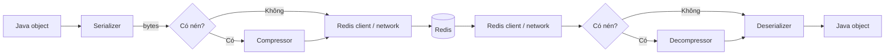

# Chi phí tuần tự hóa, JSON và nén dữ liệu trong Spring Data Redis

## 1. Tại sao serialization có thể là nút thắt hiệu năng của Redis?

Redis xử lý nhiều thao tác key/value rất nhanh, nhưng ứng dụng Spring Data Redis không truyền trực tiếp một đối tượng Java vào bộ nhớ của Redis. Ở phía client, đối tượng phải được **tuần tự hóa (serialization)** thành các byte; khi đọc, chuỗi byte phải được **giải tuần tự hóa (deserialization)** về dạng ứng dụng sử dụng.

Ví dụ:

```java
ProductSnapshot snapshot = new ProductSnapshot(
        "SKU-42", "Áo thun", 199_000L, Instant.now());

productRedisTemplate.opsForValue()
        .set("product:SKU-42", snapshot);

ProductSnapshot loaded = productRedisTemplate.opsForValue()
        .get("product:SKU-42");
```

Trong đoạn code này có ít nhất năm phần chi phí:

1. **Mã hóa key:** `"product:SKU-42"` được chuyển thành byte theo key serializer.
2. **Mã hóa value:** `ProductSnapshot` được chuyển thành JSON hoặc một định dạng khác.
3. **Truyền dữ liệu qua mạng:** client gửi command và payload tới Redis.
4. **Lưu trữ trong Redis:** Redis giữ các byte của key/value cùng metadata và overhead cấu trúc dữ liệu.
5. **Giải mã khi đọc:** Redis trả byte về client, serializer tạo lại đối tượng Java.

Nếu có **nén dữ liệu**, client còn phải thực hiện thêm bước compress trước khi gửi và decompress sau khi nhận.

Sơ đồ đường đi:



**Hiệu năng tổng thể không chỉ là latency của Redis server.** Độ trễ ứng dụng còn phụ thuộc kích thước payload, CPU serializer, cấp phát bộ nhớ, garbage collection, băng thông mạng và số operation đồng thời.

Bài này giúp chọn serializer và chính sách nén trong Spring Data Redis dựa trên số liệu thay vì các giả định như “JSON luôn chậm” hoặc “nén luôn nhanh hơn”.

## 2. Những lớp chi phí cần đo riêng

Có thể hình dung thời gian xử lý một request Redis ở mức gần đúng:

```text
T_operation ≈ T_serialize_key
            + T_serialize_value
            + T_client_queue
            + T_network_request
            + T_redis_execution
            + T_network_response
            + T_deserialize_value
            + T_application_processing
```

Với lệnh `SET`, phần giải mã value phía response có thể rất nhỏ. Với `GET` trả object lớn, phần giải mã JSON và cấp phát object có thể đáng kể. Với các key nhỏ trong mạng nội bộ, overhead codec đôi khi quan trọng ngang hoặc lớn hơn thời gian Redis thực thi lệnh.

Một số ví dụ:

| Trường hợp | Chi phí thường đáng chú ý | Hướng tối ưu |
| --- | --- | --- |
| `GET` một chuỗi vài chục byte | Network round-trip, client overhead | Giảm số lượt gọi, không nén |
| `GET` JSON vài kilobyte | Network + JSON parser + allocations | Serializer phù hợp, benchmark compression |
| `GET` JSON hàng trăm kilobyte | Network/CPU/GC, lớn hơn cache entry thông thường | Giảm payload, phân mảnh hợp lý hoặc nén |
| `MGET` nhiều key | Tổng bytes, số object được tạo, bộ nhớ tạm | Batch có kiểm soát, giới hạn kích thước |
| Cache miss hàng loạt | Serialization + backend query + ghi cache | Chống stampede, giới hạn concurrency |
| Giá trị thường xuyên cập nhật | Chi phí encode, overwrite, persistence/replication | Tránh nén đắt, tối ưu schema |
| Hash cập nhật một field | Không nhất thiết phải mã hóa lại cả object | Dùng Redis Hash nếu semantics phù hợp |

Không tối ưu bằng cách chỉ xem `redis-cli INFO commandstats`. Thống kê server không phản ánh đầy đủ CPU của ứng dụng dành cho Jackson, GZIP hoặc cấp phát mảng byte.

## 3. Spring Data Redis quyết định bytes được lưu như thế nào?

Các abstraction thường gặp:

- `RedisTemplate<K,V>`: đồng bộ, cho phép cấu hình key/value/hash serializers.
- `StringRedisTemplate`: template chuyên cho key và value kiểu String.
- `ReactiveRedisTemplate<K,V>`: bản reactive với serialization context.
- `ReactiveStringRedisTemplate`: reactive template chuyên chuỗi.
- `RedisCacheManager` và `RedisCacheConfiguration`: serialization của entry trong Spring Cache.
- Redis Repository: object mapping, Hash và những cấu trúc/index theo cơ chế repository.

Trong `RedisTemplate` có nhiều vị trí serializer:

| Serializer | Dữ liệu xử lý | Tác động |
| --- | --- | --- |
| `keySerializer` | Redis key ở top-level | Bytes của tên key, định tuyến hash slot trong Cluster |
| `valueSerializer` | Redis String value hoặc value qua operations tương ứng | Kích thước payload và decode khi đọc |
| `hashKeySerializer` | Tên field của Redis Hash | Chi phí và khả năng truy cập field bằng các client khác |
| `hashValueSerializer` | Giá trị field trong Hash | Codec của từng field |
| Serialization context | Reactive template | Tương đương các đường mã hóa/giải mã trong reactive operations |
| `SerializationPair` | Redis Cache | Codec cho keys/values theo cấu hình cache |

**Key serializer quan trọng ngang value serializer về tính tương thích.** Nếu service A dùng UTF-8 key `product:42`, còn service B dùng JDK serialization cho Java String `"product:42"`, hai service có thể lưu những byte key khác nhau trong Redis, dù tên hiển thị ở Java giống nhau.

Trong Redis Cluster, bytes của key còn được dùng để tính hash slot. Thay key serializer trong lúc nâng phiên bản có thể khiến client tìm sai key cũ và gây cache miss hàng loạt.

## 4. Các lựa chọn serialization phổ biến

| Lựa chọn | Độ dễ đọc | Hiệu năng/size | Khả năng tương thích |
| --- | --- | --- | --- |
| `StringRedisSerializer` | Rất dễ đọc bằng `redis-cli` | Hiệu quả cho text ngắn; không có JSON parse | Tốt khi thống nhất encoding |
| JSON có kiểu cụ thể | Dễ đọc, dễ quan sát | Có field names và escape; tốn parse/allocations | Tốt nếu quản lý schema |
| JSON generic chứa type metadata | Dễ đọc nhưng payload thêm metadata | Có thêm bytes và logic polymorphism | Cần quản lý typing và bảo mật |
| JDK serialization | Khó đọc và thường gắn với Java implementation | Có metadata và phụ thuộc class; không mặc định hiệu quả | Yếu khi khác ngôn ngữ hoặc thay class |
| Binary codec có schema | Khó xem trực tiếp | Có thể compact, xử lý nhanh tùy codec | Cần schema/protocol chung |
| JSON + GZIP | Không xem trực tiếp bằng `GET` | Giảm bytes khi dữ liệu đủ lớn/repetitive; thêm CPU | Phải thống nhất header, version và giải nén |
| Binary codec + LZ4/Zstd | Không xem trực tiếp | Có thể cân bằng tốc độ và tỷ lệ nén tốt | Cần dependency, benchmark và format rõ |

Không có định dạng nào tốt nhất cho mọi key. Key/value chuỗi nhỏ không cần full JSON codec, trong khi một object phức tạp được nhiều service dùng có thể hưởng lợi từ schema rõ và JSON để quản lý phiên bản.

**Hãy đo với payload thực**, thay vì suy luận tốc độ từ tên thư viện hay benchmark tổng quát không giống dữ liệu ứng dụng.

## 5. `StringRedisSerializer`: đơn giản và ít overhead cho dữ liệu chuỗi

Ví dụ dùng `StringRedisTemplate`:

```java
import java.time.Duration;
import org.springframework.data.redis.core.StringRedisTemplate;

public class FeatureFlagStore {

    private final StringRedisTemplate redis;

    public FeatureFlagStore(StringRedisTemplate redis) {
        this.redis = redis;
    }

    public void save(String name, boolean enabled) {
        redis.opsForValue().set(
                "feature:" + name,
                enabled ? "1" : "0",
                Duration.ofMinutes(5));
    }

    public boolean isEnabled(String name) {
        String value = redis.opsForValue()
                .get("feature:" + name);
        return "1".equals(value);
    }
}
```

Với một boolean, mã hóa thành `"1"`/`"0"` có thể hiệu quả hơn tạo một JSON object như:

```json
{
  "flag": "checkout",
  "enabled": true,
  "updatedBy": "service-a"
}
```

Nhưng compact không đồng nghĩa luôn tốt hơn: nếu cần metadata, auditing, version hoặc nhiều field, một format rõ ràng dễ bảo trì hơn.

### Không nhầm số ký tự với số byte

Với UTF-8:

```text
"OK"       -> 2 bytes
"Việt Nam" -> nhiều bytes hơn số ký tự vì dấu tiếng Việt
```

Kích thước payload nên đo bằng số byte **sau serialization**, không chỉ `String.length()` trong Java. UTF-8 có ký tự mã hóa bằng nhiều byte, nên một tên sản phẩm đa ngôn ngữ có thể chiếm nhiều network/memory hơn một chuỗi ASCII cùng số ký tự.

## 6. JSON có kiểu cụ thể: rõ schema và kiểm soát metadata

Giả sử cache một ảnh chụp sản phẩm:

```java
import java.time.Instant;

public record ProductSnapshot(
        String sku,
        String title,
        long priceCents,
        Instant updatedAt) {
}
```

Một JSON value:

```json
{
  "sku": "SKU-42",
  "title": "Áo thun",
  "priceCents": 199000,
  "updatedAt": "2026-11-13T00:00:00Z"
}
```

JSON có một số đặc tính:

- Field names xuất hiện lặp lại ở mỗi entry.
- Phần text có thể phải escape.
- Khi decode, Jackson phân tích cú pháp và tạo các object/string/collection mới.
- Định dạng dễ đọc bằng CLI, tiện hỗ trợ vận hành và tương tác nhiều ngôn ngữ.
- Schema evolution có thể dễ quản lý hơn JDK serialization nếu thiết kế rõ field optional/default/version.

### Cấu hình `RedisTemplate` với JSON typed serializer

Trong các phiên bản Spring Data Redis hỗ trợ constructor tương ứng, có thể cấu hình:

```java
import org.springframework.context.annotation.Bean;
import org.springframework.context.annotation.Configuration;
import org.springframework.data.redis.connection.RedisConnectionFactory;
import org.springframework.data.redis.core.RedisTemplate;
import org.springframework.data.redis.serializer.Jackson2JsonRedisSerializer;
import org.springframework.data.redis.serializer.StringRedisSerializer;

@Configuration
public class ProductRedisConfiguration {

    @Bean
    RedisTemplate<String, ProductSnapshot> productRedisTemplate(
            RedisConnectionFactory connectionFactory) {

        RedisTemplate<String, ProductSnapshot> template =
                new RedisTemplate<>();

        template.setConnectionFactory(connectionFactory);

        template.setKeySerializer(new StringRedisSerializer());
        template.setValueSerializer(
                new Jackson2JsonRedisSerializer<>(
                        ProductSnapshot.class));

        template.setHashKeySerializer(
                new StringRedisSerializer());

        template.afterPropertiesSet();
        return template;
    }
}
```

Mẫu chỉ minh họa đường mã hóa của value trong Redis String. Ở ứng dụng thực tế có field `Instant`, hãy cấu hình ObjectMapper/module Java Time theo đúng version của Jackson/Spring Data Redis; một Jackson serializer được tạo mặc định không nhất thiết có cấu hình giống ObjectMapper mà Spring MVC/WebFlux đang dùng.

Có thể cân nhắc constructor nhận `ObjectMapper` của phiên bản tương ứng, hoặc xây serializer typed sử dụng một `ObjectMapper` do ứng dụng quản lý, để thống nhất:

- `JavaTimeModule`.
- Naming strategy.
- Null handling.
- Date/time timezone.
- Unknown fields.
- Numeric precision.
- Schema version.

**Không đổi JSON shape trên Redis một cách tùy tiện khi nhiều phiên bản ứng dụng đang cùng chạy.**

### Vì sao typed serializer có thể ưu thế?

Một `Jackson2JsonRedisSerializer<ProductSnapshot>` biết trước kiểu mong đợi, nên không nhất thiết phải ghi metadata kiểu Java vào mỗi payload. Điều này thường giúp giảm kích thước so với một serializer generic kèm thông tin polymorphic class.

Với một cache chỉ chứa `ProductSnapshot`, định dạng có kiểu rõ là lựa chọn hợp lý. Với cache hỗn hợp nhiều loại object, cần một cơ chế nhận diện type an toàn và quản lý schema rõ hơn.

## 7. Generic JSON và rủi ro polymorphic type metadata

Một số ứng dụng dùng serializer JSON generic để lưu nhiều loại Java object trong cùng template hoặc Spring Cache. Khi đó, định dạng có thể cần thêm type metadata nhằm xác định class khi deserialize.

Ví dụ minh họa metadata phụ thuộc cấu hình:

```json
{
  "@class": "com.example.catalog.ProductSnapshot",
  "sku": "SKU-42",
  "title": "Áo thun",
  "priceCents": 199000
}
```

Hệ quả hiệu năng:

1. Mỗi entry có thêm bytes cho tên package/class hoặc type marker.
2. Jackson phải đọc metadata và quyết định kiểu đích.
3. Thay package/class có thể ảnh hưởng khả năng đọc cache cũ.
4. Payload không nhất thiết được các dịch vụ khác ngôn ngữ hiểu.

Hệ quả bảo mật:

- Không bật Jackson default typing hoặc deserialization polymorphic quá rộng trên dữ liệu chưa được tin cậy.
- Tránh cho dữ liệu Redis do nhiều bên có quyền ghi tự xác định arbitrary Java class được tạo.
- Nếu cần polymorphism, dùng type whitelist/`PolymorphicTypeValidator` và hợp đồng schema đã giới hạn.
- Hạn chế Redis ACL theo namespace/role; đừng coi Redis nội bộ mặc định là nguồn dữ liệu an toàn tuyệt đối.

**Khuyến nghị thực hành:** nếu một cache dùng một kiểu DTO ổn định, ưu tiên serializer typed; nếu nhiều kiểu dữ liệu, dùng envelope có `typeId` và `schemaVersion` do ứng dụng quản lý thay vì tự động phụ thuộc vào toàn bộ tên class Java.

## 8. Vì sao JDK serialization hiếm khi là lựa chọn tốt cho cache liên dịch vụ?

`JdkSerializationRedisSerializer` cho phép serialize Java object, nhưng có các đánh đổi:

- Payload nhị phân khó xem và hỗ trợ vận hành.
- Phụ thuộc class name, `serialVersionUID` và hình dạng object Java.
- Dễ gặp vấn đề khi deploy song song hai phiên bản không tương thích.
- Không phù hợp để các service Go/Python/Node.js đọc.
- Có rủi ro bảo mật khi deserialize dữ liệu không tin cậy.
- Kích thước/CPU không mặc định nhỏ hơn JSON.

Redis phục vụ byte array, không biết object gốc. Khi sửa model trong code, người dùng có thể không để ý rằng cache cũ vẫn lưu object theo binary format của version trước.

Nếu hệ thống đang sử dụng JDK serialization, đừng chuyển codec trực tiếp ở cùng key prefix rồi giả định dữ liệu cũ đọc được. Cần lập kế hoạch migration bằng namespace/version hoặc dual-read, kèm TTL và cách xử lý key cũ.

## 9. JSON không phải lúc nào cũng tốn nhất: kích thước và CPU cần đo

Một payload JSON nhỏ:

```json
{"id":"42","status":"ACTIVE"}
```

Nén nó bằng GZIP có thể tạo dữ liệu **lớn hơn** vì GZIP có header/footer và overhead xử lý. Ngoài ra CPU khởi tạo compressor/decompressor có thể lớn hơn thời gian truyền vài chục byte.

Với JSON lặp tên field và chứa nhiều text:

```json
[
  {"sku":"A-001","category":"t-shirt","available":true},
  {"sku":"A-002","category":"t-shirt","available":true},
  {"sku":"A-003","category":"t-shirt","available":true}
]
```

thuật toán nén có thể tận dụng lặp lại và làm kích thước nhỏ hơn đáng kể.

### Cần tách các câu hỏi

- JSON có thực sự lớn không, sau khi đo byte UTF-8?
- CPU serialization chiếm bao nhiêu phần trăm latency request?
- Network giữa Spring app và Redis có phải nút thắt không?
- Redis memory có bị giới hạn bởi tổng số value bytes hay chủ yếu do số key/overhead?
- Payload có lặp/chứa text đủ để nén hiệu quả không?
- Tỷ lệ đọc/ghi là bao nhiêu? Nếu ghi nhiều đọc ít, chi phí compress có thể không được hoàn vốn.
- Cache entry có TTL quá ngắn khiến chi phí nén/giải nén lặp lại nhiều hơn lợi ích không?

Một quyết định tốt chỉ đến sau khi đo **CPU + allocations + network + memory + p95 latency**, không chỉ xem tỷ lệ nén.

## 10. Nén dữ liệu cải thiện chi phí nào và tăng chi phí nào?

Một mô hình gần đúng:

```text
Không nén:
  serialize -> gửi N bytes -> lưu N bytes
  -> nhận N bytes -> deserialize

Có nén:
  serialize -> compress -> gửi M bytes -> lưu M bytes
  -> nhận M bytes -> decompress -> deserialize

Trong đó:
  M < N chỉ khi payload nén thực sự nhỏ hơn.
```

So sánh:

| Yếu tố | JSON không nén | JSON + nén |
| --- | --- | --- |
| Network payload | Lớn hơn nếu JSON lặp nhiều | Có thể nhỏ hơn |
| Redis value memory | Lớn hơn nếu JSON lặp nhiều | Có thể nhỏ hơn |
| CPU khi ghi | JSON encode | JSON encode + compress |
| CPU khi đọc | JSON parse | Decompress + JSON parse |
| GC/allocations | JSON bytes + DTO | JSON bytes + compressed bytes + buffers + DTO |
| `redis-cli GET` | Có thể xem JSON text | Nhận binary, cần tool giải mã |
| Lua xử lý nội dung JSON | Có thể nếu phù hợp | Phải giải nén trước; Redis Lua không tự có codec Java |
| Thay version schema | Quản lý JSON schema | Phải quản lý JSON schema **và** format nén |
| Lệnh thao tác field | Có thể dùng Hash thay thế | Redis String nén thường phải đọc/ghi toàn value |

**Nén không làm Redis command nguyên tử hơn, không đổi TTL semantics và không tự tăng khả năng durability.** Nó chỉ thay cách biểu diễn bytes của value cùng chi phí encode/decode.

## 11. Khi nào nén thực sự có ích?

Các trường hợp đáng thử nghiệm:

- Cache các JSON DTO lớn và có lặp field name.
- Cache dữ liệu cấu hình/document text có kích thước vài kilobyte trở lên.
- App và Redis ở khác host/vùng khiến network payload đáng kể.
- Redis memory là chi phí lớn, còn CPU phía client có dư địa.
- Tỷ lệ read/write và cache hit cao đủ để lợi ích giảm bytes bù lại CPU giải nén.

Các trường hợp thường không nên nén:

- Value là boolean, số đếm, mã trạng thái hoặc token ngắn.
- Dữ liệu đã nén sẵn (JPEG, PNG, gzip, zip...) hoặc entropy cao như bytes ngẫu nhiên.
- Bộ đếm cần lệnh `INCR`/`INCRBY` trực tiếp tại Redis.
- Hash cần `HGET`/`HSET` từng field.
- App đang giới hạn CPU hoặc GC hơn là network/memory.
- Value phải được các client khác đọc trực tiếp bằng `StringRedisTemplate` hoặc công cụ quản trị.

### Có một ngưỡng nén cố định cho mọi ứng dụng không?

Không. Ngưỡng như 1 KiB, 2 KiB hoặc 4 KiB chỉ là **điểm bắt đầu để benchmark**. Một JSON dài 10 KiB chứa dữ liệu ngẫu nhiên có thể nén kém hơn JSON 2 KiB lặp nhiều trường.

Có thể áp dụng chính sách:

1. Không nén payload dưới một ngưỡng byte được cấu hình.
2. Với payload trên ngưỡng, thử nén.
3. Chỉ giữ bản nén khi nó **thật sự ngắn hơn bản gốc** đủ để bù framing overhead.
4. Ghi header format để decoder biết payload có nén hay không.
5. Theo dõi tỷ lệ nén và CPU thực tế, điều chỉnh ngưỡng theo dữ liệu.

## 12. Những thuật toán thường được cân nhắc

| Thuật toán | Điểm mạnh thường gặp | Đánh đổi |
| --- | --- | --- |
| GZIP/Deflate | Có sẵn trong JDK, dễ chia sẻ giữa nhiều ngôn ngữ | CPU có thể cao hơn codec thiên về tốc độ |
| LZ4 | Tốc độ nén/giải nén rất nhanh trên nhiều loại payload | Tỷ lệ nén có thể thấp hơn các thuật toán nén mạnh |
| Zstandard (Zstd) | Cân bằng tốt giữa tốc độ và tỷ lệ nén với cấu hình level phù hợp | Thêm dependency, tuning và đôi khi native library |
| Snappy | Tốc độ cao trong nhiều trường hợp | Tỷ lệ nén có thể không tốt trên mọi JSON |
| Không nén | Không tốn CPU nén/giải nén | Payload lớn hơn |

Không mặc định GZIP chậm nhất hay Zstd luôn thắng. Kết quả phụ thuộc kích thước, entropy, level, phiên bản thư viện, JVM/CPU và workload.

Với cache object lớn đọc rất thường xuyên, **giải nén nhanh** có thể quan trọng hơn tối đa hóa tỷ lệ nén. Với dữ liệu ghi một lần đọc rất ít, lợi ích giảm network/memory có thể không đủ trả chi phí compress.

Ngoài ra, các codec có thư viện native/JNI cần đánh giá triển khai ở CI, container và hệ điều hành mục tiêu. Một thuật toán benchmark nhanh trên laptop không nhất thiết thuận tiện vận hành ở production.

## 13. Format nén phải có version, không dựa vào “đoán gzip”

Giả sử một Redis key từng lưu JSON thô:

```text
{"sku":"SKU-42","priceCents":199000}
```

Sau khi bật GZIP, value cùng key trở thành binary. Nếu một ứng dụng cũ vẫn giải mã bằng UTF-8/JSON, nó sẽ thất bại.

Một định dạng dễ quản lý nên có header **tự mô tả**:

```text
+------------+----------+----------+--------------------+
| Magic "RJ" | Version 1| Codec ID | Payload bytes      |
+------------+----------+----------+--------------------+
  2 bytes      1 byte     1 byte    N bytes

Codec ID:
  0 = JSON UTF-8, không nén
  1 = JSON UTF-8 + GZIP
```

Lợi ích:

- Decoder biết định dạng của entry mà không thử giải nén mù.
- Dữ liệu không được nén vẫn theo cùng một envelope có version.
- Có thể nâng codec sang Zstd/LZ4 ở version sau.
- Có thể phát hiện payload cũ không có magic để thực hiện migration có chủ đích.
- Có thể kiểm soát giới hạn kích thước giải nén, tránh dữ liệu nén bất thường.

Không dùng byte đầu `0x1f 0x8b` của GZIP làm **hợp đồng toàn ứng dụng** nếu nhiều kiểu payload cùng dùng Redis; phần header tự mô tả giúp tránh trùng định dạng.

### Migration dữ liệu cũ

Có ba cách phổ biến:

1. **New prefix:** dữ liệu version mới lưu ở `v2:product:*`, để key cũ hết TTL.
2. **Dual-read:** thử decoder mới trước; nếu không có header thì thử decoder cũ theo quy tắc giới hạn và ghi lại dạng mới.
3. **Batch migration:** quét key có kiểm soát, đọc, chuyển mã, ghi lại với TTL/version phù hợp.

Trong phần lớn cache có TTL ngắn, **new prefix hoặc cache miss rồi tái tạo** đơn giản và an toàn hơn đọc pha trộn mãi mãi. Với dữ liệu quan trọng không thể tái tạo, cần kế hoạch migration không làm mất trạng thái.

## 14. Ví dụ serializer JSON + GZIP có header phiên bản

Ví dụ Java dưới đây triển khai `RedisSerializer<T>` cho một DTO có kiểu đích biết trước. Thuật toán:

- Dùng Jackson để mã hóa object thành JSON UTF-8.
- Không nén nếu JSON nhỏ hơn ngưỡng.
- Nếu đủ lớn, thử GZIP; chỉ dùng GZIP khi payload thực sự nhỏ hơn.
- Ghi header `RJ` + version + codec.
- Khi đọc, xác thực header/version/codec trước khi decode.
- Đặt giới hạn số byte sau giải nén để tránh giải nén payload quá lớn.

### 14.1. Bộ mã hóa

```java
package com.example.redis;

import com.fasterxml.jackson.databind.ObjectMapper;

import java.io.ByteArrayInputStream;
import java.io.ByteArrayOutputStream;
import java.io.IOException;
import java.util.Arrays;
import java.util.Objects;
import java.util.zip.GZIPInputStream;
import java.util.zip.GZIPOutputStream;

import org.springframework.data.redis.serializer.RedisSerializer;
import org.springframework.data.redis.serializer.SerializationException;

public final class VersionedJsonGzipSerializer<T>
        implements RedisSerializer<T> {

    private static final byte MAGIC_1 = 'R';
    private static final byte MAGIC_2 = 'J';
    private static final byte VERSION = 1;
    private static final byte PLAIN_JSON = 0;
    private static final byte GZIP_JSON = 1;
    private static final int HEADER_SIZE = 4;

    private final ObjectMapper mapper;
    private final Class<T> type;
    private final int compressionThresholdBytes;
    private final int maxDecodedBytes;

    public VersionedJsonGzipSerializer(
            ObjectMapper mapper,
            Class<T> type,
            int compressionThresholdBytes,
            int maxDecodedBytes) {

        this.mapper = Objects.requireNonNull(mapper);
        this.type = Objects.requireNonNull(type);

        if (compressionThresholdBytes < 0 || maxDecodedBytes <= 0) {
            throw new IllegalArgumentException("Invalid size limits");
        }

        this.compressionThresholdBytes = compressionThresholdBytes;
        this.maxDecodedBytes = maxDecodedBytes;
    }

    @Override
    public byte[] serialize(T value) throws SerializationException {
        if (value == null) {
            return null;
        }

        try {
            byte[] json = mapper.writeValueAsBytes(value);
            if (json.length > maxDecodedBytes) {
                throw new SerializationException(
                        "JSON payload exceeds configured limit");
            }

            byte codec = PLAIN_JSON;
            byte[] payload = json;

            if (json.length >= compressionThresholdBytes) {
                byte[] compressed = gzip(json);

                if (compressed.length < json.length) {
                    codec = GZIP_JSON;
                    payload = compressed;
                }
            }

            byte[] framed = new byte[HEADER_SIZE + payload.length];
            framed[0] = MAGIC_1;
            framed[1] = MAGIC_2;
            framed[2] = VERSION;
            framed[3] = codec;

            System.arraycopy(
                    payload, 0, framed, HEADER_SIZE, payload.length);

            return framed;
        } catch (IOException ex) {
            throw new SerializationException(
                    "Unable to encode Redis JSON value", ex);
        }
    }

    @Override
    public T deserialize(byte[] bytes) throws SerializationException {
        if (bytes == null || bytes.length == 0) {
            return null;
        }

        if (bytes.length < HEADER_SIZE
                || bytes[0] != MAGIC_1
                || bytes[1] != MAGIC_2
                || bytes[2] != VERSION) {
            throw new SerializationException(
                    "Unsupported Redis value envelope");
        }

        byte codec = bytes[3];
        byte[] payload = Arrays.copyOfRange(
                bytes, HEADER_SIZE, bytes.length);

        try {
            byte[] json;
            if (codec == PLAIN_JSON) {
                json = payload;
            } else if (codec == GZIP_JSON) {
                json = gunzipWithLimit(payload);
            } else {
                throw new SerializationException(
                        "Unsupported Redis compression codec");
            }

            if (json.length > maxDecodedBytes) {
                throw new SerializationException(
                        "Decoded JSON exceeds configured limit");
            }

            return mapper.readValue(json, type);
        } catch (IOException ex) {
            throw new SerializationException(
                    "Unable to decode Redis JSON value", ex);
        }
    }

    private static byte[] gzip(byte[] input) throws IOException {
        ByteArrayOutputStream output =
                new ByteArrayOutputStream();

        try (GZIPOutputStream gzip =
                     new GZIPOutputStream(output)) {
            gzip.write(input);
        }

        return output.toByteArray();
    }

    private byte[] gunzipWithLimit(byte[] input)
            throws IOException {

        ByteArrayOutputStream output =
                new ByteArrayOutputStream();

        try (GZIPInputStream gzip = new GZIPInputStream(
                new ByteArrayInputStream(input))) {

            byte[] buffer = new byte[4096];
            int read;
            int total = 0;

            while ((read = gzip.read(buffer)) != -1) {
                if (read > maxDecodedBytes - total) {
                    throw new SerializationException(
                            "Decompressed value exceeds limit");
                }

                output.write(buffer, 0, read);
                total += read;
            }
        }

        return output.toByteArray();
    }
}
```

Ý nghĩa một số quyết định:

- `null` được giữ là `null` bytes theo quy ước của serializer; không biến null thành chuỗi literal `"null"`.
- Header cho phép giải mã rõ ràng giữa JSON thô và GZIP.
- Mã hóa typed dùng `Class<T>`, không cần deserialize arbitrary Java class theo dữ liệu đầu vào.
- Giới hạn `maxDecodedBytes` giúp tránh payload nén có tỷ lệ giải nén rất lớn làm cạn RAM.
- Việc thử nén vẫn tốn CPU và tạo buffer; nếu benchmark cho thấy đa số payload nén kém, hãy tăng ngưỡng hoặc tắt nén cho loại value đó.
- Nếu cần phân biệt nhiều DTO, envelope cần thêm `typeId`/schema version có whitelist hoặc tách template/cache theo kiểu.

Đây là **một codec ứng dụng cụ thể**, không phải format chuẩn của Redis. Các service khác muốn đọc cùng key phải triển khai chính xác hợp đồng header/JSON/GZIP.

### 14.2. Cấu hình ObjectMapper và `RedisTemplate`

```java
package com.example.redis;

import com.fasterxml.jackson.databind.ObjectMapper;
import org.springframework.context.annotation.Bean;
import org.springframework.context.annotation.Configuration;
import org.springframework.data.redis.connection.RedisConnectionFactory;
import org.springframework.data.redis.core.RedisTemplate;
import org.springframework.data.redis.serializer.StringRedisSerializer;

@Configuration
public class ProductCacheRedisConfig {

    @Bean
    public RedisTemplate<String, ProductSnapshot> productRedisTemplate(
            RedisConnectionFactory factory,
            ObjectMapper objectMapper) {

        var valueSerializer =
                new VersionedJsonGzipSerializer<>(
                        objectMapper,
                        ProductSnapshot.class,
                        2048,       // Ngưỡng thử nén: 2 KiB JSON
                        1_048_576); // Tối đa 1 MiB JSON sau giải nén

        RedisTemplate<String, ProductSnapshot> template =
                new RedisTemplate<>();

        template.setConnectionFactory(factory);
        template.setKeySerializer(new StringRedisSerializer());
        template.setValueSerializer(valueSerializer);
        template.setHashKeySerializer(new StringRedisSerializer());
        template.afterPropertiesSet();

        return template;
    }
}
```

`ProductSnapshot` là record đã định nghĩa ở trên. `ObjectMapper` nên được Spring cấu hình module cho Java Time (ví dụ `jackson-datatype-jsr310`) nếu DTO có `Instant`. Tùy ứng dụng, có thể chủ động cấu hình ObjectMapper riêng cho Redis để không thay đổi cache wire format khi điều chỉnh JSON của REST API.

Sử dụng:

```java
import java.time.Duration;

redis.opsForValue().set(
        "cache:v1:product:SKU-42",
        productSnapshot,
        Duration.ofMinutes(10));

ProductSnapshot fromRedis = redis.opsForValue()
        .get("cache:v1:product:SKU-42");
```

Trong ví dụ này `redis` là `RedisTemplate<String, ProductSnapshot>` được inject theo bean phù hợp.

**Lưu ý:** key prefix `cache:v1:` gắn với format version là một công cụ migration đơn giản. Nếu sau này thay codec, có thể dùng `cache:v2:` và để dữ liệu cũ hết TTL.

## 15. Compression threshold: không nén tất cả

Chính sách trong serializer trên:

```text
json.length < threshold
    -> lưu JSON không nén trong envelope

json.length >= threshold
    -> tạo bản GZIP
    -> nếu GZIP nhỏ hơn JSON, dùng GZIP
    -> nếu không, vẫn lưu JSON không nén
```

Với ngưỡng 2 KiB:

| JSON size | GZIP size (giả định) | Quyết định | Lý do |
| ---: | ---: | --- | --- |
| 100 B | Không thử | JSON plain | Value nhỏ hơn ngưỡng |
| 1.800 B | Không thử | JSON plain | Giảm CPU |
| 3.000 B | 700 B | GZIP | Giảm bytes đáng kể |
| 3.000 B | 3.050 B | JSON plain | GZIP làm tăng kích thước |
| 20.000 B | 8.000 B | GZIP | Có lợi về network/memory nếu CPU chấp nhận |

Các kích thước GZIP trong bảng chỉ là ví dụ minh họa. Đo tỷ lệ thực tế theo nhóm payload.

### Có cần tính cả header?

Có. Trong format ví dụ, mọi payload mang 4 byte header. So sánh hai nhánh cùng có header nên có thể so `compressed.length < json.length`. Nếu nén có thêm metadata/CRC riêng ngoài format GZIP, cần tính tổng byte thực sự lưu.

Không nên thử nén trong đường request rồi bỏ kết quả chỉ vì “nén không nhỏ hơn” nếu CPU đang là nút thắt. Thử nén thất bại về tỷ lệ vẫn đã trả chi phí CPU. Vì vậy threshold/histogram thực tế vẫn quan trọng.

## 16. Nén làm thay đổi khả năng dùng các lệnh Redis trên value

Một Redis key chứa JSON không nén vẫn là **Redis String**. Redis nhìn nó như byte array; Spring client quyết định parse JSON.

Sau nén, Redis String chứa binary envelope:

```text
Redis key: cache:v1:product:SKU-42
Redis type: string
Value bytes:
  'R' 'J' 0x01 0x01 [GZIP bytes...]
```

Những lệnh vẫn hoạt động về mặt bytes:

- `GET` trả raw bytes.
- `SET` ghi raw bytes.
- `DEL` xóa key.
- `EXPIRE` đặt TTL.
- `TTL` đọc thời hạn.
- `STRLEN` trả số bytes của value.

Nhưng:

- `redis-cli GET` không hiển thị JSON dễ đọc.
- `GETRANGE` không cung cấp một mảnh JSON có ý nghĩa.
- `APPEND` phá format nén/version nếu nối thêm bytes tùy ý.
- `INCR` không thể áp dụng lên dữ liệu đã nén.
- Một Lua script vốn dựa vào `cjson.decode(redis.call("GET", key))` không đọc được envelope GZIP nếu không có bộ giải mã phù hợp.
- Một service dùng `StringRedisTemplate` có thể đọc ra ký tự không hợp lệ hoặc không hiểu nội dung.

**Không đặt cùng một key vào hai đường codec khác nhau** chỉ vì đều là Redis String.

## 17. Redis Hash hay JSON String?

Đây là quyết định có ảnh hưởng lớn đến cả tốc độ và cấu trúc dữ liệu.

### JSON String

```text
Key: product:SKU-42
Value:
{"sku":"SKU-42","priceCents":199000,"available":true}
```

Ưu điểm:

- Một `GET` lấy toàn bộ DTO.
- Một `SET` cập nhật toàn DTO.
- Dễ version schema.
- Có thể nén toàn value nếu lớn.

Đánh đổi:

- Muốn đổi `available` thường phải GET → deserialize → sửa → serialize → SET (nếu không có cơ chế atomic khác).
- Chuỗi nhiều lệnh có thể gây lost update khi concurrent writer.
- Nén khiến mọi cập nhật field phải giải nén/nén lại toàn value.

### Redis Hash

```redis
HSET product:SKU-42 sku SKU-42
HSET product:SKU-42 priceCents 199000
HSET product:SKU-42 available true

HGET product:SKU-42 available
```

Ưu điểm:

- Truy xuất/cập nhật từng field qua `HGET`/`HSET`.
- Một số cấu trúc Hash nhỏ có thể được Redis lưu hiệu quả theo encoding nội bộ phù hợp, tùy phiên bản/ngưỡng.
- Không cần mã hóa lại JSON lớn cho mỗi field update.

Đánh đổi:

- Nếu ứng dụng cần toàn DTO, phải lấy nhiều field và map lại thành object.
- Mỗi field name và metadata có chi phí; Hash không mặc định tiết kiệm bộ nhớ cho mọi schema.
- Cần thống nhất serializer cho hash key/value.
- TTL thông thường gắn với key của Hash; semantics field-level expiration phụ thuộc phiên bản Redis, không tự áp dụng giống TTL của key.
- Spring Data Redis Repository có thể dùng Hash/index theo hợp đồng riêng, không nên tự ghi vào các key repository mà không hiểu mapping.

### Bảng chọn

| Workload | Hướng thường phù hợp |
| --- | --- |
| Đọc nguyên object thường xuyên, ít cập nhật field | JSON String typed |
| Object lớn, mạng/bộ nhớ là bottleneck | JSON String + compression có đo |
| Đọc/cập nhật một vài field thường xuyên | Redis Hash |
| Giá trị số tăng liên tục | Redis String numeric + `INCR` |
| Cần thao tác trên Redis trực tiếp bằng Lua | Chọn encoding đơn giản được Lua hiểu hoặc script làm việc với Hash |
| Cache kết quả truy vấn lớn nhưng tái tạo được | Có thể cache một object có TTL, benchmark kích thước |

Không tối ưu chỉ vì “JSON rất dài” mà quên chi phí mô hình hóa dữ liệu và yêu cầu atomicity.

## 18. Các kiểu dữ liệu dễ gây overhead bất ngờ

### Ngày giờ

Dùng `Instant`, `LocalDateTime` hoặc `ZonedDateTime` cần thống nhất JSON representation. ISO-8601 dễ đọc nhưng dài hơn số epoch milliseconds:

```json
{"updatedAt":"2026-11-13T09:15:00Z"}
```

so với:

```json
{"updatedAtEpochMs":1794561300000}
```

Không nên đổi format chỉ để tiết kiệm vài byte nếu nó làm mất timezone semantics hoặc gây nhầm đơn vị giây/mili giây.

### `BigDecimal`

Giá trị tiền tệ có thể cần độ chính xác thập phân. Không tự serialize qua `double` để giảm size nếu làm mất precision. Có thể chọn số nguyên minor units (cent/đồng nhỏ nhất) khi hợp đồng nghiệp vụ cho phép, hoặc JSON decimal string chuẩn hóa.

### Collection và field lặp

Một danh sách nhiều object nhỏ lặp key name (`id`, `status`, `category`) thường nén tốt. Nhưng trả cả danh sách lớn qua một `GET` có thể gây allocation peak và tăng latency. Cân nhắc phân trang, phân key hoặc materialized view.

### Null và field optional

Một serializer ghi nhiều trường `null` làm payload lớn hơn. Bỏ null có thể tiết kiệm bytes, nhưng cần phân biệt “không có field” và “field tồn tại nhưng null” trong schema.

### Tên field

Rút ngắn `priceCents` thành `p` giảm bytes nhưng làm giảm khả năng đọc và gây chi phí bảo trì. Nếu cần tối ưu rất mạnh, codec có schema hoặc nén thường hợp lý hơn biến mọi DTO thành chuỗi key khó hiểu.

## 19. Cấu hình nén trong Spring Cache

Spring Cache qua `RedisCacheManager` sử dụng serializer value do cache configuration chọn. Nếu một cache chỉ lưu `ProductSnapshot`, có thể cấu hình codec versioned cho riêng cache đó:

```java
import java.time.Duration;
import java.util.Map;

import com.fasterxml.jackson.databind.ObjectMapper;
import org.springframework.context.annotation.Bean;
import org.springframework.data.redis.cache.RedisCacheConfiguration;
import org.springframework.data.redis.cache.RedisCacheManager;
import org.springframework.data.redis.connection.RedisConnectionFactory;
import org.springframework.data.redis.serializer.RedisSerializationContext;

@Bean
RedisCacheManager redisCacheManager(
        RedisConnectionFactory factory,
        ObjectMapper mapper) {

    var productSerializer =
            new VersionedJsonGzipSerializer<>(
                    mapper,
                    ProductSnapshot.class,
                    2048,
                    1_048_576);

    RedisCacheConfiguration productConfig =
            RedisCacheConfiguration.defaultCacheConfig()
                    .entryTtl(Duration.ofMinutes(10))
                    .serializeValuesWith(
                            RedisSerializationContext.SerializationPair
                                    .fromSerializer(productSerializer));

    return RedisCacheManager.builder(factory)
            .withInitialCacheConfigurations(
                    Map.of("productSnapshotCache", productConfig))
            .build();
}
```

Đoạn code giả định được đặt trong một class `@Configuration` và có `ProductSnapshot` cùng serializer đã định nghĩa ở phần trước.

**Cảnh báo typed cache:** cấu hình value serializer chỉ hiểu `ProductSnapshot`. Đừng áp nó vào mọi cache có value thuộc nhiều kiểu DTO khác nhau. Những cache khác cần `RedisCacheConfiguration` riêng hoặc codec có schema/type ID an toàn tương ứng.

### Key prefix và serializer của CacheManager

Spring Cache thường sinh key từ cache name và method parameters. Nếu đổi key prefix hoặc serializer, cache entry cũ có thể không được tìm thấy. Trong giai đoạn rollout nhiều version, phải xét:

- Mỗi version có đọc được value do version khác tạo không?
- TTL entry cũ dài bao lâu?
- Có cần prefix version riêng không?
- Có thể chấp nhận cache miss để rebuild không?
- Có business operation nào vô tình dùng cùng key từ `RedisTemplate` ngoài Spring Cache không?

Không nên thay cấu hình serializer của cache production rồi trông đợi các entry cũ tự chuyển định dạng.

## 20. Reactive Redis: nén có thể tiêu tốn event-loop CPU

Với `ReactiveRedisTemplate`, việc gửi/nhận Redis I/O dùng mô hình bất đồng bộ. Tuy nhiên serialization và compression vẫn cần CPU.

Một pipeline reactive:

```text
WebFlux request
   |
   v
Serialize JSON
   |
   v
GZIP compress
   |
   v
Lettuce asynchronous network I/O
   |
   v
Redis
   |
   v
GZIP decompress
   |
   v
Deserialize JSON -> DTO
```

Nếu mã hóa/giải nén payload lớn được thực hiện trên thread nhạy cảm với latency, throughput của WebFlux có thể suy giảm dù Redis server vẫn nhàn rỗi.

### Reactive không làm JSON/GZIP miễn phí

```java
Mono<ProductSnapshot> product =
        reactiveProductTemplate.opsForValue()
                .get("product:SKU-42");
```

`Mono` mô tả quá trình không-blocking theo API; nó không có nghĩa mọi đoạn CPU serialize/deserialize được thực thi song song vô hạn hoặc không có overhead.

Một số hướng:

- Tránh nén các payload cực nhỏ.
- Giới hạn kích thước JSON được chấp nhận.
- Giới hạn concurrency để tránh nhiều decompression lớn cùng lúc.
- Chọn codec giải nén nhanh nếu workload đọc nhiều.
- Đo thread CPU và event-loop latency, không chỉ Redis RTT.
- Nếu triển khai codec CPU-bound nặng trên pipeline do ứng dụng tự xây, có thể tách scheduler phù hợp bằng Reactor, nhưng cần xác định nơi codec thực sự chạy trong Spring Data Redis/driver trước khi thay đổi.

Không coi `publishOn(Schedulers.boundedElastic())` là giải pháp thần kỳ cho mọi serializer. Việc chuyển thread cũng có chi phí và không tự thay đổi luồng nội bộ driver.

## 21. Key serializer và tương thích giữa các dịch vụ

Giả sử Redis có key:

```text
cache:v1:product:SKU-42
```

Dịch vụ Java A dùng `StringRedisSerializer` cho key; dịch vụ B dùng raw byte format khác hoặc ghép dấu phân cách khác. Dù cùng “SKU-42”, bytes cuối có thể khác, khiến B tìm nhầm key.

Nguyên tắc:

1. Key name phải có namespace ổn định.
2. Tất cả service cùng chia sẻ key phải thống nhất encoding của key.
3. Với Redis Cluster, nếu dùng hash tag `{...}`, phải thống nhất cả vị trí tag ở bytes serialized.
4. Không nén **key** chỉ vì value lớn; tên key phải được định tuyến và quan sát ổn định.
5. Không đưa bí mật vào key name; nhiều hệ thống monitoring/notifications có thể hiển thị tên key.
6. Đặt version trong namespace nếu đổi wire format không tương thích.

Nén value và nén key là hai quyết định khác nhau; trong phần lớn ứng dụng, nén chỉ áp dụng cho value phù hợp.

## 22. Tác động tới Redis Cluster và replication

Redis Cluster phân phối key theo hash slot tính trên bytes của key; thay value serializer từ JSON sang JSON+GZIP **không trực tiếp đổi hash slot**.

Nhưng compression có thể thay:

- Số byte client gửi qua mạng tới primary.
- Số byte primary giữ trong dataset.
- Số byte cần truyền trong replication và persistence theo workload/biểu diễn thực tế.
- Tốc độ restore hoặc full synchronization do dataset size thay đổi.
- CPU encode/decode ở client, và khả năng thao tác trực tiếp trên value.

Ví dụ, nếu value JSON giảm từ 20 KiB xuống 5 KiB, băng thông ghi và replication có thể giảm đáng kể. Tuy nhiên không nên tự tính “Redis memory chắc chắn giảm 75%” vì key, object headers, allocator fragmentation, TTL metadata và cấu trúc lưu trữ vẫn chiếm bộ nhớ.

Compression **không tự cải thiện consistency hoặc durability**. Failover có thể làm mất một write chưa replicate dù value được nén tốt hơn.

Với workload có nhiều replica, giảm payload có thể giảm áp lực network replication, nhưng phải đo cả chi phí CPU phía ứng dụng và thời gian serialization.

## 23. Lợi ích nén không tỷ lệ tuyến tính với tổng RAM Redis

Redis memory dùng cho:

```text
Key bytes
Value bytes
Object metadata
Dictionary/table overhead
Expiration metadata
Allocator overhead/fragmentation
Client buffers
Replication buffers
Persistence copy-on-write trong lúc snapshot/rewrite
Các cấu trúc dữ liệu khác
```

Nén chỉ giảm chủ yếu **value bytes** của những entry được áp dụng codec.

Ví dụ giả định:

```text
100.000 key
Mỗi value JSON: 2 KiB
Mỗi value nén: 0,8 KiB

Value bytes trước: khoảng 200 MiB
Value bytes sau:   khoảng 80 MiB
Tiết kiệm value:   khoảng 120 MiB

Nhưng tổng used_memory sẽ không giảm đúng 120 MiB:
còn metadata, key bytes, allocator và thay đổi layout khác.
```

Đây là phép minh họa, không phải dự báo bộ nhớ chính xác. Redis có thể cấp phát ở các size class, khiến tiết kiệm thực tế xuất hiện theo bậc và không tuyến tính với chiều dài JSON.

Nên đo `MEMORY USAGE key` cho những mẫu key đại diện và `INFO memory` trước/sau trên dataset thử nghiệm tương tự production, không chỉ cộng chiều dài chuỗi JSON.

## 24. Benchmark cần đo những gì?

Một benchmark hữu ích phải đo **hai cấp**:

1. **Codec microbenchmark:** serialize/deserialize/compress/decompress trong JVM, không có Redis I/O.
2. **End-to-end Redis benchmark:** Spring Data Redis + network + Redis + workload thực tế, có concurrency, TTL và tỷ lệ hit/miss phù hợp.

### Chỉ số cần thu

| Chỉ số | Tại sao quan trọng |
| --- | --- |
| Serialized bytes/value | Biết kích thước thực đưa lên Redis |
| Compressed bytes/value | Biết lợi ích giảm payload |
| Compression ratio | `compressed / uncompressed` và tỷ lệ tiết kiệm |
| Encode latency p50/p95/p99 | Tác động đến các lệnh ghi |
| Decode latency p50/p95/p99 | Tác động đến các lệnh đọc |
| CPU time/operation | Xác định cost của JSON/GZIP |
| Allocated bytes/operation | Dự báo GC, memory pressure |
| End-to-end Redis latency p50/p95/p99 | Phản ánh trải nghiệm thực |
| Throughput ops/s ở concurrency cố định | Biết mức tải ứng dụng chịu được |
| Redis `used_memory`/`MEMORY USAGE` | Kiểm chứng tiết kiệm RAM |
| Network bytes/s | Kiểm chứng băng thông thực |
| GC pause và heap usage | Phát hiện buffer/DTO allocations |
| Error/timeout rate | Nén có gây overload hoặc timeout không |

### Không benchmark chỉ một DTO 100 byte

Hãy lấy một tập payload đại diện:

- p50 kích thước của cache entry.
- p90/p95 kích thước.
- Một số payload rất lớn hoặc có nhiều collection.
- Chuỗi tiếng Việt/Unicode.
- JSON có nhiều field null.
- Dữ liệu ít lặp hoặc nén kém.
- Dữ liệu có schema cũ và mới nếu cần migration.

Nếu production có 90% entry dưới 256 byte, một benchmark chỉ dùng JSON 50 KiB sẽ tạo kết luận lệch rằng GZIP luôn có lợi.

## 25. Ví dụ microbenchmark với JMH

JMH giúp đo throughput/latency của các phương thức Java sau warmup JVM. Một mẫu định hướng:

```java
import java.util.concurrent.TimeUnit;

import org.openjdk.jmh.annotations.*;

@State(Scope.Thread)
@BenchmarkMode(Mode.AverageTime)
@OutputTimeUnit(TimeUnit.MICROSECONDS)
@Warmup(iterations = 3)
@Measurement(iterations = 5)
@Fork(2)
public class RedisCodecBenchmark {

    private ProductSnapshot sample;
    private byte[] encoded;
    private VersionedJsonGzipSerializer<ProductSnapshot> codec;

    @Setup
    public void setup() {
        ObjectMapper mapper = new ObjectMapper()
                .findAndRegisterModules();

        codec = new VersionedJsonGzipSerializer<>(
                mapper,
                ProductSnapshot.class,
                2048,
                1_048_576);

        sample = TestFixtures.sampleProductSnapshot();
        encoded = codec.serialize(sample);
    }

    @Benchmark
    public byte[] serialize() {
        return codec.serialize(sample);
    }

    @Benchmark
    public ProductSnapshot deserialize() {
        return codec.deserialize(encoded);
    }
}
```

Mẫu giả định `TestFixtures.sampleProductSnapshot()` là helper tạo dữ liệu test đại diện, cần được định nghĩa trong dự án. Các import `ObjectMapper`, DTO và serializer tương ứng cũng cần có.

Đây là skeleton benchmark để minh họa cấu trúc, không phải chương trình độc lập hoàn chỉnh. Muốn so sánh, thêm những benchmark tương ứng cho JSON không nén, serializer typed khác và codec binary; dùng cùng dataset.

### Tránh sai lầm khi đo

- Không dùng `System.nanoTime()` quanh đúng một invocation rồi kết luận.
- Warm up JVM và codec trước khi lấy mẫu.
- Tránh constant folding/dead-code elimination bằng cách trả kết quả hoặc dùng JMH Blackhole.
- Không phân bổ dataset ngẫu nhiên trong mỗi invocation nếu mục tiêu đo serializer.
- Đo serialize và deserialize riêng vì workload đọc/ghi có tỷ lệ khác nhau.
- Không chỉ đo average; latency tail có thể quan trọng hơn.
- Không suy từ JMH local rằng end-to-end network sẽ tăng throughput tương ứng.

## 26. Benchmark tích hợp Redis và mô hình tải

Một thí nghiệm có thể so sánh ba cấu hình:

```text
A. String/JSON không nén
B. JSON + GZIP threshold 2 KiB
C. JSON + LZ4/Zstd (nếu có dependency)

Với cùng:
  - Redis version
  - JVM/hardware
  - Docker/host topology
  - Key count
  - Payload distribution
  - TTL
  - Client concurrency
  - Read/write ratio
  - Network conditions
```

Ví dụ một chu kỳ:

1. Chuẩn bị 10.000 hoặc nhiều hơn payload **đại diện**, không dùng dữ liệu nhạy cảm thật.
2. Ghi key theo từng codec vào namespace riêng.
3. Đo thời gian mã hóa/ghi và băng thông.
4. Warmup đủ để loại trừ những yếu tố khởi động không thuộc workload.
5. Chạy mixed GET/SET workload và ghi p50/p95/p99.
6. Đo CPU/heap/GC phía ứng dụng, CPU/used_memory phía Redis.
7. Thử concurrency thấp, vừa và cao để thấy điểm bão hòa.
8. Lặp nhiều lần và so sánh variance; không chọn một run đẹp nhất.
9. Thử một chu kỳ restart/rollout tương thích codec để phát hiện vấn đề vận hành.
10. Chỉ rollout sau khi có kết quả và kế hoạch rollback.

Nếu workload thực tế có Redis Cache hit rate cao, cần đưa phần cache miss và miss path vào benchmark tổng thể; decode cache hit và gọi database khi miss có chi phí rất khác nhau.

### Ví dụ kết quả giả định

| Phương án | Value bytes trung vị | App CPU tương đối | GET p95 | Nhận xét |
| --- | ---: | ---: | ---: | --- |
| JSON typed | 3,5 KiB | 1,0x | 4 ms | Mốc so sánh |
| JSON + GZIP | 1,3 KiB | 1,4x | 5 ms | Giảm bytes nhưng tăng CPU/decode |
| JSON + LZ4 | 1,8 KiB | 1,1x | 4 ms | Có thể cân bằng tốt hơn |

Số trong bảng **hoàn toàn minh họa**, không phải số đo chung của Spring Data Redis. Chỉ dùng kết quả thật của workload để quyết định.

## 27. Tối ưu serialization không được làm mất hợp đồng dữ liệu

Một số rủi ro khi đổi codec:

### 27.1. Schema evolution

Đổi tên field:

```json
{"priceCents":199000}
```

thành:

```json
{"price":199000}
```

có thể khiến app version cũ không đọc được hoặc hiểu mặc định sai. Cần field version, migration hoặc giữ tương thích trong giai đoạn rollout.

### 27.2. Java type khác nhau giữa các service

Một service dùng `long` cho giá tiền, service khác dùng `BigDecimal` hoặc `double`. Không mặc định Jackson convert luôn giữ cùng precision và business semantics.

### 27.3. Generic typing

Một service bật deserialization polymorphic và tự động tạo class từ metadata do value cung cấp; đây là rủi ro bảo mật và compatibility. Dùng whitelist/type ID nội bộ an toàn hơn.

### 27.4. Nén không đồng bộ phiên bản

Service mới ghi envelope GZIP trong cùng key mà service cũ chỉ hiểu JSON. Service cũ có thể lỗi liên tục, làm cache trở thành nguyên nhân outage dù Redis server vẫn bình thường.

### 27.5. Không giới hạn giải nén

Một payload nhỏ có thể giải nén thành dữ liệu lớn bất thường (*decompression bomb*), gây quá tải RAM/CPU. Luôn có giới hạn payload ở cả encode/decode; đừng dựa hoàn toàn vào `maxmemory` phía Redis.

## 28. Rollout thay đổi codec an toàn

Một chiến lược cho cache có thể tái tạo:

```text
Version 1:
  prefix cache:v1:product:
  codec JSON không nén

Version 2:
  prefix cache:v2:product:
  codec JSON+GZIP envelope

Trong rollout:
  V1 vẫn đọc v1
  V2 đọc/ghi v2
  Cache miss ở v2 -> load từ nguồn -> ghi v2

Sau TTL:
  v1 tự hết hạn
  có thể dọn prefix cũ theo kế hoạch
```

Ưu điểm: hai version không đọc nhầm payload của nhau, rollback dễ hơn.

Đánh đổi: trong thời gian chuyển đổi có hai tập cache song song, tăng memory và tỷ lệ cache miss; cần capacity planning.

### Khi bắt buộc giữ cùng key

Có thể triển khai reader hỗ trợ cả JSON thô và envelope mới:

```text
Đọc bytes:
  Nếu có magic/version mới -> decode theo format mới.
  Nếu là legacy JSON hợp lệ -> decode JSON cũ.
  Nếu không hợp lệ -> báo lỗi hoặc coi cache miss theo policy.
```

Nhưng dual-read phải giới hạn thời gian và có telemetry để biết còn bao nhiêu entry legacy. Không dùng “bắt mọi exception rồi thử gzip” làm chiến lược lâu dài, vì có thể che dữ liệu hỏng và khiến decoding khó dự đoán.

**Đối với dữ liệu Redis không thể tái tạo, rollback/migration phải được thiết kế ở mức dữ liệu, không chỉ key prefix.**

## 29. Những nhầm lẫn thường gặp

**“Redis chỉ giữ byte nên serializer nào cũng nhanh như nhau.”**  
Không. Chi phí encode/decode ở JVM, memory allocation, network và JSON parser đều khác nhau.

**“JSON luôn chậm hơn binary.”**  
Không có kết luận chung nếu chưa đo cùng workload, kích thước, phiên bản thư viện và chất lượng triển khai.

**“Nén luôn giảm latency.”**  
Không. Nén giảm bytes khi phù hợp nhưng tăng CPU/allocations. Với value nhỏ, nó có thể vừa chậm vừa lớn hơn.

**“Nén giúp giảm Redis memory đúng bằng phần trăm giảm payload.”**  
Không. Key, metadata, allocator, buffers và các cấu trúc nội bộ vẫn chiếm RAM.

**“GZIP có thể áp dụng cho mọi Redis value.”**  
Không. Counter, Hash field, script và cross-language consumer có thể cần format/command khác.

**“StringRedisTemplate đọc được mọi Redis String.”**  
Nó đọc bytes dưới giả định String encoding; một Redis String lưu binary GZIP không tự biến thành JSON text.

**“Chỉ cần đổi `RedisCacheConfiguration.serializeValuesWith` là dữ liệu cũ tự chuyển codec.”**  
Không. Entry đã lưu vẫn dùng bytes cũ; cần migration hoặc prefix version.

**“`ObjectMapper` mặc định ở mọi nơi đều cùng cấu hình.”**  
Không chắc. Module, naming strategy, null handling và polymorphism khác nhau có thể tạo JSON khác.

**“Bật default typing giải quyết mọi vấn đề deserialize.”**  
Nó có thể tăng payload, ràng buộc vào class Java và thêm bề mặt tấn công. Cần type contract an toàn.

**“Reactive Redis sẽ tự xử lý CPU nén ở background.”**  
Không nên giả định. Reactive I/O không xóa chi phí CPU codec; phải đo nơi công việc chạy và bảo vệ event-loop.

**“Đo một key đủ biết lợi ích của nén.”**  
Không. Cần phân phối payload thực, tỷ lệ read/write, concurrency và tail latency.

**“Bài test chỉ xác nhận deserialize thành công là đủ.”**  
Chưa đủ cho rollout: còn phải đo serialization round-trip, backward compatibility, TTL, key namespace, memory, CPU và lỗi khi version khác cùng hoạt động.

## 30. Thực hành: so sánh JSON thô và JSON nén

Thực hiện trên Redis thử nghiệm, không dùng dữ liệu bí mật hoặc Redis production.

### Bước 1 — Tạo DTO mẫu

Tạo các nhóm dữ liệu:

- Một object nhỏ dưới 200 byte.
- Một DTO trung bình 2–5 KiB.
- Một object lớn 20–100 KiB có nhiều field/list.
- Một payload ít lặp để kiểm tra compression ratio thấp.
- Một payload Unicode/tiếng Việt.

### Bước 2 — Mã hóa thành JSON

```java
byte[] json = objectMapper.writeValueAsBytes(sample);
System.out.println("json bytes = " + json.length);
```

Không dùng `sample.toString().length()` để thay cho serialized size.

### Bước 3 — Mã hóa qua versioned codec

```java
byte[] encoded = serializer.serialize(sample);

System.out.println("stored bytes = " + encoded.length);
System.out.println("codec flag = " + encoded[3]);
```

Với codec trong bài:

- `0`: JSON không nén, có header.
- `1`: JSON + GZIP.

Chỉ dùng `encoded[3]` sau khi đã xác nhận mảng có header hợp lệ; code đọc production phải validate magic/version như serializer.

### Bước 4 — Kiểm tra round-trip

```java
ProductSnapshot actual = serializer.deserialize(encoded);

assertThat(actual).isEqualTo(sample);
```

Nếu DTO có field thời gian, xác nhận ObjectMapper đọc/ghi đúng precision và timezone. Nếu dùng BigDecimal, xác nhận precision không đổi.

### Bước 5 — Ghi vào Redis thử nghiệm

Dùng key prefix riêng:

```text
it:codec:plain:small
it:codec:plain:large
it:codec:gzip:small
it:codec:gzip:large
```

Ghi các byte tương ứng qua template có value serializer phù hợp; không dùng một `StringRedisTemplate` để ghi raw binary của codec rồi coi đó là data contract chung.

Quan sát:

```redis
TYPE it:codec:gzip:large
STRLEN it:codec:gzip:large
MEMORY USAGE it:codec:gzip:large
TTL it:codec:gzip:large
```

### Bước 6 — Đo CPU và latency

Chạy nhiều lần:

- Serialize JSON plain.
- Serialize JSON+GZIP.
- Deserialize JSON plain.
- Deserialize JSON+GZIP.
- GET/SET qua Spring RedisTemplate.

Dùng JMH cho codec và load test có giới hạn cho Redis. Ghi p50/p95/p99, allocations và CPU; không đo với một request đơn độc rồi kết luận.

### Bước 7 — Kiểm tra triển khai song song

Nếu hai phiên bản ứng dụng cùng chạy, thử cho version cũ đọc một entry mới trong môi trường test. Nếu version cũ không hiểu envelope, kế hoạch rollout phải có prefix hoặc dual-read phù hợp. Đây là vấn đề availability quan trọng, không chỉ là khác biệt hiệu năng.

## 31. Checklist chọn serializer và chính sách nén

Trước khi triển khai, trả lời:

1. Key và value thực sự có kiểu gì? Redis String hay Hash/Set/Stream?
2. Value trung bình/p95/p99 bao nhiêu byte **sau serialization**?
3. Chi phí encode/decode hiện chiếm bao nhiêu CPU và latency?
4. Redis network hay memory có đang là bottleneck?
5. Có service khác hoặc `redis-cli`/Lua đọc trực tiếp value không?
6. Có yêu cầu dùng `INCR`, `HSET` hay thao tác atomic trên nội dung không?
7. JSON typed có đáp ứng schema chưa, hay đang ghi thêm metadata class không cần thiết?
8. ObjectMapper của các service có tương thích về date, enum, null và numeric precision không?
9. Threshold nén đã được benchmark theo payload thực chưa?
10. Nén có thực sự làm giảm bytes sau khi tính header không?
11. Decompressor có giới hạn max output size không?
12. Có header version/codec ID rõ ràng không?
13. Làm sao phân biệt entry legacy và entry mới?
14. Triển khai đồng thời hai version có đọc được key của nhau không?
15. Key prefix/serializer có làm đổi hash slot hoặc gây cache miss hàng loạt không?
16. TTL/TTI có tiếp tục đúng sau migration không?
17. Có đo p95/p99 và GC ở concurrency production-like chưa?
18. Có chính sách rollback và dọn cache cũ không?
19. Những key nào có thể chấp nhận cache miss để tái tạo?
20. Có log/metric về codec errors, size distribution và compression ratio mà không lộ dữ liệu nhạy cảm không?

## 32. Câu hỏi tự kiểm tra

1. Tại sao Redis command latency thấp chưa chứng minh Spring Data Redis request latency thấp?
2. `StringRedisSerializer` và `Jackson2JsonRedisSerializer` khác nhau ở giá trị nào được xử lý?
3. Vì sao key serializer có thể ảnh hưởng tới vị trí hash slot trong Redis Cluster?
4. JSON typed serializer giảm overhead nào so với generic serializer ghi class metadata?
5. Rủi ro bảo mật của deserialization polymorphic quá rộng là gì?
6. Khi JSON chỉ 100 byte, vì sao GZIP có thể làm payload lớn hơn?
7. Compression threshold nên chọn theo độ dài Java String hay bytes sau serialization?
8. Vì sao nên giữ header version/codec thay vì dò GZIP bằng thử/exception?
9. Vì sao cần giới hạn kích thước dữ liệu sau giải nén?
10. Khi nào Redis Hash phù hợp hơn một JSON String nén?
11. Tại sao nén value không thay đổi hash slot của key?
12. Tại sao giảm 50% value bytes không bảo đảm Redis `used_memory` giảm 50%?
13. Reactive API có tự làm chi phí Jackson/GZIP biến mất không?
14. JMH và end-to-end Redis benchmark trả lời hai câu hỏi khác nhau như thế nào?
15. Khi rollout serializer mới, vì sao nên dùng prefix/cache version mới?
16. Khi một service cần đọc dữ liệu do service khác ghi, phải thống nhất những phần nào của wire format?
17. Với một cache chỉ giữ một DTO, lợi ích của typed serializer là gì?
18. Khi nào tính dễ đọc, schema evolution và khả năng debug của JSON quan trọng hơn việc tiết kiệm từng byte?
19. Một cache có TTL ngắn và read/write ratio thấp có thể gặp vấn đề gì khi bật nén?
20. Sau khi nén, những lệnh Redis thao tác trực tiếp trên value nào có thể không còn phù hợp?

**Ghi nhớ:** Chi phí serialization nằm ở phía ứng dụng cũng như network và memory của Redis. **JSON** dễ quan sát và quản lý schema nhưng tiêu tốn bytes, parse và allocations; **nén** chỉ có ích khi payload đủ lớn/có thể nén và phần tiết kiệm bù được CPU. Trong Spring Data Redis, hãy chọn serializer đúng loại key/value, ưu tiên typed contract khi phù hợp, dùng **header phiên bản** cho value nén, giới hạn kích thước giải nén, benchmark theo phân phối payload thực tế và triển khai migration có kiểm soát. Không đánh đổi tính đúng đắn và khả năng phục hồi của cache chỉ để đạt một con số compression ratio đẹp.

## Tài liệu tham khảo

- [Spring Data Redis — RedisTemplate](https://docs.spring.io/spring-data/redis/reference/redis/template.html): cấu hình Redis serializers và Redis operations.
- [Spring Data Redis — Serializers](https://docs.spring.io/spring-data/redis/reference/redis/redis-cache.html): serializer được chọn trong Redis Cache.
- [Spring Data Redis — RedisSerializer API](https://docs.spring.io/spring-data/redis/docs/current/api/org/springframework/data/redis/serializer/RedisSerializer.html): hợp đồng serialize/deserialize bytes.
- [Spring Data Redis — Redis Cache](https://docs.spring.io/spring-data/redis/reference/redis/redis-cache.html): `RedisCacheConfiguration` và `SerializationPair`.
- [Spring Data Redis — Reactive Redis support](https://docs.spring.io/spring-data/redis/reference/redis/reactive.html): serialization context trong reactive template.
- [Redis — Strings](https://redis.io/docs/latest/develop/data-types/strings/): Redis String là dữ liệu byte với các command liên quan.
- [Redis — MEMORY USAGE](https://redis.io/docs/latest/commands/memory-usage/): đo bộ nhớ Redis cho key.
- [Jackson — Databind](https://github.com/FasterXML/jackson-databind): ObjectMapper, Java object mapping và configuration.
- [OpenJDK — Java GZIPInputStream](https://docs.oracle.com/en/java/javase/21/docs/api/java.base/java/util/zip/GZIPInputStream.html): API giải nén GZIP.
- [OpenJDK — Java Microbenchmark Harness](https://openjdk.org/projects/code-tools/jmh/): công cụ benchmark codec trong JVM.
