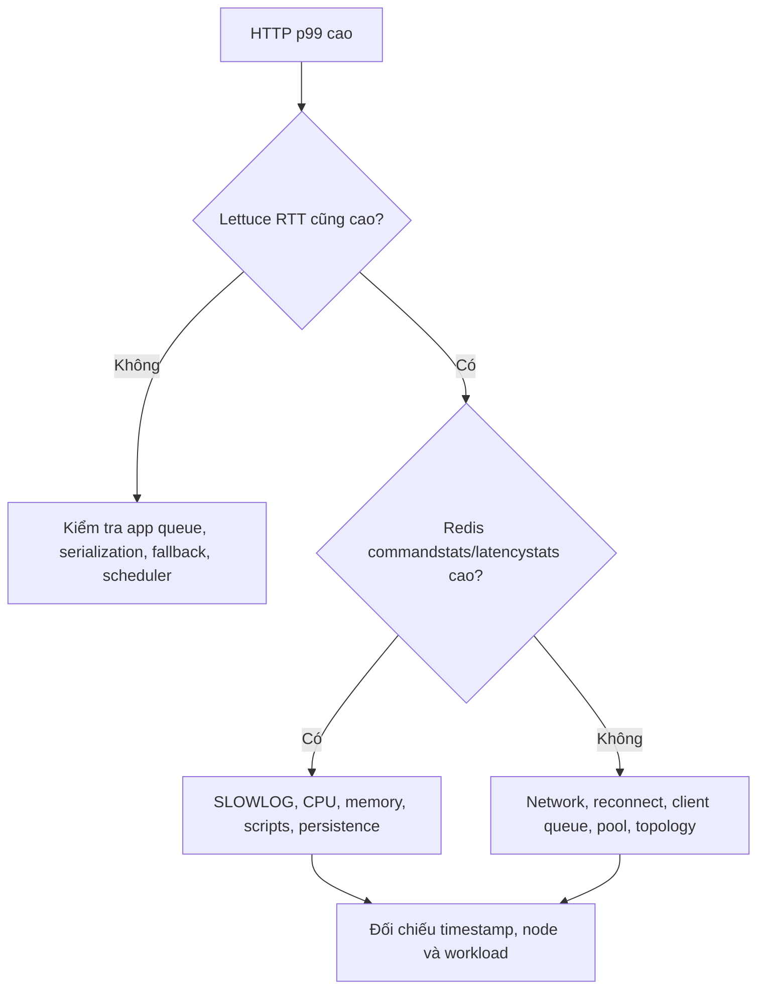
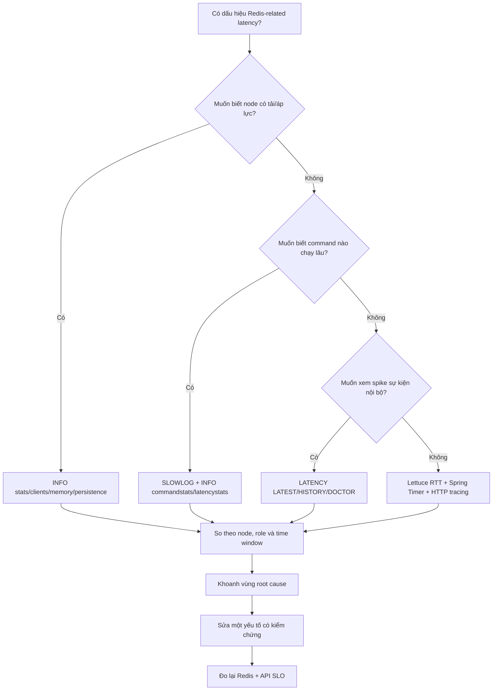

# Quan sát Redis bằng INFO, SLOWLOG và thống kê độ trễ trong Spring Data Redis

## 1. Bài toán: API chậm, nhưng Redis thực sự chậm ở đâu?

Giả sử ứng dụng Spring Boot dùng Redis để đọc cache sản phẩm:

```java
String name = stringRedisTemplate.opsForValue()
    .get("product:name:p-42");
```

Thông thường thao tác hoàn thành rất nhanh. Một ngày, API bắt đầu có độ trễ p99 cao; nhiều request chờ Redis, nhưng `PING` từ máy quản trị vẫn trả lời. Liệu Redis đang thực thi `GET` chậm? Hay ứng dụng đang đợi connection, network, reconnect hoặc một request khác?

Để trả lời, cần nhìn **nhiều điểm đo** thay vì chỉ một con số:

```text
Spring HTTP request
  |
  +-- Chờ thread / scheduler / connection
  |
  +-- Serialize key/value
  |
  +-- Redis client / Lettuce gửi command
  |       |
  |       +-- Network tới Redis
  |       |
  |       +-- Redis thực thi command
  |       |        |
  |       |        +-- SLOWLOG
  |       |        +-- INFO commandstats / latencystats
  |       |        +-- LATENCY monitor
  |       |
  |       +-- Network trả response
  |
  +-- Deserialize dữ liệu / Reactor operators
  |
  +-- Xử lý tiếp / trả HTTP response
```

Ba công cụ Redis trọng tâm:

1. **`INFO`:** các số liệu và trạng thái của Redis server theo từng nhóm như memory, clients, stats, commandstats, persistence, replication và latencystats.
2. **`SLOWLOG`:** nhật ký các command có thời gian **thực thi trong Redis** vượt ngưỡng được cấu hình.
3. **Thống kê độ trễ:** Redis Latency Monitor (`LATENCY LATEST/HISTORY/DOCTOR`), histogram/percentile lệnh khi phiên bản hỗ trợ và số liệu độ trễ client từ Lettuce hoặc Spring.

Điểm quan trọng: **SLOWLOG trống không chứng minh end-to-end Redis call của ứng dụng nhanh**. Lệnh có thể thực thi trên server trong 100 µs nhưng client đợi hàng trăm mili giây vì network, reconnect, queue, TLS hoặc ứng dụng đang thiếu tài nguyên.

Mục tiêu bài học là biết công cụ nào trả lời được câu hỏi nào, thu metric với chi phí phù hợp, dựng dashboard hữu ích và dùng kết quả để chẩn đoán đúng nguyên nhân.

## 2. Bốn tầng quan sát nên phân biệt

| Tầng | Đối tượng đo | Ví dụ tín hiệu |
|---|---|---|
| Redis server | Tình trạng node, tài nguyên, lệnh đang thực thi | `INFO`, `SLOWLOG`, `LATENCY` |
| Redis client | Thời gian từ gửi command đến nhận response, reconnect, queue | Lettuce command latency, timeout, connection errors |
| Spring Data Redis | Lời gọi qua `RedisTemplate`/`ReactiveRedisTemplate`, serialization | Micrometer instrumentation hoặc timer quanh service |
| Nghiệp vụ / HTTP | Cache hit/miss, fallback, request latency, tỷ lệ lỗi | API p95/p99, DB fallback, error budget |

Ví dụ số liệu **minh họa**:

```text
Redis GET execution:  0,08 ms
Lettuce command RTT:  6,00 ms
App cache lookup:     8,00 ms
HTTP response:      140,00 ms
```

Không được cộng/trừ các giá trị ở những thời điểm hoặc metric scope khác nhau rồi kết luận chắc chắn 132 ms nằm ở database. Muốn phân tích một request cụ thể, cần trace hoặc phép đo có cùng correlation và phân ranh giới thời gian rõ ràng.

### 2.1. Đơn vị thời gian là nguồn nhầm lẫn phổ biến

| Tín hiệu | Đơn vị thường dùng |
|---|---|
| `SLOWLOG GET` duration | **µs** (microseconds) |
| `INFO commandstats` `usec` và `usec_per_call` | **µs** |
| `INFO latencystats` | **µs** |
| `LATENCY LATEST/HISTORY` event latency | **ms** (milliseconds) |
| `redis-cli --latency` | **ms** |
| HTTP/client metrics | Có thể là s, ms hoặc ns tùy hệ đo |

Nhớ rằng **1 ms = 1.000 µs**. Một lệnh trong SLOWLOG có duration 12.000 µs tương đương 12 ms, không phải 12 giây.

## 3. INFO: ảnh chụp trạng thái của một Redis node

Trong `redis-cli`:

```redis
INFO
```

Redis trả về các section chứa dòng theo định dạng:

```text
# Stats
total_connections_received:...
total_commands_processed:...
instantaneous_ops_per_sec:...
keyspace_hits:...
keyspace_misses:...
...
```

Để giảm dữ liệu thu thập và tập trung điều tra, có thể truy vấn section:

```redis
INFO server
INFO clients
INFO memory
INFO stats
INFO commandstats
INFO persistence
INFO replication
INFO cpu
INFO keyspace
```

Các section và field cụ thể có thể khác theo **phiên bản Redis**, cấu hình, role của node và các module đã nạp. Một dashboard không nên coi mọi field là bắt buộc trên tất cả Redis 6/7/8 hoặc mọi managed Redis.

**INFO thường cho thông tin của node được kết nối**, không phải bản tổng hợp tất cả primary/replica trong Redis Cluster. Nếu cùng một API đang dùng ba primary, cần lấy metric của cả ba để tránh bỏ qua điểm nghẽn trên một shard.

### 3.1. INFO không phải lời giải cho từng request

`INFO stats` có thể cho thấy Redis xử lý 50.000 commands/s, nhưng không trực tiếp cho biết request HTTP nào đã chờ, key nào gây chậm hoặc command nào vừa timeout.

Vì vậy, dùng INFO để trả lời các câu hỏi dạng **"Redis node đang ở trạng thái nào?"**, rồi kết hợp SLOWLOG, latency monitor và client-side metric để đi sâu.

## 4. INFO server: xác nhận node và môi trường

```redis
INFO server
```

Một số trường hữu ích:

| Field | Ý nghĩa | Tại sao quan trọng |
|---|---|---|
| `redis_version` | Phiên bản Redis đang chạy | Quyết định có `LATENCY HISTOGRAM`/latencystats hay không |
| `redis_mode` | Standalone, cluster, sentinel theo vai trò server | Phân biệt topology cần theo dõi |
| `uptime_in_seconds` | Thời gian tiến trình đã chạy | Phát hiện restart làm reset counter |
| `process_id` | PID Redis trên node | Hữu ích khi đối chiếu log |
| `os` | Môi trường OS | Gợi ý vấn đề scheduler, filesystem |
| `tcp_port` | Port Redis báo cáo | Xác nhận endpoint |

Ví dụ:

```text
# Server
redis_version:7.x.x
redis_mode:standalone
uptime_in_seconds:98765
```

Đây là dữ liệu minh họa, không phải số liệu đo được từ một Redis thực tế.

### 4.1. Vì sao uptime rất quan trọng?

Nhiều metric trong INFO là **bộ đếm tích lũy kể từ khi tiến trình khởi động**. Nếu node restart, counter có thể giảm về giá trị nhỏ. Khi tính rate bằng hiệu hai lần đo, phải phát hiện reset, nếu không sẽ tạo tốc độ âm hoặc đồ thị sai.

Lưu `instance/node identifier` và uptime hoặc start time cùng các metrics giúp phân biệt:

- Tăng/giảm thực sự của traffic.
- Reset counter sau restart.
- Node cũ bị thay thế bởi node mới.
- Failover khiến role thay đổi.

## 5. INFO clients: quá nhiều client và blocked clients

```redis
INFO clients
```

Những field thường gặp:

| Field | Điều quan sát |
|---|---|
| `connected_clients` | Số client connections đang mở |
| `blocked_clients` | Client đang chờ trong những cơ chế blocking hỗ trợ |
| `maxclients` (thường ở section clients tùy bản) | Giới hạn connection server |
| Các chỉ số input/output buffer | Dấu hiệu bộ đệm client tăng bất thường |

Nếu `connected_clients` tăng từ vài trăm lên hàng nghìn khi ứng dụng deploy, có thể do:

- Tạo nhiều Redis connection factories không cần thiết.
- Một connection pool không được đóng.
- Mỗi request tạo client/connection mới.
- Nhiều pods cùng reconnect liên tục.
- Có nhiều long-lived Pub/Sub hoặc blocking consumers.

Nhưng **nhiều connected clients không tự chứng minh lỗi**. Redis Streams, Pub/Sub và blocking operations có thể giữ connections lâu theo thiết kế.

### 5.1. blocked_clients không đồng nghĩa server bị treo

Ví dụ:

```redis
BLPOP myqueue 30
```

Một client có thể block hợp lệ để chờ phần tử. Nếu có nhiều consumers dùng blocking reads, `blocked_clients` lớn có thể là đặc tính workload.

Trái lại, nếu một ứng dụng chỉ thực hiện cache GET nhưng blocked clients tăng, cần xem các phần khác của hệ thống có đang sử dụng locks, queues hoặc scripts không.

Không kết luận "Redis bị lock toàn bộ" chỉ từ số `blocked_clients`.

## 6. INFO memory: đo áp lực bộ nhớ và eviction

```redis
INFO memory
```

Các chỉ số đáng chú ý:

| Field | Ý nghĩa |
|---|---|
| `used_memory` | Bộ nhớ Redis quản lý/đếm cho dữ liệu và cấu trúc liên quan |
| `used_memory_human` | Biểu diễn dễ đọc |
| `used_memory_rss` | Resident Set Size do OS báo |
| `maxmemory` | Giới hạn bộ nhớ cấu hình nếu có |
| `maxmemory_policy` | Chính sách khi đạt giới hạn |
| `mem_fragmentation_ratio` | Tỷ lệ phản ánh tương quan RSS và bộ nhớ được Redis ghi nhận |
| `used_memory_dataset` | Ước lượng phần bộ nhớ cho dataset ở bản hỗ trợ |

### 6.1. Phân biệt memory pressure và command latency

Nếu Redis gần `maxmemory` và eviction tăng, ứng dụng có thể thấy:

- Cache hit giảm.
- Database fallback tăng.
- HTTP p99 tăng dù `GET` thực thi nhanh.
- Redis `used_memory` không tăng nhiều nữa vì có eviction.

Đây là ví dụ **hiệu năng hệ thống giảm do cache behavior**, không nhất thiết vì thời gian thực thi lệnh GET tăng.

### 6.2. Không suy luận toàn bộ từ mem_fragmentation_ratio

Một tỷ lệ fragmentation cao có thể liên quan allocator/OS memory, nhưng việc diễn giải phụ thuộc dataset size, version và môi trường. Trên instance dữ liệu rất nhỏ, ratio có thể cao mà không phản ánh vấn đề nghiêm trọng.

Cần đối chiếu cùng `used_memory`, `used_memory_rss`, RSS thực tế, memory pressure và latency. Không tự động restart Redis chỉ vì một tỷ lệ vượt ngưỡng cố định.

## 7. INFO stats: tổng quan lệnh, cache hit/miss và eviction

```redis
INFO stats
```

Một số field thường dùng:

| Field | Câu hỏi cần trả lời |
|---|---|
| `total_commands_processed` | Node xử lý tổng cộng bao nhiêu lệnh? |
| `instantaneous_ops_per_sec` | Tốc độ hoạt động gần thời điểm hiện tại? |
| `total_connections_received` | Có tăng kết nối mới bất thường? |
| `rejected_connections` | Có bị từ chối kết nối do giới hạn? |
| `keyspace_hits` | Số lần lookup Redis key thành công theo thống kê server |
| `keyspace_misses` | Số lần lookup không tìm thấy key |
| `expired_keys` | Số key bị loại bỏ do expiration |
| `evicted_keys` | Số key bị loại vì giới hạn bộ nhớ/eviction |
| `total_net_input_bytes`, `total_net_output_bytes` | Traffic network tại Redis |

### 7.1. Counter tích lũy và tốc độ theo khoảng thời gian

Giả sử hai lần đo cách nhau 60 giây:

```text
T0 total_commands_processed = 8.000.000
T1 total_commands_processed = 8.600.000

rate ≈ (8.600.000 - 8.000.000) / 60
     = 10.000 commands/s
```

Các con số trên chỉ minh họa. Trong hệ thống metrics, dùng hàm rate/increase phù hợp, biết xử lý counter reset sau restart.

**Không dùng giá trị counter tổng cộng như thể nó là số lệnh mỗi giây.**

### 7.2. Tính cache hit ratio theo delta

Giả sử trong một khoảng đo:

```text
delta(keyspace_hits)   = 900
delta(keyspace_misses) = 100

server_keyspace_hit_ratio = 900 / (900 + 100) = 90%
```

Công thức:

```text
hit_ratio = Δhits / (Δhits + Δmisses)
```

Nếu mẫu số bằng 0, tỷ lệ không có ý nghĩa và nên hiển thị "không có dữ liệu" thay vì 100%.

**Lưu ý quan trọng:** `keyspace_hits/misses` là thống kê theo logic lookup của Redis server, **không hoàn toàn đồng nghĩa hit rate của một `@Cacheable` hoặc một endpoint**. Nó có thể bao gồm accesses từ nhiều ứng dụng, Lua và cấu trúc dữ liệu khác nhau. Muốn đo hiệu quả cache theo domain, nên instrument tại layer cache của ứng dụng.

### 7.3. Expiration khác eviction

- `expired_keys` tăng: key đạt TTL và bị loại.
- `evicted_keys` tăng: Redis loại key do áp lực `maxmemory` và policy.

Nếu request cache miss tăng vì TTL quá ngắn, cách giải quyết khác với request miss do bộ nhớ hết và eviction liên tục.

Không gộp hai chỉ số thành một biểu đồ "keys lost" rồi đưa ra một hướng xử lý duy nhất.

## 8. INFO commandstats: lệnh nào tiêu tốn CPU Redis?

```redis
INFO commandstats
```

Ví dụ đầu ra mô phỏng:

```text
# Commandstats
cmdstat_get:calls=100000,usec=200000,usec_per_call=2.00
cmdstat_set:calls=50000,usec=350000,usec_per_call=7.00
cmdstat_hgetall:calls=6000,usec=900000,usec_per_call=150.00
```

Các bản Redis mới còn có thể trả những field như `rejected_calls` hoặc `failed_calls` cho từng command; không nên hardcode parser dựa trên ví dụ một phiên bản duy nhất.

Ý nghĩa:

- `calls`: số lần command đã được ghi nhận.
- `usec`: tổng thời gian CPU/thực thi được Redis ghi nhận cho command.
- `usec_per_call`: thời gian trung bình của command theo thống kê.

### 8.1. Trung bình rất thấp vẫn có tail latency

Giả sử `GET` có `usec_per_call=3.0` µs. Điều này **không chứng minh** tất cả GET đều dưới 10 µs: một số ít lệnh chậm có thể bị trung bình che lấp.

Muốn biết p99 và sự kiện chậm bất thường, xem `INFO latencystats`, `LATENCY HISTOGRAM`, `SLOWLOG` và client RTT.

### 8.2. commandstats không phải client RTT

Nếu `cmdstat_hgetall` ghi `usec_per_call=150`, đó là thời gian server thống kê cho command, không bao gồm toàn bộ chờ:

- DNS và connect.
- Network tới Redis rồi quay về.
- Client request queue.
- Redis connection pool wait.
- Serialization/deserialization ở Java.
- Retry/fallback.

Do đó, không lấy `usec_per_call` làm thời gian phản hồi end-to-end của một HTTP API.

## 9. INFO persistence và replication: khi độ trễ đến từ hạ tầng

```redis
INFO persistence
INFO replication
```

Nếu bật AOF/RDB, các field đáng chú ý có thể gồm:

```text
aof_enabled:1
aof_rewrite_in_progress:0
aof_last_write_status:ok
aof_pending_bio_fsync:0
aof_delayed_fsync:0
rdb_bgsave_in_progress:0
```

Nếu latency tăng đúng lúc AOF rewrite hoặc RDB background save, hãy kiểm tra CPU, copy-on-write memory và disk I/O. Không nên tự kết luận đây là nguyên nhân chỉ vì hai sự kiện trùng thời điểm; cần xem latency samples, logs và storage metrics.

Trong mô hình primary–replica:

```text
role:master
connected_slaves:2
master_repl_offset:...
slave0:ip=...,port=...,state=online,offset=...,lag=...
```

Các field theo replica cho biết tiến độ replication. **Replication lag là độ mới của dữ liệu bản sao**, khác với độ trễ của một lệnh GET. Một replica có thể trả lời GET nhanh nhưng vẫn trả dữ liệu cũ.

### 9.1. Redis Cluster và Sentinel cần thu theo node

Trong Redis Cluster, nhiều primary sở hữu các hash slots khác nhau; nếu chỉ đọc INFO trên một node, có thể bỏ qua shard quá tải.

Trong Sentinel failover, node đổi role; dashboard cần gắn metric với **node ID / address / role / cluster**, không gộp nhầm primary cũ và primary mới.

Khi làm monitoring, theo dõi riêng từng primary/replica và aggregate theo vai trò, thay vì coi một hostname seed là đại diện cho tất cả Redis nodes.

## 10. INFO keyspace: bao nhiêu key và TTL ra sao?

```redis
INFO keyspace
```

Ví dụ:

```text
# Keyspace
db0:keys=120000,expires=80000,avg_ttl=650000
```

Ý nghĩa:

- `keys`: số key được Redis thống kê trong database.
- `expires`: số key có expiration.
- `avg_ttl`: thống kê thời gian sống trung bình theo cách Redis thu thập.

Các số chỉ là ví dụ. Keyspace INFO hữu ích khi:

- Số key tăng không kiểm soát.
- Ứng dụng ngừng đặt TTL và `expires` giảm tương đối.
- Dữ liệu cache hết hạn nhanh bất thường.

**Keyspace không phân biệt tự động key của từng dịch vụ theo prefix.** Muốn có metric theo domain, hãy instrument producer/cache layer hoặc dùng công cụ khảo sát keyspace có giới hạn, không tùy tiện chạy `KEYS *` trên node production lớn.

## 11. SLOWLOG: xem các command thực thi lâu trong Redis

SLOWLOG là log **trong bộ nhớ Redis**, ghi lại những command có thời gian thực thi vượt ngưỡng. Nó khác ứng dụng logs và khác network trace.

Các lệnh:

```redis
SLOWLOG GET 10
SLOWLOG LEN
```

`SLOWLOG GET 10` lấy tối đa 10 mục gần nhất; `SLOWLOG LEN` cho số mục đang được giữ.

Một entry SLOWLOG có thông tin thường gồm:

```text
ID của entry
Unix timestamp (giây)
Thời gian thực thi (microseconds)
Command và một số arguments
Client address (nếu phiên bản hỗ trợ)
Client name (nếu phiên bản hỗ trợ)
```

Ví dụ mô phỏng:

```text
id       = 4321
unix_sec = 1794500000
duration = 18500 microseconds
command  = HGETALL big:profile:42
client   = 10.0.1.25:52022
```

18.500 µs tương đương **18,5 ms** thực thi tại Redis. Timestamp chỉ minh họa định dạng Unix, không phải sự kiện thực tế.

### 11.1. SLOWLOG không đo network latency

Redis ghi nhận thời gian lệnh được thực thi trên server, **không bao gồm** thời gian truyền request từ client hoặc gửi response qua mạng theo cách đo của SLOWLOG.

Vì thế:

```text
Lettuce GET RTT  = 200 ms
SLOWLOG GET      = không có entry
```

không phải một mâu thuẫn. Có thể command chạy rất nhanh nhưng client bị:

- Network delay/loss.
- Reconnect hoặc request queue.
- Connection/pool contention.
- Redis server bị stall trước khi bắt đầu xử lý command cụ thể.
- Event-loop hoặc scheduler Java quá tải.
- TLS/serialization overhead.

SLOWLOG đặc biệt hữu ích để xác định **lệnh nào có thời gian thực thi server cao**, không phải chứng nhận mọi thành phần ngoài server đang khỏe.

## 12. Cấu hình ngưỡng và kích thước SLOWLOG

Redis có các tham số:

```conf
slowlog-log-slower-than 10000
slowlog-max-len 128
```

Ý nghĩa:

- `slowlog-log-slower-than` dùng **microseconds**.
- `10000` nghĩa là ngưỡng khoảng 10 ms.
- `slowlog-max-len` giới hạn số entry Redis giữ trong bộ nhớ.

Kiểm tra trạng thái:

```redis
CONFIG GET slowlog-log-slower-than
CONFIG GET slowlog-max-len
```

**Đặc biệt lưu ý hai giá trị:**

| Giá trị ngưỡng | Ý nghĩa |
|---|---|
| `10000` | Theo dõi command vượt khoảng 10 ms |
| `1000` | Theo dõi command vượt khoảng 1 ms |
| `0` | Ghi **mọi** command, rất dễ gây overhead/tràn log |
| `-1` | Tắt ghi slowlog entries |

Không dùng `0` trên production bận rộn chỉ để "thu đủ số liệu". Với tốc độ rất cao, mọi command bị ghi log làm chi phí tăng và ring buffer nhỏ quay vòng nhanh.

### 12.1. Thay đổi runtime: chỉ khi có quyền vận hành

Trong Redis test riêng:

```redis
CONFIG SET slowlog-log-slower-than 5000
CONFIG SET slowlog-max-len 256
```

Các lệnh này **thay đổi hành vi Redis server**, không phải chỉ đọc thông tin. Chúng cần ACL phù hợp và không nên thực hiện trên production nếu chưa có quy trình quản trị.

Runtime config không phải lúc nào cũng tự tồn tại sau restart; đối với hệ thống managed Redis, phải dùng cách cấu hình tham số server do nhà cung cấp hỗ trợ.

### 12.2. SLOWLOG không phải log bền vững

SLOWLOG giữ một số mục gần nhất trong bộ nhớ. Khi quá giới hạn, các mục cũ được thay thế. Sau restart, bạn không nên mặc định lịch sử vẫn còn.

Muốn có điều tra lâu dài, cần hệ thống metrics/log collection thu định kỳ, với **giới hạn dữ liệu và quyền truy cập** thích hợp. Đừng dùng SLOWLOG làm event audit log nghiệp vụ.

## 13. Đọc SLOWLOG có hệ thống

Khi thấy một entry:

```text
HGETALL user:profile:u-42  — 20.500 µs
```

hãy đặt câu hỏi:

1. Lệnh này có thường xuất hiện hay chỉ một lần?
2. Payload/Hash lớn đến mức nào?
3. Có nhiều client cùng gọi `HGETALL` với các key lớn?
4. Có thể đọc một vài field bằng `HMGET` hoặc thay đổi mô hình dữ liệu không?
5. Có Lua script xử lý nhiều dữ liệu trên event loop Redis?
6. Có `SCAN`/`KEYS`/`SMEMBERS` trả khối lượng dữ liệu lớn?
7. Có biến động CPU hoặc disk fork cùng thời điểm?

### 13.1. Những command nên xem kỹ

| Command hoặc nhóm | Rủi ro điển hình |
|---|---|
| `KEYS *` | Quét rộng, có thể gây pause lớn trên dataset nhiều key |
| `HGETALL` trên Hash rất lớn | Đọc và trả nhiều field/value |
| `SMEMBERS` trên Set rất lớn | Trả toàn bộ thành viên |
| `LRANGE 0 -1` trên List lớn | Lấy toàn bộ phần tử |
| Lua `EVAL` có vòng lặp nặng | Script chặn tiến trình xử lý lệnh trong khoảng dài |
| `SORT`, một số thao tác tập hợp lớn | Chi phí xử lý tăng theo dữ liệu |
| Xử lý massive multi-key operations | Tăng CPU và payload size |

Không nên suy diễn cứ có một `HGETALL` trong SLOWLOG là phải thay thành `HSCAN`. Quyết định cần dựa vào số field, yêu cầu nhất quán, pagination, overhead và business semantics.

### 13.2. Slow command và hot key

Một hot key thường có **rất nhiều lệnh nhanh**, làm Redis shard bận liên tục nhưng từng lệnh không vượt slowlog threshold. SLOWLOG vì vậy có thể **không cho thấy** vấn đề hot key.

Cần kết hợp:

- Command rate per node.
- Latency histogram và CPU.
- Dữ liệu application key namespace/operation.
- Công cụ phân tích hot key phù hợp và kiểm soát chi phí.

Không chạy các command thu thập quá rộng hoặc nguy hiểm trên production chỉ để tìm hot key.

## 14. SLOWLOG và vấn đề bảo mật thông tin

SLOWLOG có thể chứa tên command và arguments, có thể bao gồm key hoặc một phần payload. Redis/phiên bản hiện đại có cơ chế che bớt dữ liệu nhạy cảm cho một số command, nhưng **không nên mặc định mọi dữ liệu nghiệp vụ đã được ẩn**.

Ví dụ một lệnh:

```redis
SET session:token:abc123 some-sensitive-payload
```

Nếu bị ghi SLOWLOG, nội dung có thể làm lộ token/payload trong log dump hoặc dashboard khi không được xử lý đúng.

Biện pháp:

- Áp dụng Redis ACL/least privilege cho quyền đọc SLOWLOG.
- Chỉ thu những fields cần thiết và che key/payload nhạy cảm khi export.
- Không paste nguyên SLOWLOG production vào ticket công khai.
- Hạn chế retention và quyền truy cập hệ thống log tập trung.
- Dùng aggregate theo command và service thay vì lưu mọi argument không cần thiết.

**`SLOWLOG RESET` xóa lịch sử slowlog trong bộ nhớ**, là thao tác thay đổi dữ liệu quan sát. Không dùng lệnh này trong quy trình điều tra thông thường nếu chưa có chỉ dẫn quản trị, vì nó làm mất bằng chứng.

## 15. Redis Latency Monitor: ghi nhận những sự kiện độ trễ

Redis có **Latency Monitoring Framework** để phát hiện các sự kiện có thời gian xử lý bất thường, ví dụ một lệnh chậm, fork hoặc hoạt động liên quan persistence, tùy phiên bản.

Không giống SLOWLOG, latency monitor có thể theo dõi **nhiều loại sự kiện nội bộ**, không chỉ một command có duration dài.

Kiểm tra cấu hình:

```redis
CONFIG GET latency-monitor-threshold
```

Ngưỡng `latency-monitor-threshold` tính bằng **milliseconds**. Khi đặt `0`, latency event monitoring theo cơ chế này bị tắt.

Ví dụ trong môi trường test:

```redis
CONFIG SET latency-monitor-threshold 100
```

Ý nghĩa: quan sát các sự kiện latency vượt ngưỡng khoảng 100 ms theo framework Redis hỗ trợ.

**Khác với SLOWLOG:**

```text
slowlog-log-slower-than = 10000  -> 10.000 µs = 10 ms
latency-monitor-threshold = 100 -> 100 ms
```

Nhầm đơn vị có thể khiến một hệ thống ghi log quá nhiều hoặc bỏ sót các sự kiện bạn mong muốn.

### 15.1. Không bật ngưỡng quá thấp theo suy đoán

Ngưỡng quá nhỏ có thể tạo lượng ghi nhận lớn không cần thiết; ngưỡng quá cao bỏ qua các spike ảnh hưởng tới API low-latency. Nên đặt theo SLA, baseline và hướng dẫn version Redis đang sử dụng.

Tùy thuộc Redis version, các event có sẵn và chi phí monitoring có thể thay đổi. Khi dùng managed service, cần xem provider có cho thay cấu hình monitor hay không.

## 16. LATENCY LATEST, HISTORY và DOCTOR

Các lệnh chẩn đoán:

```redis
LATENCY LATEST
LATENCY HISTORY command
LATENCY DOCTOR
```

### 16.1. LATENCY LATEST

`LATENCY LATEST` trả thông tin tóm tắt các event được monitor ghi nhận, với những dữ kiện như:

- Tên sự kiện.
- Dấu thời gian event gần đây.
- Latency gần đây, thường theo ms.
- Mức latency lớn nhất theo cửa sổ/historic data mà Redis lưu.

Ví dụ **mô phỏng**:

```text
event: command
timestamp: 1794500000
latest latency: 130 ms
max latency: 320 ms
```

Một event `command` cho thấy một lệnh đã gây latency đáng kể theo Redis monitor. Không có nghĩa mọi `GET` đều chậm 130 ms.

### 16.2. LATENCY HISTORY

`LATENCY HISTORY event-name` cho chuỗi các mẫu theo event:

```redis
LATENCY HISTORY command
```

Mỗi mẫu thường gắn Unix timestamp và latency. Có thể dùng để quan sát spike có lặp lại trước/sau một đợt Redis rewrite hay deployment không.

Tên event thực tế do Redis sinh ra; không nên giả định cluster của bạn chắc chắn có một event tên `command`. Hãy xem `LATENCY LATEST` trước, rồi truy vấn đúng tên event đã xuất hiện.

### 16.3. LATENCY DOCTOR

```redis
LATENCY DOCTOR
```

Redis tạo bản diễn giải và gợi ý dựa trên các event đã thu. Nó có thể hữu ích như bước triage ban đầu, nhưng **không thay thế việc đối chiếu workload, storage, network và client metrics**.

Nếu latency monitor bị tắt hoặc chưa thu được mẫu trên ngưỡng, `LATENCY DOCTOR` không có đủ bằng chứng để giải thích các request HTTP chậm. Không kết luận từ báo cáo trống rằng ứng dụng không có latency problem.

### 16.4. Các sự kiện khác ngoài command

Redis có thể ghi nhận event liên quan:

- Fork quá trình background.
- AOF write hoặc fsync bị trì hoãn.
- RDB/AOF background activity.
- Active defragmentation.
- Một số hoạt động nội bộ hoặc command execution.

Tên event cụ thể thay đổi theo phiên bản Redis. Hãy đọc danh sách event trên node thật thay vì hardcode mọi tên vào dashboard rồi coi event không tồn tại là lỗi.

## 17. INFO latencystats: percentile của command trên Redis 7+

Các bản Redis mới hỗ trợ thống kê độ trễ theo command bằng percentiles:

```redis
INFO latencystats
```

Ví dụ đầu ra **minh họa**:

```text
# Latencystats
latency_percentiles_usec_get:p50=1.003,p99=5.031,p99.9=12.000
latency_percentiles_usec_set:p50=3.007,p99=17.001,p99.9=70.003
```

Các giá trị ở đây tính bằng **microseconds**. Chúng không đo thời gian request đi qua Spring/Lettuce/network.

### 17.1. Khác trung bình trong commandstats như thế nào?

Giả sử:

```text
INFO commandstats:
  cmdstat_get: usec_per_call=2.5

INFO latencystats:
  GET p50=1.0 µs
  GET p99=8.0 µs
  GET p99.9=40.0 µs
```

Trung bình 2,5 µs có thể trông tốt, nhưng một phần nhỏ GET cần lâu hơn nhiều. Nếu Redis có 100.000 GET/s, tail latency của tỷ lệ nhỏ vẫn có thể tác động đến một lượng đáng kể request.

### 17.2. Percentile không cộng/trừ giữa tầng

Nếu Redis GET p99 = 8 µs và Lettuce p99 = 30 ms, không thể kết luận **mỗi request ở p99 của Lettuce** đã tiêu tốn đúng 29,992 ms network. Hai percentile thường đến từ **những tập mẫu khác nhau**, thời gian đo khác nhau và sự kiện không nhất thiết khớp từng request.

Để tìm nguyên nhân cụ thể, cần instrument cùng một lần gọi hoặc trace phù hợp.

### 17.3. Cấu hình tracking và tập percentile

Trên các Redis version hỗ trợ:

```redis
CONFIG GET latency-tracking
CONFIG GET latency-tracking-info-percentiles
```

Có thể có các tùy chọn bật/tắt command latency tracking và xác định percentiles được xuất ra. Không giả định `INFO latencystats` sẽ có cùng cấu trúc trên Redis cũ không hỗ trợ lệnh này.

**Latency tracking/histogram theo command là một cơ chế khác với latency event monitor điều khiển bởi `latency-monitor-threshold`.** Đừng nhầm rằng chỉ bật monitor event là đủ để có mọi command percentile.

## 18. LATENCY HISTOGRAM: phân bố độ trễ theo lệnh

Với Redis hỗ trợ histogram (Redis 7+), có thể dùng:

```redis
LATENCY HISTOGRAM
LATENCY HISTOGRAM GET SET
```

Ý tưởng là quan sát số lệnh trong các khoảng độ trễ được ghi nhận, thường theo microseconds, thay vì chỉ một giá trị trung bình.

Ví dụ khái niệm:

```text
GET:
  <= 1 µs       : 20.000 calls
  <= 2 µs       : 80.000 calls
  <= 8 µs       : 99.000 calls
  <= 64 µs      : 99.900 calls
  total         : 100.000 calls
```

Đây là **một histogram tích lũy minh họa**, không phải output thực tế của Redis. Khi đọc kết quả thật, cần hiểu bucket boundaries, count và version-specific representation.

### 18.1. Histogram giúp trả lời câu hỏi nào?

- Tail latency của GET/SET có tăng theo thời gian không?
- Một command có nhiều outliers dù trung bình thấp?
- Có cần thay `HGETALL` bằng các thao tác đọc có phạm vi hẹp hơn?
- Sau deploy, phân bố command duration dịch chuyển thế nào?

Để đo theo khoảng thời gian, hệ thống monitoring phải xử lý counter/histogram cumulative đúng cách; không so sánh hai bucket counts tích lũy như hai phép đo độc lập.

### 18.2. Histograms không thay thế SLOWLOG

Histogram cho thấy **phân bố**, nhưng thường không cho biết key hoặc command args của một lần chậm cụ thể. SLOWLOG cung cấp ví dụ lệnh có duration dài, còn histogram cho bạn biết hiện tượng đó phổ biến đến mức nào.

Kết hợp cả hai sẽ tốt hơn dùng riêng lẻ.

## 19. redis-cli --latency: đo phản hồi từ vị trí client

Một phép đo đơn giản từ máy có `redis-cli`:

```text
redis-cli -h redis.internal -p 6379 --latency
```

Công cụ liên tục thực hiện phép đo độ trễ tới Redis và hiển thị số liệu min/avg/max theo cách của Redis CLI. Có thể dùng để so sánh:

- Chạy trên Redis host.
- Chạy trên Spring application host/pod.
- Chạy qua cùng network path/TLS mà ứng dụng sử dụng, nếu công cụ hỗ trợ cấu hình tương ứng.

### 19.1. Đo client latency không giống SLOWLOG

Ví dụ:

```text
Từ Redis host:            average RTT = 0,3 ms
Từ Spring application:    average RTT = 8,0 ms
Redis SLOWLOG:            không có GET chậm
```

Các số giả định này gợi ý kiểm tra network path/client environment. Nhưng vẫn cần xem liệu ứng dụng có cùng endpoint, ACL, TLS, packet size và command workload như phép đo CLI không.

Một phép đo PING RTT nhỏ **không chứng minh** thao tác trả payload 2 MB hoặc Lua script dài cũng có latency nhỏ tương tự.

### 19.2. Không làm phép đo gây tải vô hạn mà không kiểm soát

Chạy liên tục nhiều phép đo từ hàng trăm pods có thể tạo thêm traffic. Hãy đặt mục tiêu đo, thời gian quan sát hợp lý, và dừng chương trình sau khi đủ số liệu.

Trong production, ưu tiên metrics instrumentation theo tần suất kiểm soát được và không thu payload nhạy cảm.

## 20. Vì sao có thể Redis nhanh nhưng ứng dụng Spring chậm?

Một ví dụ:

```text
Redis GET exec               80 µs
Lettuce command RTT          4 ms
Connection pool wait       120 ms
JSON deserialization        15 ms
Application scheduling       8 ms
--------------------------------
Spring cache lookup        147 ms (minh họa)
```

Trong trường hợp này, tối ưu câu lệnh Redis từ 80 µs xuống 40 µs gần như không thay đổi API latency. Điểm nghẽn có thể nằm ở pool wait hoặc client-side processing.

Những nguyên nhân phổ biến:

- Redis connection pool hết permit.
- Tạo connection mới liên tục.
- DNS hoặc TLS handshake.
- Redis Client reconnect/command queue.
- JVM GC pause hoặc thiếu CPU.
- Reactor event-loop chạy thao tác blocking.
- JSON/JDK serialization của value lớn.
- API wrapper retry command nhiều lần.
- Network packet loss.
- Đọc replica ở vùng địa lý xa.

**Không dùng `SLOWLOG GET 10` trống làm cơ sở duy nhất để kết luận ứng dụng lỗi.** Phải so metric từ nhiều tầng.

## 21. Spring Data Redis đọc INFO bằng Java

Để tích hợp số liệu server vào một công cụ quản trị nội bộ, Spring Data Redis cung cấp server commands qua `RedisConnection`.

Ví dụ dùng `StringRedisTemplate` với Redis có quyền `INFO` phù hợp:

```java
import java.util.Properties;

import org.springframework.data.redis.core.RedisCallback;
import org.springframework.data.redis.core.StringRedisTemplate;
import org.springframework.stereotype.Component;

@Component
public class RedisInfoReader {

    private final StringRedisTemplate redis;

    public RedisInfoReader(StringRedisTemplate redis) {
        this.redis = redis;
    }

    public Properties readStats() {
        return redis.execute(
            (RedisCallback<Properties>) connection ->
                connection.serverCommands().info("stats")
        );
    }

    public Long totalCommands() {
        Properties stats = readStats();

        if (stats == null) {
            return null;
        }

        String raw = stats.getProperty("total_commands_processed");
        return raw == null ? null : Long.valueOf(raw);
    }
}
```

Điều cần chú ý:

- Lệnh `INFO` được thực hiện trên kết nối Redis mà template sử dụng.
- Đọc một section cụ thể giảm số lượng trường cần parse.
- Field có thể vắng mặt hoặc khác theo phiên bản.
- Trên Redis Cluster, một template operation theo connection có thể không thay thế việc truy vấn **từng node**.
- Server INFO thường cần quyền Redis ACL tương ứng và có thể bị hạn chế bởi managed Redis.

Ví dụ sử dụng `Properties` được viết theo API Spring Data Redis 3.x. Với những dòng phiên bản khác, cần đối chiếu signature `RedisServerCommands.info(...)` và xử lý response kiểu của library đang dùng.

### 21.1. Không gọi INFO trong mỗi HTTP request

Nếu một web endpoint có 5.000 requests/s mà mỗi request đều gọi `INFO stats`, bạn đã thêm lượng command quản trị không cần thiết và làm endpoint phụ thuộc vào hoạt động monitoring.

Thay vào đó:

- Thu theo chu kỳ phù hợp qua metrics exporter.
- Cache kết quả quan sát ở lớp monitoring nếu cần.
- Tránh query lặp tần suất quá cao.
- Không xuất toàn bộ thông tin nội bộ Redis cho người dùng HTTP.

## 22. Đo latency trong Spring bằng Micrometer

Redis server đo thời gian thực thi command; ứng dụng thường cần đo **thời gian thực tế mà service chờ**.

Với Spring Boot Actuator và Micrometer, có thể đặt timer quanh một operation:

```groovy
dependencies {
    implementation 'org.springframework.boot:spring-boot-starter-actuator'
    implementation 'org.springframework.boot:spring-boot-starter-data-redis'
}
```

Một service imperative:

```java
import io.micrometer.core.instrument.MeterRegistry;
import io.micrometer.core.instrument.Timer;

import org.springframework.data.redis.core.StringRedisTemplate;
import org.springframework.stereotype.Service;

@Service
public class MeasuredCacheReader {

    private final StringRedisTemplate redis;
    private final MeterRegistry registry;

    public MeasuredCacheReader(
            StringRedisTemplate redis, MeterRegistry registry) {
        this.redis = redis;
        this.registry = registry;
    }

    public String getProductName(String productId) {
        Timer.Sample sample = Timer.start(registry);
        String outcome = "success";

        try {
            return redis.opsForValue()
                .get("product:name:" + productId);
        } catch (RuntimeException error) {
            outcome = "error";
            throw error;
        } finally {
            sample.stop(
                Timer.builder("app.redis.cache.lookup")
                    .tag("operation", "GET")
                    .tag("outcome", outcome)
                    .register(registry)
            );
        }
    }
}
```

Timer này đo **tổng thời gian lời gọi Java qua template**, có thể bao gồm network, client queue và deserialize. Nó **không đo riêng server command execution**.

### 22.1. Tags phải có cardinality thấp

Nên tag theo:

```text
operation = GET | SET | HGET
purpose   = cache | session | rate_limit
outcome   = success | error | cancelled
service   = catalog | checkout
```

Không dùng:

```text
redis_key = product:name:p-42
user_id   = u-123456
request_id= ...
```

Mỗi key/user/request ID khác nhau có thể tạo hàng triệu time series, làm hệ thống metrics tốn RAM và chi phí lưu trữ rất lớn. Thêm nữa, những giá trị ấy có thể chứa dữ liệu nhạy cảm.

### 22.2. "success" không đồng nghĩa cache hit

`StringRedisTemplate.opsForValue().get(...)` trả `null` khi key không tồn tại. Một lần gọi thành công về mặt Redis nhưng cache miss vẫn nên có:

```text
Redis call outcome = success
Cache result       = miss
```

Nếu cần đo cache hit ratio theo service, tạo một counter/timer riêng cho hit/miss. Không gộp cache miss vào error rate của circuit breaker.

## 23. Đo một ReactiveRedisTemplate operation

Trong Reactor, một `Mono` là lazy và có thể được subscribe nhiều lần. Nếu start timer quá sớm, bạn có thể đo cả thời gian **chờ trước khi subscribe**, không phải operation.

Ví dụ:

```java
import java.time.Duration;
import java.util.concurrent.TimeUnit;

import io.micrometer.core.instrument.MeterRegistry;
import io.micrometer.core.instrument.Timer;

import org.springframework.data.redis.core.ReactiveStringRedisTemplate;
import org.springframework.stereotype.Service;

import reactor.core.publisher.Mono;
import reactor.core.publisher.SignalType;

@Service
public class MeasuredReactiveCacheReader {

    private final ReactiveStringRedisTemplate redis;
    private final MeterRegistry registry;

    public MeasuredReactiveCacheReader(
            ReactiveStringRedisTemplate redis,
            MeterRegistry registry) {
        this.redis = redis;
        this.registry = registry;
    }

    public Mono<String> getProductName(String productId) {
        return Mono.defer(() -> {
            long start = System.nanoTime();

            return redis.opsForValue()
                .get("product:name:" + productId)
                .doFinally(signal -> {
                    long elapsed = System.nanoTime() - start;

                    String outcome =
                        signal == SignalType.ON_ERROR ? "error" :
                        signal == SignalType.CANCEL   ? "cancelled" :
                            "complete";

                    Timer.builder("app.redis.cache.lookup")
                        .tag("operation", "GET")
                        .tag("api", "reactive")
                        .tag("outcome", outcome)
                        .register(registry)
                        .record(elapsed, TimeUnit.NANOSECONDS);
                });
        });
    }
}
```

Điểm cần nhớ:

- `Mono.defer(...)` tạo một phép đo mới mỗi lần subscribe.
- `doFinally` chạy theo completion, error hoặc cancellation.
- `System.nanoTime()` dùng đo khoảng thời gian, không phải timestamp lịch.
- Completion của một `Mono.empty()` vẫn là `complete`, không phải lỗi.
- Nếu đặt timer bên ngoài retry/fallback, thời gian đo có thể bao gồm **tất cả các lần thử lại và fallback**. Để đo riêng Redis attempt, đặt instrumentation đúng phạm vi.

**Hãy định nghĩa rõ metric đang đo gì** trước khi so sánh với Redis SLOWLOG. Dù cả hai cùng có chữ "latency", chúng không dùng cùng ranh giới.

## 24. Lettuce command latency và client-level instrumentation

Lettuce có khả năng thu command latency ở phía client, và có thể tích hợp với Micrometer tùy phiên bản/cấu hình.

Khác với timer tầng service:

```text
Service timer:
    cache lookup Java method
    -> Redis command + serializer + client waiting

Lettuce command latency:
    các giai đoạn client theo dõi khi gửi command
    -> nhận kết quả từ Redis

Redis INFO/SLOWLOG:
    chỉ những giai đoạn server Redis thực thi/ghi nhận
```

Khi bật command latency recorder phù hợp, có thể quan sát command name, remote endpoint và các percentile/timer mà integration cung cấp. Nhưng **Spring Data Redis không mặc định đảm bảo mọi metrics Lettuce tự xuất ra** chỉ vì ứng dụng có dependency Micrometer.

Để tích hợp production:

1. Xác định phiên bản Lettuce được Spring Boot resolve.
2. Kiểm tra client resources và recorder/instrumentation thực sự đã cấu hình.
3. Đảm bảo ứng dụng export metrics tới hệ thống theo dõi.
4. Kiểm tra tag cardinality, connection target và cách aggregate.
5. Test bằng một GET có kết quả và một lần Redis timeout để đảm bảo metric đúng scope.

Nếu đã có auto-instrumentation từ framework/agent, đừng bọc thêm timer cùng tên khiến dashboard đếm double. Phân biệt metrics theo **metric name và measurement boundary**.

### 24.1. Vì sao command RTT vẫn có thể thấp hơn API latency?

Ví dụ server GET nhanh và Lettuce chỉ ghi nhận RTT 2 ms, nhưng API p99 500 ms vì:

- Waiting for connection/bulkhead.
- Database fallback sau cache miss.
- Blocking JSON parsing hoặc CPU starvation.
- HTTP queue và downstream latency.

Theo dõi chỉ Redis metrics không đủ để nói toàn bộ API đang khỏe.

## 25. Redis latency monitor và client timer khác nhau thế nào?

| Công cụ | Nguồn dữ liệu | Ranh giới đo | Trả lời tốt nhất |
|---|---|---|---|
| `INFO stats` | Redis server | Counters toàn node | Traffic, hits/misses, evictions, errors |
| `INFO commandstats` | Redis server | Aggregate execution per command | Command nào chiếm CPU/thời gian thực thi |
| `INFO latencystats` | Redis server | Percentiles execution của command | Tail latency tại Redis |
| `SLOWLOG` | Redis server | Lệnh thực thi vượt ngưỡng | Command/args nào rất chậm |
| `LATENCY LATEST/HISTORY` | Redis server | Các event latency nội bộ vượt ngưỡng | Có fork/AOF/command spike nào? |
| `LATENCY HISTOGRAM` | Redis server | Phân bố độ trễ các command | Tỷ lệ outlier theo command |
| `redis-cli --latency` | Một client CLI | Network + server round trip cho phép đo | RTT từ vị trí chạy CLI |
| Lettuce command latency | Redis Java client | Các pha gửi/nhận command | Client nhìn Redis command nhanh/chậm thế nào |
| Micrometer service Timer | Spring app | Phạm vi method/Publisher được đo | Business cache lookup tốn bao lâu |
| HTTP server metrics | Web server | Toàn request | Người dùng thấy latency gì |

Không có một công cụ đơn lẻ chứa mọi nguyên nhân. Một dashboard tốt trình bày các lớp này cạnh nhau, tránh trộn thành một đồ thị có tên chung "Redis latency".

## 26. Dựng dashboard theo câu hỏi vận hành

Một bố cục hữu ích:

### 26.1. Hàng 1 — Trạng thái hệ thống

- Redis node up/down, role primary/replica, Redis version.
- Connected clients, blocked clients.
- Cluster health hoặc Sentinel failover events.
- Redis errors và client reconnect/timeout.

### 26.2. Hàng 2 — Tải và bộ nhớ

- Commands/s, network in/out.
- Used memory, maxmemory, RSS và fragmentation.
- Keyspace hits/misses rate và service-specific cache hit rate.
- Expired/evicted keys per second.

### 26.3. Hàng 3 — Latency

- Lettuce command RTT p50/p95/p99.
- Redis command latency percentiles per command.
- SLOWLOG slow entries rate hoặc top command families.
- Redis latency event spikes, AOF rewrite/fork correlation.
- HTTP cache endpoint p95/p99.

### 26.4. Hàng 4 — Persistence, replication và fallback

- `aof_delayed_fsync`/AOF write status.
- Replication offset gap, master link state.
- Redis Cluster redirects/failover.
- DB fallback requests/s, latency và error rate.

### 26.5. Hàng 5 — Các SLO nghiệp vụ

- Request success rate.
- Cache availability/fail-open rate.
- p99 latency của API quan trọng.
- Tác động tới checkout, session hoặc rate-limit decisions.

Không dùng dashboard để khoe số lượng metrics; mỗi đồ thị nên giúp trả lời một câu hỏi điều tra hoặc quyết định vận hành cụ thể.

## 27. Tính rate và percentile đúng trong hệ thống metrics

Một Redis exporter thường lấy INFO theo chu kỳ và chuyển các fields thành time series. Khi vẽ, cần hiểu:

### 27.1. Counters

`total_commands_processed`, `keyspace_hits`, `keyspace_misses`, `expired_keys`, `evicted_keys` thường được xem như counters. Tốc độ nên tính từ tăng trưởng theo thời gian, có xử lý restart.

Ví dụ phép tính khái niệm:

```text
ops_per_second ≈ Δ(total_commands_processed) / Δtime_seconds
```

### 27.2. Gauges

`connected_clients` và `used_memory` là những giá trị trạng thái tại thời điểm đo. Không áp dụng rate một cách máy móc khi câu hỏi là "hiện tại có bao nhiêu clients?".

### 27.3. Histograms/percentiles

Đừng lấy trung bình các giá trị **p99 của từng node** rồi gọi đó là p99 toàn Redis Cluster. Để tính phân vị tổng hợp chính xác, cần histogram hoặc dữ liệu phân bố phù hợp để gộp theo trọng số.

Ví dụ:

```text
Node A có 100.000 GET/s, p99 = 1 ms
Node B có     100 GET/s, p99 = 50 ms
```

Trung bình số học (1 + 50) / 2 = 25,5 ms không đại diện cho p99 thật của tất cả requests. Cần giữ scope/node rõ hoặc aggregate theo cách hỗ trợ từ histogram/metrics pipeline.

### 27.4. Sampling và time window

Một spike 200 ms chỉ diễn ra vài giây có thể bị bỏ qua nếu scraper chạy mỗi 60 giây và chỉ lấy gauge cuối cùng.

Để nắm tail latency, nên dùng counters/histogram đúng cách, request metrics đủ chi tiết và thời gian retention phù hợp. Không nhất thiết tăng toàn bộ INFO polling lên mỗi 100 ms; điều đó có thể tạo tải lớn không cần thiết.

## 28. Chẩn đoán: API p99 tăng nhưng SLOWLOG trống

Giả định:

```text
Spring HTTP p99:       1.200 ms
Lettuce GET p99:         900 ms
Redis GET latencystats:   10 µs
SLOWLOG:                không có GET chậm
```

Khả năng cần xem:

1. Kết nối Redis có đang reconnect?
2. Redis command có bị queue ở client?
3. Network từ application pods đến Redis có packet loss hoặc RTT lớn?
4. Redis replica có nằm khác region?
5. Có quá nhiều concurrent requests tranh connection?
6. Timeout có bị retry nhiều lần?
7. Redis đã stall trước khi bắt đầu command, trong khi SLOWLOG chỉ ghi execution?
8. Driver/client metrics đang đo đúng command và endpoint hay không?

Đường điều tra:



**Sơ đồ là hướng phân tích**, không phải kết luận cứng. Tùy phạm vi metric và thời gian lấy mẫu, các giá trị có thể không hoàn toàn khớp.

## 29. Chẩn đoán: nhiều SLOWLOG entries và latency monitor command spikes

Giả định một node có:

```text
SLOWLOG:
  HGETALL key lớn: 30 ms
  EVAL script:    120 ms

LATENCY LATEST:
  command event gần nhất: 120 ms

INFO commandstats:
  cmdstat_eval usec tăng mạnh
```

Những giả định này gợi ý workload server-side đang gây chậm. Cần:

- Xác định script có vòng lặp qua số lượng lớn keys/members không.
- Giảm kích thước tập dữ liệu mà một request đọc một lần.
- Dùng pagination theo command phù hợp, tránh quét dữ liệu lớn trong một lệnh.
- Chuyển logic CPU nặng ra khỏi Redis nếu không cần atomicity trên server.
- Đặt giới hạn dữ liệu/khối lượng làm việc.
- Đo lại sau thay đổi trên môi trường thử nghiệm.

Đừng chỉ tăng `slowlog-log-slower-than` để làm log trống. Làm vậy xóa triệu chứng khỏi màn hình, không giảm latency.

### 29.1. LUA và single-thread execution

Redis server thực thi nhiều command logic theo mô hình tuần tự trên main command execution path. Một script Lua quá dài có thể ảnh hưởng khả năng xử lý command khác. Những Redis version hiện đại còn có I/O threading và background work, nên mô tả "Redis hoàn toàn đơn luồng" là đơn giản hóa quá mức.

Điểm cần chú ý vận hành: script dài có thể làm tăng latency của các client khác ngay cả khi chúng chỉ gọi GET.

## 30. Chẩn đoán: cache misses và DB tải cao nhưng GET rất nhanh

Giả định:

```text
Redis GET execution p99 = 15 µs
Cache hit ratio giảm 95% -> 40%
evicted_keys/s tăng mạnh
DB query p99 tăng
HTTP p99 tăng
```

Redis GET vẫn nhanh, nhưng nhiều requests phải đi database. Nguyên nhân có thể:

- Cache eviction do `maxmemory`.
- TTL quá ngắn.
- Key version/prefix thay đổi sau deploy.
- Sai key serializer, khiến service đọc nhầm keyspace.
- Cache warming chưa hoàn tất.

Kiểm tra:

```redis
INFO memory
INFO stats
INFO keyspace
```

Đồng thời xem cache hit/miss theo endpoint tại Spring app, không chỉ tỷ lệ tổng server. Cần xác nhận liệu các key bị evict hay đơn giản producer và reader dùng hai prefix khác nhau.

**Bài học:** giải quyết vấn đề cache efficiency không phải lúc nào cũng là tối ưu Redis command execution.

## 31. Chẩn đoán: spike latency khi AOF rewrite hoặc fork

Redis có thể tạo background process để rewrite AOF hoặc snapshot RDB. Những thời điểm này có thể tạo chi phí CPU/memory, copy-on-write và disk I/O.

Quan sát cùng thời gian:

```redis
INFO persistence
INFO memory
LATENCY LATEST
LATENCY DOCTOR
```

Các metric đáng quan sát:

- `aof_rewrite_in_progress`.
- `rdb_bgsave_in_progress`.
- `aof_delayed_fsync`.
- Memory/RSS tăng bất thường.
- Latency monitor fork/AOF-related events nếu có.
- Disk write latency và filesystem metrics bên ngoài Redis.

Một correlation hợp lý:

```text
AOF rewrite bắt đầu
    -> disk I/O tăng
    -> fsync delay tăng
    -> Redis p99/HTTP p99 tăng
```

Nhưng cần xác nhận bằng số liệu và log, vì latency cùng thời điểm có thể do một batch traffic khác hoặc network.

## 32. Chẩn đoán: chỉ một Redis Cluster shard chậm

Redis Cluster chia keys qua 16.384 hash slots. Nếu service dùng hash tag không phù hợp hoặc có hot key, một primary có thể chịu phần lớn tải.

Ví dụ:

```text
Primary A: 60.000 ops/s, CPU cao, p99 cao
Primary B:  8.000 ops/s, CPU thấp
Primary C:  7.000 ops/s, CPU thấp
```

Nếu dashboard chỉ lấy số trung bình toàn cluster, vấn đề ở A có thể bị che.

Các bước:

1. Thu `INFO stats/commandstats/memory` trên từng node.
2. So sánh command rate và p99 per-node.
3. Kiểm tra hot keys và hash tags trong key design.
4. Dùng `CLUSTER KEYSLOT` trên một số key nghi vấn trong môi trường được phép.
5. Xem resharding/failover có đang diễn ra không.
6. Nếu cần rebalancing, thực hiện qua quy trình vận hành riêng, không tự động đổi owner slot từ ứng dụng.

**Không so sánh p99 của node A với traffic của toàn cluster** như thể chúng đo cùng mẫu. Giữ node ID/role trong mọi metric.

## 33. Một quy trình điều tra có trình tự

Giả sử dashboard báo Redis timeout tăng. Quy trình có thể đi như sau:

**Bước 1 — Xác nhận phạm vi.** Lỗi ở một HTTP API, mọi cache operations, một service hay mọi service? Chỉ một Redis node hay toàn topology?

**Bước 2 — Kiểm tra client.** Lettuce có reconnect, command timeout hoặc queue lớn không? Có recent deploy thay pool, serializer hoặc timeout?

**Bước 3 — Kiểm tra server tổng quát.**

```redis
INFO server
INFO clients
INFO stats
INFO memory
```

**Bước 4 — Xem command-level performance.**

```redis
INFO commandstats
INFO latencystats
SLOWLOG GET 20
```

Nếu Redis version không hỗ trợ `latencystats`, không ép parser hoặc chẩn đoán dựa vào section thiếu.

**Bước 5 — Quan sát latency events.**

```redis
LATENCY LATEST
LATENCY DOCTOR
```

Nếu monitor chưa bật, nói rõ thiếu dữ liệu thay vì coi báo cáo trống là bằng chứng Redis hoàn toàn khỏe.

**Bước 6 — Kiểm tra hạ tầng.**

```redis
INFO persistence
INFO replication
```

Đối chiếu với CPU, disk I/O, network và failover/resharding events.

**Bước 7 — So thời gian.** Ghép các tín hiệu có cùng time window, node/role và loại command.

**Bước 8 — Đề xuất thay đổi nhỏ có đo trước/sau.** Ví dụ giảm `HGETALL` trên Hash lớn, giới hạn concurrency ở client hoặc khắc phục network.

**Bước 9 — Kiểm chứng tác động nghiệp vụ.** Redis p99 cải thiện có làm HTTP p99 và error rate tốt hơn không? Có làm cache miss hoặc fallback rate tăng không?

Không bỏ qua bước cuối. Một thay đổi tối ưu Redis server có thể làm service chậm hơn nếu nó vô tình tăng số round trips hoặc phá một thao tác nguyên tử.

## 34. Bài thực hành 1: lấy baseline INFO

Thực hiện trên Redis phát triển hoặc Redis test riêng. Không cần thay cấu hình server.

### Bước 1: xác định phiên bản và role

```redis
INFO server
INFO replication
```

Ghi lại Redis version, uptime và role.

### Bước 2: lấy số liệu tài nguyên

```redis
INFO clients
INFO memory
INFO stats
INFO keyspace
```

Quan sát `connected_clients`, `used_memory`, `keyspace_hits`, `keyspace_misses` và `evicted_keys`.

### Bước 3: gửi một số GET/SET

```redis
SET test:obs:item-1 hello EX 300
GET test:obs:item-1
GET test:obs:missing
GET test:obs:item-1
```

Đây là các lệnh thử trên keyspace riêng, TTL ngắn để tự dọn. Sau đó:

```redis
INFO stats
INFO commandstats
```

Mục tiêu là hiểu những bộ đếm nào thay đổi, không cần ép một tỷ lệ chính xác vì trên Redis có thể đồng thời có traffic khác.

### Bước 4: tính delta

Lấy mẫu lại sau một khoảng thời gian đủ dài, tính tốc độ commands/s và cache hit ratio theo delta. Nếu Redis test chỉ có một client, bạn có thể dễ liên hệ lệnh mình gửi với counter; trên production, phải account các clients khác.

## 35. Bài thực hành 2: đọc SLOWLOG có điều kiện

Trong Redis test, quan sát:

```redis
CONFIG GET slowlog-log-slower-than
CONFIG GET slowlog-max-len
SLOWLOG LEN
SLOWLOG GET 10
```

Nếu muốn thiết lập một ngưỡng minh họa, **chỉ trong test**:

```redis
CONFIG SET slowlog-log-slower-than 1000
CONFIG SET slowlog-max-len 256
```

Ngưỡng 1.000 µs = 1 ms.

Sau đó chạy một workload test có chi phí CPU phù hợp, quan sát liệu command xuất hiện trong SLOWLOG không. Không sử dụng `KEYS *` trên dataset lớn hoặc Lua cố tình chạy quá lâu trong production để "tạo một slowlog entry".

Khi đọc:

1. Ghi ID và timestamp.
2. Chuyển duration µs sang ms chính xác.
3. Nhóm theo command type.
4. Xác định input size và data structure.
5. Đối chiếu application latency cùng time window.

**Đừng thay đổi ngưỡng production chỉ để tạo log cho bài thực hành.**

## 36. Bài thực hành 3: Redis latency events

Chỉ trên Redis test:

```redis
CONFIG GET latency-monitor-threshold
CONFIG SET latency-monitor-threshold 50
LATENCY LATEST
LATENCY DOCTOR
```

Khi có event vượt ngưỡng 50 ms, quan sát tên event và thời gian. Nếu có event `command`:

```redis
LATENCY HISTORY command
```

Không có event không phải lỗi của bài thực hành; có thể workload chưa tạo latency đủ lớn.

Nếu Redis version hỗ trợ:

```redis
CONFIG GET latency-tracking
INFO latencystats
LATENCY HISTOGRAM GET SET
```

So sánh **đơn vị µs** của per-command percentile với **ms** của latency event monitor. Chúng đo các tín hiệu liên quan nhưng không hoàn toàn trùng nhau.

Lưu ý các lệnh `LATENCY RESET` hoặc `SLOWLOG RESET` làm mất dữ liệu lịch sử trong bộ nhớ; không cần dùng để hoàn thành bài thực hành.

## 37. Bài thực hành 4: đo từ Spring Boot

Tạo một service dùng `StringRedisTemplate` hoặc `ReactiveStringRedisTemplate` và instrument Timer Micrometer như các ví dụ trước.

### Bước 1: gắn nhãn low-cardinality

```text
metric: app.redis.cache.lookup
tags:
  operation: GET
  outcome: complete/error
  purpose: product-cache
```

### Bước 2: tạo cache hit và cache miss

```text
GET product:name:p-42 -> HIT
GET product:name:missing -> MISS
```

Xác nhận metrics tách **operation success** với **cache hit/miss**, không tính miss như connection error.

### Bước 3: so thời gian nhiều tầng

Lấy cùng cửa sổ:

- Spring timer p50/p99.
- Lettuce command latency nếu đã bật instrumentation.
- `INFO latencystats` hoặc `SLOWLOG` từ Redis.
- HTTP server request timer.

Ghi chú metric nào đo thời gian service, metric nào đo Redis server command execution.

### Bước 4: mô phỏng latency mạng

Trong môi trường test riêng, có thể dùng network fault injection (ví dụ một TCP proxy test) để tăng RTT tới Redis mà không cố ý làm Redis command nặng.

Kỳ vọng:

```text
Lettuce/client RTT tăng
Spring cache lookup tăng
Redis server SLOWLOG có thể vẫn trống
Redis command execution percentile có thể không tăng tương ứng
```

Đây là một thí nghiệm quan trọng để thấy **không thể tìm mọi nguyên nhân latency chỉ từ SLOWLOG**.

### Bước 5: mô phỏng server-side chậm

Trên Redis test cô lập, dùng một workload có chi phí server-side cao được kiểm soát. Quan sát:

```text
SLOWLOG xuất hiện command chậm
INFO commandstats usec_per_call tăng
latencystats/histogram thể hiện outliers nếu hỗ trợ
Spring/Lettuce latency có thể tăng
```

Không tạo script vô hạn, không khóa server production và không dùng dữ liệu người dùng thật.

## 38. Các lỗi thường gặp khi dùng INFO, SLOWLOG, LATENCY

### "SLOWLOG trống nghĩa là Redis không chậm"

Sai. SLOWLOG chỉ ghi những lệnh vượt ngưỡng **thời gian thực thi trên server**. Network, client queue và reconnect không nhất thiết xuất hiện.

### "INFO usec_per_call chính là API latency"

Sai. Đó là thống kê thời gian thực thi Redis theo command, không bao gồm mọi giai đoạn end-to-end.

### "latency-monitor-threshold dùng microseconds"

Sai. Đây là ngưỡng **milliseconds**; slowlog threshold mới dùng microseconds.

### "INFO latencystats và LATENCY LATEST là cùng một tính năng"

Không. Per-command latency tracking/percentiles khác với latency event monitor dùng threshold.

### "SLOWLOG GET 10 là toàn bộ lịch sử"

Không. Nó chỉ lấy tối đa 10 mục gần nhất trong ring buffer, không phải audit log lâu dài.

### "Mỗi SLOWLOG entry đều là nguyên nhân API chậm"

Không chắc. Cần đối chiếu node, thời gian, command và request scope; có thể nhiều sự kiện xảy ra đồng thời.

### "Có thể trung bình p99 của các Redis nodes"

Không thể coi trung bình p99 là p99 hợp lệ của phân bố hợp nhất. Cần aggregation có histogram hoặc hiển thị theo node.

### "Bật slowlog-log-slower-than=0 trên production là vô hại"

Sai. Nó có thể ghi mọi command, tạo overhead và lộ thông tin nhạy cảm.

### "Redis INFO trên một seed là INFO của toàn Cluster"

Không. Cần thu metrics theo các Redis data nodes và vai trò thực tế.

### "Redis eviction tăng là do TTL hết hạn"

Không. Expiration và eviction là hai cơ chế khác nhau và có counters riêng.

### "LATENCY DOCTOR không báo gì tức là mọi thứ tốt"

Không nếu monitor tắt, threshold quá cao hoặc chưa có mẫu phù hợp.

### "Client PING RTT thấp chứng minh SET payload lớn nhanh"

Không. Payload, command type, server workload và application serialization có thể làm kết quả khác.

### "Thêm thật nhiều labels vào Micrometer để debug dễ hơn"

Không nếu labels là Redis key, user ID hoặc request ID có cardinality lớn. Cần traces/logs phù hợp để giữ thông tin từng request.

### "Có thể dùng SLOWLOG làm lưu trữ audit thay vì database"

Không. Nó bị giới hạn bộ nhớ, có thể ghi đè entries và không giữ lịch sử nghiệp vụ bền vững.

### "Một đồ thị Redis latency tổng hợp đủ để điều hành"

Không. Phải phân biệt Redis server execution, client RTT, Spring service timer, HTTP latency và kết quả nghiệp vụ.

## 39. Quy trình quyết định công cụ cần dùng



Checklist sử dụng trong production:

1. Biết Redis version và topologies đang chạy.
2. Thu INFO trên **từng** data node, lưu nhãn node/role.
3. Hiểu đơn vị của SLOWLOG (µs) và LATENCY monitor (ms).
4. Có commandstats/latencystats hoặc phương án tương đương cho Redis version cũ.
5. Không dùng threshold bằng 0 trên production bận rộn.
6. Không export raw arguments chứa dữ liệu nhạy cảm từ SLOWLOG.
7. Phân biệt counter, gauge và histogram khi xây dashboard.
8. Xử lý counter reset khi Redis restart và role change.
9. Có client RTT và Spring/HTTP timers ngoài server metrics.
10. Có metric cache hit/miss theo business domain, không chỉ Redis global hits/misses.
11. Đối chiếu p99 theo cùng node, command và time range.
12. Có test thực nghiệm phân biệt network latency với server execution time.
13. Có alert theo SLO người dùng, không chỉ ngưỡng CPU/memory.
14. Khi sự cố, điều tra từ dữ liệu trước khi tăng timeout hoặc thay Redis config.

## 40. Tổng kết

**`INFO`, `SLOWLOG` và thống kê độ trễ là ba mảnh ghép bổ sung nhau để quan sát Redis trong một hệ thống Spring Data Redis.**

- **`INFO`** cho thấy trạng thái của node, traffic, memory, clients, cache behavior, persistence, replication và hiệu năng tổng hợp của từng command.
- **`SLOWLOG`** ghi những command thực thi chậm **ở phía Redis server**, với ngưỡng tính bằng **microseconds**; nó không phản ánh đầy đủ network latency hoặc queue của Java client.
- **`LATENCY LATEST/HISTORY/DOCTOR`** giúp xem các event latency nội bộ vượt ngưỡng tính bằng **milliseconds**, khi event monitor được bật.
- **`INFO latencystats` và `LATENCY HISTOGRAM`** cung cấp thông tin phân bố/tail latency theo command trên những Redis version hỗ trợ.
- **Lettuce và Micrometer trong Spring** bổ sung góc nhìn client/application: request chờ bao lâu, có reconnect, timeout hay fallback không, và điều đó ảnh hưởng tới HTTP p99 ra sao.

Để chẩn đoán chính xác, cần giữ đúng **đơn vị, phạm vi đo, Redis node, thời gian và ngữ nghĩa metric**. Đừng tối ưu một GET từ 20 µs xuống 10 µs khi ứng dụng đang chờ connection 300 ms, và cũng đừng xem SLOWLOG trống là bằng chứng mọi request Redis đều nhanh.

Điểm quan trọng nhất: **quan sát từ server đến ứng dụng**, dùng các tín hiệu phù hợp để tìm nguyên nhân, rồi đo lại tác động lên trải nghiệm người dùng và tính đúng của nghiệp vụ.

## Tài liệu tham khảo

- [Redis Documentation — INFO](https://redis.io/docs/latest/commands/info/)
- [Redis Documentation — SLOWLOG](https://redis.io/docs/latest/commands/slowlog/)
- [Redis Documentation — SLOWLOG GET](https://redis.io/docs/latest/commands/slowlog-get/)
- [Redis Documentation — LATENCY LATEST](https://redis.io/docs/latest/commands/latency-latest/)
- [Redis Documentation — LATENCY HISTORY](https://redis.io/docs/latest/commands/latency-history/)
- [Redis Documentation — LATENCY DOCTOR](https://redis.io/docs/latest/commands/latency-doctor/)
- [Redis Documentation — LATENCY HISTOGRAM](https://redis.io/docs/latest/commands/latency-histogram/)
- [Redis Documentation — Redis latency monitoring](https://redis.io/docs/latest/operate/oss_and_stack/management/optimization/latency-monitor/)
- [Redis Documentation — Diagnosing latency issues](https://redis.io/docs/latest/operate/oss_and_stack/management/optimization/latency/)
- [Redis Documentation — CONFIG GET](https://redis.io/docs/latest/commands/config-get/)
- [Redis Documentation — Redis Cluster](https://redis.io/docs/latest/operate/oss_and_stack/reference/cluster-spec/)
- [Spring Data Redis Reference — Drivers](https://docs.spring.io/spring-data/redis/reference/redis/drivers.html)
- [Spring Data Redis Reference — RedisTemplate](https://docs.spring.io/spring-data/redis/reference/redis/template.html)
- [Spring Data Redis Reference — Reactive Redis Support](https://docs.spring.io/spring-data/redis/reference/redis/reactive.html)
- [Spring Boot Reference — Metrics](https://docs.spring.io/spring-boot/reference/actuator/metrics.html)
- [Micrometer Documentation — Timers](https://docs.micrometer.io/micrometer/reference/concepts/timers.html)
- [Lettuce Reference — Command latency](https://redis.github.io/lettuce/advanced-usage/#command-latency-collector)
