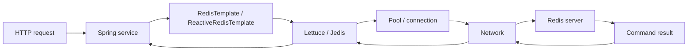
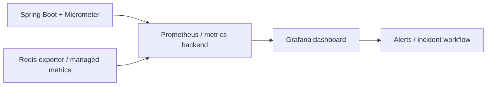

# Theo dõi số kết nối, lỗi lệnh và thời gian chờ trong Spring Data Redis

## 1. Tại sao cần quan sát Redis ở cả phía ứng dụng và phía server?

Redis thường trả kết quả rất nhanh, nên một ứng dụng Spring Data Redis có thể vận hành ổn định trong nhiều tháng trước khi gặp sự cố khó chẩn đoán:

- HTTP request chậm dần dù Redis vẫn phản hồi `PING`.
- Một số instance Spring Boot báo `RedisCommandTimeoutException` nhưng Redis không có lệnh chậm tương ứng trong `SLOWLOG`.
- Số client kết nối Redis tăng đột biến sau khi deployment hoặc failover.
- Các lệnh `GET` vẫn thành công nhưng `SET` bắt đầu bị từ chối do memory hoặc quyền truy cập.
- Redis có nhiều `blocked_clients`, nhưng thực tế đó là những consumer `XREAD BLOCK` bình thường.
- Application connection pool đã cạn trong khi Redis server vẫn còn nhiều chỗ trống cho kết nối mới.

Những hiện tượng này không thể giải thích chỉ bằng một metric “Redis UP/DOWN”.

Bài học tập trung vào **ba nhóm tín hiệu vận hành quan trọng trong Spring Data Redis**:

1. **Số kết nối:** Redis server có bao nhiêu client đang kết nối, ứng dụng tạo và dùng connection thế nào, pool có cạn không?
2. **Lỗi lệnh:** Redis trả lỗi loại gì, client gặp lỗi kết nối/serialization/timeout nào, tác động đến nghiệp vụ ra sao?
3. **Thời gian chờ:** kết quả Redis chậm do thực thi lệnh, mạng, pool, driver, blocking command hay retry?

Mục tiêu là thiết kế quan sát được sự cố trước khi người dùng bị ảnh hưởng nghiêm trọng và có đủ tín hiệu để tìm nguyên nhân.

> **Nguyên tắc cốt lõi:** phải đo cả **Redis server**, **Redis driver** và **ngữ cảnh thao tác trong ứng dụng**. Chúng mô tả các phần khác nhau của cùng một lời gọi Redis, không thay thế nhau.

---

## 2. Phân biệt ba lớp quan sát

Một yêu cầu đọc cache có thể đi qua:



Mỗi lớp đo được một phần:

| Lớp | Tín hiệu đặc trưng | Không nhìn thấy đầy đủ |
|---|---|---|
| **Ứng dụng Spring** | Thời gian gọi service Redis, cache hit/miss, lỗi tác động tới endpoint, retry/fallback | Toàn bộ kết nối của các ứng dụng khác trên Redis |
| **Driver Lettuce/Jedis** | Command latency, connect/reconnect, pool wait, timeout phía client | Các lệnh do client khác gửi tới server |
| **Redis server** | `connected_clients`, `rejected_connections`, `commandstats`, `errorstats`, `SLOWLOG` | Tổng thời gian một request HTTP chờ pool, Java serialization và mạng hai chiều |

Ví dụ một `GET` mất 500 ms ở tầng Java nhưng chỉ mất 30 µs xử lý tại Redis server. Chênh lệch có thể đến từ chờ connection, hàng đợi lệnh, event loop, network, serialization, JVM GC hoặc thread scheduling. Không thể tự động kết luận “Redis chạy chậm” chỉ vì application timer cao.

Ngược lại, Redis `SLOWLOG` có nhiều lệnh tốn CPU nhưng API chưa tăng latency rõ có thể báo trước nguy cơ khi lưu lượng tăng.

## 3. Bộ chỉ số tối thiểu nên theo dõi

| Nhóm | Chỉ số | Câu hỏi cần trả lời |
|---|---|---|
| Connections | `connected_clients` | Redis đang duy trì bao nhiêu kết nối client? |
| Connections | `maxclients` | Còn dư địa kết nối theo cấu hình không? |
| Connections | `rejected_connections` | Server đã từ chối kết nối mới chưa? |
| Connections | `total_connections_received` | Tốc độ tạo kết nối mới có bất thường không? |
| Connections | Pool active/idle/waiting | Ứng dụng có đợi mượn connection không? |
| Connections | Connect/reconnect failures | Có mất kết nối hoặc vòng reconnect không? |
| Commands | Command counts / rate | Lệnh nào được gọi nhiều và tải thay đổi ra sao? |
| Commands | `total_error_replies` | Redis đã trả bao nhiêu error reply? |
| Commands | `errorstats` | Những loại error reply nào đang tăng? |
| Commands | `commandstats` rejected/failed | Có lệnh bị từ chối hoặc thực thi lỗi? |
| Timeouts | Application command timeout | Có bao nhiêu lệnh không hoàn tất trong ngân sách client? |
| Latency | Client p50/p95/p99 | Người gọi thấy thời gian lệnh Redis phân bố thế nào? |
| Latency | `SLOWLOG`, `LATENCY` | Có vấn đề thực thi hoặc sự kiện latency trên server không? |
| Business impact | HTTP error/latency, cache fallback | Sự cố Redis ảnh hưởng người dùng ra sao? |

Ba nhóm đầu cần được liên kết bằng **thời gian, instance ứng dụng, Redis node và loại thao tác**. Một metric đơn lẻ hiếm khi đủ để chẩn đoán.

---

## 4. Đọc số kết nối từ Redis bằng INFO clients

Redis cung cấp lệnh:

```redis
INFO clients
```

Ví dụ kết quả có thể chứa:

```text
# Clients
connected_clients:82
cluster_connections:0
maxclients:10000
client_recent_max_input_buffer:16384
client_recent_max_output_buffer:0
blocked_clients:8
tracking_clients:0
```

Tên field cụ thể có thể thay đổi theo Redis version và chế độ triển khai. Những giá trị phía trên **chỉ là minh họa**, không phải trạng thái một server thực tế.

### 4.1. connected_clients

`connected_clients` là số client connection hiện đang kết nối tới **Redis node trả lời lệnh**. Nó không nhất thiết là:

- Số người dùng đang online.
- Số HTTP request đang chạy.
- Số Spring Boot instance.
- Số thread ứng dụng.
- Số lệnh Redis đang xử lý.

Một Spring Boot instance có thể duy trì nhiều kết nối do connection pool, Pub/Sub, blocking Stream readers hoặc cơ chế driver. Ngược lại, nhiều lệnh từ ứng dụng có thể sử dụng chung một native connection Lettuce.

Với Redis Cluster, cần quan sát **từng node**; đọc `INFO clients` ở một node không cho biết đầy đủ mọi client connection trong toàn bộ cluster.

### 4.2. maxclients

`maxclients` là giới hạn cấu hình cho kết nối client Redis, có thể quan sát bằng `INFO clients` ở những phiên bản phù hợp hoặc:

```redis
CONFIG GET maxclients
```

`CONFIG GET` cần quyền phù hợp và một số managed Redis hạn chế truy cập. Hạn mức thực tế cũng chịu ràng buộc bởi file descriptor hoặc giới hạn của dịch vụ.

Có thể theo dõi tỷ lệ:

\[
\text{Connection utilization} =
\frac{\text{connected\_clients}}{\text{maxclients}}
\times 100\%
\]

Nếu có 8.000 kết nối trên `maxclients=10.000`, tỷ lệ là 80%. Đây là tín hiệu cần điều tra, **không phải ngưỡng bắt buộc chuẩn cho mọi hệ thống**; còn phải xét xu hướng tăng, node dự phòng và các client đặc biệt.

### 4.3. blocked_clients

`blocked_clients` thường liên quan những client đang thực hiện **lệnh blocking** như `BLPOP` hoặc `XREAD BLOCK`.

Ví dụ:

```redis
XREAD BLOCK 5000 COUNT 10 STREAMS events:orders $
```

Một consumer chủ động chờ event có thể góp phần tăng `blocked_clients`. Do đó:

- `blocked_clients > 0` **không tự chứng minh Redis bị treo**.
- Số blocked tăng phù hợp với số worker có thể hoàn toàn bình thường.
- Tăng đột ngột ngoài kế hoạch có thể cho thấy tạo quá nhiều consumer, listener không được dừng hoặc pool bị giữ lâu.
- Phải so với số worker/subscription mong đợi trước khi cảnh báo.

`blocked_clients` của Redis server **khác** số Java thread bị block vì chờ connection trong application.

### 4.4. client buffers

Các chỉ số về input/output buffer giúp phát hiện client đọc dữ liệu chậm, đẩy payload quá lớn hoặc Pub/Sub subscriber không tiêu thụ kịp.

Tuy nhiên một field `client_recent_max_output_buffer` chỉ là một góc nhìn, không thay thế việc xem Redis memory và trạng thái client chi tiết. Nếu buffer tăng liên tục, kiểm tra tốc độ subscriber, network và command response size.

---

## 5. Phát hiện vòng tạo kết nối bất thường

Hai chỉ số khác nhau:

```redis
INFO stats
```

Trong đó thường có:

```text
total_connections_received:...
rejected_connections:...
```

### total_connections_received

Đây là bộ đếm tích lũy số kết nối được server nhận kể từ lúc khởi động. Để theo dõi tốc độ tạo kết nối, phải tính **mức tăng trên một khoảng thời gian**, không chỉ nhìn trị số tuyệt đối.

Ví dụ:

```text
12:00:00 total_connections_received = 100000
12:01:00 total_connections_received = 101800

Có 1800 kết nối mới được nhận trong 60 giây.
Tốc độ trung bình trong khoảng = 30 kết nối/giây.
```

Nếu trước đây ứng dụng tạo 2–3 kết nối mới/giây mà sau deployment tăng lên 30/giây, cần kiểm tra:

- Có tạo `LettuceConnectionFactory` hoặc `JedisPool` mới cho từng request không?
- Có đóng/mở connection lặp lại không?
- Có cơ chế reconnect liên tục do network/TLS/authentication lỗi không?
- Pool có `max-idle` quá thấp khiến connection bị loại rồi tạo lại nhiều?
- Có job hoặc health check mới tạo connection theo mỗi lần chạy?
- Có ứng dụng khác cùng Redis tăng tải?

Khi Redis restart, counter tích lũy có thể về 0. Dashboard nên dùng rate từ hệ giám sát có xử lý reset counter, không lấy phép trừ đơn giản qua một lần restart.

### rejected_connections

`rejected_connections` là số kết nối mới đã bị Redis từ chối, thường liên quan giới hạn kết nối hoặc tài nguyên của server.

Tăng trong lúc `connected_clients` sát `maxclients` là một tín hiệu mạnh cho thấy sức chứa connection đang thiếu. Nhưng điều tra vẫn cần xem log, giới hạn file descriptor, managed service và trạng thái network.

**Lưu ý:** một timeout ở client **không nhất thiết** làm `rejected_connections` tăng. Ví dụ client không thể kết nối do DNS hoặc firewall thì yêu cầu có thể chưa tới Redis server.

---

## 6. CLIENT LIST: xem ai đang chiếm connection

Lệnh:

```redis
CLIENT LIST
```

cung cấp thông tin chi tiết về những client đang kết nối, ví dụ địa chỉ, loại client, tuổi kết nối, trạng thái, DB, tên client và một số thông tin buffer tùy Redis version.

Một đoạn minh họa:

```text
id=204 addr=10.0.0.21:50210 age=300 idle=0
flags=N db=0 name=orders-api ...
```

Đây là dữ liệu kỹ thuật có thể chứa thông tin nội bộ nhạy cảm. Không đưa toàn bộ output `CLIENT LIST` lên dashboard công khai hoặc log gửi tới nơi không kiểm soát.

### CLIENT SETNAME giúp điều tra

Redis có lệnh:

```redis
CLIENT SETNAME orders-api-instance-a
```

Đặt client name có thể giúp nhận biết connection thuộc thành phần nào khi xem `CLIENT LIST`. Khi dùng Spring Data Redis, cách đặt tên tùy driver và cấu hình connection; cần làm rõ client name được gán cho **connection cụ thể** chứ không mặc định tất cả connection từ một service đều mang tên giống nhau.

Với hệ thống có pool hoặc reconnect, hãy kiểm tra tên thực tế sau khi kết nối lại và cách driver quản lý connection.

### Điều cần tránh

Không tự động gọi `CLIENT KILL` trên những connection trông “nhàn rỗi” chỉ dựa vào `idle`; nhiều native connection hoặc Pub/Sub listener hợp lệ có thời gian idle dài.

Nếu cần kết thúc client, phải xác minh ownership, vai trò, ảnh hưởng giao dịch/consumer và chính sách vận hành. Trong quá trình quan sát, ưu tiên các lệnh đọc trạng thái.

---

## 7. Số kết nối ở Spring Data Redis không đồng nghĩa với số kết nối phía server

Spring Data Redis cung cấp abstraction `RedisConnectionFactory`; hoạt động kết nối thực tế phụ thuộc driver.

### 7.1. Lettuce

Lettuce dùng mô hình I/O dựa trên Netty và có thể chia sẻ native connection cho nhiều lệnh thông thường theo cấu hình `LettuceConnectionFactory`.

Hệ quả:

- Nhiều lời gọi `StringRedisTemplate.opsForValue().get(...)` không nhất thiết mở một socket mới mỗi lần.
- Số request đồng thời cao không nhất thiết làm số socket tăng tương ứng.
- Một connection có thể chứa nhiều command đang chờ phản hồi; **ít connection không có nghĩa ít tải**.
- Những lệnh có trạng thái connection, blocking read, Pub/Sub hoặc transaction có yêu cầu xử lý connection riêng.
- Khi dùng pooling cho Lettuce, cần hiểu pool phục vụ loại thao tác nào; **không phải mọi ứng dụng Lettuce đều cần pool**.

### 7.2. Jedis

Jedis thường được sử dụng qua cơ chế connection/pool cho thao tác synchronous. Nếu pool bị cạn, thread ứng dụng có thể **chờ mượn connection**, khiến request chậm trước khi lệnh Redis được gửi.

Vì vậy, ngoài số kết nối phía Redis, cần theo dõi:

- Số connection đang được mượn.
- Số connection idle.
- Số caller đang chờ connection.
- Thời gian mượn connection.
- Số lần không mượn được connection trong thời gian cho phép.

### 7.3. Bảng phân biệt

| Hiện tượng | Có thể quan sát ở đâu? |
|---|---|
| Redis đang có bao nhiêu socket client | `INFO clients` |
| Pool đang có bao nhiêu connection active/idle | Metrics của pool/client phía JVM |
| Một thread đợi mượn pool quá lâu | Pool wait và exception tại ứng dụng |
| Lệnh Redis vẫn đang chờ phản hồi | Driver command latency/in-flight metrics, tracing |
| Redis từ chối mở connection | `rejected_connections`, log/exception client |
| Pub/Sub subscriber giữ connection | Redis `CLIENT LIST`, driver listener lifecycle |
| XREAD BLOCK chờ message | `blocked_clients` và các số liệu consumer |

**Đừng suy ra pool có vấn đề chỉ vì `connected_clients` cao**, và cũng đừng kết luận pool khỏe chỉ vì Redis chưa chạm `maxclients`.

---

## 8. Ví dụ cấu hình kết nối và timeout trong Spring Boot

Với Spring Boot và Lettuce, cấu hình minh họa:

```yaml
spring:
  data:
    redis:
      host: localhost
      port: 6379
      connect-timeout: 1s
      timeout: 2s
```

Ý nghĩa tổng quát:

- `connect-timeout`: giới hạn thời gian thiết lập connection theo cơ chế client/driver.
- `timeout`: giới hạn liên quan việc thực thi command của Redis client theo cấu hình Spring Boot.

Tên thuộc tính và hành vi cụ thể cần phù hợp với phiên bản Spring Boot/driver đang dùng. Đây là cấu hình mẫu cho Redis standalone local; production còn có TLS, authentication, Sentinel/Cluster, client resources và failover.

### Khi cần pool

Một cấu hình pool minh họa cho Lettuce:

```yaml
spring:
  data:
    redis:
      lettuce:
        pool:
          max-active: 16
          max-idle: 8
          min-idle: 2
          max-wait: 500ms
```

Khi bật pooling, cần dependency Apache Commons Pool 2 hoặc thành phần pool tương ứng theo phiên bản Spring Boot.

**Không nên thêm pool một cách máy móc.** Lettuce có khả năng chia sẻ native connection cho các lệnh thông thường; pool có thể hữu ích trong một số workload hoặc command stateful, nhưng thêm pool không tự làm Redis nhanh hơn.

Các con số `16/8/2/500ms` chỉ là ví dụ. Giá trị thực tế phải dựa vào số instance, số task đồng thời, loại command, giới hạn server, độ trễ và hành vi khi mất kết nối.

### Tính tổng số kết nối tối đa

Giả sử có:

```text
20 Spring Boot instances
Mỗi instance pool tối đa 16 connections

Chỉ riêng các pool đó có thể cần tới 20 × 16 = 320 connections.
```

Chưa tính:

- Pub/Sub listener connections.
- Stream blocking readers.
- Các connection do health check và công cụ giám sát.
- Redis replication/cluster internal connections.
- Ứng dụng khác dùng cùng Redis.
- Connection đang trong quá trình reconnect/failover.

Kế hoạch connection capacity phải tính theo **toàn bộ client ứng dụng**, không chỉ một pod.

---

## 9. Ba loại lỗi thường bị trộn lẫn

Khi một lời gọi Redis thất bại, cần phân loại **lỗi được Redis server trả về** và **lỗi ở client/transport**.

### 9.1. Redis error reply

Redis đã nhận lệnh và trả một phản hồi báo lỗi, ví dụ:

```text
-WRONGTYPE Operation against a key holding the wrong kind of value
-NOAUTH Authentication required.
-NOSCRIPT No matching script. Please use EVAL.
-OOM command not allowed when used memory > 'maxmemory'
```

Tùy lỗi và Redis version, server có thể tăng `total_error_replies` hoặc một nhóm error statistics.

### 9.2. Lỗi mạng hoặc kết nối

Ví dụ:

- DNS không phân giải được.
- TCP connect bị từ chối.
- TLS handshake thất bại.
- Firewall/network partition chặn kết nối.
- Socket bị đóng khi command đang chờ.
- Driver mất connection trong failover.

Các lỗi này thường xuất hiện ở **application/driver metrics và exception**, không nhất thiết ở `INFO errorstats` vì Redis server có thể không nhận được lệnh nào.

### 9.3. Timeout phía client

Ví dụ lệnh mất quá thời gian cho phép ở Lettuce/Jedis hoặc ứng dụng timeout khi mượn connection từ pool.

Timeout chỉ có nghĩa caller **không nhận được kết quả đúng hạn**. Không đủ để khẳng định Redis đã hay chưa thực thi lệnh.

Một `INCR` có thể đã tăng counter trên server nhưng response không đến trước timeout. Retry thiếu idempotency có thể làm tăng counter lần nữa.

### Bảng chẩn đoán ngắn

| Lỗi | Redis có thể ghi nhận error reply? | Có thể cần xem thêm |
|---|---|---|
| `WRONGTYPE` | Có | Key schema, serializer, lệnh app |
| `NOAUTH`/`NOPERM` | Có thể có | ACL, credential, quyền Pub/Sub/lệnh |
| `OOM` | Có thể có | `used_memory`, `maxmemory`, policy eviction |
| TCP connect timeout | Không nhất thiết | DNS, network, connect timeout, pool |
| Command timeout ở client | Không nhất thiết | Driver latency, server latency, network, in-flight |
| Pool borrow timeout | Redis có thể hoàn toàn khỏe | Pool active/waiters, connection bị giữ lâu |
| Serializer exception trong JVM | Không nhất thiết | Codec/serializer, object schema |
| Redis failover giữa command | Tùy thời điểm | Reconnect, topology, replication/failover |
| Command bị client cancel | Không nhất thiết | Subscription/cancellation, caller timeout |

**Không gộp mọi lỗi thành “Redis down”.** Cách xử lý và tác động nghiệp vụ của từng loại rất khác nhau.

---

## 10. Theo dõi lỗi từ Redis server: INFO stats

Chạy:

```redis
INFO stats
```

Một trường hữu ích:

```text
total_error_replies:...
```

Đây là bộ đếm tích lũy số error replies mà server đã trả. Vì là counter, cần lấy tốc độ gia tăng:

```text
09:00 total_error_replies = 1250
09:05 total_error_replies = 1310

Trong 5 phút có thêm 60 error replies.
```

Tăng error replies cần được phân tích theo loại lệnh và nguồn gọi. Có thể có một lượng nhỏ lỗi ứng dụng không ảnh hưởng người dùng, nhưng tăng mạnh sau khi deploy thường là tín hiệu lỗi API/schema/config.

**Không so một con số tích lũy với ngưỡng tĩnh** như “lớn hơn 1000 là sự cố”: Redis chạy lâu có thể có bộ đếm lớn dù hiện tại không có lỗi mới.

## 11. Theo dõi theo loại lỗi: INFO errorstats

Lệnh:

```redis
INFO errorstats
```

có thể trả các nhóm theo tiền tố mã lỗi, ví dụ:

```text
# Errorstats
errorstat_ERR:count=...
errorstat_WRONGTYPE:count=...
errorstat_NOAUTH:count=...
```

Dạng field, những loại mã có mặt và khả năng truy cập phụ thuộc Redis version, cấu hình và service được quản lý.

### Đọc số liệu để tìm nguyên nhân

- `WRONGTYPE` tăng: có thể hai thành phần đang dùng một key cho các kiểu dữ liệu khác nhau, như một bên `SET` string và bên kia `HSET` hash.
- `NOAUTH`/`NOPERM` tăng: credentials hoặc ACL có thể bị cấu hình sai, nhất là khi đổi secret hoặc thêm lệnh mới.
- `ERR` tăng: xem nội dung lỗi thực tế và command đang phát sinh; đây là nhóm khá rộng.
- `OOM` hoặc lỗi liên quan memory: cần đối chiếu `INFO memory`, maxmemory policy và thao tác bị từ chối.
- `NOSCRIPT` tăng: có thể liên quan cách sử dụng `EVALSHA`/script cache trong lúc restart/failover; API scripting phù hợp thường có cơ chế tải/chạy lại script.

Không nên tự động lặp lại mọi lệnh lỗi: `WRONGTYPE`, lỗi ACL hay lỗi cú pháp thường **không phải lỗi tạm thời** và retry chỉ tạo thêm tải.

### Bảo mật log lỗi

Thông báo lỗi Redis đôi khi chứa tên lệnh, tên key hoặc dữ liệu có thể nhạy cảm. Đừng thêm nguyên văn command arguments/Redis key/token làm label metric vì hệ thống giám sát có thể lưu lâu và tạo cardinality rất cao.

---

## 12. Theo dõi lỗi theo lệnh: INFO commandstats

Chạy:

```redis
INFO commandstats
```

Ví dụ một dòng minh họa:

```text
cmdstat_get:calls=100000,usec=250000,usec_per_call=2.50,rejected_calls=0,failed_calls=0
```

Các field có thể khác theo phiên bản Redis. Ý nghĩa thường gặp:

| Trường | Diễn giải |
|---|---|
| `calls` | Số lần lệnh được tính theo cơ chế thống kê của server |
| `usec` | Tổng thời gian xử lý lệnh theo microseconds |
| `usec_per_call` | Thời gian xử lý trung bình mỗi lần lệnh |
| `rejected_calls` | Số lệnh bị từ chối trước khi xử lý theo điều kiện thống kê |
| `failed_calls` | Số lần lệnh có lỗi trong xử lý theo thống kê |

Từ commandstats có thể phát hiện:

- Lệnh `HGETALL` hoặc `ZRANGE` tăng đột biến sau thay đổi code.
- Một thao tác có thời gian xử lý trung bình cao hơn trước.
- Số lệnh bị từ chối/failed tập trung vào một nhóm command.
- Tốc độ lệnh tăng nhưng ứng dụng chưa tăng số request tương ứng, gợi ý retry hoặc N+1 Redis calls.

**Giới hạn quan trọng:** `usec_per_call` là thời gian xử lý phía Redis cho command, **không phải thời gian trọn vẹn** tính từ một thread Java gọi `RedisTemplate` đến khi nhận kết quả. Nó cũng là giá trị trung bình, có thể che lấp đuôi độ trễ p99.

---

## 13. Theo dõi lệnh chậm bằng SLOWLOG

Redis có `SLOWLOG`:

```redis
SLOWLOG LEN
SLOWLOG GET 10
```

Nó ghi lại những command có **thời gian thực thi tại Redis** vượt ngưỡng cấu hình. Các tham số Redis tự quản lý có thể bao gồm:

```redis
CONFIG GET slowlog-log-slower-than
CONFIG GET slowlog-max-len
```

`slowlog-log-slower-than` thường được tính bằng **microseconds**, khác với command timeout phía Java thường tính theo milliseconds/seconds.

### SLOWLOG có đo mạng không?

Không. Redis slow log tập trung vào **thời gian thực thi command** tại server; nó không phản ánh toàn bộ thời gian network I/O hoặc thời gian command nằm trong queue trước khi được thực thi.

Ví dụ:

```text
App thấy GET mất 300 ms
Redis SLOWLOG không ghi GET

Có thể xảy ra:
  - Pool wait 150 ms
  - Network / driver queue 149 ms
  - Redis xử lý GET 1 ms
```

Từ việc `SLOWLOG` rỗng **không** suy ra application latency tốt.

### Khi nào cần xem SLOWLOG?

- Driver p99 tăng nhưng không có connection errors.
- Redis CPU tăng.
- Có lệnh Lua hoặc các thao tác xử lý dữ liệu lớn.
- Một endpoint mới chạy lệnh có độ phức tạp cao.
- Redis latency giật cục khi traffic tăng.

SLOWLOG có thể chứa thông tin command arguments; quyền truy cập và việc trích xuất phải được kiểm soát. Không nên xuất toàn bộ dữ liệu sang log tập trung mà không xử lý thông tin nhạy cảm.

---

## 14. Theo dõi sự kiện latency của Redis server

Redis cung cấp một số công cụ quan sát latency, ví dụ:

```redis
LATENCY LATEST
LATENCY DOCTOR
```

Tùy Redis version, có thể dùng thêm lịch sử sự kiện latency.

**Lưu ý:** Redis latency monitoring có thể cần cấu hình ngưỡng và được bật phù hợp. Nếu monitoring chưa được bật hoặc không ghi nhận sự kiện vượt ngưỡng, output không có dữ liệu **không chứng minh Redis không có độ trễ**.

Các nguyên nhân làm latency server tăng có thể gồm:

- Command xử lý nhiều dữ liệu.
- Lua script hoặc Redis Function chạy lâu.
- Tác vụ liên quan persistence.
- Memory allocator hoặc active defragmentation trong một số điều kiện.
- CPU contention hoặc host virtualization.
- Network/server event-loop chịu tải.

Cần đối chiếu thông tin latency với `INFO commandstats`, `SLOWLOG`, CPU, disk I/O, AOF/RDB và metrics ở client.

### Redis latency và HTTP latency khác nhau

```text
HTTP response latency
  = routing/security/logic Java
  + connection acquire
  + Redis client/driver/queue/network/command
  + downstream DB/HTTP
  + serialization HTTP
```

Vì vậy, một Redis server có latency thấp vẫn có thể đi kèm HTTP p99 rất cao nếu driver chờ pool, GC pause hoặc nhiều bước gọi Redis tuần tự.

---

## 15. Phân loại thời gian chờ khi dùng Spring Data Redis

Từ “timeout Redis” trong log có thể chỉ rất nhiều điểm hết thời gian chờ:

| Loại | Xảy ra khi nào? | Hướng điều tra |
|---|---|---|
| **DNS resolution timeout** | Client không phân giải endpoint đúng hạn | DNS, service discovery, mạng |
| **TCP connect timeout** | Không thiết lập được socket đến Redis | Redis endpoint, firewall, network, connect timeout |
| **TLS handshake/auth timeout** | Kết nối đã bắt đầu nhưng không hoàn tất thương lượng/xác thực | TLS config, cert, ACL, network |
| **Pool borrow timeout** | Không lấy được connection từ pool trong thời gian cho phép | Pool size, active/waiting, connection leak |
| **Command timeout** | Gửi hoặc xếp lệnh nhưng không có kết quả theo ngân sách client | Driver queue, network, server, command latency |
| **Redis blocking command timeout** | `XREAD BLOCK`/`BLPOP` hết thời gian đợi dữ liệu | Có thể là hành vi bình thường, không phải incident |
| **Application/request timeout** | HTTP hoặc Reactor deadline ngắn hơn tổng công việc | End-to-end latency budget |
| **Retry budget exceeded** | Tổng thời gian nhiều lần thử vượt hạn mức | Retry policy, backoff, downstream health |

Một command bị timeout thường cần xem **tên exception và stack** để biết timeout được phát từ đâu.

Không nên gán mọi exception có chữ `timeout` là lỗi Redis server; ví dụ pool borrow có thể timeout vì ứng dụng giữ quá nhiều connection, dù Redis xử lý lệnh vẫn nhanh.

### Phân biệt timeout và cache miss

- Redis `GET` với key không tồn tại thường trả `null` qua `StringRedisTemplate`; đây là **cache miss**, không phải lỗi.
- Command timeout tạo exception hoặc error signal, không phải dữ liệu “không tồn tại”.
- Trả một giá trị mặc định khi timeout có thể phù hợp với cache tùy chọn nhưng nguy hiểm với permission, idempotency hoặc tính tiền.

Theo dõi riêng `hit`, `miss` và `error` để dashboard không báo cache miss là lỗi vận hành.

---

## 16. Blocking commands cần được đọc theo ngữ nghĩa riêng

Ví dụ một consumer:

```redis
XREAD BLOCK 5000 COUNT 50 STREAMS order-events $
```

Lệnh có thể chờ tối đa 5.000 ms nếu chưa có event mới. Redis có thể tăng `blocked_clients` và phía caller chờ theo thiết kế.

Cần phân biệt:

1. **Đúng thiết kế:** không có message; `XREAD` chờ 5 giây rồi trả rỗng.
2. **Lỗi client timeout:** command timeout ở driver đặt 2 giây, ngắn hơn `BLOCK 5000`; driver có thể báo lỗi trước lúc Redis hoàn tất chờ.
3. **Lỗi thực sự:** Redis không phản hồi ngay cả khi đã vượt điều kiện timeout đáng lẽ hợp lệ, hoặc connection bị đứt.

Đối với Stream consumers, dashboard cần quan sát cả:

- Số consumer và blocking connections theo thiết kế.
- Số lần đọc rỗng sau khoảng chờ bình thường.
- Số event thực nhận.
- Consumer lag, pending entries, ACK/retry.
- Driver command timeout **bất thường**, phân biệt với block hết hạn bình thường.

Không đặt cảnh báo “mọi lệnh Redis kéo dài hơn 1 giây là lỗi” cho các workload có `XREAD BLOCK 5000` hoặc subscription được thiết kế chạy lâu.

---

## 17. Mối quan hệ giữa timeout, retry và idempotency

Giả sử service gọi:

```java
redis.opsForValue().increment("orders:counter");
```

Client timeout sau 2 giây. Có ít nhất hai khả năng:

```text
A. Redis chưa nhận hoặc chưa thực thi INCR.
B. Redis đã thực thi INCR, nhưng response không tới client.
```

Nếu service retry không điều kiện, trường hợp B có thể làm counter tăng hai lần. Với `XADD`, có thể tạo message trùng; với `SET` có TTL, thời điểm expire có thể thay đổi khi retry.

Do đó, sau khi quan sát được timeout:

- Không tự động coi write là chưa chạy.
- Chỉ retry loại lỗi và loại thao tác có chính sách an toàn.
- Thiết kế idempotency cho thao tác có side effect.
- Dùng backoff và jitter để tránh retry storm.
- Đặt giới hạn retries theo request time budget.
- Theo dõi số lần retry riêng với số logical request.

Một thay đổi retry policy có thể làm `commands/sec` tăng nhiều lần dù lưu lượng HTTP không tăng. Đây là lý do phải so sánh metric ở **tầng ứng dụng** với **tầng Redis server**.

---

## 18. Bổ sung Spring Boot Actuator và Micrometer

Để quan sát Spring Boot, có thể dùng Actuator và Micrometer. Ví dụ Gradle:

```kotlin
dependencies {
    implementation("org.springframework.boot:spring-boot-starter-data-redis")
    implementation("org.springframework.boot:spring-boot-starter-actuator")

    // Chỉ cần nếu muốn Prometheus scrape Actuator:
    runtimeOnly("io.micrometer:micrometer-registry-prometheus")
}
```

Spring Boot thường quản lý version qua BOM. Tên và khả năng tích hợp metrics của driver phụ thuộc Spring Boot, Spring Data Redis, Lettuce/Jedis và cấu hình phiên bản đang chạy.

Ví dụ Maven:

```xml
<dependencies>
    <dependency>
        <groupId>org.springframework.boot</groupId>
        <artifactId>spring-boot-starter-data-redis</artifactId>
    </dependency>
    <dependency>
        <groupId>org.springframework.boot</groupId>
        <artifactId>spring-boot-starter-actuator</artifactId>
    </dependency>
    <dependency>
        <groupId>io.micrometer</groupId>
        <artifactId>micrometer-registry-prometheus</artifactId>
        <scope>runtime</scope>
    </dependency>
</dependencies>
```

### 18.1. Cấu hình endpoint quan sát

```yaml
management:
  endpoints:
    web:
      exposure:
        include: health,info,metrics,prometheus
  endpoint:
    health:
      show-details: when_authorized
```

Khi registry Prometheus được cấu hình và endpoint được expose, Prometheus có thể scrape endpoint:

```text
/actuator/prometheus
```

`/actuator/metrics` hữu ích để tìm meter đang thực sự có trong ứng dụng.

**Lưu ý an toàn:**

- Không expose toàn bộ management endpoints ra Internet không xác thực.
- Bảo vệ metrics và health details theo chính sách network/security.
- Không công khai Redis hostname, credential, connection string, exception stack hoặc user-specific labels.
- Actuator có thể có Redis health check, nhưng **health check không thay thế command latency metrics hay kiểm tra dữ liệu đúng**.

### 18.2. Kiểm tra metric nào đang được xuất

Tên meter cụ thể phụ thuộc thành phần instrumented. Chỉ thêm Actuator **không đảm bảo** có đầy đủ mọi metric Lettuce command latency, connection pool hoặc Redis command error.

Quy trình:

1. Chạy ứng dụng với Actuator.
2. Thực hiện vài Redis operations.
3. Xem danh sách meter tại `/actuator/metrics`.
4. Xác định các meter từ Micrometer, Lettuce, pool hoặc custom instrumentation.
5. Kiểm tra nhãn, đơn vị đo và mức histogram/percentile.
6. Đối chiếu với Prometheus endpoint nếu có.
7. Bổ sung instrumentation ở service/driver/exporter cho những tín hiệu còn thiếu.

Không thiết kế dashboard dựa vào một metric name đoán trước mà chưa xác minh nó có được xuất ở đúng phiên bản ứng dụng.

---

## 19. Đo thời gian Redis bằng Timer ở tầng service

Micrometer `Timer` có thể đo thời gian từ lúc application chuẩn bị gọi Redis tới lúc nhận kết quả hoặc exception ở một thao tác synchronous.

Ví dụ một adapter cache dùng `StringRedisTemplate`:

**`MeasuredProductCache.java`**

```java
package com.example.observability;

import java.util.Optional;

import io.micrometer.core.instrument.MeterRegistry;
import io.micrometer.core.instrument.Timer;
import org.springframework.data.redis.core.StringRedisTemplate;
import org.springframework.stereotype.Component;

@Component
public class MeasuredProductCache {

    private final StringRedisTemplate redis;
    private final MeterRegistry meters;

    public MeasuredProductCache(
            StringRedisTemplate redis,
            MeterRegistry meters
    ) {
        this.redis = redis;
        this.meters = meters;
    }

    public Optional<String> getProductName(String sku) {
        String key = "catalog:v1:name:" + sku;
        Timer.Sample sample = Timer.start(meters);
        String outcome = "hit";

        try {
            String value = redis.opsForValue().get(key);

            if (value == null) {
                outcome = "miss";
                return Optional.empty();
            }

            return Optional.of(value);
        } catch (RuntimeException ex) {
            outcome = "error";

            meters.counter(
                    "app.redis.command.errors",
                    "operation", "get"
            ).increment();

            throw ex;
        } finally {
            sample.stop(
                    Timer.builder("app.redis.command.duration")
                            .description(
                                    "Application-observed Redis operation time"
                            )
                            .tag("operation", "get")
                            .tag("outcome", outcome)
                            .register(meters)
            );
        }
    }
}
```

Kết quả logic của các meter:

- `app.redis.command.duration` đo **thời gian nhìn từ service Java** cho một `GET`.
- `outcome=hit` khi nhận dữ liệu.
- `outcome=miss` khi key không có.
- `outcome=error` khi có exception.
- `app.redis.command.errors` đếm exception theo thao tác.

Ví dụ không tự suy đoán exception nào là timeout; việc phân loại lỗi chi tiết cần dựa trên driver/Spring exception thực tế. Có thể bổ sung nhãn `error_type` với một **tập giá trị hữu hạn đã chuẩn hóa** (ví dụ `timeout`, `connection`, `serialization`, `other`), không dùng nguyên message.

### Tại sao không gắn tên key?

Không nên dùng:

```java
.tag("key", "catalog:v1:name:" + sku)
```

Nếu ứng dụng có hàng triệu SKU, metric backend có thể tạo hàng triệu time series. Đây là **high cardinality**, gây tốn memory/CPU/storage, chi phí và có thể rò rỉ dữ liệu.

Nên dùng nhãn:

```text
operation=get
component=product-cache
outcome=hit|miss|error
```

Tập giá trị nhãn phải nhỏ và ổn định.

### App Timer không phải Redis server Timer

Đoạn code đo thời gian gọi Redis tại service, gồm cả một phần Java/driver/network. Nó **không** đo riêng thời gian Redis server xử lý lệnh. Dùng thêm commandstats, SLOWLOG hoặc metrics driver để phân rã nguyên nhân.

---

## 20. Đo pipeline ReactiveRedisTemplate đúng thời điểm subscription

Với Redis reactive, `Mono` có thể được tạo trước khi subscription chạy. Nếu bắt đầu timer khi method được gọi nhưng publisher chỉ được subscribe 2 giây sau, bạn sẽ đo sai thời gian thực thi pipeline.

Dùng `Mono.defer(...)` để tạo thời điểm đo riêng cho **mỗi subscription**.

**`MeasuredReactiveCache.java`**

```java
package com.example.observability;

import java.util.concurrent.TimeUnit;
import java.util.concurrent.atomic.AtomicReference;

import io.micrometer.core.instrument.MeterRegistry;
import io.micrometer.core.instrument.Timer;
import org.springframework.data.redis.core.ReactiveStringRedisTemplate;
import org.springframework.stereotype.Component;

import reactor.core.publisher.Mono;
import reactor.core.publisher.SignalType;

@Component
public class MeasuredReactiveCache {

    private final ReactiveStringRedisTemplate redis;
    private final MeterRegistry meters;

    public MeasuredReactiveCache(
            ReactiveStringRedisTemplate redis,
            MeterRegistry meters
    ) {
        this.redis = redis;
        this.meters = meters;
    }

    public Mono<String> getName(String sku) {
        return Mono.defer(() -> {
            long startNanos = System.nanoTime();

            AtomicReference<String> outcome =
                    new AtomicReference<>("hit");

            return redis.opsForValue()
                    .get("catalog:v1:name:" + sku)
                    .doOnSuccess(value -> {
                        if (value == null) {
                            outcome.set("miss");
                        }
                    })
                    .doOnError(error -> outcome.set("error"))
                    .doFinally(signal -> {
                        if (signal == SignalType.CANCEL) {
                            outcome.set("cancel");
                        }

                        long elapsedNanos =
                                System.nanoTime() - startNanos;

                        Timer.builder("app.redis.command.duration")
                                .tag("operation", "get")
                                .tag("mode", "reactive")
                                .tag("outcome", outcome.get())
                                .register(meters)
                                .record(
                                        elapsedNanos,
                                        TimeUnit.NANOSECONDS
                                );
                    });
        });
    }
}
```

Giải thích:

- `Mono.defer` tạo timer mới khi có subscriber.
- `System.nanoTime()` là nguồn thời gian đơn điệu phù hợp đo elapsed time, không dùng để lưu timestamp nghiệp vụ.
- `doOnSuccess(null)` biểu diễn Mono hoàn tất rỗng trong Reactor đối với trường hợp cache miss.
- `doOnError` phân biệt lỗi.
- `doFinally` ghi metric ngay cả khi downstream cancel subscription.
- `SignalType.CANCEL` là tín hiệu hủy ở phía subscriber, **không phải bằng chứng Redis server chưa chạy lệnh**.

Với reactive, một request bị timeout hoặc cancel có thể đã gửi Redis command. Cần thiết kế retry/idempotency như với thao tác synchronous.

**Không gọi `block()` chỉ để đo thời gian:** hành vi đó biến lời gọi ở thread hiện tại thành blocking và có thể làm WebFlux event loop bị nghẽn.

---

## 21. Quan sát độ trễ ở mức driver Lettuce/Jedis

Ngoài Timer ở service, driver có thể cung cấp command latency và các tín hiệu connection/command lifecycle.

### Lettuce

Lettuce có khả năng ghi nhận command latency và tích hợp Micrometer theo phiên bản/cấu hình. Các phép đo ở mức driver có thể phân biệt:

- Thời gian từ khi lệnh được phát tới khi có phản hồi đầu tiên.
- Thời gian hoàn tất theo cơ chế đo của driver.
- Nhóm command và địa chỉ Redis endpoint.
- Sự kiện reconnect, command timeout hoặc trạng thái connection qua các cơ chế phù hợp.

**Những meter này không luôn được bật tự động trong mọi Spring Boot version.** Cần kiểm tra:

1. Phiên bản Lettuce và Spring Data Redis.
2. `ClientResources` và recorder/collector được cấu hình.
3. Micrometer registry đã được cung cấp đúng nơi hay chưa.
4. Meter thực sự xuất hiện trong `/actuator/metrics`.
5. Tag/đơn vị đo, histograms và tác động đến hiệu năng.

Trong một số tích hợp, meter Lettuce có tên liên quan `lettuce.command.*`; không hard-code dashboard chỉ dựa vào tiền tố này khi chưa xem meter thực tế.

### Jedis

Nếu ứng dụng dùng Jedis, khả năng expose latency/pool metrics phụ thuộc phiên bản client, pool và instrumentation được cài. Có thể đo ở lớp adapter/service bằng Micrometer Timer như phần trước; nếu dùng Commons Pool 2, theo dõi pool-specific metrics phù hợp.

### Không coi driver latency là API latency

Driver latency không bao gồm mọi công việc phía application, ví dụ:

- Auth/session parsing trước khi gọi Redis.
- Xử lý JSON/business logic trước và sau lệnh.
- Retry logic cấp service.
- Query database nguồn.
- Ghi response HTTP.

Cần cả hai loại: **driver command latency** và **application operation latency** để hiểu khoảng chênh lệch.

---

## 22. Đo thời gian chờ pool và phân biệt connection saturation

Với pool, một request có thể tốn phần lớn thời gian chờ mượn connection:

```text
HTTP request begins
  |
  +-- 450 ms: wait for available connection
  +--   1 ms: Redis executes GET
  +--   2 ms: response / deserialize
  |
  +-- Total ~453 ms
```

`SLOWLOG` Redis không ghi nhận 450 ms chờ pool, nhưng người dùng vẫn thấy endpoint chậm.

Các tín hiệu cần theo dõi:

| Pool metric | Ý nghĩa |
|---|---|
| Active/borrowed | Số connection đang được cấp cho caller |
| Idle | Connection sẵn có để mượn |
| Waiting/queued | Caller đang chờ lấy connection |
| Borrow wait p95/p99 | Mượn connection chậm ra sao |
| Exhausted/borrow timeout | Pool không đáp ứng trong thời gian cho phép |
| Created/destroyed | Pool có churn bất thường không |
| Validation failures | Connection trong pool không còn dùng được |

Nếu Redis `connected_clients` vẫn thấp nhưng ứng dụng báo pool exhausted, có thể pool được cấu hình quá nhỏ, có connection bị giữ lâu hoặc client pool riêng bị tắc. Tăng `maxclients` Redis không giải quyết nguyên nhân này.

Ngược lại, nếu mỗi pod tạo quá nhiều connection và Redis `rejected_connections` tăng, việc tăng `max-active` ở mọi pod có thể làm sự cố nặng hơn.

### Dấu hiệu connection leak

- Active connections tăng rồi không giảm sau khi traffic trở lại bình thường.
- Pool waiters tăng kéo dài.
- Thread dumps cho thấy nhiều caller chờ borrow.
- Các code path mở connection thủ công nhưng không close/release trong `finally`.
- Những subscriber/consumer mới được tạo nhưng không stop khi task kết thúc.

Trong Spring Data Redis, nên dùng template/factory được Spring quản lý và tuân thủ lifecycle thay vì mở connection mới trong mỗi HTTP request.

---

## 23. Quan sát Redis server bằng exporter

Spring Boot Actuator đo **ứng dụng Java**, còn Redis server cần một nguồn metric riêng. Một cách thường dùng là Redis exporter tương thích Prometheus hoặc dịch vụ giám sát do nền tảng Redis managed cung cấp.

Luồng:



Redis exporter có thể thu thập các tín hiệu dựa trên `INFO` và lệnh quan sát. Cần cấu hình quyền đọc phù hợp, bảo vệ endpoint và tránh việc exporter chạy các lệnh tốn kém quá thường xuyên.

Các loại metric nên có:

- Connected clients, blocked clients, max clients.
- Total connections, rejected connections.
- Error replies và error breakdown.
- Commands/sec, commandstats.
- Redis memory/evictions.
- CPU, network I/O, persistence và replication state.
- Server role/uptime để nhận biết restart hoặc failover.

**Metric names khác nhau giữa các exporter/version.** Không mặc định mọi exporter phát cùng tên như `redis_connected_clients` hoặc mọi lỗi đều xuất được theo một định dạng giống nhau. Cần xem output exporter thực tế trước khi viết query dashboard.

### Dùng rate cho counter, dùng giá trị hiện tại cho gauge

| Loại | Ví dụ | Cách đọc |
|---|---|---|
| Gauge | Connected clients | Giá trị hiện tại, so với giới hạn/xu hướng |
| Gauge | Blocked clients | Giá trị hiện tại, so với số blocking consumers mong đợi |
| Counter | Total connections received | Tốc độ tăng theo khoảng quan sát |
| Counter | Rejected connections | Tốc độ tăng; khác 0 kéo dài cần điều tra |
| Counter | Error replies | Tốc độ lỗi và tỷ lệ lỗi |
| Counter | Command calls | Tốc độ lệnh theo loại |
| Timer/histogram | App/driver latency | p50, p95, p99; tốc độ và tổng mẫu |

Không lấy counter tích lũy sau restart để so với giá trị trước restart mà không xử lý reset.

---

## 24. Độ trễ: p50, p95, p99 và histogram

Giả sử trong một phút có 10.000 Redis calls:

```text
Phần lớn GET: 1–3 ms
Một số ít GET: 50–100 ms
Một ít request: timeout ở 2 giây
```

Trung bình có thể vẫn nhỏ, trong khi một bộ phận người dùng bị chậm đáng kể. Vì vậy cần theo dõi **phân vị độ trễ**.

| Phân vị | Diễn giải |
|---|---|
| p50 | Một nửa mẫu có latency không lớn hơn mức này |
| p95 | Khoảng 95% mẫu có latency không lớn hơn mức này |
| p99 | Khoảng 99% mẫu có latency không lớn hơn mức này |
| max | Mẫu lớn nhất trong cửa sổ thống kê, phụ thuộc cơ chế thu thập |

Ví dụ SLO Redis read của một ứng dụng là **p99 dưới 20 ms** trong điều kiện bình thường. Đây là ví dụ minh họa; workload cross-region, command blocking và tác vụ lưu dữ liệu lớn sẽ có ngân sách khác.

### Cấu hình histogram trong Micrometer

Nếu muốn tính phân vị trên nhiều instance bằng Prometheus, có thể bật histogram có kiểm soát cho timer quan trọng:

```yaml
management:
  metrics:
    distribution:
      percentiles-histogram:
        app.redis.command.duration: true
```

Tùy Spring Boot/Micrometer version, tên thuộc tính, cách dùng histogram và SLO buckets cần tương thích với meter thực tế. Histogram tăng số time series, vì vậy chỉ bật cho meter quan trọng và tag có cardinality thấp.

### Ví dụ PromQL trên custom meter

Nếu Micrometer xuất timer `app.redis.command.duration` thành `app_redis_command_duration_seconds_bucket` và histogram được bật, có thể tính p95:

```promql
histogram_quantile(
  0.95,
  sum by (le, operation) (
    rate(app_redis_command_duration_seconds_bucket[5m])
  )
)
```

Đây là query **minh họa với tên xuất Prometheus theo cách cấu hình phổ biến**; cần xác minh tên metric và labels trong endpoint thực tế.

Nếu chỉ có `_sum` và `_count`, có thể tính **thời gian trung bình**, không phải p95/p99:

```promql
sum(rate(app_redis_command_duration_seconds_sum[5m]))
/
sum(rate(app_redis_command_duration_seconds_count[5m]))
```

Khi phân tích p99, cần chú ý số lượng mẫu quá nhỏ trong một cửa sổ có thể làm kết quả biến động mạnh.

---

## 25. Đặt ngân sách thời gian chờ theo request

Một API có tổng ngân sách latency giới hạn không thể phân bổ mọi tầng cùng timeout dài hơn ngân sách đó.

Ví dụ:

```text
HTTP request budget: 1500 ms

Authentication      50 ms
Redis cache read     80 ms
Database fallback   900 ms
Response rendering  100 ms
Reserved            370 ms
```

Nếu Redis command timeout được đặt 3 giây, khi Redis gặp sự cố, một request HTTP có ngân sách 1,5 giây sẽ bị giữ quá lâu hoặc bị hủy trước Redis timeout.

Ngược lại, nếu dùng Redis Streams blocking read 5 giây, không thể dùng chính timeout 80 ms của cache GET cho mọi lệnh Redis.

Nên phân biệt:

- **Fast Redis operations:** GET, SET, HGET, INCR trong đường request.
- **Long-running/blocking operations:** Stream read BLOCK, Pub/Sub listener.
- **Bulk operations:** SCAN, batch read/write, script có khối lượng dữ liệu lớn.

Mỗi loại có thể cần timeout hoặc connection strategy riêng theo driver, không dùng một giá trị cho mọi workload.

### Không đặt timeout quá thấp chỉ để “fail fast”

Timeout 1 ms có thể khiến lệnh bình thường bị hủy trong điều kiện network jitter và tạo retry storm. Chọn ngưỡng dựa trên:

1. Độ trễ đo được trong điều kiện bình thường và tải cao.
2. Ngân sách request end-to-end.
3. SLO của nghiệp vụ.
4. Chi phí retry/fallback.
5. Hành vi driver và môi trường mạng.

---

## 26. Khi nào dùng tracing thay vì chỉ metric?

Metrics cho biết “có bao nhiêu timeout và p99 là bao nhiêu”; distributed tracing giúp trả lời “request cụ thể bị chậm ở bước nào?”.

Một trace có thể có:

```text
HTTP GET /products/{sku}                 840 ms
  |
  +-- Authentication                      15 ms
  |
  +-- ProductService.load                 810 ms
        |
        +-- Redis GET (client span)        420 ms
        |
        +-- DB fallback                    360 ms
```

Khi có instrumentation hỗ trợ, có thể đưa Redis client operations vào trace thông qua Micrometer Observation/Tracing hoặc driver integration phù hợp.

### Cẩn trọng khi gắn tags cho span

Nên dùng:

```text
db.system=redis
operation=GET
component=product-cache
outcome=timeout
```

Tránh gắn:

```text
redis.key=session:<token>
redis.command=SET auth:secret:... <raw-value>
user.email=...
```

Raw Redis key, command arguments và value có thể chứa identifier/secret, đồng thời tạo cardinality lớn và tăng chi phí trace storage.

Một Redis span có thể cho biết command client chậm, nhưng vẫn cần liên hệ metrics pool và server để kết luận nguyên nhân.

### Tracing sampling

Không nhất thiết trace 100% request ở hệ thống lưu lượng rất cao. Có thể sử dụng sampling và tăng khả năng thu thập trace của request lỗi/timeout theo năng lực nền tảng quan sát.

Trong điều tra sự cố, một số trace đại diện cộng với metric rate/latency toàn hệ thống thường hiệu quả hơn log mọi command.

---

## 27. Dashboard gợi ý cho Spring Data Redis

Một dashboard vận hành nên gom thành các vùng có thể đối chiếu theo cùng khoảng thời gian.

### Nhóm A — Kết nối

- `connected_clients` theo Redis node.
- Tỷ lệ kết nối so với `maxclients`.
- `rejected_connections`/giây.
- Tốc độ `total_connections_received`.
- `blocked_clients` và số blocking workers kỳ vọng.
- Pool active/idle/waiters theo Spring Boot instance.
- Reconnect events, connection exceptions.

### Nhóm B — Lỗi

- Redis error replies/giây theo loại.
- Command rejected/failed counts theo command.
- Client command timeout/giây.
- Connect timeout/giây.
- Pool borrow timeout/giây.
- Lỗi serializer/codec.
- Ảnh hưởng HTTP: 5xx, 429, fallback và operation failure.

### Nhóm C — Thời gian

- App timer p50/p95/p99 theo operation.
- Driver latency nếu có.
- Redis SLOWLOG count/trends.
- Redis server latency events.
- Pool borrow wait p95/p99.
- Tổng HTTP latency p95/p99.
- Retry attempts và deadline exceeded.

### Nhóm D — Bối cảnh server

- Redis CPU và memory.
- Command rate, network I/O.
- Persistence/AOF fsync nếu dùng.
- Replication lag/role.
- Evictions.
- Redis restarts/failovers.

Không nhất thiết tất cả nằm trên một màn hình. Điều quan trọng là điều tra viên có thể chọn **cùng một thời điểm và cùng Redis node/ứng dụng** để xem các tín hiệu liên quan.

---

## 28. Ví dụ đặt cảnh báo có ngữ cảnh

Các ngưỡng dưới đây chỉ là **ví dụ khởi đầu**, cần điều chỉnh theo baseline, SLO và số lượng instance thực tế.

| Cảnh báo | Điều kiện minh họa | Tại sao cần |
|---|---|---|
| Connection saturation | `connected_clients/maxclients > 80%` duy trì 5 phút và còn tăng | Sớm phát hiện nguy cơ chạm giới hạn |
| Rejected connections | Rate `rejected_connections > 0` duy trì | Có client không kết nối được |
| Connection churn | Tốc độ kết nối mới tăng gấp nhiều lần baseline | Reconnect storm/connection leak/config mới |
| Client timeout spike | Timeout tăng trên mức bình thường và tác động API | Người dùng chờ quá lâu |
| Error reply spike | Error replies tăng mạnh sau deploy | Lỗi command/ACL/schema |
| Redis latency SLO | p99 thao tác GET vượt ngân sách trong một khoảng đủ mẫu | Phát hiện tail latency |
| Pool exhausted | Waiters tăng và borrow time gần max-wait | Pool bão hòa hoặc giữ connection |
| Unexpected blocked clients | Số blocked vượt đáng kể số worker dự kiến | Lỗi lifecycle hoặc consumer tăng |
| Failover/reconnect storm | Nhiều reconnect đồng thời, command errors tăng | Sự cố topology hoặc network |

### Dùng nhiều tín hiệu để giảm cảnh báo giả

Ví dụ `blocked_clients=50`:

- Nếu hệ thống có đúng 50 Stream consumers `XREAD BLOCK`, số này có thể bình thường.
- Nếu chỉ dự kiến 5 consumers và số blocked tăng từ 5 lên 50 sau deploy, cần điều tra.

Ví dụ p99 Redis tăng:

- Nếu Redis server commandstats và SLOWLOG vẫn ổn, kiểm tra pool, mạng, GC, driver queue.
- Nếu server CPU/SLOWLOG cùng tăng, nghi vấn nghiêng về command complexity hoặc tải Redis.

**Một cảnh báo hữu ích phải gắn với hành động điều tra rõ**, không chỉ thông báo một metric cao.

---

## 29. Runbook 1: số kết nối tăng bất thường

### Triệu chứng

`connected_clients` tăng nhanh, `rejected_connections` bắt đầu tăng hoặc pool nhiều instance báo lỗi.

### Các bước an toàn

**Bước 1 — Xác định Redis node và phạm vi**

```redis
INFO clients
INFO stats
```

Xem Redis đang gần `maxclients` không và tốc độ kết nối mới có tăng không.

**Bước 2 — Xem client đang kết nối**

```redis
CLIENT LIST
```

Tập trung vào client name, source host, loại connection, tuổi connection và trạng thái. Không xuất toàn bộ thông tin nhạy cảm ra kênh không được phép.

**Bước 3 — Đối chiếu deployment và pool**

Kiểm tra:

- Có vừa scale từ 5 lên 50 pods không?
- `max-active` mỗi pod có tăng không?
- Có connection factory/pool được tạo theo request không?
- Có Pub/Sub/Stream listener tạo thêm khi restart mà listener cũ chưa dừng?
- Có lỗi kết nối dẫn tới reconnect lặp?

**Bước 4 — Xác định nguyên nhân trước khi tăng giới hạn**

Nếu leak ở application, chỉ tăng `maxclients` có thể trì hoãn sự cố rồi Redis vẫn cạn tài nguyên. Nếu workload tăng hợp lệ, cần capacity planning và scaling theo topology.

**Bước 5 — Xác minh sau xử lý**

Theo dõi số connections, connection creation rate, reject rate và HTTP errors trở về baseline. Không chỉ kiểm tra Redis `PING`.

### Những việc không nên làm

- Không `CLIENT KILL` hàng loạt khi chưa biết connection thuộc ai.
- Không `FLUSHDB`/`FLUSHALL` để “giải phóng connection”; xóa key không sửa connection leak.
- Không tăng pool max-active đồng loạt mà không tính tổng connections theo pod.

---

## 30. Runbook 2: Redis command errors tăng sau deployment

### Triệu chứng

Application logs ghi lỗi Redis, đồng thời `total_error_replies` hoặc errorstats tăng.

### Quy trình

1. Ghi nhận thời điểm deployment và Redis node có lỗi.
2. Xem `INFO errorstats` để phân biệt nhóm lỗi.
3. Xem `INFO commandstats` để tìm command tăng rejected/failed.
4. So sánh số lỗi ở application theo operation và endpoint.
5. Kiểm tra thay đổi key schema, serializer, ACL, scripts, maxmemory hoặc connection settings.
6. Nếu nghi ngờ `WRONGTYPE`, kiểm tra đúng một key thuộc quyền kiểm soát bằng `TYPE` và logic tạo key; tránh log giá trị nhạy cảm.
7. Nếu lỗi `NOPERM`/`NOAUTH`, kiểm tra cấu hình quyền/secret qua kênh vận hành bảo mật.
8. Nếu lỗi do Redis OOM, xem `INFO memory` và chính sách memory, không chỉ tăng retry.
9. Xác minh sửa xong bằng tốc độ error replies/giây và tỷ lệ lỗi của ứng dụng.

Ví dụ:

```redis
INFO errorstats
INFO commandstats
INFO memory
```

### Tại sao không tự retry mọi lỗi?

Một lệnh `HGET` trên key string sẽ tiếp tục `WRONGTYPE` dù retry 100 lần. Retry chỉ tăng số command và chi phí hệ thống. Lỗi schema/code cần sửa nguyên nhân; lỗi temporary network cần retry có kiểm soát nếu thao tác an toàn.

---

## 31. Runbook 3: timeout tăng nhưng Redis SLOWLOG rỗng

### Triệu chứng

Ứng dụng ghi nhận nhiều `RedisCommandTimeoutException` hoặc deadline exceeded, trong khi `SLOWLOG GET` không thấy lệnh chậm đáng kể.

### Trình tự điều tra

**Bước 1 — Xác định loại timeout**

Xem exception chain và telemetry:

- Connect timeout?
- Pool borrow timeout?
- Command timeout?
- HTTP/Reactor timeout?
- Một blocking command với `BLOCK` hợp lệ?

**Bước 2 — Xem số liệu driver/pool**

Kiểm tra command in-flight, pool waiters, active/idle, reconnects, command latency và cấu hình timeout.

**Bước 3 — Xem Redis server**

```redis
INFO clients
INFO stats
INFO commandstats
SLOWLOG GET 10
LATENCY LATEST
```

Nếu server command latency thấp, nghi vấn chuyển sang network, driver event loop, pool và JVM.

**Bước 4 — Kiểm tra host và JVM**

Xem CPU throttling, GC pauses, thread starvation, container resource limits và độ trễ mạng giữa ứng dụng với Redis. Một event loop bị chặn bởi tác vụ CPU nặng có thể trì hoãn xử lý phản hồi dù Redis đã trả dữ liệu.

**Bước 5 — So sánh timeout budget**

Nếu timeout client là 100 ms nhưng p99 RTT bình thường đã 80 ms khi tải cao, một ít jitter có thể tạo nhiều timeout. Cần điều chỉnh ngân sách theo SLO và kiến trúc, không chỉ tăng timeout vô hạn.

**Bước 6 — Kiểm tra retry**

Retry nhiều lần có thể tạo phản hồi chậm hơn, tăng command rate và làm nguồn chính quá tải khi cache fail-open. Theo dõi retry attempts cùng HTTP latency.

### Kết luận điều tra

`SLOWLOG` rỗng không phủ nhận timeout tại ứng dụng. Nó chỉ cho biết không có command nào đáp ứng điều kiện ghi slow log theo cấu hình server trong khoảng quan sát.

---

## 32. Redis Cluster và Sentinel: cần quan sát theo topology

Trong Redis Cluster, key được phân bố trên các node theo hash slot. Một ứng dụng có thể làm việc với nhiều Redis node, nên **một dòng `connected_clients` không đại diện cả cluster**.

### Với Redis Cluster

- Thu thập metrics từ từng primary và replica có liên quan.
- Quan sát connections theo node, không chỉ tổng.
- Theo dõi role, failover, resharding và lỗi routing.
- Phân biệt error reply như `MOVED`/`ASK` trong cơ chế điều hướng của client với các lỗi thực sự tác động ứng dụng; hành vi phụ thuộc driver và trạng thái topology.
- Một node có thể hotspot và p99 cao dù tổng throughput toàn cluster chưa lớn.
- Kiểm tra client topology refresh khi nhiều timeout xảy ra sau reshard/failover.
- Không gắn một Redis key cụ thể làm metric label cho từng hot key; dùng cách phân tích có kiểm soát.

### Với Sentinel

Khi primary failover:

- Client có thể bị disconnect và reconnect.
- Một số command in-flight có thể timeout.
- Connection counts ở primary cũ/mới biến động.
- Một số request ghi có thể có kết quả không chắc chắn khi network lỗi.

Dashboard cần hiển thị **mốc failover/role change** cùng command errors và application latency. Nếu không, một đợt timeout hợp lệ trong chuyển đổi topology có thể bị nhầm với lỗi code mới.

### Với managed Redis

Nhà cung cấp có thể giới hạn `CONFIG GET`, `CLIENT LIST`, `SLOWLOG` hoặc cung cấp metric khác. Khi đó dùng nguồn quan sát do dịch vụ hỗ trợ và xác minh tính tương đương của các chỉ số; không giả định mọi command đều được phép.

---

## 33. Redis sức chứa lệnh và connections không tăng tỷ lệ đơn giản

Một hiểu lầm thường gặp: “Càng nhiều connection thì Redis càng xử lý nhanh”.

Trong nhiều workload, Redis server xử lý command rất nhanh, nhưng CPU, băng thông mạng, bộ nhớ, số thao tác và độ phức tạp command mới là yếu tố chính. Thêm connection không tự tăng năng lực xử lý trên một node.

Ví dụ ứng dụng hiện có:

```text
100 HTTP requests đồng thời
Mỗi request thực hiện 20 Redis GET tuần tự
Tổng = 2.000 Redis commands
```

Nếu tối ưu giảm số GET theo request hoặc dùng batch API phù hợp, tải Redis có thể giảm đáng kể mà không cần tăng số connection.

Ngược lại, nếu timeout do connection pool quá nhỏ và queue borrow dài, điều chỉnh pool có thể giúp. Quyết định phải dựa trên metric:

- Redis CPU/commands/sec.
- Command latency ở driver.
- Pool wait và active count.
- Response payload size.
- Network throughput.
- App p99 và error rate.

### Dùng pipelining và batch không làm biến mất giới hạn

Pipelining có thể giảm round trips nhưng nhiều lệnh vẫn cần Redis xử lý. Batch quá lớn có thể làm queue memory hoặc response size tăng và ảnh hưởng tail latency của các client khác.

Không bật pipelining hàng loạt chỉ vì muốn giảm số connection.

---

## 34. Quan sát theo use case: cache, session, Stream và Pub/Sub

### Cache

Tín hiệu quan trọng:

- Cache hit/miss theo cache name hoặc component, không theo key.
- Redis GET latency và timeout.
- Fallback rate về database.
- Số request đồng thời vào nguồn chính khi Redis lỗi.
- Redis evictions và memory pressure.

Một cache miss tăng không nhất thiết là lỗi Redis. Có thể do TTL ngắn, cache cold start hoặc deployment vừa thay prefix.

### Session

Theo dõi:

- Lỗi đọc/ghi session.
- Session access latency.
- Redis connections và timeout.
- Tỷ lệ người dùng phải đăng nhập lại bất thường.
- Cảnh báo an ninh khi không thể xác minh session.

**Không fail-open quyền truy cập chỉ vì Redis session store tạm thời không phản hồi.**

### Redis Streams

Theo dõi:

- Số blocking readers dự kiến.
- Số record nhận mỗi giây.
- Lag/backlog/pending của consumer group.
- XREAD timeout thực sự vs block timeout bình thường.
- Lỗi ACK/reclaim.
- Connection được giữ bởi consumer và lifecycle shutdown.

### Pub/Sub

Theo dõi:

- Subscriber đang kết nối hay không.
- Số subscription dự kiến.
- Message rate và lỗi callback.
- Reconnect events.
- Áp lực output buffer khi subscriber chậm.

Redis Pub/Sub không lưu bền vững message để replay sau disconnect; một metric connection-up không chứng minh các message trong lúc mất kết nối đã được nhận.

### Rate limiter

Theo dõi:

- Lượng ALLOW/DENY theo policy.
- Lua script latency và Redis errors.
- Timeout/connection failures.
- Fail-open hoặc fail-closed fallback rate.
- Redis key cardinality và memory.

Đừng chỉ nhìn HTTP 429: lỗi Redis của rate limiter có thể xuất hiện dưới dạng 503 hoặc nguy hiểm hơn là request đi qua không được kiểm soát.

---

## 35. Kiểm tra instrumentation bằng những tình huống có kiểm soát

Trước khi tin dashboard, cần có cách xác nhận các metric được ghi như mong đợi trong **môi trường thử nghiệm riêng**.

### Tình huống 1 — Lệnh thành công

Gửi một số `GET`/`SET` bình thường. Kiểm tra:

- App Timer có số mẫu tăng.
- Outcome thành công phù hợp.
- Redis command count tăng ở lệnh tương ứng.
- Không có lỗi bị ghi nhận sai.

### Tình huống 2 — Key không tồn tại

`GET` key không tồn tại:

- Service trả cache miss.
- Metric ghi `outcome=miss`.
- Error counter **không** tăng.
- HTTP 404 hay fallback tùy nghiệp vụ, không mặc định đây là Redis outage.

### Tình huống 3 — Redis trả lỗi thật

Trong Redis test riêng, thử một thao tác sai kiểu có chủ đích:

```redis
SET demo:it:key value
HGET demo:it:key field
```

`HGET` trên string có thể tạo `WRONGTYPE`. Xem errorstats/counter của Redis và application exception.

Không thực hiện thử nghiệm làm thay đổi key production.

### Tình huống 4 — Không có Redis connection

Trong test environment, ngắt hoặc tắt Redis test container có kiểm soát:

- App ghi nhận connection/command errors.
- Timeout không bị phân loại thành cache miss.
- Retry được giới hạn.
- Endpoint thực hiện đúng fail-open/fail-closed theo policy.
- Sau khi Redis phục hồi, connection được thiết lập lại.

### Tình huống 5 — Blocking read bình thường

Gọi `XREAD BLOCK` với khoảng chờ hữu hạn nhưng không có event. Kiểm tra:

- `blocked_clients` có thể tăng trong thời gian chờ.
- Hết `BLOCK` trả kết quả rỗng theo ngữ nghĩa Redis.
- Metric không ghi nhầm một lượt chờ bình thường thành lỗi.
- Client command timeout đủ phù hợp với thời gian block.

Các tình huống này xác minh **instrumentation**, không yêu cầu chạy fault injection trên Redis đang phục vụ người dùng thật.

---

## 36. Bảo mật dữ liệu giám sát

Observability có thể vô tình trở thành kênh rò rỉ dữ liệu nếu thu thập raw Redis key, command hoặc network endpoint.

### Không đưa dữ liệu độ phân giải cao vào labels

Những nhãn nên tránh:

```text
redis.key=session:user:12345:token:...
client.ip=<arbitrary-ip>
error.message=<raw stack trace>
user.id=<millions of values>
```

Metric backend có thể phải tạo hàng triệu series từ các giá trị này.

Thay bằng tập nhãn giới hạn:

```text
application=orders-api
operation=get
component=session-store
outcome=error
error_kind=timeout
redis_role=primary
```

Số giá trị của mỗi tag cần được quản lý và có chính sách.

### Giới hạn truy cập lệnh điều tra

- `CLIENT LIST` có thể hiển thị địa chỉ nội bộ và metadata connection.
- `SLOWLOG` có thể chứa command arguments.
- `MONITOR` tạo luồng lệnh theo thời gian thực, có overhead và nguy cơ lộ dữ liệu rất cao; **không dùng làm hệ thống giám sát mặc định**.
- `CONFIG GET`/`CONFIG SET` có thể bị hạn chế bởi ACL/managed service.
- `/actuator/prometheus` và `/actuator/metrics` không nên mở công khai trên Internet.

Khi cần điều tra sâu, dùng quyền đọc tối thiểu, thu thập trong thời gian có giới hạn và lọc thông tin nhạy cảm.

---

## 37. Phân biệt Redis server khỏe với nghiệp vụ khỏe

Một Redis node có thể phản hồi `PING` bình thường nhưng ứng dụng vẫn lỗi vì:

- Dữ liệu sai kiểu hoặc serializer.
- ACL chặn đúng command mà service cần.
- Pool connection cạn trong một số instance.
- Command timeout do network giữa pod và Redis.
- Redis cache miss hàng loạt làm database quá tải.
- Failover khiến client route sang node cũ.
- Stream consumer lag tăng, backlog không được xử lý.

Do đó, một Redis health indicator không đủ để quyết định RTO hoặc SLO của nghiệp vụ đã đạt.

Cần ít nhất:

1. **Server health:** Redis phục vụ cơ bản, connections, error replies, memory.
2. **Client health:** kết nối, timeout, pool, command latency từ các instance ứng dụng.
3. **Business health:** tỷ lệ API thành công, latency, số tác vụ/event đã hoàn thành đúng.

Với nghiệp vụ nhạy cảm, một phép đọc/ghi synthetic đến **key riêng dành cho health test** có thể kiểm tra đường kết nối thật, nhưng cần giới hạn tần suất và tránh biến health check thành nguồn tải lớn.

---

## 38. Những hiểu lầm và lỗi thường gặp

| Hiểu lầm | Vì sao không đúng | Cách tiếp cận |
|---|---|---|
| `connected_clients` là số HTTP users | Một connection có thể phục vụ nhiều command; một app có nhiều socket | Phân biệt Redis clients và business users |
| Redis `PING` thành công thì không có timeout | Timeout có thể do pool, network, driver hoặc command khác | Xem client metrics và end-to-end traces |
| `SLOWLOG` rỗng nghĩa là Redis không gây chậm | Slowlog không đo pool/network và chỉ ghi vượt ngưỡng | Xem app/driver latency, pool, network |
| `blocked_clients > 0` là lỗi | XREAD BLOCK/BLPOP có thể chủ động chờ | So với số blocking workers dự kiến |
| Tăng maxclients giải quyết mọi timeout | Pool cạn, network hoặc server CPU vẫn có thể nghẽn | Tìm bottleneck theo lớp |
| Tăng pool max-active luôn tốt | Tăng sockets và tải Redis, có thể tạo connection storm | Capacity planning theo tổng instance |
| Redis error reply bao gồm mọi client timeout | Timeout có thể chưa tới server | Đo lỗi client riêng |
| Cache miss là Redis error | GET key không tồn tại là kết quả bình thường | Phân biệt hit, miss, error |
| Timeout có nghĩa write chưa chạy | Response có thể thất lạc sau khi write đã thực thi | Idempotency và retry có điều kiện |
| Tổng số error replies lớn là sự cố hiện tại | Counter tích lũy từ khi server chạy | Xem rate và error ratio |
| p99 ứng dụng bằng Redis server execution p99 | Có pool, driver, network, serialization | Kết hợp nhiều lớp metrics |
| Có Actuator là tự có mọi metric Lettuce | Instrumentation phụ thuộc version/config | Xác nhận meter hiện diện, thêm recorder nếu cần |
| Gắn key/user ID vào mỗi metric giúp debug tốt | Cardinality cao và nguy cơ lộ dữ liệu | Dùng component/operation/outcome |
| SLOWLOG thay thế monitoring thường xuyên | Chỉ ghi lệnh vượt ngưỡng, có thể chứa data nhạy cảm | Dùng exporter, timer, tracing và SLOWLOG khi điều tra |
| Chỉ giám sát một node Redis Cluster | Shard/replica khác có thể lỗi | Thu thập per-node và đối chiếu topology |
| Retry vô hạn giúp vượt timeout | Có thể tạo retry storm và side effect trùng | Retry giới hạn, backoff, idempotency |

---

## 39. Câu hỏi luyện tập

### Câu 1. Redis báo 200 connections, nhưng có 1.000 request HTTP đang xử lý. Có mâu thuẫn không?

Không. Các request HTTP không tương ứng một-một với Redis sockets. Đặc biệt Lettuce có thể chia sẻ connection cho nhiều lệnh, còn nhiều request có thể chưa gọi Redis.

### Câu 2. `rejected_connections` tăng nhưng Redis CPU thấp. Nên xem gì?

Kiểm tra `connected_clients` so với `maxclients`, tốc độ tạo connection, tổng số pool tối đa trên các instance, connection leak và file descriptor/giới hạn dịch vụ.

### Câu 3. Service báo command timeout, Redis SLOWLOG rỗng. Có kết luận Redis server không liên quan không?

Chưa. Có thể timeout do pool, network, event loop hoặc sự kiện server không được ghi vào slowlog. Cần đối chiếu driver latency, pool, server metrics và trace.

### Câu 4. Redis có `blocked_clients=40` vì 40 worker đang `XREAD BLOCK`. Đây có phải cảnh báo nghiêm trọng?

Không nhất thiết. Nếu 40 worker là quy mô được thiết kế, đó có thể là trạng thái bình thường. Cảnh báo chỉ hợp lý khi số blocked bất thường hoặc kết hợp lỗi/lag.

### Câu 5. `total_error_replies` tăng sau deploy. Những thông tin gì có thể giúp xác định nguyên nhân?

`INFO errorstats`, `INFO commandstats`, application exception theo operation, thay đổi schema/serializer/ACL/script và thời điểm deployment.

### Câu 6. Redis `GET` không có key. Có nên ghi vào `app.redis.command.errors` không?

Không. Cache miss là kết quả bình thường nếu hợp đồng dữ liệu cho phép; nên có metric outcome `miss` riêng.

### Câu 7. Pool borrow timeout là lỗi Redis server trả về?

Không. Pool timeout xảy ra khi client không lấy được connection trong thời gian cho phép. Redis có thể chưa hề nhận command.

### Câu 8. Tại sao không gắn `redis.key` vào Micrometer Timer?

Vì tên key thường chứa rất nhiều giá trị, tạo high-cardinality time series và có thể lộ dữ liệu. Nên gắn operation, component và outcome với tập giá trị hữu hạn.

### Câu 9. Một thao tác `INCR` timeout. Retry có an toàn không?

Không thể kết luận an toàn chỉ từ timeout. Lệnh có thể đã tăng counter trước khi response mất. Cần idempotency hoặc logic chấp nhận khả năng thực thi trùng.

### Câu 10. Với Redis Cluster, tại sao tổng connections toàn cụm chưa đủ?

Một node cụ thể có thể cạn connection hoặc chịu hotspot dù tổng chưa cao. Cần xem metrics theo primary/replica/node và trạng thái topology.

### Câu 11. Nếu Actuator có `/actuator/metrics`, đã chắc có histogram p99 Redis?

Chưa. Phải có meter liên quan được instrument và cấu hình histogram/percentile phù hợp. Các phiên bản Spring Boot/Micrometer có thể expose meter khác nhau.

### Câu 12. Khi Redis server dùng `XREAD BLOCK 5000`, client timeout 2 giây có thể gây điều gì?

Client có thể timeout trước khi Redis hoàn tất chờ 5 giây theo ngữ nghĩa lệnh, tạo lỗi quan sát sai nếu chỉ muốn đợi event. Cần điều chỉnh timeout/client strategy cho blocking readers.

---

## 40. Quy trình triển khai observability trong dự án Spring Data Redis

Một kế hoạch thực hiện có thể theo thứ tự:

1. **Liệt kê workload Redis:** cache, session, rate limiter, lock, Stream, Pub/Sub, Repository và những lệnh chặn dài.
2. **Xác định driver:** Lettuce hay Jedis, cấu hình connection sharing/pool, topology standalone/Sentinel/Cluster.
3. **Thu thập server metrics:** `INFO clients`, `INFO stats`, `INFO commandstats`, `INFO errorstats`, exporter hoặc managed metrics.
4. **Đo application operations:** Timer cho GET/SET và các thao tác quan trọng, outcome hit/miss/error, error counter.
5. **Bật driver metrics khi có hỗ trợ:** command latency, connection lifecycle, pool wait; kiểm tra meter thực tế trong Actuator.
6. **Phân loại timeout:** connect, borrow, command, blocking read, request deadline; không gộp tất cả.
7. **Đo tail latency:** p95/p99 cho các thao tác có SLO, dùng histogram với cardinality được kiểm soát.
8. **Liên kết business impact:** HTTP error/latency, cache fallback, session failures, Stream lag/ACK.
9. **Thiết kế dashboard và alert:** ngưỡng theo baseline, role/node và khoảng thời gian có ý nghĩa.
10. **Viết runbook:** quy trình cụ thể cho connection spike, error replies tăng và client timeout.
11. **Kiểm tra trong Redis test riêng:** success/miss/error, mất connection, blocking read bình thường.
12. **Bảo vệ dữ liệu observability:** không log keys/values/credentials, giới hạn quyền truy cập metrics.
13. **Theo dõi sau thay đổi:** version driver, số pod, pool size, retry policy, Redis failover và payload size.
14. **Cập nhật ngân sách timeout:** dựa trên số liệu thật và SLO, không dùng giá trị mặc định mà không hiểu tác động.

### Bảng câu hỏi trước khi đóng một sự cố Redis

| Câu hỏi | Bằng chứng cần có |
|---|---|
| Có nhiều connection hơn bình thường không? | `connected_clients`, connection creation rate, pool metrics |
| Redis đã từ chối connection chưa? | `rejected_connections` và client connect errors |
| Redis trả lỗi command nào? | `errorstats`, `commandstats`, exception đã phân loại |
| Thời gian chậm nằm ở đâu? | App Timer, driver latency, pool wait, SLOWLOG, network |
| Timeout nào là bất thường? | Connect/borrow/command/request; loại trừ BLOCK hợp lệ |
| Có retry storm không? | Attempts per request, command rate, retry errors |
| Có rủi ro xử lý ghi trùng không? | Lệnh có side effect, idempotency/reconciliation |
| Có ảnh hưởng user/business không? | HTTP latency/5xx, cache fallback, session, Stream lag |
| Sự cố đã kết thúc thực sự chưa? | Error rate về baseline, p99 đạt SLO, luồng nghiệp vụ đúng |

---

## 41. Kết luận

Trong Spring Data Redis, theo dõi **số kết nối, lỗi lệnh và thời gian chờ** cần kết hợp nhiều góc nhìn:

- **Redis server:** `INFO clients`, `INFO stats`, `INFO commandstats`, `INFO errorstats`, `CLIENT LIST`, `SLOWLOG` và `LATENCY` cho biết số kết nối, loại lỗi và hành vi thực thi ở node.
- **Driver Lettuce/Jedis:** connection/pool metrics, command latency, reconnect và timeout cho biết những vấn đề phát sinh trước hoặc sau khi Redis xử lý command.
- **Ứng dụng Spring:** Micrometer Timer, error counter, tracing, cache hit/miss, fallback và HTTP latency cho biết tác động tới nghiệp vụ.

Cần đặc biệt nhớ bốn điều:

1. `connected_clients` không phải số request; `blocked_clients` không tự động là lỗi.
2. Redis server error replies không bao gồm mọi lỗi network/pool/client timeout.
3. `SLOWLOG` không đo toàn bộ thời gian ứng dụng chờ Redis; cần quan sát end-to-end.
4. Timeout không chứng minh một write chưa thực thi, nên retry phải xét idempotency.

Một dashboard tốt không chỉ có biểu đồ đẹp mà còn giúp người vận hành trả lời nhanh: **lỗi ở đâu, mức ảnh hưởng bao nhiêu, cần kiểm tra điều gì tiếp theo và làm sao biết hệ thống đã hồi phục**.

### Tài liệu tham khảo

- [Redis — INFO](https://redis.io/docs/latest/commands/info/)
- [Redis — CLIENT LIST](https://redis.io/docs/latest/commands/client-list/)
- [Redis — CLIENT SETNAME](https://redis.io/docs/latest/commands/client-setname/)
- [Redis — SLOWLOG](https://redis.io/docs/latest/commands/slowlog/)
- [Redis — Latency Monitoring](https://redis.io/docs/latest/operate/oss_and_stack/management/optimization/latency-monitor/)
- [Redis — XREAD](https://redis.io/docs/latest/commands/xread/)
- [Spring Data Redis — Reference Documentation](https://docs.spring.io/spring-data/redis/reference/)
- [Spring Data Redis — RedisTemplate](https://docs.spring.io/spring-data/redis/reference/redis/template.html)
- [Spring Boot — Production-ready Features: Actuator](https://docs.spring.io/spring-boot/reference/actuator/index.html)
- [Spring Boot — Metrics](https://docs.spring.io/spring-boot/reference/actuator/metrics.html)
- [Micrometer — Concepts](https://docs.micrometer.io/micrometer/reference/concepts.html)
- [Lettuce — Java Redis Client](https://redis.github.io/lettuce/)
