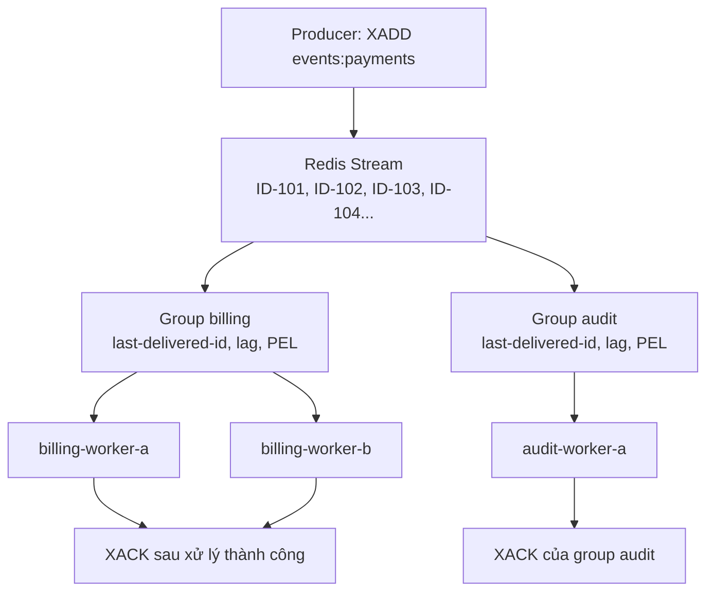
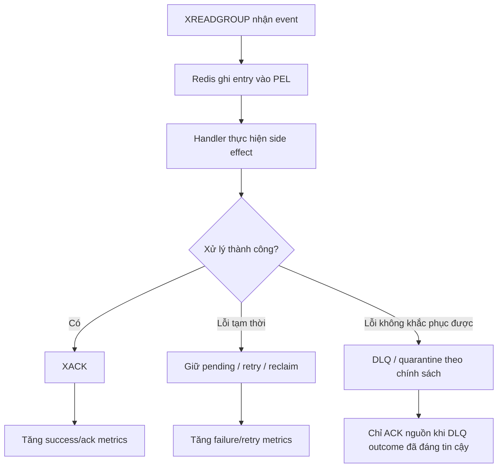
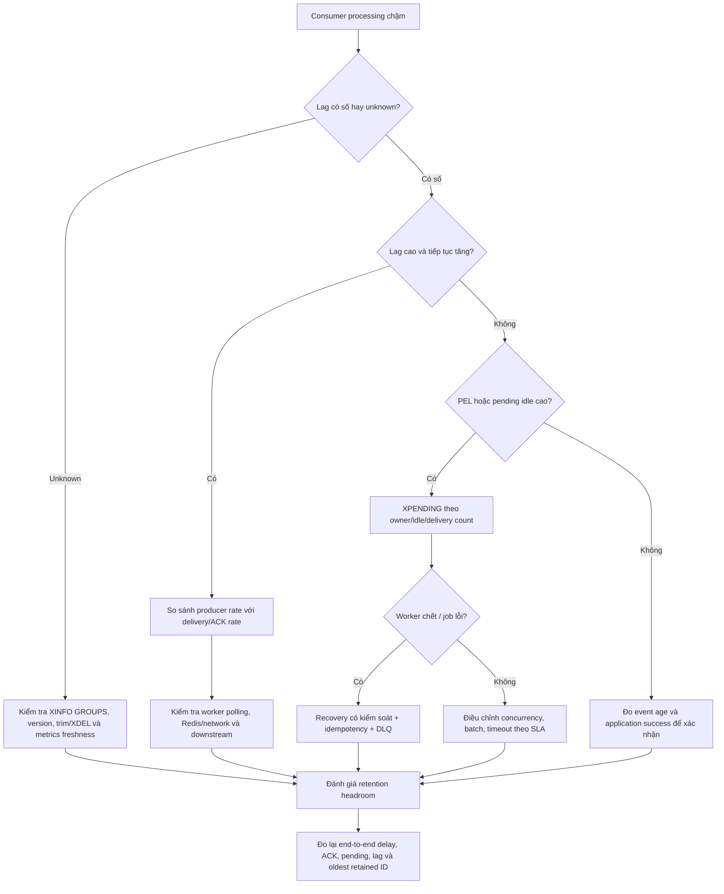

# Quan sát consumer lag và Pending Entries List của Redis Streams trong Spring Data Redis

## 1. Vì sao cần quan sát cả lag lẫn pending?

Redis Streams cho phép ứng dụng ghi sự kiện bằng `XADD` và tổ chức các worker thành **consumer group** thông qua `XREADGROUP`. Consumer group theo dõi những entry đã được giao cho worker và những entry đã được xác nhận bằng `XACK`. Trong vận hành, chỉ thấy Redis đang kết nối và worker còn chạy **không đủ** để biết công việc có được xử lý kịp thời hay không.

Ví dụ một hệ thống nhận sự kiện thanh toán:

```text
Producer:              ghi 1.000 event/phút vào events:payments
Consumer group billing: xử lý 700 event/phút
Consumer group audit:   xử lý 1.000 event/phút
```

Redis vẫn phản hồi bình thường, worker `billing` vẫn đang chạy, nhưng khối lượng chưa xử lý của nhóm đó tăng khoảng 300 event/phút. Nếu không phát hiện sớm, hệ thống có thể chậm nhiều giờ hoặc retention xóa những entry chưa được xử lý.

Có hai loại công việc còn tồn tại cần theo dõi **riêng**:

1. **Chưa được giao cho consumer group** (*undelivered entries*, thường thể hiện qua **consumer lag** trong `XINFO GROUPS` khi Redis tính được).
2. **Đã giao nhưng chưa được xác nhận** (*pending entries*, được theo dõi trong **Pending Entries List — PEL**).

> **Lag không phải PEL.** Lag lớn nghĩa là group chưa bắt kịp các entry mới; PEL lớn hoặc pending idle lâu nghĩa là entry đã được phát cho consumer nhưng chưa được `XACK`. Một dashboard chỉ có một trong hai số liệu sẽ bỏ sót những kiểu sự cố quan trọng.

Bài học tập trung vào cách đọc các số liệu này từ Redis và Spring Data Redis, giải thích các trường hợp đặc biệt, xây dashboard/alert và tổ chức runbook phục hồi.

## 2. Ôn lại mô hình Stream, group và consumer

Một Stream là một log gồm các entry có ID tăng theo thứ tự. Mỗi group có một vị trí phát message và một PEL riêng. Trong cùng group có thể có nhiều consumer cùng nhận các entry mới.



Cùng một entry có thể được group `billing` xử lý và ack, nhưng vẫn chưa được group `audit` nhận hoặc ack. Trạng thái của **hai group độc lập**.

Các lệnh thường gặp:

| Lệnh | Vai trò |
|---|---|
| `XADD` | Thêm entry vào Stream |
| `XGROUP CREATE` | Tạo consumer group với vị trí bắt đầu |
| `XREADGROUP` | Nhận entry theo consumer group |
| `XACK` | Gỡ entry khỏi PEL của group sau khi xử lý |
| `XINFO STREAM` | Xem thông tin Stream và các mốc ID |
| `XINFO GROUPS` | Xem trạng thái các consumer group và lag nếu có |
| `XINFO CONSUMERS` | Xem các consumer trong một group |
| `XPENDING` | Xem thống kê hoặc các entry chưa ack |
| `XCLAIM` / `XAUTOCLAIM` | Chuyển quyền xử lý pending khi recovery |
| `XTRIM` / `XDEL` | Loại entry khỏi Stream, có thể ảnh hưởng khả năng replay |

`XACK` không mặc nhiên xóa payload khỏi Stream. Còn `XTRIM` có thể xóa dữ liệu trước khi consumer kịp xử lý nếu retention được đặt sai.

## 3. Phân biệt ba loại khối lượng công việc

Để đọc chính xác dashboard, nên tách ít nhất ba đại lượng:

### 3.1. Số entry chưa được giao cho group (lag)

Một group có `last-delivered-id` đánh dấu vị trí đã phát message cho consumer. Redis có thể tính số entry nằm phía sau vị trí đó, tức những entry mới còn chưa được giao.

Ví dụ:

```text
Stream:
  ID 101 102 103 104 105 106 107 108 109 110

Group billing:
  Đã được giao: 101 102 103 104 105
  Chưa giao:    106 107 108 109 110

Consumer lag (nếu Redis tính được): 5 entry
```

Ở đây lag đếm **entry**, không phải mili-giây. Nó chưa chứng minh các entry 101–105 đã được xử lý thành công.

### 3.2. Số entry đã giao nhưng chưa ACK (PEL)

Ví dụ các entry đã được giao từ 101 đến 105, nhưng mới ack 101, 102 và 104:

```text
Đã giao:         101 102 103 104 105
Đã XACK:         101 102     104
PEL còn:                 103     105

Pending: 2 entry
```

Hai message đó có thể đang được xử lý hoặc đang kẹt vì worker gặp lỗi. Cần kiểm tra **idle time**, consumer owner, delivery count và trạng thái handler.

### 3.3. Tuổi sự kiện và thời gian chờ nghiệp vụ

Một nhóm có lag 5 entry nhưng mỗi entry có thể đã đợi 10 giây hoặc 10 giờ. Muốn biết thời gian chậm trễ, phải có một mốc thời gian phù hợp:

- Khi producer ghi entry vào Stream.
- Khi consumer nhận entry lần đầu.
- Khi bắt đầu thực hiện nghiệp vụ.
- Khi nghiệp vụ hoàn thành và ack.
- Khi entry được giao lại sau lỗi.

**Pending idle time** không phải lúc nào là tuổi sự kiện: khi message bị claim/giao lại, mốc idle liên quan lần delivery gần nhất có thể thay đổi. Muốn đo **end-to-end processing delay**, nên lưu `createdAt`/event timestamp do producer tạo hoặc có một mốc đáng tin cậy, rồi đo tới lúc xử lý thành công.

### 3.4. Ví dụ dễ gây nhầm

| Trường hợp | Lag | Pending | Ý nghĩa |
|---|---:|---:|---|
| Group mới, chưa đọc gì | Rất lớn | 0 | Có rất nhiều entry chưa được giao |
| Worker nhận nhanh nhưng xử lý chậm | 0 hoặc thấp | Rất lớn | Công việc bị kẹt sau lúc delivery |
| Worker crash sau khi nhận | 0 hoặc thấp | Tồn tại lâu | Cần xử lý pending/reclaim |
| Consumer khỏe, xử lý gần realtime | Thấp | Thấp và tuổi nhỏ | Tình trạng bình thường theo SLA |
| Stream chỉ giữ entry đã ack từ lâu | 0 | 0 | `XLEN` vẫn có thể rất lớn |
| Stream bị trim mạnh | Có thể không xác định | Có thể còn tham chiếu | Cần kiểm tra dữ liệu đã mất khỏi log |

Một hệ thống chỉ cảnh báo khi `XPENDING > 1000` sẽ bỏ sót group không đọc entry mới. Một hệ thống chỉ cảnh báo theo `lag` có thể bỏ sót worker nhận message nhưng không ack.

## 4. Tạo dữ liệu minh họa bằng redis-cli

Các lệnh dưới đây dùng **namespace thử nghiệm riêng**. Không chạy `DEL` hoặc thay đổi group trên dữ liệu production.

### 4.1. Tạo Stream và group

```redis
DEL demo:obs:orders

XGROUP CREATE demo:obs:orders billing 0-0 MKSTREAM
# OK

XADD demo:obs:orders * eventId ev-1 orderId 101 type CREATED
XADD demo:obs:orders * eventId ev-2 orderId 102 type PAID
XADD demo:obs:orders * eventId ev-3 orderId 103 type CREATED
XADD demo:obs:orders * eventId ev-4 orderId 104 type PAID
XADD demo:obs:orders * eventId ev-5 orderId 105 type CREATED
```

Redis trả các Stream ID dạng `milliseconds-sequence`. Ghi lại ID thực tế khi muốn ack hoặc điều tra; các chuỗi `ev-1`, `ev-2` là **ID nghiệp vụ minh họa**, không phải Stream ID do Redis trả.

`XGROUP CREATE ... 0-0` nghĩa là group có thể đọc các entry còn trong Stream bắt đầu từ đầu. `MKSTREAM` cho phép tạo một Stream rỗng khi key chưa tồn tại.

### 4.2. Xem group trước khi consumer đọc

```redis
XINFO GROUPS demo:obs:orders
```

Ở phiên bản Redis hỗ trợ thống kê lag, sau khi tạo group từ đầu Stream và đã thêm năm entry, group có thể thể hiện lag tương ứng năm entry chưa được giao.

Nếu dùng:

```redis
XGROUP CREATE demo:obs:orders future-only $ 
```

thì group `future-only` bắt đầu tại cuối Stream ở thời điểm tạo và chỉ đọc những entry mới hơn. Đừng so sánh lag của hai group mà không xét **offset khởi tạo**. Cả hai có thể đúng theo mục tiêu nhưng phạm vi công việc khác nhau.

### 4.3. Đọc một số entry và xem pending

```redis
XREADGROUP GROUP billing worker-a COUNT 3 STREAMS demo:obs:orders >
```

Lệnh nhận tối đa ba entry mới cho group. Chúng được đưa vào PEL của group nếu chưa ack.

Tiếp theo:

```redis
XPENDING demo:obs:orders billing
XINFO GROUPS demo:obs:orders
XINFO CONSUMERS demo:obs:orders billing
```

Trong điều kiện không có thao tác trim/xóa khác, có thể quan sát lag giảm từ 5 xuống khoảng 2, trong khi pending tăng từ 0 lên 3.

### 4.4. Ack một entry và quan sát khác biệt

Dùng **Stream ID thực tế** của entry đã nhận:

```redis
XACK demo:obs:orders billing <STREAM_ID_CUA_EV_1>
```

Lệnh trả số entry được ack thành công. Khi ack một pending entry, pending giảm nhưng lag **không nhất thiết thay đổi** vì message đã được giao trước đó.

```redis
XPENDING demo:obs:orders billing
XLEN demo:obs:orders
```

`XLEN` vẫn có thể là 5: ack không tự xóa toàn bộ event khỏi log.

## 5. XINFO GROUPS: quan sát lag và tiến độ giao

Lệnh:

```redis
XINFO GROUPS events:orders
```

thường cung cấp một tập trường theo phiên bản Redis, trong đó có:

| Trường | Cách hiểu |
|---|---|
| `name` | Tên consumer group |
| `consumers` | Số consumer có metadata trong group |
| `pending` | Tổng số entry đang pending của group |
| `last-delivered-id` | Stream ID cuối đã được giao theo vị trí của group |
| `entries-read` | Logical read counter được Redis dùng hỗ trợ tính lag |
| `lag` | Số entry chưa được giao cho group, **nếu Redis tính được** |

`entries-read` và `lag` không xuất hiện hay có cùng semantics ở mọi Redis version. Redis 7.0 bổ sung cách quan sát group lag dựa trên logical entries-read counter. Khi sử dụng server cũ, đừng tự giả định trường đó tồn tại.

### 5.1. Lag được tính theo entry, không theo đồng hồ

Ví dụ `lag = 1200` nghĩa là có khoảng 1.200 entry thuộc phạm vi tính lag chưa được group delivery, **không có nghĩa group trễ 1.200 mili-giây hoặc 1.200 giây**.

Nếu producer ghi 100 entry/giây, 1.200 entry tương ứng khoảng 12 giây tốc độ đầu vào hiện tại trong một ví dụ dòng sự kiện đều đặn. Nhưng nếu producer từng dừng vài giờ hoặc có đợt burst, suy luận từ entry count sang thời gian sẽ sai.

Muốn cảnh báo "event đã chờ hơn 5 phút", cần timestamp/event time và một phép đo delay thực, không đặt ngưỡng `lag > 300000` như thể đang đếm mili-giây.

### 5.2. Lag có thể là null/không xác định

Ở những tình huống Redis không thể tính chính xác khoảng cách logical giữa group và Stream, trường `lag` có thể nhận giá trị **null**. Các tình huống liên quan gồm:

- Group được tạo hoặc đặt vị trí ở một ID tùy ý khiến Redis không thể xác định logical entries-read counter một cách đáng tin cậy.
- `XDEL` hoặc `XTRIM` xóa entry ở khoảng ảnh hưởng việc tính lag, chẳng hạn giữa vị trí đã delivery của group và phần cuối Stream.
- Một số tình huống restore, nâng cấp hay thay đổi metadata khiến việc suy ra lag không còn đơn giản.

Redis có thể xác lập lại việc tính lag sau khi group đi đến một vị trí thích hợp theo semantics server. Không được tự động đổi **lag null thành 0** trong dashboard: điều đó sẽ che khuất một trường hợp "không biết" thành "không có backlog".

Trong Java và metrics exporter, nên phân biệt:

```text
lag = 0     -> Redis trả số 0
lag = 250   -> Redis trả số 250
lag = null  -> Redis không xác định được / trường không có
```

Khi lag null, sử dụng thêm tốc độ publish/deliver/ack, mốc ID, oldest event age và PEL để đánh giá hệ thống thay vì đoán một giá trị chính xác.

### 5.3. Không lấy XLEN làm lag

`XLEN` trả **số entry còn trong Stream**, bao gồm những entry đã được các consumer group xử lý và ack nhưng chưa bị trim.

Ví dụ:

```text
XLEN = 1.000.000
Group billing:
  lag = 0
  pending = 0

=> Stream vẫn giữ 1 triệu entry lịch sử.
   billing đã bắt kịp và không còn pending.
```

Do đó công thức `lag = XLEN - pending` là **sai**. `XLEN` còn chịu ảnh hưởng trim/xóa, trong khi group có offset và metadata riêng.

## 6. XINFO STREAM: hiểu phạm vi dữ liệu thực sự còn lưu

Lệnh:

```redis
XINFO STREAM events:orders
```

Các trường thường hữu ích:

| Trường | Ý nghĩa vận hành |
|---|---|
| `length` | Số entry hiện còn trong Stream |
| `first-entry` | Entry đầu tiên hiện còn tồn tại |
| `last-entry` | Entry cuối hiện còn tồn tại |
| `last-generated-id` | ID cuối do Stream tạo/sinh theo trạng thái server |
| `entries-added` | Số entry đã được thêm theo bộ đếm tương ứng ở phiên bản hỗ trợ |
| `max-deleted-entry-id` | ID lớn nhất từng bị xóa theo metadata tương ứng |
| `recorded-first-entry-id` | Thông tin điểm đầu được Redis ghi lại để hỗ trợ tính logical lag |
| `groups` | Số consumer groups của Stream |

Không phải mọi version/engine đều hiển thị toàn bộ các trường hoặc trình bày chúng y hệt nhau.

### 6.1. Mốc ID lớn không nhất thiết là khối lượng backlog lớn

Stream ID thường có thành phần thời gian và sequence. Không nên lấy:

```text
last-generated-id - last-delivered-id
```

như phép trừ số nguyên để suy ra số entry pending hay lag. Hai ID có thể khác nhau rất xa về timestamp mà chỉ có một entry ở giữa; ngược lại có thể có rất nhiều entry được ghi trong một khoảng ngắn.

Nếu có `lag` được Redis tính chính xác, dùng nó. Nếu không, đo thêm rate và thời gian trễ bằng dữ liệu application, hoặc xây cơ chế cursor/sequence có chủ đích thay vì đoán từ giá trị ID.

### 6.2. Khi trim xóa dữ liệu phía sau group

Một Stream có chính sách:

```redis
XADD events:orders MAXLEN ~ 100000 * eventId ev-1000 type CREATED
```

Nếu producer nhanh hơn consumer, những entry ở đầu Stream có thể bị trim trước khi group kịp đọc. Khi đó group có thể **không có cách đọc lại phần dữ liệu đã mất** dù nó biết vị trí giao trước đó.

Vì vậy dashboard cần xem **group lag + retention window + oldest retained ID**. Chỉ thấy `lag` giảm không chứng minh group đã xử lý thành công: giảm có thể do delivery, group reposition hoặc chính sách xóa/trim, tùy hoàn cảnh.

## 7. XPENDING: xem pending ở cấp group

Lệnh ngắn:

```redis
XPENDING events:orders billing
```

trả tổng quan PEL của group, gồm thông tin như:

- Số pending.
- ID pending nhỏ nhất và lớn nhất khi có.
- Phân bố số pending theo consumer owner.

Dạng tổng quan phù hợp để quan sát định kỳ ở mức group mà không cần tải từng message.

### 7.1. Xem pending chi tiết

Cú pháp mở rộng:

```redis
XPENDING events:orders billing - + 10
```

Ví dụ muốn xem entry đang pending tối đa 10 item. Mỗi item thường có:

1. **Stream ID** đang pending.
2. **Consumer name** đang sở hữu.
3. **Idle time** tính bằng mili-giây theo thời điểm delivery/activity được Redis theo dõi.
4. **Số lần giao** (*delivery count*).

Khi muốn giới hạn các entry idle lâu hơn một ngưỡng, ở Redis hỗ trợ syntax:

```redis
XPENDING events:orders billing IDLE 60000 - + 10
```

Tham số `IDLE 60000` lọc những message có idle time ít nhất 60 giây. Câu lệnh này hữu ích để tìm công việc có dấu hiệu bị kẹt.

### 7.2. Lọc theo consumer

Có thể lấy pending của một consumer cụ thể:

```redis
XPENDING events:orders billing - + 20 worker-a
```

Điều này giúp so sánh:

- Worker nào giữ nhiều pending nhất.
- Worker nào có pending idle lâu nhất.
- Có consumer cũ sau restart nhưng vẫn mang backlog không.
- Có phân phối công việc quá lệch giữa các worker không.

Không tự động kết luận consumer có nhiều pending là lỗi: có thể nó đang nhận một batch lớn hợp lệ, hoặc mỗi job có thời gian xử lý khác nhau. Cần xem **tuổi pending, loại công việc và throughput**.

### 7.3. Đừng quét toàn PEL quá thường xuyên

`XPENDING` với range lớn và nhiều pending entries có thể tạo phản hồi lớn, tiêu tốn CPU/network. Để giám sát:

- Dùng summary `XPENDING stream group` ở tần suất hợp lý.
- Dùng `XINFO GROUPS` và `XINFO CONSUMERS` cho tổng quan.
- Chỉ truy vấn chi tiết với `COUNT` có giới hạn khi phát hiện triệu chứng.
- Khi cần liệt kê nhiều pending, phân trang theo ID thay vì yêu cầu tất cả trong một lệnh.
- Gắn dashboard với polling interval phù hợp và giới hạn concurrency cho monitoring jobs.

Không để một monitoring service tự làm Redis chậm vì liên tục quét hàng triệu pending IDs.

## 8. XINFO CONSUMERS: thấy consumer nào còn hoạt động

Lệnh:

```redis
XINFO CONSUMERS events:orders billing
```

Thông tin quan trọng:

| Trường | Ý nghĩa |
|---|---|
| `name` | Tên consumer trong group |
| `pending` | Số entry pending của consumer |
| `idle` | Khoảng thời gian không có tương tác/thao tác theo semantics phiên bản |
| `inactive` | Khoảng thời gian từ lần tương tác thành công theo Redis phiên bản có hỗ trợ |

Từ Redis 7.2, `idle` và `inactive` được phân biệt rõ hơn: `idle` phản ánh thời gian từ lần tương tác được thử gần nhất; `inactive` phản ánh thời gian từ lần tương tác thành công gần nhất. Với Redis phiên bản cũ, cách diễn giải `idle` có thể khác. Do đó dashboard phải gắn với **Redis version** thay vì áp dụng một cách hiểu duy nhất cho mọi môi trường.

### 8.1. Consumer idle không chắc đã chết

Một worker có thể:

- Đang thực hiện một job hợp lệ nhưng rất lâu.
- Không còn message mới để đọc.
- Đang pause do backpressure.
- Đã dừng nhưng metadata vẫn còn.
- Polling liên tục nhưng không nhận được message mới.
- Có connection lỗi và không xử lý được.

`XINFO CONSUMERS` cho biết **metadata phía Redis**, không phải health check đầy đủ của tiến trình Java. Cần kết hợp:

- Heartbeat của worker nếu có.
- Last successful handler completion.
- Last successful ack.
- Số batch đang xử lý.
- Pod/process health, restart count.
- Log lỗi, dependency timeout.
- Pending idle age và delivery count.

Không xóa consumer chỉ vì `idle` lớn mà chưa biết nó có pending còn cần xử lý hay không.

### 8.2. Ổn định tên consumer để điều tra

Trong cùng group, nên cấp một consumer name giúp nhận diện instance/worker ổn định trong một vòng đời triển khai, ví dụ:

```text
billing-worker-pod-7f3a
billing-worker-pod-8c91
```

Nếu mỗi lần poll lại tạo một consumer name mới, `XINFO CONSUMERS` sẽ đầy các consumer "ma", khó theo dõi pending owner và số lượng consumer thật. Nếu hai process khác nhau vô tình dùng **cùng consumer name**, Redis xem chúng cùng một logical consumer và số liệu per-consumer sẽ khó chẩn đoán.

Đối với Kubernetes, có thể tạo tên từ pod identity phù hợp, nhưng cần xử lý khi pod bị thay thế: pending của tên cũ phải được reclaim hoặc recovery, và consumer metadata cũ được dọn theo chính sách.

## 9. Một ma trận triệu chứng để xác định điểm nghẽn

| Dấu hiệu | Khả năng chính | Bước điều tra |
|---|---|---|
| Lag tăng, pending thấp | Consumer không đọc đủ nhanh hoặc không đọc | Xem `XINFO GROUPS`, worker polling, throughput |
| Lag thấp, pending tăng | Worker nhận nhanh nhưng xử lý/ack chậm | Xem handler latency, errors và `XPENDING` |
| Lag = 0, pending rất cũ | Có job đã nhận nhưng bị kẹt | Xem owner, idle, recovery |
| Lag tăng đột ngột sau deploy | Consumer ngừng hoặc connection/config sai | Xem readiness, Redis auth, schema |
| Lag null | Redis không tính được logical lag | Kiểm tra group offset, trim/XDEL và version |
| PEL nhiều, delivery count tăng | Retry/reclaim thường xuyên | Xem poison message, idle threshold quá ngắn |
| PEL thấp nhưng database downstream lỗi | Consumer có thể ack quá sớm hoặc bỏ qua lỗi | Đối chiếu ack với business success |
| Group A khỏe, group B lag cao | Bottleneck theo downstream, không phải toàn Redis | Điều tra từng group |
| XLEN giảm mạnh, group báo mất event | Stream bị trim/xóa trước khi đọc | Kiểm tra retention và oldest ID |
| Consumer count tăng liên tục | Tên consumer không ổn định hoặc không dọn metadata | Kiểm tra naming/restart và `XGROUP DELCONSUMER` |
| Mọi group chậm và Redis latency tăng | Vấn đề Redis/network/CPU/memory | Xem `INFO`, commandstats, infrastructure |
| Rate ACK cao nhưng backlog vẫn tăng | Producer nhanh hơn consumer | So sánh ingress/ack và cần scale/backpressure |

Hai đại lượng chính nên luôn xuất hiện **cạnh nhau** trong dashboard: *undelivered lag* và *pending count*. Nhưng để biết tiến triển thực, cũng cần xem **rate** và **tuổi của event**.

## 10. Throughput: tốc độ đến, giao và xác nhận

Có ba tốc độ khác nhau:

- **Ingress rate:** số event được producer ghi thành công bằng `XADD` mỗi giây.
- **Delivery rate:** số entry được giao cho các consumer qua `XREADGROUP` mỗi giây.
- **Success/ACK rate:** số event thực sự được handler xử lý thành công và `XACK` thành công mỗi giây.

Đừng dùng số lần worker gọi `XREADGROUP` làm số event đã xử lý; một lần gọi có thể nhận 0, 1 hoặc nhiều entry.

### 10.1. Khi nào backlog sẽ tăng?

Giả sử trên một khoảng đo ổn định:

```text
Ingress = 150 event/giây
ACK thành công = 120 event/giây

Chênh lệch ≈ 30 event/giây
Sau 10 phút, số việc chưa hoàn thành có thể tăng
khoảng 18.000 event, nếu không có trim/xóa hay ngoại lệ khác.
```

Đây là ước lượng **outstanding workload toàn nhóm**, không thể trực tiếp thay cho riêng trường `lag`. Consumer có thể đã nhận nhiều message nên backlog chuyển từ phần chưa giao sang PEL.

Nếu `ACK rate` thấp hơn ingress kéo dài, tăng số consumer có thể giúp **nếu bottleneck nằm ở năng lực xử lý có thể mở rộng**. Nếu downstream database đã quá tải, tăng worker chỉ làm tình hình tệ hơn.

### 10.2. Tốc độ đủ để bắt kịp sau outage

Giả sử tồn đọng 120.000 event và:

```text
Ingress mới = 100 event/giây
Consumer xử lý thành công = 140 event/giây

Tốc độ giảm outstanding ≈ 40 event/giây
Thời gian theo kịp ≈ 120.000 / 40 = 3.000 giây (50 phút)
```

Ước lượng này giả định tốc độ giữ ổn định và mỗi event được xử lý một lần về mặt throughput. Trong thực tế retry, poison messages, job có kích thước khác nhau và giới hạn downstream có thể kéo dài thời gian.

Nếu ACK rate chỉ bằng ingress rate, outstanding sẽ **không giảm** dù consumer vẫn đang làm việc liên tục.

## 11. Quan sát bằng Spring Data Redis

Spring Data Redis cung cấp `StreamOperations` thông qua `RedisTemplate.opsForStream()` hoặc `StringRedisTemplate.opsForStream()`. Các API này có thể dùng cho cả xử lý và quan sát Stream.

Những API đáng biết:

| API / kiểu | Mục đích |
|---|---|
| `opsForStream().read(...)` | Đọc bằng consumer group hoặc offset |
| `opsForStream().acknowledge(...)` | ACK sau khi xử lý |
| `opsForStream().pending(stream, group)` | Đọc summary Pending Entries List |
| `opsForStream().groups(stream)` | Lấy group info tương tự `XINFO GROUPS` |
| `opsForStream().consumers(stream, group)` | Lấy consumer info tương tự `XINFO CONSUMERS` |
| `opsForStream().info(stream)` | Lấy Stream info tương tự `XINFO STREAM` |
| `StreamInfo` / `PendingMessagesSummary` | Đại diện dữ liệu trả về từ Redis theo Spring Data Redis API |

Chữ ký, kiểu trả và getter của `StreamInfo` hoặc đối tượng nhóm có thể khác giữa các phiên bản Spring Data Redis. Khi cần trường `lag` và `entries-read`, phải kiểm tra phiên bản server và Spring Data Redis đang dùng; API cũ có thể chưa expose toàn bộ trường mới.

### 11.1. Đọc PEL summary

Một đoạn code tối giản:

```java
package com.example.demo.streams;

import org.springframework.data.redis.connection.stream.PendingMessagesSummary;
import org.springframework.data.redis.core.StringRedisTemplate;
import org.springframework.stereotype.Service;

@Service
public class OrderPendingInspector {

    private static final String STREAM = "events:orders";
    private static final String GROUP = "billing";

    private final StringRedisTemplate redis;

    public OrderPendingInspector(StringRedisTemplate redis) {
        this.redis = redis;
    }

    public long pendingCount() {
        PendingMessagesSummary summary =
                redis.opsForStream().pending(STREAM, GROUP);

        return summary.getTotalPendingMessages();
    }
}
```

Cần lưu ý:

- Group và Stream phải tồn tại để lệnh quan sát thành công theo yêu cầu của Redis.
- Khi Redis không sẵn sàng, method có thể ném exception; **không nên tự trả 0** và làm dashboard báo "không còn backlog".
- Đây là summary tổng số entry pending, **không bao gồm những entry chưa từng được giao**.
- Đối với một workload rất lớn, summary thường phù hợp hơn việc liên tục đọc mọi pending ID.
- Với Streams quan trọng, nên kiểm tra cả tình huống message đã bị trim/xóa nhưng metadata pending vẫn còn theo chính sách và version.

### 11.2. Đọc thông tin group và consumer

Spring có thể lấy thông tin group/consumer theo các API:

```java
var groups = stringRedisTemplate.opsForStream()
        .groups("events:orders");

var consumers = stringRedisTemplate.opsForStream()
        .consumers("events:orders", "billing");
```

Khi xây exporter, duyệt group và lấy các trường được API hỗ trợ: group name, pending, consumer count, last-delivered ID và lag khi khả dụng. Đừng ép một trường absent/null thành số 0.

Một Redis exporter chuyên dụng cũng có thể đọc `XINFO GROUPS` trực tiếp nếu Spring Data Redis version chưa cung cấp getter cho thông tin cần thiết. Nếu dùng driver/raw connection để đọc RESP reply, cần xử lý kiểu dữ liệu đúng và giữ code quan sát tách biệt khỏi business logic.

## 12. Ví dụ worker Spring Data Redis: đo delivery, xử lý, ACK

Quan sát thành công từ application giúp giải thích số liệu Redis. Một worker nên đo ít nhất:

- Số entry được nhận.
- Số entry handler xử lý thành công.
- Số entry xử lý lỗi.
- Số ACK thành công.
- Thời gian handler xử lý.
- Thời gian event tồn tại trước khi hoàn tất, nếu có timestamp trong payload.

Ví dụ:

```java
package com.example.demo.streams;

import java.time.Duration;

import io.micrometer.core.instrument.Counter;
import io.micrometer.core.instrument.MeterRegistry;
import io.micrometer.core.instrument.Timer;
import org.springframework.data.redis.connection.stream.Consumer;
import org.springframework.data.redis.connection.stream.ReadOffset;
import org.springframework.data.redis.connection.stream.StreamOffset;
import org.springframework.data.redis.core.StreamReadOptions;
import org.springframework.data.redis.core.StringRedisTemplate;
import org.springframework.stereotype.Service;

@Service
public class InstrumentedOrderWorker {

    private static final String STREAM = "events:orders";
    private static final String GROUP = "billing";

    private final StringRedisTemplate redis;
    private final OrderHandler handler;
    private final Counter received;
    private final Counter handled;
    private final Counter failures;
    private final Counter acknowledged;
    private final Timer handlerTime;

    public InstrumentedOrderWorker(
            StringRedisTemplate redis,
            OrderHandler handler,
            MeterRegistry metrics) {

        this.redis = redis;
        this.handler = handler;

        this.received = Counter.builder(
                "app.redis.stream.messages.received")
                .tag("stream", STREAM)
                .tag("group", GROUP)
                .register(metrics);

        this.handled = Counter.builder(
                "app.redis.stream.messages.handled")
                .tag("stream", STREAM)
                .tag("group", GROUP)
                .register(metrics);

        this.failures = Counter.builder(
                "app.redis.stream.messages.failed")
                .tag("stream", STREAM)
                .tag("group", GROUP)
                .register(metrics);

        this.acknowledged = Counter.builder(
                "app.redis.stream.messages.acknowledged")
                .tag("stream", STREAM)
                .tag("group", GROUP)
                .register(metrics);

        this.handlerTime = Timer.builder(
                "app.redis.stream.handler.duration")
                .tag("stream", STREAM)
                .tag("group", GROUP)
                .register(metrics);
    }

    public void pollOnce(String consumerName) {
        var records = redis.opsForStream().read(
                Consumer.from(GROUP, consumerName),
                StreamReadOptions.empty()
                        .count(50)
                        .block(Duration.ofSeconds(2)),
                StreamOffset.create(
                        STREAM, ReadOffset.lastConsumed())
        );

        if (records == null || records.isEmpty()) {
            return;
        }

        received.increment(records.size());

        for (var record : records) {
            try {
                handlerTime.record(() ->
                        handler.handle(record.getValue())
                );
                handled.increment();

                Long acked = redis.opsForStream().acknowledge(
                        STREAM, GROUP, record.getId()
                );

                if (acked != null && acked > 0) {
                    acknowledged.increment(acked);
                }
            } catch (RuntimeException failure) {
                failures.increment();
                // Không ACK: message vẫn cần luồng recovery/retry.
                // Cần log với ID và không làm lộ payload nhạy cảm.
            }
        }
    }

    public interface OrderHandler {
        void handle(java.util.Map<String, String> payload);
    }
}
```

Đây là ví dụ instrument một vòng poll, **chưa triển khai scheduling, PEL recovery, idempotency và DLQ**. Tùy serializer, kiểu `record.getValue()` của `StringRedisTemplate` có thể được ánh xạ thành Map với kiểu generic khác; điều chỉnh interface handler để khớp schema và mapper thực tế của dự án.

Đặc biệt:

- `received` tăng khi consumer nhận message, không chứng minh nghiệp vụ thành công.
- `handled` tăng sau khi handler return thành công, nhưng có thể lớn hơn số ACK nếu mạng/Redis lỗi.
- `acknowledged` tăng khi Redis trả kết quả ack thành công; không được tính một message ack hai lần chỉ vì retry trả 0.
- `failed` cho biết callback/handler có exception; có thể có lỗi sau side effect thành công nhưng trước ack, nên cần idempotency.
- Sau khi một message bị giao lại, cùng event có thể làm counter `received` tăng lần thứ hai. Đó là **delivery count**, không phải unique event count.

Không đồng nhất counter của process với toàn hệ thống nếu metric chưa được tổng hợp qua các instance.

## 13. Expose PEL dưới dạng Micrometer Gauge

Có thể tạo một probe đọc PEL theo chu kỳ để dashboard thấy tổng pending từ góc nhìn Redis.

### 13.1. Ví dụ @Scheduled và Gauge

```java
package com.example.demo.streams;

import java.time.Instant;
import java.util.concurrent.atomic.AtomicLong;

import io.micrometer.core.instrument.Counter;
import io.micrometer.core.instrument.Gauge;
import io.micrometer.core.instrument.MeterRegistry;
import org.slf4j.Logger;
import org.slf4j.LoggerFactory;
import org.springframework.data.redis.connection.stream.PendingMessagesSummary;
import org.springframework.data.redis.core.StringRedisTemplate;
import org.springframework.scheduling.annotation.Scheduled;
import org.springframework.stereotype.Component;

@Component
public class StreamPendingMetricsProbe {

    private static final Logger log =
            LoggerFactory.getLogger(StreamPendingMetricsProbe.class);

    private static final String STREAM = "events:orders";
    private static final String GROUP = "billing";

    private final StringRedisTemplate redis;

    // Giá trị cuối lấy được thành công. Không biến lỗi Redis thành 0.
    private final AtomicLong pending = new AtomicLong(-1L);
    private final AtomicLong scrapeOk = new AtomicLong(0L);
    private final AtomicLong lastSuccessEpochSeconds =
            new AtomicLong(0L);

    private final Counter scrapeErrors;

    public StreamPendingMetricsProbe(
            StringRedisTemplate redis,
            MeterRegistry registry) {

        this.redis = redis;

        Gauge.builder(
                "app.redis.stream.pending.entries",
                pending, AtomicLong::get)
                .tag("stream", STREAM)
                .tag("group", GROUP)
                .register(registry);

        Gauge.builder(
                "app.redis.stream.probe.success",
                scrapeOk, AtomicLong::get)
                .tag("stream", STREAM)
                .tag("group", GROUP)
                .register(registry);

        Gauge.builder(
                "app.redis.stream.probe.last.success.epoch",
                lastSuccessEpochSeconds, AtomicLong::get)
                .tag("stream", STREAM)
                .tag("group", GROUP)
                .register(registry);

        this.scrapeErrors = Counter.builder(
                "app.redis.stream.probe.errors")
                .tag("stream", STREAM)
                .tag("group", GROUP)
                .register(registry);
    }

    @Scheduled(
            fixedDelayString =
                    "${app.redis.stream.probe.delay-ms:15000}"
    )
    public void refresh() {
        try {
            PendingMessagesSummary summary =
                    redis.opsForStream().pending(STREAM, GROUP);

            pending.set(summary.getTotalPendingMessages());
            scrapeOk.set(1L);
            lastSuccessEpochSeconds.set(
                    Instant.now().getEpochSecond()
            );
        } catch (RuntimeException failure) {
            scrapeOk.set(0L);
            scrapeErrors.increment();
            log.warn(
                    "Cannot refresh stream pending metrics for {}/{}",
                    STREAM, GROUP, failure
            );
        }
    }
}
```

Để kích hoạt `@Scheduled` trong ứng dụng, cần bật scheduling bằng `@EnableScheduling` ở một configuration thích hợp. Ví dụ:

```java
@Configuration
@EnableScheduling
public class SchedulingConfiguration {
}
```

Cần import đúng các annotation Spring; đây là ví dụ chức năng đo PEL, không phải cấu hình production đầy đủ của scheduler.

### 13.2. Vì sao có probe.success và timestamp?

Nếu Redis tạm thời không truy cập được, giữ nguyên `pending` từ lần đo trước có thể dẫn tới **metric cũ**. Nếu thay bằng 0 thì càng nguy hiểm vì 0 được hiểu là group đã hết việc.

Vì vậy exporter nên có:

- `pending.entries`: giá trị cuối đo thành công.
- `probe.success`: lần poll gần nhất có thành công không.
- `last.success.epoch`: thời điểm lần đo thành công gần nhất.
- `probe.errors`: số lỗi lấy metrics.

Dashboard phải hiển thị **staleness**. Một biểu đồ pending đẹp nhưng lần cập nhật cuối cách đây hai giờ không chứng minh Stream khỏe.

Trong production có thể biểu diễn missing data bằng `NaN`/absent metric theo convention hệ thống giám sát, thay vì giá trị -1 như ví dụ. Trọng tâm là **không gộp lỗi đo thành pending=0**.

### 13.3. Chọn nơi đặt probe

Nếu có 30 application pods và cả 30 cùng truy vấn `XPENDING` cho một group sau mỗi 5 giây, lượng tải monitoring được nhân 30 mà thông tin gần như trùng nhau. Có thể:

- Dùng một exporter chuyên trách cho Redis Streams metrics.
- Đặt observer ở một instance có leader election nếu thích hợp.
- Phân chia group giữa các probe.
- Tăng interval với metric ít biến động, dùng alert theo rate/age.
- Giữ monitoring read-only; không mix recovery logic vào mỗi lần scrape.

Hệ thống cần đảm bảo monitoring vẫn có thể quan sát khi worker chính chết, nên probe chỉ nằm trong chính worker có thể bỏ lỡ đúng tình huống lỗi quan trọng.

## 14. Thiết kế các metric hữu ích và tránh cardinality cao

Metric naming sau đây là **đề xuất tự instrument**, không phải danh sách metric Spring Data Redis hoặc Redis exporter chắc chắn có sẵn.

| Metric gợi ý | Kiểu | Đơn vị | Giải thích |
|---|---|---|---|
| `app.redis.stream.group.lag.entries` | Gauge | entry | Số entry chưa giao (nếu biết) |
| `app.redis.stream.group.lag.known` | Gauge | 0/1 | Có tính được lag hay không |
| `app.redis.stream.group.pending.entries` | Gauge | entry | Tổng PEL chưa ack |
| `app.redis.stream.group.pending.oldest.idle.seconds` | Gauge | giây | Idle lớn nhất trong tập được đo |
| `app.redis.stream.group.consumers` | Gauge | consumer | Consumer metadata count |
| `app.redis.stream.events.published` | Counter | event | XADD thành công do app quan sát |
| `app.redis.stream.events.delivered` | Counter | delivery | Số lần delivery, kể cả giao lại |
| `app.redis.stream.events.acknowledged` | Counter | ack | Số ack thành công |
| `app.redis.stream.events.failed` | Counter | attempt | Lượt xử lý gặp lỗi |
| `app.redis.stream.events.reclaimed` | Counter | entry | Lượt entry được claim |
| `app.redis.stream.handler.duration` | Timer | giây | Độ trễ thực thi handler |
| `app.redis.stream.event.end.to.end.delay` | Timer | giây | Từ lúc event tạo đến lúc xử lý xong |
| `app.redis.stream.monitor.scrape.success` | Gauge | 0/1 | Lần đọc metric gần nhất thành công |
| `app.redis.stream.retention.oldest.age.seconds` | Gauge | giây | Tuổi entry đầu Stream còn lưu |

Cần định nghĩa tên và đơn vị nhất quán với Micrometer/Prometheus convention trong hệ thống. Ví dụ Micrometer `Timer` có thể được export thành các time-series khác nhau tùy registry và histogram configuration.

### 14.1. Label nên giữ cardinality thấp

Label hợp lý:

```text
stream="events:orders"
group="billing"
service="order-processing"
environment="production"
redis_node="redis-primary-1"
```

Label không phù hợp cho metric đại trà:

```text
event_id="1763000000000-0"
order_id="123456789"
user_id="..."
payload="..."
trace_id="..."
```

Mỗi event ID hoặc user ID có thể tạo hàng triệu time-series, khiến chính hệ thống monitoring quá tải. Khi cần điều tra một event cụ thể, dùng **structured logs hoặc tracing** với ID được xử lý theo chính sách bảo mật, không dùng làm label metric.

### 14.2. Pending idle và event age là hai metric khác nhau

Giả sử event được tạo 30 phút trước, worker nhận lúc đó, sau 25 phút bị reclaim và giao lại:

```text
Event age = 30 phút
Current pending idle = 5 phút
```

Nếu chỉ alert `pending idle > 10 phút`, hệ thống có thể không cảnh báo dù event đã chậm 30 phút. Vì thế đối với SLA end-to-end, nên đo event age hoặc thời gian từ creation đến hoàn tất, bên cạnh idle dùng cho recovery.

## 15. Dashboard tối thiểu cho Redis Stream consumer group

Một dashboard hữu ích có thể chia thành những hàng thông tin:

### Hàng 1 — Sức khỏe luồng

- `XADD` rate / incoming events per second.
- `XACK` rate / successful completion per second.
- Lag (entry count) của **từng group**.
- Pending count của **từng group**.
- Group lag có biết được không.
- Error rate của worker và Redis connection.

### Hàng 2 — Độ trễ xử lý

- End-to-end event delay p50/p95/p99.
- Handler duration p50/p95/p99.
- Pending oldest idle, ví dụ top 10.
- Độ tuổi event chưa xử lý lâu nhất theo timestamp.
- Retry/reclaim count.

### Hàng 3 — Worker distribution

- Số consumer của group.
- Pending count theo consumer.
- `idle`/`inactive` theo Redis version.
- Worker heartbeat và số pod đang ready.
- CPU, memory, GC và downstream dependency latency.

### Hàng 4 — Retention & Redis infrastructure

- `XLEN`, oldest retained Stream ID.
- Tốc độ trim/delete theo Stream.
- Redis memory usage và eviction/expiration.
- Redis latency, CPU, network.
- AOF/RDB/replication health nếu Stream là dữ liệu bắt buộc phục hồi.

Khi so sánh nhiều group trên cùng Stream, nên hiển thị **cùng đơn vị thời gian và cùng time range**; `billing` có thể chậm 15 phút trong khi `audit` vẫn realtime.

### 15.1. Metric nào phải có trước khi go-live?

Nếu chỉ được chọn một bộ tối thiểu:

1. **Lag theo group** hoặc một tín hiệu thay thế có cảnh báo khi lag không xác định.
2. **Pending count** và **pending age** theo group.
3. **Published vs acknowledged rate**.
4. **Consumer health / last successful ACK**.
5. **Oldest retained entry / retention headroom**.
6. **Monitoring freshness** để không hiểu biểu đồ cũ là trạng thái hiện tại.

Bộ này phản ánh cả người sản xuất, người tiêu thụ, kết quả xử lý và nguy cơ mất khả năng replay.

## 16. Ví dụ truy vấn Prometheus khi dùng metric tự instrument

Giả sử một exporter cung cấp các series sau dưới tên Prometheus:

```text
redis_stream_group_lag_entries{stream="events:orders",group="billing"}
redis_stream_group_pending_entries{stream="events:orders",group="billing"}
redis_stream_group_lag_known{stream="events:orders",group="billing"}
redis_stream_events_published_total{stream="events:orders"}
redis_stream_events_acknowledged_total{stream="events:orders",group="billing"}
redis_stream_probe_success{stream="events:orders",group="billing"}
```

Đây là **schema metric giả định cho minh họa**, không phải metric mặc định có sẵn trong mọi Redis exporter.

Một số truy vấn PromQL:

```promql
redis_stream_group_lag_entries{
  stream="events:orders",
  group="billing"
}
```

```promql
redis_stream_group_pending_entries{
  stream="events:orders",
  group="billing"
}
```

```promql
rate(redis_stream_events_published_total{
  stream="events:orders"
}[5m])
```

```promql
rate(redis_stream_events_acknowledged_total{
  stream="events:orders",
  group="billing"
}[5m])
```

Cảnh báo lag không thể xác định:

```promql
redis_stream_group_lag_known{
  stream="events:orders",
  group="billing"
} == 0
```

Đây mới là ví dụ về **đo**, chưa phải alert rule hoàn chỉnh. Nếu metric hoàn toàn biến mất khi exporter chết, điều kiện `== 0` không đủ. Hệ thống còn phải giám sát `up`, scrape freshness và trường hợp series **absent**, tùy discovery labels.

### 16.1. Đừng cộng ACK của nhiều group làm throughput của Stream

Một event có thể được xử lý bởi group `billing`, `audit` và `notifications`. Nếu cả ba group ack cùng event, tổng `ACK count` toàn hệ thống là 3, nhưng producer chỉ ghi **1 event**.

Khi so sánh rate:

- So sánh producer rate với ACK rate **riêng từng group**.
- Đừng cộng ACK của tất cả group rồi khẳng định consumers nhanh gấp ba producer.
- Nếu group có filter hoặc skip theo business rule, định nghĩa rõ "xử lý thành công" gồm những event nào.

Cần biết group có nhiệm vụ tiêu thụ mọi event hay chỉ một subset; một kiến trúc có stream processor định tuyến sang stream khác sẽ cần metric tương ứng ở từng stage.

## 17. Xây cảnh báo phù hợp, không chỉ đặt ngưỡng số entry

Các ngưỡng dưới đây **chỉ để minh họa**, phải hiệu chỉnh theo baseline và SLA thực tế:

| Alert | Ví dụ điều kiện | Tác động cần điều tra |
|---|---|---|
| Consumer không tiến triển | Có ingress nhưng không có ACK 5 phút | Worker chết, auth lỗi, handler bị block |
| Group lag cao kéo dài | Lag trên 10.000 entry trong 10 phút | Producer vượt năng lực delivery |
| PEL tăng liên tục | Pending tăng trong nhiều khoảng đo | Handler/ACK/recovery có vấn đề |
| Pending idle lớn | Oldest idle trên 300 giây | Job kẹt hoặc worker không hồi phục |
| End-to-end delay vi phạm SLA | p99 delay trên 60 giây | Dữ liệu cập nhật quá muộn |
| Delivery count bất thường | Nhiều pending retry trên 5 lần | Poison message hoặc reclaim quá sớm |
| Lag không xác định | `lag = null` kéo dài | XINFO logical lag bị vô hiệu |
| Metrics stale | Không scrape thành công 2 phút | Không biết trạng thái thực |
| Retention nguy hiểm | Oldest retained ID vượt mốc cần replay | Dữ liệu có thể bị trim trước xử lý |
| Redis overloaded | CPU/memory/latency tăng đồng thời | Bottleneck hạ tầng hoặc monitoring quá nặng |

### 17.1. Cảnh báo phải có thời gian duy trì

Một group có lag 20.000 trong vài giây sau một batch import có thể là bình thường nếu worker bắt kịp trong phút tiếp theo. Vì vậy thường dùng:

- Mức độ lớn của lag/pending.
- **Đạo hàm/tốc độ tăng** và tốc độ ACK.
- Thời gian vượt ngưỡng.
- Độ tuổi entry ảnh hưởng SLA.
- Mức tải và khả năng phục hồi của downstream.

Ví dụ "lag cao hơn 10.000 trong 10 phút và ACK rate không đủ bắt kịp" có ý nghĩa vận hành hơn alert tức thời `lag > 10000`.

### 17.2. Khi PEL lớn không phải lỗi

Nếu worker được thiết kế nhận batch 500 event và xử lý mất 2 giây, trong lúc đang xử lý có thể quan sát pending vài trăm entry. Điều này chưa có nghĩa queue bị kẹt.

Một alert tốt cần phân biệt **pending bình thường theo batch size** với **pending không được ack trong thời gian vượt SLA**. Nếu chỉ alert theo số pending, sẽ có nhiều false positive và có nguy cơ khuyến khích tăng threshold vô hạn.

## 18. Xử lý pending lâu: XPENDING, XCLAIM, XAUTOCLAIM

Khi worker nhận entry rồi chết trước `XACK`, entry vẫn pending và không tự được đọc như entry mới chỉ bằng `XREADGROUP ... >`.

### 18.1. Nhận diện entry kẹt

```redis
XPENDING events:orders billing
XPENDING events:orders billing IDLE 60000 - + 50
```

Kết quả mở rộng giúp xem ID, owner, idle time và số lần delivery.

### 18.2. Chuyển quyền bằng XAUTOCLAIM

Redis phiên bản hỗ trợ `XAUTOCLAIM`:

```redis
XAUTOCLAIM events:orders billing worker-b 60000 0-0 COUNT 50
```

Ý nghĩa:

- `billing` là group.
- `worker-b` là consumer nhận quyền xử lý mới.
- `60000` là ngưỡng idle tối thiểu tính bằng ms.
- `0-0` là cursor bắt đầu tìm pending.
- `COUNT 50` điều chỉnh giới hạn kết quả/work cho lần gọi.

Cần xử lý cursor trả về và tiếp tục quét theo cơ chế của Redis. Không dùng một lần `XAUTOCLAIM` rồi kết luận đã kiểm tra toàn bộ PEL nếu còn cursor/phạm vi chưa duyệt.

### 18.3. Vì sao idle threshold phải lớn hơn thời gian xử lý bình thường?

Nếu một job cần 90 giây để xử lý nhưng recovery reclaim mọi message idle trên 10 giây, hai worker có thể **xử lý song song cùng một event**:

```text
worker-a bắt đầu job dài
        |
        +--- sau 10 giây ---> worker-b claim và bắt đầu lại
        |
        +--- worker-a vẫn chưa xong
```

Phải dùng SLA handler/heartbeat/progress hợp lý để chọn ngưỡng reclaim; với job dài có thể cần thiết kế lease/heartbeat riêng hoặc phân chia công việc nhỏ hơn.

**XAUTOCLAIM không có nghĩa exactly-once.** Worker cũ có thể đã thực hiện side effect rồi chết trước ack; worker mới phải xử lý idempotent theo event ID.

### 18.4. Pending đã bị trim thì sao?

Một số chính sách xóa/trim Stream có thể loại payload khi PEL còn reference. Trong những trường hợp như vậy:

- `XPENDING` có thể còn ID, tùy version và chính sách xóa reference.
- `XAUTOCLAIM` ở Redis 7.0+ có thể dọn các reference trỏ tới entry đã bị xóa; đó là dọn metadata, **không khôi phục payload**.
- Không thể chỉ tăng số worker để xử lý lại message đã mất khỏi Stream.
- Cần nguồn event bền vững, archive/outbox hoặc quy trình đối soát.

Từ Redis 8.2 có thêm những lựa chọn xóa/trim liên quan tham chiếu giữa các group như `KEEPREF`, `DELREF` và `ACKED` ở các lệnh hỗ trợ. Phải đối chiếu version/server policy; **PEL thấp do xóa reference không phải bằng chứng event đã xử lý thành công**.

## 19. XACK đúng thời điểm và những hệ quả cho metrics

Một worker thường có chuỗi:



Điều quan trọng:

- Ack **trước** khi xử lý có thể khiến một event bị mất khi process chết sau ack.
- Ack **sau** khi xử lý có thể gây duplicate nếu process chết ngay sau side effect nhưng trước ack.
- Ack luôn trong `finally` là sai vì có thể ack cả exception.
- Nếu handler thành công nhưng `XACK` lỗi mạng, PEL có thể còn pending mặc dù business side effect đã xảy ra.
- Nếu `XACK` trả 0, có thể entry không còn pending trong group tại thời điểm gọi; cần hiểu nguyên nhân thay vì tăng counter "acknowledged" bằng 1 bất kể kết quả.

Đo cả **handler success** và **ACK success** giúp phát hiện vùng rủi ro giữa hai bước. Với nghiệp vụ có side effect quan trọng, dùng idempotency key/eventId và transaction tại hệ thống đích phù hợp.

## 20. Quy trình điều tra khi lag tăng

Một runbook theo thứ tự có thể là:

### Bước 1: xác định phạm vi sự cố

- Chỉ một consumer group hay tất cả groups?
- Chỉ một Stream hay nhiều Streams?
- Chỉ một Redis node/cluster shard hay toàn bộ hạ tầng?
- Có thay đổi deployment, schema, ACL, TTL hoặc retention gần thời điểm bắt đầu lỗi không?

### Bước 2: xem Redis group state

```redis
XINFO STREAM events:orders
XINFO GROUPS events:orders
XINFO CONSUMERS events:orders billing
XPENDING events:orders billing
```

Xác định lag có số cụ thể hay null, PEL count, số consumers và last-delivered ID.

### Bước 3: so sánh tốc độ

- Producer có đột ngột ghi nhiều hơn không?
- Delivery rate có giảm?
- Handler success/ACK rate có giảm?
- Worker có nhận message nhưng fail hoặc giữ pending lâu?
- Có retry liên tục tạo thêm tải downstream không?

### Bước 4: kiểm tra application và dependency

Quan sát:

- Exception trong handler, JSON/schema migration.
- Timeout kết nối database/API downstream.
- Thread pool saturation, queue waiting, JVM GC.
- Redis connection pool, blocked read và command timeout.
- Consumer process restart.
- Duplicate consumer name hoặc group name sai.

### Bước 5: xác định backlog có thể phục hồi

- Entry đầu Stream còn đủ sớm để đọc các message chưa giao không?
- Retention `MAXLEN`/`MINID` có trim trước khi group bắt kịp không?
- Có pending ID thiếu payload không?
- Có event log/outbox đủ để replay không?
- Có DLQ và giới hạn retry hay không?

### Bước 6: khôi phục có kiểm soát

Tùy nguyên nhân:

- Khởi động lại consumer với config đúng.
- Tăng consumer nếu downstream và Redis còn năng lực.
- Điều chỉnh `COUNT` và concurrency có giới hạn.
- Reclaim pending idle sau khi xác minh worker cũ không còn thực thi hoặc handler idempotent.
- Chuyển poison message sang DLQ/quarantine đúng cách.
- Tăng retention/capacity hoặc giảm tốc độ producer nếu replay window nguy hiểm.
- Dùng replay/reconciliation từ source of truth khi payload Stream đã mất.

### Bước 7: xác nhận đã bắt kịp

Không chỉ nhìn lag giảm về 0; cần thấy:

- Pending đã được xử lý/ack hợp lệ, không còn entry idle quá SLA.
- ACK/success rate theo kịp ingress.
- End-to-end delay trở về mức bình thường.
- Không có DLQ/error tăng âm thầm.
- Metrics mới được scrape thành công.
- Không có mất event do trim/skip chưa được đối soát.

## 21. Quy trình điều tra khi pending tăng

Nếu PEL tăng nhưng lag gần 0:

1. Xem `XPENDING` summary.
2. Dùng `XPENDING ... IDLE ...` lấy mẫu các pending lâu.
3. Xem consumer owner, idle và delivery count.
4. Kiểm tra worker đã xử lý xong nhưng chưa ack hay chưa.
5. Xem liệu worker cũ đã chết, worker mới chỉ đọc `>` hay không.
6. Kiểm tra exception và poison messages.
7. Khi cần, dùng cơ chế reclaim có giới hạn rồi chạy handler idempotent.
8. Kiểm tra DLQ/reconciliation và khôi phục metrics.

Ví dụ một job gửi email:

```text
worker-a nhận evt-42
Email provider xác nhận gửi thành công
Process crash trước XACK
PEL còn evt-42
worker-b claim lại evt-42
```

Nếu không có idempotency, email có thể được gửi hai lần. Giải pháp không phải "thấy pending thì xóa ngay"; cần nhận diện event đã xử lý ở hệ thống có thẩm quyền và ack sau khi kết luận.

### 21.1. XGROUP DELCONSUMER có thể nguy hiểm

Redis có `XGROUP DELCONSUMER stream group consumer` để xóa metadata của một consumer, nhưng thao tác này **không tự chuyển pending của consumer đó sang consumer khác để xử lý hoàn chỉnh**.

Nếu consumer còn pending, xóa metadata có thể khiến các message trở thành khó thu hồi hoặc loại bỏ dấu vết ownership tùy semantics Redis version. Trước khi dọn một consumer "ma", cần kiểm tra pending và có chiến lược claim/ack rõ ràng.

Không dùng xóa consumer như một cách giảm metric `consumers` hoặc `pending` cho đẹp dashboard.

## 22. Retention phải đi cùng lag và PEL

Nếu Stream giữ tối đa 100.000 entry nhưng group có backlog chưa giao 150.000 entry ở thời điểm tải tăng, những event cũ có thể bị cắt bỏ trước khi worker đọc.

Các thao tác retention:

```redis
XTRIM events:orders MAXLEN ~ 100000
XTRIM events:orders MINID ~ <cutoff-id>
```

Lưu ý cú pháp Redis thay đổi theo phiên bản và chính sách reference của consumer groups.

**Khi đo lag, phải đo retention headroom.** Câu hỏi vận hành là: "Nếu consumer tiếp tục chậm, bao lâu nữa entry chưa xử lý có thể bị trim?"

### 22.1. Mối quan hệ cần theo dõi

| Đại lượng | Cho biết |
|---|---|
| `XLEN` | Bao nhiêu entry còn giữ trong Stream |
| `first-entry ID` | Mốc entry cũ nhất còn trong Stream |
| Group `last-delivered-id` | Group đã giao tới đâu |
| Group `lag` | Chưa giao bao nhiêu entry, nếu tính được |
| PEL min/max ID | Những entry đã giao chưa ack ở các ID nào |
| Pending oldest idle | Một số entry đang chờ ACK lâu ra sao |
| Producer rate | Dữ liệu mới có thể đẩy entry cũ ra nhanh thế nào |
| Current trim rate | Policy đang cắt bỏ dữ liệu nhanh ra sao |

Nếu đầu Stream đã vượt qua một pending ID cần replay, việc reclaim bình thường có thể thất bại vì payload không còn. Với Stream chứa công việc bắt buộc xử lý, cần chính sách giữ entry cho đến khi mọi group quan trọng đã xử lý an toàn hoặc có bản archive đáng tin cậy.

### 22.2. Lag = null sau trim không phải lúc nào là lỗi exporter

Khi Redis không thể tính lag do thay đổi lịch sử Stream, exporter cần giữ trạng thái unknown, đồng thời vẫn quan sát pending, ingress/ACK rate và oldest retained ID. Không nên sửa số liệu bằng công thức tự chế từ `XLEN` và PEL khi Redis đã nói không đủ thông tin.

### 22.3. Phân biệt khả năng đọc lại với dữ liệu nghiệp vụ đã hoàn tất

Một event có thể:

- Còn trong Stream nhưng đã ack ở group A.
- Đang pending ở group B.
- Chưa từng được giao cho group C.
- Bị trim dù group B chưa ack, tùy policy.
- Được archive ở nơi khác để replay.

Do đó, không có một metric "Stream processed" toàn cục nếu chưa xác định tập consumer groups và điều kiện "processed" của hệ thống.

## 23. XINFO/XPENDING có chi phí vận hành

Các truy vấn quan sát cũng là Redis commands. Khi có hàng chục nghìn Streams và nhiều groups, polling quá dày có thể:

- Tăng QPS và CPU Redis.
- Tăng số reply và network traffic.
- Làm nhiều application instances cùng truy vấn metadata trùng nhau.
- Tạo áp lực lên Redis connection pool.
- Làm dashboard chậm mà không tăng khả năng phát hiện lỗi.
- Tạo metric cardinality rất cao nếu expose mỗi pending ID.

Một mô hình hợp lý:

1. **Tổng quan** `XINFO GROUPS` và `XPENDING summary` theo chu kỳ vài chục giây nếu phù hợp SLA.
2. **Chi tiết** `XPENDING ... COUNT n` chỉ khi có alert hoặc điều tra.
3. **Application counters** instrument ngay tại producer/consumer để xem rate thay vì quét toàn bộ Stream.
4. **Sampling** pending IDs theo giới hạn, không gom mọi entry vào một request.
5. **Lọc stream/group cần thiết** theo inventory; không chạy `KEYS *` trên production để liệt kê bừa mọi key.

Nếu có hàng nghìn groups, cân nhắc exporter chuyên dụng, lịch scrape phân tán và bảo vệ Redis trước monitoring overload.

## 24. Quyền Redis cần cho việc quan sát

Một monitoring client cần quyền để gọi các lệnh như:

```text
XINFO
XPENDING
XLEN
XRANGE (nếu kiểm tra oldest/newest entry)
INFO (nếu có metrics hạ tầng)
```

Theo Redis ACL và engine version, quyền có thể được cấu hình theo nhóm lệnh hoặc subcommands. Nên cấp **read-only, least privilege** cho exporter, giới hạn key patterns nếu phù hợp.

Các lệnh recovery như `XCLAIM`, `XAUTOCLAIM`, `XACK` và `XGROUP DELCONSUMER` **không nên tự động nằm trong quyền của một dashboard chỉ để đọc số liệu**. Tách role quan sát với role thao tác phục hồi giúp giảm rủi ro một lỗi script/automation sửa nhầm trạng thái group.

Không log raw payload chứa thông tin tài chính/PII chỉ để điều tra pending. Thường Stream ID, event type, thời điểm và correlation ID đã đủ để nối log/tracing với dữ liệu gốc qua quyền kiểm soát phù hợp.

## 25. Khi Redis Cluster hoặc nhiều stream partitions được sử dụng

Một Redis Stream key thuộc một slot/node trong Redis Cluster. Nếu chia workload thành nhiều streams:

```text
events:orders:0
events:orders:1
events:orders:2
events:orders:3
```

thì mỗi Stream có:

- Các consumer groups và PEL tương ứng.
- Một giá trị lag riêng.
- Retention window và oldest ID riêng.
- Producer/ACK rate riêng.
- Các worker có thể phân chia partition khác nhau.

Dashboard tổng hợp cần biết **partition nào đang tụt lại**. Chỉ hiển thị tổng lag bốn partition có thể che việc partition số 2 đứng im nhưng các partition khác rất nhanh.

Ví dụ:

| Partition | Lag | Pending |
|---|---:|---:|
| 0 | 10 | 5 |
| 1 | 8 | 2 |
| 2 | 10.000 | 2.000 |
| 3 | 15 | 4 |

Một bảng tổng cho bốn partition là 10.033 lag, nhưng điều cần ưu tiên là nguyên nhân **partition 2**. Có thể nó chứa hot key/order ID, worker lỗi hoặc Redis node quá tải.

### 25.1. Cẩn thận khi cộng các số liệu

- Lag của các partition thuộc cùng logical consumer stage có thể cộng để ước lượng tổng message chưa giao **nếu metrics đầy đủ và mỗi event thuộc đúng một partition**.
- Pending cũng có thể cộng để ước lượng tổng pending của stage.
- Không cộng lag khi một partition báo null mà mặc định đó là 0.
- Không cộng các group **khác chức năng** rồi coi là một backlog chung: cùng event có thể xuất hiện trong nhiều groups.
- Khi có nhiều Redis nodes, đọc metadata đúng stream key và topology; không đọc một node rồi kết luận cả cluster ổn.

## 26. Ví dụ dashboard thực tế: ứng dụng xử lý đơn hàng

Giả sử một dịch vụ có:

```text
Stream: events:orders

Group billing:
  - 4 workers
  - xử lý thanh toán
  - SLA hoàn tất event trong 30 giây

Group notifications:
  - 2 workers
  - gửi thông báo
  - SLA hoàn tất event trong 2 phút
```

Trong một khoảng đo:

| Metric | billing | notifications |
|---|---:|---:|
| Producer rate (cùng stream) | 200/s | 200/s |
| Group ACK rate | 195/s | 210/s |
| Lag | 2.500 | 0 |
| Pending | 800 | 3.000 |
| Pending oldest idle | 45 s | 1.200 s |
| Handler error rate | 2% | 15% |
| End-to-end delay p99 | 60 s | 25 phút |

Đọc tình huống:

- `billing` chậm hơn producer nên có nguy cơ tiếp tục tăng outstanding; p99 đã vượt SLA 30 giây.
- `notifications` có lag 0 nhưng pending rất lớn, nhiều entry idle 20 phút; việc delivery nhanh **không đồng nghĩa thông báo đã được gửi thành công**.
- Không thể ưu tiên chỉ dựa trên lag: `notifications` có thể còn nghiêm trọng hơn vì pending cũ.
- Cả hai nhóm phải điều tra độc lập; mở thêm worker cho billing không tự sửa lỗi handler của notifications.

Các số liệu chỉ minh họa một snapshot để tập đọc dashboard, không phải chuẩn vận hành của mọi hệ thống.

## 27. Những ngộ nhận cần tránh

**"Lag là số message chưa xử lý."** Chưa đủ. Lag thường phản ánh entry chưa được giao cho group; pending phản ánh entry đã giao nhưng chưa ack. Cần xem cả hai.

**"Pending bằng 0 nghĩa là consumer đã xử lý hết."** Không. Có thể còn nhiều entry chưa giao, hoặc worker đã ack sai, hoặc reference bị xóa.

**"XLEN trừ pending là lag."** Sai. XLEN bao gồm lịch sử đã xử lý, còn lag thuộc vị trí giao của mỗi group.

**"Lag bằng null nghĩa là 0."** Sai. Null có nghĩa Redis không tính được hoặc exporter chưa có trường đó; cần trình bày là unknown.

**"Lag 500 nghĩa là trễ 500 giây."** Sai. Lag đo số entry, không phải thời gian.

**"Consumer idle cao chắc chắn process chết."** Không. Có thể không có event mới hoặc handler đang xử lý lâu; phải kết hợp heartbeat và metrics ứng dụng.

**"XACK làm XLEN giảm."** Không theo mô hình Streams thông thường. Ack gỡ pending của group; payload vẫn tồn tại tới khi xóa/trim.

**"Dùng dấu > khi restart sẽ lấy lại mọi pending."** Không. `XREADGROUP ... >` đọc entry chưa từng được giao cho group; cần luồng xử lý pending riêng.

**"XAUTOCLAIM bảo đảm không xử lý trùng."** Không. Một entry có thể bị claim khi worker cũ vẫn chạy hoặc sau khi side effect đã thành công trước lúc ack.

**"Nếu XAUTOCLAIM tìm thấy ID, payload luôn còn."** Không. Entry có thể đã bị trim/xóa; recovery phải xử lý trường hợp mất payload.

**"Có nhiều consumer thì group chắc chắn nhanh hơn."** Không. Downstream, Redis node, lock contention và hot partition có thể là giới hạn.

**"Metric exported mặc định đã đủ."** Không chắc. Spring Data Redis không mặc định cung cấp mọi series về group lag, pending age và end-to-end delay. Nhiều metric cần exporter hoặc instrumentation riêng.

**"Thu thập mọi pending ID làm metric label sẽ dễ điều tra hơn."** Sai. Cardinality rất lớn có thể gây quá tải hệ thống monitoring.

**"Một alert lag duy nhất đủ bảo vệ retention."** Không. Phải giám sát oldest retained ID, trim rate và cả pending/unknown lag.

## 28. Cây chẩn đoán nhanh



Cây này chỉ dẫn đường điều tra, không tự chứng minh một sự cố đã được khắc phục. Khi message có giá trị nghiệp vụ, phải xác nhận trạng thái thực ở hệ thống đích và khả năng đối soát event đã mất.

## 29. Tổng kết

Để quan sát Redis Streams trong Spring Data Redis một cách có ý nghĩa, cần nhìn **cả hai phía của quá trình xử lý**:

- **Consumer lag** trả lời group còn bao nhiêu entry **chưa được giao**, khi Redis có thể tính được trường này.
- **Pending Entries List** trả lời group đã giao những entry nào nhưng **chưa được ACK**, gồm owner, idle time và delivery count.

`XINFO GROUPS`, `XINFO CONSUMERS`, `XPENDING` và `XINFO STREAM` giúp kiểm tra các trạng thái này ở Redis. Trong Spring Data Redis, `StreamOperations` cung cấp các thao tác tương ứng và có thể kết hợp **Micrometer** để đo delivered, handler success, ACK, lỗi và độ trễ end-to-end từ application. Dashboard cũng phải phân biệt **lag null với 0**, **pending idle với tuổi sự kiện**, và **PEL với backlog chưa giao**.

Quan sát tốt không chỉ là vẽ biểu đồ. Nó phải dẫn tới một hành động đúng khi worker chậm hoặc chết: nhận diện pending kẹt, retry/reclaim có idempotency, giới hạn batch và downstream load, theo dõi retention để không trim mất event chưa xử lý, đồng thời có cảnh báo khi metrics đã cũ. Với những event không được phép mất, **sự hoàn tất nghiệp vụ phải được xác minh bằng trạng thái bền vững và ACK đúng thời điểm**, chứ không chỉ bằng việc lag trở về 0.

## Tài liệu tham khảo

- [Redis — XINFO GROUPS](https://redis.io/docs/latest/commands/xinfo-groups/)
- [Redis — XINFO CONSUMERS](https://redis.io/docs/latest/commands/xinfo-consumers/)
- [Redis — XINFO STREAM](https://redis.io/docs/latest/commands/xinfo-stream/)
- [Redis — XPENDING](https://redis.io/docs/latest/commands/xpending/)
- [Redis — XREADGROUP](https://redis.io/docs/latest/commands/xreadgroup/)
- [Redis — XACK](https://redis.io/docs/latest/commands/xack/)
- [Redis — XAUTOCLAIM](https://redis.io/docs/latest/commands/xautoclaim/)
- [Redis — Streams introduction](https://redis.io/docs/latest/develop/data-types/streams/)
- [Spring Data Redis — Redis Streams](https://docs.spring.io/spring-data/redis/reference/redis/redis-streams.html)
- [Spring Data Redis — StreamOperations API](https://docs.spring.io/spring-data/redis/docs/current/api/org/springframework/data/redis/core/StreamOperations.html)
- [Micrometer — Documentation](https://docs.micrometer.io/micrometer/reference/)
