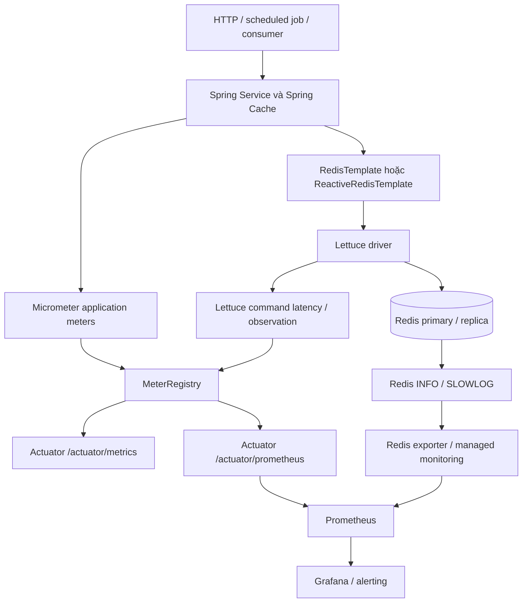
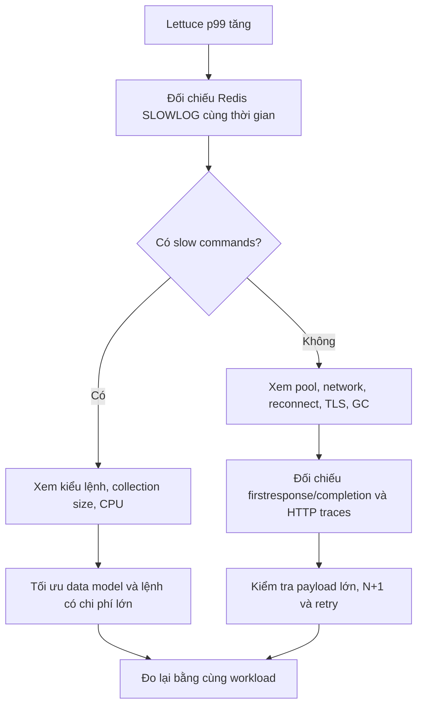

# Tích hợp Micrometer, Actuator và số liệu của trình điều khiển

Khi một ứng dụng **Spring Data Redis** chạy chậm, tăng timeout hoặc gặp lỗi sau failover, chỉ biết “Redis còn sống” là chưa đủ. Một HTTP request có thể phải chờ kết nối, gọi hàng chục lệnh Redis, nhận một payload lớn, deserialize dữ liệu trong JVM hoặc liên tục cache miss, dù Redis Server không có command nào xuất hiện trong Slow Log.

Để tìm nguyên nhân, cần quan sát từ **mã nghiệp vụ**, qua **Spring Data Redis và trình điều khiển**, tới **Redis Server**. Trong ứng dụng Spring Boot, ba thành phần thường kết hợp với nhau:

- **Micrometer:** mô hình đo lường độc lập với backend bằng các meter như `Counter`, `Timer`, `Gauge`, histogram; cùng hệ sinh thái `Observation` và tracing.
- **Spring Boot Actuator:** tự cấu hình nhiều thành phần observability và cung cấp các endpoint như `/actuator/health`, `/actuator/metrics`, `/actuator/prometheus`.
- **Redis driver**, thường là **Lettuce**: ghi nhận độ trễ và observation của lệnh Redis, bao gồm thời gian đến phản hồi đầu tiên và đến khi lệnh hoàn tất.

Bài học giải thích cách cấu hình, đọc số liệu, đo các thao tác ứng dụng, quan sát Redis cache và driver, gửi metric tới Prometheus, liên kết trace, kiểm soát cardinality và phân biệt vấn đề Redis Server với vấn đề mạng/client.

> **Nguyên tắc:** Actuator không phải Prometheus; `RedisHealthIndicator` không phải bộ đo p99; và lệnh Redis nhanh không chứng minh một nghiệp vụ nhiều bước cũng nhanh. Mỗi lớp có hợp đồng quan sát riêng.

## 1. Kiến trúc quan sát Redis từ ứng dụng tới server



Các mũi tên mô tả những đường đo **có thể thiết lập**, không có nghĩa tất cả tự xuất hiện chỉ sau khi thêm một dependency. Redis Server metrics cần một nguồn server-side; driver metrics cần instrumentation tương ứng được kích hoạt.

### 1.1. Bốn lớp cần phân biệt

| Lớp | Câu hỏi cần trả lời | Nguồn đo phù hợp |
| --- | --- | --- |
| **Ứng dụng/cache** | Cache hit/miss bao nhiêu? `loadProduct` tốn bao lâu? | Metric nghiệp vụ, CacheManager metrics khi được hỗ trợ |
| **Driver** | `GET`, `SET`, `HGETALL` trả lời chậm không? | Lettuce command latency recorder, driver events |
| **Redis Server** | CPU, memory, eviction, replication lag, slow commands? | Redis `INFO`, `SLOWLOG`, server exporter |
| **Request end-to-end** | HTTP request chậm vì Redis, SQL, network hay JVM? | HTTP metrics, tracing, correlation ID |

Một metric riêng lẻ hiếm khi đủ cho chẩn đoán. Ví dụ Redis GET chỉ mất 2 ms nhưng một request gửi 100 GET nối tiếp có thể chậm đáng kể.

## 2. Các khái niệm Micrometer

Micrometer cho phép ứng dụng viết metric bằng một API thống nhất rồi phát ra nhiều hệ thống monitoring. Thành phần trung tâm là `MeterRegistry`.

| Loại meter | Dùng để đo | Ví dụ |
| --- | --- | --- |
| `Counter` | Số sự kiện chỉ tăng | Retry, timeout, cache miss |
| `Timer` | Số lần và thời gian của một thao tác | Redis command latency, nghiệp vụ đọc sản phẩm |
| `DistributionSummary` | Phân bố một đại lượng không phải thời gian | Payload bytes, batch size |
| `Gauge` | Giá trị hiện tại, có thể tăng hoặc giảm | Backlog, số tác vụ đang chờ |
| `LongTaskTimer` | Số lượng/thời gian những job chạy lâu | Backfill, maintenance |

Ví dụ tạo counter:

```java
import io.micrometer.core.instrument.Counter;
import io.micrometer.core.instrument.MeterRegistry;

Counter misses = Counter.builder("app.redis.cache.lookups")
        .description("Cache lookups recorded by the application")
        .tag("cache", "productName")
        .tag("result", "miss")
        .register(meterRegistry);

misses.increment();
```

`app.redis.cache.lookups` là **metric tùy chỉnh**, không phải tên metric mặc định của Spring Data Redis.

### 2.1. Metric tags và cardinality

Tag nên có số giá trị hữu hạn:

```text
cache     = products | sessions
command   = GET | SET | HGET
operation = loadProduct | reserveInventory
result    = success | timeout | error
```

Không dùng:

```text
userId   = u-389123
key      = cart:tenant-12:user-389123
traceId  = mỗi request một ID mới
session  = session ngẫu nhiên
```

Với Micrometer, một tổ hợp **metric name + tags** thường tạo một meter/series riêng. Gắn ID người dùng, Redis key hay request ID sẽ làm số time series tăng rất lớn, tốn RAM ở JVM/monitoring và có thể để lộ dữ liệu nhạy cảm.

**Metric tags dành cho low-cardinality dimensions**; dữ liệu chẩn đoán theo từng request nên dùng trace/log đã được kiểm soát quyền truy cập.

## 3. Actuator: endpoint, health và metrics

Spring Boot Actuator cung cấp những endpoint hữu ích:

| Endpoint | Nội dung | Giới hạn |
| --- | --- | --- |
| `/actuator/health` | Trạng thái health indicator, có thể gồm Redis | Không đo phân vị độ trễ |
| `/actuator/metrics` | Danh sách meter và measurement đã thu thập | Không phải Prometheus scrape format |
| `/actuator/prometheus` | Mẫu metric dạng Prometheus khi có registry | Không tự tạo metrics server-side Redis |
| `/actuator/caches` | Các cache được Spring nhận diện | Không mặc nhiên có hit/miss trên mọi provider |
| `/actuator/info` | Metadata ứng dụng được cấu hình | Không thay thế việc quan sát Redis |

**Endpoint exposure** và **endpoint access** là hai việc khác nhau. Chỉ khai báo exposure không tự thiết lập authentication/authorization. Trong production, không mở rộng tất cả endpoint Actuator ra Internet.

### 3.1. Health UP không có nghĩa Redis đang nhanh

Redis health indicator có thể kiểm tra khả năng kết nối và trả trạng thái phù hợp. Một Redis đang quá tải vẫn có thể trả health `UP` trong khi p99 latency tăng. Ngược lại, health check có thể timeout trong giai đoạn failover dù ứng dụng sẽ khôi phục sau đó.

Vì vậy:

- Dùng **health** để phục vụ readiness/availability theo hợp đồng vận hành.
- Dùng **driver timers** để quan sát độ trễ command.
- Dùng **server metrics/Slow Log** để tìm nguyên nhân ở Redis.
- Dùng **HTTP/business timers/traces** để đo trải nghiệm ứng dụng.

Không dùng health indicator như một phép thử độ bền ghi sau replication/failover.

## 4. Dependencies cho Spring Boot + Redis + Actuator

Ví dụ dự án Spring Boot 3.x, Java 17+, Lettuce:

```groovy
// build.gradle
dependencies {
    implementation 'org.springframework.boot:spring-boot-starter-data-redis'
    implementation 'org.springframework.boot:spring-boot-starter-actuator'
    implementation 'org.springframework.boot:spring-boot-starter-cache'

    runtimeOnly 'io.micrometer:micrometer-registry-prometheus'

    testImplementation 'org.springframework.boot:spring-boot-starter-test'
}
```

Ví dụ giả định dự án đang dùng Spring Boot dependency management để thống nhất version. Nếu không dùng Spring Cache, có thể bỏ starter cache. Nếu chỉ cần `/actuator/metrics` để chẩn đoán tại chỗ, Prometheus registry không bắt buộc.

**Lưu ý version:** Spring Boot 3.x và 4.x có thể có khác biệt về auto-configuration, tracing dependencies và một số property; trước khi áp dụng lên dự án thật phải đọc reference tương ứng phiên bản đang dùng.

### 4.1. Cấu hình ứng dụng

```yaml
# application.yml
spring:
  application:
    name: catalog-service
  data:
    redis:
      host: localhost
      port: 6379
      connect-timeout: 2s
      timeout: 3s

management:
  endpoints:
    web:
      exposure:
        include: "health,info,metrics,prometheus,caches"
  endpoint:
    health:
      show-details: when_authorized
  metrics:
    tags:
      application: ${spring.application.name}
```

`localhost` dùng cho phát triển. Khi triển khai production, thay địa chỉ, xác thực, TLS và topology theo hạ tầng Redis thực tế.

`management.metrics.tags.application` là một tag có số giá trị nhỏ, hữu ích khi nhiều ứng dụng cùng xuất metrics.

Điểm quan trọng:

1. Phải có `micrometer-registry-prometheus` và expose `prometheus` thì mới dùng được endpoint scrape.
2. Endpoint bị chặn bởi security/network có thể trả 401/403 dù đã expose.
3. Không để health details/endpoint nhạy cảm hiển thị công khai.
4. Cấu hình Redis driver và metric instrumentation có thể phụ thuộc vào cách Bean `LettuceConnectionFactory` được tạo.

## 5. Đọc số liệu qua Actuator

Sau khi ứng dụng khởi động và có traffic Redis thật:

```sh
curl -s http://localhost:8080/actuator/health
curl -s http://localhost:8080/actuator/metrics
curl -s http://localhost:8080/actuator/prometheus
```

`/actuator/metrics` liệt kê các **tên meter đã có trong registry**. Muốn xem một meter cụ thể:

```sh
curl -s "http://localhost:8080/actuator/metrics/lettuce.command.completion"
```

Lọc theo một tag:

```sh
curl -s "http://localhost:8080/actuator/metrics/lettuce.command.completion?tag=command:GET"
```

Chỉ truy vấn meter **thực sự có trong danh sách**, vì tên metric/tag phụ thuộc Lettuce version, cấu hình instrumentation và việc đã có command hoàn tất hay chưa.

### 5.1. Tên meter của Micrometer khác tên export Prometheus

Ví dụ Timer gốc:

```text
lettuce.command.completion
```

Khi xuất sang Prometheus, có thể thấy các series dạng:

```text
lettuce_command_completion_seconds_count
lettuce_command_completion_seconds_sum
lettuce_command_completion_seconds_max
```

Nếu cấu hình **histogram**, có thể có thêm:

```text
lettuce_command_completion_seconds_bucket
```

Tên metric/hậu tố phụ thuộc registry và version; `_bucket` **không tự xuất hiện** khi histogram chưa được bật. Khi gọi Actuator metrics selector, dùng **tên meter gốc**, không phải tên đã chuyển sang định dạng Prometheus.

## 6. Lettuce đo Redis command latency như thế nào?

Lettuce có cơ chế đo command latency và tích hợp Micrometer. Với `MicrometerCommandLatencyRecorder`, hai Timer cơ bản:

| Timer | Mô tả | Ý nghĩa phân tích |
| --- | --- | --- |
| `lettuce.command.firstresponse` | Khoảng thời gian tới **phản hồi đầu tiên** | Độ trễ ban đầu nhìn từ driver |
| `lettuce.command.completion` | Khoảng thời gian tới lúc **command hoàn tất** | Độ trễ hoàn tất mà driver ghi nhận |

Với lệnh trả một reply đơn giản, hai thời gian có thể gần nhau. Với response lớn hoặc command streaming nhiều phần, completion có thể cao hơn firstresponse.

**Không hiểu Timer của Lettuce như thời gian CPU riêng của Redis Server.** Nó đo ở driver, chịu ảnh hưởng của đường kết nối, queueing, network, xử lý reply và các thành phần có liên quan. Để xem server command execution, dùng dữ liệu server như `SLOWLOG`/`INFO commandstats`.

### 6.1. Những tag mặc định thường gặp

| Tag | Ví dụ | Tác dụng |
| --- | --- | --- |
| `command` | `GET`, `SET`, `HGETALL` | Phân loại lệnh Redis |
| `local` | `ANY` hoặc địa chỉ socket local | Phân biệt kết nối local nếu được cấu hình |
| `remote` | `redis-a:6379` | Phân biệt Redis endpoint |

Lettuce có thể gộp những connection cùng remote endpoint để tránh cardinality lớn; tùy chọn phân biệt local socket có thể làm tăng series khi connection liên tục tạo mới.

Trong Redis Cluster và failover, số remote endpoints có thể thay đổi. Vì vậy cần giám sát số lượng time series, nhất là khi thêm tags tùy chỉnh.

## 7. Auto-configuration của Spring Boot và giới hạn

Khi Spring Boot tạo `LettuceConnectionFactory` và hạ tầng Micrometer phù hợp đã có, Boot có thể tự cấu hình instrumentation cho Lettuce. Trong tài liệu Spring Data Redis 3.5, `LettuceMetricsAutoConfiguration` được nhắc tới như thành phần thiết lập `MicrometerCommandLatencyRecorder`.

Quy trình nên dùng trước khi cấu hình thủ công:

1. Thêm Redis starter, Actuator và registry cần thiết.
2. Dùng Redis connection factory do Spring Boot auto-configure.
3. Thực thi vài lệnh thật qua `StringRedisTemplate`.
4. Kiểm tra `/actuator/metrics` và `/actuator/prometheus`.
5. Chỉ cấu hình driver recorder thủ công nếu cần tùy biến hoặc auto-configuration không đáp ứng yêu cầu.

**Không có bảo đảm tổng quát** rằng chỉ thêm Actuator là mọi phiên bản Spring Boot, mọi driver và mọi `RedisConnectionFactory` tự tạo sẽ có các Timer `lettuce.command.*`.

Nếu dùng **Jedis** thay Lettuce, không trông chờ metric có tên `lettuce.command.completion`. Cần dùng instrumentation thực tế của Jedis hoặc metric tầng ứng dụng.

## 8. Cấu hình thủ công MicrometerCommandLatencyRecorder

Lettuce cung cấp `MicrometerOptions` và `MicrometerCommandLatencyRecorder`.

```java
import io.lettuce.core.metrics.MicrometerCommandLatencyRecorder;
import io.lettuce.core.metrics.MicrometerOptions;
import io.lettuce.core.resource.ClientResources;
import io.micrometer.core.instrument.MeterRegistry;

// registry là MeterRegistry được Spring inject.
MicrometerOptions options = MicrometerOptions.create();

ClientResources resources = ClientResources.builder()
        .commandLatencyRecorder(
                new MicrometerCommandLatencyRecorder(registry, options))
        .build();
```

Tạo recorder chưa đủ: phải dùng **chính ClientResources đó** cho connection factory xử lý traffic Redis.

### 8.1. Ví dụ Spring configuration thủ công

```java
package com.example.observability;

import io.lettuce.core.metrics.MicrometerCommandLatencyRecorder;
import io.lettuce.core.metrics.MicrometerOptions;
import io.lettuce.core.resource.ClientResources;
import io.micrometer.core.instrument.MeterRegistry;
import org.springframework.context.annotation.Bean;
import org.springframework.context.annotation.Configuration;
import org.springframework.data.redis.connection.RedisStandaloneConfiguration;
import org.springframework.data.redis.connection.lettuce.LettuceClientConfiguration;
import org.springframework.data.redis.connection.lettuce.LettuceConnectionFactory;

@Configuration
public class ManualLettuceMetricsConfiguration {

    @Bean(destroyMethod = "shutdown")
    public ClientResources clientResources(MeterRegistry registry) {
        return ClientResources.builder()
                .commandLatencyRecorder(
                        new MicrometerCommandLatencyRecorder(
                                registry, MicrometerOptions.create()))
                .build();
    }

    @Bean
    public LettuceConnectionFactory redisConnectionFactory(
            ClientResources resources) {

        RedisStandaloneConfiguration server =
                new RedisStandaloneConfiguration("localhost", 6379);

        LettuceClientConfiguration client =
                LettuceClientConfiguration.builder()
                        .clientResources(resources)
                        .build();

        return new LettuceConnectionFactory(server, client);
    }
}
```

Đây là **một phương án thay thế** cho kết nối tự động của Boot, không phải yêu cầu thêm một connection factory thứ hai. Khi tự tạo factory, phải mang theo cấu hình authentication, TLS, Sentinel, Cluster, timeout, topology refresh và lifecycle đang dùng.

Không tạo một `ClientResources` riêng cho mỗi HTTP request. Không cài đồng thời nhiều recorder đo cùng traffic rồi cộng số liệu như thể mỗi recorder tương ứng một lệnh Redis khác.

### 8.2. Các tùy chọn MicrometerOptions

| Tùy chọn | Tác dụng | Đánh đổi |
| --- | --- | --- |
| `histogram` | Bật histogram cho phân tích latency distribution | Nhiều series/bucket hơn |
| `targetPercentiles` | Cấu hình các percentile được đo theo driver | Cần hiểu cách xuất và tính gộp |
| `localDistinction` | Phân biệt local connection/socket | Dễ tăng cardinality khi reconnect |
| `minLatency`, `maxLatency` | Phạm vi latency kỳ vọng cho histogram | Cần phù hợp SLO thực tế |
| `tags` | Thêm tags tĩnh/ít giá trị | Tag không giới hạn dễ tạo hàng triệu series |

Bật histogram cho mọi command và endpoint có thể tốn nhiều bộ nhớ. Nên chọn những metric thật sự cần p95/p99 và kiểm tra chi phí số series.

## 9. Micrometer Observation và distributed tracing

Metrics cho biết **xu hướng chung**. Tracing giúp xem **một request cụ thể** đã làm gì.

```text
GET /products/P-101
  |
  +-- Spring Cache lookup
        |
        +-- Redis GET productCards::P-101
  |
  +-- Database SELECT (khi cache miss)
  |
  +-- Redis SET cache entry
```

Micrometer Observation có thể tạo cả meter và span khi các handler/bridge được cấu hình. Spring Data Redis dùng tích hợp Lettuce để quan sát Redis command.

### 9.1. MicrometerTracing trong Lettuce

Tài liệu Spring Data Redis minh họa tích hợp bằng `MicrometerTracing`:

```java
import io.lettuce.core.resource.ClientResources;
import io.lettuce.core.tracing.MicrometerTracing;
import io.micrometer.observation.ObservationRegistry;

// observationRegistry là bean đã được Spring inject.
ClientResources resources = ClientResources.builder()
        .tracing(new MicrometerTracing(
                observationRegistry, "catalog-redis"))
        .build();
```

`resources` phải được đưa vào `LettuceClientConfiguration` thực tế. Với Spring Boot đã tự cấu hình tracing/observability, nên **xác nhận kết quả trước khi tạo cấu hình cạnh tranh**.

Một số tài liệu cũ sử dụng `MicrometerTracingAdapter`; Spring Data Redis các phiên bản mới khuyến nghị `MicrometerTracing` của Lettuce thay thế adapter cũ.

### 9.2. Tracing cần exporter và sampling

Để xuất trace tới OpenTelemetry Collector, Jaeger, Zipkin hoặc backend tương ứng, cần:

1. Instrumentation sinh observation/span.
2. Bridge/tracer được hỗ trợ.
3. Exporter và endpoint của backend.
4. Sampling policy.
5. Context propagation phù hợp giữa các luồng/thread/reactive signals.

Ví dụ tùy phiên bản Spring Boot:

```yaml
management:
  tracing:
    sampling:
      probability: 0.1
```

Đây là tỷ lệ sampling minh họa, không phải lệnh chỉ gửi 10% Redis command. Sampling quá cao có thể gây chi phí export/storage lớn khi traffic tăng.

**Actuator `/actuator/metrics` không phải trình xem traces.** Trace xuất tới một backend phân tích trace riêng.

## 10. Redis driver metrics khác Redis server metrics

| Câu hỏi | Nguồn số liệu phù hợp |
| --- | --- |
| Command `GET` từ Java chờ bao lâu? | Lettuce command completion/firstresponse Timer |
| Redis CPU có đạt ngưỡng quá tải không? | Redis `INFO cpu` hoặc exporter |
| Redis có đang evict key do thiếu memory? | `INFO stats`, server metrics |
| Có slow command trên server? | Redis `SLOWLOG` |
| Cache hit ratio? | Cache metrics hoặc đo lookup ở tầng cache |
| Có bao nhiêu retry/timeout? | Application/driver instrumentation hoặc metric tự tạo |
| Một request chậm ở bước nào? | Distributed tracing và business timers |
| Replica có lag không? | `INFO replication` / server exporter |

Actuator không tự lấy tất cả Redis server stats và tạo metrics cho từng Redis instance chỉ vì có Redis starter.

### 10.1. Một số lệnh Redis để đối chiếu

```redis
INFO server
INFO clients
INFO cpu
INFO memory
INFO stats
INFO commandstats
INFO replication
SLOWLOG GET 20
LATENCY LATEST
```

Các dữ liệu hữu ích:

- `used_memory`, fragmentation, `maxmemory`.
- `evicted_keys`, `expired_keys`.
- `connected_clients`, `blocked_clients`.
- `cmdstat_get`, `cmdstat_set` và thời gian server xử lý.
- Replica link status, replication offset/lag.
- Những command xuất hiện trong Redis Slow Log.

Ở managed Redis, một số lệnh/metric có thể bị giới hạn, nên dùng hạ tầng monitoring của nhà cung cấp. Trên Redis Cluster, cần xem từng primary/replica liên quan.

## 11. Slow Log không phải command latency toàn tuyến

Redis Slow Log đo thời gian **server thực thi command**, không bao gồm toàn bộ:

```text
chờ lấy connection trong pool
queueing ở client
network RTT
truyền reply qua mạng
deserialize trong JVM
thời gian thực thi service/business code
```

Một tình huống:

```text
HTTP p99                  = 420 ms
Lettuce GET completion    = 250 ms
Redis SLOWLOG             = không có command trên 10 ms
```

Không mâu thuẫn. Nguyên nhân có thể ở driver, network, pool, Redis reply lớn hoặc GC. Đừng tăng CPU Redis ngay nếu chưa biết thời gian đang nằm ở đâu.

### 11.1. So sánh firstresponse và completion

Nếu `firstresponse` gần `completion`, phần lớn thời gian có thể nằm trước/đến phản hồi đầu tiên. Nếu `completion` lớn hơn nhiều, cần xem response size, streaming, network/backpressure và cách nhận dữ liệu.

Đây chỉ là **gợi ý chẩn đoán**, không phải công thức phân rã chính xác CPU vs network. Phải kết hợp tracing, server metrics và kích thước payload.

## 12. Cache metrics: đừng suy ra hit từ số lệnh GET

Với Spring Cache:

```java
@Cacheable(cacheNames = "productCards", key = "#p0")
public Product find(String id) {
    return repository.findById(id).orElseThrow();
}
```

Khi cache hit, Spring interceptor có thể **không chạy thân method**. Một counter ở trong body chỉ đếm lần chạy body, không đo mọi lookup.

```java
public Product find(String id) {
    // Nếu @Cacheable hit, dòng này không chạy.
    cacheMissCounter.increment();
    return repository.findById(id).orElseThrow();
}
```

Counter này cũng không chứng minh các lần chạy body đều do cache miss: self-invocation hoặc condition có thể khiến cache advice bị bỏ qua. Để đo hit ratio, cần đo tại một nơi thực sự biết **lookup cache trả hit hay miss**.

### 12.1. Spring Boot Cache Metrics

Spring Boot có hỗ trợ instrumentation cho nhiều Cache provider, trong đó có Redis khi cấu hình phù hợp. Meters có thể được gắn tag cache name và CacheManager name.

Nhưng:

- Một số provider **không hỗ trợ đủ** số liệu hit/miss/size/eviction.
- Cache tạo động sau khi Spring Boot bind startup có thể không được đăng ký tự động; cần `CacheMetricsRegistrar` nếu phù hợp.
- Không nên mặc định `cache.gets{result="hit"}` tồn tại với mọi RedisCacheManager version.
- `/actuator/caches` và `/actuator/metrics` cần được kiểm tra để xem số liệu đang thực sự có.

Ví dụ khai báo cache names tĩnh:

```yaml
spring:
  cache:
    type: redis
    cache-names: productCards,productDetails
```

Nếu cần hit/miss chính xác theo yêu cầu riêng, có thể tự instrument một cache wrapper hoặc dùng một lớp cache thủ công đo được kết quả lookup.

### 12.2. Ví dụ cache thủ công có hit/miss counters

```java
package com.example.catalog;

import io.micrometer.core.instrument.Counter;
import io.micrometer.core.instrument.MeterRegistry;
import java.time.Duration;
import org.springframework.data.redis.core.StringRedisTemplate;
import org.springframework.stereotype.Service;

@Service
public class ProductNameCache {

    private final StringRedisTemplate redis;
    private final Counter hits;
    private final Counter misses;

    public ProductNameCache(
            StringRedisTemplate redis, MeterRegistry registry) {
        this.redis = redis;
        this.hits = Counter.builder("app.redis.cache.lookups")
                .tag("cache", "productName")
                .tag("result", "hit")
                .register(registry);
        this.misses = Counter.builder("app.redis.cache.lookups")
                .tag("cache", "productName")
                .tag("result", "miss")
                .register(registry);
    }

    public String findName(String id) {
        if (id == null || !id.matches("[A-Za-z0-9_-]{1,64}")) {
            throw new IllegalArgumentException("Invalid id");
        }

        String key = "cache:product-name:v1:" + id;
        String value = redis.opsForValue().get(key);

        if (value != null) {
            hits.increment();
            return value;
        }

        misses.increment();
        String loaded = "Product-" + id; // Nguồn dữ liệu minh họa.
        redis.opsForValue()
                .set(key, loaded, Duration.ofMinutes(10));
        return loaded;
    }
}
```

Đây là **một cache thủ công** do ứng dụng tự quản lý, không phải việc Spring tự đo `@Cacheable`. Miss được định nghĩa là GET trả `null` theo hợp đồng service. Nếu Redis GET ném exception, ta **không** tăng hit/miss mà cần metric `error` khác.

Không dùng ID sản phẩm làm tag; nó chỉ nên nằm trong Redis key theo namespace có kiểm soát.

## 13. Đo end-to-end operation bằng Timer

Một request đọc sản phẩm có thể gồm:

```text
GET Redis
SELECT database khi miss
SET Redis
Map DTO
Return HTTP
```

`lettuce.command.completion` chỉ đo từng lệnh Redis. Để đo một thao tác nghiệp vụ, dùng Timer riêng:

```java
package com.example.catalog;

import io.micrometer.core.instrument.MeterRegistry;
import io.micrometer.core.instrument.Timer;
import org.springframework.stereotype.Service;

@Service
public class CatalogObservedService {

    private final MeterRegistry registry;
    private final ProductNameCache cache;

    public CatalogObservedService(
            MeterRegistry registry,
            ProductNameCache cache) {
        this.registry = registry;
        this.cache = cache;
    }

    public String loadName(String id) {
        Timer.Sample sample = Timer.start(registry);
        try {
            return cache.findName(id);
        } finally {
            sample.stop(Timer.builder("app.catalog.lookup.duration")
                    .description("Duration of catalog lookup")
                    .tag("operation", "loadName")
                    .register(registry));
        }
    }
}
```

Timer này đo thời gian chạy `loadName`, bao gồm cache lookup và những bước sau đó. Khi cần tag `outcome=success|error`, phải có đường ghi đúng outcome kể cả khi có exception, không đưa exception message vào tag.

### 13.1. Đơn vị

Micrometer `Timer` dùng đơn vị thời gian nhất quán và có thể xuất Prometheus dưới dạng **seconds**. Không tự thêm hậu tố `_ms` rồi mặc định Prometheus hiểu đó là milliseconds.

Với `DistributionSummary` cho payload bytes, nên khai báo base unit `"bytes"` và không trộn số byte với số phần tử trong cùng meter.

## 14. HTTP metrics, Redis metrics và lỗi N+1

Một service có thể gọi Redis nhiều lần:

```java
public List<String> loadNames(List<String> ids) {
    return ids.stream()
            .map(cache::findName)
            .toList();
}
```

Nếu có 100 ID và mỗi ID được GET riêng, một HTTP request có thể phát 100 Redis commands. Mỗi GET nhanh không có nghĩa request nhanh.

Quan sát kết hợp:

| Metric | Câu hỏi |
| --- | --- |
| HTTP request duration | Người dùng chờ bao lâu? |
| Lettuce command count/latency | Có bao nhiêu GET và mỗi GET tốn bao lâu? |
| Application Timer | Thời gian `loadNames` là bao nhiêu? |
| Tracing spans | Lệnh đang được gọi nối tiếp hay song song? |
| DB metrics | Cache miss có làm tăng SQL load không? |

Đừng tối ưu Redis theo một Timer duy nhất nếu thực tế thiết kế N+1 command là nguyên nhân.

## 15. Prometheus: các biểu thức truy vấn cơ bản

Khi có Micrometer Prometheus registry, những Timer thường được xuất dưới dạng `_seconds_count`, `_seconds_sum` và đôi khi `_seconds_bucket`.

### 15.1. Throughput GET

```promql
sum(rate(lettuce_command_completion_seconds_count{command="GET"}[5m]))
```

Kết quả là số command GET **được Timer ghi nhận/giây**, không phải HTTP requests/giây hoặc unique users.

### 15.2. Mean completion latency của GET

```promql
sum(rate(lettuce_command_completion_seconds_sum{command="GET"}[5m]))
/
sum(rate(lettuce_command_completion_seconds_count{command="GET"}[5m]))
```

Đây là **trung bình** theo khoảng 5 phút, đơn vị giây theo format Timer Prometheus; nó không thay thế p95/p99.

### 15.3. p95 từ histogram

Khi **đã bật histogram và xác minh có series `_bucket`**:

```promql
histogram_quantile(
  0.95,
  sum by (le, command) (
    rate(lettuce_command_completion_seconds_bucket{command="GET"}[5m])
  )
)
```

Nếu không có `_bucket`, phải bật cấu hình histogram phù hợp hoặc chọn nguồn số liệu khác. Không dùng biểu thức này rồi coi kết quả trống là Redis không có traffic.

### 15.4. Cache hit ratio tùy chỉnh

Từ `ProductNameCache` ở ví dụ:

```promql
sum(rate(app_redis_cache_lookups_total{cache="productName",result="hit"}[5m]))
/
clamp_min(
  sum(rate(app_redis_cache_lookups_total{cache="productName"}[5m])),
  1e-9
)
```

Đây chỉ là ratio trong **lớp cache đã instrument**. Không mặc nhiên phản ánh mọi Spring Cache trong ứng dụng. Nếu không có lookup trong cửa sổ, dashboard nên biểu diễn “không đủ dữ liệu” thay vì kết luận hit ratio thật bằng 0.

### 15.5. Vì sao không trung bình p95 từ nhiều JVM?

Percentile là đặc tính của **phân bố dữ liệu**, không phải giá trị có thể gộp bằng trung bình thông thường.

```text
JVM A: p95 = 5 ms,  1.000 command
JVM B: p95 = 80 ms, 100.000 command
```

`(5 + 80) / 2` **không phải p95 của 101.000 command**. Để tính percentile gộp, nên dùng histogram có thể aggregate theo buckets/series phù hợp hoặc backend hỗ trợ dữ liệu phân bố.

## 16. Pool, reconnect và driver errors

Lettuce có nhiều mô hình sử dụng connection. Không phải ứng dụng nào cũng cần connection pool cho lệnh Redis thông thường. Nếu cấu hình pool, nên xem:

- Active/idle/max connections.
- Thời gian chờ mượn connection.
- Timeout khi pool cạn.
- Số lần tạo/hủy connection.
- Reconnect và connection reset theo Redis endpoint.

**Không bảo đảm** có một meter pool tên cố định trong mọi Spring Boot/Lettuce setup. Pool metrics phụ thuộc driver, library như `commons-pool2`, cấu hình và binder đang sử dụng.

### 16.1. Redis Server CPU thấp nhưng client p99 cao

Những nguyên nhân cần kiểm tra:

```text
waiting for connection
DNS/TLS handshake
network packet loss
Redis topology refresh
reconnect after failover
JVM GC pause
payload deserialize
retry backoff
```

Đừng chỉ tăng `spring.data.redis.timeout` rồi coi sự cố đã được xử lý. Timeout dài hơn có thể che lỗi và giữ request lâu hơn.

## 17. Redis Cluster và Sentinel: phân tích theo node

Trong Redis Cluster có nhiều primary/replica; tag `remote` của Lettuce giúp phân biệt lệnh đi tới endpoint nào nếu instrumentation hỗ trợ.

```text
command=GET, remote=redis-a:6379
command=GET, remote=redis-b:6379
command=GET, remote=redis-c:6379
```

Nếu chỉ một node có p99 tăng, có thể liên quan hot slot, collection quá lớn, memory pressure, network hoặc resharding.

Với Sentinel failover, primary endpoint có thể chuyển từ A sang B. Series theo `remote` cũng thay đổi: không nên nhìn mất traffic ở A rồi kết luận hệ thống không ghi Redis nữa.

### 17.1. Tránh nổ cardinality do local socket

Khi bật phân biệt local connection, mỗi reconnect/ephemeral port có thể tạo thêm tổ hợp tag. Metric timer có thể tồn tại trong registry ngay cả sau khi connection cũ đóng.

Với môi trường nhiều connection, ưu tiên gộp theo endpoint và command nếu không có yêu cầu chẩn đoán chi tiết từng socket. Theo dõi số meter/time series trong JVM và Prometheus.

## 18. Metrics không bảo đảm correctness của ghi

Một lệnh:

```redis
SET order:101:status PAID
```

có thể trả thành công trên Redis primary cũ, nhưng bị mất sau failover khi replication bất đồng bộ chưa kịp đồng bộ tới replica được promote.

Lettuce Timer chỉ mô tả **thời gian command được quan sát**, không chứng minh durability sau failover. Tương tự, timeout có thể xảy ra sau khi server đã thực thi lệnh, nên không thể suy ra lệnh chưa ghi.

Với workflow quan trọng, bổ sung:

- Stable operation ID/idempotency.
- Counter cho outcome `CONFIRMED`, `UNKNOWN`, `REJECTED`.
- Retry counts và reconciliation backlog.
- Outbox/Stream consumer lag, pending entries và dead-letter count.
- Phân tích replication lag/failover qua server metrics.

Quan sát latency tốt là cần thiết, nhưng không thay thế cơ chế phục hồi nghiệp vụ.

## 19. Thiết kế custom metrics có ý nghĩa

| Tên minh họa | Loại | Tag giới hạn | Ý nghĩa |
| --- | --- | --- | --- |
| `app.redis.operation.duration` | Timer | `operation`, `outcome` | Thời gian nghiệp vụ liên quan Redis |
| `app.redis.cache.lookups` | Counter | `cache`, `result` | Hit/miss do application đo |
| `app.redis.timeouts` | Counter | `operation` | Số timeout |
| `app.redis.retries` | Counter | `operation`, `reason` | Số retry |
| `app.redis.unknown_writes` | Counter | `operation` | Kết quả ghi không chắc chắn |
| `app.stream.pending` | Gauge | `group`, `stream` đã định danh cố định | Backlog consumer |
| `app.outbox.oldest_age` | Gauge | `publisher` | Tuổi record outbox lâu nhất |

Không nhất thiết tạo tất cả metric. Mỗi meter nên hỗ trợ một hành động vận hành: alert, tối ưu hay điều tra.

### 19.1. Gauge không được biến thành full Redis scan

Ví dụ anti-pattern:

```text
Gauge supplier:
  SCAN all keys
  GET each key
  count active sessions
```

Mỗi Prometheus scrape lúc này trở thành một công việc nặng, có thể làm Redis quá tải đúng lúc hệ thống đang cần giám sát.

Thay bằng:

- Giá trị đã được cập nhật từ logic ghi.
- Một background job có budget rồi lưu snapshot gần nhất cho Gauge.
- Lệnh cardinality phù hợp và có tần suất thấp, như `SCARD`/`ZCARD`.
- Redis server exporter/managed monitoring.

## 20. Những panel dashboard đáng có

**Tầng ứng dụng:** HTTP request p95/p99, error rate, cache hit ratio, thời gian `loadProduct`, retry/timeout/unknown writes.

**Tầng Lettuce:** command rate theo loại lệnh, firstresponse/completion latency, p95/p99 nếu có histogram, phân loại remote endpoint, reconnect/errors nếu có instrumentation.

**Tầng Redis Server:** CPU, memory, evictions, blocked clients, commandstats, replication lag và Slow Log.

**Tầng workflow:** Streams pending/lag, DLQ, outbox backlog, thời gian đối soát và số event được dedup.

Dashboard phải dùng cùng **khoảng thời gian và đơn vị**. Phân biệt rate mỗi giây, count, milliseconds/seconds và phần trăm.

## 21. Thiết kế alert có bối cảnh

| Tín hiệu | Mục tiêu | Kiểm tra cùng |
| --- | --- | --- |
| Command p99 tăng trong nhiều phút | Phát hiện Redis/driver bottleneck | Traffic, CPU, Slow Log |
| Timeout tăng | Network hoặc quá tải | Reconnect, health, pool |
| Hit ratio giảm mạnh | Cache miss storm/invalidation sai | DB load, deploy timeline |
| `evicted_keys` tăng | Thiếu memory hoặc policy eviction | Memory, maxmemory |
| Replication lag tăng | Stale reads và nguy cơ write loss | Failover events |
| Stream pending tăng | Consumer chậm hoặc chết | Consumer throughput, DLQ |
| Prometheus scrape mất | Không có telemetry đáng tin | Target `up`, auth, network |

Chọn ngưỡng theo SLO và tải thực tế, không mặc định p99 trên 10 ms là lỗi ở mọi môi trường. Hạn chế cảnh báo dựa trên một sample đơn lẻ; dùng thời gian đánh giá và traffic tối thiểu.

## 22. Bảo mật Actuator, metrics và traces

Metrics có thể tiết lộ tên service, Redis endpoint, command distribution, cache names, traffic hoặc nội dung nhạy cảm nếu tags thiết kế sai.

Các quy tắc cơ bản:

1. Chỉ expose những endpoint cần vận hành.
2. Bảo vệ bằng network segmentation, authentication/authorization hoặc monitoring ingress.
3. Nếu dùng management port riêng, chỉ cho phép scraper/ops được phê duyệt truy cập.
4. Không mở các endpoint như `env`, `heapdump`, `configprops` nếu không có nhu cầu được kiểm soát.
5. Không gắn Redis password, token, userId, sessionId, raw key hay payload vào metrics.
6. Quản lý retention và quyền truy cập đến trace/log/metrics.
7. Chọn sampling hợp lý để tránh bùng chi phí export.

`show-details: when_authorized` của health không tự bảo vệ toàn bộ Actuator; security phải được cấu hình riêng.

## 23. Chẩn đoán khi không thấy metrics Lettuce

### 23.1. Ứng dụng đã gọi Redis thật chưa?

Nhiều meter được tạo **khi có traffic**. Sau khi Spring Boot khởi động nhưng chưa có lệnh Redis, có thể chưa thấy Timer.

Ví dụ thực hiện trên Redis test:

```java
stringRedisTemplate.opsForValue().set(
        "lesson:metrics:ping",
        "ok",
        java.time.Duration.ofMinutes(1));

String value = stringRedisTemplate.opsForValue()
        .get("lesson:metrics:ping");
```

Sau đó mở lại `/actuator/metrics`.

### 23.2. Actuator endpoint chưa expose?

Nếu `/actuator/metrics` trả 404, có thể endpoint chưa được expose/access, không đồng nghĩa Lettuce instrumentation không hoạt động. Kiểm tra dependencies, properties và security.

### 23.3. Đang dùng driver nào?

Ứng dụng dùng Jedis sẽ không có meter dành riêng cho Lettuce. Kiểm tra connection factory được Spring inject và classpath thực tế.

### 23.4. Connection factory có tự tạo?

Một `LettuceConnectionFactory` tạo thủ công có thể không dùng `ClientResources` đã được instrument. Cần xác nhận factory/driver xử lý traffic thật có recorder mong muốn.

### 23.5. Metric bị filter/disable?

`MeterFilter`, `management.metrics.enable` và registry configuration có thể lọc meter. Prometheus exporter không tự xuất meter đã bị chặn trong registry.

### 23.6. Sai tên meter?

Actuator dùng tên gốc như `lettuce.command.completion`, còn Prometheus thường chuyển sang snake case kèm hậu tố. Dựa vào danh sách `/actuator/metrics` thay vì đoán tên.

### 23.7. Version khác tài liệu?

Spring Boot 3.x/4.x và Lettuce các phiên bản khác có thể thay đổi auto-configuration, tên observation, tag và cách cài tracing. Cần dùng tài liệu của **phiên bản đang chạy**.

## 24. Điều tra p99 tăng khi Redis Slow Log trống



Một quy trình điều tra tốt cần:

- Đồng bộ thời gian/timezone ứng dụng và monitoring.
- Theo dõi Redis endpoint được xác định từ tag `remote`.
- Xem p99 **cùng throughput/error rate**, không nhìn percentile ở lượng mẫu cực nhỏ.
- Kiểm tra Redis payload/collection size.
- Biết một business operation có thể gồm nhiều Redis command và retry.

## 25. Kiểm thử metrics trong Spring context

Một kiểm thử tích hợp có thể xác nhận meter được tạo **sau khi Redis command thực thi qua connection factory đã được instrument**.

```java
// Ví dụ trong @SpringBootTest dùng Redis test backend.
@Autowired StringRedisTemplate redis;
@Autowired MeterRegistry registry;

@Test
void lettuceMetricsAppearAfterRedisCommands() {
    redis.opsForValue().set("test:metrics:key", "ok");
    redis.opsForValue().get("test:metrics:key");

    // Assert này chỉ có ý nghĩa khi test đã bật
    // Lettuce MicrometerCommandLatencyRecorder.
    assertThat(registry.find("lettuce.command.completion")
            .meters()).isNotEmpty();
}
```

Các import của JUnit 5, AssertJ, Micrometer và Spring Test được lược bớt cho dễ đọc. Một test như trên cần **Redis thực trong Testcontainers hoặc môi trường test riêng**, không phải mock RedisTemplate. Không chạy kiểm thử ghi dữ liệu này lên Redis production.

Có thể kiểm tra theo HTTP Actuator ở môi trường test:

```sh
curl -s "http://localhost:8080/actuator/metrics"
curl -s "http://localhost:8080/actuator/metrics/lettuce.command.completion"
curl -s "http://localhost:8080/actuator/prometheus"
```

Nếu không thấy meter, trước tiên xác định đúng driver, config và traffic, rồi mới kết luận lỗi instrumentation.

## 26. Những hiểu nhầm thường gặp

### 26.1. “Có Actuator thì tự có đủ Redis Server metrics”

Sai. Actuator/Micrometer chủ yếu quan sát ứng dụng và driver. Redis CPU, memory, evictions, replication lag cần nguồn giám sát phía Redis hoặc exporter.

### 26.2. “Health UP thì Redis không chậm”

Sai. Health check có thể pass trong khi p99 latency tăng mạnh.

### 26.3. “Lettuce command timer là thời gian CPU của Redis”

Sai. Nó ghi thời gian theo góc nhìn driver, bao gồm nhiều yếu tố ngoài thời gian server chạy command.

### 26.4. “Timer nào cũng có histogram buckets”

Sai. `_bucket` chỉ xuất khi cấu hình histogram phù hợp; không tự có bởi mọi Timer.

### 26.5. “Lấy trung bình p95 của các JVM là p95 toàn hệ thống”

Sai. Percentile không thể gộp bằng trung bình; cần histogram/distribution phù hợp.

### 26.6. “Một Lettuce GET tương đương một Spring Cache hit”

Sai. GET có thể trả null, dùng cho logic khác, hoặc nằm trong các lần lookup không qua Spring Cache.

### 26.7. “Tag userId hoặc key giúp debug tốt hơn”

Không nên. Nó tạo cardinality rất cao, tăng chi phí metric và có thể lộ dữ liệu.

### 26.8. “Không thấy meter nghĩa là không có Redis traffic”

Chưa chắc. Driver/config/registry/endpoint có thể khác hoặc instrumentation bị disable.

### 26.9. “Tracing 100% luôn tốt hơn”

Không. Sampling cao có chi phí tài nguyên/storage; chọn theo traffic và nhu cầu.

### 26.10. “Command success metric đảm bảo không mất ghi”

Không. Lệnh đã được primary xác nhận vẫn có thể mất sau failover khi replication bất đồng bộ.

### 26.11. “Bật phân biệt mọi local connection là tối ưu”

Không. Reconnect tạo thêm sockets/series, dễ làm số lượng metric tăng mạnh.

### 26.12. “Có thể SCAN toàn Redis mỗi lần Prometheus scrape”

Không nên. Một Gauge/endpoint metrics có thể làm Redis quá tải nếu thực hiện full scan ở mỗi lần collection.

## 27. Checklist triển khai

1. Chốt phiên bản Spring Boot/Spring Data Redis/Lettuce đang dùng.
2. Thêm Actuator và registry export cần thiết.
3. Chỉ expose các endpoint cần thiết; bảo vệ bằng network và authentication.
4. Xác nhận ứng dụng dùng Lettuce nếu muốn đo `lettuce.command.*`.
5. Tạo traffic Redis thật, kiểm tra meter qua `/actuator/metrics`.
6. Phân biệt client timers, server metrics, cache hit/miss và business timers.
7. Dùng tag có cardinality thấp, không ghi ID hay raw Redis key.
8. Khi cần p95/p99 gộp instance, thiết kế histogram buckets và kiểm tra chi phí series.
9. Thu thập Redis Server metrics và Slow Log để so sánh với client.
10. Theo dõi timeout, reconnect, retry và unknown write outcomes.
11. Không thực hiện full Redis scan trong Gauge supplier.
12. Kiểm tra server node/role khi có Cluster hoặc Sentinel failover.
13. Kiểm thử tính sẵn sàng của metrics sau nâng cấp dependencies.
14. Viết runbook cho p99 tăng, missing meter, cache miss storm và failover.

## 28. Tổng kết

**Micrometer, Actuator và Lettuce** giúp quan sát Redis theo nhiều góc độ: Micrometer chuẩn hóa meters/observations; Actuator cung cấp các endpoint vận hành; Lettuce có thể đo **first-response latency**, **completion latency** và tạo spans Redis khi được instrument. Khi kết hợp với Prometheus, tracing và số liệu Redis Server, ứng dụng có đủ tín hiệu để phân biệt command chậm, client queueing, network, cache miss, hot key hoặc sự cố failover.

Điểm quyết định chất lượng monitoring là **đo đúng thứ cần biết**: health không phải latency, driver Timer không phải server CPU, số lệnh GET không phải cache hit, và metrics không chứng minh durability của ghi. Chỉ dùng low-cardinality tags, bảo vệ Actuator, xác minh meter thực tế của phiên bản đang chạy và giữ chi phí instrumentation trong giới hạn vận hành.

### Tài liệu tham khảo

- [Spring Data Redis — Observability](https://docs.spring.io/spring-data/redis/reference/observability.html): Lettuce, Micrometer, Redis command observations và cấu hình.
- [Spring Boot — Actuator Metrics](https://docs.spring.io/spring-boot/reference/actuator/metrics.html): MeterRegistry, cache metrics, Prometheus và distribution configuration.
- [Spring Boot — Actuator Endpoints](https://docs.spring.io/spring-boot/reference/actuator/endpoints.html): exposure, access và bảo mật endpoint.
- [Spring Boot — Observability](https://docs.spring.io/spring-boot/reference/actuator/observability.html): metrics, logging, tracing và ObservationRegistry.
- [Spring Boot — Tracing](https://docs.spring.io/spring-boot/reference/actuator/tracing.html): Micrometer Tracing, exporter và sampling.
- [Lettuce — Observability](https://redis.github.io/lettuce/advanced-usage/observability/): `MicrometerCommandLatencyRecorder`, timers và tags.
- [Redis — INFO](https://redis.io/docs/latest/commands/info/): thống kê server theo nhóm.
- [Redis — SLOWLOG](https://redis.io/docs/latest/commands/slowlog/): command execution time phía server.
- [Micrometer — Reference](https://docs.micrometer.io/micrometer/reference/): Counter, Timer, Observation và metrics backends.
