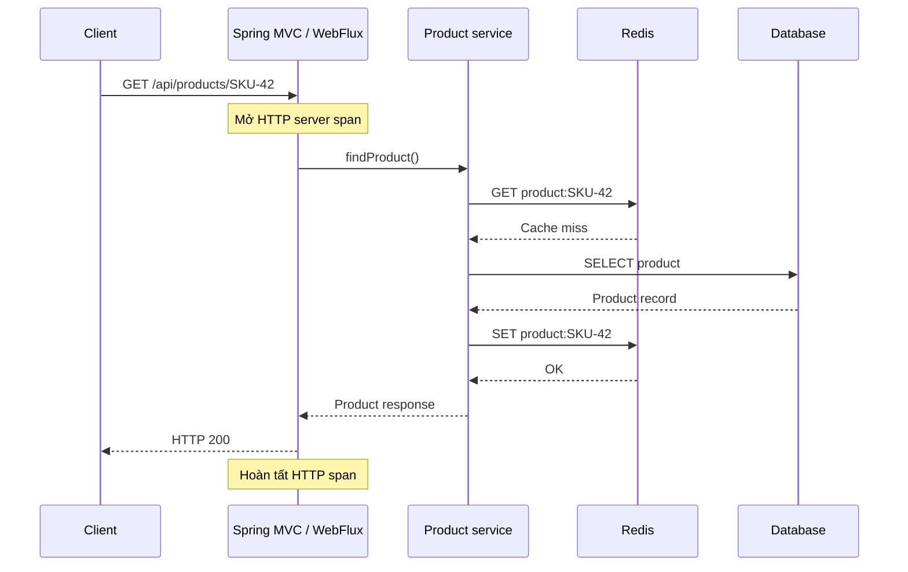
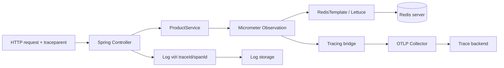

# Liên kết dấu vết yêu cầu với thao tác Redis trong Spring Data Redis

## 1. Bài toán: request chậm vì ứng dụng hay vì Redis?

Một API trả lời chậm không có nghĩa bản thân Redis thực thi lệnh chậm. Trong một request Spring Boot, ứng dụng có thể thực hiện xác thực, truy vấn SQL, đọc cache Redis, giải mã JSON, gọi HTTP service khác và kết xuất response.

Ví dụ:

```text
GET /api/products/SKU-42
  ├── Xác thực request                    5 ms
  ├── Tìm trong Redis                     80 ms
  │    ├── Lấy kết nối / xếp hàng         35 ms
  │    ├── Network + Redis GET             3 ms
  │    └── Deserialize payload JSON       42 ms
  ├── Nếu cache miss: truy vấn database  120 ms
  └── Tạo HTTP response                    6 ms
```

Nếu chỉ quan sát `INFO commandstats` hoặc Redis `SLOWLOG`, ta có thể thấy `GET` thực thi nhanh và không giải thích được 80 ms phía ứng dụng. Ngược lại, nếu chỉ có access log `GET /api/products... duration=211ms`, ta không biết đoạn nào là thủ phạm.

**Distributed tracing** giúp ghép các công đoạn vào **cùng dấu vết yêu cầu** (*trace*). Mỗi công đoạn quan trọng có một **span** với khoảng thời gian, quan hệ cha–con, kết quả và các thuộc tính giới hạn. Khi Spring Data Redis được instrument đúng, span Redis có thể nằm dưới span xử lý request, cho biết thao tác Redis nào đã đóng góp vào độ trễ hoặc lỗi.

Mục tiêu bài này:

1. Hiểu `trace ID`, `span ID`, parent–child và correlation ID.
2. Liên kết inbound HTTP request tới service, Redis command và các bước liên quan.
3. Thiết lập Micrometer Observation/Tracing với OpenTelemetry trong ứng dụng Spring Boot.
4. Phân biệt instrumentation tự động của driver với span tạo thủ công quanh Redis operations.
5. Giữ trace context qua WebFlux, Reactor, `@Async` và ranh giới message.
6. Theo dõi Redis Cache hit/miss mà không tiết lộ key hoặc giá trị nhạy cảm.
7. Thiết kế sampling, cardinality, error tagging và retention an toàn.
8. Kiểm tra bằng trace thực thay vì suy từ việc có log hay dependency.

## 2. Trace, span và correlation ID khác nhau thế nào?

Một **trace** biểu diễn một chuỗi công việc có liên hệ nhân quả, có thể trải dài trên nhiều service.

Một **span** biểu diễn một công đoạn của công việc đó: xử lý HTTP, gọi database, thực hiện Redis `GET`, tính toán cache miss hoặc gọi downstream API.

Ví dụ:

```text
Trace ID: aaaaaaaaaaaaaaaaaaaaaaaaaaaaaaaa
  Span HTTP GET /api/products/{sku}      [SERVER]  140 ms
    └── Span ProductService.findBySku     [INTERNAL] 133 ms
         ├── Span Redis GET               [CLIENT]   12 ms
         └── Span SQL SELECT              [CLIENT]  110 ms
```

Các khái niệm:

| Khái niệm | Ý nghĩa | Đặc điểm |
| --- | --- | --- |
| `traceId` | Định danh cho cả dòng xử lý liên quan | Các span trong cùng trace có cùng trace ID |
| `spanId` | Định danh riêng một công đoạn | Mỗi span có span ID riêng |
| `parentSpanId` | Quan hệ span cha | Dùng để dựng cây thời gian |
| `SpanKind.SERVER` | Công đoạn tiếp nhận một lời gọi | Ví dụ HTTP server xử lý request |
| `SpanKind.CLIENT` | Công đoạn gọi một hệ thống khác | Ví dụ HTTP client, Redis client |
| `SpanKind.INTERNAL` | Công đoạn nội bộ ứng dụng | Ví dụ tính toán hoặc service method |
| Correlation ID nghiệp vụ | ID để đối chiếu nghiệp vụ hoặc support case | Có thể là request ID/order ID, không bắt buộc là trace ID |

**Trace ID không phải Redis key, cache key hay business transaction ID.** Không ghép trace ID vào mọi tên key Redis chỉ để đối chiếu: việc đó có thể phá cache sharing, tăng cardinality và làm khó truy vấn.

Một correlation ID nghiệp vụ có thể tồn tại xuyên nhiều ngày, trong khi trace thường có vòng đời tương ứng một request/workflow quan sát. Hãy lưu hai loại ID cho hai mục đích khác nhau.

## 3. Span Redis nằm ở vị trí nào trong một trace?

Ví dụ request đọc dữ liệu qua cache:



Một trace được liên kết đúng có thể có cấu trúc:

```text
HTTP GET /api/products/{sku}      SERVER
└─ ProductService.findProduct     INTERNAL
   ├─ Redis GET                   CLIENT
   ├─ DB SELECT                   CLIENT
   └─ Redis SET                   CLIENT
```

Kết quả cần kiểm tra là **cùng trace ID và quan hệ parent phù hợp**, không chỉ là ba dòng log đều có từ `Redis`.

Trong một ứng dụng có instrumentation tự động, HTTP, SQL và Redis spans có thể được tạo bởi các thư viện khác nhau. Một điểm cần chú ý là **không phải mọi phiên bản Spring Boot/Spring Data Redis/Lettuce đều tự tạo Redis span chỉ vì đã thêm tracing dependency**. Cần xác định cấu hình observability thực tế của version đang dùng và kiểm tra trace được xuất.

## 4. Kiến trúc observability với Spring Data Redis

Các tầng có thể tham gia:

| Tầng | Công cụ thường gặp | Trách nhiệm |
| --- | --- | --- |
| HTTP request | Spring MVC/WebFlux instrumentation | Tạo server span, đọc trace context inbound |
| Service | Micrometer Observation hoặc OpenTelemetry API | Tạo span nghiệp vụ cần quan sát |
| Redis client | Spring Data Redis/driver integration hoặc custom observation | Theo dõi Redis command/client latency |
| HTTP outbound | Instrumented HTTP client | Truyền trace context sang downstream service |
| Metrics | Micrometer Registry, ví dụ Prometheus | Đo latency, count, hit/miss và error theo nhóm giới hạn |
| Tracing bridge | Micrometer Tracing + OpenTelemetry bridge | Đưa observation vào trace/span backend |
| Exporter | OTLP exporter/collector | Chuyển spans tới hệ thống thu thập |
| Backend | Jaeger, Tempo, Zipkin hoặc tương đương | Tìm theo trace ID và dựng timeline |
| Logs | SLF4J/MDC và tập trung log | Tìm log theo trace ID/span ID |

Luồng tổng thể:



Bản đồ trên không ngụ ý Redis server tự gửi span vào collector. Phần lớn Redis command span được quan sát **ở client**, quanh thời gian gọi Redis. Để thấy những sự kiện nội bộ server chi tiết hơn, phải dùng metrics, log, latency monitoring và công cụ vận hành Redis riêng.

## 5. Những gì Redis client span đo được — và không đo được

Một span client có thể đo:

- Thời gian từ lúc thư viện bắt đầu command đến lúc nhận kết quả/lỗi.
- Command hoặc nhóm operation: `GET`, `SET`, `HGETALL`...
- Endpoint logic của Redis connection nếu instrumentation ghi.
- Loại lỗi, timeout, retry hoặc hủy lời gọi.
- Quan hệ của command với HTTP request đang thực hiện.

Nhưng span client thường **không tự tách chính xác**:

```text
Mất 60 ms:
  10 ms chờ connection/resource
  15 ms trong client queue
   3 ms Redis server execution
  12 ms network
  20 ms decode JSON
```

Thời gian và phạm vi đo phụ thuộc điểm instrumentation. Nếu span chỉ bao quanh `RedisTemplate.get()`, nó có thể gồm serialization/deserialization. Nếu instrumentation nằm sâu trong driver, nó có thể chỉ đo phần command, không gồm tất cả mã hóa object ở service. Không gắn nhãn `redis.server.time` cho một khoảng đo phía client chưa tách được thành phần server.

Vì vậy nên phối hợp:

1. **Trace phía client** để biết request nào gọi Redis, lúc nào và mất bao lâu.
2. **Metrics ứng dụng** về cache hit/miss, serializer latency và thời gian chờ.
3. **Metrics Redis server** như CPU, commandstats, network, connections, slowlog.
4. **Sự kiện topology** khi Sentinel/Cluster failover hoặc thay node.

## 6. Spring Boot: chuẩn bị tracing stack

Một ứng dụng Spring Boot hiện đại thường sử dụng Micrometer Observability và tracing bridge tới OpenTelemetry. Ví dụ Maven:

```xml
<dependencies>
    <dependency>
        <groupId>org.springframework.boot</groupId>
        <artifactId>spring-boot-starter-web</artifactId>
    </dependency>

    <dependency>
        <groupId>org.springframework.boot</groupId>
        <artifactId>spring-boot-starter-data-redis</artifactId>
    </dependency>

    <dependency>
        <groupId>org.springframework.boot</groupId>
        <artifactId>spring-boot-starter-actuator</artifactId>
    </dependency>

    <dependency>
        <groupId>io.micrometer</groupId>
        <artifactId>micrometer-tracing-bridge-otel</artifactId>
    </dependency>

    <dependency>
        <groupId>io.opentelemetry</groupId>
        <artifactId>opentelemetry-exporter-otlp</artifactId>
    </dependency>
</dependencies>
```

Đây là ví dụ một stack Spring Boot có dependency management phù hợp; dự án dùng WebFlux có thể thay MVC starter bằng `spring-boot-starter-webflux`. Tên artifact, khả năng auto-configuration và dependency version cần được đối chiếu với chính bản Spring Boot đang dùng.

Một `application.yml` minh họa:

```yaml
spring:
  application:
    name: catalog-service
  data:
    redis:
      host: localhost
      port: 6379

management:
  tracing:
    sampling:
      probability: 1.0
  otlp:
    tracing:
      endpoint: http://localhost:4318/v1/traces
```

Giải thích:

- `spring.application.name` giúp phân biệt service trong trace backend.
- Sampling `1.0` thường phù hợp ở **local/test** để dễ quan sát mọi request.
- OTLP endpoint là địa chỉ collector/backend hỗ trợ nhận trace qua HTTP. Nếu collector dùng port/protocol khác, cấu hình phải khớp.
- Ở production không mặc nhiên chọn sampling 100% vì số lượng span và chi phí lưu trữ có thể rất lớn.

**Lưu ý:** Cấu hình tracing HTTP không bảo đảm driver Redis đã được instrument. Nếu request hiển thị nhưng thiếu Redis client span, cần kiểm tra integration của Spring Data Redis/Lettuce hoặc thêm manual observation có chủ đích.

## 7. Cách xác nhận trace HTTP đầu vào đang hoạt động

Trước khi kiểm tra Redis, xác nhận HTTP request đã có trace context:

1. Gửi một HTTP request tới controller.
2. Xem backend có server span như `GET /api/products/{sku}` không.
3. Kiểm tra log ứng dụng có `traceId` và `spanId` phù hợp hay không.
4. Nếu gửi header `traceparent` từ upstream đáng tin, kiểm tra service có tiếp tục trace theo chuẩn W3C hay theo cấu hình propagator không.
5. Đối chiếu timestamp và service name.

Ví dụ header W3C Trace Context:

```http
traceparent: 00-aaaaaaaaaaaaaaaaaaaaaaaaaaaaaaaa-bbbbbbbbbbbbbbbb-01
```

Ở đây:

- Phần 32 hex là trace ID.
- Phần 16 hex tiếp theo là parent span ID được gửi qua ranh giới HTTP.
- Phần cờ biểu diễn sampling/trace flags theo chuẩn.

Không dùng một chuỗi tùy tiện gọi là `trace-id` rồi giả định mọi công cụ tự liên kết. Các công cụ tracing tương thích thường hỗ trợ W3C `traceparent`/`tracestate` theo cấu hình propagator.

Nếu không có inbound trace context hợp lệ, service có thể tạo trace mới; điều đó bình thường cho request bắt đầu tại service.

## 8. Ví dụ service có Observation bao quanh thao tác Redis

Một cách rõ ràng để đảm bảo một phần thao tác Redis được quan sát là tạo **Micrometer Observation** tại service. Ví dụ dưới dùng `StringRedisTemplate` và một cache dữ liệu chuỗi:

```java
package com.example.catalog;

import io.micrometer.observation.Observation;
import io.micrometer.observation.ObservationRegistry;
import org.springframework.data.redis.core.StringRedisTemplate;
import org.springframework.stereotype.Service;

@Service
public class CatalogCacheReader {

    private final StringRedisTemplate redis;
    private final ObservationRegistry observationRegistry;

    public CatalogCacheReader(
            StringRedisTemplate redis,
            ObservationRegistry observationRegistry) {
        this.redis = redis;
        this.observationRegistry = observationRegistry;
    }

    public String findStatus(String sku) {
        String key = "catalog:status:" + sku;

        return Observation
                .createNotStarted("app.redis.cache.read", observationRegistry)
                .contextualName("Catalog cache lookup")
                .lowCardinalityKeyValue("cache.name", "catalog-status")
                .lowCardinalityKeyValue("redis.operation", "GET")
                .observe(() -> redis.opsForValue().get(key));
    }
}
```

Đoạn code này:

- Tạo một observation quanh lời gọi `GET`.
- Gắn cache name và Redis operation thuộc tập giá trị có giới hạn.
- Cho tracing bridge tạo span liên quan tới observation hiện hành, khi cấu hình tracing đang hoạt động.
- Để exception từ Redis được ghi nhận theo hành vi của observation handler và truyền về caller.
- Không đưa raw SKU hay Redis key vào span attributes.

Nếu request controller đang có một server observation hiện hành và propagation phù hợp, observation cache read có thể xuất hiện là child của request/service span.

### Ý nghĩa của manual observation

Span ở ví dụ đo **operation như được nhìn thấy từ tầng service**. Nếu ứng dụng cũng đã có automatic Redis instrumentation, có thể thấy:

```text
HTTP GET /api/products/{sku}
└─ Catalog cache lookup          (manual)
   └─ Redis GET                   (automatic)
```

Đây không nhất thiết là lỗi: một span phản ánh thao tác nghiệp vụ, span còn lại phản ánh driver Redis. Tuy nhiên nếu tạo hai span cùng mô tả cùng phạm vi, trace trở nên rườm rà. Nên phân biệt tên và mục tiêu của chúng, tránh instrumentation lặp không có giá trị.

## 9. Không ghi dữ liệu có cardinality cao hoặc nhạy cảm vào attributes

Cách gắn tag nguy hiểm:

```java
// KHÔNG NÊN cho metrics/tracing có thể được xuất ra ngoài:
observation.highCardinalityKeyValue(
        "redis.key", "session:secret-token-123");

observation.lowCardinalityKeyValue(
        "user.id", "user-987654");
```

Rủi ro:

- Raw session key có thể chứa token, email, ID khách hàng hoặc dữ liệu nhạy cảm.
- User ID mỗi request khác nhau làm số lượng series metrics tăng không giới hạn nếu dùng low-cardinality key.
- Trace backend/log storage có thể được nhiều người truy cập, khiến dữ liệu vận hành trở thành kênh rò rỉ.
- Command arguments có thể chứa mật khẩu, API key hoặc nội dung cá nhân.

Thay bằng các thuộc tính có tập giá trị hữu hạn:

```text
cache.name       = catalog-status
redis.operation  = GET
redis.keyspace   = catalog
cache.result     = hit | miss | error
redis.role       = primary | replica | unknown
service.name     = catalog-service
```

Nếu thật sự cần định danh một yêu cầu cụ thể, dùng trace ID để tra cứu và liên kết với log đã được phân quyền; không đưa hàng triệu SKU/user ID vào low-cardinality metric tags.

**Lưu ý:** high-cardinality tracing attributes cũng cần giới hạn về bí mật, độ dài và volume. Khác biệt low/high cardinality không cho phép tùy tiện ghi PII vào traces.

## 10. Phân biệt span thao tác Redis và span cache hit/miss

Một Redis `GET` thành công ở mức protocol chưa chắc là **cache hit**. Nếu key không tồn tại, Redis vẫn trả response hợp lệ, ứng dụng nhận null hoặc publisher rỗng.

Ví dụ:

```text
GET catalog:status:SKU-42
Redis trả nil
Command result: success
Cache result: miss
```

Hai tín hiệu cần tách:

| Tín hiệu | Câu hỏi |
| --- | --- |
| `redis.operation=GET` + span status | Lời gọi Redis thành công hay gặp lỗi? |
| `cache.result=hit/miss` | Có value hữu ích trong cache không? |
| `cache.fallback=db` | Request có phải đọc nguồn dữ liệu khác không? |
| `cache.populate=success/error` | Việc ghi lại cache có thành công không? |
| `request.duration` | Tổng độ trễ người dùng trải nghiệm là bao nhiêu? |

Một ví dụ instrument service theo kết quả:

```java
public String getWithObservedResult(String sku) {
    Observation observation = Observation
            .createNotStarted("app.catalog.cache.lookup", observationRegistry)
            .lowCardinalityKeyValue("cache.name", "catalog-status");

    observation.start();
    try (Observation.Scope ignored = observation.openScope()) {
        String value = redis.opsForValue()
                .get("catalog:status:" + sku);

        observation.lowCardinalityKeyValue(
                "cache.result",
                value == null ? "miss" : "hit");

        return value;
    } catch (RuntimeException ex) {
        observation.error(ex);
        observation.lowCardinalityKeyValue("cache.result", "error");
        throw ex;
    } finally {
        observation.stop();
    }
}
```

Đoạn code minh họa cách tạo observation và gắn result sau khi đã có kết quả. `lowCardinalityKeyValue` dùng một tập giá trị nhỏ `hit/miss/error`. Không gắn tên key hoặc SKU lên metric.

Có thể đặt `cache.result` trong high-cardinality context nếu chỉ cần trace thay vì metrics, nhưng vì nó chỉ có ba giá trị ổn định nên low cardinality thường hợp lý.

## 11. Ghép controller, service, Redis và database trong một trace

Giả sử luồng nghiệp vụ:

```java
@RestController
@RequestMapping("/api/products")
public class ProductController {

    private final ProductService productService;

    public ProductController(ProductService productService) {
        this.productService = productService;
    }

    @GetMapping("/{sku}")
    public ResponseEntity<ProductView> get(@PathVariable String sku) {
        ProductView view = productService.find(sku);

        return view == null
                ? ResponseEntity.notFound().build()
                : ResponseEntity.ok(view);
    }
}
```

Một service:

```java
@Service
public class ProductService {

    private final CatalogCacheReader cache;
    private final ProductRepository repository;

    public ProductService(
            CatalogCacheReader cache,
            ProductRepository repository) {
        this.cache = cache;
        this.repository = repository;
    }

    public ProductView find(String sku) {
        String cachedStatus = cache.findStatus(sku);

        if (cachedStatus != null) {
            return new ProductView(sku, cachedStatus);
        }

        ProductEntity entity = repository.findBySku(sku);
        if (entity == null) {
            return null;
        }

        return new ProductView(sku, entity.status());
    }
}
```

`ProductRepository`, `ProductEntity` và `ProductView` là kiểu ứng dụng minh họa, cần định nghĩa theo domain của dự án. Đoạn code chỉ mô tả read path, chưa cập nhật lại cache sau miss.

Một trace hợp lý có thể trông như sau:

```text
traceId = 2a2b...   HTTP GET /api/products/{sku}
  └─ app.catalog.cache.lookup       4 ms; cache.result=miss
      └─ Redis GET                  3 ms (nếu đã instrument)
  └─ JDBC SELECT product            8 ms (nếu đã instrument)

HTTP 200: 15 ms
```

Không yêu cầu một trace phải có chính xác những tên span nêu trên. Tên và attributes được tạo tự động phụ thuộc Micrometer/Spring Data/driver/OTel semantic conventions. Điều quan trọng là quan hệ nhân quả và thời lượng được phản ánh đúng.

## 12. Log correlation: từ một lỗi Redis tới request gốc

Khi tracing bridge tích hợp với logging, trace ID và span ID có thể xuất hiện trong MDC để log của những thành phần thuộc cùng context được liên kết.

Ví dụ log:

```text
2026-11-13T09:00:00Z INFO  [traceId=abc...,spanId=111...]
  ProductController - get product started

2026-11-13T09:00:00Z WARN  [traceId=abc...,spanId=222...]
  CatalogCacheReader - Redis command failed: timeout

2026-11-13T09:00:00Z ERROR [traceId=abc...,spanId=111...]
  ProductController - Request failed
```

Không cần log toàn bộ Redis key/value hoặc authentication token. Log một mã lỗi, operation type, nhóm cache và trace ID thường đủ để chuyển người vận hành sang trace backend.

Ví dụ cấu hình pattern logging cho một số phiên bản Spring Boot:

```yaml
logging:
  pattern:
    correlation: "[%X{traceId:-},%X{spanId:-}] "
```

Hỗ trợ thuộc tính và pattern phụ thuộc phiên bản Boot/logging stack. Trước khi phụ thuộc cấu hình này, nên xác nhận log thực sự chứa trace/span ID. Một số setup đã tự thêm correlation theo mặc định; cấu hình lặp có thể gây trùng thông tin.

### Không tự tạo traceId cho mỗi method

Sai lầm phổ biến:

```java
String traceId = UUID.randomUUID().toString();
log.info("traceId={} Redis get...", traceId);
```

Một UUID mới mỗi method **không phải trace ID chung** giữa controller, Redis và downstream. Nó chỉ là một ID log tự tạo, không tham gia quan hệ span parent–child.

Nếu ứng dụng cần business correlation ID riêng, có thể tạo một lần ở biên request rồi truyền theo contract rõ ràng. Còn trace/span ID nên để tracing framework quản lý.

## 13. OpenTelemetry: spans là quan sát phía client, không phải Redis server trace

Khi dùng OpenTelemetry, tên thuộc tính thường xoay quanh:

```text
db.system.name = redis
db.operation.name = GET
server.address = redis.internal
server.port = 6379
network.protocol.name = redis
error.type = timeout
```

Tên cụ thể thay đổi theo phiên bản semantic conventions và instrumentation. Một số hệ thống cũ dùng tên khác như `db.system` hoặc `db.statement`. Khi quan sát hai service khác phiên bản, cần chuẩn hóa bằng collector/query hoặc lựa chọn naming phù hợp, tránh hardcode một tên tag không tồn tại ở backend.

Không nên mặc định ghi command statement đầy đủ:

```text
SET session:secret-user-key secret-token-value
```

Nó có thể làm lộ bí mật qua trace. Nếu cần log tên command, ưu tiên `SET`/`GET`/`HGETALL` và nhóm Redis keyspace có giới hạn, không log argument.

### Có cần cài OpenTelemetry Java agent không?

Có thể dùng Java agent hoặc instrumentation thư viện, nhưng không mặc định phải kết hợp mọi phương án đồng thời.

Hai kiểu triển khai phổ biến:

1. **Application/library instrumentation:** Spring Boot + Micrometer Tracing + driver hooks được cấu hình, exporter do app quản lý.
2. **Java agent instrumentation:** agent quan sát các API/framework được hỗ trợ khi JVM khởi động, với exporter/resource configuration tương ứng.

Khi bật cả agent và instrumentation thủ công/auto trong app, có thể xuất hiện các span Redis hoặc HTTP trùng lặp. Cần chọn một chiến lược đo và kiểm tra trace thực tế để quyết định đoạn nào cần giữ.

## 14. RedisTemplate và Lettuce: instrumentation nằm ở đâu?

Spring Data Redis cung cấp abstraction `RedisTemplate`; Lettuce là Redis driver thường được dùng ở Spring Boot.

Đường gọi:

```text
Service method
  |
  v
RedisTemplate
  |
  v
RedisConnectionFactory
  |
  v
Lettuce / Redis connection
  |
  v
Redis server
```

Có thể instrument ở nhiều tầng:

| Điểm đo | Ưu điểm | Điều không nên giả định |
| --- | --- | --- |
| Manual Observation quanh service | Tên nghiệp vụ rõ; dễ gắn cache hit/miss | Không tách được mọi thành phần latency trong driver |
| RedisTemplate/connection integration | Bao quát nhiều command qua template | Phải xác nhận version và cấu hình thực sự bật |
| Lettuce client instrumentation | Gần command/connection hơn; có thể bao quát lệnh ngoài template | Không tự biết cache hit, tenant hoặc business result |
| Java agent | Ít thay đổi code, có thể instrument nhiều framework | Không phải lúc nào cũng bao phủ mọi API, version hoặc custom client |
| Redis server metrics | Thấy trạng thái và tải server | Không tự biết một command thuộc request HTTP nào |

**Đừng khẳng định Redis đã được trace chỉ dựa vào dependency `lettuce-core`.** Hãy kiểm tra backend xem có `CLIENT` span Redis với cùng trace ID với server span HTTP.

Với Redis dùng custom connection factory hoặc nhiều connection factory (read/write split), từng đường có thể cần cấu hình instrumentation riêng.

## 15. Luồng lệnh đồng bộ và chuyện context hiện hành

Trong Spring MVC với `StringRedisTemplate`:

```java
@GetMapping("/status/{id}")
public String status(@PathVariable String id) {
    return service.findStatus(id);
}
```

Nếu framework tạo server span cho request và service gọi Redis ngay trên context đang hoạt động, một manual observation ở service thường tạo child span đúng vị trí.

Nhưng khi bắt đầu một task asynchronous, trace context không nhất thiết tự chuyển:

```java
CompletableFuture.supplyAsync(() ->
        redis.opsForValue().get("catalog:status:SKU-42"));
```

`CompletableFuture.supplyAsync` không kèm executor context-aware có thể chạy ở thread khác, mất tracing scope hiện hành. Hệ quả:

- Redis span có thể trở thành root span mới.
- Log trong thread mới không có trace ID.
- Lỗi callback không xuất hiện trong trace request.
- Người vận hành không nối được Redis call tới HTTP request ban đầu.

Không tự dùng một static `ThreadLocal<String> traceId` để truyền dữ liệu mà không quản lý clear/restore; điều đó dễ rò context giữa các request khi thread được tái sử dụng.

## 16. Truyền context qua `@Async` và Executor

Các công cụ tracing thường có cách bọc task/executor hoặc snapshot context trước khi dispatch sang thread khác.

Một mẫu dùng Micrometer Context Propagation theo ý tưởng:

```java
import io.micrometer.context.ContextSnapshot;
import io.micrometer.context.ContextSnapshotFactory;

import java.util.concurrent.Executor;

public final class ContextAwareTasks {

    private final Executor executor;
    private final ContextSnapshotFactory snapshots;

    public ContextAwareTasks(
            Executor executor,
            ContextSnapshotFactory snapshots) {
        this.executor = executor;
        this.snapshots = snapshots;
    }

    public void submit(Runnable operation) {
        ContextSnapshot captured = snapshots.captureAll();

        executor.execute(() -> {
            try (ContextSnapshot.Scope ignored =
                         captured.setThreadLocals()) {
                operation.run();
            }
        });
    }
}
```

Đây là mẫu mô tả cách capture context tại **thời điểm submit** và restore tại **thời điểm chạy task**. Các class factory, registration của context accessors và cơ chế auto-propagation tùy thuộc phiên bản Micrometer/Spring Boot. Trong ứng dụng thật cần kiểm tra tracing context được đăng ký đúng; có `ContextSnapshot` thôi không tự sinh child span khi operation không tạo span.

Với `@Async`, Spring Boot có thể cung cấp tích hợp context propagation cho những executor được quản lý. Tuy nhiên không nên giả định một executor tự tạo bằng `Executors.newFixedThreadPool(...)` có cùng hành vi. Cần kiểm tra loại executor, `TaskDecorator`/wrapper và scope hiện hành tại lúc dispatch.

### Context propagation và thời gian span

Nếu HTTP request đã kết thúc trước khi background job chạy, việc ép job trở thành child kéo dài trực tiếp dưới request có thể không phản ánh đúng vòng đời. Có thể dùng một trace mới với **link** tới trace request nguồn, hoặc lưu business correlation ID để liên kết hai workflow.

Không giữ span HTTP mở hàng giờ chỉ để chờ một tác vụ không đồng bộ hoàn thành.

## 17. Spring WebFlux/Reactor: đừng dựa vào ThreadLocal đơn thuần

Reactive pipeline có thể chuyển thread trong quá trình chạy:

```text
HTTP event-loop
     |
     v
flatMap / async Redis GET
     |
     v
Lettuce response callback
     |
     v
map / fallback / zip
     |
     v
HTTP response
```

Một giả định như “mọi dòng xử lý HTTP chạy trên cùng thread” là sai trong nhiều pipeline reactive. Vì thế trace context có thể được lưu/chuyển bằng **Reactor Context**, rồi được tích hợp với ThreadLocal/MDC khi cần.

Một ví dụ controller:

```java
import org.springframework.web.bind.annotation.GetMapping;
import org.springframework.web.bind.annotation.PathVariable;
import org.springframework.web.bind.annotation.RestController;
import org.springframework.data.redis.core.ReactiveStringRedisTemplate;
import reactor.core.publisher.Mono;

@RestController
public class ReactiveCatalogController {

    private final ReactiveStringRedisTemplate redis;

    public ReactiveCatalogController(ReactiveStringRedisTemplate redis) {
        this.redis = redis;
    }

    @GetMapping("/api/catalog/{sku}/status")
    public Mono<String> status(@PathVariable String sku) {
        return redis.opsForValue()
                .get("catalog:status:" + sku)
                .defaultIfEmpty("UNKNOWN");
    }
}
```

Nếu WebFlux và Redis client được instrument đúng, yêu cầu này có thể có server span và Redis client span liên quan. Tuy nhiên **một `Mono` không tự mang trace nếu instrumentation/context propagation chưa được thiết lập đúng**.

### Không tạo span rồi đóng trước khi publisher thực sự chạy

Anti-pattern:

```java
public Mono<String> getStatus(String key) {
    Observation observation = Observation
            .createNotStarted("app.redis.get", registry)
            .start();

    try (Observation.Scope ignored = observation.openScope()) {
        return reactiveRedis.opsForValue().get(key);
    } finally {
        observation.stop();
    }
}
```

Method trả về publisher gần như ngay lập tức; `GET` có thể chỉ được thực thi **sau khi subscribe**. Span phía trên kết thúc quá sớm, không đo hoạt động bất đồng bộ.

Đúng hướng là sử dụng instrumentation/observation tương thích với Reactor lifecycle, trong đó span được bắt đầu khi subscription xảy ra và kết thúc khi pipeline complete/error/cancel.

Có thể dùng integration Micrometer–Reactor hoặc driver tracing theo version của dự án. Nếu tự xây operator thủ công, phải quản lý đầy đủ `onSubscribe`, `onError`, `onComplete` và `cancel`; không dùng scope ThreadLocal đơn giản bao quanh lúc tạo Mono.

## 18. Automatic context propagation trong Reactor

Ở các bản Reactor và Spring Boot hỗ trợ Micrometer Context Propagation, có các cơ chế truyền context tự động hoặc có chọn lọc.

Ví dụ cấu hình mà một số phiên bản Spring Boot hỗ trợ:

```yaml
spring:
  reactor:
    context-propagation: auto
```

Chế độ và thuộc tính cụ thể cần được xác nhận theo phiên bản Boot/Reactor. Bật auto propagation giúp giải quyết một số ranh giới context, nhưng **không có nghĩa mọi thư viện tự tạo span**.

Một bài kiểm thử tốt phải trả lời:

1. HTTP span có trace ID không?
2. Trong callback sau `flatMap` hoặc khi Redis trả lời, log có cùng trace ID không?
3. Redis client span, nếu có, nằm trong đúng trace không?
4. Khi pipeline có `publishOn` hoặc `subscribeOn`, context còn tiếp tục không?
5. Khi cancel request hoặc timeout, span có được đóng và gắn trạng thái phù hợp không?

### Không gọi `block()` chỉ để giữ trace context

```java
// KHÔNG NÊN trong WebFlux request handler:
String value = reactiveRedis.opsForValue().get(key).block();
```

Nó chặn thread và làm mất lợi ích của reactive I/O. Cần sửa instrumentation/context propagation thay vì biến pipeline về blocking để dễ log.

## 19. Redis Cache: method-level tracing và driver-level tracing

Khi dùng Spring Cache:

```java
@Cacheable(cacheNames = "productSnapshotCache", key = "#sku")
public ProductSnapshot findProduct(String sku) {
    return repository.load(sku);
}
```

Có hai tình huống:

**Cache hit:** phương thức `repository.load` có thể không được gọi; Redis Cache tìm value đã lưu.

**Cache miss:** Redis Cache đọc nil, thực hiện method thật rồi ghi cache.

Trace có thể là:

```text
HTTP GET /api/products/{sku}
  ├─ Cache GET productSnapshotCache
  └─ Cache MISS
      ├─ DB SELECT
      └─ Cache SET productSnapshotCache
```

Một observation đặt **bên trong body của method `findProduct`** có thể **không chạy khi cache hit**, vì proxy cache trả luôn dữ liệu. Do đó nếu muốn đo mọi lookup, cần instrument tại:

- Tầng gọi method bao quanh caching proxy.
- Một cache abstraction/CacheManager instrumentation phù hợp.
- Redis client instrumentation.
- Hoặc service orchestration đặt bên ngoài method được cache.

**Không suy rằng “không thấy span repository” nghĩa là request không làm gì với cache.** Nó có thể là một cache hit và method bị bỏ qua đúng ý định.

### Tránh biến tên cache thành dữ liệu có cardinality cao

`cache.name=productSnapshotCache` là tên có giới hạn thường phù hợp metrics.

Nhưng `cache.key=product:sku-42` hoặc `cache.key=session:user-<id>` có thể có hàng triệu giá trị. Không ghi trực tiếp vào low-cardinality tags; nếu phải debug một request cụ thể, dùng trace ID kết hợp một log có quyền truy cập phù hợp và ID đã che dấu.

## 20. Tracing khi Redis gặp lỗi

Một Redis command có thể lỗi vì:

- Timeout hoặc connection reset.
- Sai ACL/credential.
- `READONLY` khi client gửi write đến replica.
- `MOVED`/`ASK` trong Redis Cluster mà client chưa xử lý topology.
- `WRONGTYPE` vì key đang chứa data type khác.
- Server quá tải, hết memory hoặc lỗi persistence.
- Codec JSON/serialization lỗi ngay trong ứng dụng.

Nên phân biệt:

| Loại lỗi | Trạng thái Redis span | Ghi nhận thêm |
| --- | --- | --- |
| Redis connection timeout | Error nếu operation thất bại | Error type, retry count, timeout budget |
| Cache miss hợp lệ | Success | `cache.result=miss` |
| `WRONGTYPE` | Error | Command name + namespace, không log value |
| `READONLY` | Error | Role/topology event, driver reconnect |
| JSON parse lỗi sau GET | Có thể là lỗi ở service/cache decode | Tách span codec hoặc error ở tầng phù hợp |
| Request bị cancel | Span phải kết thúc; trạng thái theo instrumentation | Cancellation không luôn tương đương Redis server error |

Một request có thể **trả HTTP 200** sau khi Redis lỗi và ứng dụng fallback sang database. Khi đó:

```text
HTTP GET /api/products/{sku}     success
  ├─ Redis GET                    error: timeout
  └─ SQL SELECT                   success
```

Nếu chỉ xem HTTP error rate, sự cố Redis có thể bị che. Cần metric riêng cho fallback và Redis error rate.

### Retry làm trace dài hơn và phức tạp hơn

```text
HTTP GET /products/{sku}
└─ Cache lookup (logical operation)
   ├─ Redis GET attempt 1 -> timeout
   ├─ backoff 100 ms
   └─ Redis GET attempt 2 -> success
```

Có thể tạo một span cho logical operation với số retry, hoặc span riêng cho từng attempt nếu library hỗ trợ. Không cần tự tạo vô hạn spans cho các vòng retry có thể bị storm.

**Retry không phải biện pháp an toàn cho mọi command.** Retry `INCR`, `LPUSH`, `XADD` hoặc `PUBLISH` sau timeout có thể lặp side effect. Tracing giúp nhìn thấy số attempt nhưng không tự giải quyết tính lũy đẳng.

## 21. Redis Cluster/Sentinel: một trace có thể gọi nhiều node

Khi Redis dùng Sentinel hoặc Cluster:

- Client có thể kết nối primary hoặc replica tùy read preference.
- Một command có thể được redirect trong cluster.
- Failover có thể gây reconnect hoặc `READONLY`.
- Replica có thể trả dữ liệu cũ nếu read routing cho phép.

Một trace client có thể mang endpoint logic như:

```text
db.system.name = redis
db.operation.name = GET
server.address = redis-node-2.internal
redis.role = replica
```

Nhưng không mặc nhiên kỳ vọng mọi instrumentation tự phát hiện và ghi role. Các thông tin như `redis.role` có thể là tag tự bổ sung nếu hệ thống có mapping topology đáng tin.

### Không đưa hostname/endpoint tùy ý vào low-cardinality metrics nếu topology quá động

Một cụm nhỏ có vài hostname cố định có thể có cardinality chấp nhận được, nhưng môi trường auto-scale tạo hàng nghìn tên pod và instance ID có thể khiến tag count tăng. Nên chọn label ổn định như `cluster=cache-prod` và `node.role=primary/replica` cho metrics tổng hợp, còn endpoint cụ thể có thể xuất hiện trong trace/log nếu được phép và có ích.

### Redis command span không thay thế topology monitoring

Một lỗi `READONLY` trong trace gợi ý client route sai hoặc role đã thay đổi, nhưng để điều tra phải xem Sentinel/Cluster log, replication state và driver topology refresh. Không dùng trace ID để khẳng định Redis server đã replicate hoặc fsync dữ liệu.

## 22. Pub/Sub và Redis Streams: ranh giới propagation là message

Với HTTP, trace context thường được truyền qua header `traceparent`. Nhưng Redis Pub/Sub truyền channel và payload; Redis Streams lưu các field/value của record. **Redis protocol không tự đính trace context của HTTP vào mọi message nghiệp vụ**.

Nếu một service publish event:

```java
redis.convertAndSend("orders.created", eventJson);
```

subscriber ở service khác có thể tạo một trace mới vì payload không mang context nguồn.

Để liên kết, ứng dụng cần thiết kế **envelope** hoặc metadata:

```json
{
  "eventId": "evt-1001",
  "eventType": "OrderCreated",
  "schemaVersion": 1,
  "traceparent": "00-aaaaaaaaaaaaaaaaaaaaaaaaaaaaaaaa-bbbbbbbbbbbbbbbb-01",
  "orderId": "42"
}
```

Khi publish, producer lấy trace context hợp lệ từ tracing framework rồi đưa vào envelope. Consumer parse/validate metadata và **extract context** qua propagator phù hợp.

Lưu ý:

- Không copy một chuỗi `traceId` rồi tự tạo spanId theo ý mình.
- Không dùng raw user-supplied `traceparent` mà không validate theo chuẩn và chính sách tin cậy.
- Một event có thể được xử lý nhiều giờ sau khi phát; khi đó tạo trace mới **có link** đến producer context có thể phù hợp hơn tiếp tục cùng một cây dài.
- Redis Pub/Sub không lưu event; nếu subscriber offline, trace context nằm trong event cũng không thể phục hồi event đã mất.
- Redis Streams có record tồn tại và consumer group; khi xử lý lại, có thể phát sinh nhiều consumer processing spans cho một event ID. Đây là hành vi quan sát đúng, không phải lỗi tracing.

### Producer span và consumer span

Một timeline sự kiện có thể gồm:

```text
Trace A:
  HTTP POST /orders
    └─ CreateOrder
        └─ Publish Redis event

Trace B:
  Consume Redis event evt-1001
    └─ Write order projection

Trace B có link hoặc correlation tới producer context của Trace A.
```

Chọn **parent–child** hay **span link** theo lifecycle, độ trễ và semantics của hệ thống message. Không kéo dài một HTTP server span để chờ consumer xử lý xong event bất đồng bộ.

## 23. Redis Streams có thêm thông tin để đối chiếu

Ngoài trace ID, Redis Streams có:

- Stream key, ví dụ `orders:events`.
- Record ID, ví dụ `1730000000000-0`.
- Consumer group.
- Consumer name.
- Pending/ACK/retry metadata.
- Event ID nghiệp vụ nếu ứng dụng ghi.

Khi consumer xử lý, có thể gắn attributes giới hạn:

```text
messaging.system = redis
messaging.destination.name = orders.events
messaging.operation = process
messaging.consumer.group.name = order-workers
event.type = OrderCreated
```

Tên attribute cụ thể phụ thuộc convention/instrumentation. Không thêm raw event ID/record ID vào low-cardinality metrics; một event ID duy nhất cho mỗi message là cardinality cao.

Nếu cần debug một record cụ thể, có thể ghi record ID trong log được phân quyền hoặc trace attributes đã kiểm soát volume và dữ liệu nhạy cảm. Metric tổng hợp nên dùng tên stream/group, command và result, không dùng mỗi ID thành một label.

## 24. Sampling: tại sao một request không xuất hiện trong trace backend?

**Sampling** quyết định trace nào được thu thập/xuất. Nếu sample rate ở production là 10%, phần lớn request sẽ không có đầy đủ trace được lưu.

Ví dụ:

```yaml
management:
  tracing:
    sampling:
      probability: 0.1
```

Đây là ví dụ tỷ lệ 10%, không phải cấu hình khuyến nghị chung. Cần chọn theo traffic, ngân sách storage, yêu cầu vận hành và độ quý hiếm của lỗi.

Các câu hỏi cần xét:

1. Với lỗi hiếm, sampling ngẫu nhiên có bỏ sót dấu vết quan trọng không?
2. Backend/collector có tail sampling hoặc error-aware sampling không?
3. Nếu downstream nhận sampled flag từ upstream, hệ thống có nhất quán quyết định giữ/drop không?
4. Khi mở nhiều span Redis mỗi request, trace volume tăng bao nhiêu?
5. Traces được giữ lại trong bao lâu và ai được truy cập?
6. Dù một trace bị sample out, các **metrics tổng hợp** như Redis latency và error count có còn đầy đủ không?

### Không dùng 100% sampling trong production chỉ vì debug thuận tiện

Nếu mỗi request tạo 20 Redis spans và có 10.000 requests/s:

```text
Số Redis spans trước sampling ≈ 200.000 spans/s
```

Đây là phép minh họa. Thực tế mỗi request có thể khác nhau; collector/backend/agent đều chịu chi phí CPU, network và storage. Với workload cao, cần có giới hạn và sampling phù hợp.

Ở môi trường integration test, sampling 100% giúp xác nhận một request cụ thể. Ở production, có thể dùng sampling thấp hơn và tăng có kiểm soát khi điều tra sự cố.

## 25. Trace sampling khác metrics cardinality

Một quy tắc quan trọng:

- **Traces:** mỗi span là một sự kiện quan sát có định danh và thuộc tính; sampling ảnh hưởng lượng lưu.
- **Metrics:** các chuỗi time-series được phân chia theo tổ hợp label; tag có nhiều giá trị khác nhau làm chi phí tăng rất nhanh.
- **Logs:** mỗi dòng là bản ghi độc lập; trace ID thường giúp tìm liên quan.

Ví dụ metric nguy hiểm:

```text
redis_get_duration_seconds{redis_key="session:user-1"}
redis_get_duration_seconds{redis_key="session:user-2"}
...
redis_get_duration_seconds{redis_key="session:user-5000000"}
```

Thay bằng:

```text
redis_get_duration_seconds{cache="session",operation="GET"}
```

Một nhóm cache có số giá trị cố định hoặc được quản trị dễ vận hành hơn nhiều. Nếu cần biết user nào bị lỗi, tra cứu trong trace/log có quyền phù hợp hoặc hệ thống support theo business correlation ID.

## 26. Phân tích số liệu: latency của Redis hay của codec?

Một tình huống:

```text
HTTP request p95 = 130 ms
Redis GET span p95 = 9 ms
Deserialize JSON = 75 ms
Application mapping = 30 ms
Response encode = 10 ms
```

Nếu chỉ thấy request chậm và Redis xuất hiện trong code, có thể kết luận sai rằng Redis server yếu. Tracing kết hợp manual observation quanh codec giúp làm rõ phần nào chiếm latency.

Ví dụ instrument deserialize khi benchmark:

```java
ProductSnapshot decodePayload(byte[] raw) {
    return Observation
            .createNotStarted("app.redis.decode", observationRegistry)
            .lowCardinalityKeyValue("codec", "json")
            .lowCardinalityKeyValue("model", "ProductSnapshot")
            .observe(() -> serializer.deserialize(raw));
}
```

`serializer` là một bean hỗ trợ giải mã typed `ProductSnapshot`. Đây là ví dụ manual measurement dành cho các đoạn decode đáng chú ý; trong ứng dụng nhỏ không cần thêm span cho mọi thao tác Java vài microsecond.

Nếu đặt instrumentation sai chỗ, overhead của span có thể lớn hơn công việc cần đo. Cần chọn granularity phù hợp, kết hợp metrics/histograms cho đường nóng.

## 27. Những lệnh Redis nào cần quan sát?

Các nhóm lệnh thường đáng quan tâm:

| Nhóm | Ví dụ | Điều nên đo |
| --- | --- | --- |
| String cache | `GET`, `SET`, `MGET` | Command latency, hit/miss, payload bytes |
| Hash | `HGET`, `HSET`, `HGETALL` | Số field, value decode, response size |
| Key/TTL | `EXISTS`, `EXPIRE`, `DEL` | Result, fail/retry, expiration strategy |
| Counter | `INCR`, `INCRBY` | Retry ambiguity, failure rate |
| Lua | `EVAL`, `EVALSHA` | Script group/name, timeout, errors, không log script/ARGV nhạy cảm |
| Pub/Sub | `PUBLISH`, `SUBSCRIBE` | Tình trạng kết nối, publish errors, subscriber lifecycle |
| Redis Streams | `XADD`, `XREADGROUP`, `XACK` | Publish/consume latency, lag, pending, retry |
| Cluster | Redirect, reconnect, topology refresh | Failover/role events, command errors |
| Serialization | JSON encode/decode, nén | Codec latency, bytes, GC |
| Cache fallback | Redis miss/error → SQL | Total request duration, fallback rate |

Tránh tạo tag theo toàn bộ command arguments. Một `EVAL` với script nội bộ dài hoặc hàng nghìn ARGV có thể khiến telemetry trở thành nguồn chi phí và rò rỉ thông tin.

## 28. Redis Pub/Sub notification khác trace context propagation

Redis keyspace notifications có channel đặc biệt như:

```text
__keyevent@0__:expired
__keyspace@0__:session:42
```

Đây là thông báo do Redis server phát khi một loại thay đổi key được cấu hình. Thông báo đó **không tự mang W3C traceparent của HTTP request đã thực hiện `EXPIRE` hoặc `SET`**.

Nếu ứng dụng cần biết “request nào đã đặt TTL khiến key này hết hạn về sau”, keyspace notification một mình không đủ. Cần lưu business metadata hoặc event log theo thiết kế riêng, có thể chứa request ID/operation ID phù hợp.

Ngoài ra event `expired` có thể xảy ra sau request hàng phút hoặc hàng giờ, nên gán nó làm child trực tiếp của span HTTP từ lúc đặt TTL thường không phản ánh đúng vòng đời.

## 29. Kiểm thử observability: phải xác minh quan hệ parent–child

Một integration test nên không chỉ kiểm tra HTTP 200, mà còn kiểm tra **quan hệ trace**.

Kịch bản:

1. Khởi động Spring Boot test và Redis test riêng.
2. Bật tracing với sample rate phù hợp cho test, thường 100%.
3. Gửi request có traceparent đã biết hoặc để server tạo trace.
4. Cho controller thực hiện một `RedisTemplate GET` qua service đã instrument.
5. Đợi spans được ghi nhận/xuất bởi test tracing backend hoặc in-memory exporter.
6. Xác nhận HTTP server span và Redis/client/manual observation cùng trace ID.
7. Xác nhận Redis-related span có parent hợp lệ trong cấu trúc.
8. Xác nhận không có raw Redis key/secret trong attributes.
9. Kiểm tra error span khi Redis timeout.
10. Dọn Testcontainers và telemetry resources sau test.

**Bài test không bắt buộc dùng collector thật.** Có thể dùng in-memory span exporter hoặc test observation registry theo bộ công cụ được phiên bản Micrometer/OpenTelemetry hỗ trợ. Nhưng test chỉ thấy một `ObservationRegistry` bean tồn tại không chứng minh span thực sự được xuất.

### Không dùng `Thread.sleep` để đợi exporter

Exporter có thể gửi spans bất đồng bộ. Chờ cố định 1 giây khiến test chậm hoặc flaky. Thay bằng một điều kiện như “in-memory exporter đã có hai span cùng trace ID” với timeout tối đa, hoặc dùng flush API phù hợp của SDK ở teardown.

Ví dụ giả lập logic điều kiện:

```text
await().atMost(5 seconds).until:
  contains HTTP server span
  contains catalog cache span
  both have same trace ID
  child span parentSpanId points to relevant parent
```

Đây là pseudo-code cho phép kiểm tra, không phụ thuộc cụ thể vào API exporter của một version. Không tự viết assertion theo đúng tên semantic-convention attribute nếu thư viện đang dùng phát ra tên khác.

## 30. Kiểm tra manual Observation bằng Spring Test

Đối với đoạn service `CatalogCacheReader`, có thể kiểm tra logic nghiệp vụ độc lập với remote trace exporter.

Ví dụ ý tưởng:

```java
@Test
void cacheReadReturnsValue() {
    when(redis.opsForValue().get("catalog:status:SKU-42"))
            .thenReturn("ACTIVE");

    String result = service.findStatus("SKU-42");

    assertThat(result).isEqualTo("ACTIVE");
}
```

Test này xác nhận service gọi Redis và nhận value, **không xác nhận tracing**. Để kiểm tra observation thực sự được tạo và có tags:

- Gắn một `TestObservationRegistry` hoặc recording handler phù hợp.
- Gọi `findStatus`.
- Kiểm tra observation name `app.redis.cache.read`, các low-cardinality keys và lỗi được ghi nhận.
- Nếu cần kiểm tra trace ID/parent-child, dùng tracing bridge/in-memory exporter ở một lớp integration test riêng.

Tách unit/business test và tracing integration test giúp giảm phụ thuộc vào collector trong mọi bài test.

## 31. Quy trình điều tra một request có Redis timeout

Giả sử support báo API chậm đúng thời điểm nhiều Redis errors:

**Bước 1 — Tìm trace request.** Lấy trace ID từ log HTTP đã correlation hoặc response/tracing tooling nếu có chính sách phù hợp.

**Bước 2 — Xem span timeline.** Tìm khoảng thời gian request bị chặn và các Redis spans lỗi/chậm.

**Bước 3 — Xem operation và scope.** `GET` cache nào? `SET` hay `EVAL`? Có retry không? Không cần mở raw value.

**Bước 4 — Xem retry pattern.** Một request có ba lượt Redis timeout hay một lời gọi duy nhất? Tổng thời gian backoff bao nhiêu?

**Bước 5 — So metrics server.** CPU, memory, network, connection count, Redis latency, replication/failover, disk I/O, serializer CPU phía app.

**Bước 6 — Kiểm tra topology.** Có Sentinel failover, Cluster `MOVED`/`ASK` hoặc read routing sang replica không?

**Bước 7 — Đánh giá fallback.** Request trả thành công sau query database hay đã lỗi? Fallback có tạo load storm xuống database không?

**Bước 8 — Khắc phục theo nguyên nhân.** Connection pool, timeout budget, serializer, network hoặc Redis capacity; không tự tăng timeout vô hạn khi chưa biết nguyên nhân.

Trace giúp định vị request và công đoạn; root-cause analysis vẫn cần nhiều nguồn dữ liệu khác.

## 32. Những lỗi thiết kế observability thường gặp

| Hiện tượng | Nguyên nhân có thể | Cách xử lý |
| --- | --- | --- |
| Có HTTP span, không có Redis span | Driver instrumentation chưa bật hoặc không hỗ trợ API hiện tại | Kiểm tra Spring Data/Lettuce/agent integration, thêm manual observation khi cần |
| Có Redis span nhưng khác trace ID | Mất context qua thread/executor/reactive boundary | Dùng context propagation phù hợp và test quan hệ parent |
| Có log trace ID nhưng backend không có trace | Sampling hoặc exporter/collector lỗi | Kiểm tra sampling, endpoint, exporter metrics |
| Redis command span rất nhanh nhưng API chậm | Serialization, waiting, backoff hoặc DB fallback ngoài span | Đo các đoạn service/codec và metrics |
| Span trùng nhau | Java agent + library + manual instrumentation cùng đo một command | Kiểm tra nguồn instrumentation và giữ cấp đo có giá trị |
| Metrics có hàng triệu time-series | Gắn raw key/userId vào low-cardinality labels | Dùng operation/cache name có tập giá trị hữu hạn |
| Trace chứa mật khẩu/token | Log full command arguments hoặc payload | Tắt/redact attributes và áp dụng kiểm soát truy cập |
| Tracing làm p99 latency tăng | Quá nhiều spans hoặc sampling/export sync gây tải | Giới hạn granularity, sampling, collector batching |
| WebFlux span kết thúc trước Redis GET | Manual observation bao quanh lúc tạo Mono, không phải subscription | Dùng instrumentation reactive-aware |
| Lỗi Pub/Sub không liên kết request gốc | Message không truyền trace context | Thêm envelope/propagator hoặc span link khi phù hợp |
| HTTP 200 nhưng Redis bị timeout | Fallback đã che lỗi ở status HTTP | Theo dõi Redis errors và fallback metrics |
| Redis failover không hiện trong trace | Failover là sự kiện hệ thống, không phải command span | Kết hợp Sentinel/Cluster logs, metrics và annotations |
| Trace IDs không khớp giữa các service | Khác propagator, proxy xóa headers, context được tạo lại | Thống nhất W3C propagation và cấu hình gateway |
| Không tìm thấy một request hiếm | Sampling loại request | Dùng metrics/logs và error/tail sampling phù hợp |

## 33. Quan sát mà không ảnh hưởng an toàn dữ liệu

Dấu vết request có thể chứa nhiều metadata. Cần áp dụng nguyên tắc quyền tối thiểu:

- Không ghi Redis password, connection URL có credential hoặc token vào spans/logs.
- Không lưu raw Redis value.
- Không lưu session ID, API token hay thông tin cá nhân từ key name nếu không có chính sách bảo vệ.
- Không gắn `Authorization` header hoặc cookie nguyên văn vào trace.
- Không ghi toàn bộ payload `XADD`/`PUBLISH` vào span attributes.
- Giới hạn kích thước và số lượng attributes/events per span.
- Cấu hình thời hạn lưu trace và quyền tìm kiếm trong backend.
- Tránh exporter gửi telemetry ra endpoint chưa được cấp phép.
- Dùng TLS giữa app–collector và collector–backend khi phù hợp.
- Nếu cần correlation theo ID nghiệp vụ, xem xét pseudonymization/hash có kiểm soát và retention tương ứng.

Một môi trường Redis nội bộ vẫn có thể chứa PII hoặc secrets trong cache. Telemetry thường được lưu lâu và có phạm vi truy cập khác so với Redis, vì vậy phải xét nó là một mặt phẳng dữ liệu cần bảo vệ.

## 34. Chi phí tracing và chiến lược bật từng phần

Không cần span cho mọi dòng Java. Có thể bắt đầu:

1. HTTP SERVER spans.
2. Redis CLIENT spans hoặc một manual Observation quanh nhóm command có ý nghĩa.
3. Database/HTTP outbound spans.
4. Cache hit/miss metrics.
5. Một số internal spans cho công đoạn thật sự tốn thời gian: decode JSON lớn, fallback query, Lua/Streams workflow.

Sau khi có dữ liệu, chỉ mở rộng nếu câu hỏi chẩn đoán chưa được trả lời.

Ví dụ một API đọc 50 Redis keys:

```text
Phương án A:
  1 span HTTP
  1 span service
  50 Redis GET spans

Phương án B:
  1 span HTTP
  1 span batch/cache lookup
  1 metric số command và tổng thời gian
  Redis spans được lấy mẫu ở tầng driver khi cần
```

Phương án nào phù hợp phụ thuộc mục tiêu: chẩn đoán từng command hay tổng thời gian batch. Quá nhiều spans khiến trace khó đọc và tăng chi phí lưu, trong khi quá ít spans che mất nút thắt.

Cần cân nhắc việc batch bằng `MGET`/pipelining hoặc tối ưu kiểu dữ liệu thay vì chỉ instrument và chấp nhận một request có hàng trăm Redis round-trip.

## 35. Hướng dẫn thực hành: truy từ HTTP request tới Redis GET

Bài thực hành dùng ứng dụng Spring Boot và Redis thử nghiệm.

### Bước 1 — Tạo môi trường quan sát

Chuẩn bị:

- Redis test tại `localhost:6379` hoặc qua Testcontainers.
- Spring Boot app có MVC hoặc WebFlux.
- Actuator + Micrometer Tracing bridge.
- Tracing backend/OTLP collector hoặc in-memory exporter.
- Sampling 100% **chỉ trong test/local** để dễ nhìn.

Không cần tạo Redis key chứa trace ID; trace tồn tại trong telemetry của ứng dụng.

### Bước 2 — Viết endpoint

```java
@GetMapping("/api/catalog/{sku}/status")
public String status(@PathVariable String sku) {
    return catalogCacheReader.findStatus(sku);
}
```

Trong ứng dụng thật, cần xử lý cache miss và exception theo API contract; ví dụ ngắn này chỉ tập trung liên kết span.

### Bước 3 — Bật manual observation quanh Redis GET

Sử dụng `CatalogCacheReader` từ phần 8.

Đặt các tags:

```text
cache.name      = catalog-status
redis.operation = GET
```

Không gắn `sku` hoặc raw Redis key.

### Bước 4 — Ghi dữ liệu thử nghiệm

```redis
SET catalog:status:SKU-42 ACTIVE
```

### Bước 5 — Gửi HTTP request

```bash
curl -i http://localhost:8080/api/catalog/SKU-42/status
```

Response dự kiến chứa `ACTIVE` khi ứng dụng/Redis đã cấu hình đúng và key còn tồn tại.

### Bước 6 — Tìm trace

Trong trace backend:

- Tìm service `catalog-service`.
- Tìm server span của route `/api/catalog/{sku}/status`.
- Mở child span `Catalog cache lookup`.
- Xem cùng trace ID và thời lượng.
- Nếu có driver Redis instrumentation, xem client span `GET` nằm dưới logical cache lookup.

Nếu không thấy Redis driver span, manual observation vẫn giúp đo phần ứng dụng bao quanh `GET`; đó là phạm vi đã instrument, không phải bằng chứng full driver instrumentation.

### Bước 7 — Gây lỗi trong môi trường test

Trong **Redis test instance**, mô phỏng kết nối không khả dụng hoặc sai endpoint để service nhận lỗi.

Quan sát:

- Span Redis/cache lookup có ghi lỗi không.
- HTTP request trả lỗi hay fallback.
- Log có trace ID liên kết không.
- Có retry nào làm latency tăng không.

Không ngắt Redis production để kiểm tra observability.

### Bước 8 — Kiểm tra bí mật

Mở danh sách attributes và events của các spans. Bảo đảm không thấy:

```text
catalog:status:SKU-42 nếu chính sách không cho ghi raw key
session token
redis password
Authorization header
full command arguments chứa value nhạy cảm
```

Nếu có, sửa filter/redaction trước khi mở tracing rộng hơn.

## 36. Checklist triển khai thực tế

Trước khi tuyên bố request tracing đã liên kết được Redis, kiểm tra:

1. **HTTP server span** có được tạo với trace ID không?
2. **Redis operation** có span hoặc observation được ghi nhận không?
3. Hai span có **cùng trace ID** không?
4. Parent–child/span link có diễn đạt đúng quan hệ nhân quả không?
5. Span Redis đo tầng service hay driver, có biết ranh giới đo không?
6. Có phân biệt **cache miss** và **Redis error** không?
7. Có metric Redis latency, timeout, fallback và hit/miss không?
8. Có hỗ trợ context propagation qua executor, `@Async`, Reactor không?
9. Nếu có Pub/Sub/Streams, metadata event có cơ chế propagation/link phù hợp không?
10. Có xử lý trace context khi consumer chạy lâu sau HTTP request không?
11. Tên operation/cache có cardinality hữu hạn không?
12. Có tránh raw key, value, PII và credentials trong telemetry không?
13. Có kiểm tra duplicate spans từ agent/library/manual instrumentation không?
14. Sampling và exporter có phù hợp test vs production không?
15. Collector và backend có latency/retention/ACL hợp lý không?
16. Trace ID có xuất hiện trong log để điều tra request cụ thể không?
17. Có theo dõi Redis server metrics/slowlog bên cạnh traces không?
18. Đã thử tình huống lỗi timeout và reconnect/failover trong lab chưa?
19. Đã kiểm tra span của reactive publisher chỉ kết thúc sau actual operation chưa?
20. Có kiểm tra chi phí tracing khi tải cao không?

## 37. Những hiểu lầm thường gặp

**“Có trace ID trong HTTP log nghĩa là Redis GET đã được trace.”**  
Không. Trace ID trong log cho biết context được đưa vào logging; Redis client span có thể chưa được tạo.

**“Redis tự hiểu và lưu traceparent của từng GET.”**  
Không. Redis protocol không mặc định là một giao thức distributed tracing. Thông thường client/driver tạo span, Redis server không nhận trace ID của HTTP request như metadata của lệnh.

**“Redis span chậm chứng minh Redis server chậm.”**  
Không. Phạm vi đo có thể chứa client queue, network, serializer hoặc timeout. Cần đối chiếu metrics server.

**“GET trả nil phải là error span.”**  
Không. Cache miss có thể là Redis command thành công; nên đánh dấu `cache.result=miss` thay vì lỗi.

**“Tôi nên gắn mỗi Redis key thành metric label để dễ debug.”**  
Không. Nó tạo high-cardinality metrics, tăng chi phí và có thể làm lộ thông tin.

**“Mỗi request luôn phải có một trace được lưu.”**  
Không. Sampling, collector/exporter hoặc cấu hình propagation có thể khiến request không xuất hiện trong backend.

**“`Observation.start()` quanh lúc tạo Mono sẽ đo toàn bộ Redis operation.”**  
Không. Mono thường chạy sau subscription; observation có thể kết thúc quá sớm.

**“Dùng `CompletableFuture.supplyAsync` là trace tự truyền qua thread mới.”**  
Không được giả định. Cần context-aware executor/wrapper hoặc tích hợp framework phù hợp.

**“Mọi lỗi Redis phải làm HTTP trả 500.”**  
Không. Cache có thể fallback sang database. Nhưng Redis error vẫn cần ghi metric và trace để không bị che khuất.

**“Publish một message tự động mang trace context sang subscriber.”**  
Không. Cần truyền metadata qua envelope/protocol nếu muốn liên kết producer–consumer.

**“Span link và parent–child là hai cách biểu diễn giống hệt.”**  
Không. Parent–child phù hợp cho công việc trực tiếp trong cùng chuỗi thực thi; span link thường hữu ích cho xử lý bất đồng bộ nhiều nguồn hoặc tách vòng đời.

**“Bật OpenTelemetry agent + Spring tracing sẽ luôn cho nhiều thông tin hơn.”**  
Không. Có thể tạo duplicate instrumentation, overhead và dữ liệu khó diễn giải.

## 38. Câu hỏi tự kiểm tra

1. Trace ID và span ID khác nhau ở phạm vi và vai trò thế nào?
2. Vì sao span HTTP có thể là cha của một span Redis CLIENT?
3. Vì sao thời gian `RedisTemplate.get()` ở ứng dụng có thể lớn hơn thời gian thực thi `GET` trên Redis server?
4. Nếu chỉ thêm Micrometer Tracing bridge mà không thấy Redis span, bước kiểm tra nào cần làm tiếp?
5. Tại sao raw Redis key không phù hợp làm low-cardinality metric label?
6. `GET` trả nil có phải một Redis error không?
7. Khi cache miss dẫn đến SQL fallback, trace nên thể hiện những công đoạn nào?
8. Vì sao một `Observation` tạo quanh service không mặc nhiên cung cấp chi tiết connection queue của driver?
9. Khi dùng `@Cacheable`, tại sao instrumentation nằm trong body method có thể không chạy ở cache hit?
10. Khi gọi Redis trong `@Async` hoặc một executor tự tạo, trace context có thể mất ở đâu?
11. Vì sao tạo span rồi `stop()` trước khi subscribe `Mono` không đo được operation?
12. Reactor Context giúp gì trong ứng dụng WebFlux?
13. `traceparent` được truyền qua HTTP như thế nào ở mức khái niệm?
14. Pub/Sub có tự mang trace context của producer sang consumer không?
15. Khi một message được xử lý sau nhiều giờ, khi nào span link hợp lý hơn parent–child?
16. Redis Streams có những ID/metadata nào giúp đối chiếu việc xử lý lại?
17. Vì sao một request HTTP trả 200 vẫn có thể có Redis error span?
18. Sampling 10% ảnh hưởng cách tìm một request cụ thể như thế nào?
19. Trace backend và metrics server Redis giải quyết hai câu hỏi chẩn đoán khác nhau ra sao?
20. Khi một application dùng agent và manual observation, làm sao phát hiện span trùng?
21. Vì sao phải kiểm tra attributes để tránh lộ password/PII?
22. Tại sao tracing không thay thế chính sách idempotency, retry và durability?
23. Khi p99 latency tăng sau bật tracing, những thành phần nào cần đo để tìm overhead?
24. Một integration test nào có thể chứng minh span Redis thuộc cùng trace với inbound HTTP span?

**Ghi nhớ:** Muốn liên kết dấu vết của một yêu cầu với thao tác Redis trong Spring Data Redis, cần có **HTTP trace context**, **instrumentation ở service/Redis client**, **context propagation xuyên ranh giới thread/reactive/message**, và **exporter/backend để quan sát quan hệ span**. Trace ID giúp nối log và thao tác; Redis client span giúp khoanh vùng latency và lỗi; metrics Redis server giúp xác định nguyên nhân hạ tầng. Chỉ dùng tags có cardinality hữu hạn, tránh dữ liệu nhạy cảm và kiểm chứng bằng trace thực tế thay vì giả định một dependency tự đo tất cả.

## Tài liệu tham khảo

- [Spring Boot — Observability](https://docs.spring.io/spring-boot/reference/actuator/observability.html): Micrometer Observation, HTTP instrumentation và cấu hình vận hành.
- [Spring Boot — Tracing](https://docs.spring.io/spring-boot/reference/actuator/tracing.html): Micrometer Tracing, propagation và OTLP export.
- [Spring Data Redis — Observability](https://docs.spring.io/spring-data/redis/reference/observability.html): các khả năng quan sát Redis theo phiên bản Spring Data.
- [Spring Data Redis — RedisTemplate](https://docs.spring.io/spring-data/redis/reference/redis/template.html): đường thao tác Redis và serialization.
- [Spring Data Redis — Reactive Redis](https://docs.spring.io/spring-data/redis/reference/redis/reactive.html): API reactive cho Redis.
- [Micrometer — Observation](https://docs.micrometer.io/micrometer/reference/observation.html): quản lý scope, observation lifecycle và key/value.
- [Micrometer — Context Propagation](https://docs.micrometer.io/context-propagation/reference/): truyền context giữa các ranh giới thực thi.
- [OpenTelemetry — Traces](https://opentelemetry.io/docs/concepts/signals/traces/): traces, spans, attributes và links.
- [W3C — Trace Context](https://www.w3.org/TR/trace-context/): `traceparent` và `tracestate`.
- [Redis — Latency Monitoring](https://redis.io/docs/latest/operate/oss_and_stack/management/optimization/latency-monitor/): quan sát latency phía Redis server.
- [Redis — SLOWLOG](https://redis.io/docs/latest/commands/slowlog/): các command có thời gian thực thi cao trên Redis.
