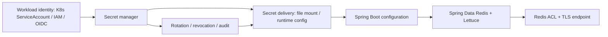
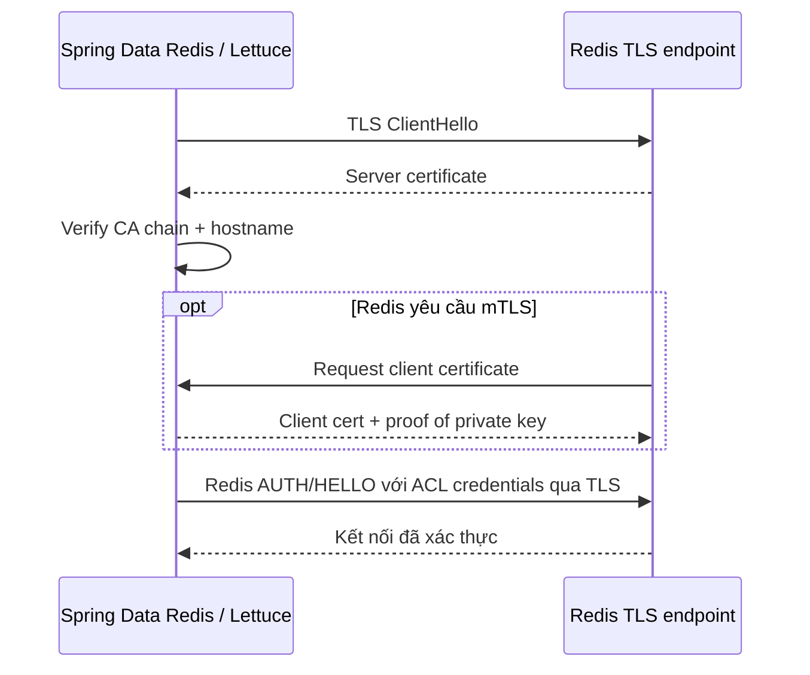
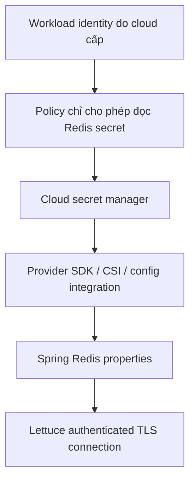
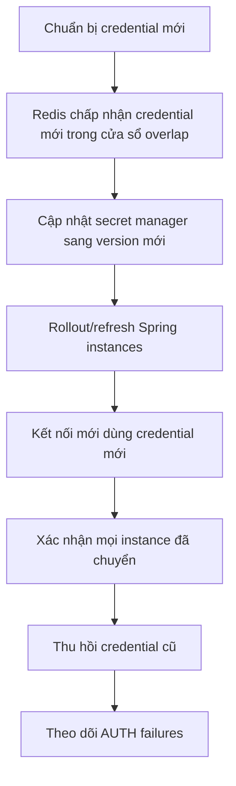

# Quản lý mật khẩu và chứng chỉ bằng kho bí mật trong Spring Data Redis

Một ứng dụng Spring Boot dùng Spring Data Redis thường cần **mật khẩu Redis**, đôi khi cần **Redis ACL username**, và trong môi trường yêu cầu TLS có thể cần **CA certificate**, **client certificate**, **client private key** hoặc password của keystore. Những giá trị đó phải được quản lý như bí mật vận hành, không phải hằng số Java hay thuộc tính cấu hình có thể chia sẻ tự do.

Ví dụ đơn giản nhưng không phù hợp với production:

```yaml
spring:
  data:
    redis:
      host: redis.internal
      password: "password-used-in-production"
```

Đoạn cấu hình trên khiến mật khẩu có nguy cơ xuất hiện trong Git, bản build, pipeline, backup và nhiều máy phát triển. Việc bật Redis ACL hay TLS cũng không giải quyết được vấn đề nếu **chính credential và private key đã bị lộ**.

Một thiết kế tốt tách rõ:

1. **Redis server**: áp dụng xác thực, quyền truy cập và TLS phù hợp.
2. **Kho bí mật (secret manager)**: lưu, kiểm soát truy cập, phiên bản và luân chuyển credential/chứng chỉ.
3. **Danh tính workload**: cho phép đúng ứng dụng đọc đúng bí mật mà không cần nhúng một mật khẩu gốc trong mã nguồn.
4. **Cơ chế phân phối bí mật**: cung cấp bí mật cho tiến trình Spring khi chạy, ví dụ file mount bảo vệ, cấu hình externalized hoặc integration với Vault.
5. **Spring Data Redis/Lettuce**: dùng credential và TLS material để thiết lập connection, đồng thời có kế hoạch reconnect/rotation.
6. **Quan sát và vận hành**: phát hiện hết hạn, thất bại xác thực, lỗi TLS và rò rỉ mà không ghi giá trị bí mật vào log.

Trong bài này, ta xây dựng cách quản lý **mật khẩu Redis và chứng chỉ TLS bằng kho bí mật** trong ngữ cảnh Spring Data Redis, từ nguyên tắc tới ví dụ Spring Boot, Vault, Kubernetes và quy trình rotation an toàn.

> **Phạm vi:** đây là bài về quản lý bí mật cho Redis client. Những ví dụ tên host, secret path, certificate và role chỉ mang tính minh họa; không chứa bí mật thật. Khả năng SSL bundle, cấu hình Vault và các property cần đối chiếu với phiên bản Spring Boot/Spring Data Redis của dự án khi áp dụng.

## 1. Những dữ liệu nào là bí mật?

Không phải mọi giá trị trong `application.yml` đều có độ nhạy giống nhau.

| Dữ liệu | Có phải bí mật? | Lý do |
|---|---|---|
| Redis hostname/port | Thường là cấu hình, không phải secret | Không tự cấp quyền truy cập; vẫn có thể là thông tin hạ tầng cần hạn chế |
| Redis ACL username | Thường là định danh, không phải credential đầy đủ | Không đủ để xác thực nếu thiếu password; nên tránh tiết lộ không cần thiết |
| Redis ACL password | **Có** | Có thể được dùng để xác thực với Redis |
| Secret manager access token | **Có** | Có thể cấp quyền truy xuất nhiều bí mật |
| Client TLS private key | **Có, rất nhạy cảm** | Chứng minh danh tính client trong mTLS |
| Client TLS certificate | Thường không bí mật | Chứa public key và nhận dạng; phải quản lý tính toàn vẹn và vòng đời |
| CA certificate/trust bundle | Thường không bí mật | Là dữ liệu tin cậy; bị thay thế sai có thể phá xác minh peer |
| Keystore/truststore password | **Có** nếu bảo vệ khóa/vật liệu nhạy cảm | Có thể mở khóa nội dung keystore |
| Server TLS private key | **Có, thuộc phía Redis** | Không được đưa cho ứng dụng client |
| Redis namespace và logical DB | Thường là cấu hình | Không thay thế ACL hoặc network isolation |

**Phân biệt bí mật với dữ liệu cần giữ toàn vẹn:** CA certificate không phải secret theo nghĩa phải giấu nội dung, nhưng nếu attacker thay CA trust bundle thì ứng dụng có thể tin nhầm server giả. Vì vậy, CA bundle vẫn cần được phân phối từ nguồn tin cậy và có kiểm soát cập nhật.

### 1.1. ACL password và TLS private key giải quyết hai vấn đề khác nhau

- **Redis AUTH/ACL** xác thực quyền của client thực hiện lệnh và truy cập key.
- **TLS server authentication** giúp client xác minh đang kết nối tới endpoint Redis hợp lệ và mã hóa kênh truyền.
- **mTLS** (mutual TLS) cho phép server xác minh certificate của client, tùy cấu hình Redis/hạ tầng.

Một kết nối có thể yêu cầu cả Redis ACL lẫn TLS/mTLS. Việc ứng dụng có certificate client hợp lệ **không tự có nghĩa** Redis đã cấp quyền `GET`, `SET` hay truy cập mọi namespace.

### 1.2. Mục tiêu của quản lý bí mật

Mục tiêu không phải “không bao giờ có password trong RAM” — Redis client cần credential để xác thực. Mục tiêu là:

- Không lưu bí mật dài hạn trong source code, Git, image, artifact hoặc tài liệu.
- Cấp đúng workload quyền đọc đúng bí mật.
- Phân phối qua kênh bảo vệ, hạn chế bản sao.
- Có thể rotate/revoke mà không phải sửa code hoặc phát hành lại credential trong Git.
- Không làm rò rỉ qua log, exception, trace, metric, dump hoặc CI.
- Khi không thể lấy/xác minh bí mật, hệ thống thất bại theo chính sách rõ ràng thay vì tự dùng default password yếu.

## 2. Sơ đồ kiến trúc tham chiếu



Trong mô hình này:

1. Pod/VM hoặc service có **danh tính** do nền tảng cấp.
2. Secret manager xác thực danh tính đó và áp policy cụ thể.
3. Credential và TLS material được cấp cho instance khi khởi động hoặc được refresh theo cơ chế có kiểm soát.
4. Spring Boot bind các giá trị thành cấu hình Redis client.
5. Lettuce mở TLS connection, xác minh certificate và AUTH bằng Redis ACL credential.
6. Khi secret đổi, cần **đảm bảo client thực sự tạo kết nối với vật liệu mới**; cập nhật dữ liệu trong secret manager không có nghĩa mọi connection đang sống đã đổi ngay.

### 2.1. Ba ranh giới cần bảo vệ

```text
Ranh giới A — Secret manager -> workload
  IAM/role/policy, HTTPS/mTLS, file permissions, audit

Ranh giới B — Workload -> Redis
  TLS hostname verification, ACL username/password,
  network policies, timeouts

Ranh giới C — Bên trong workload
  Không log secret, không debug dump tùy tiện,
  tránh trả credential qua Actuator/HTTP
```

Chỉ bảo vệ đường truyền tới Redis mà để ứng dụng log password lúc startup vẫn là một thiết kế chưa an toàn.

## 3. Vì sao hardcode password là lỗi nghiêm trọng?

Ví dụ Java:

```java
RedisStandaloneConfiguration redis =
        new RedisStandaloneConfiguration("redis.internal", 6379);
redis.setPassword(RedisPassword.of("actual-production-password"));
```

Những rủi ro:

- Bí mật tồn tại trong lịch sử Git kể cả khi sau đó xóa khỏi commit mới.
- Build artifact, Docker image và source archive có thể chứa literal.
- Developer/CI runner có quyền đọc source có thể truy xuất mật khẩu.
- Rotation yêu cầu sửa code và redeploy mới theo cách thủ công.
- Một credential thường bị tái sử dụng giữa staging và production.
- Việc vô tình gửi snippet tới ticket/chat làm phạm vi lộ rộng hơn.

Đọc password từ environment tốt hơn hardcode, nhưng vẫn cần phân biệt **nơi lưu gốc** và **kênh phân phối**. Biến môi trường là một cách cấp giá trị cho process; nó không tự cung cấp versioning, audit, rotation và truy cập theo danh tính.

### 3.1. Dùng placeholder trong application.yml

```yaml
spring:
  data:
    redis:
      host: redis.internal
      port: 6379
      username: ${REDIS_USERNAME}
      password: ${REDIS_PASSWORD}
      ssl:
        enabled: true
```

Các biến `REDIS_USERNAME` và `REDIS_PASSWORD` cần được nền tảng cấp lúc chạy. Đây là **bước tách cấu hình khỏi code**, chưa phải toàn bộ giải pháp secret management.

Ở môi trường production, nên biết rõ bí mật đó được lấy từ đâu, ai được phép đọc, lúc nào phải rotate và có thể xuất hiện ở các bề mặt nào.

## 4. Kho bí mật cung cấp những gì?

Một secret manager thường cung cấp một số khả năng:

| Khả năng | Mục đích |
|---|---|
| Mã hóa at rest và in transit | Giảm nguy cơ lộ secret trong lưu trữ hoặc trên đường truy xuất |
| Identity-based access | Ứng dụng nhận quyền qua IAM/Kubernetes/OIDC thay vì mật khẩu gốc |
| Secret versioning | Cho phép phân biệt phiên bản hiện tại và cũ |
| Audit trail | Ghi lại workload nào đọc/cập nhật bí mật và khi nào |
| Secret rotation | Thay password/key/certificate theo quy trình |
| Revocation | Thu hồi credential bị lộ hoặc không còn được phép dùng |
| Lease/TTL | Phù hợp với một số loại secret có hiệu lực ngắn |
| Policy theo môi trường | Tách dev, staging, production và các ứng dụng |

Các sản phẩm có thể triển khai mô hình này gồm HashiCorp Vault, AWS Secrets Manager, Azure Key Vault, Google Cloud Secret Manager hoặc một hệ thống quản lý bí mật nội bộ. **Cơ chế auth, phiên bản và khả năng rotation cụ thể khác nhau theo dịch vụ**; không phải công cụ nào cũng tạo được Redis ACL credential động.

### 4.1. Kho bí mật không tự biến password Redis thành credential động

Có hai mô hình:

**Static secret được quản lý:**

```text
Secret manager lưu Redis username/password do operator tạo.
Các pod được phép đọc cùng một secret version.
Rotation cần phối hợp cập nhật credential trên Redis server.
```

**Dynamic/leased secret nếu hạ tầng hỗ trợ:**

```text
Secret backend có khả năng cấp credential riêng cho workload,
gắn lease/expiry và thu hồi theo chính sách.
```

Không nên tự tuyên bố một kết nối Redis có credential “ngắn hạn” chỉ vì Vault token của client có TTL. **TTL của token truy cập Vault khác TTL của Redis ACL password**. Muốn credential Redis thực sự bị thu hồi khi lease hết hạn, backend phải hỗ trợ và thực hiện việc đó.

## 5. Thiết kế quyền truy cập: ứng dụng chỉ đọc đúng secret cần dùng

Một cấu trúc đường dẫn minh họa:

```text
secret/
  dev/
    catalog-api/
      redis/
  staging/
    catalog-api/
      redis/
  prod/
    catalog-api/
      redis/
    session-service/
      redis/
```

Giả sử `catalog-api` production chỉ cần:

```text
secret/prod/catalog-api/redis
```

Nó không nên có quyền đọc:

```text
secret/prod/session-service/redis
secret/staging/*
secret/prod/database-admin/*
```

Nguyên tắc **least privilege** áp dụng cho cả secret manager và Redis:

- **Secret manager policy:** cho phép workload đọc một tập secret nhỏ, không cho liệt kê toàn bộ namespace khi không cần.
- **Redis ACL:** chỉ cho phép command và key patterns phù hợp với vai trò ứng dụng.
- **Network policy:** chỉ service hợp lệ được kết nối Redis và secret manager.
- **Operational role:** quyền sửa hoặc rotate secret tách khỏi quyền đọc runtime khi phù hợp.

### 5.1. Danh tính workload quan trọng hơn tên Pod

Trên Kubernetes, một Pod thường dùng **ServiceAccount**. Trên cloud VM/managed service có thể dùng IAM role/workload identity. Secret manager phải xác minh danh tính được nền tảng chứng thực, thay vì tin một HTTP header hoặc biến môi trường do ứng dụng tự khai báo.

Ví dụ:

```text
namespace = production
serviceAccount = catalog-api
vaultRole = catalog-redis-reader
allowed path = secret/prod/catalog-api/redis
```

Tên role/path ở trên là minh họa. Việc đảm bảo chỉ ServiceAccount và namespace dự kiến được bind vào role là trách nhiệm cấu hình identity provider/Vault policy.

### 5.2. Không dùng một Redis superuser cho mọi service

Nếu tất cả microservices đều dùng `default` user với quyền rộng, một ứng dụng bị xâm nhập có thể ảnh hưởng dữ liệu của ứng dụng khác.

Tốt hơn:

```text
catalog-api -> Redis ACL user catalog-app -> ~catalog:*
session-api -> Redis ACL user session-app -> ~session:*
```

Command permission thực tế phải bao gồm các thao tác mà Spring Data Redis/driver dùng: lệnh dữ liệu, scripting, pub/sub, cluster topology khi cần. Tránh copy một ACL mẫu quá chặt khiến production hỏng, nhưng cũng không cấp `+@all` chỉ để “sửa lỗi”.

## 6. Redis ACL: identity và command/key permission

Redis 6 trở lên hỗ trợ ACL users. Một Redis ACL user có thể có:

- Tên người dùng.
- Một hoặc nhiều password được cấp theo cấu hình.
- Quyền cho từng command hoặc command category.
- Key patterns được phép truy cập.
- Channel permissions nếu dùng Pub/Sub theo chính sách Redis/version.

Ví dụ mô hình quyền:

```text
User: catalog-app
Keys: catalog:cache:*
Commands: GET, SET, DEL, EXPIRE, PING và các lệnh thực sự cần
Channels: chỉ những channel nghiệp vụ được cho phép nếu có Pub/Sub
```

Đây là **đặc tả quyền**, không phải một chuỗi ACL có thể copy-paste áp dụng cho mọi deployment. Redis Cluster, Spring Cache clear, Lua script, Redis Repositories, Pub/Sub và monitoring có thể cần command khác; quyền phải được xác định từ behavior của ứng dụng.

### 6.1. Client phải gửi đúng username/password

Trong Spring Boot:

```yaml
spring:
  data:
    redis:
      username: ${REDIS_USERNAME}
      password: ${REDIS_PASSWORD}
```

Nếu Redis dùng default user và chỉ có password, username có thể không bắt buộc. Nếu Redis yêu cầu ACL user riêng, password đơn độc có thể không đủ.

**Không log giá trị password để debug lỗi NOAUTH/WRONGPASS.** Thay vào đó, log tên ứng dụng, môi trường, endpoint đã được làm sạch, error category và secret version không nhạy cảm.

### 6.2. ACL của từng node trong Cluster

Redis Cluster cần chính sách xác thực nhất quán với các node mà client có thể kết nối. Client không nhất thiết luôn dùng seed node; nó có thể chuyển tới primary khác theo hash slot.

Nếu ACL trên node A cho phép request nhưng node B từ chối cùng credential, ứng dụng có thể thấy lỗi “chỉ một số key thất bại”. Khi điều tra cần kiểm tra đồng bộ ACL, topology và secret distribution ở **tất cả Redis nodes** liên quan.

## 7. TLS: bảo mật kênh client–Redis

Không nên chỉ nghĩ đến password; nếu gửi AUTH và dữ liệu Redis qua kết nối không được mã hóa trong môi trường có nguy cơ quan sát network, cả credential và payload đều có thể bị lộ.

TLS giải quyết:

1. **Encryption in transit** giữa application và Redis endpoint.
2. **Server identity verification** thông qua certificate chain và hostname.
3. **Client identity verification** nếu môi trường bật mTLS.

Sơ đồ:



TLS và ACL bổ sung nhau; một Redis server có thể yêu cầu đồng thời cả hai.

### 7.1. Mỗi loại chứng chỉ/khóa thuộc về đâu?

| Vật liệu | Được lưu ở đâu? | Spring client dùng làm gì? |
|---|---|---|
| Redis server certificate | Phía Redis/server proxy | Client nhận và xác minh |
| Redis server private key | **Chỉ phía Redis/server** | Không cấp cho client Spring |
| CA certificate | Truststore/trust bundle của client | Xác minh server certificate |
| Client certificate (mTLS) | Phía Spring client | Trình chứng chỉ cho server |
| Client private key (mTLS) | **Secret manager và mount bảo vệ ở client** | Chứng minh sở hữu certificate |
| Keystore password | Secret manager nếu keystore có password | Mở vật liệu khóa được bảo vệ |

Một câu hỏi quan trọng khi thiết kế: **Redis deployment có thật sự yêu cầu mTLS không?** Nếu không, ứng dụng chỉ cần trust CA và ACL credentials; không nên tự phát thêm client private key mà không có yêu cầu.

## 8. Spring Boot: cấu hình kết nối TLS và ACL

Với Spring Boot 3.x có Spring Data Redis và Lettuce, ví dụ:

```yaml
spring:
  data:
    redis:
      client-type: lettuce
      host: redis.internal.example
      port: 6380
      username: ${REDIS_USERNAME}
      password: ${REDIS_PASSWORD}
      ssl:
        enabled: true
      connect-timeout: 3s
      timeout: 3s
```

Đây là **cấu hình khung**:

- `6380` chỉ là cổng minh họa; dùng cổng TLS thực tế của deployment.
- `ssl.enabled: true` yêu cầu client kết nối TLS theo hỗ trợ của Boot/Lettuce.
- Truststore mặc định của JVM có thể đủ nếu certificate server được cấp bởi CA được JVM tin cậy.
- Nếu dùng private/internal CA hoặc mTLS, cần thêm cấu hình trust material và có thể cả client certificate/private key.

### 8.1. Bật SSL không đồng nghĩa cấu hình đã an toàn

Còn phải xác minh:

- Certificate chain hợp lệ.
- Hostname server khớp Subject Alternative Name trong certificate.
- Certificate chưa hết hạn hoặc bị thu hồi theo chính sách hạ tầng.
- Cổng thật sự phục vụ TLS.
- Không có cấu hình tắt hostname verification do lịch sử debug.
- Các node Redis Cluster được khám phá sau đó cũng dùng TLS và có certificate phù hợp.

Không nên dùng “trust all certificates” hoặc tắt peer verification trong production. Những mẹo đó loại bỏ một trong các mục tiêu quan trọng nhất của TLS.

## 9. Spring Boot SSL bundles và vật liệu chứng chỉ từ file

Trong các phiên bản Spring Boot có hỗ trợ SSL bundles cho Redis, có thể cấu hình bundle PEM. Ví dụ minh họa khi **chỉ cần xác minh server**:

```yaml
spring:
  ssl:
    bundle:
      pem:
        redis-client:
          truststore:
            certificate: file:/run/redis-secrets/ca.crt
  data:
    redis:
      host: redis.internal.example
      port: 6380
      username: ${REDIS_USERNAME}
      password: ${REDIS_PASSWORD}
      ssl:
        enabled: true
        bundle: redis-client
```

Ở đây:

- `ca.crt` chứa CA certificate được ứng dụng tin cậy.
- File được mount từ nguồn quản lý certificate/secret đáng tin.
- `redis-client` là tên bundle do ứng dụng đặt.
- Spring Boot auto-configuration cần hỗ trợ binding bundle vào Redis client ở **phiên bản được chọn**.

Nếu Redis yêu cầu **mTLS**, bundle có thể bổ sung client certificate và private key:

```yaml
spring:
  ssl:
    bundle:
      pem:
        redis-client:
          truststore:
            certificate: file:/run/redis-secrets/ca.crt
          keystore:
            certificate: file:/run/redis-secrets/client.crt
            private-key: file:/run/redis-secrets/client.key
  data:
    redis:
      ssl:
        enabled: true
        bundle: redis-client
```

Đây chỉ là phần TLS của ví dụ mTLS; cấu hình host, port, ACL username/password vẫn cần có theo deployment.

### 9.1. Khi nào dùng PEM, khi nào dùng JKS/PKCS12?

| Định dạng | Đặc trưng | Điều cần bảo vệ |
|---|---|---|
| PEM | Certificate và private key có thể nằm ở file riêng | Quyền đọc private key, toàn vẹn CA bundle |
| JKS | Java keystore/truststore truyền thống | Store password, key material và lifecycle |
| PKCS12 | Định dạng bundle chứa certificate/private key | File, password nếu có, key material |

Không có định dạng nào tự bảo đảm rotation/reload. Một chứng chỉ được đổi trên filesystem có thể **chưa được SSLContext hoặc connection hiện có sử dụng** cho đến khi client được cập nhật/recreate.

### 9.2. Cẩn trọng với password của truststore

Truststore chứa CA certificates thường không có cùng mức bí mật như client private key, nhưng password và file phải được quản lý theo cách phù hợp với tính toàn vẹn. Không ghi `trustStorePassword` vào command line hoặc log khi vận hành.

Với JVM system properties như `javax.net.ssl.trustStorePassword`, cần lưu ý nhiều phương thức truyền qua command-line arguments có thể bị nhìn thấy bởi các công cụ quan sát process. Ưu tiên cơ chế Boot/secret injection được hạ tầng hỗ trợ.

## 10. Secret delivery qua biến môi trường: đơn giản nhưng có giới hạn

Một cách triển khai:

```text
Secret manager
       |
       v
Deployment controller injects REDIS_USERNAME / REDIS_PASSWORD
       |
       v
Spring Boot đọc placeholder khi startup
```

Ví dụ:

```yaml
spring:
  data:
    redis:
      username: ${REDIS_USERNAME}
      password: ${REDIS_PASSWORD}
```

Ưu điểm:

- Ít thay đổi code Java.
- Hoạt động với Spring Boot externalized configuration.
- Nhiều nền tảng runtime hỗ trợ inject environment variables.

Giới hạn:

- Environment có thể xuất hiện trong dump/chẩn đoán hoặc công cụ có quyền inspect process/container.
- Một số nền tảng cho phép người quản trị xem biến env trong deployment.
- Secret thay đổi ở manager **không tự cập nhật biến env của tiến trình đang chạy**.
- Thường cần restart/rollout để nhận secret mới.
- Khi biến bị in ra bởi script CI, nó có thể tồn tại trong build log.

Vì vậy, biến môi trường có thể là **kênh phân phối**, nhưng không phải nơi quản lý bí mật duy nhất.

### 10.1. Không cung cấp default password production

Ví dụ nguy hiểm:

```yaml
password: ${REDIS_PASSWORD:default123}
```

Nếu deployment quên inject secret, ứng dụng sẽ dùng password mặc định đã lộ. Trong production, prefer fail startup khi secret bắt buộc không có hoặc không hợp lệ.

Một số profile test có thể có credential giả rõ ràng, nhưng phải tách biệt với cấu hình production.

## 11. Mount file bí mật và Spring Boot config tree

Một pattern hữu ích trong container/Kubernetes là **secret manager hoặc CSI driver mount nội dung secret thành file read-only**. Spring Boot hỗ trợ import một thư mục config tree làm các property.

Ví dụ file tree:

```text
/run/redis-secrets/
    spring.data.redis.username
    spring.data.redis.password
```

File `spring.data.redis.username` chứa tên ACL user; file `spring.data.redis.password` chứa password. Chỉ nội dung của hai file là giá trị, không phải chuỗi `key=value`.

Ứng dụng:

```yaml
spring:
  config:
    import: "configtree:/run/redis-secrets/"
  data:
    redis:
      host: redis.internal.example
      port: 6380
      ssl:
        enabled: true
```

Nhờ `configtree:`, Spring Boot đọc các file trong thư mục và đưa chúng vào môi trường cấu hình dưới tên property tương ứng.

### 11.1. Vì sao nên bỏ optional trong production?

```yaml
spring:
  config:
    import: "configtree:/run/redis-secrets/"
```

Khi thư mục bí mật là điều kiện bắt buộc, không thêm `optional:` chỉ để startup tiếp tục nếu thư mục không tồn tại. Một secret mount lỗi cần được phát hiện rõ.

Ở môi trường local có thể có profile riêng dùng `optional:configtree:...`, nhưng phải bảo đảm nó không làm production âm thầm chuyển sang credential mặc định.

### 11.2. Phân quyền file

File chứa password/private key nên:

- Chỉ user/group của tiến trình ứng dụng cần thiết được phép đọc.
- Không ghi được bởi ứng dụng nếu không có lý do.
- Không nằm trong web root hoặc static-resource directory.
- Không được gửi vào Docker image layer.
- Không được copy vào thư mục artifact/test report/log.
- Được dọn/thu hồi quyền truy cập khi Pod/VM bị hủy theo cơ chế nền tảng.

Mount **read-only** không tự chứng minh file chỉ đọc được bởi đúng process: vẫn cần Linux UID/GID, file mode, container isolation và quyền truy cập node.

### 11.3. Update file không tự refresh Redis connection

Một secret manager có thể thay nội dung file trên mount. Tuy nhiên:

```text
Secret file đổi
    ≠ Spring Environment nhất thiết rebind bean
    ≠ LettuceConnectionFactory lập tức thay password
    ≠ Socket Redis đang mở tự AUTH lại
```

Phải thiết kế một luồng **rollout/recreate connection** hoặc refresh được hỗ trợ chính thức. Đừng coi live-mounted secret là tự động hot reload end-to-end.

## 12. Kubernetes Secret: dùng để phân phối, không mặc định là kho bí mật cuối

Kubernetes `Secret` có thể được dùng để truyền credential cho Pod:

```yaml
apiVersion: v1
kind: Pod
metadata:
  name: catalog-api-example
spec:
  serviceAccountName: catalog-api
  containers:
    - name: app
      image: example/catalog-api:1.0.0
      env:
        - name: REDIS_USERNAME
          valueFrom:
            secretKeyRef:
              name: catalog-redis
              key: username
        - name: REDIS_PASSWORD
          valueFrom:
            secretKeyRef:
              name: catalog-redis
              key: password
```

Đây là **ví dụ minh họa Kubernetes API**, không phải deployment hoàn chỉnh.

Lưu ý:

- Kubernetes Secret mặc định được biểu diễn bằng base64 trong manifest; **base64 không phải mã hóa**.
- Cần cấu hình encryption at rest cho etcd theo chính sách cluster, RBAC tối thiểu, audit và quyền truy cập node.
- Nếu một controller đồng bộ dữ liệu từ external secret manager vào Kubernetes Secret, secret tồn tại thêm trong **Kubernetes API/etcd** và có thêm phạm vi truy cập cần bảo vệ.
- Environment variables của Pod đang chạy không tự đổi khi Secret được cập nhật.

### 12.1. External Secrets Operator

Một operator có thể đồng bộ secret từ cloud secret manager/Vault vào Kubernetes Secret rồi cho Pod mount hoặc env injection.

```text
External secret manager -> External Secrets Operator
                       -> Kubernetes Secret
                       -> Pod
                       -> Spring Data Redis
```

Đánh đổi: cách triển khai thuận tiện và quen thuộc với Kubernetes, nhưng secret có thêm bản sao trong Kubernetes API.

### 12.2. Secrets Store CSI Driver

Một mô hình khác là mount secret trực tiếp vào Pod qua CSI provider được triển khai:

```yaml
volumes:
  - name: redis-secret-files
    csi:
      driver: secrets-store.csi.k8s.io
      readOnly: true
      volumeAttributes:
        secretProviderClass: catalog-redis
```

Pod container mount:

```yaml
volumeMounts:
  - name: redis-secret-files
    mountPath: /run/redis-secrets
    readOnly: true
```

Điều kiện:

- CSI driver và provider đã cài đặt.
- `SecretProviderClass` đã được cấu hình đúng.
- Workload identity có quyền đọc secret ở backend.
- Tên file được provider mount trùng tên mà Spring Boot `configtree:` hoặc SSL bundle tham chiếu.
- Xử lý trường hợp mount chưa sẵn sàng hoặc provider không thể lấy secret.

Không giả định mọi CSI provider đều tự xoay vòng file và mọi ứng dụng tự nhận update. **Kiểm chứng capability rotation của cả driver, provider và connection lifecycle**.

## 13. HashiCorp Vault với Spring Boot

Một hướng là cho Spring Boot lấy cấu hình từ Vault thông qua **Spring Cloud Vault**, nếu dự án sử dụng stack này.

Mô hình:

```text
Kubernetes ServiceAccount / workload identity
             |
             v
        Vault auth method
             |
             v
      Vault policy + KV secret
             |
             v
 Spring Boot Config Data / properties
             |
             v
       Lettuce Redis client
```

Spring Cloud Vault thường tích hợp vào cơ chế externalized configuration của Spring. Ví dụ định hướng:

```yaml
spring:
  application:
    name: catalog-api
  config:
    import: "vault://"
  cloud:
    vault:
      uri: https://vault.internal.example:8200
      authentication: KUBERNETES
      kubernetes:
        role: catalog-api
      kv:
        enabled: true
        backend: secret
```

Ví dụ này yêu cầu dependency **Spring Cloud Vault Config** tương thích với Spring Boot của dự án, một Vault server thực tế và Kubernetes auth đã được cấu hình. Secret paths/context names do Spring Cloud Vault resolution và Vault KV mount/version quyết định; **không tự suy ra** từ ví dụ rằng một secret bất kỳ chắc chắn được load.

### 13.1. Giá trị ở Vault

Ở path mà cấu hình Spring Cloud Vault thực sự đọc, lưu các cặp cấu hình như:

```text
spring.data.redis.username = catalog-app
spring.data.redis.password = <secret value held only in Vault>
```

Nội dung ở đây chỉ là sơ đồ; không đưa password thật vào lệnh `vault kv put` được lưu trong shell history, ticket hoặc CI stdout.

### 13.2. Vault token và Redis password là hai lớp credential

- Vault token hoặc workload identity cho phép **đọc Vault secret**.
- Redis password được lấy từ Vault để **AUTH với Redis**.

Nếu Vault token bị thu hồi, connection Redis hiện có không tự đóng. Nếu Redis password bị thay, Vault token còn hợp lệ không tự làm các socket Redis cũ cập nhật credential.

Hai lifecycle phải được quản lý riêng.

### 13.3. Không đặt Vault root token trong application.yml

Một cấu hình kiểu:

```yaml
spring:
  cloud:
    vault:
      token: "vault-root-token"
```

đưa rủi ro quay lại điểm xuất phát. Trong Kubernetes, ưu tiên workload auth được ràng buộc ServiceAccount/namespace; trên cloud có thể dùng phương thức identity được provider hỗ trợ; trên VM có thể dùng cơ chế cấp credential ngắn hạn và policy riêng.

### 13.4. KV secret không tự có automatic rotation

Một KV path chỉ là nơi lưu phiên bản secret. Nếu muốn Redis password tự động thay theo lịch, cần:

- Một rotation controller/workflow có quyền hợp lệ.
- Thao tác thay credential trên Redis một cách an toàn.
- Cập nhật secret version mới.
- Làm mới/recreate client connections.
- Thu hồi credential cũ khi chắc chắn các consumer đã chuyển.

Không nên hứa “cài Spring Cloud Vault là password Redis tự động rotate”.

## 14. Vault Agent/sidecar như một cơ chế phân phối

Thay vì application tự gọi Vault, một Vault Agent hoặc sidecar có thể:

1. Xác thực với Vault bằng workload identity.
2. Đọc secret theo policy.
3. Render nội dung vào volume được bảo vệ.
4. Duy trì hoặc refresh dữ liệu theo cơ chế agent.

Ví dụ thư mục mount:

```text
/run/redis-secrets/
    spring.data.redis.username
    spring.data.redis.password
    ca.crt
    client.crt
    client.key
```

Spring Boot dùng:

```yaml
spring:
  config:
    import: "configtree:/run/redis-secrets/"
  ssl:
    bundle:
      pem:
        redis-client:
          truststore:
            certificate: file:/run/redis-secrets/ca.crt
          keystore:
            certificate: file:/run/redis-secrets/client.crt
            private-key: file:/run/redis-secrets/client.key
  data:
    redis:
      ssl:
        enabled: true
        bundle: redis-client
```

Trong deployment chỉ có TLS xác minh server, bỏ phần `keystore` client certificate/private key.

### 14.1. Agent render không giống client reload

Agent có thể render secret mới lên volume; Spring/Lettuce vẫn có thể đang dùng credential hoặc SSL context cũ. Cần một **reload trigger** rõ ràng hoặc rollout để tạo client mới.

Với Spring Boot SSL bundle reload support ở các phiên bản phù hợp, còn phải kiểm tra **Redis connection factory và Lettuce có tiêu thụ bản bundle mới hay không**, không suy ra chỉ vì file được cập nhật.

### 14.2. Không dùng shared volume không kiểm soát

Nếu nhiều container trong Pod hoặc trên node cùng đọc một mount chứa Redis private key, phạm vi lộ rộng ra. Cần mount đúng container, dùng quyền filesystem tối thiểu và không copy secret sang volume dùng chung không cần thiết.

## 15. Cloud secret managers: mẫu chung

Với AWS Secrets Manager, Azure Key Vault, Google Cloud Secret Manager hoặc dịch vụ tương đương, kiến trúc phổ biến:



Các lựa chọn tích hợp:

- **Provider SDK tại bootstrap:** application đọc secret trước khi tạo Redis factory.
- **Spring Config Data integration:** provider đưa secret vào Environment, nếu có thư viện tương thích.
- **External Secrets Operator:** đồng bộ tới Kubernetes Secret.
- **CSI file mount:** mount thành file để Spring đọc.
- **Sidecar/agent:** ứng dụng đọc từ volume local có quyền truy cập được giới hạn.

Mỗi lựa chọn có khác biệt về:

| Khía cạnh | Câu hỏi |
|---|---|
| Bootstrap | Nếu secret manager chậm hoặc offline thì ứng dụng có khởi động không? |
| Credential cache | Bí mật được cache trong process hay filesystem bao lâu? |
| Rotation | Ai nhận biết phiên bản mới? Ai recreate Redis connection? |
| Permission | Workload có quyền gì tại provider? |
| Audit | Đọc secret có được ghi nhận và phát hiện bất thường không? |
| Exposure | Có thêm bản sao trong Kubernetes Secret hoặc env không? |
| Availability | Secret manager down sau startup có ảnh hưởng connection đang sống không? |

Không có một lựa chọn “tốt nhất” cho mọi tổ chức. Nếu được phép, **workload identity + secret store policy + file/config integration được hỗ trợ chính thức** là một nền tảng rõ ràng để giảm bí mật hardcode.

## 16. Cấu hình Java trực tiếp bằng RedisStandaloneConfiguration

Khi không dùng Boot auto-configuration hoặc cần tự tạo connection factory, Spring Data Redis có thể nhận credential từ nguồn đã được bind:

```java
package com.example.redis.security;

import java.time.Duration;

import org.springframework.beans.factory.annotation.Value;
import org.springframework.context.annotation.Bean;
import org.springframework.context.annotation.Configuration;
import org.springframework.data.redis.connection.RedisPassword;
import org.springframework.data.redis.connection.RedisStandaloneConfiguration;
import org.springframework.data.redis.connection.lettuce.LettuceClientConfiguration;
import org.springframework.data.redis.connection.lettuce.LettuceConnectionFactory;

@Configuration
public class RedisClientConfiguration {

    @Bean
    LettuceConnectionFactory redisConnectionFactory(
            @Value("${app.redis.host}") String host,
            @Value("${app.redis.port:6380}") int port,
            @Value("${spring.data.redis.username}") String username,
            @Value("${spring.data.redis.password}") String password) {

        if (password == null || password.isBlank()) {
            throw new IllegalStateException(
                    "Redis password is required");
        }

        RedisStandaloneConfiguration server =
                new RedisStandaloneConfiguration(host, port);

        server.setUsername(username);
        server.setPassword(RedisPassword.of(password));

        LettuceClientConfiguration client =
                LettuceClientConfiguration.builder()
                        .useSsl()
                        .commandTimeout(Duration.ofSeconds(3))
                        .build();

        return new LettuceConnectionFactory(server, client);
    }
}
```

Lưu ý:

- `@Value` chỉ đọc cấu hình đã được Spring cung cấp; nó không tự biết secret đến từ Vault/CSI/env nào.
- Ví dụ dùng TLS; certificate trust và mTLS material phải được cấu hình thêm nếu deployment yêu cầu.
- Nếu dùng Boot SSL bundles, ưu tiên để Boot tạo Lettuce factory hoặc tự tích hợp SSL material đúng API; không giả định `useSsl()` tự dùng bundle do Boot khai báo.
- Một bean `LettuceConnectionFactory` tự khai báo thường làm Boot back off đối với factory tương ứng; lúc đó một số `spring.data.redis.*` có thể không được auto-applied ngoài những giá trị code đọc rõ ràng.
- Password tồn tại trong JVM memory để AUTH; không in đối tượng cấu hình, không serialize nó ra response.

### 16.1. Khi Redis dùng default user

Một số Redis deployment chỉ yêu cầu password của default user, không có username riêng. Trong trường hợp đó có thể không cần gọi `setUsername(...)`, nhưng phải xác định theo cấu hình ACL thật của Redis; không đưa username rỗng tùy tiện nếu client/server xử lý khác nhau.

## 17. Cấu hình Redis Cluster với credential từ secret manager

Với Redis Cluster:

```yaml
spring:
  data:
    redis:
      client-type: lettuce
      cluster:
        nodes:
          - redis-a.internal.example:6380
          - redis-b.internal.example:6380
          - redis-c.internal.example:6380
      username: ${REDIS_USERNAME}
      password: ${REDIS_PASSWORD}
      ssl:
        enabled: true
```

Ở Java, `RedisClusterConfiguration` cũng hỗ trợ thông tin xác thực theo phiên bản tương ứng:

```java
RedisClusterConfiguration cluster =
        new RedisClusterConfiguration(List.of(
                "redis-a.internal.example:6380",
                "redis-b.internal.example:6380"));

cluster.setUsername(username);
cluster.setPassword(RedisPassword.of(password));
```

Cần bảo đảm:

- Tất cả seed thuộc cùng cluster.
- Credential ACL phù hợp các node có thể được client kết nối.
- Redis topology quảng bá hostname/port **reachable** từ ứng dụng.
- Server certificates được tin cậy **không chỉ ở seed**, mà cả các node sau khi driver khám phá.
- TLS bundle/truststore phù hợp với hostname thực tế sau `MOVED`/`ASK`.

Một cấu hình “seed connect OK, node B TLS handshake fail” có thể chỉ làm lỗi những key thuộc một số hash slot, nên rất dễ bị nhầm là lỗi ngẫu nhiên.

### 17.1. Secret version thống nhất giữa nhiều instance

Nếu rollout một password mới mà chỉ một số Pod đã nhận secret version mới, các Pod cũ có thể vẫn hoạt động với password cũ trong thời gian chuyển tiếp. Phải thiết kế overlap đủ dài trước khi revoke.

Không cập nhật password ở Redis rồi lập tức xóa password cũ khi tất cả consumers chưa nhận update.

## 18. Redis Sentinel cũng có các bí mật riêng

Redis Sentinel được dùng để phát hiện master trong mô hình replication/sentinel, **không phải Redis Cluster sharding**.

Một deployment có thể cần:

1. Credential để client nói chuyện với **Sentinel endpoints**.
2. Credential để client nói chuyện với **Redis data nodes**.
3. Cấu hình TLS riêng cho Sentinel và Redis nếu topology yêu cầu.

Trong Spring Data Redis, các phương thức cấu hình Sentinel authentication có API riêng tùy phiên bản. Không mặc định rằng đặt `spring.data.redis.password` đã đủ cho Sentinel ACL hoặc ngược lại.

Khi dùng secret manager, có thể tách:

```text
secret/prod/catalog-api/redis-data
secret/prod/catalog-api/redis-sentinel
```

nếu hai loại endpoint dùng credential khác nhau. Nếu chúng dùng cùng credential theo hạ tầng, vẫn cần hiểu trách nhiệm và kiểm soát rotation.

## 19. Rotation: thay mật khẩu Redis mà không làm gián đoạn dịch vụ

Một rotation an toàn không đơn thuần là ghi giá trị mới vào secret manager.

Luồng tổng quát:



### 19.1. Tại sao cần khoảng overlap?

Giả sử có ba instance:

```text
App A: password version 1
App B: password version 1
App C: password version 1
```

Nếu Redis chỉ chấp nhận version 2 trước khi app rollout, mọi **connection mới** dùng version 1 có thể thất bại. Connection đang tồn tại có thể tiếp tục hoạt động một thời gian, khiến sự cố xuất hiện muộn khi reconnect.

Vì vậy, tổ chức rotation thường cần một khoảng Redis chấp nhận **old + new** theo khả năng ACL/server, cho phép app chuyển sang secret mới, sau đó mới revoke old.

### 19.2. Redis ACL có thể hỗ trợ nhiều password trong giai đoạn chuyển tiếp

Redis ACL hỗ trợ quản lý nhiều credential/password cho một user trong những phiên bản/cấu hình phù hợp. Có thể dùng khả năng này để áp dụng **dual-password window**, nhưng thao tác vận hành phải được kiểm soát chặt.

Không nên chèn password thật vào lệnh `ACL SETUSER` trong terminal history, CI logs hoặc ticket. Dùng công cụ quản trị secret/Redis được bảo vệ, có audit và cơ chế truyền dữ liệu nhạy cảm phù hợp.

### 19.3. Quy trình vận hành chi tiết

1. **Tạo credential mới** bằng nguồn ngẫu nhiên an toàn.
2. **Cho phép Redis chấp nhận credential mới** mà chưa thu hồi credential cũ, theo cơ chế hạ tầng.
3. **Tạo version mới trong secret manager**, cập nhật metadata và quyền đọc.
4. **Rollout một canary instance**, để nó lấy credential mới.
5. **Kiểm tra canary thực sự tạo một Redis connection mới** và AUTH thành công.
6. **Mở rộng rollout** tới các instance còn lại.
7. **Theo dõi reconnect/AUTH errors**, latency và lỗi phía ứng dụng.
8. **Xác nhận không còn process dùng credential cũ**; chú ý pool và kết nối dài hạn.
9. **Thu hồi credential cũ** sau cửa sổ an toàn.
10. **Ghi nhận audit** với version và thời điểm, không ghi password.

Nếu rotation xảy ra vì nghi ngờ đã lộ credential, thời gian overlap phải được cân bằng với nguy cơ bảo mật; có thể cần cắt credential cũ sớm hơn và chấp nhận gián đoạn được kiểm soát.

### 19.4. Cập nhật secret manager trước hay Redis trước?

Nếu ứng dụng đọc secret mới **trước khi Redis server chấp nhận nó**, các connection mới sẽ bị `WRONGPASS`/AUTH failure. Một rotation thuận lợi thường đảm bảo Redis chấp nhận password mới trước khi client bắt đầu sử dụng nó.

Nhưng việc thay đổi Redis ACL và secret manager không có transaction phân tán chung. Cần kế hoạch rollback và xác nhận từng pha; không coi toàn bộ quy trình là atomic chỉ vì dùng một secret store.

## 20. Một cách rotation khác: thay cả ACL user

Khi không muốn dùng dual password trên cùng user, có thể:

```text
redis-client-v1 -> ACL user app-v1
redis-client-v2 -> ACL user app-v2
```

Quy trình:

1. Tạo user mới với quyền tương đương cần thiết.
2. Cấp username/password mới qua secret manager.
3. Rollout app dùng user mới.
4. Xác nhận toàn bộ traffic sử dụng user mới.
5. Thu hồi/disable user cũ.

Ưu điểm: có thể phân biệt user cũ/mới trong audit và rollback rõ. Nhược điểm: phải đồng bộ chính sách ACL trên các node, quản lý hai user tạm thời và bảo đảm không còn kết nối cũ.

Không dùng user mới có quyền rộng hơn chỉ để canary hoạt động; cần mô hình permission đúng từ đầu.

## 21. Rotation certificate và private key

TLS certificate cũng có vòng đời:

- Certificate server có `notBefore`/`notAfter`.
- CA có thể được thay hoặc thu hồi.
- Client certificate/private key dùng cho mTLS có thể cần đổi định kỳ hoặc sau sự cố.
- Keystore password có thể phải đổi.

Một quy trình certificate rotation:

```text
CA trust overlap (nếu đổi CA)
       |
       v
Cấp certificate mới hợp lệ theo hostname/role
       |
       v
Mount vật liệu mới / cập nhật SSL bundle
       |
       v
Recreate TLS sessions/connections có kiểm soát
       |
       v
Xác nhận handshake & AUTH trên mọi node
       |
       v
Thu hồi vật liệu cũ khi an toàn
```

### 21.1. Đổi server certificate

Nếu certificate mới được ký bởi **CA đã được client tin cậy** và hostname vẫn đúng, client có thể không cần cập nhật truststore, nhưng các kết nối mới phải thực hiện handshake thành công.

Nếu đổi sang CA mới, client trust bundle phải nhận CA mới trước khi server chuyển sang certificate chỉ được ký bởi CA mới; thường cần giai đoạn **tin cả CA cũ và CA mới**.

### 21.2. Đổi client certificate (mTLS)

Secret manager cấp client.crt/client.key mới. Những vấn đề cần xác nhận:

- Key tương ứng certificate mới.
- Certificate có EKU và identity phù hợp policy server.
- File mode/private key ownership được áp đúng.
- Spring/Lettuce thực sự dùng vật liệu mới cho kết nối mới.
- Redis/proxy mTLS trust policy đã chấp nhận certificate mới.
- Certificate cũ được thu hồi hoặc loại khỏi policy khi rotation hoàn tất.

**Chỉ cập nhật file trên mount không bảo đảm kết nối mTLS đang sống đổi certificate**. Thường cần reconnect hoặc tạo lại client SSL context.

### 21.3. Không dùng một private key cho tất cả môi trường

Dev/staging/prod nên có certificate và private key tách biệt. Nếu một key ở staging bị lộ, nó không được phép xác thực vào Redis production.

Khi có nhiều service cần mTLS, lý tưởng mỗi workload hoặc nhóm vai trò có identity riêng thay vì chia sẻ một client private key toàn hệ thống.

## 22. SSL bundle reload có giới hạn thực tế

Một số phiên bản Spring Boot hỗ trợ reload SSL material và thông báo thay đổi bundle. Tuy nhiên, **khả năng reload ở framework không đồng nghĩa mọi client đang sử dụng bundle đều tự động tạo SSL context/socket mới**.

Nên phân biệt:

| Lớp | Có thể thay đổi gì? |
|---|---|
| File mount | Nội dung certificate/key mới xuất hiện |
| Secret integration | Cấu hình hoặc dữ liệu bí mật được cập nhật |
| Spring SSL bundle | Có thể tải lại material tùy tính năng phiên bản |
| Lettuce client resources | Có thể giữ SSL context/connection cũ |
| TCP/TLS connection | Không tự renegotiate toàn bộ danh tính sau khi file đổi |
| Redis ACL auth | Connection có thể giữ trạng thái auth cũ đến khi reconnect |

Một phương án đáng tin cậy, dễ vận hành là **rolling restart/recreate connection** có kiểm soát, đặc biệt khi chưa xác nhận được cơ chế live reload của stack đang dùng.

### 22.1. Không tự gọi factory destroy rồi tạo lại tùy tiện trong request

`LettuceConnectionFactory` được Spring quản lý và có thể đang phục vụ nhiều template/repository. Việc gọi `destroy()`/`afterPropertiesSet()` ngay giữa một request có thể làm hỏng các subscriber/connection hiện hữu.

Nếu cần rotation không restart, phải thiết kế riêng lifecycle, atomic swap giữa các factory/client instances, drain connections và rollback theo hợp đồng API; không dùng một đoạn “reload” ngắn chưa kiểm chứng cho production.

## 23. TTL của secret và TTL của Redis key là hai khái niệm

Ví dụ:

```text
Redis cache key:
    cache:product:42
    TTL = 10 phút

Secret manager credential:
    redis-password version 7
    rotation policy = 30 ngày
```

TTL của cache key chỉ điều khiển **tuổi thọ dữ liệu ứng dụng trong Redis**. Nó không thay đổi Redis password hay client certificate.

Ngược lại, rotation Redis password không làm `cache:product:42` tự hết hạn; Redis key vẫn tồn tại theo TTL/bộ nhớ/khả năng phục vụ bình thường.

Thêm một lớp:

```text
Workload identity token:
    Có TTL riêng để gọi secret manager.
```

Không gộp ba TTL này:

1. TTL của Redis data key.
2. Hiệu lực/rotation của Redis credential.
3. TTL của token/lease để đọc secret manager.

Chúng có mục đích và phương án refresh khác nhau.

## 24. Khi secret manager không sẵn sàng

Có thể xảy ra:

```text
T0: Pod chuẩn bị khởi động
T1: Secret manager timeout
T2: Spring chưa nhận Redis password
```

Hành vi mong muốn phải được định nghĩa:

- **Fail startup** khi credential bắt buộc chưa có và không có cache secret được cấp phép.
- Có retry/backoff ở tầng secret fetch phù hợp ngân sách startup.
- Không fallback sang một password hardcode/dễ đoán.
- Không gửi request Redis không xác thực rồi tự nới lỏng bảo mật khi bị `NOAUTH`.
- Ghi lỗi “secret unavailable” nhưng **không ghi nội dung secret hoặc access token**.

### 24.1. Nếu app đang chạy thì sao?

Một ứng dụng đã lấy credential và có kết nối Redis có thể tiếp tục hoạt động khi secret manager tạm thời down, tùy driver và hạ tầng. Tuy nhiên:

- Khi credential hết hạn/revoked, reconnect có thể lỗi.
- Khi certificate mới đã được server triển khai, connection mới có thể handshake fail nếu truststore cũ.
- Nếu quy trình refresh bắt buộc nhưng không lấy được secret mới, phải có chính sách degrade/fail closed.

Đừng khẳng định secret manager outage luôn làm Redis dừng ngay; cũng đừng giả định ứng dụng an toàn tiếp tục vô hạn bằng credential cũ.

### 24.2. Không đưa secret store vào critical path của mỗi GET

Một anti-pattern:

```text
Mỗi HTTP request:
    -> gọi Vault để đọc Redis password
    -> tạo LettuceConnectionFactory mới
    -> Redis GET
```

Cách này tăng latency, tải Vault và số lượng kết nối; làm Redis availability phụ thuộc vào secret manager cho mỗi request.

Thực hành tốt hơn là **lấy secret tại bootstrap hoặc theo chu kỳ/lease refresh có kiểm soát**, rồi tái sử dụng client/connection infrastructure với lifecycle rõ ràng.

## 25. Những điểm có thể làm lộ credential ngoài Git

### 25.1. CI/CD logs

Ví dụ không nên:

```bash
echo "$REDIS_PASSWORD"
printenv
set -x
```

Những lệnh này có thể in bí mật vào log; `set -x` còn khiến shell trace hiển thị command/argument nhạy cảm.

Trong CI, sử dụng secret masking của nền tảng nhưng không coi masking là bảo đảm tuyệt đối: biến đổi/encode secret có thể tránh được một số rule redaction.

### 25.2. Docker image và build layers

Không copy file `.env.production`, `client.key`, `keystore.p12` vào Docker image. Ngay cả khi xóa file ở layer sau, nội dung vẫn có thể tồn tại trong layer trước hoặc build cache.

Secret injection nên xảy ra lúc chạy thay vì build image, trừ trường hợp build thực sự cần secret và dùng cơ chế build-time secret mount không để lại artifact.

### 25.3. JVM heap dumps và thread dumps

Credential có thể tồn tại ở bộ nhớ của framework/client. Heap dump dùng để debug có thể chứa String/password/certificate material.

Cần quản lý:

- Ai được tạo/tải heap dump.
- Nơi lưu dump và thời gian giữ.
- Mã hóa, phân quyền và xóa sau điều tra.
- Không tự tải dump lên ticket công khai.

### 25.4. Spring Actuator

Endpoints `env` và `configprops` có cơ chế sanitization/visibility theo phiên bản Boot và cấu hình, nhưng không nên coi chúng là nơi an toàn để phơi bày cho mọi người.

Không mở Actuator management endpoints nhạy cảm ra Internet; áp dụng authentication, authorization, network restriction và quy tắc không hiển thị giá trị secret.

### 25.5. Exception và debug logging

Một lỗi kết nối có thể làm log chứa host, username hoặc một phần cấu hình. Tránh:

```java
log.info("Redis config = {}", redisProperties);
```

nếu object có getter `password`.

Nên log:

```text
component=redis-client
environment=production
secretVersion=v7
tls=true
outcome=authentication_failed
```

Không log raw password, token Vault, nội dung client private key hoặc URL có credential.

## 26. Secret redaction và “đã mã hóa” không đồng nghĩa an toàn

Một số hệ thống lưu:

```text
REDIS_PASSWORD_BASE64 = c2VjcmV0
```

rồi giải mã Base64 ở runtime. Đây là **encoding**, không phải encryption; ai đọc được chuỗi có thể giải mã dễ dàng.

Tương tự, mã hóa password bằng một “master key” nhưng đặt master key ngay cạnh ciphertext trong Git không giải quyết được rủi ro cốt lõi.

Secret manager có giá trị vì tạo ra **một hệ thống kiểm soát truy cập, audit, rotation và tách key-management khỏi code**, không chỉ vì bí mật được lưu ở dạng text khác.

### 26.1. Không dùng một secret để mã hóa chính nó

Ví dụ một ứng dụng chứa:

```text
encryptedRedisPassword = ...
decryptionKey = "hardcoded-in-Java"
```

Attacker có source hoặc image vẫn có thể giải mã. Tốt hơn là workload identity được cấp quyền hạn chế tới một key-management/secret-management service.

## 27. So sánh các mô hình phân phối bí mật

| Mô hình | Điểm mạnh | Điểm cần lưu ý |
|---|---|---|
| Environment variables từ secret store | Dễ tích hợp Spring Boot | Runtime env có thể bị inspect; phải restart để nhận update |
| Kubernetes Secret volume | File được mount, không hardcode trong image | RBAC/etcd encryption, không tự reload Lettuce |
| External Secrets Operator | Đồng bộ provider vào Kubernetes workflow | Secret có bản sao ở Kubernetes API |
| Secrets Store CSI | Mount từ provider qua driver | Phụ thuộc CSI/provider, file update chưa chắc client reload |
| Vault Agent template | Workload auth, render secret file, có khả năng refresh | Phải thiết kế app restart/reconnect |
| Spring Cloud Vault Config | Tích hợp Config Data khi Boot startup | Version/auth/lease/reload cần cấu hình đúng |
| Direct provider SDK | Kiểm soát logic refresh và secret version | Tăng code/lifecycle trách nhiệm cho app |

Không có phương án nào làm mất hoàn toàn thời gian secret tồn tại ở RAM của Redis client. Thiết kế cần tối thiểu hóa **phạm vi truy cập**, **thời gian lưu** và **số bản sao**, thay vì hứa bí mật “không bao giờ xuất hiện ở ứng dụng”.

## 28. Quan sát rotation mà không làm lộ bí mật

Những số liệu hữu ích:

| Metric / event | Ý nghĩa |
|---|---|
| `redis_auth_failures_total` | Số lần AUTH thất bại, nếu có nguồn đo phù hợp |
| `redis_tls_handshake_failures_total` | Lỗi xác minh TLS/handshake |
| `secret_fetch_failures_total` | Lỗi đọc secret từ backend |
| `secret_refresh_success_total` | Số lần thay secret thành công ở tầng phân phối |
| `secret_version_loaded` | Version không nhạy cảm app đang dùng |
| `certificate_not_after` | Thời điểm hết hạn certificate để cảnh báo |
| `redis_connection_reconnects_total` | Tần suất reconnect, tùy metrics client |
| `redis_command_latency` | Tác động tới request sau rotation |

**Không đặt password, raw secret ID chứa PII, Vault token hoặc private key làm metric label.** Nếu secret path chứa tên ứng dụng nhạy cảm, cân nhắc hiển thị service ID đã chuẩn hóa.

### 28.1. Cảnh báo trước khi chứng chỉ hết hạn

Nếu client certificate sẽ hết hạn sau bảy ngày:

```text
cert_not_after - current_time < 7 days
```

có thể tạo cảnh báo để vận hành cấp certificate mới và rollout. Trong hệ thống có nhiều cert/server nodes, phải theo dõi đủ chain và endpoints, không chỉ certificate ở seed Redis node.

### 28.2. Bài toán phát hiện rollout chưa hoàn tất

Thống kê:

```text
App A -> secret version 8
App B -> secret version 8
App C -> secret version 7
```

Nếu còn instance v7, chưa được thu hồi credential cũ một cách mù quáng. Cần canary/health check và biết kết nối mới có dùng version 8 thực sự hay không.

Một `readinessProbe` trả `UP` không tự chứng minh Redis connection đã dùng version mới: có thể connection cũ đang sống hoặc health check không tạo handshake mới.

## 29. Kiểm tra TLS mà không in password

Trong môi trường được phép, có thể kiểm tra certificate của Redis endpoint bằng công cụ TLS:

```bash
openssl s_client \
  -connect redis.internal.example:6380 \
  -servername redis.internal.example \
  -CAfile /run/redis-secrets/ca.crt
```

Lệnh này minh họa kiểm tra TLS handshake/certificate chain; output không chứng minh Redis ACL credentials đúng hay ứng dụng có đủ command permissions.

Khi sử dụng Redis CLI:

```bash
redis-cli --tls \
  --cacert /run/redis-secrets/ca.crt \
  -h redis.internal.example -p 6380 \
  --user catalog-app --askpass
```

Tùy phiên bản `redis-cli`, tùy chọn và phương thức auth có thể khác. Cách nhập password tương tác an toàn hơn so với đặt plaintext password trực tiếp trong command line, nhưng terminal/session logging vẫn cần được bảo vệ.

Với mTLS, client có thể cần các tham số certificate/key phù hợp. Không copy nội dung private key vào command text.

### 29.1. Những kiểm tra nối tiếp

1. DNS và network đến đúng hostname/port.
2. TLS handshake với CA verification.
3. Hostname verification hợp lệ.
4. Redis ACL AUTH thành công.
5. Command/key permissions đúng nghiệp vụ.
6. Với Cluster, kiểm tra vài key thuộc nhiều node/slot.
7. Với Sentinel, kiểm tra cả Sentinel discovery lẫn Redis data node.

Nếu bước 2 thất bại, đổi Redis password không thể sửa lỗi CA/certificate. Nếu bước 4 thất bại, tăng Lettuce command timeout cũng không giải quyết credential sai.

## 30. Phân biệt lỗi xác thực và lỗi TLS

| Triệu chứng | Lớp vấn đề | Hướng điều tra |
|---|---|---|
| `NOAUTH Authentication required` | Redis AUTH chưa hoàn tất | Username/password và connection factory |
| `WRONGPASS` | Redis ACL credential sai hoặc user không hợp lệ | Secret version, ACL user/password trên server |
| `NOPERM` | Đã auth nhưng thiếu quyền | ACL command/key/channel policy |
| TLS handshake failure | TLS/certificate/protocol | CA, client cert, private key, TLS versions |
| Hostname mismatch | Server identity verification | SAN certificate, DNS, advertised address |
| Certificate expired | Certificate lifecycle | `notAfter`, secret rotation |
| Connect timeout | Network/endpoint hoặc quá tải | Host, port, firewall, network policy |
| Chỉ một số Cluster key lỗi | Một phần topology/node khác | ACL/TLS trên node đích, cluster announce |
| Chỉ lỗi sau reconnect | Rotation/lifecycle | Credential cũ, SSL context cũ, connection mới |

Không lấy việc “thêm retry” làm hướng sửa đầu tiên cho password/certificate sai. Retry với credential sai chỉ tạo thêm tải và che nguyên nhân.

## 31. Tình huống lỗi: cập nhật secret nhưng Spring vẫn dùng password cũ

Giả sử:

```text
T0: Spring start với REDIS_PASSWORD=v1.
T1: Secret manager được cập nhật lên v2.
T2: Redis server bắt đầu chỉ chấp nhận v2.
T3: Lettuce reconnect.
```

Ở T3, nếu Spring factory vẫn có v1, AUTH sẽ thất bại.

Đây là sự cố **secret propagation/lifecycle**, không nhất thiết do Spring Data Redis mapping.

Phương án khắc phục:

- Thiết kế rotation có overlap.
- Rollout Spring instances nhận version mới.
- Xác nhận connection mới thực sự AUTH bằng version mới.
- Thu hồi v1 sau khi xác minh.
- Có khả năng rollback có kiểm soát nếu v2 không hoạt động.

Không nên tự thay giá trị `Environment` rồi giả định bean `LettuceConnectionFactory` đã rebind.

## 32. Tình huống lỗi: CA certificate mới nhưng Redis handshake thất bại

Mẫu sự cố:

```text
Secret manager: ca.crt mới đã sẵn sàng.
Pod volume: ca.crt mới đã được mount.
JVM: SSL context cũ vẫn dùng CA cũ.
Redis: server certificate được ký bởi CA mới.
```

Giải pháp phụ thuộc stack:

- Recreate Redis client hoặc restart Pod theo rolling rollout.
- Hoặc dùng SSL bundle reload và client integration đã được xác nhận hỗ trợ.
- Đảm bảo giai đoạn CA overlap nếu đổi trust anchor.
- Kiểm tra SAN và hostname trên cả node seed và nodes được discovery.

Không tắt hostname verification hoặc trust mọi certificate để đi vòng lỗi này.

## 33. Tình huống lỗi: secret manager có quyền đọc quá rộng

Giả sử một ứng dụng chỉ dùng Redis cache của mình nhưng IAM role có quyền:

```text
Read secret/prod/*
Write secret/prod/*
```

Nếu ứng dụng bị chiếm quyền, attacker có thể lấy hoặc sửa credential của những hệ thống khác.

Giảm quyền:

```text
Read secret/prod/catalog-api/redis only
No write
No list across other apps
No permission to manage policies
```

Đồng thời, Redis ACL user của app chỉ nên truy cập namespace và commands thực sự cần. **Secret manager policy và Redis ACL phải được thiết kế cùng nhau**.

## 34. Tình huống lỗi: dùng chung client private key

Ví dụ:

```text
catalog-api, session-api, analytics-worker
    -> cùng mount client.key
    -> cùng certificate identity trước Redis proxy
```

Hệ quả:

- Không xác định rõ service nào thực hiện request dựa trên mTLS identity.
- Khi key bị lộ phải rotate cùng lúc tất cả workloads.
- Không thể thu hồi một workload mà không ảnh hưởng workloads còn lại nếu identity được chia sẻ.

Tốt hơn là cấp identity/certificate riêng theo service hoặc nhóm quyền có lý do rõ. Với rotation, scope ảnh hưởng nhỏ hơn và audit dễ hơn.

## 35. Bảo mật trong CI/CD

Một pipeline triển khai Spring Data Redis nên tách:

```text
Build:
    compile/test/package app without production Redis secrets

Deploy:
    configure workload identity + secret mount/reference

Run:
    Pod/VM retrieves secret under runtime policy
    Spring creates authenticated TLS Redis client
```

Tránh:

- Ghi password Redis vào `Dockerfile ARG`/`ENV` của image.
- Copy client private key vào `src/main/resources`.
- Đưa production secret vào test fixture.
- In `kubectl get secret -o yaml` vào CI log.
- Chạy `printenv` hoặc verbose debug với mọi biến.
- Tạo shared GitHub/GitLab artifact chứa `.env.production`.

### 35.1. Secret scanning vẫn cần thiết

Ngay cả khi quy trình đúng, developer vẫn có thể vô tình commit secret. Tổ chức có thể dùng secret scanner/pre-commit và pipeline policy.

Nếu secret đã bị commit:

1. **Rotate/revoke** secret ngay theo mức độ rủi ro.
2. Đánh giá phạm vi repo, forks, caches, CI artifacts.
3. Xử lý lịch sử Git theo chính sách tổ chức.
4. Không coi “xóa dòng trong commit mới” là đã bảo mật lại credential cũ.

## 36. Mẫu cấu hình production có phân tách trách nhiệm

Một mô hình kết hợp:

**A. Secret manager chứa:**

```text
prod/catalog-api/redis/username
prod/catalog-api/redis/password
prod/catalog-api/redis/ca-cert
prod/catalog-api/redis/client-cert   (nếu mTLS)
prod/catalog-api/redis/client-key    (nếu mTLS)
```

**B. CSI/Vault Agent render thành file:**

```text
/run/redis-secrets/
    spring.data.redis.username
    spring.data.redis.password
    ca.crt
    client.crt
    client.key
```

**C. Application configuration không chứa bí mật:**

```yaml
spring:
  config:
    import: "configtree:/run/redis-secrets/"
  ssl:
    bundle:
      pem:
        redis-client:
          truststore:
            certificate: file:/run/redis-secrets/ca.crt
          keystore:
            certificate: file:/run/redis-secrets/client.crt
            private-key: file:/run/redis-secrets/client.key
  data:
    redis:
      client-type: lettuce
      host: redis.internal.example
      port: 6380
      ssl:
        enabled: true
        bundle: redis-client
      connect-timeout: 3s
      timeout: 3s
```

Với Redis chỉ yêu cầu TLS server authentication, bỏ phần keystore client mTLS. Nếu phiên bản Boot không hỗ trợ Redis SSL bundle, cần cấu hình Lettuce TLS theo API tương thích hoặc sử dụng JVM truststore/SSL context được quản lý đúng.

**D. Deployment identity:** ServiceAccount/IAM role chỉ đọc được secret scope của `catalog-api` production.

**E. Rotation:** Controller cập nhật Redis ACL và secret manager có overlap; deployer rollout canary rồi toàn bộ instances; sau xác nhận mới revoke credential cũ.

### 36.1. Vì sao không đặt secret trong application.yml?

File trong repo chỉ mô tả:

- Host/port/timeout.
- Nơi lấy secret (`configtree`/SSL bundle resources).
- Tên bundle hoặc namespace.

Giá trị password và client private key chỉ được đưa vào runtime mount bởi một thành phần có identity được cho phép.

### 36.2. Startup không được bỏ qua lỗi secret bắt buộc

Nếu mount không tồn tại hoặc thiếu file `spring.data.redis.password`, ứng dụng cần fail startup hoặc fail readiness theo thiết kế bảo mật. Không chuyển sang local Redis không auth hoặc dùng password mặc định.

## 37. Mẫu kiểm thử cấu hình và rotation

Không cần dùng credential production trong kiểm thử. Có thể tạo một Redis test instance có ACL/TLS bằng certificate/key **test-only**.

Những tình huống cần xác nhận:

| Kịch bản | Kết quả mong đợi |
|---|---|
| Không có Redis password bắt buộc | App không khởi động thành công với cấu hình production |
| Password sai | Redis AUTH thất bại; không log password |
| ACL thiếu GET | Kết nối thành công nhưng lệnh GET bị `NOPERM` |
| CA không tin cậy | TLS handshake thất bại |
| Hostname certificate không khớp | Không cho kết nối theo policy xác minh hostname |
| Client mTLS certificate thiếu | Bị server từ chối nếu mTLS bắt buộc |
| Password mới được Redis chấp nhận | Canary client kết nối mới thành công |
| Secret file đổi nhưng process chưa reload | Hệ thống thực hiện rollout/recreate theo thiết kế |
| Một Cluster node dùng ACL cũ | Test lệnh tới slot/node đó phát hiện lỗi |
| Secret manager tạm thời down lúc startup | Fail theo policy, không dùng secret hardcode |
| Secret manager down sau startup | Quan sát behavior theo cơ chế cache/refresh đã chọn |
| Audit/metrics | Ghi secret version và outcome, không ghi giá trị |

### 37.1. Không test TLS bằng cách tắt verification

Một số test code sử dụng “trust all certificates” cho nhanh. Điều đó có thể khiến test luôn pass ngay cả khi production bị lỗi CA/hostname. Với bài kiểm thử bảo mật, phải cấp một **test CA** và certificate có SAN đúng để kiểm chứng behavior thật.

### 37.2. Kiểm tra cấu hình ở runtime mà không đọc ra secret

Có thể xác nhận:

```text
redis_tls_enabled = true
redis_secret_version = v8
redis_endpoint = redis.internal.example:6380
redis_connection_test = success
```

Không cần in:

```text
redis_password = ...
client_private_key = ...
vault_token = ...
```

Nếu muốn xác nhận process đã đọc secret mới, dùng version metadata hoặc kiểm tra AUTH bằng một **connection mới**; không dùng log plaintext password để so sánh.

## 38. Câu hỏi thường gặp

### 38.1. Đặt password trong environment có đủ an toàn không?

Nó tốt hơn hardcode nhưng chưa đủ tự thân. Cần nguồn secret được quản lý, workload identity, quyền đọc tối thiểu, tránh env dumps/logging và quy trình rotation/restart.

### 38.2. CA certificate có phải secret không?

CA public certificate thường không bí mật, nhưng cần bảo vệ tính toàn vẹn và nguồn phân phối. Client private key thì **phải được giữ bí mật**.

### 38.3. Chỉ bật spring.data.redis.ssl.enabled là đủ chưa?

Chưa nếu server certificate dùng private CA hoặc yêu cầu client certificate. Cần trust material/mTLS config phù hợp và hostname verification.

### 38.4. Có thể dùng Vault KV là password tự rotate không?

Không tự động. KV lưu phiên bản secret; rotation Redis credential cần workflow cập nhật server, secret store và clients.

### 38.5. Khi file secret thay đổi, Lettuce dùng ngay giá trị mới chứ?

Không nên giả định. Tùy stack, properties có thể chỉ đọc lúc startup và connections/SSL context đang sống vẫn giữ bản cũ. Phải kiểm tra hỗ trợ reload hoặc rollout.

### 38.6. Redis TLS có thay thế ACL không?

Không. TLS bảo vệ kênh và xác minh peer; ACL quản lý danh tính/quyền lệnh và keyspace Redis.

### 38.7. Có thể lưu server private key trong Spring app không?

Không cần và không nên. Spring client chỉ cần CA trust material và client private key nếu có mTLS; Redis server private key thuộc server.

### 38.8. Có nên dùng cùng password cho Redis standalone, Sentinel và Cluster?

Không mặc định. Các endpoint có mô hình xác thực và quyền riêng; lựa chọn dùng chung hay tách biệt phải dựa trên kiến trúc và policy, ưu tiên phân tách khi khả thi.

### 38.9. Rotation có cần downtime?

Không nhất thiết nếu Redis hỗ trợ overlap credential, secret distribution/rollout được thiết kế tốt và app có nhiều instance. Nhưng không nên cam kết zero downtime nếu stack chưa được test hoặc connection lifecycle chưa rõ.

### 38.10. Có nên để Spring tự gọi Vault cho mỗi Redis GET?

Thường không. Lấy/cập nhật secret theo bootstrap hoặc lifecycle có kiểm soát, rồi reuse Redis connection; không để secret manager nằm trên critical path của mọi lệnh.

## 39. Các lỗi phổ biến cần tránh

### Lỗi 1 — Hardcode Redis password trong Java hoặc YAML

Gây lộ qua repo/build/history. Thay bằng secret manager và runtime injection.

### Lỗi 2 — Dùng base64 như thể đó là mã hóa

Base64 chỉ là encoding. Cần KMS/secret manager và quyền truy cập phù hợp.

### Lỗi 3 — Đưa secret vào Docker image

Secret có thể tồn tại trong image layers/cache ngay cả khi đã xóa file ở layer sau.

### Lỗi 4 — Cấp quyền đọc secret/prod/* cho một service nhỏ

Vi phạm least privilege; tách policy theo workload và môi trường.

### Lỗi 5 — Dùng Redis default user quyền rộng cho mọi ứng dụng

Khi một app bị xâm nhập, phạm vi tác động lên Redis rộng. Tạo ACL user và key patterns thích hợp.

### Lỗi 6 — Chỉ bật TLS mà tắt hostname verification

Có thể chấp nhận kết nối tới endpoint giả. Cần xác minh CA chain và SAN/hostname.

### Lỗi 7 — Đưa server TLS private key vào client

Client không cần server private key. Chỉ sử dụng client private key riêng nếu mTLS được yêu cầu.

### Lỗi 8 — Update Vault secret rồi coi đã rotate Redis

Redis server và connection đang mở có lifecycle riêng; phải cập nhật Redis ACL và rollout/reconnect.

### Lỗi 9 — Xóa credential cũ trước khi client nhận credential mới

Dễ gây outage. Thiết kế overlap, canary và xác nhận trước khi revoke.

### Lỗi 10 — Dùng một secret cho dev/staging/prod

Làm tăng blast radius khi một môi trường bị lộ.

### Lỗi 11 — Log Redis config object có password

`toString()`/binding/debug có thể lộ bí mật. Log outcome và version metadata thay vì value.

### Lỗi 12 — In environment hoặc kubectl secret ra CI logs

Secret masking không phải bảo đảm tuyệt đối. Cấm đường log không cần thiết.

### Lỗi 13 — Tắt secret validation để app “khởi động được”

Fallback sang credential mặc định hoặc Redis không auth ở production là hành vi nguy hiểm.

### Lỗi 14 — Quên kiểm tra certificates của node được Redis Cluster discovery

Seed hoạt động không chứng minh tất cả node có TLS/hostname hợp lệ.

### Lỗi 15 — Nhầm Vault token TTL với Redis password TTL

Hai credential khác nhau, cần rotation/lease policy riêng.

### Lỗi 16 — Mong CSI file rotation tự reload mọi SSL context

File đổi chưa có nghĩa Lettuce connection hoặc Java SSL context đã đổi. Thiết kế rollout/recreate cụ thể.

### Lỗi 17 — Gửi credential thật qua command-line arguments

Có thể bị ghi vào process list, history hoặc CI logs. Dùng phương thức nhập/secret delivery bảo vệ.

### Lỗi 18 — Không có cơ chế rollback rotation

Nếu credential mới không hoạt động và cũ đã thu hồi, khôi phục phức tạp. Cần kế hoạch rollback có kiểm soát, không biến rollback thành lưu mật khẩu cũ vô hạn.

### Lỗi 19 — Cho rằng TLS thất bại là password sai

TLS handshake xảy ra trước Redis AUTH trong kết nối TLS thông thường. Phân loại lỗi để sửa đúng tầng.

### Lỗi 20 — Không xem xét private key trong heap dump hoặc backup

Private key và password có thể lan sang artifact/debug/backup. Quản lý quyền và retention theo mức nhạy cảm.

## 40. Bài tập thực hành

### Bài 1 — Chuyển cấu hình hardcode sang secret injection

Cho:

```yaml
spring:
  data:
    redis:
      host: redis.internal
      password: "not-a-real-example-password"
```

Viết lại để password lấy từ `REDIS_PASSWORD`, giải thích vì sao environment variable chỉ là kênh phân phối chứ chưa phải một secret manager hoàn chỉnh.

### Bài 2 — Spring Boot configtree

Tạo một **môi trường test** có file:

```text
/run/redis-secrets/spring.data.redis.username
/run/redis-secrets/spring.data.redis.password
```

Viết `spring.config.import` để Spring Boot nhận hai property. Giải thích tại sao production không nên dùng `optional:` nếu mount bắt buộc.

### Bài 3 — Phân biệt CA và client private key

Giả sử Redis dùng TLS server authentication nhưng không yêu cầu mTLS. Xác định ứng dụng cần file nào trong `ca.crt`, `client.crt`, `client.key`; giải thích file nào là secret và file nào cần bảo vệ tính toàn vẹn.

### Bài 4 — mTLS với SSL bundle

Tạo cấu hình PEM SSL bundle trỏ tới ba file giả định `ca.crt`, `client.crt`, `client.key`. Chỉ dùng file test, không đưa khóa production vào repo.

### Bài 5 — Thiết kế Vault/Kubernetes policy

Một `catalog-api` production cần chỉ đọc secret Redis của nó. Hãy vẽ policy scope tương ứng, phân biệt quyền đọc secret và quyền quản trị/rotate.

### Bài 6 — Rotation không downtime

Giả sử ba Pod dùng Redis password v1; Redis hỗ trợ overlap hai password. Xây trình tự áp dụng v2 lên Redis, secret manager, canary và các Pod trước khi revoke v1.

### Bài 7 — Rotation certificate

Redis server chuyển từ CA-A sang CA-B. Đề xuất giai đoạn trust overlap, cách cập nhật bundle, restart/recreate connections và cách xác nhận handshake trên từng Redis Cluster node.

### Bài 8 — Secret manager outage

Secret manager mất kết nối đúng lúc Pod khởi động. Mô tả hành vi startup, retry có giới hạn, log an toàn và vì sao không fallback sang mật khẩu mặc định.

### Bài 9 — Lỗi chỉ xuất hiện sau reconnect

Ứng dụng vẫn thực hiện GET thành công sau khi Redis password đổi, nhưng lỗi `WRONGPASS` chỉ xảy ra khi network chập chờn làm Lettuce reconnect. Giải thích lifecycle nào gây hiện tượng và cách xử lý.

### Bài 10 — Redis Cluster credential

Ứng dụng có ba seed nodes; Pod chỉ truy cập được hai node bằng TLS. Hãy giải thích vì sao test `PING` một seed thành công không chứng minh mọi key sẽ hoạt động, và cách kiểm tra advertised endpoints/certificate.

### Bài 11 — Audit không lộ secret

Đề xuất các log fields và metric labels dùng theo dõi rotation (secret version, outcome, service, environment), tránh raw password/URL/token/private key.

### Bài 12 — Khắc phục credential bị commit nhầm

Một file cấu hình chứa Redis production password đã được commit lên repo riêng tư và dùng bởi CI. Nêu những bước ưu tiên: rotate/revoke, đánh giá phạm vi lộ, kiểm tra artifacts/logs và sửa secret injection.

## 41. Bảng ghi nhớ

| Câu hỏi | Trả lời |
|---|---|
| Mật khẩu Redis nên nằm ở đâu? | Secret manager hoặc runtime secret injection được bảo vệ |
| Có nên commit password vào application.yml? | Không |
| Biến môi trường có phải secret manager không? | Không; đó là một kênh phân phối |
| Base64 có phải mã hóa không? | Không |
| CA certificate là secret? | Thường không, nhưng phải bảo vệ tính toàn vẹn |
| Private key dùng mTLS có phải secret? | Có |
| Redis server private key có cần cấp cho Spring không? | Không |
| Redis ACL và TLS có thay thế nhau không? | Không; chúng giải quyết các lớp bảo vệ khác nhau |
| Spring Boot dùng file secret làm property bằng gì? | `spring.config.import=configtree:/...` |
| Dùng TLS trong Boot bằng gì? | `spring.data.redis.ssl.enabled` và trust/SSL bundle phù hợp |
| Khi nào cần client certificate? | Khi endpoint yêu cầu mTLS |
| Workload identity dùng để làm gì? | Cho ứng dụng đọc secret theo policy mà không nhúng master token |
| Vault KV tự động đổi Redis password? | Không |
| Secret file đổi thì Lettuce tự dùng credential mới? | Không được giả định; cần refresh/reconnect/rollout |
| Rotation password an toàn gồm gì? | Credential mới, overlap, secret version, rollout, xác nhận, revoke cũ |
| Secret manager token TTL có phải Redis password TTL? | Không |
| Những gì không nên log? | Password, Vault token, client private key, secret-bearing URL |
| Redis Cluster cần kiểm tra TLS ở đâu? | Mọi node endpoint được client discovery/redirect |
| Có nên fallback về password mặc định khi vault down? | Không |
| Khi AUTH fail nên tăng retry vô hạn? | Không; kiểm tra secret version/ACL trước |

**Kết luận:** quản lý mật khẩu và chứng chỉ trong Spring Data Redis không dừng ở việc thay password hardcode bằng một biến môi trường. Một hệ thống bảo mật cần **secret manager có policy và audit**, **workload identity**, **cách phân phối bí mật không đưa vào mã nguồn**, **Redis ACL giới hạn quyền**, **TLS/mTLS xác minh đúng peer** và **một vòng đời rotation/reconnect được thiết kế rõ ràng**.

Điểm quan trọng nhất khi vận hành là **bí mật đã đổi ở kho lưu trữ chưa chắc Redis server hoặc Lettuce client đã sử dụng phiên bản mới**. Hãy phối hợp ACL/certificate changes, secret distribution, canary rollout, connection lifecycle và thu hồi credential cũ theo một trình tự có thể quan sát và rollback. Đồng thời kiểm soát mọi nơi bí mật có thể rò rỉ: Git, image, CI logs, environment dumps, Actuator, APM và heap dumps.

### Tài liệu tham khảo

- [Spring Data Redis — Connecting to Redis](https://docs.spring.io/spring-data/redis/reference/redis/redis-connection.html)
- [Spring Data Redis — LettuceConnectionFactory API](https://docs.spring.io/spring-data/redis/reference/api/java/org/springframework/data/redis/connection/lettuce/LettuceConnectionFactory.html)
- [Spring Data Redis — Redis Cluster](https://docs.spring.io/spring-data/redis/reference/redis/cluster.html)
- [Spring Boot — Externalized Configuration](https://docs.spring.io/spring-boot/reference/features/external-config.html)
- [Spring Boot — SSL](https://docs.spring.io/spring-boot/reference/features/ssl.html)
- [Spring Boot — Redis](https://docs.spring.io/spring-boot/reference/data/nosql.html#data.nosql.redis)
- [Spring Cloud Vault — Reference](https://docs.spring.io/spring-cloud-vault/reference/)
- [Redis — Access Control Lists (ACL)](https://redis.io/docs/latest/operate/oss_and_stack/management/security/acl/)
- [Redis — TLS](https://redis.io/docs/latest/operate/oss_and_stack/management/security/encryption/)
- [Redis — Security](https://redis.io/docs/latest/operate/oss_and_stack/management/security/)
- [Kubernetes — Secrets](https://kubernetes.io/docs/concepts/configuration/secret/)
- [Secrets Store CSI Driver](https://secrets-store-csi-driver.sigs.k8s.io/)
- [HashiCorp Vault — Kubernetes Authentication](https://developer.hashicorp.com/vault/docs/auth/kubernetes)
- [OWASP — Secrets Management Cheat Sheet](https://cheatsheetseries.owasp.org/cheatsheets/Secrets_Management_Cheat_Sheet.html)
