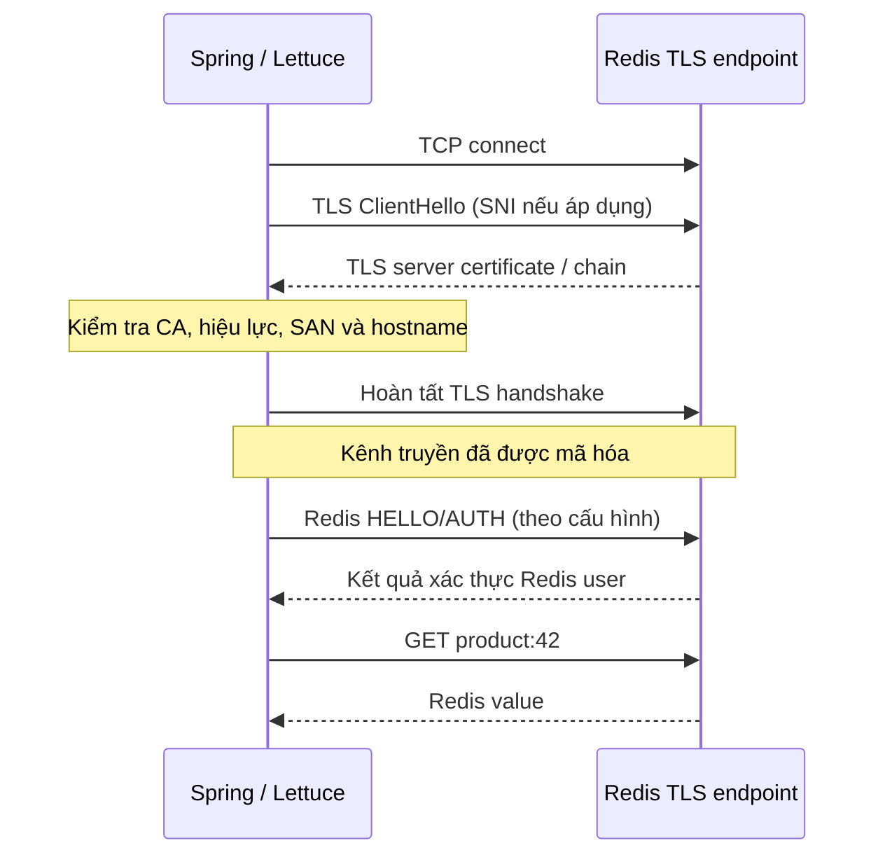
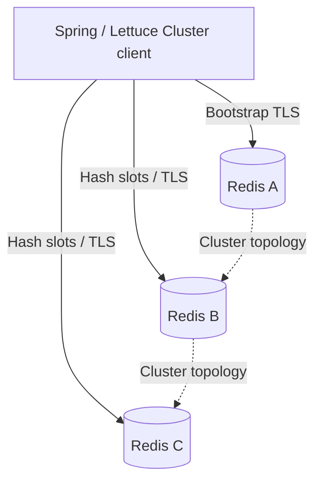
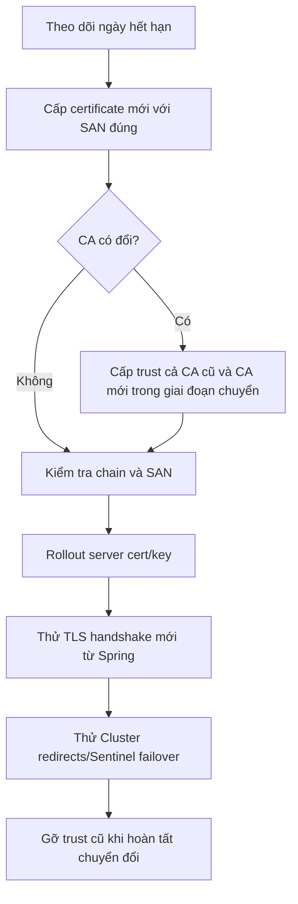

# Bật TLS và kiểm tra danh tính máy chủ trong Spring Data Redis

## 1. Tại sao chỉ kết nối thành công tới Redis chưa đủ?

Giả sử một ứng dụng Spring Boot dùng Redis để lưu session, cache thông tin khách hàng và một số trạng thái nghiệp vụ. Ứng dụng kết nối tới `redis.prod.example.com` qua mạng nội bộ:

```text
Spring Boot / Lettuce
        |
        | TCP
        v
redis.prod.example.com:6380
        |
        v
Redis server
```

Nếu kết nối không được bảo vệ, dữ liệu truyền trên mạng — bao gồm Redis commands, keys, values và thông tin xác thực — có thể bị quan sát hoặc can thiệp khi kẻ tấn công có quyền truy cập phù hợp trên đường truyền.

Bật **Transport Layer Security (TLS)** giải quyết vấn đề mã hóa và toàn vẹn dữ liệu trên đường truyền. Tuy nhiên, TLS chỉ thực sự bảo vệ ứng dụng khỏi máy chủ giả mạo khi client còn **kiểm tra danh tính máy chủ**. Nếu ứng dụng chấp nhận mọi chứng chỉ, một endpoint giả vẫn có thể hoàn tất kết nối TLS và nhận thông tin mà ứng dụng gửi.

Một kết nối bảo mật phải trả lời được hai câu hỏi:

1. Dữ liệu trao đổi qua network có được bảo vệ bằng TLS không?
2. Redis endpoint đang nói chuyện có đúng là máy chủ mà ứng dụng muốn kết nối không?

Trong Spring Data Redis, đặc biệt khi dùng **Lettuce**, nhiệm vụ cấu hình TLS nằm ở Redis client/connection factory. Nó không nằm trong cách gọi `opsForValue().get()` hay `opsForHash().put()`.

Sau bài học, bạn sẽ biết cách cấu hình Redis server và Spring Boot, kiểm tra CA, SAN, hostname và SNI, dùng SSL bundle/truststore, thiết lập mTLS khi cần, xử lý Redis Sentinel/Cluster, kiểm thử chứng chỉ sai và xây quy trình vận hành certificate rotation.

## 2. Bốn lớp bảo vệ không được đánh đồng

| Cơ chế | Mục đích | Không tự bảo đảm |
|---|---|---|
| **TLS encryption** | Mã hóa traffic và phát hiện thay đổi dữ liệu trên đường truyền | Đúng máy chủ nếu bỏ xác minh certificate |
| **Certificate chain validation** | Chứng chỉ do CA được tin cậy cấp, còn hợp lệ theo chính sách | Chứng chỉ có tên đúng Redis endpoint |
| **Hostname verification** | Danh tính DNS/IP trong certificate khớp host đang kết nối | User Redis có quyền đọc/ghi key nào |
| **Redis ACL/AUTH** | Xác thực user và cấp quyền thực thi command/key/channel | Mã hóa đường truyền nếu client dùng plaintext |

Ví dụ: một ứng dụng có username/password Redis đúng nhưng truyền trên TCP plaintext vẫn có rủi ro lộ credentials. Ngược lại, ứng dụng bật TLS nhưng dùng một trust manager chấp nhận tất cả chứng chỉ cũng không có xác minh server thực sự.

**Nguyên tắc:** TLS + CA trust + hostname verification + Redis ACL là các lớp bổ sung nhau, không phải những lựa chọn thay thế.

## 3. TLS handshake diễn ra trước Redis commands



Sơ đồ thể hiện luồng logic, không phải mọi packet của TLS 1.2 hoặc TLS 1.3. Nếu client không tin certificate hoặc tên máy chủ không khớp, kết nối phải bị từ chối **trước khi gửi Redis credentials**.

Các thành phần:

- **Server certificate:** chứng chỉ server trình ra khi handshake.
- **CA (Certificate Authority):** nguồn phát hành/trust anchor dùng để xác minh chain.
- **Truststore:** tập trust anchors hoặc chứng chỉ được client tin cậy.
- **SAN (Subject Alternative Name):** các DNS names và IP addresses mà certificate cho phép.
- **SNI (Server Name Indication):** hostname client gửi trong handshake để server/proxy chọn chứng chỉ.
- **mTLS:** Redis server cũng xác minh chứng chỉ của client.

Một certificate có thể được ký đúng nhưng vẫn không có danh tính phù hợp. Do đó, **kiểm tra chain và kiểm tra hostname là hai điều kiện riêng biệt**.

## 4. SAN: nơi xác định hostname hợp lệ

Giả sử certificate có:

```text
Subject: CN=redis.prod.example.com
Subject Alternative Name:
    DNS:redis.prod.example.com
    DNS:redis-read.prod.example.com
```

Ứng dụng kết nối tới `redis.prod.example.com` có thể xác minh tên qua DNS SAN tương ứng. Nếu ứng dụng đổi sang `redis-other.prod.example.com` nhưng certificate không cho phép tên này, một client xác thực hostname đúng sẽ từ chối.

### 4.1. Không chỉ dựa vào Common Name

Các chuẩn và TLS implementations hiện đại ưu tiên hoặc yêu cầu **SAN** để biểu diễn danh tính. Không thiết kế chứng chỉ mới chỉ có CN rồi kỳ vọng mọi Java/JDK/client sẽ chấp nhận fallback.

Khi cấp server certificate, phải ghi rõ những hostnames mà ứng dụng và Redis clients thực sự sử dụng.

### 4.2. DNS SAN khác IP SAN

Ví dụ certificate:

```text
DNS:redis.prod.example.com
```

nhưng ứng dụng kết nối bằng:

```text
10.20.30.40
```

Tên DNS trong SAN không tự xác minh IP literal này. Với kết nối bằng IP, cần **IP SAN đúng IP đó**, hoặc sử dụng DNS name có trong SAN.

Việc đổi hostname sang IP nhằm tránh lỗi DNS có thể làm phá hostname verification, đặc biệt trong Redis Cluster hoặc Kubernetes nơi các node được quảng bá bằng IP nội bộ.

### 4.3. Wildcard certificate có giới hạn

Chứng chỉ cho `*.redis.example.com` không nên được hiểu là hợp lệ cho mọi mức tên miền. Quy tắc wildcard thường khớp một cấp DNS label phù hợp, không tự khớp những tên sâu hơn như `node-a.cluster.redis.example.com`.

Với nhiều Redis nodes, thiết kế SAN dựa trên hostnames thực tế, không dựa vào suy đoán wildcard bao trùm mọi trường hợp.

## 5. SNI không phải hostname verification

SNI cho biết client đang yêu cầu hostname nào trong TLS handshake. Nó giúp một TLS proxy phục vụ nhiều hostname trên cùng IP chọn đúng chứng chỉ:

```text
Client wants redis.prod.example.com
        |
        +-- SNI: redis.prod.example.com
        |
Proxy presents certificate for redis.prod.example.com
        |
Client validates SAN against redis.prod.example.com
```

**SNI không tự chứng minh certificate hợp lệ.** Nếu server trả chứng chỉ sai, client vẫn phải từ chối.

Trong môi trường có TLS termination proxy hoặc managed Redis endpoint, một lỗi thiếu hoặc sai SNI có thể khiến client nhận certificate mặc định. Cần điều tra:

1. Hostname được cấu hình trong Spring.
2. Giá trị SNI mà client gửi.
3. Certificate server thực tế trả về.
4. SAN của certificate.
5. CA truststore mà JVM dùng.

Không sửa bằng cách tắt hostname verification.

## 6. Phía Redis phải thực sự hỗ trợ TLS

Trước khi cấu hình Spring, xác định:

- Redis endpoint hỗ trợ TLS không?
- TLS đang phục vụ trên port nào?
- Server certificate và chain được cấp bởi CA nào?
- Server có yêu cầu client certificate (mTLS) không?
- Redis có yêu cầu AUTH/ACL username/password không?
- Có proxy, Sentinel hoặc Redis Cluster thay đổi endpoint trong runtime không?

**Cổng 6380 chỉ là ví dụ phổ biến, không phải port TLS bắt buộc.** Managed Redis có thể dùng 6379 hoặc endpoint/port khác.

Nếu Spring gửi plaintext Redis protocol tới TLS port, hoặc gửi TLS handshake tới plaintext port, sẽ có protocol/handshake error. Đổi port đơn độc không tự bật TLS.

## 7. Ví dụ cấu hình Redis OSS phục vụ TLS

Với Redis OSS tự quản trị và bản build hỗ trợ TLS:

```conf
# Không phục vụ traffic client plaintext.
port 0

# Ví dụ cổng TLS.
tls-port 6380

# Certificate và private key của Redis server.
tls-cert-file /etc/redis/tls/server.crt
tls-key-file /etc/redis/tls/server.key

# Certificate Authority theo PKI của hệ thống.
tls-ca-cert-file /etc/redis/tls/ca.crt

# Ví dụ chỉ xác minh server, không yêu cầu client cert.
tls-auth-clients no
```

Các file certificate phải phù hợp với Redis version, cấu hình TLS và định dạng mà server chấp nhận. Certificate cần chứa SAN cho hostname ứng dụng gọi.

### 7.1. Bảo vệ private key

`server.key` là bí mật của TLS server:

- Không đưa vào Git hoặc Docker image công khai.
- Hạn chế quyền đọc file cho Redis process.
- Mount từ secret management hoặc storage được quản lý.
- Theo dõi việc cấp mới, thay thế và thu hồi.
- Không in nội dung private key trong log hoặc ticket.

### 7.2. Bật TLS client không đồng nghĩa server đã cấm plaintext

Nếu Redis vẫn mở:

```conf
port 6379
tls-port 6380
```

thì những client khác vẫn có thể dùng plaintext qua 6379. Với yêu cầu mã hóa bắt buộc, phải kiểm soát server ports, firewall, network policy và mọi đường truy cập khác.

### 7.3. TLS node-to-node cần cấu hình riêng

Với Redis replication hoặc Redis Cluster có hỗ trợ TLS, các thiết lập server có thể bao gồm:

```conf
tls-replication yes
tls-cluster yes
```

Chúng liên quan đến kết nối giữa Redis nodes. **Client→Redis dùng TLS không tự chứng minh replication hoặc cluster bus traffic được mã hóa.** Cần kiểm tra topology và TLS của từng chặng.

## 8. Bật TLS trong Spring Boot

Với Spring Boot 3.x và Redis certificate được JVM tin cậy:

```yaml
spring:
  data:
    redis:
      host: redis.prod.example.com
      port: 6380
      username: app-cache
      password: ${REDIS_PASSWORD}
      ssl:
        enabled: true
      timeout: 3s
```

Ý nghĩa:

- `host` phải là hostname mà certificate cho phép.
- `port` là Redis TLS endpoint thực tế.
- `ssl.enabled: true` bật TLS ở Redis client.
- `username/password` dùng để xác thực Redis ACL user.
- `REDIS_PASSWORD` lấy từ cấu hình bí mật của môi trường, không hardcode.
- Driver và JVM phải tin CA ký Redis server certificate.

**Giữ nguyên certificate/peer verification và hostname verification.** Nếu handshake báo chứng chỉ không hợp lệ, hãy sửa truststore hoặc certificate, không dùng cơ chế trust-all.

### 8.1. Khi nào không cần cấu hình CA riêng?

Nếu certificate do một CA mà JVM hiện tại đã tin cậy ký, default trust configuration có thể đủ. Tuy nhiên, nhiều Redis nội bộ dùng private CA; Java runtime trong container chưa chắc tin CA của công ty.

Cần kiểm tra **JVM thực sự chạy production**, không chỉ truststore trên máy phát triển.

### 8.2. Redis AUTH không bật TLS

Đặt `password` mà quên `ssl.enabled` không mã hóa dữ liệu. Redis ACL bảo vệ quyền thực thi command, còn TLS bảo vệ credentials và data in transit.

## 9. Spring Boot SSL bundle cho Redis private CA

Trong các phiên bản Spring Boot hỗ trợ SSL bundles và Redis SSL bundle, có thể cấu hình PEM CA cho riêng Redis:

```yaml
spring:
  ssl:
    bundle:
      pem:
        redis-client:
          truststore:
            certificate: file:/etc/app/tls/redis-ca.pem

  data:
    redis:
      host: redis.prod.example.com
      port: 6380
      username: app-cache
      password: ${REDIS_PASSWORD}
      ssl:
        enabled: true
        bundle: redis-client
```

Ý nghĩa:

1. Bundle `redis-client` chỉ rõ trust material dành cho Redis.
2. Redis connection configuration tham chiếu đúng bundle.
3. Client xác minh certificate chain qua CA được tin cậy.
4. Hostname validation vẫn áp dụng theo driver/JVM.

Ưu điểm của bundle là giới hạn phạm vi tin cậy và tránh sửa default truststore cho toàn bộ ứng dụng.

**Phụ thuộc phiên bản:** nếu Spring Boot cũ chưa hỗ trợ property Redis SSL bundle, nó có thể không được áp dụng như kỳ vọng. Cần chọn cơ chế tương thích với phiên bản đang chạy.

### 9.1. Đừng dùng bundle như lý do bỏ hostname verification

Một CA có thể cấp nhiều certificate cho các server khác nhau. Chỉ vì certificate được CA này ký không có nghĩa nó thuộc về Redis endpoint đang yêu cầu. Kiểm tra SAN vẫn là điều kiện bắt buộc.

### 9.2. Factory tự khai báo phải sử dụng đúng SSL configuration

Nếu project tự tạo `LettuceConnectionFactory` và Spring Boot auto-configuration back off, YAML chỉ định bundle **không bảo đảm** factory đó tự lấy bundle.

Chọn một trong hai hướng rõ ràng:

- Dùng Spring Boot auto-configuration cùng SSL bundle.
- Hoặc tự tạo factory và cấu hình trust material/credentials đầy đủ.

Tránh tạo hai connection factories ngoài ý muốn rồi để `RedisTemplate` và `ReactiveRedisTemplate` kết nối qua hai chính sách TLS khác nhau.

## 10. Truststore dạng JKS/PKCS12

Khi tổ chức quản lý CA bằng Java KeyStore hoặc PKCS12, Spring Boot phiên bản hỗ trợ có thể dùng:

```yaml
spring:
  ssl:
    bundle:
      jks:
        redis-client:
          truststore:
            location: file:/etc/app/tls/redis-truststore.p12
            password: ${REDIS_TRUSTSTORE_PASSWORD}
            type: PKCS12

  data:
    redis:
      host: redis.prod.example.com
      port: 6380
      ssl:
        enabled: true
        bundle: redis-client
```

**Truststore khác keystore:**

- Truststore phía client chứa CA hoặc chứng chỉ dùng kiểm tra server.
- Keystore phía client (mTLS) chứa chứng chỉ và private key để client chứng minh danh tính với server.
- Redis server cũng có certificate/private key riêng.

Password truststore không phải Redis ACL password. Tránh ghi các secret này vào Git, image layer hoặc build logs.

### 10.1. Java truststore ở cấp JVM

Một lựa chọn khác là sử dụng các system properties:

```text
-Djavax.net.ssl.trustStore=/etc/app/tls/redis-truststore.p12
-Djavax.net.ssl.trustStoreType=PKCS12
-Djavax.net.ssl.trustStorePassword=<provided-securely>
```

Đây là trust configuration cấp JVM đối với các thư viện dùng default JSSE. Nó có thể ảnh hưởng những kết nối HTTPS, database hoặc gRPC khác trong cùng ứng dụng. Nếu truststore chỉ có Redis CA, kết nối tới những dịch vụ khác có thể bị lỗi nếu chúng phụ thuộc default truststore.

Vì vậy, khi có thể, ưu tiên cấu hình trust riêng cho Redis và quản lý secret bằng công cụ triển khai phù hợp.

## 11. Cấu hình Lettuce bằng Java

Nếu không dùng Boot auto-configuration, có thể tạo Redis connection factory với TLS:

```java
package com.example.redis.security;

import java.time.Duration;

import org.springframework.context.annotation.Bean;
import org.springframework.context.annotation.Configuration;
import org.springframework.data.redis.connection.RedisStandaloneConfiguration;
import org.springframework.data.redis.connection.lettuce.LettuceClientConfiguration;
import org.springframework.data.redis.connection.lettuce.LettuceConnectionFactory;

@Configuration
public class SecureRedisConnectionConfig {

    @Bean
    LettuceConnectionFactory redisConnectionFactory() {
        RedisStandaloneConfiguration redis =
            new RedisStandaloneConfiguration(
                "redis.prod.example.com", 6380
            );

        // Thêm username/password thông qua secret configuration
        // đúng với môi trường và Redis ACL account.

        LettuceClientConfiguration lettuce =
            LettuceClientConfiguration.builder()
                .useSsl()
                .and()
                .commandTimeout(Duration.ofSeconds(3))
                .build();

        return new LettuceConnectionFactory(redis, lettuce);
    }
}
```

Ví dụ giả định JVM đã tin CA và certificate Redis có SAN đúng hostname. Nếu dùng private CA, phải đưa CA vào trust configuration thích hợp.

### 11.1. Giữ peer verification và hostname verification

Không gọi những API có ý nghĩa như `disablePeerVerification()` hoặc tạo một `TrustManager` chấp nhận mọi certificate.

Lettuce/TLS configuration có thể thay đổi giữa các phiên bản, nhưng yêu cầu bảo mật ổn định:

```text
TLS enabled
AND chain validated against approved CA
AND hostname/SAN validated
AND Redis ACL applied as required
```

Để xác minh cấu hình driver đang an toàn, cần test: **hostname sai hoặc CA sai phải làm handshake thất bại**.

### 11.2. Tùy chỉnh SSLContext phải giữ đầy đủ kiểm tra

Nếu dùng cấu hình SSL tùy biến cho truststore, client key hoặc TLS versions, cần bảo đảm implementation vẫn dùng trust managers đúng và endpoint identification.

Không tự thay trust manager bằng một hàm kiểm tra luôn thành công. Một mã như vậy dễ pass integration tests theo happy path nhưng loại bỏ xác thực danh tính.

## 12. Redis URI và `rediss://`

Redis connection URI có thể biểu diễn:

```text
redis://redis.example.com:6379
rediss://redis.example.com:6380
```

Thông thường, `rediss://` biểu thị sử dụng TLS. Nhưng:

- URI không tự giải quyết vấn đề private CA.
- Driver vẫn phải xác minh certificate và hostname.
- Username/password trong URL có thể cần URL encoding và dễ bị lộ khi log.
- Nếu đồng thời khai báo `spring.data.redis.url` và `host/port`, cần hiểu thứ tự ưu tiên properties ở phiên bản Boot đang dùng.

Đối với production, cấu hình riêng host, port, SSL bundle và secrets thường dễ kiểm soát hơn nhúng credentials vào URI.

## 13. Mutual TLS: khi Redis yêu cầu client certificate

TLS một chiều phổ biến:

```text
Spring verifies Redis server certificate.
Redis verifies application using ACL credentials.
```

Với **mTLS**, Redis còn yêu cầu chứng chỉ client:

```conf
tls-auth-clients yes
```

Khi đó, ứng dụng phải có client certificate và private key phù hợp.

Với Spring Boot SSL bundle hỗ trợ PEM:

```yaml
spring:
  ssl:
    bundle:
      pem:
        redis-mtls:
          keystore:
            certificate: file:/etc/app/tls/client.crt
            private-key: file:/etc/app/tls/client.key
          truststore:
            certificate: file:/etc/app/tls/redis-ca.crt

  data:
    redis:
      host: redis.prod.example.com
      port: 6380
      username: app-cache
      password: ${REDIS_PASSWORD}
      ssl:
        enabled: true
        bundle: redis-mtls
```

Ở đây:

- Client dùng truststore để **xác minh Redis server**.
- Client dùng keystore để **trình certificate cho Redis**.
- Redis xác minh client certificate theo CA/chính sách server.
- Redis ACL vẫn được dùng khi được cấu hình.

Không nhầm mTLS với việc tắt kiểm tra danh tính server. **Hai phía cùng cần xác minh bên kia**, không phải chỉ phía server kiểm tra client.

### 13.1. Bảo vệ client private key

Không commit `client.key` vào Git, không đặt trong image được chia sẻ rộng và không in nội dung PEM vào logs. Dùng secret management, volume permissions và rotation policy phù hợp.

### 13.2. mTLS không tự cấp quyền truy cập mọi command

Ngay cả khi mTLS handshake thành công, Redis có thể trả `NOPERM` do ACL user không được dùng `HGET` hoặc không được truy cập key pattern đó. Đây là lỗi authorization, không phải lỗi certificate chain.

## 14. OpenSSL: kiểm tra trust chain và hostname

Trên máy có quyền truy cập tới Redis TLS endpoint:

```bash
openssl s_client \
  -connect redis.prod.example.com:6380 \
  -servername redis.prod.example.com \
  -verify_hostname redis.prod.example.com \
  -verify_return_error \
  -CAfile /etc/app/tls/redis-ca.pem
```

Ý nghĩa:

| Tùy chọn | Mục đích |
|---|---|
| `-connect` | Host:port của endpoint cần kiểm tra |
| `-servername` | Gửi SNI để chọn certificate phù hợp |
| `-verify_hostname` | Yêu cầu xác minh hostname |
| `-verify_return_error` | Làm lỗi xác minh hiện rõ và dừng theo chính sách |
| `-CAfile` | Chỉ định CA dùng trong phép thử |

OpenSSL giúp kiểm tra certificate mà endpoint thực tế trình ra. Tuy vậy, **OpenSSL truststore không nhất thiết giống Java truststore**, và handshake thành công chưa chứng minh Redis ACL credentials đúng.

### 14.1. Đọc SAN và thời hạn chứng chỉ

Với file chứng chỉ server:

```bash
openssl x509 \
  -in /etc/app/tls/redis-server.crt \
  -noout -subject -issuer -dates -ext subjectAltName
```

Kiểm tra `notBefore`, `notAfter`, issuer và SAN. Đừng vô tình kiểm tra CA certificate rồi tưởng SAN của CA là SAN server.

### 14.2. Vì sao test trên laptop chưa đủ?

Laptop và Spring pod có thể dùng DNS, CA trust, TLS proxy hoặc network route khác nhau. Nên chạy một phép xác minh tương ứng **từ môi trường mạng của ứng dụng**, rồi tiếp tục bằng Java integration test.

## 15. redis-cli qua TLS

Với `redis-cli` hỗ trợ TLS:

```bash
redis-cli \
  --tls \
  -h redis.prod.example.com \
  -p 6380 \
  --sni redis.prod.example.com \
  --cacert /etc/app/tls/redis-ca.pem \
  PING
```

Kết quả có thể là `PONG` nếu command được Redis cho phép. Nếu server yêu cầu ACL, cung cấp credentials qua cơ chế an toàn của môi trường (chẳng hạn `REDISCLI_AUTH`); không đưa password literal vào command line có thể xuất hiện trong shell history/process list.

Nếu Redis yêu cầu mTLS:

```bash
redis-cli \
  --tls \
  -h redis.prod.example.com \
  -p 6380 \
  --cacert /etc/app/tls/redis-ca.pem \
  --cert /etc/app/tls/client.crt \
  --key /etc/app/tls/client.key \
  PING
```

**Không dùng chế độ `--insecure` làm bằng chứng kết nối TLS an toàn.** Hãy xác minh CA, SAN và hostname; nếu muốn kiểm tra hostname chặt chẽ qua CLI ngoài Java, OpenSSL `-verify_hostname` là một công cụ hữu ích.

### 15.1. PONG không phải chứng minh đầy đủ TLS

Một Redis endpoint mở plaintext cũng có thể trả `PONG`. Kết quả PING chỉ hữu ích khi đã xác nhận:

- Client dùng TLS.
- Chứng chỉ được kiểm tra.
- Hostname phù hợp.
- Không có tùy chọn bỏ verification.

## 16. Kiểm thử tích hợp với Spring Data Redis

Ví dụ JUnit và `StringRedisTemplate`:

```java
import static org.assertj.core.api.Assertions.assertThat;

import java.time.Duration;
import java.util.UUID;

import org.junit.jupiter.api.Test;
import org.springframework.beans.factory.annotation.Autowired;
import org.springframework.boot.test.context.SpringBootTest;
import org.springframework.data.redis.core.StringRedisTemplate;

@SpringBootTest
class RedisTlsIntegrationTest {

    @Autowired
    StringRedisTemplate redis;

    @Test
    void canAccessRedisThroughConfiguredTlsEndpoint() {
        String key = "test:tls:" + UUID.randomUUID();

        try {
            redis.opsForValue().set(key, "safe", Duration.ofMinutes(2));
            assertThat(redis.opsForValue().get(key))
                .isEqualTo("safe");
        } finally {
            redis.delete(key);
        }
    }
}
```

Test này xác minh Redis commands chạy được qua connection factory đã cấu hình. Nó **chưa đủ** để chứng minh hostname verification, vì một cấu hình tắt kiểm tra chứng chỉ cũng có thể đọc/ghi thành công.

Phải có **negative tests** cho CA hoặc hostname sai.

## 17. Negative tests: kết nối sai danh tính phải thất bại

Một test suite TLS tốt gồm:

| Trường hợp | Kỳ vọng |
|---|---|
| CA được tin cậy, SAN đúng, cert còn hạn | Handshake thành công |
| CA không được truststore tin | Handshake thất bại |
| Cert ký hợp lệ nhưng SAN của hostname khác | Handshake thất bại |
| Cert hết hạn | Handshake thất bại |
| Cert chưa đến `notBefore` | Handshake thất bại |
| Kết nối bằng IP nhưng cert chỉ có DNS SAN | Bị từ chối nếu IP không được cho phép |
| Redis yêu cầu mTLS nhưng client không có cert | Handshake thất bại |
| Client cert được ký bởi CA không được Redis tin | Handshake thất bại |
| TLS hợp lệ nhưng password Redis sai | Redis AUTH thất bại |
| TLS client gửi vào plaintext port | Protocol/handshake thất bại |
| Client plaintext gửi vào TLS-only port | Protocol/handshake thất bại |

### 17.1. Vì sao test hostname sai rất quan trọng?

Nếu chỉ chạy happy path:

```text
GET test:key -> đúng dữ liệu
```

thì một driver đã bị cấu hình **trust-all** vẫn có thể pass. Test hostname sai phải fail chứng minh bảo vệ danh tính chưa bị vô hiệu hóa.

### 17.2. Test setup

Tạo môi trường Redis TLS hoặc TLS proxy **cô lập** với:

1. Một CA chỉ dùng trong test.
2. Chứng chỉ server có SAN đúng hostname test.
3. Chứng chỉ server khác có SAN sai nhưng được cùng CA ký.
4. Truststore chỉ chứa CA test.
5. Profile Spring cho positive test và negative test.

Không gây lỗi trên production bằng cách thay certificate của Redis đang phục vụ người dùng.

## 18. Spring ReactiveRedisTemplate cũng cần TLS ở connection factory

Reactive API không tự kích hoạt TLS; nó dùng Redis connection factory đã cấu hình:

```java
import org.springframework.data.redis.core.ReactiveStringRedisTemplate;
import org.springframework.stereotype.Service;
import reactor.core.publisher.Mono;

@Service
public class SecureReactiveCache {

    private final ReactiveStringRedisTemplate redis;

    public SecureReactiveCache(ReactiveStringRedisTemplate redis) {
        this.redis = redis;
    }

    public Mono<String> get(String key) {
        return redis.opsForValue().get(key);
    }
}
```

Một `Mono` thường chỉ thực hiện công việc khi có subscription. Nếu TLS handshake thất bại, lỗi có thể phát trên reactive pipeline và được Spring Data hoặc Lettuce bọc trong exception khác.

Không dùng một `onErrorResume` tự động **thử lại với SSL verification disabled**. Nếu Redis là cache tùy chọn, có thể fallback nguồn authoritative theo chính sách, nhưng vẫn phải ghi nhận/alert lỗi certificate.

### 18.1. TLS error khác timeout

Một lỗi xác minh certificate là vấn đề **danh tính hoặc trust**, không nhất thiết là lỗi mạng tạm thời. Retry 100 lần với cùng hostname và truststore sai thường không sửa được nguyên nhân.

Circuit breaker hoặc bounded retry có thể giúp bảo vệ tài nguyên, nhưng không được hạ cấp bảo mật để "hồi phục".

## 19. Redis Sentinel: TLS trên đường discovery và data

Khi dùng Sentinel, client có thể kết nối tới hai nhóm endpoints:

```text
Lettuce
  |
  +-- Sentinel nodes: tìm primary hiện tại
  |
  +-- Redis primary/replicas: thực thi GET, SET...
```

Ví dụ topology Spring:

```yaml
spring:
  data:
    redis:
      sentinel:
        master: mymaster
        nodes:
          - sentinel-a.internal.example:26379
          - sentinel-b.internal.example:26379
          - sentinel-c.internal.example:26379
      ssl:
        enabled: true
```

Đây là ví dụ cấu hình topology và ý định bật TLS, **không phải cam kết mọi kết nối tới Sentinel dùng cùng chính sách TLS trong mọi version của Boot/Lettuce**.

Cần xác minh độc lập:

- Sentinel endpoints dùng TLS hay plaintext?
- Client hỗ trợ TLS Sentinel theo driver/version/hạ tầng không?
- Hostname và SAN của mỗi Sentinel hợp lệ?
- Redis data nodes sau failover có cert hợp lệ?
- Discovery trả hostname hay IP và có khớp SAN không?

**Sentinel failover không được là lý do tắt hostname verification.** Nếu primary mới có cert sai hoặc địa chỉ quảng bá không khớp, phải sửa certificate/endpoint.

## 20. Redis Cluster: mọi node được khám phá phải xác minh được

Redis Cluster chia key theo 16.384 hash slots. Lettuce có thể bootstrap từ một seed node rồi kết nối trực tiếp những Redis nodes khác sau topology discovery hoặc `MOVED`/`ASK` redirect.



Nếu chỉ seed A có certificate hợp lệ, ứng dụng vẫn có thể lỗi khi truy cập slot thuộc B hoặc C.

| Vấn đề | Biểu hiện |
|---|---|
| Node B thiếu cert SAN đúng | Lỗi chỉ với những lệnh route tới B |
| Node mới dùng CA chưa được tin | Lỗi sau resharding/failover |
| Redis quảng bá IP nội bộ | TLS hostname mismatch hoặc network unreachable |
| Node B mở port plaintext thay vì TLS | Handshake error sau redirect |
| TLS proxy che sai cluster topology | Client không kết nối được advertised endpoints |

### 20.1. MOVED tới IP không nằm trong SAN

Ví dụ Redis trả:

```text
MOVED 9134 10.244.3.17:6380
```

nhưng certificate node chỉ có:

```text
DNS:redis-b.cluster.internal.example
```

Client dùng IP có thể không xác minh được danh tính. Đây là **lỗi thiết kế advertised address/certificate**, không phải lỗi của Redis hash slots.

Giải pháp:

- Dùng hostnames ổn định mà client resolve được.
- Cấp certificate với SAN đúng cho endpoints thực tế.
- Kiểm tra topology refresh và NAT/proxy mapping do provider hỗ trợ.
- Không bỏ verification để theo được redirect.

### 20.2. TLS cluster bus và replication

Nếu chính sách yêu cầu mã hóa nội bộ, cần xác nhận `tls-cluster` và `tls-replication` phù hợp trên các Redis nodes. Việc Spring đã bật TLS chỉ chứng minh một phần — đường ứng dụng tới data endpoint.

## 21. Khi Redis nằm sau proxy hoặc load balancer

Một số hạ tầng:

```text
Spring -- TLS --> Redis proxy -- TLS hoặc plaintext --> Redis
```

Certificate mà Spring thấy là của **proxy**. Cần xác minh hostname proxy và trust chain tương ứng.

Nếu proxy→Redis là plaintext, kết nối Spring→proxy có TLS **không đồng nghĩa mã hóa end-to-end**.

Kiểm tra:

- Proxy trả đúng certificate theo SNI?
- Redis backend traffic có được TLS bảo vệ theo policy?
- Proxy có hỗ trợ Redis Pub/Sub, Streams, blocking commands và long-lived connections?
- Redis Cluster redirects được proxy/client xử lý phù hợp?
- Kết nối tới từng endpoint sau failover có xác minh hostname?

Không dùng một TCP load balancer thông thường cho Redis Cluster rồi giả định nó hiểu hash slots.

## 22. Những lỗi TLS thường gặp

| Lỗi / dấu hiệu | Nguyên nhân thường gặp | Hướng khắc phục |
|---|---|---|
| `PKIX path building failed` | JVM không tin CA hoặc thiếu intermediate | Kiểm tra chain và truststore |
| `No subject alternative DNS name matching` | Hostname không nằm trong SAN | Dùng DNS đúng hoặc cấp lại cert |
| `No subject alternative names present` | Cert không có SAN cần thiết | Cấp cert có SAN |
| `certificate expired` | Quá ngày `notAfter` | Rotate certificate |
| `certificate not yet valid` | Chưa đến `notBefore` hoặc clock sai | Kiểm tra certificate và đồng hồ |
| `handshake_failure` | TLS version/cipher/mTLS mismatch | Kiểm tra JSSE, server/proxy logs |
| `wrong version number` | Plaintext/TLS đi sai port/protocol | Kiểm tra endpoint |
| `unrecognized_name` | SNI không phù hợp | Kiểm tra DNS/SNI và cert selection |
| `connection reset` khi handshake | Server/proxy/network từ chối | Điều tra logs, port, policy |
| Redis `WRONGPASS` | Redis ACL credentials sai | Kiểm tra username/password |
| Redis `NOPERM` | ACL thiếu command/key permission | Sửa Redis ACL tối thiểu |
| Lỗi chỉ sau MOVED | Node mới có endpoint/cert sai | Kiểm tra từng Cluster node |
| Lỗi sau CA rotation | Truststore client chưa cập nhật | Overlap CA và rollout |

Spring Data Redis có thể bọc exception của Lettuce/JSSE, vì vậy cần xem **root cause**, không chỉ exception ngoài cùng.

### 22.1. Không sửa PKIX bằng trust-all

Nếu thông báo:

```text
SunCertPathBuilderException:
unable to find valid certification path to requested target
```

hãy kiểm tra:

1. Redis đã trình đúng certificate chain chưa.
2. Intermediate CA có thiếu không.
3. JVM đã nạp đúng truststore hoặc SSL bundle chưa.
4. Có custom factory bỏ qua Spring SSL properties không.
5. Truststore có được mount và đọc được trong app container không.
6. Có một TLS proxy trình cert khác Redis backend không.

Không chuyển sang cơ chế chấp nhận mọi chứng chỉ.

## 23. OS truststore và Java truststore không phải một

Một lệnh OpenSSL thành công trên cùng máy không bảo đảm Spring Java cũng thành công:

```text
OpenSSL:
  CA file / OS trust anchors -> certificate accepted

JVM:
  separate cacerts / SSL bundle -> CA may be absent
```

Trên Kubernetes, laptop và container còn có thể dùng DNS khác nhau. Vì thế cần xác nhận:

- Java runtime thực tế (JDK distribution, version).
- SSL bundle/truststore được ứng dụng sử dụng.
- Hostname DNS resolve từ app pod.
- Certificate chain từ đúng network route.
- Connection factory mà template đang inject.

Không dựa vào thử nghiệm từ một máy quản trị nằm ngoài network path của ứng dụng để kết luận Java đã cấu hình đúng.

## 24. Certificate chain và intermediate CA

Một chuỗi thường có:

```text
Trusted Root CA
    |
    +-- Intermediate CA
            |
            +-- Redis server certificate
```

Nếu Redis/proxy không gửi intermediate cần thiết, JVM có thể không xây được đường xác minh tới Root CA.

Nên sửa cấu hình server để trình đầy đủ chain theo PKI. Không import ngẫu nhiên mọi leaf certificate vào truststore rồi quên kế hoạch rotation.

### 24.1. Trust CA hay pin leaf certificate?

Tin CA nội bộ phù hợp thường thuận tiện hơn khi rotation vì leaf certificate có thể thay nhưng vẫn được CA tin cậy ký.

Pinning leaf certificate có thể phù hợp với chính sách rất cụ thể, nhưng cần quy trình cập nhật trước khi cert thay. Dù chọn chiến lược nào, vẫn cần kiểm tra SAN/hostname và quản lý trust material.

## 25. Certificate rotation và zero-downtime planning

Một workflow:



Lưu ý:

- Kết nối TLS đã tồn tại có thể tiếp tục hoạt động sau khi cert server được thay; cần thử **kết nối mới**.
- Nếu một số Redis nodes vẫn dùng CA cũ, gỡ CA cũ khỏi truststore quá sớm có thể làm lỗi một phần traffic.
- Nếu DNS names thay, cert mới phải có SAN tương ứng.
- Nếu client dùng mTLS, phải rotate cả client cert/key.
- Nếu server/proxy cần reload/restart để dùng cert mới, phải có kế hoạch rollout phù hợp.

### 25.1. Monitor ngày hết hạn

Theo dõi `notAfter` cho từng TLS endpoint và cảnh báo đủ sớm để quy trình cấp/chuyển chứng chỉ hoàn tất. Với Redis Cluster, không chỉ giám sát cert của seed node; các nodes khác cũng có cert có thể hết hạn riêng.

## 26. TLS handshake latency và kết nối lâu sống

TLS tạo chi phí handshake và mã hóa/giải mã, nhưng một ứng dụng dùng Lettuce có thể tái sử dụng connections thay vì bắt tay TLS cho mỗi Redis command.

```text
Redis GET execution:      0,1 ms
Lettuce RTT:              4,0 ms
New TCP/TLS connection: 120,0 ms
```

Các số chỉ minh họa. Nếu ứng dụng tạo connection mới liên tục, request latency có thể tăng dù Redis `SLOWLOG` trống.

Giải pháp:

- Tái sử dụng `LettuceConnectionFactory` có lifecycle phù hợp.
- Không tạo Redis client mới mỗi HTTP request.
- Quan sát reconnect, handshake failures và command RTT.
- Chọn TLS protocol/ciphers phù hợp với server và JDK.
- Không tắt certificate verification để tối ưu vài mili giây.

## 27. Quan sát và chẩn đoán TLS trong Spring

Các tín hiệu đáng theo dõi:

| Metric / log | Mục tiêu |
|---|---|
| TLS handshake failure count | Có sự cố cert/trust/protocol? |
| Redis connect/reconnect attempts | Driver có đang reconnect liên tục? |
| Redis command timeout | I/O đã phục hồi chưa? |
| Certificate expiry date | Có cần rotation sớm? |
| Redis connection pool wait | App có thiếu connections? |
| Lettuce command latency | Sau TLS, command RTT có tăng? |
| Redis INFO/SLOWLOG | Redis server có thực thi lệnh chậm? |
| Spring API p95/p99 | Người dùng có bị ảnh hưởng? |

Không ghi Redis password, client private key hoặc toàn bộ payload vào logs.

### 27.1. JSSE debug chỉ dùng có kiểm soát

Trong test cô lập có thể bật:

```text
-Djavax.net.debug=ssl,handshake
```

Output có thể rất dài và chứa metadata về certificates, hostnames/handshake. Không bật đại trà trên production rồi đưa nguyên log vào ticket công khai.

Tập trung vào root cause và mã lỗi. Nếu chứng chỉ sai, cần sửa CA/SAN/trust, không tạo log vô hạn bằng retry.

## 28. Tình huống Kubernetes: pod IP không nằm trong certificate

Giả sử Redis node có tên:

```text
redis-0.redis-headless.svc.cluster.local
```

nhưng Cluster/Sentinel quảng bá:

```text
10.244.5.21:6380
```

Certificate có:

```text
DNS:redis-0.redis-headless.svc.cluster.local
```

Nếu Lettuce kết nối theo IP, hostname verification có thể fail.

Cần:

1. Dùng advertised DNS names đúng SAN và reachable từ app pods.
2. Hoặc cấp IP SAN đúng cho IP đích (khó quản lý nếu IP thay thường xuyên).
3. Kiểm tra Cluster topology refresh, Sentinel discovery và DNS behavior.
4. Không hardcode một pod IP cố định.
5. Không bỏ kiểm tra hostname.

TLS cấu hình đúng ở Redis server nhưng topology quảng bá sai vẫn có thể khiến toàn bộ ứng dụng lỗi sau resharding/failover.

## 29. Tình huống Redis certificate đúng nhưng Redis AUTH thất bại

Nếu TLS đã hoàn tất, nhưng Redis trả:

```text
WRONGPASS invalid username-password pair
```

thì lỗi thuộc lớp Redis user authentication. Xem credentials, user state, cách inject environment variables và ACL configuration.

Nếu Redis trả:

```text
NOPERM this user has no permissions to run the command
```

thì TLS và AUTH có thể đã thành công nhưng user thiếu quyền. Cần sửa ACL đúng phạm vi, không thay truststore hoặc bỏ TLS.

Ngược lại, lỗi `PKIX` hoặc `No subject alternative DNS name` xuất hiện trước Redis AUTH. Không "chữa" bằng cách thay Redis password.

## 30. Bài thực hành: thiết lập và kiểm chứng TLS

Thực hiện trên **Redis test riêng**, không can thiệp Redis production.

### Bước 1 — Chuẩn bị certificate

Tạo một private CA dành cho test, cấp server cert có SAN:

```text
DNS:redis-test.internal.example
```

Đảm bảo test DNS/hosts setup dẫn tới Redis TLS endpoint, certificate còn hiệu lực và chain đúng.

### Bước 2 — Bật TLS trên Redis test

Dùng cấu hình Redis TLS server ở mục 7. Không bắt đầu bằng việc tắt verify trên client.

### Bước 3 — Xác minh bằng OpenSSL

```bash
openssl s_client \
  -connect redis-test.internal.example:6380 \
  -servername redis-test.internal.example \
  -verify_hostname redis-test.internal.example \
  -verify_return_error \
  -CAfile ./test-ca.pem
```

Nếu fail, kiểm tra chain và SAN. Không chuyển sang chế độ insecure.

### Bước 4 — Cấu hình Spring SSL bundle

Chỉ định CA test cho Redis bundle và bật `spring.data.redis.ssl.enabled`. Kết nối bằng hostname trong SAN, không đổi thành IP nếu cert không có IP SAN.

### Bước 5 — Chạy test Spring GET/SET

Chạy integration test mục 16 với một keyspace riêng. Xác nhận cả write và read thành công qua connection đã cấu hình.

### Bước 6 — Negative test sai hostname

Đổi hostname mà client xác minh sang tên **không nằm trong SAN**, trong khi server certificate và CA vẫn giữ nguyên. Kỳ vọng TLS bị từ chối.

Nếu test vẫn pass, cần điều tra liệu hostname verification đã bị tắt hoặc client đang kết nối tới endpoint khác.

### Bước 7 — Negative test sai CA

Tạo truststore chỉ có CA khác, rồi thử kết nối. Kỳ vọng chain validation fail.

### Bước 8 — Test mTLS nếu có yêu cầu

Redis server yêu cầu client cert; thử một lần thiếu cert và một lần có cert/key hợp lệ. Không chấp nhận private key bị lộ hoặc được gắn trong source.

### Bước 9 — Test certificate rotation

Cấp một server cert mới cùng hostname/SAN, thay trên Redis test, tạo connection mới từ Java. Nếu đổi CA, kiểm tra giai đoạn overlap trust.

### Bước 10 — Test topology

Với Redis Cluster/Sentinel test, kiểm tra endpoint sau failover và redirect có SAN, chain, hostname phù hợp.

## 31. Những anti-pattern nguy hiểm

### "Bật ssl.enabled là đủ"

Chưa đủ; CA và hostname phải được xác minh đúng, cùng với ACL và network policy.

### "Certificate do CA hợp lệ ký thì hostname nào cũng đúng"

Sai. Certificate phải cho phép **hostname đang truy cập** trong SAN.

### "Có CN rồi không cần SAN"

Không nên dựa vào CN fallback; cấp server cert với SAN đúng.

### "SNI chính là xác minh danh tính"

Sai. SNI giúp chọn certificate; client vẫn phải kiểm tra certificate đó.

### "PKIX lỗi thì disablePeerVerification"

Đây là security downgrade nguy hiểm. Sửa trust/chain hoặc certificate.

### "Đổi sang IP để tránh DNS sẽ không ảnh hưởng TLS"

Nếu cert chỉ có DNS SAN, kết nối IP có thể fail verification.

### "redis-cli PONG chứng minh Spring đã xác thực máy chủ"

Không. CLI và JVM có thể dùng truststore/protocol khác nhau.

### "TLS client→Redis đồng nghĩa replication và Cluster bus đều mã hóa"

Không. Cần cấu hình và xác minh từng chặng.

### "mTLS nghĩa là không cần ACL"

Không nhất thiết. mTLS xác thực certificate client; Redis ACL quyết định quyền.

### "Lỗi WRONGPASS là lỗi certificate"

Sai. WRONGPASS là Redis authentication error, không phải TLS chain validation.

### "Certificate đã đổi và GET vẫn hoạt động nghĩa là rotation xong"

Không. GET có thể dùng connection cũ; phải kiểm tra handshake mới trên mọi node.

### "Chỉ seed Redis Cluster cần cert đúng"

Sai. Client có thể kết nối mọi node trong topology, nhất là sau MOVED/ASK.

### "TLS chậm thì tắt hostname verification"

Không. Tối ưu connection reuse/handshake và phân tích metrics thay vì giảm an toàn.

## 32. Checklist trước production

1. Redis server hỗ trợ TLS trên host/port thực tế.
2. Plaintext port được đóng hoặc hạn chế theo chính sách.
3. Server certificate còn hạn và SAN khớp tên DNS/IP client dùng.
4. Certificate chain đầy đủ; CA nằm trong đúng truststore/SSL bundle.
5. Peer validation và hostname verification không bị tắt.
6. SNI chính xác khi dùng proxy/multiple certificates.
7. Redis ACL credentials quản lý bằng secrets, dùng least privilege.
8. Client private key (nếu mTLS) được bảo vệ và có rotation.
9. Spring Boot/Lettuce versions hỗ trợ TLS properties/bundle đang cấu hình.
10. Custom connection factory không bỏ qua SSL bundle/username/password.
11. TLS được kiểm tra từ vị trí mạng của ứng dụng, không chỉ laptop.
12. Sentinel discovery và Redis data endpoints được kiểm tra riêng.
13. Mọi Redis Cluster nodes có certificate/SAN phù hợp với advertised endpoints.
14. Replication/Cluster bus TLS được bật nếu chính sách yêu cầu.
15. Có negative tests cho sai CA, sai hostname và cert hết hạn.
16. Có kiểm thử mTLS nếu Redis yêu cầu client certificate.
17. Có cảnh báo certificate expiry và handshake failures.
18. Có kế hoạch CA overlap và server/client certificate rotation.
19. Có runbook phân biệt PKIX, SAN mismatch, protocol mismatch và ACL errors.
20. Không có fallback tự động sang plaintext hoặc disable verification.

## 33. Kết luận

**Bật TLS trong Spring Data Redis phải đi cùng kiểm tra danh tính Redis server.** Một cấu hình an toàn có bốn yếu tố:

1. Client dùng TLS tới đúng Redis endpoint.
2. Client tin cậy CA/chain hợp lệ và kiểm tra hiệu lực certificate.
3. Client xác minh SAN khớp hostname hoặc IP thực sự kết nối.
4. Redis ACL/mTLS (nếu áp dụng) kiểm soát danh tính và quyền phía client.

Spring Boot cho phép bật TLS bằng `spring.data.redis.ssl.enabled: true`; với phiên bản hỗ trợ, SSL bundle giúp quản lý private CA và mTLS. Lettuce cần tiếp tục bật peer/hostname verification, không chuyển sang chế độ trust-all khi phát sinh lỗi.

Đối với Redis Sentinel và Cluster, một thiết lập an toàn còn phải xét **các endpoints thay đổi sau discovery, failover và resharding**, không chỉ seed node đầu tiên. Hãy thử cả kết nối đúng **thành công** và kết nối sai danh tính **bị từ chối**.

**Điểm ghi nhớ:** TLS mà không xác minh máy chủ có thể vẫn mã hóa dữ liệu gửi tới nhầm người. Không sửa lỗi certificate bằng cách bỏ kiểm tra danh tính; hãy sửa CA trust, SAN, DNS hoặc topology.

## Tài liệu tham khảo

- [Redis Documentation — TLS](https://redis.io/docs/latest/operate/oss_and_stack/management/security/encryption/)
- [Redis Documentation — Security](https://redis.io/docs/latest/operate/oss_and_stack/management/security/)
- [Redis Documentation — ACL](https://redis.io/docs/latest/operate/oss_and_stack/management/security/acl/)
- [Redis Documentation — Redis Cluster specification](https://redis.io/docs/latest/operate/oss_and_stack/reference/cluster-spec/)
- [Redis Documentation — Sentinel](https://redis.io/docs/latest/operate/oss_and_stack/management/sentinel/)
- [Spring Boot Reference — SSL Bundles](https://docs.spring.io/spring-boot/reference/features/ssl.html)
- [Spring Boot Reference — Connecting to Redis](https://docs.spring.io/spring-boot/reference/data/nosql.html)
- [Spring Data Redis Reference — Redis Connections](https://docs.spring.io/spring-data/redis/reference/redis/drivers.html)
- [Spring Data Redis Reference — Connection Modes](https://docs.spring.io/spring-data/redis/reference/redis/connection-modes.html)
- [Spring Data Redis API — LettuceClientConfiguration](https://docs.spring.io/spring-data/redis/docs/current/api/org/springframework/data/redis/connection/lettuce/LettuceClientConfiguration.html)
- [Lettuce — Advanced Usage / SSL](https://redis.github.io/lettuce/advanced-usage/)
- [OpenSSL Documentation — s_client](https://docs.openssl.org/master/man1/openssl-s_client/)
- [OpenSSL Documentation — x509](https://docs.openssl.org/master/man1/openssl-x509/)
- [RFC 6125 — Service Identity](https://www.rfc-editor.org/rfc/rfc6125)
- [RFC 8446 — TLS 1.3](https://www.rfc-editor.org/rfc/rfc8446)
