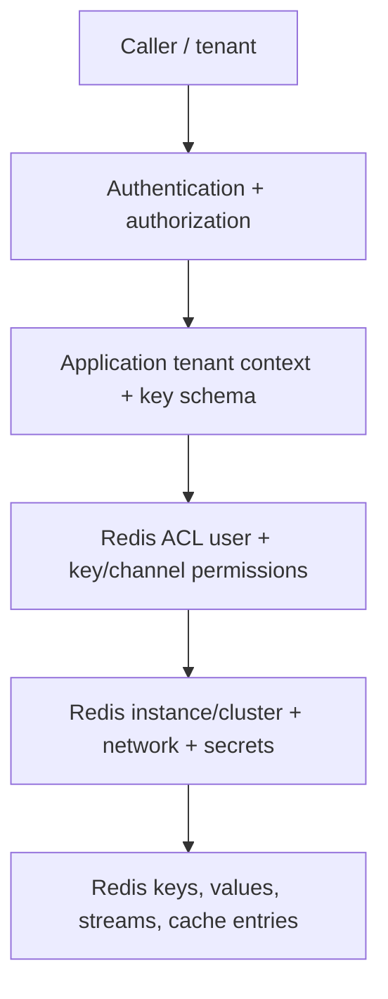
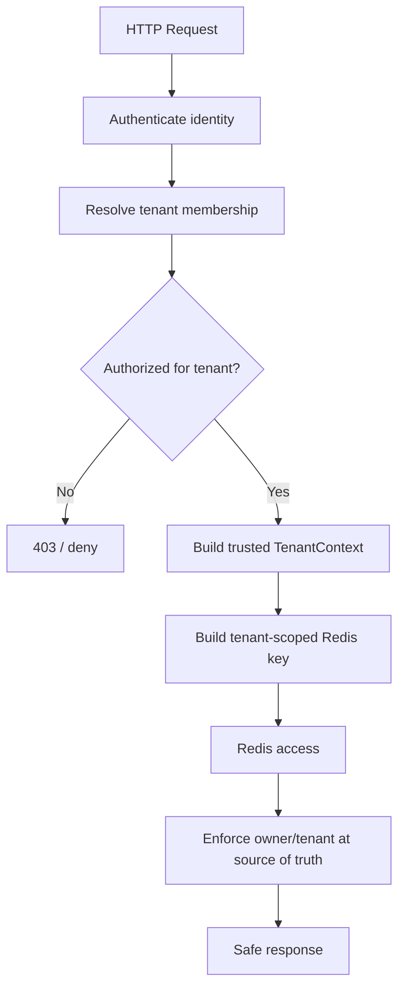

# Cô lập dữ liệu giữa môi trường và khách thuê trong Spring Data Redis

> **Module:** Spring Data Redis  
> **Chương:** Bảo mật  
> **Chủ đề:** Thiết kế và triển khai cách ly dữ liệu Redis giữa development, staging, production và giữa các tenant trong ứng dụng Spring Boot đa khách thuê; kết hợp ranh giới hạ tầng, Redis ACL, key namespace, tenant identity, Spring Cache/RedisTemplate/Repository và kiểm thử chống rò rỉ dữ liệu chéo.

## 1. Vì sao cô lập dữ liệu Redis là yêu cầu bảo mật?

Một ứng dụng SaaS dùng chung Spring Boot service và Redis để phục vụ nhiều tổ chức:

```text
Tenant A: Công ty A
Tenant B: Công ty B

Spring Boot instances
        |
        v
     Redis
        |
        +-- cache:orders:101
        +-- cache:orders:102
        +-- session:abc
```

Nếu service lấy một order theo ID mà **không xác định tenant**, hai khách hàng có thể sử dụng cùng một ID nghiệp vụ. Cache key `cache:orders:101` có nguy cơ:

- Người dùng Tenant B nhận dữ liệu của Tenant A do cache key trùng.
- Một yêu cầu cập nhật/xóa của Tenant B làm mất dữ liệu cache của Tenant A.
- Staging và production ghi vào cùng key khi dùng chung Redis.
- Redis Cache Manager xóa hàng loạt keys thuộc nhiều khách thuê.
- Một background job quét Redis và vô tình xử lý mọi tenant.
- Session, rate limit hoặc idempotency state bị dùng chung sai.
- Worker/event consumer lấy message của tenant khác.

**Cô lập dữ liệu Redis** là tạo ranh giới để một môi trường hoặc tenant không thể đọc, sửa, xóa hoặc ảnh hưởng bất hợp lý tới dữ liệu của môi trường/tenant khác.

Cần phân biệt hai lớp vấn đề:

1. **An toàn truy cập (security isolation):** Ai có quyền đọc/ghi Redis key nào?
2. **Cô lập tài nguyên (resource isolation):** Một tenant có thể làm quá tải Redis và ảnh hưởng tenant khác không?

Cùng một key prefix có thể giảm va chạm tên, nhưng **không tự giải quyết cả hai**.

### 1.1. Các trường hợp phải bảo vệ

| Tình huống | Rủi ro nếu thiếu cách ly |
|---|---|
| Dev vô tình kết nối Redis production | Dữ liệu production bị sửa/xóa |
| Staging chạy tác vụ dọn cache | Xóa cả cache production |
| Hai tenant có `orderId=101` | Trả nhầm order |
| Cache key chỉ chứa ID | Cross-tenant cache hit |
| Tất cả tenants cùng rate limit key | Tenant A bị giới hạn do traffic B |
| Một Redis ACL user có quyền mọi keys | Lộ mọi tenant nếu app/credential bị chiếm |
| Tenant lớn ghi rất nhiều dữ liệu | Eviction, CPU, memory pressure ảnh hưởng tenant nhỏ |
| Redis Pub/Sub không namespace | Subscriber nhận sự kiện của tenant khác |
| Backup/replica chứa nhiều tenant | Một lần lộ backup có thể lộ dữ liệu của tất cả |

### 1.2. Mục tiêu khi thiết kế

- **Không va chạm khóa** giữa environment, service, tenant và đối tượng.
- **Không tin tenant ID từ request** nếu chưa xác thực/ủy quyền.
- **Áp dụng tenant scope cho mọi đường truy cập**, không chỉ một `GET`.
- **Kiểm soát quyền Redis client** theo least privilege.
- **Tách môi trường có mức rủi ro khác nhau**, nhất là production.
- **Có khả năng xóa/rotate/migrate dữ liệu một tenant** mà không tác động tenant khác ngoài phạm vi chấp nhận được.
- **Ngăn noisy neighbor** bằng capacity planning và quota/partition phù hợp.
- **Kiểm thử hành vi cross-tenant**, không chỉ test đường thành công cho một tenant.

## 2. Ba tầng cô lập: hạ tầng, Redis credentials và ứng dụng

Một cách phân tích là ba vòng bảo vệ:



| Tầng | Đảm bảo chính | Giới hạn |
|---|---|---|
| **Hạ tầng** | Production Redis riêng, network/secret/backup riêng | Không tự ngăn lỗi tenant routing bên trong cùng app |
| **Redis ACL** | Giới hạn commands, key patterns, Pub/Sub channels theo user | Một credential chung của app có thể vẫn thấy tất cả tenant keys trong prefix được cho phép |
| **Ứng dụng** | Xác thực tenant, tạo scoped keys, kiểm tra ownership, response filtering | Bug trong app hoặc credential quyền quá rộng vẫn có thể gây lộ dữ liệu |

**Defense in depth:** Không dùng chỉ một cơ chế làm hàng rào an toàn tuyệt đối.

Ví dụ `app:prod:orders:tenant:A:101` là key rõ namespace. Nhưng nếu ứng dụng cho client nhập `tenant=B` tùy ý và Redis ACL cấp quyền `app:prod:orders:*`, tiền tố key **không ngăn** người dùng A đọc đơn hàng của B.

## 3. Chọn mức cách ly theo yêu cầu nghiệp vụ

### 3.1. Một Redis instance dùng chung, chỉ phân biệt key prefix

```text
app:prod:tenant:a:...
app:prod:tenant:b:...
```

Ưu điểm:

- Chi phí thấp.
- Vận hành đơn giản.
- Dùng chung connection pool và Redis capacity.

Nhược điểm:

- Mọi tenant chia sẻ memory, CPU và network.
- App credential thường có quyền rộng.
- `FLUSHDB` hoặc lệnh xóa không được kiểm soát có thể ảnh hưởng toàn bộ.
- Backup/replica chứa dữ liệu nhiều tenant.
- Một bug key routing có thể gây cross-tenant access.

**Phù hợp** khi dữ liệu có mức nhạy cảm thấp hơn, tenant boundaries được kiểm tra kỹ trong application và chấp nhận shared resource risk. Đây là **cách ly logic**, không phải cách ly hạ tầng.

### 3.2. Dùng Redis ACL và các key patterns

Có thể cấp service account chỉ truy cập một namespace, ví dụ `~app:prod:orders:*`.

Ưu điểm:

- Giảm quyền của service.
- Hạn chế sai sót giữa services và environments nếu dùng prefix khác nhau.
- Có thể hạn chế các commands nguy hiểm.

Giới hạn:

- ACL theo key pattern không tự biết tenant hiện đang đăng nhập trong HTTP request.
- Nếu credential có quyền mọi `app:prod:orders:*`, nó có thể truy cập cả tenant A và tenant B.
- Dùng per-tenant ACL users/credentials có thể tạo chi phí quản lý lớn và phức tạp connection pools.
- Redis ACL không cấp quota bộ nhớ/CPU riêng theo key prefix.

### 3.3. Redis logical databases với SELECT

Redis standalone truyền thống hỗ trợ các logical DB indexes (`SELECT 0`, `SELECT 1`, …) tùy cấu hình. Tuy nhiên:

- Chúng chia sẻ cùng Redis process, memory, CPU và cấu hình.
- Một sự cố server/backup/capacity ảnh hưởng tất cả DBs.
- Không phải security boundary mạnh.
- `FLUSHALL` có thể tác động nhiều databases nếu account được phép.
- Redis Cluster chỉ hỗ trợ database 0 và không hỗ trợ phân vùng tenants bằng `SELECT` các DB khác.

**Không sử dụng DB index như giải pháp chính cho hard multi-tenant isolation**, nhất là khi dự án có thể chuyển sang Cluster.

### 3.4. Redis instances/clusters riêng

```text
Production application --> Redis Production
Staging application    --> Redis Staging
Development application--> Redis Development
```

Với tenant có yêu cầu mạnh:

```text
Tenant A --> Redis resource A
Tenant B --> Redis resource B
```

Ưu điểm:

- Ranh giới resource, backup, secret và permissions rõ hơn.
- Sự cố `FLUSHDB` ở resource A không xóa resource B.
- Capacity/availability có thể độc lập.
- Dễ đáp ứng yêu cầu dữ liệu riêng theo tenant nếu được thiết kế đúng.

Đổi lại:

- Chi phí nhiều Redis resources.
- Tăng độ phức tạp kết nối, failover, monitoring và lifecycle.
- Provisioning/rotation/backup cần tự động hóa.
- Một app bug vẫn có thể gửi dữ liệu vào resource sai nếu routing/auth sai.

**Khuyến nghị mặc định cho production:** Dùng Redis production riêng với dev/staging. Key prefix và ACL vẫn được áp dụng như các lớp bảo vệ bổ sung. Với tenant có yêu cầu cô lập đặc biệt, cân nhắc resource riêng.

### 3.5. Bảng lựa chọn

| Mức cô lập | Key collision | App credential compromise | Noisy neighbor | Chi phí |
|---|---|---|---|---|
| Prefix trong cùng Redis | Giảm nếu key builder đúng | Rủi ro cao nếu credential rộng | Vẫn chung | Thấp |
| Prefix + ACL per service | Giảm; hạn quyền namespace | Giảm phạm vi service | Vẫn chung | Thấp–trung bình |
| ACL per tenant trong cùng Redis | Giảm phạm vi truy cập khi dùng credential đúng | Hạn theo tenant | Vẫn chung CPU/RAM | Trung bình–cao |
| Redis resource riêng mỗi environment | Tách môi trường mạnh | Credential env không tới env khác nếu network/secret tách | Tách giữa envs | Trung bình |
| Redis resource riêng cho tenant | Cách ly tài nguyên/secret mạnh hơn | Blast radius theo tenant | Tách tốt hơn | Cao |

Đây là đánh giá định tính. Mức bảo vệ thực tế còn phụ thuộc quản trị identities, network policy, key management, backup và vận hành.

## 4. Cô lập môi trường development, staging và production

### 4.1. Không nên chỉ khác key prefix

Không an toàn cho production nếu:

```text
DEV service   --> redis.company.internal
STAGE service --> redis.company.internal
PROD service  --> redis.company.internal
```

và mọi service dùng cùng password, dù keys có prefix `dev:`, `stage:` và `prod:`.

Một lỗi cấu hình hoặc script cleanup vẫn có thể xóa dữ liệu production nếu quyền không bị chặn.

### 4.2. Kiến trúc an toàn hơn

```text
DEV VPC/namespace       -> DEV Redis / dev ACL / dev backups
STAGING VPC/namespace   -> STAGING Redis / staging ACL / staging backups
PROD VPC/namespace      -> PROD Redis / prod ACL / prod backups
```

Nên tách:

- Redis endpoints và service discovery.
- Credentials/ACL users/secrets.
- Network policies/security groups.
- Backup/snapshot destinations.
- Monitoring/alerts.
- IaC resources và deployment permissions.
- Application profiles và feature flags.
- Data restoration procedures.

### 4.3. Spring Boot configuration theo environment

Ví dụ cấu hình profile:

`application-dev.yml`:

```yaml
spring:
  data:
    redis:
      host: redis-dev.internal
      port: 6379

app:
  redis:
    namespace: app:dev:orders:v2
```

`application-prod.yml`:

```yaml
spring:
  data:
    redis:
      host: redis-prod.internal
      port: 6379
      ssl:
        enabled: true

app:
  redis:
    namespace: app:prod:orders:v2
```

Ví dụ dựa trên cấu trúc properties của Spring Boot 3.x; một số version dùng prefix/cách cấu hình SSL khác. Password không hard-code trong YAML ví dụ. Dùng secret manager/Kubernetes Secrets với chính sách kiểm soát truy cập và rotation.

**Quan trọng:** Redis namespace là một tham số ứng dụng; nó không tự biến endpoint dev thành production hay bảo vệ khỏi trỏ nhầm. Cần deploy policy kiểm tra profile–endpoint–credential phù hợp.

### 4.4. Fail fast nếu cấu hình môi trường sai

Một kiểm soát hữu ích:

- Tên/identity của environment do hệ thống deploy cung cấp, không do request.
- Chỉ cho phép production kết nối endpoint được allowlist.
- Không chứa production Redis credentials trong dev/staging runtime.
- Alert nếu service bất ngờ dùng Redis endpoint/ACL user không đúng deployment.
- Dùng IAM/network policy ngăn workloads ngoài production kết nối production Redis.

Không nên dựa hoàn toàn vào một `if (profile.equals("prod"))` trong Java, vì code hoặc env vars có thể bị cấu hình sai.

### 4.5. Không copy production snapshot sang development tùy tiện

Redis dump/backup có thể chứa:

- PII.
- Sessions/tokens.
- Cache payload nhạy cảm.
- Idempotency results.
- Rate limiting keys.
- Auth-related state.

Nếu cần tái hiện bug, ưu tiên synthetic data hoặc snapshot đã được xử lý dữ liệu theo quy trình bảo mật. Không coi Redis là “chỉ cache nên không có dữ liệu nhạy cảm”.

## 5. Key namespace: lớp bảo vệ đầu tiên ở ứng dụng

Một key schema nên thể hiện đủ phạm vi:

```text
<application>:<environment>:<domain>:<schema-version>:tenant:<tenantId>:<entity>:<entityId>
```

Ví dụ:

```text
app:prod:orders:v2:tenant:t-17:order:o-101
app:prod:orders:v2:tenant:t-18:order:o-101
app:staging:orders:v2:tenant:t-17:order:o-101
```

Ba keys khác nhau dù cùng `orderId=o-101`.

### 5.1. Các thành phần namespace

| Thành phần | Ví dụ | Vai trò |
|---|---|---|
| Application | `app` hoặc `billing` | Tránh va chạm giữa services |
| Environment | `prod` | Tránh trộn dev/staging/prod |
| Domain | `orders` | Phân biệt orders/sessions/caches |
| Version | `v2` | Key/data schema migration |
| Tenant | `t-17` | Tránh cross-tenant collision |
| Entity type | `order` | Tránh order/session cùng ID |
| Entity ID | `o-101` | Định danh resource |

Nếu Redis instance production được cách ly vật lý, vẫn nên có `prod` trong key prefix để dễ quan sát và tránh trộn khi migration. Nhưng prefix **không thay thế** hạ tầng tách biệt.

### 5.2. Quy tắc key builder

Không ghép key tùy ý trong mỗi controller:

```java
String key = "order:" + orderId;
```

Thay vào đó, tập trung logic key schema:

```java
public final class TenantRedisKeys {

    private final String namespace;

    public TenantRedisKeys(String namespace) {
        if (namespace == null || namespace.isBlank()) {
            throw new IllegalArgumentException("Namespace is required");
        }
        this.namespace = namespace;
    }

    public String order(String tenantId, String orderId) {
        return namespace
                + ":tenant:" + validate(tenantId)
                + ":order:" + validate(orderId);
    }

    public String orderLock(String tenantId, String orderId) {
        return namespace
                + ":tenant:" + validate(tenantId)
                + ":lock:order:" + validate(orderId);
    }

    private static String validate(String value) {
        if (value == null
                || !value.matches("[A-Za-z0-9_-]{1,64}")) {
            throw new IllegalArgumentException(
                    "Invalid Redis key component");
        }
        return value;
    }
}
```

Giả sử `namespace="app:prod:orders:v2"`:

```text
order(t-17, o-101)
=> app:prod:orders:v2:tenant:t-17:order:o-101
```

Lợi ích:

- Thống nhất key schema.
- Ngăn ID chứa `:` hoặc `{}` làm thay đổi ranh giới namespace.
- Dễ đổi version.
- Dễ viết tests về không va chạm.
- Dễ áp Redis ACL key pattern theo domain.

**Không đưa trực tiếp raw user input vào Redis key** nếu nó có thể chứa delimiter, wildcard, hash tag hoặc chuỗi dài bất thường.

### 5.3. Hash tenant ID có thay authorization không?

Có thể sử dụng SHA-256/HMAC trên tenant identifier để tránh lộ tên tenant trực tiếp trong Redis key/log. Nhưng:

- Hash không phải authorization.
- SHA-256 của tenant ID dễ đoán vẫn có thể đoán bằng dictionary khi ID có entropy thấp.
- HMAC phụ thuộc secret rotation và key schema migration.
- App vẫn phải kiểm tra tenant identity và resource ownership.

Không dùng “khóa khó đoán” làm hàng rào quyền truy cập duy nhất.

## 6. Tenant identity phải đến từ nguồn đáng tin cậy

Nguy cơ lớn nhất không phải key prefix thiếu đẹp, mà là **tenant ID do client tùy ý chỉ định**.

Không an toàn:

```http
GET /orders/o-101
X-Tenant-Id: tenant-b
```

nếu backend chỉ tin header và dùng nó dựng Redis key, trong khi người dùng thực ra thuộc tenant A.

### 6.1. Quy trình đúng



Tenant phải được lấy từ:

- Security principal hoặc token claims **đã xác minh**.
- Membership/authorization service.
- Session state đã xác thực.
- Service-to-service identity được cấp quyền cho tenant.

Nếu API cho phép chọn tenant trong URL/header, phải kiểm tra caller **được phép hành động trong tenant đó** trước khi xây key.

### 6.2. Phân biệt authentication và authorization

- **Authentication:** xác minh caller là ai.
- **Authorization:** caller có được truy cập tenant T, resource R, action A không.

Một JWT hợp lệ không có nghĩa mọi `tenantId` trong request đều được phép. Nếu principal thuộc nhiều tenant, phải có bước chọn active tenant và kiểm tra membership/role cụ thể.

### 6.3. Không để controller quyết định tenant theo input thô

Ví dụ abstraction:

```java
public interface VerifiedTenantResolver {
    String currentTenantId();
}
```

`VerifiedTenantResolver` là interface **do ứng dụng tự triển khai** dựa trên Spring Security context/membership. Nó phải trả tenant đã được xác minh, không đọc tùy ý một header.

Service:

```java
public class TenantOrderCache {

    private final StringRedisTemplate redis;
    private final TenantRedisKeys keys;
    private final VerifiedTenantResolver tenantResolver;

    public TenantOrderCache(
            StringRedisTemplate redis,
            TenantRedisKeys keys,
            VerifiedTenantResolver tenantResolver) {
        this.redis = redis;
        this.keys = keys;
        this.tenantResolver = tenantResolver;
    }

    public String getOrderJson(String orderId) {
        String tenantId = tenantResolver.currentTenantId();
        String key = keys.order(tenantId, orderId);
        return redis.opsForValue().get(key);
    }
}
```

Mẫu trên giải quyết nhất quán hóa key. Tuy nhiên authorization thực tế còn cần:

- Kiểm tra caller có quyền `read:order`.
- Kiểm tra order thực sự thuộc tenant đó tại source of truth.
- Không coi Redis key existence là bằng chứng quyền truy cập.
- Không đưa JSON của tenant khác vào cache key của tenant hiện tại.

### 6.4. Tenant scope trong background jobs

Không phải mọi thao tác Redis đến từ HTTP request. Batch jobs, scheduled tasks và message consumers có thể không có `SecurityContext` của người dùng.

Cần truyền **tenant context tường minh** từ trusted job metadata:

```java
public void refreshOrderForTenant(
        VerifiedJobTenant tenant,
        String orderId) {
    // tenant phải được tạo sau khi job metadata được kiểm tra.
    String key = keys.order(tenant.id(), orderId);
    // ...
}
```

`VerifiedJobTenant` là kiểu ứng dụng, không phải API Spring có sẵn. Không fallback thành tenant `"default"` khi context thiếu: một job lỗi có thể ghi dữ liệu nhiều khách thuê vào namespace chung.

## 7. ThreadLocal, @Async và Reactor Context

### 7.1. ThreadLocal tenant context có thể bị rò giữa requests

Ứng dụng đa tenant đôi khi dùng:

```java
TenantContextHolder.set(tenantId);
```

trên `ThreadLocal`. Nếu không `clear()` trong `finally`, worker thread được tái sử dụng có thể giữ tenant của request trước:

```text
Request A -> Thread-7 -> tenant=t-17
Request B -> Thread-7 -> tenant context vẫn t-17
```

Đây là lỗi cross-tenant nghiêm trọng.

Nếu dự án buộc dùng ThreadLocal, scope phải rõ ràng:

```java
try {
    TenantContextHolder.set(verifiedTenant);
    chain.doFilter(request, response);
} finally {
    TenantContextHolder.clear();
}
```

Đoạn code minh họa Filter logic. Phải xác thực/ủy quyền tenant **trước** khi set context.

### 7.2. @Async không tự mang mọi ThreadLocal

Các phương thức `@Async`, executor threads, scheduled jobs và CompletableFuture có thể chạy trên thread khác. Không giả định tenant context tự được truyền.

Giải pháp:

- Truyền tenant ID đã xác minh qua method parameters.
- Dùng context propagation được thiết kế/kiểm thử đúng nếu cần.
- Không giữ mutable tenant state trong singleton service.
- Fail fast khi context thiếu.
- Kiểm thử hai tenants xen kẽ trên thread pool.

### 7.3. WebFlux: Reactor context và reactive security

Trong reactive pipeline, không nên phụ thuộc vào ThreadLocal tenant context qua các scheduler boundaries. Một hướng là lấy tenant từ reactive security context đã được xác thực.

Ví dụ cấu trúc:

```java
public Mono<String> getOrderJson(String orderId) {
    return ReactiveSecurityContextHolder.getContext()
            .map(context -> context.getAuthentication())
            .flatMap(authentication ->
                    verifiedTenantService.resolve(authentication))
            .flatMap(tenantId ->
                    reactiveStringRedisTemplate.opsForValue()
                            .get(keys.order(tenantId, orderId)));
}
```

`verifiedTenantService.resolve(authentication)` là method **do ứng dụng định nghĩa** và phải kiểm tra membership/authorization. Trong một số kiến trúc, có thể lưu `VerifiedTenant` vào Reactor `Context`; chỉ dùng giá trị được tạo sau xác thực, không lấy raw user-provided value.

### 7.4. Không dùng singleton field để lưu tenant hiện tại

Sai:

```java
@Service
class CurrentTenantService {
    private String currentTenant;
}
```

Nếu nhiều requests đồng thời, trường mutable dùng chung có thể bị thay đổi giữa tenants. Tenant phải ở request/security context hoặc method parameter đúng vòng đời.

## 8. RedisTemplate: mọi thao tác phải đi qua scoped keys

Một key builder tốt chỉ có tác dụng nếu tất cả đường thao tác sử dụng nó.

### 8.1. Đọc và ghi

```java
public void saveOrderJson(
        String tenantId,
        String orderId,
        String json) {
    String key = keys.order(tenantId, orderId);

    redis.opsForValue().set(
            key, json, Duration.ofMinutes(15));
}
```

`tenantId` ở đây phải được truyền từ một trusted service boundary, không lấy trực tiếp từ HTTP header chưa kiểm tra.

### 8.2. Xóa cache

```java
public boolean evictOrder(
        String tenantId,
        String orderId) {
    String key = keys.order(tenantId, orderId);

    Boolean deleted = redis.delete(key);
    return Boolean.TRUE.equals(deleted);
}
```

Không viết:

```java
redis.delete("order:" + orderId);
```

vì có thể xóa khóa chung hoặc làm va chạm giữa tenants.

### 8.3. Collection operations

Với Set/List/Hash/ZSet, **Redis key** vẫn phải scoped:

```text
app:prod:orders:v2:tenant:t-17:order-index
app:prod:orders:v2:tenant:t-18:order-index
```

Một Set chứa các order IDs của tenant t-17 không được vô tình dùng chung cho t-18.

Ví dụ:

```java
String indexKey = namespace
        + ":tenant:" + tenantId + ":order-index";

redis.opsForSet().add(indexKey, orderId);
```

Nếu sau đó service dùng Redis index để truy xuất order, vẫn cần kiểm tra tenant/owner của entity ở nguồn chuẩn nếu đó là dữ liệu nhạy cảm.

### 8.4. Serializer và bytes của key

Redis thực tế lưu key dưới dạng bytes. Nếu Java key nhìn như:

```text
app:prod:orders:v2:tenant:t-17:order:o-101
```

nhưng serializer gói bytes bằng JDK serialization, Redis ACL patterns/hash tags/CLI diagnostics có thể hoạt động khác dự kiến.

Nên dùng key serializer ổn định, thường `StringRedisSerializer`:

```java
@Bean
RedisTemplate<String, String> scopedRedisTemplate(
        RedisConnectionFactory connectionFactory) {

    RedisTemplate<String, String> template =
            new RedisTemplate<>();

    template.setConnectionFactory(connectionFactory);
    template.setKeySerializer(new StringRedisSerializer());
    template.setValueSerializer(new StringRedisSerializer());
    template.setHashKeySerializer(new StringRedisSerializer());
    template.setHashValueSerializer(new StringRedisSerializer());
    template.afterPropertiesSet();

    return template;
}
```

Với String keys/values, `StringRedisTemplate` có sẵn thường đơn giản hơn. Đảm bảo các writer/reader dùng cùng format.

## 9. Spring Cache abstraction: nguy cơ cross-tenant cache hit

Đây là lỗi rất dễ bỏ sót:

```java
@Cacheable(cacheNames = "orders", key = "#orderId")
public OrderDto getOrder(String orderId) {
    return database.loadOrder(orderId);
}
```

Giả sử Tenant A và B đều có `orderId=o-101`. Cache key có thể cùng là:

```text
orders::o-101
```

Nếu một tenant gọi trước, tenant sau có thể nhận kết quả cache của tenant trước, **ngay cả khi database query có tenant filter đúng**. Lý do: `@Cacheable` có thể trả cache hit mà **không gọi method body**.

### 9.1. Include tenant trong cache key

Một hướng tường minh:

```java
@Cacheable(
        cacheNames = "orders",
        key = "#tenantId + ':' + #orderId")
public OrderDto findOrder(
        String tenantId,
        String orderId) {
    return repository.findByTenantIdAndId(tenantId, orderId)
            .orElseThrow();
}
```

Điều kiện: `tenantId` là giá trị **đã xác thực/ủy quyền** ở tầng caller, và repository query thực sự lọc cả tenant và order ID.

**Không** coi việc có `tenantId` trong method parameters là đủ. Nếu controller cho client tự gửi tenant ID, cache key vẫn có thể bị lạm dụng.

### 9.2. Dùng KeyGenerator hoặc service key builder

Nếu nhiều methods cần cùng chính sách, có thể tạo một `KeyGenerator` hoặc helper bean sinh key theo tenant đã xác thực.

Ví dụ ý tưởng:

```java
@Component("tenantCacheKeys")
public class TenantCacheKeys {

    private final VerifiedTenantResolver tenantResolver;

    public TenantCacheKeys(VerifiedTenantResolver tenantResolver) {
        this.tenantResolver = tenantResolver;
    }

    public String order(String orderId) {
        return tenantResolver.currentTenantId() + ":order:" + orderId;
    }
}
```

Sử dụng SpEL:

```java
@Cacheable(
        cacheNames = "orders",
        key = "@tenantCacheKeys.order(#orderId)")
public OrderDto findOrder(String orderId) {
    return orderSource.loadAuthorizedOrder(orderId);
}
```

Yêu cầu:

- `currentTenantId()` trả tenant đã được xác minh.
- `loadAuthorizedOrder()` cũng enforce resource ownership.
- Context hoạt động đúng với threads và async/reactive calls.
- Không dùng helper của Spring MVC `ThreadLocal` thiếu propagation trong WebFlux.

### 9.3. Prefix của RedisCacheManager

Có thể cấu hình prefix để tách application/environment:

```java
@Configuration
public class RedisCacheConfig {

    @Bean
    RedisCacheManager redisCacheManager(
            RedisConnectionFactory connectionFactory) {

        RedisCacheConfiguration defaults =
                RedisCacheConfiguration.defaultCacheConfig()
                    .computePrefixWith(cacheName ->
                            "app:prod:orders:v2:cache:"
                            + cacheName + "::")
                    .entryTtl(Duration.ofMinutes(10))
                    .serializeKeysWith(
                            RedisSerializationContext
                                    .SerializationPair
                                    .fromSerializer(
                                            new StringRedisSerializer()));

        return RedisCacheManager.builder(connectionFactory)
                .cacheDefaults(defaults)
                .build();
    }
}
```

Các imports thuộc Spring Data Redis cache/config/serialization packages và Java `Duration`.

Ví dụ tạo key:

```text
app:prod:orders:v2:cache:orders::t-17:o-101
```

**Cần cả hai điều kiện:**

1. Redis CacheManager prefix tách service/environment.
2. Cache key hoặc cache namespace tách tenant.

Chỉ cấu hình `computePrefixWith(cacheName -> "app:prod:...")` mà key vẫn là `orderId` **không** ngăn cache collision giữa tenants.

### 9.4. @CacheEvict(allEntries=true) là nguy cơ lớn

Ví dụ:

```java
@CacheEvict(cacheNames = "orders", allEntries = true)
public void clearOrdersCache() {
}
```

Nếu cache `orders` đang dùng chung cho mọi tenants, `allEntries=true` có thể clear **toàn bộ cache name** chứ không chỉ tenant hiện tại. Tenant A có thể làm mất cache Tenant B.

Hệ quả:

- Cache miss storm cho nhiều tenants.
- Dữ liệu cũ/mới không đồng bộ trong các thời điểm refresh.
- Mất kiểm soát resource isolation.
- Các tenant khác chịu latency cao vì thao tác của tenant A.

Cách xử lý:

- Ưu tiên evict đúng key tenant-scoped.
- Với xóa theo tenant, thiết kế namespace/version per tenant hoặc một cơ chế clear có phạm vi tenant thực sự.
- Không dùng `clear()` trên cache toàn cục để xử lý một tenant.
- Nếu cần scan/delete theo tenant prefix, dùng batched scan với giới hạn và nhận thức Redis Cluster/replication; không dùng `KEYS *` tùy tiện.
- Test xóa cache của A không ảnh hưởng key của B.

### 9.5. Cache put và cache evict phải cùng key schema

Một lỗi khác:

```java
@Cacheable(key = "#tenantId + ':' + #orderId")
@CacheEvict(key = "#orderId")
```

Nếu key expressions không khớp, evict có thể xóa sai hoặc không xóa được key cần xóa. Tập trung hóa key builder và test cả read/write/evict.

### 9.6. Cache response vẫn cần authorization

Nếu cache chứa dữ liệu nhạy cảm, không coi “đọc ra một cached DTO” là có quyền. Phải kiểm tra quyền caller **trước khi** có thể trả cache hit, thông qua service boundary/authorization infrastructure.

Đặc biệt nếu quyền truy cập thay đổi (role revoked, tenant membership removed), cached response theo tenant ID thôi có thể chưa đủ. Cần cân nhắc principal/role scope, invalidation, TTL hoặc authorization check ở mỗi lần đọc.

## 10. Redis Repository và secondary indexes

Spring Data Redis Repository với `@RedisHash`, `@Id`, `@Indexed` có thể tự sinh nhiều keys:

- Entity Hash.
- Keyspace metadata.
- Secondary indexes.
- TTL-related metadata.

Ví dụ:

```java
@RedisHash("orders")
public class OrderCacheEntity {

    @Id
    private String id;

    @Indexed
    private String status;
}
```

Nếu `id=o-101` tồn tại ở cả hai tenants và `@Id` chỉ chứa orderId, entities có thể **va chạm** trong Redis keyspace.

### 10.1. Một compound ID do ứng dụng quản lý

Có thể dùng ID scoped:

```text
t-17:o-101
t-18:o-101
```

hoặc một key builder ổn định. Nhưng không tự suy luận việc entity ID đã scoped đồng nghĩa **mọi secondary index/repository finder cũng tenant-scoped**.

Ví dụ finder:

```java
findByStatus("PENDING")
```

có thể trả entries của nhiều tenants nếu query/index không thêm tenant filter. Repository API không tự suy ra current tenant.

### 10.2. Cần xem cả index keyspace

Một repository có thể tạo:

```text
orders:<id>
orders:status:<value>
metadata/index keys ...
```

Các tên chỉ minh họa, không phải contract keys của mọi Spring Data Redis version. Nếu shared index chứa nhiều tenants, một query theo status có thể dẫn đến việc lộ IDs của tenant khác nếu service không filter hoặc authorize.

Với isolation chặt:

- Mô hình hóa tenant trong entity ID và query.
- Kiểm tra các index keys thực tế mà version Spring Data Redis tạo.
- Không dùng finder rộng không có tenant boundary.
- Xem khả năng kiểm soát keyspace/index generation có đáp ứng yêu cầu không.
- Cân nhắc dùng RedisTemplate với key schema tự quản nếu repositories không phù hợp.
- Database/source of truth cũng phải enforce tenant filter.

### 10.3. TTL và keyspace events

Repository có thể sử dụng TTL và keyspace notifications. Event listener nhận expiry event có thể thấy key/ID của nhiều tenants. Handler cần parse và validate tenant scope rồi xử lý đúng tenant, tránh fallback vào tenant mặc định.

Không giả định TTL event tự có verified tenant context.

## 11. Redis Cluster và hash tags trong multi-tenant key schema

Redis Cluster chia keys vào 16.384 hash slots. Hash tags dạng `{...}` buộc các keys có cùng tag nằm cùng slot.

Ví dụ một order của tenant t-17:

```text
app:prod:orders:v2:{t-17|o-101}:state
app:prod:orders:v2:{t-17|o-101}:items
app:prod:orders:v2:{t-17|o-101}:payment
```

Ba keys cùng tag nên thuộc cùng slot và có thể tham gia những multi-key Redis commands hợp lệ trên cùng shard.

### 11.1. Vì sao tag cần bao gồm tenant?

Giả sử chỉ dùng order ID:

```text
app:prod:orders:v2:tenant:t-17:order:{o-101}:state
app:prod:orders:v2:tenant:t-18:order:{o-101}:state
```

Hai keys khác nhau nên không phải một collision dữ liệu, nhưng cùng hash tag `o-101` có thể bị co-locate dù khác tenant. Nếu cần co-location **theo từng tenant + aggregate**, tag nên bao gồm cả hai.

### 11.2. Không dùng tag toàn bộ tenant nếu không cần

```text
app:prod:orders:v2:{tenant-t-17}:order:1
app:prod:orders:v2:{tenant-t-17}:order:2
app:prod:orders:v2:{tenant-t-17}:order:3
```

Mọi key của tenant t-17 thuộc một slot. Nếu tenant lớn, có thể gây **hot shard**.

Chỉ co-locate phạm vi nhỏ nhất thật sự cần atomic multi-key command, ví dụ `{t-17|o-101}`. Với các order độc lập, cho phép chúng phân phối trên nhiều slots.

### 11.3. Hash tag không phải authorization

Dù tag chứa tenant ID, Redis không hiểu tenant membership. Một credential có quyền toàn namespace có thể vẫn đọc key của tenant khác nếu ứng dụng gửi tên key đó.

Hash tag phục vụ **slot placement**, không phải bảo mật.

### 11.4. Không dựa vào SELECT DB cho Redis Cluster

Redis Cluster không hỗ trợ nhiều logical database indexes như standalone. Cách ly tenant qua database number sẽ không hoạt động như mong muốn nếu triển khai Cluster.

## 12. Redis ACL: giới hạn lệnh và key patterns

Redis ACL cho phép tạo users với quyền đối với command và key patterns tùy phiên bản Redis.

Ví dụ ý tưởng một service chỉ cần thao tác keys của order ở production:

```redis
ACL SETUSER svc_orders_prod on >REPLACE_WITH_STRONG_SECRET ~app:prod:orders:* +GET +SET +DEL +HGET +HSET +EXPIRE
```

**Đây là cú pháp minh họa cần cấu hình/bảo vệ credential thật theo quy trình admin; không paste secret thật vào terminal, source control hoặc log.** Các commands khác mà framework thực sự cần có thể phải được cấp thêm sau khi kiểm tra.

### 12.1. ACL bảo vệ service, không tự bảo vệ từng tenant

Pattern:

```text
~app:prod:orders:*
```

cho phép user này truy cập mọi keys trong namespace đã cho, bao gồm:

```text
app:prod:orders:v2:tenant:t-17:...
app:prod:orders:v2:tenant:t-18:...
```

Nghĩa là Redis ACL trên **shared service credential** không thay thế tenant authorization của application.

### 12.2. ACL theo tenant khi cần bảo vệ mạnh hơn

Về nguyên tắc, có thể tạo credential với key pattern tenant cụ thể:

```text
~app:prod:orders:v2:tenant:t-17:*
```

Nhưng vận hành có những thách thức:

- Số ACL users/credentials tăng.
- Phải quản lý connection pools theo credential.
- Rotate secrets per tenant.
- Không gửi nhầm credential tenant A cho request tenant B.
- Jobs/aggregations cross-tenant cần cơ chế admin được kiểm soát.
- Vẫn chia sẻ CPU/RAM/Redis process.

Với yêu cầu hard isolation và tenants lớn, Redis resource riêng thường dễ lý giải hơn một số kiến trúc ACL đa tenant phức tạp.

### 12.3. Giới hạn commands nguy hiểm

Service account không nên có quyền tùy tiện với:

- `FLUSHALL`, `FLUSHDB`.
- `CONFIG` administration.
- `ACL` management.
- `DEBUG` và các lệnh quản trị nhạy cảm.
- `KEYS`/`SCAN` nếu không phục vụ use case đã kiểm soát.
- Pub/Sub/Function/script commands không sử dụng.

Trong production, cấp **chỉ các commands thực tế cần** thay vì `+@all`, và kiểm tra framework có gọi thêm commands cho transactions, health checks hoặc Cluster routing không.

### 12.4. Pub/Sub channel ACL

Redis ACL cũng có các quy tắc cho channel patterns trong những phiên bản Redis hỗ trợ. Khi dùng Pub/Sub, cần tách channel scope:

```text
app:prod:orders:tenant:t-17:events
app:prod:orders:tenant:t-18:events
```

Một service chỉ được phép subscribe đúng channels của mình nếu phân quyền thiết kế ở tầng Redis cho phép. Nhưng nếu dùng một shared app credential subscribe `app:prod:orders:*`, app vẫn cần kiểm tra tenant context để không phát event cho caller khác.

## 13. Redis TLS, network segmentation và credentials

Key prefixes không giải quyết rủi ro khi credential/traffic bị đánh cắp.

### 13.1. Bảo vệ đường truyền

- Dùng TLS với Redis khi môi trường yêu cầu.
- Xác minh server certificate.
- Tránh tắt certificate verification ở production.
- Đặt Redis private network, hạn chế inbound rules.
- Không expose Redis port công khai tùy tiện.
- Giới hạn network identity của app workloads.
- Đặt timeout và connection policies hợp lý.

### 13.2. Bảo vệ secrets

- Mỗi environment có secrets riêng.
- Không commit passwords/ACL credentials vào Git.
- Dùng secret manager/runtime secret injection.
- Rotate credentials có kế hoạch.
- Cân nhắc secret leak blast radius.
- Không log URI chứa password.

### 13.3. Backup và replication

Redis backup/replica có thể chứa toàn bộ dữ liệu của nhiều tenants. Cần cùng mức bảo vệ với nguồn dữ liệu chính:

- Encryption at rest theo capabilities của platform.
- IAM/ACL cho snapshot bucket/control plane.
- Retention policy.
- Tenant-aware deletion/retention workflow khi có yêu cầu.
- Quy trình restore vào môi trường đúng.
- Không restore production backup vào dev không được kiểm soát.

Không coi việc key có TTL là bảo đảm đã được loại khỏi mọi snapshot/backup ngay tức thì.

## 14. Pub/Sub và Redis Streams cũng cần tenant scope

### 14.1. Pub/Sub

Nếu tất cả tenants dùng:

```text
orders:events
```

một subscriber có thể nhận events nhiều tenants.

Đặt tên:

```text
app:prod:orders:tenant:t-17:events
app:prod:orders:tenant:t-18:events
```

Hoặc nếu sử dụng một channel chung vì kiến trúc, mỗi message phải có verified tenant identifier và consumer phải authorize/filter đúng. Tuy nhiên shared channel tăng nguy cơ một consumer bị cấu hình sai nhận toàn bộ events; channel riêng/ACL có thể phù hợp hơn.

Redis Pub/Sub không đảm bảo durable replay hay exactly-once; đó là vấn đề khác với tenant isolation.

### 14.2. Redis Streams

Keys:

```text
app:prod:orders:v2:tenant:t-17:stream:events
app:prod:orders:v2:tenant:t-18:stream:events
```

Consumer phải:

- Đọc đúng stream tenant đã được giao.
- Không để shared consumer group logic trộn IDs/offsets giữa tenants.
- Kiểm tra tenant trước khi cập nhật database.
- Xử lý retry/reclaim không chuyển event sang tenant khác.
- Giới hạn retention/stream length để tenant lớn không chiếm toàn bộ memory.

Nếu dùng một stream chung, ghi rõ tenant vào event schema và có authorization/validation tại consumer; không đặt niềm tin tuyệt đối vào field do producer không đáng tin gửi.

### 14.3. Keyspace notifications

Keyspace notification có thể tiết lộ tên key hoặc metadata của tenants khác cho subscriber có quyền rộng. Chỉ bật và subscribe theo nhu cầu; áp channel permissions, namespace và kiểm tra event ownership.

Không xây chức năng bảo mật dựa trên việc keyspace notifications luôn được gửi, vì Pub/Sub events có thể mất và cấu hình provider có thể hạn chế.

## 15. Sessions và token caches

Các key chứa session hoặc authorization data thường có độ nhạy cao:

```text
app:prod:auth:v2:tenant:t-17:session:s-abc
app:prod:auth:v2:tenant:t-18:session:s-def
```

Những yêu cầu:

- Session được gắn user/tenant và kiểm tra authorization khi sử dụng.
- Tenant switching không làm tái sử dụng cache quyền của tenant trước.
- Logout/revocation được xử lý đúng.
- TTL phù hợp authentication requirements.
- Không dùng session ID làm Redis ACL credential.
- Không đặt token thô trong Redis key name/log.
- Redis sessions được bảo vệ ở network, ACL, at-rest backup.

Nếu dùng Spring Session Redis, framework có thể sinh key/index nội bộ. **Không tự giả định tất cả key names đều bao gồm tenant** chỉ vì ứng dụng biết tenant. Cần kiểm tra namespace và semantics session repository, test tenant switch, revoke và key indexing.

## 16. Rate limiting theo tenant

Nếu dùng chung key:

```text
rate:api:requests
```

traffic của tenant A sẽ làm tenant B bị giới hạn, hoặc ngược lại.

Thay:

```text
app:prod:api:v2:tenant:t-17:rate:POST-orders
app:prod:api:v2:tenant:t-18:rate:POST-orders
```

Với quota ở cấp user trong tenant:

```text
app:prod:api:v2:tenant:t-17:user:u-55:rate:POST-orders
```

Cần định nghĩa:

- Quota theo tenant hay user?
- Period/window và TTL.
- Algorithm: fixed window, sliding window, token bucket…
- Cách tính khi user chuyển tenant.
- Fairness giữa tenants.
- Fail-open/fail-closed khi Redis không sẵn sàng.

**Redis không tự cấp CPU/memory quota riêng cho từng tenant key prefix.** Rate limit ở application bảo vệ một phần request volume, nhưng không thay resource isolation của Redis.

## 17. Idempotency keys, distributed locks và caches phải tenant-scoped

### 17.1. Idempotency key

Sai:

```text
idem:request-123
```

vì hai tenants có thể cùng dùng `Idempotency-Key: request-123`.

Tốt hơn:

```text
app:prod:orders:v2:tenant:t-17:idem:POST-orders:request-123
app:prod:orders:v2:tenant:t-18:idem:POST-orders:request-123
```

Một operation scope nên bao gồm:

- Environment.
- Service/domain.
- Tenant đã xác thực.
- Operation name/version.
- Client idempotency key.

Khi replay result, phải kiểm tra caller hiện tại còn quyền đối với tenant/resource. Một key khó đoán không đủ để truy cập response nhạy cảm.

### 17.2. Distributed lock

Sai:

```text
lock:order:o-101
```

Nếu order IDs trùng giữa tenants, một tenant có thể khóa công việc của tenant khác.

Tốt hơn:

```text
app:prod:orders:v2:tenant:t-17:lock:order:o-101
```

Lease/owner token và Lua compare-and-delete vẫn cần thiết để tránh worker cũ xóa lock mới. Tenant scoping không tự giải quyết lease expiration/fencing.

### 17.3. Cache-aside

Bộ nhớ cache phải được phân tách:

```text
Tenant A -> app:prod:orders:v2:tenant:t-17:order:o-101
Tenant B -> app:prod:orders:v2:tenant:t-18:order:o-101
```

Nếu DB query sai tenant filter nhưng key đúng tenant prefix, dữ liệu tenant B vẫn có thể bị ghi vào key tenant A. Do đó phải bảo vệ **cả database query + cache key + response authorization**.

## 18. Xóa dữ liệu một tenant mà không ảnh hưởng tenants khác

Yêu cầu thường gặp: tenant đóng tài khoản, chuyển data region hoặc cần xóa cache theo phạm vi.

Không nên:

```redis
FLUSHDB
FLUSHALL
```

trên Redis dùng chung.

### 18.1. Xóa chính xác keys đã biết

Nếu biết key names, gọi `DEL`/`UNLINK` cho chính keys của tenant cần xóa. Tránh broad wildcard không kiểm soát.

### 18.2. Duyệt theo namespace với SCAN

Có thể dùng `SCAN` theo match pattern trong một quy trình admin có kiểm soát:

```text
MATCH app:prod:orders:v2:tenant:t-17:*
```

Những lưu ý:

- `SCAN` là cursor-based; không đảm bảo snapshot bất biến khi keys đang thay đổi.
- Redis Cluster cần duyệt các primary nodes hoặc dùng cluster-aware API tương ứng.
- Chia nhỏ batch và giới hạn rate để không làm nghẽn Redis.
- Sử dụng exact validated tenant ID, không dùng user input có wildcard.
- Không dùng `KEYS *` trên production dataset lớn.
- Theo dõi sự thay đổi đồng thời của application trong lúc cleanup.
- Có audit log và dry-run/preview khi thao tác quan trọng.

### 18.3. Versioned namespace

Một cách làm cache invalidation là đưa tenant cache generation vào key:

```text
app:prod:orders:v2:tenant:t-17:gen:7:order:o-101
app:prod:orders:v2:tenant:t-17:gen:8:order:o-101
```

Khi tăng generation, new reads không dùng old generation. Nhưng:

- Bản ghi cũ vẫn chiếm RAM tới TTL hoặc cleanup.
- Generation state phải nhất quán và được quản lý an toàn.
- Không được reset generation tùy tiện.
- Không đồng nghĩa dữ liệu đã được xóa khỏi backups.
- Với dữ liệu cực kỳ nhạy cảm, cần quy trình deletion thực sự thay vì chỉ không tham chiếu.

### 18.4. Không chỉ xóa cache

Nếu tenant offboarding, cần xem cả:

- Primary database records.
- Redis caches.
- Redis sessions.
- Streams/pubsub retention.
- Repository secondary indexes.
- Background jobs/in-flight operations.
- Backups/snapshots theo retention policy.
- Logs và observability stores có dữ liệu liên quan.

Redis key delete đơn thuần không giải quyết mọi vị trí tồn tại dữ liệu.

## 19. Noisy neighbor: data isolation không đồng nghĩa resource isolation

Giả sử Redis dùng chung có 10 tenants. Tenant lớn đột ngột ghi 2 triệu cache keys.

Hậu quả:

- Redis memory tăng.
- Eviction có thể loại cả keys của tenants khác.
- CPU/network tăng.
- Tail latency của mọi tenants bị ảnh hưởng.
- Replication/persistence overhead tăng.
- Redis client connection pool bị chiếm nhiều.

Key prefix phân tách tên nhưng **không tạo quota RAM hoặc CPU**.

### 19.1. Những biện pháp ở application

- Rate limit requests theo tenant.
- Giới hạn key count/value size/TTL theo use case.
- Giới hạn concurrent Redis operations theo tenant.
- Cache admission policy cho tenants lớn.
- Không cache response cực lớn không kiểm soát.
- Tách workloads như session vs analytics cache khi có mức ưu tiên khác.
- Quan sát memory/ops per tenant ở ứng dụng bằng metrics tổng hợp.

### 19.2. Giới hạn của quota theo prefix

Redis không cung cấp mặc định một cách enforcement CPU/memory cứng per arbitrary key prefix trong shared instance. Có thể xây quota logic phía ứng dụng, nhưng nếu app credential trực tiếp ghi tùy ý, quota logic có thể bị bypass bởi bug/tool.

Khi cần bảo đảm hard resource isolation, cân nhắc Redis instances/clusters riêng hoặc mô hình pool phân tầng có capacity policies rõ ràng.

### 19.3. Per-tenant metrics có thể gây cardinality

Đo per-tenant QPS và cache size hữu ích, nhưng nếu có hàng trăm nghìn tenants, metric label `tenantId` có thể quá lớn.

Gợi ý:

- Label theo tier/plan/bucket thay vì every tenant ID trong Prometheus.
- Top-N tenants qua logs/tracing/sampled analytics.
- Theo dõi exception/eviction/latency theo service và workload.
- Bảo vệ tenant IDs trong observability.

## 20. Bảo vệ quyền ở nguồn chuẩn, không chỉ trong cache

Nếu source database lưu orders:

```sql
SELECT *
FROM orders
WHERE id = :orderId;
```

mà thiếu `tenant_id`, request của tenant A có thể đọc order B dù Redis key được tạo theo A.

Phải có:

```sql
SELECT *
FROM orders
WHERE tenant_id = :tenantId
  AND id = :orderId;
```

Đồng thời authorization layer phải xác minh tenantId thuộc quyền caller. Nếu database hỗ trợ row-level security hoặc tenancy policies, có thể thêm defense in depth phù hợp.

### 20.1. Cache poisoning cross-tenant

Một flow lỗi:

```text
Caller A -> key tenant:A:order:101 -> MISS
DB query chỉ theo orderId -> trả order của B
App SET tenant:A:order:101 = B's data
Caller A retry -> HIT và tiếp tục nhận dữ liệu của B
```

Key prefix đúng nhưng dữ liệu đã sai ngay từ bước load.

Cách phòng:

1. Source query tenant-scoped.
2. Domain object có `tenantId` và kiểm tra trước khi cache put.
3. Cache key dùng verified tenant ID.
4. Authorization check trước khi response.
5. Integration tests cố tình dùng trùng resource ID giữa A/B.

### 20.2. Cache-aside và invalidation

Một update của tenant A phải evict key của tenant A; không được sử dụng một global prefix. Ngoài ra nếu quyền bị thu hồi, dữ liệu cache được lưu trước đó cần chính sách TTL/authorization thích hợp.

## 21. Migration key schema không làm lộ dữ liệu cũ

Khi hệ thống chuyển từ single-tenant sang multi-tenant:

```text
Cũ: order:o-101
Mới: app:prod:orders:v2:tenant:t-17:order:o-101
```

Không thể chỉ đổi key builder và giả định dữ liệu cũ an toàn.

### 21.1. Rủi ro migration

- Legacy keys không có tenant, không thể xác định owner.
- Dual-read fallback sang legacy key có thể trả dữ liệu của tenant khác.
- Cache invalidation cũ vẫn xóa nhầm.
- Repository indexes cũ chứa IDs không scoped.
- Có hai application versions ghi format khác nhau.
- Old keys tồn tại trong backups.

### 21.2. Phương pháp an toàn hơn

1. Định nghĩa schema mới và canonical key builder.
2. Xác minh tenant ownership của dữ liệu tại source of truth.
3. Chỉ backfill legacy entry khi biết tenant của nó.
4. Nếu không thể xác minh ownership, bỏ cache cũ và rebuild từ nguồn chuẩn.
5. Không tự động fallback từ new key sang old unscoped key khi không chứng minh tenant mapping.
6. Chuyển tất cả producers/consumers/evictors.
7. Theo dõi legacy keys còn được đọc/ghi không.
8. Dọn dữ liệu cũ theo lịch có kiểm soát.
9. Test cả rollout và rollback logic; tránh rollback về key schema không có tenant boundary.

Nếu Redis là nguồn chuẩn chứ không chỉ cache, migration cần quy trình transaction/reconciliation thích hợp, không được xóa dữ liệu cũ tùy ý.

## 22. Logging, tracing và audit

Một incident cross-tenant cần xác định:

- Caller identity/role sau xác thực.
- Verified tenant.
- Operation: GET/SET/DEL/CACHE_EVICT/PUBLISH/XREAD...
- Key namespace, không log raw secret/key payload.
- Redis ACL user/service account.
- Application environment.
- Cache hit/miss/error.
- Authorization decision.
- Correlation/trace ID.

### 22.1. Gợi ý structured log

```json
{
  "event": "REDIS_ORDER_CACHE_READ",
  "environment": "prod",
  "service": "orders",
  "tenantRef": "hashed-tenant-reference",
  "keyNamespace": "app:prod:orders:v2",
  "operation": "GET",
  "cacheResult": "HIT",
  "traceId": "trace-example"
}
```

Không log session token, secret, raw personal data hoặc full Redis value. Nếu logs chứa tenant identifiers, áp dụng retention/access controls tương ứng.

### 22.2. Alerting

Cảnh báo khi:

- Có key access ngoài namespace dự kiến.
- Redis ACL báo NOPERM/NOAUTH bất thường.
- App instance dùng nhầm environment endpoint.
- Bulk delete/FLUSH attempts.
- Cache clear phạm vi rộng.
- Redis memory/eviction tăng do tenant traffic spike.
- Số lượng keys/bytes tăng đột biến.
- Redis connection count hoặc command QPS vượt capacity.
- Cross-tenant access test/canary phát hiện bất thường.

## 23. Kiểm thử chống truy cập chéo tenant

Đây là nhóm test quan trọng hơn việc chỉ kiểm tra cache hit đúng.

### 23.1. Hai tenant có cùng resource ID

Thiết lập:

```text
Tenant A, orderId=o-101, value=A-data
Tenant B, orderId=o-101, value=B-data
```

Kỳ vọng:

- A đọc A-data.
- B đọc B-data.
- Cache hits độc lập.
- A update/evict không làm thay đổi B-data.
- B không thể thay tenant bằng header giả để đọc A-data.

### 23.2. Test Spring Cache collision

Một test integration:

1. Authenticated as tenant A.
2. Gọi cached method cho orderId `o-101`.
3. Authenticated as tenant B.
4. Gọi cùng method và order ID.
5. Xác minh response B không chứa bất kỳ dữ liệu A nào.
6. Gọi `@CacheEvict` của A.
7. Xác minh cache của B vẫn có dữ liệu và không bị clear trái phép.

### 23.3. Test tenant context propagation

Thử:

- Spring MVC thread reuse.
- `@Async` tasks.
- Scheduled jobs.
- WebFlux Reactor context/scheduler boundaries.
- Nested service calls.
- Concurrent requests A/B xen kẽ.
- Missing tenant context phải fail fast.

Mục tiêu: không có một singleton/thread bị giữ tenant context của request trước.

### 23.4. Test Redis ACL

Ở môi trường test riêng:

- Service A đọc được key pattern được phép.
- Service A bị từ chối khi truy cập key namespace không thuộc quyền.
- Không thể chạy `FLUSHDB`/`FLUSHALL`.
- Không thể subscribe Pub/Sub channels ngoài phạm vi.
- Không dùng shared production credentials trong tests.

Những lệnh/framework features cần cấp thêm phải được kiểm tra chứ không mở `+@all` theo phản xạ.

### 23.5. Test Redis Cluster

- Đảm bảo key builder và serializer tạo đúng namespace/key bytes.
- Hash tags cùng aggregate cho các operations cần cùng slot.
- Không đặt mọi tenant keys vào một hot slot.
- Multi-key scripts không truy cập keys khác slot.
- Khi failover/topology refresh, application vẫn không đổi tenant routing.

### 23.6. Test cleanup và offboarding

Sau khi dọn tenant A:

- Keys của A được xử lý theo policy.
- Keys của B vẫn nguyên vẹn.
- Sessions/jobs/events liên quan tới A được vô hiệu hóa theo contract.
- Không sử dụng global FLUSH.
- Migration/backup retention tuân thủ quy trình đã đặt.

## 24. Ví dụ kiến trúc cho một dịch vụ Orders đa tenant

### 24.1. Các ranh giới

```text
Authenticated client
       |
       v
Spring Security: identity + tenant membership
       |
       v
OrderService
       |
       +-- TenantRedisKeys
       |     +-- app:prod:orders:v2:tenant:t-17:order:o-101
       |
       +-- StringRedisTemplate (Redis ACL svc_orders_prod)
       |     +-- Redis Production (private/TLS)
       |
       +-- OrderRepository
             +-- DB query tenant_id = t-17 AND order_id = o-101
```

Các ranh giới làm ba việc:

1. Identity/authorization quyết định tenant nào được truy cập.
2. Redis namespace tránh collision và hỗ trợ ACL/operations.
3. Database/source of truth enforce tenant ownership độc lập với cache.

### 24.2. Một read path an toàn hơn

```java
public OrderDto findOrder(String orderId) {
    String tenant = verifiedTenantResolver.currentTenantId();

    authorization.checkCanReadOrders(tenant);

    String key = tenantRedisKeys.order(tenant, orderId);

    String json = redis.opsForValue().get(key);
    if (json != null) {
        OrderDto cached = objectMapper.readValue(
                json, OrderDto.class);
        if (!tenant.equals(cached.tenantId())) {
            throw new SecurityException(
                    "Tenant mismatch in cached order");
        }
        return cached;
    }

    OrderDto order = orderRepository
            .findByTenantIdAndOrderId(tenant, orderId)
            .orElseThrow();

    redis.opsForValue().set(
            key,
            objectMapper.writeValueAsString(order),
            Duration.ofMinutes(10));

    return order;
}
```

Đoạn code minh họa luồng nghiệp vụ; `authorization`, `verifiedTenantResolver`, `OrderDto`, `OrderRepository` là abstractions ứng dụng, JSON exceptions cần được xử lý/khai báo theo implementation cụ thể.

**Không nên coi code sketch này là component đầy đủ để copy-paste build ngay** khi chưa bổ sung dependencies, try/catch, transaction/fallback policy, authorization và DTO contract.

### 24.3. Fail-open cache không được fail-open authorization

Nếu Redis cache lỗi, có thể đọc database thay thế **nếu** Redis chỉ là cache và database được tenant-filtered. Nhưng không bao giờ trả dữ liệu mặc định của tenant khác hay bỏ qua authorization chỉ vì cache unavailable.

Ví dụ policy:

```text
Redis GET lỗi
    -> ghi metrics
    -> DB query WHERE tenant_id = verifiedTenant
    -> verify owner/authorization
    -> trả kết quả hoặc lỗi phù hợp
```

## 25. Những sai lầm thường gặp

### 25.1. Dùng `SELECT` database index để cô lập production và staging

Logical DB không phải security/resource boundary mạnh; Redis Cluster không hỗ trợ nhiều DB indexes. Nên dùng Redis resources/credentials riêng theo môi trường.

### 25.2. Chỉ dựa vào key prefix để bảo mật

Nếu credential có quyền toàn namespace và app cho phép chọn tenant tùy ý, prefix không chặn truy cập chéo. Phải kết hợp auth, ACL và hạ tầng.

### 25.3. Tin `X-Tenant-Id` không kiểm tra

Caller có thể sửa header. Tenant scope phải được xác minh dựa trên identity/membership.

### 25.4. `@Cacheable(key="#id")` trong SaaS multi-tenant

Hai tenant cùng ID có thể trả nhầm cached value. Cache key phải bao gồm verified tenant hoặc dùng tenant-specific cache namespace.

### 25.5. `@CacheEvict(allEntries=true)` cho một tenant

Có thể xóa toàn bộ shared cache, gây tác động tới tenants khác. Cần key-specific eviction hoặc tenant-scoped cache design.

### 25.6. Redis Repository entity ID scoped nhưng secondary index không scoped

Finder/index có thể vẫn truy vấn IDs của nhiều tenants. Cần xem repository mapping và enforce tenant filter.

### 25.7. ThreadLocal tenant không clear sau request

Thread pool reuse có thể khiến request sau dùng tenant của request trước. Dùng `try/finally` và test concurrency, hoặc truyền context tường minh.

### 25.8. Hash tag theo toàn tenant

Một tenant lớn có thể bị dồn vào một Redis Cluster hash slot gây hot shard. Chỉ co-locate theo aggregate nhỏ nhất cần atomicity.

### 25.9. Dùng cùng ACL credential cho mọi environments

Khi dev app bị xâm nhập, có thể truy cập production nếu network/credential không tách. Cần least privilege, secrets và network boundaries.

### 25.10. Pub/Sub channels chung không có tenant filtering

Consumer có thể nhận events của tenant khác. Dùng scoped channels hoặc strict message authorization.

### 25.11. `FLUSHDB` khi offboarding một tenant

Có thể xóa mọi tenant cùng DB. Chỉ xóa scoped keys và tuân thủ cleanup process.

### 25.12. Redis key names chứa dữ liệu nhạy cảm

Keys có thể xuất hiện trong logs, monitoring, slowlogs, snapshots và CLI. Không cho token, email hoặc PII thô vào key nếu không cần.

### 25.13. Shared Redis có prefix nghĩa là có quota mỗi tenant

Sai. Memory/CPU/network vẫn dùng chung. Cần quotas ở application hoặc resource isolation thực sự.

### 25.14. Cache key đúng tenant nhưng DB query không filter tenant

Có thể cache dữ liệu B vào key của A. Tenant ownership phải được kiểm tra từ source of truth trước cache write.

### 25.15. Migration tự động đọc old unscoped key

Legacy key có thể thuộc tenant khác. Chỉ backfill khi biết owner; với cache có thể rebuild từ nguồn chuẩn.

## 26. Câu hỏi thường gặp

**1. Chỉ thêm `tenantId` vào Redis key đã đủ bảo mật chưa?**

Chưa. Nó giảm va chạm key nhưng không thay authentication, authorization, Redis ACL và nguồn dữ liệu có tenant filter.

**2. Redis logical databases có phù hợp tách tenants không?**

Có thể phân biệt names khi standalone nhưng không phải hard isolation; chia sẻ tài nguyên và Redis Cluster chỉ hỗ trợ DB 0.

**3. Production và staging có thể chung Redis nếu prefix khác nhau không?**

Kỹ thuật có thể, nhưng rủi ro cao hơn và thường không phải lựa chọn nên ưu tiên. Production nên tách resource, network, credentials và backup khi có thể.

**4. Redis ACL có tự hiểu tenant trong JWT không?**

Không. ACL kiểm tra Redis user/command/key/channel patterns, không tự hiểu HTTP authenticated tenant. Application phải enforce tenant authorization.

**5. Một service credential có thể chỉ được truy cập keys của một tenant không?**

Có thể giới hạn bằng ACL key pattern nếu kiến trúc dùng per-tenant users/credentials, nhưng phức tạp vận hành và không cách ly CPU/RAM.

**6. Vì sao Spring Cache dễ rò dữ liệu hơn code RedisTemplate rõ ràng?**

Cache interception có thể trả cache hit trước khi method body chạy. Nếu cache key thiếu tenant, repository method có tenant filter vẫn không được gọi trong nhánh cache hit.

**7. Có nên đưa userId vào cache key không?**

Tùy phạm vi dữ liệu. Tenant scope là tối thiểu cho dữ liệu tenant; dữ liệu phụ thuộc quyền/role/user có thể cần thêm principal scope hoặc authorization mỗi lần.

**8. Redis Repository tự đa tenant không?**

Không nên mặc định. Entity IDs, secondary indexes, TTL metadata và query finder cần được kiểm tra theo version và data model.

**9. Hash tag là cơ chế security isolation?**

Không. Hash tag chỉ ảnh hưởng hash slot placement của Redis Cluster.

**10. Có nên dùng một hash tag `{tenantId}` cho mọi key tenant?**

Chỉ khi thật sự cần nhiều keys cùng slot. Tenant lớn dễ tạo hot shard; thường tag theo aggregate nhỏ hơn.

**11. Xóa tenant cache bằng `KEYS tenant:*` rồi `DEL` được không?**

Không nên dùng KEYS toàn keyspace production lớn. Có thể dùng SCAN/batched deletes với validated prefix và nhận thức Cluster, concurrent updates, resource load.

**12. TLS có giải quyết cross-tenant cache hit không?**

Không. TLS bảo vệ transport, không sửa logic key/authorization.

**13. Redis instance riêng tenant có loại bỏ mọi bug cross-tenant không?**

Không. App routing sai vẫn có thể gửi dữ liệu tới instance khác; phải test verified tenant-to-resource mapping.

**14. Có cần cache tenant ID trong session?**

Nếu có, phải xác thực context/session lifecycle, tenant switching, revoke và authorization. Không tin mọi session metadata chưa được kiểm tra.

**15. Redis Pub/Sub có thể lộ tenant khác không?**

Có thể nếu channels/credentials và consumers dùng chung không filter. Cần namespace, ACL channel patterns và validation.

**16. Quota bộ nhớ theo tenant có sẵn trong Redis key prefix không?**

Không. Shared Redis resource dùng chung RAM/CPU; cần application quotas hoặc phân tách hạ tầng nếu yêu cầu cứng.

**17. Nếu Redis outage, có thể bỏ qua tenant check và đọc database không?**

Không. Fallback chỉ hợp lệ khi vẫn thực hiện tenant authorization và query tenant-scoped.

**18. Có nên log Redis key đầy đủ để debug?**

Không mặc định, vì keys có thể lộ tenant IDs/tokens. Ưu tiên namespace, hashed references, correlation ID và redaction.

## 27. Checklist triển khai bảo mật multi-tenant Redis

1. **Production Redis tách** khỏi dev/staging bằng resource/network/secrets khi phù hợp.
2. **Redis ACL least privilege** theo service/domain; không dùng shared admin credentials.
3. **TLS và private network** để bảo vệ traffic.
4. **Định nghĩa key schema** gồm service, environment, version và tenant.
5. **Validate/encode key components** để không thể chèn delimiter/hash tag.
6. **Tenant được xác minh từ security context/membership**, không tin raw headers.
7. **Kiểm tra authorization** cho từng resource/action, kể cả cache hits.
8. **Enforce tenant filter tại database/source of truth**.
9. **Cache key Spring @Cacheable chứa verified tenant**.
10. **Cache eviction không clear shared cache** chỉ vì một tenant.
11. **Redis Repository indexes/finder scoped** và có tests cụ thể.
12. **Reactive/@Async context propagation đúng**; không rò ThreadLocal.
13. **Pub/Sub, Streams, sessions, rate limits, idempotency và locks** đều tenant-scoped.
14. **Redis Cluster hash tags** không tạo hot shard hoặc giả security boundary.
15. **Không dùng SELECT DB index làm hard isolation**.
16. **Có quota/capacity plan** chống noisy neighbor.
17. **Dùng SCAN/batch xóa có kiểm soát**, không FLUSH cho offboarding.
18. **Migration chỉ backfill keys có owner xác định**.
19. **Secrets, backups, logs và monitoring** có quyền truy cập/retention phù hợp.
20. **Kiểm thử cross-tenant** với cùng resource ID, concurrent requests và cache hit/evict.
21. **Alert ACL failures, endpoint mismatch, abnormal deletes và eviction spikes**.
22. **Đối chiếu Redis/Spring Data Redis version** cho ACL, Cluster và key generation thực tế.

## 28. Tổng kết

Cô lập dữ liệu Redis giữa môi trường và khách thuê **không chỉ là đặt prefix vào key**.

Một giải pháp đáng tin cần ba lớp:

1. **Hạ tầng:** Production, staging và dev nên có Redis resources, network, credentials và backups tách biệt. Tenant có yêu cầu cách ly cao có thể dùng resource riêng.
2. **Redis security:** TLS, ACL và command/key/channel restrictions giảm phạm vi quyền của service account; ACL không tự biết tenant trong JWT.
3. **Ứng dụng:** tenant identity đã xác thực, authorization theo resource, key builder scoped, Spring Cache key/eviction đúng, Repository indexes, Pub/Sub/Streams/sessions/jobs đều tuân thủ tenant boundary.

Đồng thời cần kiểm soát tài nguyên chung, cleanup, migration, logs và backups. **Key prefix ngăn collision; authorization ngăn truy cập trái phép; resource isolation ngăn ảnh hưởng lẫn nhau về công suất.** Chỉ khi cả ba được thiết kế có chủ đích, Spring Data Redis mới an toàn trong môi trường multi-tenant.

## Tài liệu tham khảo

- Redis — [ACL](https://redis.io/docs/latest/operate/oss_and_stack/management/security/acl/): users, command permissions, key/channel patterns.
- Redis — [Security](https://redis.io/docs/latest/operate/oss_and_stack/management/security/): Redis network/security principles.
- Redis — [TLS support](https://redis.io/docs/latest/operate/oss_and_stack/management/security/encryption/): encryption in transit.
- Redis — [Redis Cluster specification](https://redis.io/docs/latest/operate/oss_and_stack/reference/cluster-spec/): hash slots, hash tags, Cluster limitations.
- Redis — [SCAN](https://redis.io/docs/latest/commands/scan/): cursor-based keyspace traversal.
- Redis — [Key eviction](https://redis.io/docs/latest/reference/eviction/): maxmemory, eviction and shared capacity.
- Spring Data Redis — [RedisTemplate](https://docs.spring.io/spring-data/redis/reference/redis/template.html): serializers and Redis operations.
- Spring Data Redis — [Redis Cache](https://docs.spring.io/spring-data/redis/reference/redis/redis-cache.html): cache prefixes and cache manager.
- Spring Data Redis — [Redis Repositories](https://docs.spring.io/spring-data/redis/reference/redis/redis-repositories.html): entity mapping and secondary indexes.
- Spring Data Redis — [Redis Cluster](https://docs.spring.io/spring-data/redis/reference/redis/cluster.html): cluster configuration/operations.
- Spring Framework — [Cache Abstraction](https://docs.spring.io/spring-framework/reference/integration/cache.html): @Cacheable and @CacheEvict.
- Spring Security — [Architecture](https://docs.spring.io/spring-security/reference/servlet/architecture.html): authenticated security context and authorization.
- Spring Security — [Reactive Security](https://docs.spring.io/spring-security/reference/reactive/configuration/webflux.html): reactive security integration.
