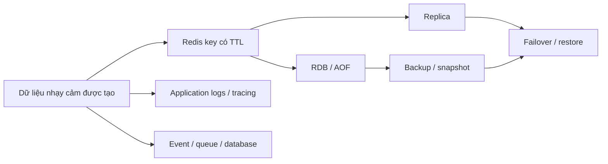
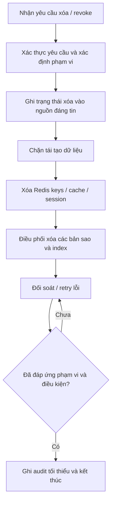

# Xác định TTL và chính sách xóa dữ liệu nhạy cảm trong Spring Data Redis

## 1. Vấn đề bảo mật: dữ liệu trong Redis không tự trở nên an toàn vì “chỉ là cache”

Redis thường được chọn vì tốc độ cao và hỗ trợ TTL (time to live). Trong ứng dụng Spring Data Redis, Redis có thể lưu:

- Session đăng nhập, thông tin xác thực tạm và mã OTP.
- Token một lần, mã xác nhận email, token đặt lại mật khẩu.
- Quyền truy cập đã tính toán, cache hồ sơ người dùng hoặc kết quả truy vấn có dữ liệu cá nhân.
- Giỏ hàng, địa chỉ giao hàng, số dư tạm hoặc trạng thái đơn hàng.
- Bộ đếm giới hạn tốc độ, lock, idempotency key.
- Redis Hash của entity, secondary index, Stream event và những bản sao phục vụ hiệu năng.

Một số dữ liệu có thể tái tạo từ nguồn chính; một số khác chỉ tồn tại trong Redis. Cả hai đều có thể chứa thông tin nhạy cảm. Nếu đặt TTL quá dài hoặc quên TTL, dữ liệu tồn tại lâu hơn nhu cầu nghiệp vụ. Nếu đặt TTL quá ngắn, người dùng bị đăng xuất hoặc luồng xác thực bị gián đoạn. Nếu “xóa” chỉ bằng một lệnh `DEL`, có thể còn bản sao trong RDB, AOF, backup hoặc những hệ thống khác.

Bài học này tập trung vào hai câu hỏi bảo mật cần được trả lời **cùng lúc**:

1. **Mỗi loại dữ liệu nhạy cảm được giữ trong Redis tối đa bao lâu, và vì sao?**
2. **Khi hết thời hạn, người dùng yêu cầu xóa, quyền bị thu hồi hoặc có sự cố bảo mật, dữ liệu phải bị loại bỏ ở những phạm vi nào?**

Hai câu hỏi tương ứng với **chính sách vòng đời dữ liệu** và **chính sách xóa/thu hồi có thể kiểm chứng**. TTL là công cụ kỹ thuật quan trọng, nhưng không thay thế đầy đủ cho hai chính sách đó.

> **Nguyên tắc:** chỉ lưu dữ liệu thực sự cần, giữ trong thời gian ngắn nhất phù hợp mục đích, giới hạn người được đọc, và thiết kế đường xóa ngay từ khi thiết kế key.

---

## 2. Phân biệt TTL, thời hạn nghiệp vụ và thời hạn lưu giữ

Ba khái niệm thường bị dùng lẫn:

| Khái niệm | Ý nghĩa | Ví dụ |
|---|---|---|
| **TTL của Redis key** | Khoảng thời gian Redis cho phép key tồn tại trước khi hết hạn | Key OTP có TTL 300 giây |
| **Thời hạn hiệu lực nghiệp vụ** | Mốc sau đó thông tin không còn được chấp nhận cho một hành động | Mã OTP không hợp lệ sau 5 phút |
| **Thời hạn lưu giữ dữ liệu (retention)** | Quy tắc giữ và xóa mọi bản sao liên quan, kể cả backup/log/archive | Token không còn trong kho hoạt động sau 5 phút; bản backup được xử lý theo chính sách riêng |

Thông thường TTL của một key nhạy cảm **không được vượt quá** thời hạn dữ liệu còn cần cho mục đích đã định. Nhưng hai thứ không luôn trùng:

- Token có thể phải bị **thu hồi ngay** khi người dùng đổi mật khẩu, dù TTL còn 20 phút.
- Bộ đếm login có TTL 15 phút có thể là dữ liệu bảo mật tạm thời; những audit record cần giữ lâu hơn nên nằm ở hệ lưu trữ **khác**, có phân quyền và retention riêng.
- Giá trị đã xóa khỏi Redis keyspace không đồng nghĩa bytes đã bị loại khỏi mọi snapshot, log, replica hoặc bộ nhớ vật lý.
- Một bản cache chứa dữ liệu cá nhân có TTL 1 giờ vẫn có thể vi phạm mục đích sử dụng nếu người dùng đã yêu cầu xóa ngay trước đó.

### 2.1. TTL là giới hạn trên thời gian sống của key, không phải lịch hẹn chính xác

Redis có cơ chế hết hạn chủ động và bị động. Khi TTL đã qua, key không còn được coi là dữ liệu hợp lệ để trả về theo cơ chế expiration, nhưng việc phát thông báo `expired` và giải phóng tài nguyên không nhất thiết diễn ra **đúng mili giây** tại mốc thời gian.

Vì vậy:

- Dựa vào TTL để giới hạn khả năng truy cập key là hợp lý.
- Không dùng event `expired` làm bộ hẹn giờ chính xác cho công việc bắt buộc phải xảy ra.
- Khi xác minh hết hạn token, nên đối chiếu thêm `expiresAt` trong nghiệp vụ nếu cần chính sách chặt.
- Không lấy “chưa nhận notification expired” làm bằng chứng token vẫn hợp lệ.

### 2.2. Một dữ liệu có thể có nhiều bản sao với thời hạn khác nhau



Một chính sách chỉ mô tả `EXPIRE key 300` mới trả lời được một phần. Cần xác định các đường sao chép dữ liệu và khoảng thời gian lưu giữ của từng nơi.

---

## 3. Phân loại dữ liệu trước khi chọn TTL

Không nên đặt cùng `Duration.ofDays(7)` cho tất cả Redis keys. Trước tiên, xác định dữ liệu nhạy cảm ở mức nào và tác động khi mất hoặc bị lộ.

Một cách phân loại thực dụng:

| Nhóm | Ví dụ | Rủi ro chính | Định hướng |
|---|---|---|---|
| **Bí mật xác thực** | OTP, reset token, bearer token | Chiếm tài khoản, dùng lại token | TTL rất ngắn, một lần dùng, không log, thu hồi được |
| **Phiên/ủy quyền** | Session, quyền truy cập tạm | Session hijacking, quyền cũ còn hiệu lực | TTL ngắn tương xứng, idle và absolute deadline |
| **Dữ liệu cá nhân** | Tên, email, địa chỉ trong cache | Lộ PII, giữ quá mục đích | Giảm trường lưu, TTL ngắn, xóa theo chủ thể |
| **Trạng thái nghiệp vụ nhạy cảm** | Giỏ hàng, trạng thái giao dịch | Lộ thông tin, mất nhất quán | TTL có cơ sở nghiệp vụ, nguồn chuẩn và xóa rõ |
| **Tín hiệu an ninh** | Rate-limit counter, failed-login state | Vượt giới hạn khi reset, liên kết danh tính | TTL theo cửa sổ rủi ro, có cơ chế dự phòng |
| **Dữ liệu dẫn xuất** | Cache quyền, cache profile, feature flags theo user | Stale authorization, hiển thị dữ liệu cũ | TTL và invalidation chủ động khi quyền thay đổi |
| **Dữ liệu quan sát** | Redis key trong log, trace command | Rò rỉ secret và identifier | Mask/redact ngay lúc thu thập, retention riêng |

Bảng này là hướng dẫn thiết kế, không tự xác định dữ liệu nào phải được giữ theo luật hoặc hợp đồng. Chính sách chính thức phải được chủ sở hữu nghiệp vụ, bảo mật và bộ phận phụ trách quyền riêng tư phê duyệt tùy quy định áp dụng.

### Tài liệu phân loại nên có

Mỗi nhóm key cần ghi rõ:

- Tên nhóm, namespace và chủ sở hữu.
- Mục đích sử dụng.
- Dữ liệu có thực sự cần lưu hay có thể băm/loại bớt.
- Dữ liệu có là nguồn sự thật không.
- TTL tối đa và có được gia hạn không.
- Sự kiện phải xóa ngay: logout, đổi mật khẩu, khóa tài khoản, yêu cầu xóa dữ liệu.
- Cách phát hiện và loại bỏ key liên quan.
- Vòng đời replica, persistence, backup và log.
- Cách kiểm chứng chính sách trong test và sản xuất.

---

## 4. Bảng quyết định TTL theo loại dữ liệu

Các giá trị sau **chỉ là ví dụ học tập**, không phải tiêu chuẩn mặc định hoặc cam kết pháp lý:

| Dữ liệu | TTL ví dụ | Có gia hạn? | Sự kiện xóa sớm |
|---|---|---|---|
| Mã OTP | 2–5 phút | Thường không gia hạn cùng mã | Dùng thành công, tạo mã thay thế, hủy yêu cầu |
| Token reset mật khẩu | 10–20 phút | Thường cấp token mới thay vì kéo dài token cũ | Đổi mật khẩu thành công, yêu cầu thu hồi |
| Challenge xác minh email | 10–30 phút | Theo policy | Đã xác minh, tài khoản bị khóa |
| Cache quyền truy cập | 30 giây–5 phút | Theo cơ chế refresh | Quyền bị thu hồi, role thay đổi |
| Session không hoạt động | 15–30 phút | Có thể gia hạn theo hoạt động | Logout, đổi mật khẩu, khóa tài khoản |
| Session absolute lifetime | Vài giờ hoặc theo chính sách | Không kéo dài quá mốc tối đa | Thu hồi và hết hạn tuyệt đối |
| Cache hồ sơ cá nhân | 1–15 phút | Theo nhu cầu | Hồ sơ sửa/xóa, thay đổi quyền xem |
| Bộ đếm thử đăng nhập | 5–30 phút | Có thể theo sliding window | Khi hết cửa sổ theo policy |
| Idempotency key | Theo khoảng retry an toàn | Có giới hạn | Quy trình kết thúc và hết thời gian retry |
| Cache giỏ hàng | Theo hành vi/mục tiêu sản phẩm | Có thể | Thanh toán xong, xóa giỏ, xóa tài khoản |

**TTL không phải một con số tùy ý:** hãy bắt đầu từ khoảng thời gian chức năng thực sự cần. Khi muốn kéo dài TTL, cần trả lời rủi ro tăng lên, ai chấp thuận và có cần đổi chính sách xóa không.

### 4.1. Xác định thời hạn bằng một công thức

Với token có hạn tuyệt đối:

\[
TTL_{\text{ghi}} =
\max(0,\ \min(TTL_{\text{policy}},\ expiresAt-now))
\]

Nếu `expiresAt` đã qua, **không ghi token mới** hoặc không cho token trở lại hợp lệ. Không lấy mặc định 5 phút nếu người dùng đã hết hạn tại nguồn xác thực.

Trong Java:

```java
Instant now = clock.instant();
Duration remaining = Duration.between(now, expiresAt);

if (remaining.isZero() || remaining.isNegative()) {
    throw new IllegalArgumentException("Token already expired");
}

Duration ttl = remaining.compareTo(MAX_TTL) > 0
        ? MAX_TTL
        : remaining;
```

Đoạn này minh họa policy. Nếu thời gian client và Redis server lệch nhau, TTL thực tế có thể lệch theo đồng hồ; với yêu cầu chặt, dùng nguồn thời gian tin cậy và kiểm soát clock skew.

### 4.2. Cần cả idle timeout và absolute timeout

Với session:

- **Idle timeout:** session hết hạn sau một khoảng không hoạt động.
- **Absolute timeout:** session hết hạn sau mốc tối đa kể từ lúc được cấp, dù người dùng tiếp tục hoạt động.

Ví dụ:

```text
Session issued at:     09:00
Idle timeout:          20 phút
Absolute timeout:      17:00

09:15 có hoạt động → idle expiry dự kiến 09:35
16:55 có hoạt động → chỉ có thể kéo dài tới 17:00
17:01               → session hết hạn tuyệt đối
```

Không chỉ gọi `EXPIRE key 20m` trên mỗi request nếu cách đó có thể khiến một session sống vô hạn.

---

## 5. Redis TTL hoạt động trên key: hiểu lệnh và giá trị trả về

### 5.1. Đặt TTL ngay lúc tạo dữ liệu

Ví dụ Redis CLI:

```redis
SET auth:otp:challenge-123 hashed-verifier EX 300
```

Lệnh `SET ... EX 300` ghi dữ liệu và đặt TTL **trong cùng một lệnh Redis**, tránh khoảng hở “đã ghi nhưng chưa đặt expiration”.

Có thể dùng milliseconds:

```redis
SET auth:otp:challenge-124 hashed-verifier PX 300000
```

Hoặc thời điểm hết hạn tuyệt đối bằng `EXAT`/`PXAT` với Redis version hỗ trợ:

```redis
SET auth:token:opaque-1 verifier EXAT 1800000000
```

`EXAT` dùng Unix time theo giây, `PXAT` theo milliseconds. Cần xác định mốc thời gian đó là hợp lệ đối với nghiệp vụ; không copy một timestamp mẫu vào production.

### 5.2. Đặt TTL cho key đã tồn tại

```redis
EXPIRE auth:otp:challenge-123 300
PEXPIRE auth:otp:challenge-123 300000
```

Hai lệnh này chỉ thay expiration của key đang tồn tại.

Cần hiểu rủi ro:

```redis
SET auth:otp:challenge-123 hashed-verifier
EXPIRE auth:otp:challenge-123 300
```

Nếu ứng dụng crash hoặc connection lỗi sau `SET` nhưng trước `EXPIRE`, key có thể tồn tại **không có TTL**. Với dữ liệu nhạy cảm, nên ưu tiên lệnh ghi **kèm expiration nguyên tử** thay vì hai round trip độc lập.

### 5.3. Đọc TTL và PTTL

```redis
TTL auth:otp:challenge-123
PTTL auth:otp:challenge-123
```

Các giá trị quan trọng:

| Kết quả | Diễn giải |
|---|---|
| Số dương hoặc 0 | Thời gian còn lại theo giây (`TTL`) hoặc milliseconds (`PTTL`) |
| `-1` | Key tồn tại nhưng không có expiration |
| `-2` | Key không tồn tại |

Nếu một nhóm key **bắt buộc có TTL**, kết quả `-1` là tín hiệu cần cảnh báo hoặc dọn/xử lý theo policy, không được coi là “an toàn vì không hết hạn”.

### 5.4. Những lệnh có thể làm thay đổi TTL ngoài ý muốn

| Thao tác | Điều cần chú ý |
|---|---|
| `SET key value` không có EX/PX | Ghi đè key và thông thường loại bỏ TTL trước đó |
| `SET key value KEEPTTL` | Giữ TTL hiện có khi version Redis hỗ trợ |
| `EXPIRE`/`PEXPIRE` | Đặt lại thời hạn của cả key |
| `PERSIST key` | Xóa expiration, biến key thành không TTL |
| `HSET` với một hash đang tồn tại | Thường giữ TTL của hash, nhưng không có TTL riêng cho từng field theo mô hình key thông thường |
| `DEL`/`UNLINK` | Loại bỏ key khỏi keyspace |
| `GETEX` | Có thể đọc và thay đổi expiration trong cùng lệnh tùy tham số |

Những API có tác dụng “touch” hoặc gia hạn TTL phải được xem như một **thay đổi bảo mật**, nhất là với session và cache quyền truy cập.

### 5.5. Hash có nhiều field với thời hạn khác nhau

Trong thiết kế phổ biến, TTL gắn với **Redis key**. Nếu một hash chứa:

```text
user-profile:42
  displayName
  phone
  verificationChallenge
```

và `verificationChallenge` cần xóa sau 5 phút, không nên mặc định rằng `EXPIRE user-profile:42 300` chỉ xóa field challenge: nó sẽ làm **cả hash** hết hạn.

Một số Redis version mới có lệnh expiration ở mức hash field, nhưng mức hỗ trợ của server, client và Spring Data Redis cần xác nhận theo phiên bản triển khai. Với hệ thống cần tương thích rộng và chính sách bảo mật đơn giản, thường nên **tách dữ liệu có thời hạn khác nhau thành các key riêng**.

---

## 6. Đặt TTL trong StringRedisTemplate

Spring Data Redis cung cấp `StringRedisTemplate` với các overload của `ValueOperations`.

Ví dụ:

```java
import java.time.Duration;

import org.springframework.data.redis.core.StringRedisTemplate;
import org.springframework.stereotype.Service;

@Service
public class TemporaryDataStore {

    private final StringRedisTemplate redis;

    public TemporaryDataStore(StringRedisTemplate redis) {
        this.redis = redis;
    }

    public void putSensitiveValue(
            String opaqueId,
            String value
    ) {
        String key = "app:v1:temporary:" + opaqueId;

        redis.opsForValue().set(
                key,
                value,
                Duration.ofMinutes(5)
        );
    }
}
```

Phương thức `set(key, value, timeout)` là lựa chọn thích hợp khi cần ghi giá trị cùng TTL. Đây là một thao tác Redis tương ứng, không phải chuỗi `SET` rồi `EXPIRE` tách rời.

**Nhưng:** ví dụ chưa tự biến giá trị thành dữ liệu an toàn. Việc dữ liệu cần thiết hay không, mã hóa/giảm dữ liệu, ai được phép đọc và cách xóa vẫn cần được quyết định riêng.

### 6.1. Tạo một lần, không ghi đè token đang có

Khi cấp một challenge hoặc idempotency record mới, có thể cần điều kiện “chưa tồn tại”:

```java
Boolean inserted = redis.opsForValue().setIfAbsent(
        key,
        value,
        Duration.ofMinutes(5)
);

if (!Boolean.TRUE.equals(inserted)) {
    throw new IllegalStateException("Key already exists");
}
```

`setIfAbsent` với TTL phù hợp giúp tránh hai client cùng tạo một record trên cùng key trong điều kiện thông thường. Không thay bằng `hasKey` rồi `set` vì hai lời gọi riêng lẻ có race condition.

### 6.2. Xóa ngay thay vì chờ TTL

```java
Boolean removed = redis.delete(key);
```

Khi token bị thu hồi, logout hoặc nghiệp vụ hoàn tất, **xóa chủ động** dù TTL chưa đến hạn. TTL là giới hạn thời gian sống khi mọi thứ bình thường; nó không thay cơ chế thu hồi quyền.

### 6.3. Không coi null hoặc lỗi Redis là cùng một trạng thái

Với `StringRedisTemplate`:

- `get(key) == null` có thể có nghĩa key không tồn tại.
- Redis timeout/mất kết nối thường dẫn đến exception.
- Serializer hoặc permission error là một loại lỗi khác.

Đối với quyết định xác thực, lỗi Redis **không được tự động chuyển thành “cho phép đăng nhập”**. Chọn fail-closed hoặc nguồn xác thực dự phòng có độ tin cậy tương đương theo thiết kế.

---

## 7. Token một lần: chỉ lưu fingerprint và tiêu thụ nguyên tử

Token reset mật khẩu hoặc xác nhận hành động thường là **bearer secret**: ai cầm token có thể thực hiện một hành động nhạy cảm. Không nên lưu raw token trong Redis key, application log hoặc trace.

Một thiết kế thường dùng:

1. Sinh token ngẫu nhiên có entropy đủ cao bằng `SecureRandom`.
2. Trả raw token **một lần** qua kênh phù hợp cho người dùng.
3. Lưu **HMAC/fingerprint** để tra cứu thay vì lưu token gốc.
4. Đặt TTL ngắn ngay khi ghi.
5. Khi token được sử dụng, kiểm tra/bắt đầu nghiệp vụ và **tiêu thụ key nguyên tử**.
6. Không cho sử dụng lại; nếu thao tác nghiệp vụ thất bại sau khi đã tiêu thụ token, xử lý theo policy cấp token mới/hoàn tất giao dịch.

### 7.1. Vì sao HMAC thay vì đặt raw token vào key?

Ví dụ không tốt:

```text
reset-token:eyJ...raw-secret...
```

Tên key có thể xuất hiện trong Redis `SCAN`, `MONITOR`, command tracing, diagnostic logs hoặc bản sao lưu. HMAC với secret riêng giúp không hiển thị raw bearer token trong tên key.

Với token ngẫu nhiên đủ entropy, hash mật mã mạnh cũng có thể phù hợp cho kiểm tra không thể đảo ngược trong nhiều tình huống. HMAC cung cấp thêm lớp bảo vệ bằng secret phía server, nhưng vẫn phải quản lý/luân chuyển HMAC key an toàn; không hard-code secret trong mã nguồn.

### 7.2. Ví dụ triển khai OneTimeTokenStore

Ví dụ sau giả định ứng dụng cung cấp một `SecretKey` HMAC hợp lệ từ hệ thống quản lý secret. Đây là phần phụ thuộc được inject và không đưa giá trị secret vào bài học.

```java
package com.example.security;

import java.nio.charset.StandardCharsets;
import java.security.GeneralSecurityException;
import java.security.SecureRandom;
import java.time.Clock;
import java.time.Duration;
import java.time.Instant;
import java.util.Base64;
import java.util.HexFormat;

import javax.crypto.Mac;
import javax.crypto.SecretKey;

import org.springframework.data.redis.core.StringRedisTemplate;

public final class OneTimeTokenStore {

    public record IssuedToken(
            String token,
            Instant expiresAt
    ) {
    }

    private static final Duration TOKEN_TTL =
            Duration.ofMinutes(10);

    private final StringRedisTemplate redis;
    private final SecretKey hmacKey;
    private final Clock clock;
    private final SecureRandom random = new SecureRandom();

    public OneTimeTokenStore(
            StringRedisTemplate redis,
            SecretKey hmacKey,
            Clock clock
    ) {
        this.redis = redis;
        this.hmacKey = hmacKey;
        this.clock = clock;
    }

    public IssuedToken issue() {
        byte[] tokenBytes = new byte[32];
        random.nextBytes(tokenBytes);

        String rawToken = Base64.getUrlEncoder()
                .withoutPadding()
                .encodeToString(tokenBytes);

        String key = keyFor(rawToken);

        Boolean stored = redis.opsForValue().setIfAbsent(
                key,
                "issued",
                TOKEN_TTL
        );

        if (!Boolean.TRUE.equals(stored)) {
            throw new IllegalStateException(
                    "Could not allocate unique token"
            );
        }

        return new IssuedToken(
                rawToken,
                clock.instant().plus(TOKEN_TTL)
        );
    }

    public boolean consume(String rawToken) {
        if (rawToken == null || rawToken.isBlank()) {
            return false;
        }

        String key = keyFor(rawToken);

        // getAndDelete tương ứng với GETDEL khi được hỗ trợ.
        String previous = redis.opsForValue()
                .getAndDelete(key);

        return "issued".equals(previous);
    }

    private String keyFor(String rawToken) {
        try {
            Mac mac = Mac.getInstance("HmacSHA256");
            mac.init(hmacKey);

            byte[] fingerprint = mac.doFinal(
                    rawToken.getBytes(StandardCharsets.UTF_8)
            );

            return "app:v1:one-time:" +
                    HexFormat.of().formatHex(fingerprint);
        } catch (GeneralSecurityException ex) {
            throw new IllegalStateException(
                    "Token fingerprint unavailable",
                    ex
            );
        }
    }
}
```

**Điều kiện của ví dụ:** `getAndDelete` cần Spring Data Redis và Redis server hỗ trợ thao tác tương ứng (Redis `GETDEL` có từ Redis 6.2). Với stack cũ hơn, cần thiết kế thao tác nguyên tử khác, ví dụ Lua script kiểm tra và xóa trên server.

**Giới hạn quan trọng:** lớp này chỉ minh họa **lưu và tiêu thụ một bearer token**, chưa thực hiện authorization, binding token với tài khoản/mục đích hoặc transaction thay đổi mật khẩu. Hệ thống thực phải liên kết token với đúng user, đúng loại hành động và policy phù hợp; không dùng token “issued” trống làm đủ bằng chứng để sửa một tài khoản bất kỳ.

### 7.3. Vì sao không GET rồi DEL tách biệt?

Cách thiếu an toàn:

```java
String value = redis.opsForValue().get(key);

if (value != null) {
    redis.delete(key);
    // Xử lý hành động nhạy cảm.
}
```

Hai request đồng thời có thể cùng `GET` thấy token tồn tại trước khi request nào xóa nó. `GETDEL` thực thi lấy và xóa **trong cùng lệnh**, nên chỉ một yêu cầu trên Redis primary đang hoạt động có thể nhận giá trị trước khi xóa.

Tuy nhiên:

- Nếu Redis primary failover và một thao tác xóa chưa được replica nhận, khả năng xuất hiện lại token phải được xét trong threat model.
- Nếu side effect nghiệp vụ diễn ra ở database riêng, `GETDEL` không tạo transaction phân tán với database đó.
- Nếu request đã tiêu thụ token rồi thất bại, cần quy trình cấp lại hoặc khôi phục an toàn.

Đối với hành động rủi ro cao, nên có bản ghi một lần dùng/idempotency bền vững ở nguồn nghiệp vụ, không dựa duy nhất vào Redis key.

---

## 8. Tránh gia hạn TTL ngoài ý muốn

Một lỗi bảo mật phổ biến là “đọc để kiểm tra” nhưng lại **gia hạn thời hạn sống**.

Ví dụ Redis hỗ trợ `GETEX`:

```redis
GETEX app:v1:temporary:abc EX 600
```

Lệnh này đọc giá trị và đặt TTL mới 600 giây. Nếu thực hiện trên mỗi lần API kiểm tra token, một token dự kiến sống tối đa 10 phút có thể bị gia hạn thêm nhiều lần.

### 8.1. Không có một chính sách “slide TTL” chung

- OTP/reset token: thường có **absolute expiry**; không gia hạn cùng token.
- Session: có thể có **sliding idle timeout**, nhưng vẫn phải có **absolute expiry**.
- Cache hồ sơ cá nhân: có thể refresh khi còn cần, nhưng khi quyền truy cập bị thu hồi phải invalidate.
- Key chống replay: TTL theo cửa sổ retry, không được làm ngắn tới mức còn có thể replay request mà record đã biến mất.

### 8.2. Bảo vệ absolute deadline khi gia hạn session

Giả sử session có:

```text
idleMs = 20 phút
absoluteExpiresAtMs = mốc cuối cùng của session
nowMs = thời gian tin cậy
```

TTL mới phải được giới hạn:

\[
newTTL = \min(idleMs,\ absoluteExpiresAtMs-nowMs)
\]

Với Redis Lua script, có thể thực thi kiểm tra key tồn tại, lấy thời gian server và cập nhật TTL trong một thao tác:

```lua
-- KEYS[1]: khóa session đang tồn tại.
-- ARGV[1]: idle timeout theo milliseconds.
-- ARGV[2]: absolute expiration theo Unix milliseconds.
-- 1 = đã gia hạn, 0 = key không còn hoặc hết hạn.

local key = KEYS[1]
local idleMs = tonumber(ARGV[1])
local absoluteMs = tonumber(ARGV[2])

if not idleMs or idleMs <= 0 or not absoluteMs then
    return redis.error_reply('invalid session expiry policy')
end

local t = redis.call('TIME')
local nowMs = tonumber(t[1]) * 1000
    + math.floor(tonumber(t[2]) / 1000)

if redis.call('EXISTS', key) == 0 then
    return 0
end

local remainingMs = absoluteMs - nowMs

if remainingMs <= 0 then
    redis.call('DEL', key)
    return 0
end

local ttlMs = math.min(idleMs, remainingMs)
return redis.call('PEXPIRE', key, ttlMs)
```

Điểm có ích:

- Không tạo lại session đã bị xóa, vì `EXISTS` phải đúng.
- Không đặt TTL vượt qua absolute deadline.
- Cùng một script giúp thao tác kiểm tra và cập nhật không bị chen giữa trên cùng Redis server.
- Nếu Redis lỗi, ứng dụng phải xử lý bằng chính sách session fail-closed phù hợp.

Script này không tự xác minh người gọi có quyền gia hạn session; bước authentication và kiểm tra trạng thái account vẫn phải có.

### 8.3. Bản ghi “absolute expiresAt” cần nằm ở nguồn đáng tin

Nếu mốc tuyệt đối chỉ lưu trong payload session mà caller có thể sửa, hoặc bị mất trong failover, policy vẫn có lỗ hổng. Với session nhạy cảm, nên có mốc được xác nhận từ hệ thống authentication và cơ chế thu hồi đáng tin cậy.

---

## 9. Spring Cache: phải cấu hình TTL theo cache name

Khi sử dụng `@Cacheable`, Redis cache có thể lưu cả object Java được serialize. Nếu không cấu hình expiration cụ thể, một số mặc định của `RedisCacheConfiguration` có thể **không đặt TTL**, khiến dữ liệu nằm lại cho tới khi bị evict/xóa.

Không nên giả định `@Cacheable` tự động đặt TTL an toàn cho dữ liệu nhạy cảm.

### 9.1. Phân nhóm cache theo mục đích

Ví dụ:

| Cache | Chứa gì | TTL minh họa | Khi nào xóa ngay |
|---|---|---|---|
| `publicCatalog` | Thông tin sản phẩm công khai | 30 phút | Giá/đặc tính sản phẩm thay đổi |
| `userProfile` | Thông tin cá nhân có quyền truy cập | 2 phút | Cập nhật/xóa profile |
| `authorizationSnapshot` | Quyền đã tính toán | 30 giây | Thu hồi role/quyền, logout |
| `checkoutPricing` | Giá tạm theo người dùng | 1 phút | Bắt đầu/hoàn tất đặt hàng |
| `securityChallenge` | Token/OTP | Không khuyến khích cache tự động | Dùng store chuyên dụng có one-time semantics |

Một số dữ liệu như reset token hoặc mã OTP không phù hợp với `@Cacheable` vì cần kiểm soát thao tác tiêu thụ một lần, logging, TTL tuyệt đối và quyền truy cập chặt hơn cơ chế cache thông thường.

### 9.2. Cấu hình RedisCacheManager

```java
package com.example.security.config;

import java.time.Duration;
import java.util.Map;

import org.springframework.context.annotation.Bean;
import org.springframework.context.annotation.Configuration;
import org.springframework.data.redis.cache.RedisCacheConfiguration;
import org.springframework.data.redis.cache.RedisCacheManager;
import org.springframework.data.redis.connection.RedisConnectionFactory;

@Configuration
public class CacheSecurityConfiguration {

    @Bean
    RedisCacheManager cacheManager(
            RedisConnectionFactory factory
    ) {
        RedisCacheConfiguration defaults =
                RedisCacheConfiguration.defaultCacheConfig()
                        .entryTtl(Duration.ofMinutes(5))
                        .computePrefixWith(
                                cacheName ->
                                        "app:v1:cache:" + cacheName + "::"
                        )
                        .disableCachingNullValues();

        RedisCacheConfiguration profile =
                defaults.entryTtl(Duration.ofMinutes(2));

        RedisCacheConfiguration auth =
                defaults.entryTtl(Duration.ofSeconds(30));

        return RedisCacheManager.builder(factory)
                .cacheDefaults(defaults)
                .withInitialCacheConfigurations(
                        Map.of(
                                "userProfile", profile,
                                "authorizationSnapshot", auth
                        )
                )
                .build();
    }
}
```

Trong ví dụ:

- Cache mặc định có TTL 5 phút.
- `userProfile` có TTL 2 phút.
- `authorizationSnapshot` có TTL 30 giây.
- Có prefix thống nhất để phân chia namespace và phục vụ cleanup có kiểm soát.
- Không cache `null` theo cấu hình này.

**Cần đối chiếu phiên bản Spring Data Redis:** API TTL, cách xử lý cache writer, serializer và time-to-idle có thể có lựa chọn khác nhau theo version. Cấu hình mẫu không tự bảo đảm object được serialize an toàn hoặc key được xóa khỏi backup.

### 9.3. Xóa cache ngay khi dữ liệu/permission thay đổi

```java
@CacheEvict(
        cacheNames = "userProfile",
        key = "#p0"
)
public void invalidateUserProfile(String userId) {
    // Lời gọi cần đi qua Spring proxy caching.
}
```

Trong hệ thống thực tế, invalidate nên gắn với thay đổi dữ liệu ở nguồn chuẩn:

```text
Cập nhật hồ sơ ở database
   |
   v
Xác nhận commit thành công
   |
   v
Evict cache profile tương ứng
   |
   v
Các lần đọc sau tải trạng thái mới
```

Nếu source update thành công nhưng cache eviction thất bại, có thể xuất hiện dữ liệu cũ cho tới khi TTL hết. Đối với cache quyền truy cập, **stale authorization** là rủi ro đặc biệt nghiêm trọng.

Có thể cần version hóa quyền, TTL ngắn, kiểm tra nguồn chuẩn ở điểm quyết định quan trọng hoặc cơ chế invalidation bền vững. **TTL ngắn chỉ giới hạn khoảng stale tối đa theo giả định**, không thay được chính sách revocation ngay lập tức nếu nghiệp vụ đòi hỏi.

### 9.4. Xóa cả cache có thể ảnh hưởng nhiều dữ liệu

`@CacheEvict(allEntries = true)` hoặc `Cache.clear()` có thể xóa cả vùng cache, đôi khi thông qua `KEYS` hoặc `SCAN` tùy batch strategy của Redis cache writer.

Với Redis chia sẻ, prefix cache phải chính xác và không được trùng nhóm dữ liệu khác. Một thao tác clear quá rộng có thể xóa dữ liệu ngoài phạm vi mong muốn; một thao tác quá hẹp lại bỏ sót cache nhạy cảm.

Không dùng `FLUSHDB`/`FLUSHALL` để “xóa cache của một người dùng” khi Redis có nhiều workload.

---

## 10. Redis Repository và TTL của entity

Spring Data Redis Repository có cơ chế lưu entity dưới Redis Hash, thường thông qua `@RedisHash` và `@TimeToLive`.

Ví dụ:

```java
package com.example.security.model;

import org.springframework.data.annotation.Id;
import org.springframework.data.redis.core.RedisHash;
import org.springframework.data.redis.core.TimeToLive;

@RedisHash("temporary-user-state")
public class TemporaryUserState {

    @Id
    private String id;

    private String status;

    @TimeToLive
    private Long ttlSeconds;

    public TemporaryUserState() {
    }

    public TemporaryUserState(
            String id,
            String status,
            Long ttlSeconds
    ) {
        this.id = id;
        this.status = status;
        this.ttlSeconds = ttlSeconds;
    }

    // Getters/setters omitted.
}
```

Khi lưu entity:

```java
TemporaryUserState state = new TemporaryUserState(
        "opaque-state-123",
        "PENDING",
        300L
);

repository.save(state);
```

Ví dụ giả định repository được khai báo và cấu hình Redis Repository phù hợp. TTL ở thuộc tính `@TimeToLive` có ngữ nghĩa cụ thể của Spring Data Redis version đang dùng, nên kiểm tra hành vi thực tế trong integration test.

### 10.1. TTL entity khác TTL từng thuộc tính

TTL của entity thường áp dụng cho key đại diện entity, không tự cấp hạn riêng cho mọi field. Nếu entity có email dùng trong nhiều ngày và mã OTP chỉ được phép giữ 5 phút, không nên đặt cả hai vào cùng một hash rồi kỳ vọng field OTP tự biến mất.

Tốt hơn:

```text
user:v1:{id}:profile         -> dữ liệu hồ sơ được phép cache
security:v1:{id}:otp:{flow}  -> fingerprint OTP/challenge, TTL ngắn
```

### 10.2. Secondary index có thể giữ dấu vết tham chiếu

Khi dùng `@Indexed`, Spring Data Redis Repository có thể tạo secondary index. Khi entity hết TTL, Redis không tự biết rằng mọi index do ứng dụng tạo cũng cần được cleanup.

Cơ chế keyspace notification/expiration listener của Spring Data Redis có thể tham gia dọn index. Tuy nhiên, listener phụ thuộc Pub/Sub và có thể bỏ lỡ event khi ứng dụng ngắt kết nối.

Do đó:

- Không khẳng định entity đã được xóa hoàn toàn ở mọi key/index chỉ vì hash chính hết hạn.
- Cần xem cơ chế cleanup index và fallback khi notification bị mất.
- Đối với dữ liệu nhạy cảm, cân nhắc liệu secondary index có chứa hoặc tiết lộ thông tin nhạy cảm qua key name.
- Thiết kế reconciliation nếu cần bảo đảm index không còn tham chiếu tới entity đã xóa.

### 10.3. Shadow copy/phantom copy

Spring Data Redis Repository có thể tạo **shadow copy** của entity hết hạn để phát sự kiện chứa nội dung entity sau khi key chính biến mất. Cơ chế này có thể giữ **một bản sao dữ liệu lâu hơn key chính**.

Với entity nhạy cảm:

- Xác định có thực sự cần payload entity trong expiration event không.
- Nếu không, xem xét cấu hình tắt shadow copy theo phiên bản Spring Data Redis đang dùng.
- Nếu có, đưa shadow copy và TTL của nó vào retention policy.
- Không coi `@TimeToLive(300)` là bằng chứng mọi bản sao entity được xóa ở giây thứ 300.

Một thiết lập tham khảo trong cấu hình repository có các lựa chọn kiểm soát việc lưu bản sao, nhưng tên enum và API cụ thể cần được đối chiếu với phiên bản Spring Data Redis; không dùng cấu hình đoán mò cho dữ liệu nhạy cảm.

---

## 11. Data minimization: dữ liệu không lưu thì không cần xóa

Trước khi áp dụng TTL, hãy hỏi: **có cần giữ toàn bộ dữ liệu trong Redis không?**

Ví dụ một API cần xác minh người dùng đã hoàn tất bước xác thực:

Không nên lưu:

```json
{
  "email": "person@example.com",
  "phone": "000-000-000",
  "rawOtp": "123456",
  "sessionBearerToken": "secret...",
  "isVerified": true
}
```

Nếu nghiệp vụ chỉ cần biết trạng thái và thời hạn, có thể lưu cấu trúc tối thiểu:

```json
{
  "challengeId": "opaque-id",
  "status": "VERIFIED",
  "expiresAt": "2026-11-13T12:00:00Z"
}
```

Hoặc tốt hơn trong một số flow, chỉ cần một key có giá trị không nhạy cảm biểu diễn challenge đang tồn tại và được kiểm tra qua HMAC token.

Lợi ích:

- Giảm hậu quả khi Redis bị đọc trái phép.
- Giảm dữ liệu đi vào backup, log và replication.
- Đơn giản hóa yêu cầu xóa.
- Giảm khả năng lộ PII qua Redis key name và command telemetry.
- Giảm số trường phải đồng bộ khi nguồn chuẩn thay đổi.

### Những trường không nên dùng trực tiếp làm Redis key

Tránh:

```text
session:eyJhbGciOi...
otp:123456
password-reset:raw-reset-token
profile:person@example.com
payment:card-number:...
```

Nên dùng opaque identifier hoặc fingerprint có kiểm soát:

```text
app:v1:session:58a4...opaque-id...
app:v1:reset:7a0f...hmac-digest...
app:v1:profile:{opaque-user-id}
```

Key name cũng là dữ liệu. Nó có thể xuất hiện trong `CLIENT LIST`/`MONITOR`/`SLOWLOG` hoặc các công cụ vận hành tùy quyền truy cập, và được ghi vào persistence.

---

## 12. Xóa chủ động: TTL là đường lui, không phải cơ chế thu hồi duy nhất

Một hệ thống cần xóa dữ liệu khi những sự kiện sau xảy ra:

- Người dùng logout.
- Token đã được tiêu thụ hoặc bị nghi lộ.
- Mật khẩu hoặc yếu tố xác thực thay đổi.
- Tài khoản bị khóa, giảm quyền hoặc bị xóa.
- Người dùng yêu cầu xóa dữ liệu theo chính sách áp dụng.
- Nghiệp vụ hoàn tất, như checkout hoàn tất và không cần bản nháp.
- Dữ liệu sai hoặc vượt quá mục đích lưu giữ.

### 12.1. DEL và UNLINK

Redis:

```redis
DEL app:v1:session:opaque-session-id
UNLINK app:v1:profile:{user-id}
```

Cả hai loại key khỏi keyspace. Khác biệt chính:

- `DEL` thực hiện xóa theo cơ chế đồng bộ của lệnh.
- `UNLINK` tách key khỏi keyspace và giải phóng phần bộ nhớ liên quan bất đồng bộ.

Trong Spring Data Redis:

```java
Boolean deleted = redis.delete(key);
```

Một số phiên bản Spring Data Redis có API `unlink` tương ứng qua template/connection.

**Đừng hiểu `UNLINK` hoặc `DEL` là “secure erase” ở mức byte.** Redis có thể còn các bản sao ở persistence, replica, backup, copy-on-write pages, crash dump hoặc tầng lưu trữ khác. Việc loại key khỏi keyspace là một bước quan trọng nhưng chưa đủ để tuyên bố xóa vĩnh viễn mọi bản sao.

### 12.2. Xóa theo key chính xác tốt hơn quét toàn Redis

Nếu biết session ID hoặc challenge ID:

```java
redis.delete("app:v1:session:" + opaqueSessionId);
```

Nếu cần xóa nhiều session của một user, cần có **cơ chế tìm đúng những key thuộc user đó** từ lúc thiết kế schema. Không nên lúc phát sinh yêu cầu xóa mới phát hiện không thể liệt kê được mọi session liên quan.

Không dùng:

```redis
KEYS *user*
FLUSHDB
FLUSHALL
```

để xử lý một user trong production. `KEYS` có thể quét rộng và gây tải lớn; `FLUSHDB/FLUSHALL` còn có thể xóa dữ liệu của mọi user, cache và workload khác.

---

## 13. Thiết kế khả năng xóa theo user/tenant ngay từ lúc tạo key

Một hệ thống có nhiều nhóm key của một user:

```text
app:v1:session:{user-42}:session-a
app:v1:session:{user-42}:session-b
app:v1:challenge:{user-42}:request-1
app:v1:profile:{user-42}
app:v1:authorization:{user-42}
```

Nếu muốn xóa toàn bộ dữ liệu liên quan user, ứng dụng cần biết các nhóm namespace và cách truy tìm chính xác.

### 13.1. Có thể dùng key registry/index

Một phương án Redis-side:

```text
app:v1:keys:{user-42}
  SET:
    app:v1:session:{user-42}:session-a
    app:v1:session:{user-42}:session-b
    app:v1:challenge:{user-42}:request-1
    app:v1:profile:{user-42}
```

Khi tạo key mới, có thể đăng ký tên key trong set index. Khi cần xóa, đọc danh sách key và xóa đúng đối tượng thuộc user.

Nhưng phương án này có giới hạn:

- Nếu ghi key thành công nhưng cập nhật index thất bại, registry thiếu key.
- Nếu key hết TTL tự nhiên mà index không cleanup, registry có thể chứa key cũ.
- Nếu nhiều service ghi dữ liệu mà không qua cùng abstraction, registry không đầy đủ.
- Registry bản thân nó cần TTL/retention và cleanup.
- Một thao tác xóa hàng nghìn key trong một request có thể vượt latency budget.
- Với Redis Cluster, multi-key script/lệnh phải tuân thủ hash slot.
- Registry lưu tên key nhạy cảm, nên cũng cần bảo vệ.

Vì thế registry chỉ đáng tin khi **mọi writer đi qua quy trình tạo key được kiểm soát** và có cơ chế đối soát. Với yêu cầu xóa dữ liệu quan trọng, có thể cần registry bền vững ở nguồn chuẩn ngoài Redis.

### 13.2. Không phụ thuộc chỉ vào SCAN để chứng minh xóa đầy đủ

`SCAN` có thể được dùng để kiểm tra hoặc cleanup theo prefix có giới hạn, nhưng:

- Không tạo snapshot nguyên tử của keyspace.
- Có thể có kết quả lặp hoặc batch rỗng.
- Writer khác có thể tạo key mới khi scan đang chạy.
- Redis Cluster cần quét các node liên quan theo topology/driver.
- Nếu serializer tạo raw key bytes không như mong muốn, prefix dạng chuỗi có thể không khớp.

Một quy trình xóa theo user cần **chặn hoặc phối hợp với writer**, rồi xóa và xác minh. Không dùng “quét thấy 0 key” như chứng nhận tuyệt đối khi hệ thống vẫn đang ghi.

### 13.3. Chặn dữ liệu bị tạo lại sau khi xóa

Một luồng lỗi thường gặp:

```text
T0  Người dùng yêu cầu xóa tài khoản.
T1  Worker A đọc dữ liệu cũ từ database.
T2  Cleanup xóa Redis key của user.
T3  Worker A ghi lại cache từ dữ liệu cũ.
T4  Key nhạy cảm xuất hiện trở lại.
```

Cách giảm rủi ro:

1. Đánh dấu trạng thái xóa/thu hồi tại nguồn chuẩn.
2. Dừng hoặc vô hiệu hóa những luồng tạo dữ liệu liên quan.
3. Invalidate các cache theo user/tenant.
4. Xóa những key thuộc phạm vi đã xác định.
5. Đối soát và giám sát việc key xuất hiện lại.
6. Đảm bảo worker đọc trạng thái xóa mới nhất trước khi tái tạo cache.

Với hệ thống event-driven, có thể dùng sự kiện xóa được lưu bền vững và retry có kiểm soát. Pub/Sub đơn thuần không phù hợp làm **bằng chứng duy nhất** rằng mọi service đã nhận lệnh xóa.

---

## 14. Phiên đăng nhập: revoke khác expire

Giả sử session có TTL 30 phút. Người dùng logout ở phút thứ 2.

Nếu chỉ đợi TTL:

```text
Phút 0: tạo session, TTL 30m
Phút 2: người dùng logout
Phút 2–30: Redis session key vẫn còn
```

Một kẻ đang giữ session identifier bị lộ có thể còn cơ hội sử dụng nếu hệ thống xác thực vẫn công nhận key đó.

Chính sách đúng thường là:

- Logout → xóa/revoke session ngay.
- Password change → vô hiệu hóa các session theo policy.
- User disabled → kiểm tra trạng thái tài khoản đáng tin, không chỉ cache quyền cũ.
- Session idle → expire sau khoảng không hoạt động.
- Absolute deadline → luôn giới hạn phiên tối đa.

### 14.1. Kết hợp định danh phiên và user

Nếu mỗi user có nhiều session, nên quản lý khả năng liệt kê session thuộc user. Đừng chỉ lưu key dạng `session:<random-id>` mà không còn bất kỳ dữ liệu nào giúp tìm session của user khi cần “logout all devices”.

Có thể dùng một session registry do ứng dụng quản lý. Nếu việc xóa tất cả session có yêu cầu bền vững cao, cần xem xét một nguồn trạng thái revocation bền vững bên cạnh Redis.

### 14.2. TTL không chống mọi phiên bị đánh cắp

TTL giảm thời gian sống của session bị lộ, nhưng không thay:

- TLS.
- Cookie có `HttpOnly`, `Secure`, `SameSite` phù hợp.
- CSRF defense khi dùng cookie authentication.
- Session rotation và phát hiện hành vi bất thường.
- Bảo vệ session identifier trong log/tracing.
- Kiểm tra trạng thái tài khoản tại điểm thực thi quyền.

### 14.3. Cache quyền truy cập cần invalidation ngay

Một cache:

```text
authz:v1:{user-42} → ["ROLE_ADMIN"]
TTL: 10 phút
```

Nếu người dùng bị thu hồi quyền ở phút thứ 1, cache còn 9 phút có thể tạo một cửa sổ stale authorization.

Với quyết định quyền nhạy cảm:

- TTL ngắn làm giảm khoảng stale trong trường hợp invalidate thất bại.
- Invalidate chủ động khi quyền đổi.
- Có thể dùng phiên bản quyền/permission epoch để kiểm tra giá trị cache.
- Ở điểm quyết định quan trọng, đọc nguồn quyền đáng tin thay vì fail-open khi Redis lỗi.

---

## 15. Redis Streams và Pub/Sub có chính sách lưu giữ khác cache

### 15.1. Redis Stream là dữ liệu tồn tại trong key

Redis Stream chứa các entry cho đến khi bị trim/xóa hoặc key bị xóa/hết TTL. Nếu event có PII, việc dùng Stream không tự áp TTL riêng cho từng entry.

Ví dụ:

```text
orders:events
  170...-0 -> {userId: "...", address: "..."}
  170...-1 -> {userId: "...", address: "..."}
```

Một key Stream có thể sống lâu, nên PII trong entry cũng có thể được giữ lâu hơn dự kiến nếu không thiết kế retention.

Có thể dùng:

- Retention theo độ dài, `XTRIM MAXLEN`, khi nghiệp vụ cho phép.
- Retention theo ID/thời gian qua cơ chế phù hợp với Redis version, nhưng phải xác định được điểm cắt chính xác.
- Event schema tối giản: đưa **ID tham chiếu**, không đưa toàn bộ thông tin nhạy cảm.
- Nguồn dữ liệu chuẩn với quyền truy cập và retention riêng.
- Quy trình purge/reconciliation khi người dùng yêu cầu xóa.

**Lưu ý:** `XDEL`/`XTRIM` làm entry không còn truy cập theo cách thông thường, nhưng không chứng minh dữ liệu nhạy cảm đã biến mất khỏi AOF/RDB/backup hoặc mọi metadata.

### 15.2. Consumer group và pending entries

Khi message bị xóa/trim trong lúc consumer group có pending state, cần hiểu hành vi PEL/ack của Redis version và cách ứng dụng xử lý các ID đã không còn entry. Không thể đơn giản “xóa event nhạy cảm ngay” mà không xem ảnh hưởng tới consumer đang chờ.

Với event chứa dữ liệu cần giữ ngắn, một thiết kế tốt là gửi reference/opaque ID; consumer truy vấn dữ liệu còn hợp lệ từ nguồn chuẩn, giảm lượng PII được nhân bản vào Stream.

### 15.3. Pub/Sub không lưu replay nhưng payload vẫn có thể bị ghi lại

Redis Pub/Sub về bản chất không giữ một lịch sử message để subscriber đến muộn đọc lại. Nhưng payload có thể được:

- Log bởi publisher/subscriber.
- Lưu lại ở tracing.
- Chuyển tới queue hoặc database khác.
- Thu thập bởi công cụ debug.

Vì vậy, không nên đưa bearer token, OTP, password hoặc dữ liệu cá nhân không cần thiết vào Pub/Sub payload chỉ vì Redis không lưu backlog.

---

## 16. Redis persistence và backup làm thay đổi ý nghĩa của “xóa”

Một thao tác:

```redis
DEL app:v1:profile:{user-42}
```

loại key khỏi keyspace hiện tại của Redis node. Nhưng Redis có thể dùng:

- **RDB:** snapshot dữ liệu ở một thời điểm.
- **AOF:** log những thao tác thay đổi để phục hồi.
- **Replication:** bản sao ở replica hoặc node được promote sau failover.
- **Backup:** bản copy tại storage/managed Redis.
- **Copy-on-write memory/disk snapshots:** bản dữ liệu có thể tồn tại theo vòng đời hệ thống lưu trữ.

### 16.1. DEL không xóa mọi byte trong backup

Nếu backup được tạo trước khi `DEL`:

```text
09:00 Backup RDB chứa profile
09:05 DELETE profile ở Redis primary
09:06 Redis keyspace không còn profile
09:10 Backup 09:00 vẫn tồn tại theo retention
```

Đây là lý do chính sách xóa phải mô tả **backup retention** và cách xử lý khi restore. Không được tuyên bố “đã xóa vĩnh viễn ở mọi nơi” chỉ vì `redis.delete(key)` trả thành công.

### 16.2. AOF rewrite không phải chứng nhận secure erase

AOF có thể chứa lịch sử các lệnh ghi liên quan tới dữ liệu cũ; AOF rewrite có thể tạo biểu diễn dữ liệu hiện tại gọn hơn. Nhưng các bản log/snapshot cũ vẫn có thể tồn tại ở tầng file, backup hoặc storage snapshots tùy môi trường.

Không lấy việc chạy `BGREWRITEAOF` hoặc `BGSAVE` làm bằng chứng mọi bản sao nhạy cảm đã bị loại bỏ vật lý.

### 16.3. Xóa khỏi keyspace trước, xử lý backup theo vòng đời đã phê duyệt

Một chính sách có thể phân biệt:

1. **Xóa hoạt động (active deletion):** không còn key có thể truy cập phục vụ nghiệp vụ.
2. **Lan truyền xóa:** các replica/cache/consumer liên quan đã quan sát trạng thái đúng.
3. **Backup retention:** backup được bảo vệ, lưu có thời hạn và được tiêu hủy theo policy.
4. **Phục hồi sau backup:** dữ liệu bị xóa không được đưa trở lại hệ thống phục vụ nếu restore từ một snapshot cũ.
5. **Bằng chứng/audit:** ghi nhận hành động xóa ở dạng tối thiểu, không lưu lại chính nội dung nhạy cảm vừa xóa.

Thời hạn cụ thể phụ thuộc chính sách, yêu cầu pháp lý và năng lực hạ tầng. Đừng suy ra quy tắc chung “backup phải xóa ngay” hoặc “backup được giữ mãi” nếu chưa có cơ sở.

---

## 17. Chống dữ liệu bị “hồi sinh” khi restore

Đây là một rủi ro quan trọng nhưng dễ bị bỏ quên.

```text
Ngày 1: Redis backup chứa session/user profile.
Ngày 2: User yêu cầu xóa; key bị DEL.
Ngày 3: Redis gặp sự cố.
Ngày 3: Operator restore backup từ Ngày 1.
```

Nếu dữ liệu trong backup chưa quá expiration và quá trình restore không áp dụng lại các thao tác xóa/thu hồi, một số record có thể trở lại.

### 17.1. Quy trình phục hồi cần tôn trọng revocation/deletion

Một cách thiết kế:

- Lưu một **deletion/revocation ledger** tối thiểu ở nguồn bền vững có chính sách bảo vệ phù hợp.
- Khi restore Redis, đưa instance vào chế độ **chưa phục vụ traffic**.
- Đối soát những subject/token đã bị thu hồi sau thời điểm snapshot.
- Xóa hoặc vô hiệu hóa dữ liệu cần xóa trước khi mở phục vụ.
- Xác minh không có service tự nạp lại dữ liệu đã bị xóa.
- Ghi nhận thời điểm và kết quả reconciliation.

Ledger cần chứa thông tin tối thiểu để xác minh xóa, không sao chép nguyên PII hoặc token bí mật vào “nhật ký xóa” tồn tại vô hạn.

### 17.2. TTL trên bản restore không có cùng rủi ro với xóa chủ động

Redis lưu thời hạn key theo ngữ nghĩa expiration; những key đã quá hạn có thể bị loại khi load hoặc truy cập sau restore. Nhưng một **key bị xóa chủ động trước khi hết TTL** vẫn có thể tồn tại trong backup cũ. Vì thế:

- TTL giúp bảo vệ trước việc giữ dữ liệu quá thời hạn được đặt.
- TTL không tự tái thực hiện thao tác “user revoked/deleted” đã xảy ra sau snapshot.
- Cần cơ chế replay hoặc reconciliation các quyết định thu hồi/xóa có ý nghĩa nghiệp vụ.

---

## 18. Mã hóa và quản lý khóa không thay TTL

TTL giúp giảm thời gian dữ liệu tồn tại. Nó không thay cơ chế bảo mật dữ liệu **khi key còn sống** hoặc **khi nằm trong backup**.

Các biện pháp tương ứng:

| Lớp | Biện pháp |
|---|---|
| Truyền tải | TLS từ ứng dụng tới Redis khi deployment hỗ trợ |
| Truy cập | Redis ACL, network isolation, nguyên tắc ít quyền |
| Dữ liệu trong Redis | Giảm dữ liệu, tránh lưu raw secret, mã hóa ở tầng ứng dụng khi có nhu cầu |
| Dữ liệu trên disk/backup | Encryption at rest và quyền truy cập backup theo nền tảng |
| Tên key | Opaque ID/HMAC, tránh email/raw token |
| Log/tracing | Redact/mask command arguments và identifier |
| Secret vận hành | Secret manager, rotation, không hard-code vào source |
| Retention | TTL và chính sách purge các bản sao |
| Recovery | Kiểm tra restore không làm hồi sinh dữ liệu bị xóa |

### 18.1. Mã hóa ở tầng ứng dụng

Nếu cần lưu một giá trị nhạy cảm mà không thể tránh, có thể dùng encryption được quản lý khóa tốt trước khi `SET`. Nhưng ứng dụng vẫn phải:

- Chọn thuật toán và chế độ mã hóa xác thực phù hợp.
- Quản lý nonce/IV đúng, không tái sử dụng nguy hiểm.
- Bảo vệ/luân chuyển key.
- Xem xét khả năng tìm/xóa dữ liệu theo user.
- Xác định thời hạn lưu ciphertext và backup.

Mã hóa không biến dữ liệu thành “không cần retention”. Ciphertext có thể vẫn thuộc phạm vi dữ liệu cần được quản lý.

### 18.2. Crypto-shredding có giới hạn

Trong một số thiết kế, xóa key mã hóa đặc thù có thể khiến những ciphertext cũ không còn giải mã được. Nhưng đây là một kiến trúc cần kiểm chứng kỹ: key hierarchy, backup key, key rotation, quyền truy cập và dữ liệu có bị sao chép dưới dạng plaintext ở nơi khác không.

Không thể coi việc xóa một Redis key chứa ciphertext là tự động hoàn thành mọi nghĩa vụ xóa dữ liệu.

---

## 19. Redis ACL và nguyên tắc ít quyền cho dữ liệu nhạy cảm

Nếu nhiều service cùng dùng Redis, không nên để mọi service có quyền đọc/ghi/xóa tất cả key.

Ví dụ một service chỉ quản lý token tạm:

```text
app:v1:one-time:*
```

Có thể cấu hình Redis ACL theo phạm vi key và nhóm lệnh cần thiết, tùy Redis version và môi trường vận hành.

Mục tiêu:

- Service cấp token chỉ có quyền phù hợp với namespace của nó.
- Service khác không đọc được token store nếu không có nhu cầu.
- Không cấp quyền `FLUSHALL`, `CONFIG SET` hoặc truy cập debug cho tài khoản ứng dụng thông thường.
- Tránh quyền đọc mọi key khi chỉ cần một nhóm.
- Bảo vệ Pub/Sub channels nếu ứng dụng dùng sự kiện.
- Tách quyền exporter/monitoring khỏi quyền write/delete nghiệp vụ.

### Đừng dựa chỉ vào prefix để bảo vệ quyền

Namespace là quy ước đặt tên, không phải ranh giới bảo mật tự động. Nếu tất cả service dùng cùng Redis credential có quyền `@all` trên mọi key, một service lỗi hoặc bị chiếm quyền vẫn có thể truy cập namespace của service khác.

ACL, network policy, secret isolation và audit mới là các lớp kiểm soát thực tế.

---

## 20. Keyspace notifications không bảo đảm công việc xóa

Redis có thể phát event `expired` nếu bật `notify-keyspace-events` tương ứng. Spring Data Redis có thể sử dụng `RedisMessageListenerContainer` để nhận event.

Nhưng không nên dùng cách:

```text
Khi nhận expired:
    xóa dữ liệu cá nhân trong database khác
```

làm **con đường duy nhất** cho tác vụ xóa bắt buộc.

Lý do:

- Expiration event có thể phát sau mốc TTL thực tế.
- Redis Pub/Sub không lưu event để replay cho subscriber offline.
- Listener có thể mất kết nối khi Redis failover.
- Nếu callback lỗi, Redis không tự retry như một durable queue.
- Event thường không chứa nội dung cũ của key, vì key đã biến mất.

### Thiết kế phù hợp hơn

Nếu cần xóa dữ liệu ở nhiều hệ thống:

1. Nguồn chuẩn ghi lại quyết định/điểm bắt đầu xóa.
2. Một workflow/job bền vững điều phối từng hệ thống cần xóa.
3. Mỗi bước có thể retry và idempotent.
4. Redis key được xóa chủ động ngay theo quyết định.
5. Kết quả được đối soát và đánh dấu hoàn tất.
6. TTL giữ vai trò safety net cho dữ liệu tạm mà workflow có thể chưa tới.

TTL notification có thể bổ sung metrics/cleanup phụ, **không làm nền tảng duy nhất để bảo đảm xóa**.

---

## 21. Tránh lộ dữ liệu nhạy cảm qua monitoring và debug

Đôi khi hệ thống có TTL và xóa key đúng, nhưng vẫn lưu raw secret qua log:

```text
Redis SET auth:reset:<raw-token> <raw-value>
Redis GET session:<session-id>
Redis WRONGTYPE key=user:<email>
```

Những thông tin này có thể xuất hiện khi bật debug quá chi tiết, interceptor ghi arguments, tracing, hoặc khi người vận hành dùng `MONITOR`.

### Một số nguồn cần kiểm soát

- `MONITOR`: có thể hiển thị command đang chạy theo thời gian thực, gây overhead và rủi ro lộ arguments.
- `SLOWLOG`: tùy trường hợp có thể chứa command arguments.
- Application debug logs của Redis driver.
- APM traces có tag `db.statement`/command arguments.
- HTTP access logs chứa token trong URL/query.
- Error stack traces và dead-letter messages.
- Backup logs hoặc file dump được copy ra máy cá nhân.

Nên log theo **loại thao tác**, không theo raw key/value:

```text
component=otp-store
operation=consume
outcome=missing
durationMs=3
traceId=opaque-trace-id
```

Không dùng email, raw token, session ID hoặc HMAC fingerprint từng user làm metric label vì vừa rò rỉ thông tin, vừa tăng cardinality.

### Audit hoạt động xóa

Một audit record nên ghi:

```text
deletionRequestId=opaque-id
subjectReference=opaque-internal-id
dataClass=session-and-profile-cache
requestedAt=...
completedAt=...
systemsChecked=redis-primary,backup-reconciliation
result=completed
```

Đừng lưu lại toàn bộ dữ liệu cá nhân vừa xóa trong audit record, nếu không chính audit trở thành một kho dữ liệu nhạy cảm mới cần retention.

---

## 22. Kiểm tra TTL bằng Redis CLI

Trong Redis test environment, thử:

```redis
SET it:security:otp-1 verifier EX 5
TTL it:security:otp-1
PTTL it:security:otp-1
```

Ban đầu `PTTL` nên dương và không vượt quá khoảng 5.000 ms, trừ các tình huống rất đặc biệt liên quan thời gian/lệnh.

Sau khi hết hạn:

```redis
GET it:security:otp-1
TTL it:security:otp-1
```

Khi key không tồn tại, `GET` trả nil và `TTL` thường trả `-2`.

### Test “không có TTL” là tình huống lỗi cần phát hiện

```redis
SET it:security:unsafe-key verifier
TTL it:security:unsafe-key
```

Kết quả `-1` cho thấy key tồn tại không có TTL.

Tình huống này hữu ích để xác minh monitoring hoặc test có thể phát hiện một key nhạy cảm được ghi sai policy.

### Kiểm tra SET làm mất TTL

```redis
SET it:security:example original EX 120
TTL it:security:example

SET it:security:example updated
TTL it:security:example
```

Thông thường `TTL` sau `SET` thứ hai trả `-1`: expiration đã bị loại bỏ. Đây là lỗi bảo mật tiềm ẩn khi developer đổi code từ overload có `Duration` sang overload không có timeout.

---

## 23. Unit test và integration test cho TTL

### 23.1. Unit test: yêu cầu đúng TTL

Trong unit test Mockito, có thể kiểm tra service gọi:

```java
verify(redis.opsForValue()).set(
        eq("app:v1:temporary:opaque-123"),
        eq("some-value"),
        eq(Duration.ofMinutes(5))
);
```

Điều này chứng minh **logic Java truyền đúng timeout**, nhưng không chứng minh Redis thật đặt TTL, vì Mockito không chạy Redis server.

### 23.2. Integration test: xác minh key có TTL thật

Với Redis test server hoặc Testcontainers:

```java
String key = "it:ttl:" + java.util.UUID.randomUUID();

try {
    redis.opsForValue().set(
            key,
            "sample",
            Duration.ofSeconds(30)
    );

    Long pttl = redis.getExpire(
            key,
            java.util.concurrent.TimeUnit.MILLISECONDS
    );

    assertThat(pttl)
            .isNotNull()
            .isGreaterThan(0L)
            .isLessThanOrEqualTo(30_000L);

} finally {
    redis.delete(key);
}
```

Test không nên khẳng định TTL đúng **chính xác** 30.000 ms, vì thời gian đã trôi qua giữa `SET` và `PTTL`.

### 23.3. Integration test expiration thật

Đối với TTL ngắn, có thể dùng polling có deadline thay vì `Thread.sleep` đúng bằng TTL:

```java
redis.opsForValue().set(
        key,
        "temporary",
        Duration.ofSeconds(1)
);

// Ví dụ nếu test dependency có Awaitility:
org.awaitility.Awaitility.await()
        .atMost(Duration.ofSeconds(5))
        .untilAsserted(() ->
                assertThat(redis.hasKey(key)).isFalse()
        );
```

Chú ý: khi dùng Awaitility phải thêm dependency phù hợp. Kiểm tra key không còn là một bài test về **trạng thái Redis**, không cần chờ notification expired.

### 23.4. Test thu hồi ngay

Tạo một token TTL 10 phút, sau đó gọi đường revoke:

1. Token tồn tại trước revoke.
2. Revoke thành công.
3. Token không còn truy cập được sau revoke.
4. Consumer cùng token không thể thực hiện hành động tiếp.
5. Trường hợp hai request tiêu thụ token đồng thời chỉ một request thành công, nếu đang dùng `GETDEL` hoặc script nguyên tử.
6. Lỗi kết nối được xử lý theo fail-closed, không giả lập token hợp lệ.

### 23.5. Test restore và backup

Một Redis container đơn node không chứng minh dữ liệu đã xóa biến mất khỏi backup. Kịch bản backup/restore cần môi trường riêng:

- Tạo dữ liệu thử có TTL.
- Tạo snapshot test theo quy trình hạ tầng.
- Xóa chủ động key.
- Restore snapshot vào instance cách ly.
- Xác định key nào có thể xuất hiện lại.
- Chạy deletion/revocation reconciliation.
- Xác minh trước khi mở dịch vụ.

Không chạy `FLUSHALL`, `CONFIG` phá hủy hoặc restore đè lên Redis production để kiểm thử.

---

## 24. Thống kê những key nhạy cảm bị thiếu TTL

Một rủi ro vận hành thực tế là code path mới vô tình quên `Duration` hoặc dùng lệnh `PERSIST`. Có thể cần phát hiện những key nhạy cảm không có expiration.

### 24.1. Kiểm soát ở thời điểm ghi là tốt nhất

- Đưa policy TTL vào adapter/repository chuyên dụng.
- Không expose API ghi raw key tùy ý cho service nếu không cần.
- Unit test xác minh timeout được truyền.
- Integration test xác minh `PTTL > 0`.
- Review các lệnh làm mất expiration.
- Log/metric một lượng **tổng hợp** các trường hợp TTL violation, không lộ raw key.

### 24.2. Kiểm tra định kỳ theo namespace

Khi cần kiểm tra dữ liệu đã tồn tại, một worker vận hành có thể dùng `SCAN` theo namespace có quyền sở hữu, rồi kiểm tra `PTTL` từng key với giới hạn tải:

```text
SCAN MATCH app:v1:temporary:* COUNT 200
PTTL <each-key>
Nếu PTTL == -1:
    ghi metric/cảnh báo có điều kiện
    xử lý theo chính sách được phê duyệt
```

Lưu ý:

- `SCAN MATCH` vẫn đi qua keyspace theo cơ chế cursor; không phải query được index theo prefix.
- Không dừng khi nhận batch rỗng nếu cursor chưa về 0.
- Key có thể biến mất giữa `SCAN` và `PTTL`; giá trị `-2` khi đó có thể bình thường.
- Không tự động đặt TTL tùy ý cho mọi key không có TTL vì có thể phá dữ liệu cần giữ.
- Nếu Redis Cluster có nhiều node, phải dùng phương pháp quét phù hợp topology.
- Chạy chậm có kiểm soát, tránh làm tăng latency của Redis sản xuất.

---

## 25. Chính sách xóa dữ liệu nhạy cảm trong môi trường nhiều tenant

Một hệ thống multi-tenant phải tránh:

- User tenant A có thể tạo key trùng với tenant B.
- Một tác vụ cleanup của tenant A xóa nhầm key của tenant B.
- Cache quyền/PII được chia sẻ chỉ vì cùng user ID nội bộ.
- Một Redis ACL dùng chung cho service không có ranh giới tenant.
- Dữ liệu backup được restore sang môi trường ít bảo mật hơn.

Ví dụ key nên thể hiện định danh an toàn:

```text
app:v1:tenant:{opaque-tenant-id}:user:{opaque-user-id}:profile
```

Nhưng việc đặt tên không tạo phân quyền tự động. Với một Redis instance dùng chung, cần kiểm soát ở application, ACL/credentials khi phù hợp và kiểm thử cách tạo key.

### Khóa Redis Cluster có hash tag

Khi thiết kế script đa key ở Redis Cluster, có thể dùng hash tag để các key của cùng một subject nằm cùng slot:

```text
app:v1:session:{opaque-user-id}:a
app:v1:session:{opaque-user-id}:b
app:v1:index:{opaque-user-id}
```

Nhưng nếu nhiều tenant có cùng user ID, hash tag và namespace phải bảo đảm định danh tenant được phân biệt. Cũng không nên ép **mọi user** vào một hash tag cố định, vì tạo hotspot.

Xóa nhiều key qua một script chỉ nguyên tử trên các key theo điều kiện Redis Cluster hỗ trợ; một workflow xóa nhiều hệ thống/tenant không tự được bảo đảm transaction phân tán.

---

## 26. Xóa dữ liệu và đối soát khi nhiều service cùng cache

Giả sử một user có profile ở:

```text
Source database
    |
    +--> user-service Redis cache
    |
    +--> recommendation-service Redis cache
    |
    +--> analytics temporary store
    |
    +--> event Stream
```

Khi có yêu cầu xóa, xóa key ở user-service chưa chắc xóa bản sao ở recommendation-service và analytics.

Cần **data inventory** ở mức hệ thống:

| Thành phần | Loại dữ liệu | TTL/retention | Cách xóa | Cách xác minh |
|---|---|---|---|---|
| User service cache | Hồ sơ cache | 2 phút | Evict theo user | Readback key/counter |
| Auth service Redis | Session/challenge | 5–30 phút theo loại | Revoke/delete | Xác minh session không còn hợp lệ |
| Recommendation cache | Dữ liệu dẫn xuất | 10 phút | Invalidation theo subject | Query cache không còn record thuộc subject |
| Redis Stream | Event chứa reference | Theo retention Stream | Trim/purge theo policy | Soát entry và nguồn cần giữ |
| Backup store | Bản sao lịch sử | Theo chính sách backup | Expire/purge backup + restore reconciliation | Báo cáo backup inventory |
| Central logging | Dấu vết request | Theo log retention | Redaction/deletion theo chính sách | Audit kết quả |

Khi thiết kế tốt, các event liên quan user chỉ chứa **opaque ID**, không chứa toàn bộ PII, để giảm số hệ thống phải xóa bản sao nhạy cảm.

### Tại sao không chỉ phát Pub/Sub “delete-user”?

Nếu subscriber offline khi message được phát, nó có thể bỏ lỡ yêu cầu xóa. Cần một workflow bền vững có retry/ack/reconciliation, hoặc cơ chế triển khai thay đổi trạng thái nguồn chuẩn mà các service có thể tự đối chiếu khi đọc.

---

## 27. Xử lý Redis lỗi trong thao tác xóa và xác thực

Giả sử dịch vụ logout gọi:

```java
redis.delete(sessionKey);
```

nhưng Redis timeout. Không thể kết luận ngay:

- Key đã bị xóa.
- Key chưa bị xóa.
- Replica mới sau failover đã phản ánh deletion.

### 27.1. Không trả thành công chắc chắn nếu chưa biết trạng thái

Với các thao tác bảo mật như revoke session hoặc reset token, có thể cần:

1. Ghi trạng thái revocation ở nguồn đáng tin cậy.
2. Thử xóa Redis key.
3. Đối soát kết quả và retry theo cơ chế an toàn.
4. Từ chối xác thực dựa trên nguồn revocation nếu Redis cache chưa cập nhật.
5. Chỉ trả thông báo hoàn tất phù hợp khi chính sách đã được bảo đảm.

Nếu không có nguồn revocation riêng, hành vi khi Redis mất kết nối phải được định nghĩa rõ; thường không nên fail-open cho xác thực hoặc quyền truy cập.

### 27.2. Retry DEL tương đối khác retry INCR

`DEL key` trên cùng key có tính chất gần idempotent về trạng thái cuối cùng: lặp lại thường vẫn khiến key không tồn tại. Nhưng cần xét:

- Key có thể đã bị tạo lại giữa các lần retry.
- Nếu tên key được tái sử dụng cho một phiên/đối tượng mới, một retry muộn có thể xóa dữ liệu hợp lệ mới.
- Trên failover, trạng thái replication có thể khác.
- Một workflow xóa theo user phải ngăn việc tạo lại dữ liệu cũ.

Vì vậy, thậm chí với `DEL`, **key version/opaque ID mới cho mỗi phiên** và lifecycle đúng vẫn rất quan trọng.

---

## 28. Không trộn dữ liệu nhạy cảm và cache thông thường trong cùng chính sách eviction

Redis hỗ trợ `maxmemory-policy`, có thể tự loại bỏ key khi bị áp lực memory theo chính sách cấu hình.

Với cache thông thường, eviction có thể là hành vi chấp nhận được. Với:

- Token revocation registry.
- Idempotency record quan trọng.
- Trạng thái chống replay.
- Session/authorization state có hậu quả bảo mật.
- Checkpoint sự kiện nghiệp vụ.

việc mất key do eviction có thể tạo sai lệch không chỉ về hiệu năng.

Ví dụ:

```text
revoked-token:<id> tồn tại = token bị cấm
Redis eviction làm key biến mất
Hệ thống chỉ kiểm tra "không có revoked key"
=> có thể vô tình xem token như chưa bị revoke
```

Đây là lỗi thiết kế **denylist chỉ tồn tại trong Redis dễ bị eviction**. Cần nguồn revocation đáng tin, deny-by-default ở điểm quan trọng, hoặc deployment/chính sách memory phù hợp.

**Đừng xem eviction là thực thi retention policy.** Eviction không xảy ra ở thời hạn dự kiến; nó phụ thuộc memory pressure và có thể xóa sớm.

---

## 29. Đánh giá TTL khi cache nhiều tầng

Một hệ thống có thể cache ở:

```text
Browser / CDN
   |
   v
API Gateway
   |
   v
Application local cache
   |
   v
Redis Cache
   |
   v
Database
```

Nếu Redis key nhạy cảm có TTL 1 phút nhưng CDN cache phản hồi cá nhân trong 1 giờ, chính sách retention ở Redis không giải quyết rủi ro tại CDN.

Khi dữ liệu cá nhân hoặc authorization thay đổi, phải xem:

- Cache-control HTTP và khả năng cache response cho từng user.
- CDN có phân biệt identity/tenant không.
- Cache local trong JVM có TTL/invalidation tương ứng không.
- Redis TTL có dài hơn thời hạn ở nguồn quyền không.
- Sự kiện xóa có đến được các cache khác không.
- Backup/log có giữ bản sao payload không.

**TTL của Redis chỉ kiểm soát Redis key cụ thể**, không kiểm soát mọi bản sao trong kiến trúc.

---

## 30. Những lỗi thường gặp và hướng phòng ngừa

| Lỗi | Hậu quả | Cách phòng ngừa |
|---|---|---|
| `SET` không có TTL cho OTP/session | Key nhạy cảm tồn tại không giới hạn | Dùng `set(..., Duration)`, integration test `PTTL` |
| `SET` đè value và làm mất expiration | Key trước có TTL trở thành không TTL | Xem lại overload và `KEEPTTL` theo version/policy |
| Token hết hạn nhưng hệ thống chỉ chờ event `expired` | Xử lý bị trễ hoặc mất message | Dựa trên TTL/expiry ở điểm kiểm tra, job bền vững cho tác vụ bắt buộc |
| Token được tái sử dụng do `GET` rồi `DEL` riêng | Race giữa hai request | `GETDEL` hoặc script nguyên tử |
| Gia hạn OTP bằng `GETEX` mỗi lần kiểm tra | Token sống lâu hơn policy | Dùng absolute expiry, không gia hạn cùng token |
| Session được refresh vô hạn | Mất giới hạn lifetime tối đa | Idle TTL + absolute deadline |
| Dùng `@Cacheable` cho raw reset token | Khó bảo đảm one-time semantics và key handling | Token store chuyên dụng, fingerprint |
| Cache permission TTL quá dài | Quyền bị thu hồi vẫn được chấp nhận | Invalidate ngay, TTL ngắn, nguồn quyền đáng tin |
| `DEL` được coi là secure erase tuyệt đối | Dữ liệu vẫn có thể nằm trong backup/AOF/replica | Retention bản sao, restore reconciliation |
| Restore backup cũ làm key đã xóa xuất hiện lại | Vi phạm revocation/deletion | Deletion ledger và kiểm tra trước khi phục vụ |
| Key Redis chứa email/token raw | Lộ thông tin qua logs/SCAN/MONITOR | Opaque ID/HMAC và giảm dữ liệu |
| Repository entity hết TTL nhưng index/shadow copy còn | Dữ liệu phụ còn tồn tại | Quản lý index, shadow copy, listener, reconciliation |
| Chỉ xóa entity hash bằng `DEL` | Index phụ do repository tạo có thể còn | Xóa qua repository và kiểm tra metadata |
| `FLUSHDB` để xóa một user | Mất dữ liệu của người khác | Registry/namespace chính xác, cleanup có giới hạn |
| Dùng SCAN khi writer vẫn tái tạo cache | Key nhạy cảm quay trở lại | Chặn writer, source-of-truth revocation |
| Dùng Pub/Sub như workflow xóa duy nhất | Subscriber offline bỏ lỡ yêu cầu | Event/job bền vững, retry, audit |
| Coi memory eviction là retention | Key có thể bị loại sớm/không theo lịch | TTL theo policy, capacity và memory config |
| Log raw Redis command | Rò rỉ bí mật đã có TTL | Mask/redact metrics, logs, traces |
| Redis lỗi thì cho phép authentication | Fail-open gây lộ quyền | Fail-closed hoặc nguồn xác thực đáng tin |
| Đổi TTL mà không cập nhật chính sách | Vận hành và nghiệp vụ không thống nhất | Version policy và kiểm thử/tài liệu |

---

## 31. Cách xây dựng chính sách xóa có thể kiểm chứng

Một chính sách tốt không chỉ ghi “xóa sau 10 phút”, mà cần trả lời **ai, cái gì, khi nào, bằng cách nào, ở đâu, và chứng minh ra sao**.

Ví dụ tài liệu chính sách minh họa:

```yaml
dataClass: password-reset-challenge
purpose: verify-password-reset-request
owner: identity-team

storage:
  system: redis
  keyNamespace: "app:v1:reset:*"
  value: "HMAC fingerprint / minimal state"
  rawTokenStored: false

lifetime:
  ttl: 10m
  renewable: false
  absoluteExpiration: required

deletion:
  onSuccess: "consume atomically"
  onRevoke: "delete immediately"
  onAccountDisable: "invalidate all active challenges"
  onTtlExpiry: "expire key naturally"

replicasAndBackups:
  backupRetention: "Defined by infrastructure policy"
  restoreReconciliation: required
  encryptionAndAccessControl: required

verification:
  unitTest: "write includes timeout"
  integrationTest: "PTTL positive; consume only once"
  operationalAudit: "deletion outcome without raw token"

failurePolicy:
  redisUnavailable: "deny token validation"
  cleanupRetry: "bounded, auditable, idempotent"
```

YAML này là **mẫu tài liệu policy**, không phải một file mà Spring Data Redis/Redis tự đọc để áp dụng. Mọi nội dung phải được chuyển thành cấu hình, mã nguồn, vận hành và test tương ứng.

### 31.1. Nên lưu thời gian tuyệt đối của policy ở đâu?

Nếu chỉ lưu TTL còn lại trong Redis, sau một lần re-create key hoặc restore/replication bất thường có thể khó giải thích vì sao dữ liệu hợp lệ tới một mốc nhất định.

Đối với token/session quan trọng, có thể cần lưu `issuedAt` và `expiresAt` ở nguồn policy đáng tin cậy hoặc trong payload được xác thực. Tuy nhiên, **không tạo một bản ghi mới chứa thêm PII chỉ để audit TTL** khi không cần thiết.

### 31.2. Thay đổi chính sách có hiệu lực hồi tố không?

Ví dụ TTL cache profile giảm từ 60 phút xuống 5 phút. Các key đã tạo theo policy cũ có thể vẫn còn TTL cũ.

Cần quyết định:

- Xóa các key cũ rồi tạo lại theo policy mới.
- Đặt lại expiration có kiểm soát.
- Chuyển namespace phiên bản mới để không đọc cache cũ.
- Chấp nhận giai đoạn chuyển tiếp nếu được phê duyệt.

Đừng nghĩ sửa `RedisCacheConfiguration.entryTtl(...)` là sẽ tự động thay TTL của mọi key đã tồn tại trong Redis.

---

## 32. Vận hành chính sách xóa với workflow bền vững

Khi một yêu cầu xóa liên quan nhiều hệ thống, nên có quy trình quản lý trạng thái:



Điểm cần lưu ý:

- Một lệnh Redis `DEL` trả thành công không đồng nghĩa toàn bộ workflow đã kết thúc.
- Xóa dữ liệu cần đồng bộ với trạng thái của nguồn chuẩn để tránh tái tạo cache.
- Nếu lỗi tạm thời, retry cần có giới hạn, backoff và giám sát.
- Nếu dữ liệu đã nằm trong backup, cần quy định vòng đời backup và hành vi restore.
- Audit không được ghi lại raw secret/PII.

### Các cấp độ hoàn tất có thể công bố

| Cấp | Nội dung |
|---|---|
| Redis active key deleted | Key đã không còn truy cập trong Redis keyspace được kiểm tra |
| Application revocation effective | Hệ thống không còn công nhận token/session/quyền bị thu hồi |
| Downstream data cleanup complete | Các cache, index, queue và service liên quan đã đối soát |
| Backup lifecycle addressed | Bản sao lưu được quản lý đúng retention và quy trình restore |
| Full deletion policy satisfied | Đã đáp ứng toàn bộ phạm vi chính sách đã phê duyệt |

Không nên dùng nhãn “xóa hoàn toàn” khi mới đạt cấp đầu tiên.

---

## 33. Bài toán thực hành 1: OTP có thời hạn 5 phút

Yêu cầu:

- Mã OTP chỉ sống tối đa 5 phút.
- Mã chỉ được dùng một lần.
- Không ghi mã gốc vào Redis hoặc log.
- Tạo OTP mới phải vô hiệu hóa mã cũ theo policy.
- Redis lỗi không được khiến OTP được chấp nhận mặc định.

Thiết kế:

1. Mã/challenge được tạo từ nguồn ngẫu nhiên phù hợp.
2. Lưu HMAC verifier hoặc hash theo mô hình an toàn tương ứng.
3. Dùng `SET ... EX 300` hoặc Spring `set(..., Duration.ofMinutes(5))`.
4. Khi xác minh, dùng thao tác nguyên tử kiểm tra và tiêu thụ nếu kịch bản phù hợp.
5. Nếu cần chống brute force, rate limit riêng theo account và nguồn truy cập.
6. Nếu challenge bị thu hồi, xóa ngay và chặn sử dụng.
7. Xác minh `PTTL > 0` và không còn key sau khi đã dùng.

Đối với OTP ngắn do người dùng nhập (không phải token entropy cao), **không nên coi việc băm OTP 6 chữ số đơn giản là đủ chống đoán offline khi attacker lấy được Redis dump**. Có thể dùng HMAC bằng secret phía server, giới hạn số lần thử, ràng buộc challenge với user/mục đích và lưu verifier tối thiểu.

---

## 34. Bài toán thực hành 2: session vừa có idle TTL vừa có absolute expiry

Yêu cầu:

- Sau 20 phút không hoạt động, session hết hạn.
- Dù hoạt động liên tục, session không được sống quá 8 giờ.
- Logout phải thu hồi ngay.
- Đổi mật khẩu có thể thu hồi tất cả session theo policy.
- Không lưu session ID raw trong log.

Thiết kế:

1. Khi cấp session, ghi `issuedAt` và `absoluteExpiresAt` theo nguồn tin cậy.
2. Đặt TTL ban đầu bằng `min(20 phút, thời gian còn tới mốc tuyệt đối)`.
3. Khi request hợp lệ, chỉ gia hạn TTL trong giới hạn absolute deadline.
4. Khi logout, xóa key session theo ID phiên.
5. Quản lý registry phiên cho “logout all sessions”.
6. Phân biệt Redis timeout với session không tồn tại; xử lý authentication fail-closed.
7. Kiểm tra hành vi failover để không coi dữ liệu revocation nằm riêng trong Redis dễ mất là đủ.

---

## 35. Bài toán thực hành 3: user yêu cầu xóa hồ sơ

Yêu cầu:

- Xóa hồ sơ ở nguồn chuẩn theo quy trình đã được phê duyệt.
- Không để profile còn được trả từ Redis Cache.
- Không cho worker background tái tạo cache đã xóa.
- Hỗ trợ rollback hạ tầng mà không làm hồi sinh quyền truy cập đã thu hồi.

Thiết kế:

1. Ghi trạng thái xóa và ngăn truy cập/tạo cache ở nguồn chuẩn.
2. Gửi workflow xóa bền vững tới các service có bản sao.
3. Evict profile cache theo chính xác user ID/tenant.
4. Xóa key phụ, index/repository data nằm trong phạm vi chính sách.
5. Đối soát key không còn trong Redis được kiểm tra và service không trả thông tin.
6. Xác định vòng đời backup/log theo policy riêng.
7. Khi restore backup cũ, chạy reconciliation trước khi nhận traffic.
8. Ghi audit tối thiểu, không ghi lại profile payload.

Rủi ro lớn nhất không chỉ là “còn một Redis key”, mà là một worker hoặc bản backup cũ **tái tạo dữ liệu sau khi người dùng đã được thông báo xóa**.

---

## 36. Bài toán thực hành 4: Redis Cache chứa quyền truy cập

Yêu cầu:

- User bị xóa role phải mất quyền nhanh.
- Cache hỗ trợ giảm tải cho hệ thống authorization.
- Khi Redis lỗi, không được cấp quyền mặc định.
- Cache có TTL ngắn nhưng không phải nguồn sự thật.

Thiết kế:

1. Nguồn role/permission chuẩn nằm ở kho đáng tin.
2. Redis cache có TTL ngắn và prefix tách biệt.
3. Khi role thay đổi, evict ngay key user/tenant.
4. Có thể dùng permission version/epoch để từ chối cached permissions lỗi thời.
5. Tại thao tác có rủi ro cao, cần xác minh trạng thái quyền đủ mới từ nguồn chuẩn.
6. Redis timeout → fail-closed hoặc fallback bảo đảm đúng quyền, không return allow.
7. Tránh đưa danh sách quyền nhạy cảm của từng user vào metric labels hoặc logs.

Nếu chỉ dựa vào “TTL 10 phút nên quyền sẽ mất trong 10 phút”, phải xác nhận đây là khoảng quyền cũ được phép tồn tại theo chính sách; nhiều nghiệp vụ không chấp nhận khoảng này.

---

## 37. Những câu hỏi cần trả lời trước khi đưa lên production

1. Loại Redis key nào có dữ liệu nhạy cảm? Có inventory đủ theo service/namespace không?
2. TTL của từng nhóm được phê duyệt dựa trên mục đích nào?
3. Có key nhạy cảm nào được tạo bằng `SET` không kèm TTL không?
4. Thao tác update/overwrite có làm mất TTL không?
5. Có mã/token nào được gia hạn ngoài absolute deadline không?
6. Dữ liệu có thể được tiêu thụ một lần theo thao tác nguyên tử không?
7. Logout/password reset/role revoke có xóa hoặc vô hiệu hóa dữ liệu ngay không?
8. Cách tìm **tất cả** key của một user hoặc tenant là gì?
9. Repository có tạo index hoặc shadow copy cần đưa vào policy không?
10. Redis Streams có mang raw PII mà retention không rõ không?
11. Logs, traces, SLOWLOG, MONITOR hoặc cache keys có chứa raw secret không?
12. Redis replica, AOF, RDB và backup được bảo vệ và giữ bao lâu?
13. Restore từ backup cũ có cơ chế replay quyết định xóa/thu hồi không?
14. Redis outage có khiến auth fail-open không?
15. Eviction/memory pressure có làm mất revocation hoặc idempotency state quan trọng không?
16. Có integration test xác minh TTL, consume-once, revoke và cleanup không?
17. Có telemetry phát hiện key nhạy cảm không TTL mà không lộ key/value không?
18. Ai chịu trách nhiệm xác nhận đã hoàn thành xóa toàn hệ thống?
19. Có quy trình xử lý khi cleanup một phần thất bại hoặc khi service vẫn tái tạo cache không?
20. Khi đổi TTL theo phiên bản mới, các key theo policy cũ được xử lý ra sao?

Một câu trả lời “Redis tự xóa khi hết TTL” chưa đủ để giải quyết phần lớn những câu hỏi trên.

---

## 38. Tổng kết

Trong Spring Data Redis, **TTL là cơ chế giới hạn thời gian sống của key**, còn **chính sách xóa dữ liệu nhạy cảm** là tập hợp quyết định nghiệp vụ, bảo mật, lưu trữ và vận hành xác định dữ liệu phải biến mất khi nào, ở đâu và được xác minh ra sao.

Những nguyên tắc quan trọng:

- **Phân loại dữ liệu trước khi chọn TTL.** OTP, session, quyền truy cập và profile cache không nên có một thời gian giữ chung.
- **Ghi kèm TTL trong thao tác nguyên tử.** Dùng `SET EX/PX` hoặc `StringRedisTemplate.opsForValue().set(key, value, Duration)` để tránh key nhạy cảm bị tạo không TTL.
- **Không gia hạn quá hạn tuyệt đối.** Session có thể dùng sliding idle timeout, nhưng reset token/OTP và nhiều secret cần absolute expiry không gia hạn.
- **Xóa chủ động khi thu hồi.** Logout, đổi mật khẩu, dùng xong token, role revoke hoặc yêu cầu xóa dữ liệu không thể chỉ đợi TTL.
- **Thiết kế key và khả năng tìm/xóa ngay từ đầu.** Tách namespace, opaque ID, không nhúng raw token/PII vào key.
- **Kiểm soát dữ liệu do framework tạo thêm.** Spring Cache có prefix/TTL riêng; Redis Repository có thể tạo index và shadow copy; Stream có retention khác key TTL.
- **Không đánh đồng DEL với xóa vĩnh viễn mọi bản sao.** AOF/RDB, replica, backup, logs và hệ thống khác đều cần policy phù hợp.
- **Ngăn dữ liệu bị hồi sinh.** Reconciliation sau restore và phối hợp với mọi writer là bắt buộc khi cần bảo đảm revocation/deletion.
- **Bảo mật truy cập trong suốt vòng đời.** TLS, ACL, quản lý secret, data minimization, log redaction và kiểm thử thực tế vẫn cần ngay cả khi TTL rất ngắn.
- **Kiểm chứng hành vi.** Test `PTTL`, consume-once, thu hồi ngay, fail-closed và restore/deletion workflow theo failure model.

Một thiết kế tốt không chỉ trả lời **“key sẽ tự hết hạn sau bao lâu?”**, mà còn trả lời **“ai được đọc key khi nó tồn tại, nó bị xóa khi nào, những bản sao nào còn lại và làm thế nào để không xuất hiện trở lại?”**.

### Tài liệu tham khảo

- [Redis — EXPIRE](https://redis.io/docs/latest/commands/expire/)
- [Redis — TTL](https://redis.io/docs/latest/commands/ttl/)
- [Redis — PTTL](https://redis.io/docs/latest/commands/pttl/)
- [Redis — SET](https://redis.io/docs/latest/commands/set/)
- [Redis — GETDEL](https://redis.io/docs/latest/commands/getdel/)
- [Redis — GETEX](https://redis.io/docs/latest/commands/getex/)
- [Redis — DEL](https://redis.io/docs/latest/commands/del/)
- [Redis — UNLINK](https://redis.io/docs/latest/commands/unlink/)
- [Redis — Key eviction](https://redis.io/docs/latest/develop/reference/eviction/)
- [Redis — Persistence](https://redis.io/docs/latest/operate/oss_and_stack/management/persistence/)
- [Redis — Access control lists (ACL)](https://redis.io/docs/latest/operate/oss_and_stack/management/security/acl/)
- [Redis — Keyspace notifications](https://redis.io/docs/latest/develop/pubsub/keyspace-notifications/)
- [Spring Data Redis — RedisTemplate](https://docs.spring.io/spring-data/redis/reference/redis/template.html)
- [Spring Data Redis — Redis Cache](https://docs.spring.io/spring-data/redis/reference/redis/redis-cache.html)
- [Spring Data Redis — Redis Repository Time To Live](https://docs.spring.io/spring-data/redis/reference/redis/redis-repositories/expirations.html)
- [Spring Data Redis — ValueOperations API](https://docs.spring.io/spring-data/redis/reference/api/java/org/springframework/data/redis/core/ValueOperations.html)
