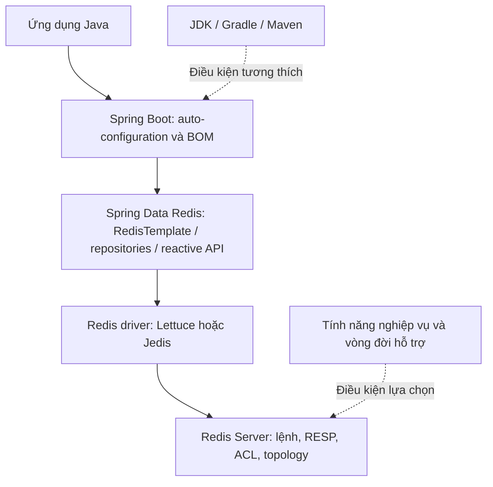
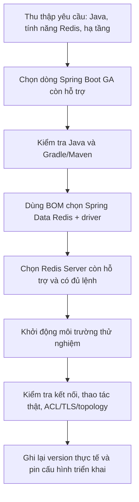

# Chọn phiên bản Spring Boot, Spring Data Redis và Redis Server tương thích

Khi khởi tạo ứng dụng Java dùng Redis, không chỉ chọn một phiên bản Spring Boot và một phiên bản Redis Server bất kỳ. Ứng dụng chạy qua nhiều tầng: **JDK và công cụ build → Spring Boot → Spring Data Redis → Redis driver → giao thức kết nối → Redis Server**. Các tầng này có quy tắc phiên bản khác nhau. Lỗi tương thích có thể xuất hiện lúc build, khởi động Spring Context, kết nối hoặc chỉ khi chạy một lệnh cụ thể.

Bài này hướng dẫn cách **chọn, khai báo và kiểm chứng một bộ phiên bản tương thích**, tập trung vào các quyết định thực tế khi tạo dự án mới, bảo trì ứng dụng cũ hoặc nâng cấp Redis Server.

> **Mốc tham chiếu: tháng 11/2026.** Các phiên bản cụ thể trong ví dụ được chọn theo các bản phát hành ổn định và tài liệu chính thức tại mốc này. Số patch, yêu cầu hạ tầng và lịch bảo trì tiếp tục thay đổi, vì thế hãy kiểm tra lại release notes khi triển khai thực tế.

## 1. Phân biệt những thành phần đang được chọn phiên bản



| Thành phần | Vai trò | Câu hỏi chọn phiên bản |
|---|---|---|
| **JDK** | Chạy và biên dịch ứng dụng | Boot và các thư viện phụ thuộc yêu cầu Java tối thiểu bao nhiêu? |
| **Spring Boot** | Quản lý hệ sinh thái Spring, cấu hình và dependency | Dòng Boot nào ổn định, còn bảo trì và chạy được trên toolchain hiện có? |
| **Spring Data Redis** | Cung cấp API như `RedisTemplate`, `StringRedisTemplate` và `ReactiveRedisTemplate` | Dòng Spring Data nào tương ứng với Spring Boot / Spring Framework? |
| **Lettuce hoặc Jedis** | Truyền lệnh Redis, xử lý kết nối và phản hồi | Client nào hỗ trợ topology, API và giao thức đang dùng? |
| **Redis Server** | Lưu trữ và thực thi lệnh Redis | Phiên bản nào có lệnh, bảo mật và tính năng cần thiết, đồng thời còn được hỗ trợ? |
| **Gradle/Maven** | Resolve dependency và build ứng dụng | Plugin Boot mục tiêu còn hỗ trợ phiên bản công cụ build không? |

**Không có quy tắc “Spring Boot 4 phải đi với Redis Server 4”.** Redis Server có version riêng, còn Spring Data Redis được phát hành trong hệ sinh thái Spring Data. Một ứng dụng Boot 4.x có thể kết nối một Redis Server 7.x nếu driver, giao thức và các lệnh sử dụng tương thích.

## 2. Bắt đầu lựa chọn từ Spring Boot

### 2.1. Vì sao Boot nên là mốc chính?

Spring Boot cung cấp **BOM (Bill of Materials)** để quản lý bộ phiên bản đã được phối hợp cho các dependency Java. Với ứng dụng thông thường, chỉ cần chọn phiên bản Spring Boot rồi thêm starter Redis:

```groovy
dependencies {
    implementation 'org.springframework.boot:spring-boot-starter-data-redis'
}
```

Không chỉ định số version ở starter vì Spring Boot đã quản lý dependency. Starter thường mang vào Spring Data Redis, Lettuce và các thư viện tích hợp phù hợp.

Nhờ đó, ta tránh tình huống tự ghép `spring-data-redis` bản mới với Spring Framework bản cũ. **BOM là cơ chế chọn bộ dependency**, không phải bảo đảm rằng mọi phiên bản Redis Server đều hỗ trợ mọi API mới.

### 2.2. Ma trận dòng phiên bản Java tham khảo

| Spring Boot | Spring Data release train | Spring Data Redis | Spring Framework | Java tối thiểu theo Boot | Định hướng sử dụng |
|---|---|---|---|---|---|
| **3.5.x** | **2025.0.x** | **3.5.x** | **6.2.x** | **17** | Hệ Boot 3 đang vận hành, cần nâng patch hoặc giữ khả năng tương thích thư viện cũ. |
| **4.0.x** | **2025.1.x** | **4.0.x** | **7.0.x** | **17** | Dự án đã chuyển sang Boot 4.0 và cần bảo trì trong dòng đó. |
| **4.1.x** | **2026.0.x** | **4.1.x** | **7.0.x** | **17** | Ứng dụng mới hoặc nâng cấp có chủ đích lên hệ Boot 4.1. |

Tại mốc tham chiếu, **Spring Boot 4.1.2** và **Spring Data Redis 4.1.2** là các bản ổn định đã công bố. Tuy nhiên, **không suy ra rằng patch version của Boot và Spring Data Redis phải luôn trùng nhau**: phải xem phiên bản thực tế do BOM của Boot đang chọn.

Số Java ở bảng thể hiện mức tối thiểu của **Spring Boot**, chưa tính yêu cầu cao hơn của các thư viện bên thứ ba hoặc nền tảng triển khai. Ví dụ chọn **JDK 21** làm toolchain cho dự án mới là một quyết định hợp lệ, nhưng không có nghĩa Boot 4.1 chỉ chạy trên Java 21.

### 2.3. Phải kiểm tra cả Gradle hoặc Maven

Tính tương thích không kết thúc ở thư viện Redis:

- **Spring Boot 3.5.x:** theo tài liệu hệ thống, hỗ trợ Gradle 8.4+ thuộc dòng 8.x; một số phiên bản 7.x cuối cũng được hỗ trợ.
- **Spring Boot 4.1.x:** hỗ trợ **Gradle 8.14+ thuộc dòng 8.x** hoặc dòng Gradle 9.x được công bố hỗ trợ.
- **Maven:** các dòng trên yêu cầu tối thiểu Maven 3.6.3.

Nếu project dùng Gradle Wrapper 8.5 mà đổi ngay plugin sang Boot 4.1.x, lỗi có thể xuất hiện **trước khi ứng dụng kết nối Redis**. Cần nâng Wrapper theo yêu cầu của Boot mục tiêu.

### 2.4. Chiến lược chọn Boot

**Ứng dụng mới:** chọn một bản GA thuộc dòng Boot được bảo trì, có hệ sinh thái và công cụ build phù hợp. Sau đó dùng patch mới trong dòng đã chọn theo chính sách dự án. Tránh chọn M/RC/SNAPSHOT trong môi trường thường ngày khi không có nhu cầu thử nghiệm đặc biệt.

**Ứng dụng hiện có:** nếu chỉ cần bảo trì, ưu tiên đánh giá nâng patch trong cùng dòng trước. Khi chuyển major từ Boot 3 sang Boot 4, cần đọc migration guide và xem cả Spring Framework, Spring Data, cấu hình auto-configuration, security, test, Gradle/Java.

**Hệ thống nhiều service:** các service không cần cùng một Spring Boot version để cùng truy cập Redis, nhưng phải thống nhất **schema dữ liệu, serializer, tên khóa, TTL và quy ước chia sẻ dữ liệu** nếu dùng chung các key.

## 3. Spring Data Redis và driver: tránh tự ghép lệch release train

### 3.1. Ví dụ Gradle độc lập

Một cấu hình mẫu cho **Spring Boot 4.1.2**, Java 21 và Lettuce mặc định:

```groovy
plugins {
    id 'java'
    id 'org.springframework.boot' version '4.1.2'
    id 'io.spring.dependency-management' version '1.1.7'
}

group = 'com.example'
version = '0.0.1-SNAPSHOT'

java {
    toolchain {
        languageVersion = JavaLanguageVersion.of(21)
    }
}

repositories {
    mavenCentral()
}

dependencies {
    implementation 'org.springframework.boot:spring-boot-starter-data-redis'
    testImplementation 'org.springframework.boot:spring-boot-starter-test'
}

tasks.named('test') {
    useJUnitPlatform()
}
```

Điều đáng chú ý:

1. Phiên bản ở **Spring Boot plugin** là mốc cho bộ dependency.
2. `spring-boot-starter-data-redis` không có phiên bản riêng.
3. Không khai báo phiên bản riêng của `spring-data-redis` hay `lettuce-core` nếu không có yêu cầu đã được xác minh.
4. `JavaLanguageVersion.of(21)` là **toolchain được chọn** cho ví dụ này; trong dự án thật phải kiểm tra thêm plugin, CI và thư viện khác.
5. Nếu dự án đã quản lý dependencies bằng Gradle native `platform` thay vì plugin `io.spring.dependency-management`, nên giữ một chiến lược nhất quán.

Ví dụ Maven với Boot parent:

```xml
<project xmlns="http://maven.apache.org/POM/4.0.0"
         xmlns:xsi="http://www.w3.org/2001/XMLSchema-instance"
         xsi:schemaLocation="http://maven.apache.org/POM/4.0.0
           https://maven.apache.org/xsd/maven-4.0.0.xsd">
    <modelVersion>4.0.0</modelVersion>

    <parent>
        <groupId>org.springframework.boot</groupId>
        <artifactId>spring-boot-starter-parent</artifactId>
        <version>4.1.2</version>
        <relativePath/>
    </parent>

    <groupId>com.example</groupId>
    <artifactId>redis-compat-demo</artifactId>
    <version>0.0.1-SNAPSHOT</version>

    <properties>
        <java.version>21</java.version>
    </properties>

    <dependencies>
        <dependency>
            <groupId>org.springframework.boot</groupId>
            <artifactId>spring-boot-starter-data-redis</artifactId>
        </dependency>
        <dependency>
            <groupId>org.springframework.boot</groupId>
            <artifactId>spring-boot-starter-test</artifactId>
            <scope>test</scope>
        </dependency>
    </dependencies>
</project>
```

Hai ví dụ minh họa **dependency management**, chưa bao gồm lớp `@SpringBootApplication` và Redis Server thật.

### 3.2. Lettuce hay Jedis?

`spring-boot-starter-data-redis` sử dụng **Lettuce theo mặc định**. Spring Boot cũng hỗ trợ cấu hình Jedis, nhưng cần thay dependency nếu muốn dùng Jedis.

| Tiêu chí | Lettuce | Jedis |
|---|---|---|
| Driver của Redis starter mặc định | Có | Không |
| Redis operations đồng bộ qua Spring Data | Có | Có |
| Spring Data Redis reactive | **Có** | **Không** qua connector reactive chuẩn |
| Standalone, Cluster, Sentinel | Có tùy cấu hình và tính năng | Có tùy cấu hình và tính năng |
| TLS, Pub/Sub, pipelining, transaction | Có, xem hỗ trợ cụ thể | Có, xem hỗ trợ cụ thể |
| Nên chọn khi nào? | Mặc định phù hợp nhiều ứng dụng, đặc biệt reactive | Có yêu cầu riêng về driver hoặc hệ thống đang chuẩn hóa Jedis |

Đổi sang Jedis bằng Gradle:

```groovy
dependencies {
    implementation('org.springframework.boot:spring-boot-starter-data-redis') {
        exclude group: 'io.lettuce', module: 'lettuce-core'
    }

    implementation 'redis.clients:jedis'
}
```

Vẫn để BOM của Boot quyết định phiên bản Jedis. Không nên dùng cả Lettuce và Jedis một cách vô thức chỉ vì nhiều dependency cùng kéo vào. Khi đổi driver, cần kiểm tra semantics kết nối, transaction, pipeline và cơ chế Cluster/Sentinel của cấu hình thực tế.

### 3.3. Ví dụ ghép lệch dễ gây lỗi

```groovy
// Ví dụ cần tránh: Boot 3.5 đang dùng Framework 6.2 nhưng ép
// riêng Spring Data Redis 4.1 thuộc hệ Framework 7.
dependencies {
    implementation 'org.springframework.boot:spring-boot-starter-data-redis'
    implementation 'org.springframework.data:spring-data-redis:4.1.2'
}
```

Đổi riêng Spring Data Redis không nâng được toàn bộ API của Spring Framework. Lỗi có thể là `NoSuchMethodError`, `NoClassDefFoundError`, `ClassNotFoundException` hoặc lỗi cấu hình bean lúc khởi động. Cách xử lý là kiểm tra dependency tree và quay về BOM đồng bộ, hoặc nâng toàn bộ nền tảng có kế hoạch.

## 4. Chọn Redis Server theo tính năng, hỗ trợ và môi trường

### 4.1. Redis Server có vòng đời độc lập với Spring Boot

Spring Boot không cài Redis Server và không quyết định version của image Docker, Redis Cloud hoặc Redis Software. Cả khi starter Java resolve hoàn hảo, server vẫn có thể thiếu một lệnh mà ứng dụng cần.

Các tiêu chí chọn Redis Server:

- **Lệnh:** Redis Server có hỗ trợ mọi command và option ứng dụng sử dụng không?
- **Tính năng:** ACL, Redis Functions, Streams, Cluster, Sentinel, Pub/Sub, TTL nâng cao, module hoặc khả năng do nhà cung cấp cung cấp.
- **Vận hành:** có phiên bản GA, được vá lỗi và nằm trong thời hạn hỗ trợ?
- **Hạ tầng:** engine đã có trong cloud hoặc nền tảng container dự kiến?
- **Nâng cấp:** dữ liệu lưu trữ, snapshot, AOF/RDB, replication và kế hoạch rollback có đáp ứng không?
- **Bảo mật:** phiên bản đó có hỗ trợ cách xác thực, ACL và TLS môi trường đòi hỏi?

### 4.2. Những dòng Redis Server đáng cân nhắc

Theo chính sách phiên bản Redis Open Source tại mốc tham khảo:

| Redis Server | Loại phát hành và vòng đời được công bố | Khi nào hợp lý? |
|---|---|---|
| **Redis 7.4** | **Extended**, EOL công bố **12/2029** | Đã vận hành ổn định với 7.4, chưa cần lệnh chỉ có trên 8.x. |
| **Redis 8.2** | **Extended**, EOL công bố **09/2030** | Dự án mới có hạ tầng hỗ trợ Redis 8.x; muốn vòng đời bảo trì dài. |
| **Redis 6.2** | **Extended** đời trước, EOL công bố **04/2027** | Hệ thống cũ bị ràng buộc; nên có lộ trình nâng cấp thay vì mặc định chọn mới. |

Đây là thông tin cho **Redis Open Source**. Redis Cloud, Redis Software và dịch vụ do nhà cung cấp quản lý có thể công bố phiên bản hỗ trợ, chính sách EOL, chức năng và cách nâng cấp riêng. Cần đối chiếu tài liệu của sản phẩm đang triển khai.

Chọn bản **GA** đang được bảo trì và có patch bảo mật. Với môi trường cần tái lập nghiêm ngặt, chốt image version/digest theo quy trình vận hành, không dùng `redis:latest` rồi mặc định môi trường nào cũng giống nhau.

### 4.3. Lệnh Redis có version tối thiểu riêng

| Tính năng / command | Redis Open Source tối thiểu tiêu biểu | Ý nghĩa khi chọn server |
|---|---|---|
| `GET`, `SET`, `INCR`, `EXPIRE` | Tồn tại lâu trước các dòng hiện đại | Phần lớn server đang được hỗ trợ có thể dùng; vẫn phải kiểm tra semantics và quyền. |
| ACL và username-based authentication | **6.0** | Nếu hạ tầng dùng Redis ACL, client cần gửi đúng username và password. |
| RESP3 / `HELLO 3` | **6.0** | Driver cần hỗ trợ thỏa thuận giao thức; không phải mọi ứng dụng cần RESP3. |
| `GETEX`, `XAUTOCLAIM` | **6.2** | Server cũ hơn sẽ không hiểu lệnh. |
| Redis Functions / `FCALL` | **7.0** | Cần server hỗ trợ function, quyền ACL và cách triển khai phù hợp. |
| Hash field expiration, ví dụ `HEXPIRE` | **7.4** | Phải có engine hỗ trợ, rồi mới xét API Spring Data/driver gọi được không. |

Ví dụ: nếu ứng dụng cần `HEXPIRE`, việc nâng chỉ `spring-data-redis` sẽ **không khiến Redis Server 7.2 hiểu lệnh mới**. Chiều ngược lại cũng đúng: nâng server chưa chắc tạo ra method Java cấp cao trong driver cũ.

Các tính năng mở rộng như tìm kiếm hoặc cấu trúc dữ liệu do module/managed service cung cấp phải kiểm tra thêm **bản phân phối và dịch vụ**, không suy từ tên Redis Server.

### 4.4. Giao thức RESP có ảnh hưởng gì?

Redis driver truyền lệnh và nhận phản hồi qua **RESP (Redis Serialization Protocol)**. RESP2 được hỗ trợ rộng rãi; Redis Open Source bắt đầu hỗ trợ RESP3 từ Redis 6.0. Driver và server có thể thương lượng phiên bản giao thức.

Điểm cần nhớ:

- Một bản Redis Server mới thường vẫn nói được RESP2 cho client hỗ trợ RESP2.
- Nếu một tính năng cần kiểu dữ liệu hoặc thông điệp từ server gắn với RESP3, phải kiểm tra hỗ trợ của cả **client lẫn server**.
- Giao thức của Redis Cloud/Redis Software có thể phụ thuộc cấu hình của dịch vụ, không chỉ con số engine.
- Không ép RESP3 chỉ vì server có khả năng; để driver Spring quản lý theo cấu hình và yêu cầu cụ thể.

## 5. Ví dụ bộ phiên bản cho từng bối cảnh

Bảng sau minh họa **ứng viên hợp lý cần xác minh theo chức năng**, không phải chứng nhận chính thức rằng mọi tổ hợp đều tương thích với mọi lệnh/topology:

| Tình huống | Spring Boot | Spring Data Redis | Redis Server đề xuất để thử | Lý do |
|---|---|---|---|---|
| Khởi tạo dự án mới, JDK 21 và Gradle hiện đại | **4.1.x** | **4.1.x**, do Boot quản lý | **8.2 Extended** | Dùng dòng Spring mới và Redis có vòng đời dài. |
| Bảo trì ứng dụng Boot 3.5 và hạ tầng Redis 7.4 | **3.5.x** | **3.5.x**, do Boot quản lý | **7.4 Extended** | Hạn chế thay đổi major khi chưa cần thiết. |
| Nâng Boot 3.5 lên 4.1 nhưng chưa nâng Redis | **4.1.x** | **4.1.x**, do Boot quản lý | **7.4**, nếu lệnh đang dùng được hỗ trợ | Có thể phân tách quá trình nâng framework và server. |

Một ứng dụng Boot 3.5 cũng có thể giao tiếp với Redis 8.2 qua driver phù hợp khi chức năng được kiểm chứng. Không có ràng buộc tự nhiên yêu cầu Boot và Redis Server phải cùng major. Điều quan trọng là driver, giao thức, lệnh và topology thực tế.

### 5.1. Quy trình quyết định cho dự án mới



Nếu Redis Server được quản lý sẵn bởi nhóm hạ tầng, điểm xuất phát có thể là **engine và tính năng đang có**; từ đó chọn một dòng Spring Boot được bảo trì và kiểm tra driver. Không phải lúc nào ứng dụng cũng có quyền quyết định phiên bản server.

### 5.2. Khi nào không nên nâng tất cả một lúc?

Nếu dự án đang ở Boot 3.5 và Redis 7.4, nâng đồng thời lên Boot 4.1 và Redis 8.2 làm tăng số biến có thể gây lỗi. Có thể tách thành:

1. Nâng ứng dụng Java trước, giữ server ở phiên bản cũ và kiểm chứng.
2. Sau khi ứng dụng ổn định, nâng Redis Server trên staging và kiểm chứng lại.

Tuy nhiên, thứ tự phải điều chỉnh nếu lệnh nghiệp vụ mới **bắt buộc** có Redis Server mới; khi đó có thể chuẩn bị server trước. Các thao tác nâng server liên quan persistence/replication phải theo kế hoạch riêng của Redis.

## 6. Dựng môi trường ví dụ: Spring Boot 4.1 + Redis 8.2

### 6.1. Chạy Redis với Docker

Giả sử máy đã có Docker và không có dịch vụ khác chiếm cổng 6379:

```bash
docker run --rm --name redis-compat-lab \
  -p 127.0.0.1:6379:6379 \
  redis:8.2
```

Cách tương đương với Docker Compose:

```yaml
services:
  redis:
    image: redis:8.2
    ports:
      - "127.0.0.1:6379:6379"
    restart: unless-stopped
```

Đây là cấu hình **local để học**, không bao gồm authentication, persistence hoặc sizing production. Khi ứng dụng Spring chạy trên host, endpoint là `127.0.0.1:6379`. Nếu Spring chạy trong container cùng Compose network, host thường là **`redis`** — tên service — vì `localhost` bên trong container Spring trỏ về container Spring.

### 6.2. Kiểm tra server thật

```bash
redis-cli -h 127.0.0.1 -p 6379 PING
redis-cli -h 127.0.0.1 -p 6379 INFO server
redis-cli -h 127.0.0.1 -p 6379 COMMAND INFO GETEX
```

Đọc trường `redis_version` trong `INFO server` để biết phiên bản Redis đang phục vụ kết nối. Lệnh `redis-cli --version` chỉ cho biết **phiên bản công cụ CLI trên máy**, không phải server từ xa. `COMMAND INFO GETEX` giúp kiểm tra một lệnh có được server nhận biết không.

### 6.3. Cấu hình Spring Boot

Một `application.yml` tối thiểu:

```yaml
spring:
  data:
    redis:
      host: localhost
      port: 6379
      database: 0
      timeout: 3s
```

Nếu dùng environment variable trong môi trường thật:

```yaml
spring:
  data:
    redis:
      host: ${REDIS_HOST}
      port: ${REDIS_PORT:6379}
      username: ${REDIS_USERNAME:}
      password: ${REDIS_PASSWORD}
      ssl:
        enabled: true
```

Ví dụ thứ hai chỉ áp dụng khi server thật được cấu hình TLS và authentication tương ứng. Các placeholder phải được cung cấp trong môi trường triển khai; không đưa mật khẩu trực tiếp vào repository.

Nếu cấu hình `spring.data.redis.url`, phải xét quy tắc ưu tiên của Boot mục tiêu. Từ Boot 3.5, URL Redis xác định cả database (mặc định 0 nếu URL không ghi), và `spring.data.redis.database` không được dùng để ghi đè khi URL đã được khai báo.

### 6.4. Kiểm tra Java gọi được Redis

Giả sử ứng dụng có starter Redis, lớp `@SpringBootApplication` và Redis Server đang chạy. Một service đơn giản:

```java
import java.time.Duration;
import java.util.UUID;

import org.springframework.data.redis.core.StringRedisTemplate;
import org.springframework.stereotype.Service;

@Service
public class RedisCompatibilityProbe {

    private final StringRedisTemplate redis;

    public RedisCompatibilityProbe(StringRedisTemplate redis) {
        this.redis = redis;
    }

    public boolean canReadBackValue() {
        String key = "lab:compat:" + UUID.randomUUID();

        try {
            redis.opsForValue().set(key, "ready", Duration.ofSeconds(30));
            String value = redis.opsForValue().get(key);
            return "ready".equals(value);
        } finally {
            redis.delete(key);
        }
    }
}
```

Một bài test tích hợp với Redis local:

```java
import static org.junit.jupiter.api.Assertions.assertTrue;

import org.junit.jupiter.api.Test;
import org.springframework.beans.factory.annotation.Autowired;
import org.springframework.boot.test.context.SpringBootTest;

@SpringBootTest
class RedisCompatibilitySmokeTest {

    @Autowired
    RedisCompatibilityProbe probe;

    @Test
    void redisRoundTripWorks() {
        assertTrue(probe.canReadBackValue());
    }
}
```

Đây là **mẫu kiểm tra** cho người học, không phải kết quả đã chạy. Nó quan sát đường đi từ Spring qua driver đến Redis với `SET`, `GET` và `DEL`. Thành công không chứng minh tự động rằng các tính năng Streams, Lua, Sentinel, Cluster, Pub/Sub, failover hoặc persistence đều tương thích.

## 7. Kiểm tra phiên bản dependency thực sự được sử dụng

Dòng trong build file thể hiện **ý định khai báo**; Gradle hoặc Maven mới xác định phiên bản được resolve cuối cùng. Các dependency trực tiếp, bắc cầu, constraint và BOM có thể ảnh hưởng kết quả.

### 7.1. Gradle

```bash
./gradlew dependencyInsight --dependency spring-data-redis --configuration runtimeClasspath
./gradlew dependencyInsight --dependency lettuce-core --configuration runtimeClasspath
./gradlew dependencies --configuration runtimeClasspath
```

Trên Windows PowerShell, có thể dùng `.\gradlew.bat` thay `./gradlew`. Cần quan sát:

- `spring-data-redis` được chọn bản nào và vì sao?
- `lettuce-core` hoặc `jedis` được chọn bản nào?
- Có thư viện thuộc hai dòng Spring Framework/Spring Data khác nhau không?
- Một version override thủ công có đè BOM không?
- Có cả Lettuce và Jedis ngoài ý muốn không?

### 7.2. Maven

```bash
mvn dependency:tree -Dincludes=org.springframework.data:spring-data-redis
mvn dependency:tree -Dincludes=io.lettuce:lettuce-core
mvn dependency:tree -Dincludes=redis.clients:jedis
```

Có thể đọc effective POM khi dependency được quản lý qua parent/BOM. **Không cần ép mọi artifact về cùng một số version**; hãy so với bộ dependency được Spring Boot quản lý ở chính phiên bản đó.

### 7.3. Hồ sơ phiên bản để lưu cùng dự án

```yaml
# Ví dụ hồ sơ quyết định, không phải application.yml
application:
  java: "21"
  springBoot: "4.1.2"
  springDataRedis: "managed by Spring Boot BOM"
  redisDriver: "Lettuce - managed by Spring Boot BOM"

infrastructure:
  redisServer: "8.2.x"
  topology: "standalone"
  tls: false

requiredCommands:
  - SET
  - GET
  - INCR
  - EXPIRE

verification:
  - "dependency tree inspected"
  - "INFO server reviewed on target Redis"
  - "round-trip read/write smoke test"
```

Hồ sơ này giúp phân biệt giữa **phiên bản dự định dùng**, **phiên bản dependency thực sự resolve** và **phiên bản server thật** ở từng môi trường.

## 8. Hiểu các cấp độ của “tương thích”

| Cấp độ | Bằng chứng đã có | Điều chưa thể khẳng định |
|---|---|---|
| **Build** | Dependency resolve và code compile. | Server hỗ trợ lệnh và kết nối tốt. |
| **Kết nối** | `PING` phản hồi, xác thực thành công. | Đọc/ghi và serializer đúng. |
| **Thao tác cơ bản** | `SET`, `GET`, TTL, counter chạy. | Cluster, transaction, Pub/Sub, Lua hoặc failover đúng. |
| **Tính năng sản phẩm** | Kiểm thử tất cả thao tác Redis mà nghiệp vụ dùng. | Hiệu năng, tải lớn và khôi phục sự cố. |
| **Vận hành** | Quan sát latency, reconnect, backup/restore, failover. | Tương thích tự động với phiên bản tương lai. |

### 8.1. Tương thích dữ liệu và serializer

Redis Server lưu byte. Spring Data Redis chuyển đối tượng Java thành byte thông qua serializer. Vì vậy, ngay cả khi phiên bản server không đổi, nâng thư viện JSON hoặc đổi cách cấu hình `RedisTemplate` vẫn có thể gây lỗi đọc dữ liệu cũ.

Ví dụ: service A lưu đối tượng `User` bằng JSON, service B đọc key bằng serializer native của Java. Redis trả dữ liệu hợp lệ nhưng service B không diễn giải đúng. Phải xét:

- serializer cho key, value, hash key và hash value;
- phiên bản schema JSON, kiểu dữ liệu và tên class;
- prefix key, TTL, naming convention;
- service đang dùng chung khóa;
- khả năng đọc dữ liệu được ghi bởi bản ứng dụng cũ.

### 8.2. Tương thích topology

Một cấu hình chạy trên Redis standalone không tự động đúng với Sentinel hoặc Cluster.

- **Standalone:** endpoint Redis đơn, quyền, TLS và database được cấu hình phù hợp.
- **Sentinel:** driver cần phát hiện primary và cấu hình xác thực Sentinel/Redis riêng nếu cần.
- **Cluster:** driver phải hiểu routing theo hash slot; các lệnh nhiều khóa có thể đòi hỏi cùng slot.
- **Managed Redis:** proxy, quyền admin, TLS, lệnh bị hạn chế và phiên bản engine có thể khác Redis tự quản lý.

Trong Cluster, lỗi `CROSSSLOT` hoặc yêu cầu chuyển hướng `MOVED`/`ASK` cần được phân tích ở tầng keyslot/driver, không thể mặc định quy thành lỗi mismatch Spring Data Redis.

## 9. Chẩn đoán các lỗi điển hình

| Dấu hiệu | Nhóm nguyên nhân nên xem đầu tiên | Cách xác minh |
|---|---|---|
| `NoSuchMethodError`, `ClassNotFoundException` | Dependency Java bị lệch major hoặc override sai BOM | Xem `dependencyInsight` / `dependency:tree`. |
| `ERR unknown command` | Redis Server chưa hỗ trợ lệnh hoặc dịch vụ hạn chế | Xem `redis_version` và `COMMAND INFO`. |
| `NOAUTH`, `WRONGPASS`, `NOPERM` | Sai xác thực hoặc ACL | Đối chiếu username, password, quyền command/key. |
| Lỗi SSL handshake | Client/server không đồng bộ TLS hoặc chứng chỉ | Xem Redis endpoint, cấu hình TLS và trust store. |
| `Connection refused`, timeout | Server chưa chạy, sai host, port, firewall, networking | Kiểm tra endpoint từ chính môi trường chạy Spring. |
| `CROSSSLOT` | Lệnh nhiều khóa trên Cluster không cùng hash slot | Xem topology và cách đặt key/hash tag. |
| Đọc dữ liệu trả exception chuyển kiểu | Serializer/schema cache không tương thích | Kiểm tra byte được lưu, serializer và dữ liệu trước nâng cấp. |

### 9.1. Phân biệt lỗi build với lỗi Redis Server

Nếu app không build được vì plugin Boot yêu cầu Gradle mới hơn, việc đổi `redis:8.2` sang `redis:7.4` không giải quyết. Ngược lại, nếu server trả `ERR unknown command 'HEXPIRE'`, nâng Java toolchain không bổ sung lệnh cho Redis Server.

Phân biệt đúng tầng lỗi giúp tránh nâng cấp nhiều thành phần không liên quan.

### 9.2. Kết nối thành công chưa chứng minh mọi lệnh hoạt động

`PING` chỉ là một kiểm tra cơ bản. `NOPERM` có thể xuất hiện khi user được phép `PING` nhưng không được phép một command dữ liệu. `GET` có thể chạy nhưng một command mới chưa có ở server. Bởi vậy phải kiểm tra **những lệnh ứng dụng thật sự cần**, đặc biệt khi thay phiên bản engine.

### 9.3. Timeout không nhất thiết là lỗi version

Timeout có thể do mạng, pool chờ quá lâu, lệnh blocking hoặc server quá tải. Client không nhận được phản hồi chưa chứng minh lệnh chưa được thực thi. Với thao tác thay đổi trạng thái như `INCR`, retry mù quáng còn có thể làm lặp hiệu ứng. Đây là vấn đề thiết kế khả năng phục hồi, không chỉ lựa chọn phiên bản.

## 10. Nâng cấp theo một quy trình có thể kiểm chứng

### 10.1. Nếu nâng Spring Boot

1. Xác định Boot, JDK, Gradle/Maven, Spring Data Redis và driver hiện tại.
2. Chọn dòng Boot mục tiêu còn bảo trì và kiểm tra yêu cầu hệ thống.
3. Đọc migration guide qua các version major/minor liên quan.
4. Nâng Boot và để BOM quản lý lại Spring Data Redis/driver.
5. Xem dependency tree; kiểm tra Spring Context, repository, template, serializer và API Redis có dùng.
6. Kiểm tra thao tác với Redis Server thực tế trước khi thay server.
7. Ghi nhận kết quả và phiên bản đã resolve.

### 10.2. Nếu nâng Redis Server

1. Ghi lại `redis_version`, topology, persistence, replication, ACL và TLS hiện tại.
2. Chọn Redis Server GA còn hỗ trợ và có lệnh nghiệp vụ yêu cầu.
3. Đọc release notes, compatibility notes và hướng dẫn nâng version của đúng sản phẩm Redis/managed service.
4. Thử trên staging với dữ liệu và topology gần production.
5. Kiểm tra read/write, TTL, scripting, transaction, stream, Pub/Sub hoặc Cluster tùy ứng dụng.
6. Xác minh kế hoạch backup/restore, failover, rollback và giám sát.
7. Sau khi triển khai, xác nhận version từ endpoint thật và theo dõi lỗi/latency.

**Rollback server không luôn là đổi lại Docker tag.** Snapshot RDB/AOF, replication hay dữ liệu đã được ghi bằng bản engine mới có thể đặt ràng buộc cho việc quay về bản cũ. Cần có quy trình khôi phục được xác minh trước.

### 10.3. Khóa môi trường để tránh sai khác dev/prod

Dùng `redis:latest` trong development trong khi production cố định Redis 6.2 là cách dễ làm lệnh chạy ở dev nhưng lỗi tại production. Nên:

- Chốt dòng Redis, patch/digest theo quy trình triển khai.
- Chốt Boot version trong build và dùng Wrapper.
- Đồng bộ Java toolchain và cấu hình CI.
- Kiểm tra `INFO server` trên từng môi trường.
- Có staging tương đồng production, nhất là topology và ACL.

## 11. Tình huống suy luận

**Tình huống 1:** Ứng dụng Boot 3.5 đang chạy ổn với Redis 7.4. Nhóm vận hành muốn nâng server lên 8.2. Có bắt buộc nâng Boot lên 4.1 không?

**Trả lời:** không phải do số major. Cần đánh giá Lettuce/Jedis và command được dùng với Redis 8.2, thử trên staging, kiểm tra phần hạ tầng khác. Có thể giữ Boot 3.5 nếu hệ Spring còn được hỗ trợ theo chính sách dự án và kết quả kiểm chứng đạt yêu cầu.

**Tình huống 2:** Bổ sung tính năng `HEXPIRE` nhưng môi trường Redis Server là 7.2. Nhóm muốn nâng duy nhất Spring Data Redis.

**Trả lời:** không đủ. Lệnh yêu cầu Redis Server có hỗ trợ, tiêu biểu từ 7.4. Sau khi nâng server còn phải xem driver/Spring API có hỗ trợ cách gọi được chọn không.

**Tình huống 3:** Cấu hình Spring Boot 4.1.2 cùng Gradle Wrapper 8.5, ứng dụng không build.

**Trả lời:** trước hết xem yêu cầu Gradle của Boot 4.1.x (8.14+ thuộc dòng 8.x). Đây là lỗi công cụ build; chưa đủ căn cứ đổ lỗi cho Redis Server.

**Tình huống 4:** App dùng Boot 3.5 nhưng ép `spring-data-redis:4.1.2` và gặp `NoSuchMethodError`.

**Trả lời:** Spring Data Redis 4.1 thuộc thế hệ dùng Spring Framework 7; Boot 3.5 dùng Spring Framework 6.2. Kiểm tra dependency tree, trả về BOM tương ứng hoặc lên kế hoạch nâng toàn hệ Spring.

**Tình huống 5:** Cùng một version Redis, dev chạy được còn production trả `NOPERM`.

**Trả lời:** cần kiểm tra Redis ACL của user ở production. Quyền command/key có thể khác, dù Redis Server và Spring Data Redis giống nhau.

## 12. Nguyên tắc ghi nhớ

**Chọn Spring Boot trước để xác lập bộ dependency Java.** Spring Data Redis và Lettuce/Jedis nên lấy phiên bản từ BOM của Boot, trừ khi có yêu cầu override được chứng minh.

**Chọn Redis Server theo tính năng và vòng đời hỗ trợ.** Một phiên bản Redis phù hợp phải có command và hành vi mong muốn, tương thích topology/bảo mật và đáp ứng chính sách vá lỗi của môi trường vận hành.

**Kiểm chứng ở đúng mức sử dụng.** Build thành công không bảo đảm server phù hợp; `PING` thành công không bảo đảm các lệnh nâng cao hoạt động. Lưu thông tin dependency đã resolve, version server thực tế và kết quả kiểm tra những thao tác ứng dụng dùng.

### Tài liệu chính thức để đối chiếu

- [Spring Boot — System Requirements](https://docs.spring.io/spring-boot/system-requirements.html) và [System Requirements 3.5](https://docs.spring.io/spring-boot/3.5/system-requirements.html): yêu cầu Java, Gradle và Maven.
- [Spring Boot — Managed Dependency Coordinates](https://docs.spring.io/spring-boot/appendix/dependency-versions/coordinates.html): bản dependency được BOM quản lý.
- [Spring Boot — Redis](https://docs.spring.io/spring-boot/reference/data/nosql.html): starter, cấu hình kết nối và driver.
- [Spring Boot — 4.1 Release Notes](https://github.com/spring-projects/spring-boot/wiki/Spring-Boot-4.1-Release-Notes): các thay đổi Spring Data BOM và nền tảng.
- [Spring Data Redis — Dependencies](https://docs.spring.io/spring-data/redis/reference/data-commons/dependencies.html): release train và quản lý BOM.
- [Spring Data Redis — Redis Drivers](https://docs.spring.io/spring-data/redis/reference/redis/drivers.html): phạm vi hỗ trợ Lettuce và Jedis.
- [Redis Open Source — Version Management](https://redis.io/docs/latest/operate/oss_and_stack/install/version-mgmt/): vòng đời Extended, phiên bản server đang hỗ trợ và mốc EOL.
- [Redis Commands](https://redis.io/commands/): kiểm tra phiên bản tối thiểu và ngữ nghĩa từng lệnh.
- [RESP Protocol Specification](https://redis.io/docs/latest/develop/reference/protocol-spec/): giao thức request/response.
