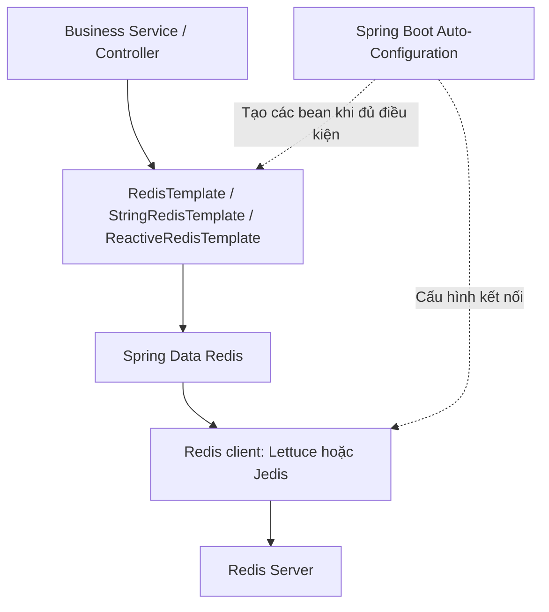

# Khai báo dependency Spring Data Redis bằng Gradle hoặc Maven

Khi khởi tạo một ứng dụng Java sử dụng Redis, bước đầu tiên là thêm các thư viện cần thiết vào **classpath** của ứng dụng. Với Spring Boot, cách phổ biến nhất là khai báo `spring-boot-starter-data-redis` trong Gradle hoặc Maven. Starter này đưa Spring Data Redis, Redis client mặc định và các phần tích hợp Spring Boot cần thiết vào project theo một bộ phiên bản tương thích.

Bài học tập trung vào cách chọn dependency phù hợp, viết khai báo cho từng công cụ build, quản lý phiên bản và xác minh ứng dụng có thể kết nối Redis. Các ví dụ sử dụng Spring Boot với hệ sinh thái Spring Data Redis; tên phiên bản cụ thể chỉ mang tính minh họa và phải phù hợp với phiên bản Spring Boot đang dùng trong project thực tế.

## 1. Hiểu các thành phần trước khi thêm dependency

Redis là máy chủ lưu trữ dữ liệu. Ứng dụng Spring không tự giao tiếp với máy chủ Redis nếu thiếu thư viện client và cấu hình kết nối. Có thể hình dung các lớp như sau:



| Thành phần | Vai trò | Có cần tự khai báo trong Spring Boot thông thường? |
| --- | --- | --- |
| `org.springframework.boot:spring-boot-starter-data-redis` | Starter cho Spring Data Redis dạng đồng bộ/blocking | **Có**, khi dùng `RedisTemplate`, `StringRedisTemplate` hoặc các repository Redis theo cách thông thường |
| `org.springframework.data:spring-data-redis` | API truy cập Redis theo cách Spring, quản lý các template/repository/connection | Thường **không** cần thêm riêng vì starter đã kéo dependency này vào |
| `io.lettuce:lettuce-core` | Redis client Lettuce kết nối qua TCP, hỗ trợ hoạt động đồng bộ và bất đồng bộ/reactive | Thường **không** cần thêm riêng; Redis starter thông thường đã có Lettuce |
| `redis.clients:jedis` | Redis client khác, thường dùng qua API đồng bộ | Chỉ thêm khi chủ động chọn Jedis |
| `org.springframework.boot:spring-boot-starter-data-redis-reactive` | Starter cho API Redis reactive trong Spring Boot | Chọn khi cần `ReactiveRedisTemplate` và dòng xử lý Reactor |
| `org.apache.commons:commons-pool2` | Hỗ trợ pooling trong cấu hình Lettuce khi cần | **Tùy chọn**, không phải yêu cầu mặc định |
| `org.springframework.boot:spring-boot-starter-test` | Hỗ trợ JUnit, Spring Test và các thư viện kiểm thử | Thường thêm ở scope test; **không** cung cấp sẵn một Redis server để test |

**Phân biệt quan trọng:** thêm dependency chỉ chuẩn bị lớp thư viện trong ứng dụng. Nó không cài đặt, khởi chạy hay đảm bảo Redis server đang hoạt động. Sau bước build vẫn phải cấu hình địa chỉ Redis và có một server thực sự để kết nối.

## 2. Chọn dependency theo nhu cầu

| Loại ứng dụng | Dependency chính | Kiểu API thường dùng |
| --- | --- | --- |
| Spring Boot, đọc/ghi Redis thông thường | `spring-boot-starter-data-redis` | `StringRedisTemplate`, `RedisTemplate` |
| Spring Boot, dữ liệu đi theo chuỗi xử lý reactive | `spring-boot-starter-data-redis-reactive` | `ReactiveStringRedisTemplate`, `ReactiveRedisTemplate` |
| Spring Boot, muốn dùng Jedis thay Lettuce | Redis starter + Jedis, loại Lettuce khỏi dependency mặc định | API đồng bộ qua `RedisTemplate` |
| Spring Framework thuần, không dùng Spring Boot | `spring-data-redis` + Redis client tương thích | Tự tạo `RedisConnectionFactory`, template và cấu hình bean |

Trong phần lớn dự án Spring Boot bắt đầu với Redis, chỉ cần:

```text
org.springframework.boot:spring-boot-starter-data-redis
```

Không nên thêm đồng thời `spring-data-redis` và `lettuce-core` với các phiên bản tự chọn nếu starter đã quản lý chúng. Việc chỉ định một phiên bản khác có thể làm lệch bộ thư viện Spring, dẫn đến lỗi class hoặc method khi chạy.

## 3. Khai báo trong Gradle Groovy DSL (`build.gradle`)

Đây là cách thường dùng nếu project có file `build.gradle`. Giả sử project **đã cấu hình Spring Boot plugin và cơ chế dependency management**, bổ sung phần sau:

```groovy
dependencies {
    implementation 'org.springframework.boot:spring-boot-starter-data-redis'

    testImplementation 'org.springframework.boot:spring-boot-starter-test'
}
```

Ý nghĩa:

- `implementation`: dependency cần cho việc biên dịch và chạy ứng dụng.
- `testImplementation`: dependency chỉ cần trong quá trình biên dịch/chạy test.
- Không ghi `:version` sau tên starter vì phiên bản nên do Spring Boot quản lý.

Ví dụ một `build.gradle` độc lập sử dụng Spring Boot 3.3.5 để minh họa cấu trúc:

```groovy
plugins {
    id 'java'
    id 'org.springframework.boot' version '3.3.5'
    id 'io.spring.dependency-management' version '1.1.6'
}

group = 'com.example'
version = '0.0.1-SNAPSHOT'

java {
    toolchain {
        languageVersion = JavaLanguageVersion.of(21)
    }
}

repositories {
    mavenCentral()
}

dependencies {
    implementation 'org.springframework.boot:spring-boot-starter-data-redis'
    testImplementation 'org.springframework.boot:spring-boot-starter-test'
}

tasks.named('test') {
    useJUnitPlatform()
}
```

Hai số phiên bản plugin ở đây là **ví dụ nhất quán cho một project Spring Boot 3.3.x**, không phải khuyến nghị giữ cố định khi tạo project mới. Hãy dùng phiên bản Spring Boot mà project hiện tại đã chọn, đồng thời đảm bảo Java và Gradle tương thích với phiên bản đó.

Nếu project đã có block `plugins`, `repositories` hoặc `dependencies`, chỉ thêm phần còn thiếu. Không tạo block cấu hình hoặc khai báo plugin trùng lặp chỉ để cài Spring Data Redis.

### Gradle quản lý dependency qua Spring Boot BOM

Một project Gradle có thể dùng native BOM support thay cho plugin `io.spring.dependency-management`:

```groovy
dependencies {
    // Phiên bản 3.3.5 chỉ minh họa; phải khớp Spring Boot của ứng dụng.
    implementation platform('org.springframework.boot:spring-boot-dependencies:3.3.5')

    implementation 'org.springframework.boot:spring-boot-starter-data-redis'
}
```

`platform(...)` mang các ràng buộc phiên bản trong BOM vào cấu hình dependency. Cả hai hướng — dependency-management plugin hoặc Gradle platform/BOM — đều phục vụ mục tiêu đồng bộ phiên bản. Chọn một cách phù hợp với quy ước build hiện có; tránh quản lý cùng một bộ dependency bằng nhiều BOM có phiên bản khác nhau.

Trong project Gradle nhiều module, dependency Redis cần được khai báo ở **module thật sự sử dụng Redis**. Nếu parent project đã áp dụng plugin và BOM thông qua cấu hình chung, module con thường chỉ cần dòng `implementation`, không cần cấu hình lại phiên bản plugin.

## 4. Khai báo trong Gradle Kotlin DSL (`build.gradle.kts`)

Nếu project dùng `build.gradle.kts`, cú pháp tương ứng là:

```kotlin
dependencies {
    implementation("org.springframework.boot:spring-boot-starter-data-redis")

    testImplementation("org.springframework.boot:spring-boot-starter-test")
}
```

Một project mẫu có Spring Boot plugin và dependency management:

```kotlin
plugins {
    java
    id("org.springframework.boot") version "3.3.5"
    id("io.spring.dependency-management") version "1.1.6"
}

group = "com.example"
version = "0.0.1-SNAPSHOT"

java {
    toolchain {
        languageVersion = JavaLanguageVersion.of(21)
    }
}

repositories {
    mavenCentral()
}

dependencies {
    implementation("org.springframework.boot:spring-boot-starter-data-redis")
    testImplementation("org.springframework.boot:spring-boot-starter-test")
}

tasks.test {
    useJUnitPlatform()
}
```

Nếu project Kotlin DSL đã dùng Gradle platform:

```kotlin
dependencies {
    implementation(platform("org.springframework.boot:spring-boot-dependencies:3.3.5"))
    implementation("org.springframework.boot:spring-boot-starter-data-redis")
}
```

Sự khác nhau chủ yếu giữa Groovy DSL và Kotlin DSL là cú pháp chuỗi, lời gọi hàm và khai báo plugin. **Tọa độ artifact Redis hoàn toàn giống nhau**.

## 5. Khai báo trong Maven (`pom.xml`)

Trong một project Spring Boot Maven sử dụng `spring-boot-starter-parent`, phần dependency có thể viết:

```xml
<dependencies>
    <dependency>
        <groupId>org.springframework.boot</groupId>
        <artifactId>spring-boot-starter-data-redis</artifactId>
    </dependency>

    <dependency>
        <groupId>org.springframework.boot</groupId>
        <artifactId>spring-boot-starter-test</artifactId>
        <scope>test</scope>
    </dependency>
</dependencies>
```

Không cần thêm `<version>` cho từng starter vì Maven đã nhận quy tắc quản lý phiên bản từ Spring Boot parent.

Ví dụ file `pom.xml` đầy đủ cho một project minh họa:

```xml
<?xml version="1.0" encoding="UTF-8"?>
<project xmlns="http://maven.apache.org/POM/4.0.0"
         xmlns:xsi="http://www.w3.org/2001/XMLSchema-instance"
         xsi:schemaLocation="http://maven.apache.org/POM/4.0.0
                             https://maven.apache.org/xsd/maven-4.0.0.xsd">
    <modelVersion>4.0.0</modelVersion>

    <parent>
        <groupId>org.springframework.boot</groupId>
        <artifactId>spring-boot-starter-parent</artifactId>
        <version>3.3.5</version>
        <relativePath/>
    </parent>

    <groupId>com.example</groupId>
    <artifactId>redis-demo</artifactId>
    <version>0.0.1-SNAPSHOT</version>

    <properties>
        <java.version>21</java.version>
    </properties>

    <dependencies>
        <dependency>
            <groupId>org.springframework.boot</groupId>
            <artifactId>spring-boot-starter-data-redis</artifactId>
        </dependency>
        <dependency>
            <groupId>org.springframework.boot</groupId>
            <artifactId>spring-boot-starter-test</artifactId>
            <scope>test</scope>
        </dependency>
    </dependencies>

    <build>
        <plugins>
            <plugin>
                <groupId>org.springframework.boot</groupId>
                <artifactId>spring-boot-maven-plugin</artifactId>
            </plugin>
        </plugins>
    </build>
</project>
```

Với Maven, scope mặc định của một dependency là `compile`, vì vậy starter Redis không cần ghi `<scope>compile</scope>`. Starter test dùng `<scope>test</scope>` để không xuất hiện như một dependency của chương trình khi chạy production.

### Nếu project Maven không dùng Spring Boot parent

Có thể import Spring Boot BOM trong `dependencyManagement` của `pom.xml`. Ví dụ:

```xml
<properties>
    <!-- Ví dụ; chọn phiên bản tương thích với ứng dụng. -->
    <spring-boot.version>3.3.5</spring-boot.version>
</properties>

<dependencyManagement>
    <dependencies>
        <dependency>
            <groupId>org.springframework.boot</groupId>
            <artifactId>spring-boot-dependencies</artifactId>
            <version>${spring-boot.version}</version>
            <type>pom</type>
            <scope>import</scope>
        </dependency>
    </dependencies>
</dependencyManagement>

<dependencies>
    <dependency>
        <groupId>org.springframework.boot</groupId>
        <artifactId>spring-boot-starter-data-redis</artifactId>
    </dependency>
</dependencies>
```

`dependencyManagement` chỉ thiết lập cách **chọn phiên bản**. Nó không tự đưa Redis starter vào classpath. Vì vậy cần cả khai báo thực tế dưới `<dependencies>`. BOM cũng không tự biến một project Spring Framework thuần thành ứng dụng Boot có auto-configuration; để có hành vi đó, project còn cần Spring Boot application setup thích hợp.

## 6. Vì sao nên để Spring Boot quản lý phiên bản?

Một starter kéo theo nhiều thư viện có liên hệ với nhau. Ví dụ cấu trúc logic:

```text
spring-boot-starter-data-redis
  ├─ Spring Boot starter/auto-configuration
  ├─ spring-data-redis
  │    └─ Spring Data Commons và các thành phần Spring liên quan
  └─ lettuce-core (client mặc định)
```

Đây là sơ đồ minh họa mối quan hệ, không phải kết quả `dependency:tree` chính xác của mọi phiên bản. Danh sách và các nhánh transitive cụ thể có thể thay đổi theo Spring Boot release.

Spring Boot BOM quy định các phiên bản đã được lựa chọn để phối hợp trong cùng dòng phát hành. Nếu cố định riêng:

```groovy
// Ví dụ về cách dễ gây lệch phiên bản; không sao chép vào project.
implementation 'org.springframework.boot:spring-boot-starter-data-redis:3.3.5'
implementation 'org.springframework.data:spring-data-redis:4.0.0'
```

thì có nguy cơ kết hợp Spring Boot một dòng phát hành với Spring Data thuộc dòng khác. Lỗi có thể xuất hiện lúc chạy, chẳng hạn `NoSuchMethodError`, `ClassNotFoundException` hoặc thất bại khi tạo bean.

Nguyên tắc làm việc:

1. Xác định phiên bản **Spring Boot hiện dùng** qua cấu hình chung của project.
2. Khai báo starter Redis không kèm version khi đã dùng Spring Boot BOM/parent.
3. Chỉ override thư viện transitive khi có lý do rõ ràng, chẳng hạn bản vá bảo mật hay yêu cầu tương thích, và kiểm tra toàn bộ dependency graph.
4. Trong monorepo nhiều module, kiểm tra classpath thực tế ở module được chạy; có thể có cấu hình chung hoặc quy ước riêng chi phối dependency.

## 7. Lettuce mặc định, Jedis tùy chọn

### Lettuce: lựa chọn phổ biến ban đầu

Spring Boot Redis starter thông thường đã mang Lettuce vào classpath. Khi chọn starter mặc định, không cần viết:

```groovy
implementation 'io.lettuce:lettuce-core'
```

trừ trường hợp cấu hình dependency của project đã loại bỏ nó hoặc bạn đang dùng Spring Framework thuần. Lettuce hỗ trợ API đồng bộ, bất đồng bộ và reactive; có thể dùng trong các ứng dụng Spring Boot thông thường mà không cần biến toàn bộ chương trình thành reactive.

### Chuyển sang Jedis với Gradle

Chỉ làm điều này nếu ứng dụng có yêu cầu sử dụng Jedis. Ví dụ Groovy DSL:

```groovy
dependencies {
    implementation('org.springframework.boot:spring-boot-starter-data-redis') {
        exclude group: 'io.lettuce', module: 'lettuce-core'
    }

    implementation 'redis.clients:jedis'
}
```

Trong Spring Boot, có thể chỉ rõ client được chọn:

```yaml
spring:
  data:
    redis:
      client-type: jedis
```

Nếu Lettuce vẫn được mang vào qua một dependency khác, việc kiểm tra và chọn client-type rõ ràng giúp tránh cấu hình không như dự tính. Không chọn Jedis cho một luồng thao tác Spring Data Redis reactive vì reactive Redis của Spring dựa trên Lettuce.

### Chuyển sang Jedis với Maven

```xml
<dependencies>
    <dependency>
        <groupId>org.springframework.boot</groupId>
        <artifactId>spring-boot-starter-data-redis</artifactId>
        <exclusions>
            <exclusion>
                <groupId>io.lettuce</groupId>
                <artifactId>lettuce-core</artifactId>
            </exclusion>
        </exclusions>
    </dependency>

    <dependency>
        <groupId>redis.clients</groupId>
        <artifactId>jedis</artifactId>
    </dependency>
</dependencies>
```

Ở cả hai công cụ build, phiên bản Jedis nên do Spring Boot BOM quản lý nếu dòng Spring Boot hiện dùng hỗ trợ và quản lý client này. Không cần thêm Jedis vào project đang chạy ổn với Lettuce chỉ để “đầy đủ thư viện”.

## 8. Khi nào cần Redis reactive starter?

Khi ứng dụng thực sự sử dụng Reactor với `Mono`/`Flux` và Redis reactive API, thay dependency chính bằng Redis reactive starter:

**Gradle Groovy**

```groovy
dependencies {
    implementation 'org.springframework.boot:spring-boot-starter-data-redis-reactive'
}
```

**Gradle Kotlin**

```kotlin
dependencies {
    implementation("org.springframework.boot:spring-boot-starter-data-redis-reactive")
}
```

**Maven**

```xml
<dependency>
    <groupId>org.springframework.boot</groupId>
    <artifactId>spring-boot-starter-data-redis-reactive</artifactId>
</dependency>
```

Ví dụ API sử dụng Spring Data Redis reactive:

```java
import reactor.core.publisher.Mono;
import org.springframework.data.redis.core.ReactiveStringRedisTemplate;
import org.springframework.stereotype.Service;

@Service
public class ReactiveTokenService {
    private final ReactiveStringRedisTemplate redis;

    public ReactiveTokenService(ReactiveStringRedisTemplate redis) {
        this.redis = redis;
    }

    public Mono<String> findToken(String tokenId) {
        return redis.opsForValue().get("token:" + tokenId);
    }
}
```

`get(...)` ở đây trả về `Mono<String>`; thao tác thực sự được kích hoạt khi có subscription. Không tự gọi `.block()` trong xử lý reactive chỉ để lấy kết quả đồng bộ, vì làm vậy có thể chặn luồng xử lý. Bổ sung `spring-boot-starter-webflux` nếu project còn cần xây dựng HTTP endpoint reactive; đó là nhu cầu của tầng web, không phải dependency bắt buộc chỉ để truy cập Redis reactive.

Không cần khai báo cả starter blocking và reactive theo thói quen. Hãy chọn theo kiểu API/kiến trúc ứng dụng, rồi xem dependency graph cụ thể để tránh kéo vào các thư viện không sử dụng.

## 9. Dependency tùy chọn cho connection pooling

Lettuce có khả năng sử dụng kết nối chia sẻ cho nhiều thao tác thông thường; không phải mọi ứng dụng đều cần tạo một pool lớn. Nếu chọn cấu hình Lettuce pooling trong Spring Boot, bổ sung Apache Commons Pool 2:

**Gradle**

```groovy
dependencies {
    implementation 'org.springframework.boot:spring-boot-starter-data-redis'
    implementation 'org.apache.commons:commons-pool2'
}
```

**Maven**

```xml
<dependency>
    <groupId>org.apache.commons</groupId>
    <artifactId>commons-pool2</artifactId>
</dependency>
```

Ví dụ cấu hình với Spring Boot 3.x:

```yaml
spring:
  data:
    redis:
      lettuce:
        pool:
          enabled: true
          max-active: 8
          max-idle: 8
          min-idle: 0
          max-wait: 2s
```

Sự cần thiết của pool và kích thước pool phụ thuộc tải, loại thao tác và cách ứng dụng sử dụng kết nối. Đừng coi thêm `commons-pool2` là biện pháp mặc định để tăng tốc Redis: pool quá nhỏ có thể khiến request phải chờ; pool quá lớn có thể tạo nhiều kết nối không cần thiết. Với các thao tác blocking lâu dài như chờ message, cần xem riêng cách quản lý kết nối.

## 10. Spring Framework thuần, không dùng Spring Boot

Nếu ứng dụng không sử dụng Spring Boot starter và auto-configuration, có thể thêm trực tiếp:

**Gradle**

```groovy
dependencies {
    implementation 'org.springframework.data:spring-data-redis'
    implementation 'io.lettuce:lettuce-core'
}
```

**Maven**

```xml
<dependencies>
    <dependency>
        <groupId>org.springframework.data</groupId>
        <artifactId>spring-data-redis</artifactId>
    </dependency>
    <dependency>
        <groupId>io.lettuce</groupId>
        <artifactId>lettuce-core</artifactId>
    </dependency>
</dependencies>
```

Các snippet này chỉ đầy đủ về **tên dependency**. Khi không có BOM/parent quản lý, phải thêm version tương thích hoặc import BOM quản lý Spring Data và các thư viện liên quan. Ứng dụng Spring thuần cũng phải tự tạo các bean kết nối, ví dụ:

```java
import org.springframework.context.annotation.Bean;
import org.springframework.context.annotation.Configuration;
import org.springframework.data.redis.connection.RedisConnectionFactory;
import org.springframework.data.redis.connection.lettuce.LettuceConnectionFactory;
import org.springframework.data.redis.core.StringRedisTemplate;

@Configuration
public class RedisConfig {
    @Bean
    public RedisConnectionFactory redisConnectionFactory() {
        return new LettuceConnectionFactory("localhost", 6379);
    }

    @Bean
    public StringRedisTemplate stringRedisTemplate(
            RedisConnectionFactory connectionFactory) {
        return new StringRedisTemplate(connectionFactory);
    }
}
```

Đoạn cấu hình trên chỉ minh họa quan hệ giữa `RedisConnectionFactory` và `StringRedisTemplate`. Trong Spring Boot thông thường, auto-configuration đã đảm nhận phần lớn công việc này và việc tự định nghĩa bean có thể thay đổi cơ chế tự cấu hình. Chỉ tạo bean thủ công khi có yêu cầu thực tế.

## 11. Cấu hình kết nối sau khi đã thêm dependency

Với Spring Boot 3.x, Redis auto-configuration thường sử dụng các thuộc tính `spring.data.redis.*`:

```yaml
# src/main/resources/application.yml
spring:
  data:
    redis:
      host: localhost
      port: 6379
      timeout: 2s
```

Hoặc với `application.properties`:

```properties
spring.data.redis.host=localhost
spring.data.redis.port=6379
spring.data.redis.timeout=2s
```

`localhost` nghĩa là Redis đang nghe trên chính môi trường mạng của tiến trình ứng dụng. Nếu ứng dụng chạy trong Docker container còn Redis chạy trong một container khác, `localhost` trỏ về **container ứng dụng**, không phải container Redis. Khi đó cần dùng tên service hoặc host phù hợp với topology triển khai.

Khi Redis yêu cầu mật khẩu, tài khoản, TLS hoặc các chế độ Sentinel/Cluster, phải cấu hình theo hạ tầng thực tế. Đừng hardcode mật khẩu sản xuất vào file cấu hình được commit lên repository; sử dụng cơ chế secret/configuration của môi trường.

Với Spring Boot 2.x, nhiều tài liệu và project cũ dùng tiền tố `spring.redis.*`. Phải đối chiếu đúng nhánh Spring Boot của project; không trộn các ví dụ cấu hình thuộc hai dòng phát hành.

### Kiểm tra nhanh khả năng đọc/ghi

Khi đã có Redis server đang chạy và kết nối đúng, một service đơn giản có thể dùng `StringRedisTemplate`:

```java
import java.time.Duration;
import org.springframework.data.redis.core.StringRedisTemplate;
import org.springframework.stereotype.Service;

@Service
public class RedisConnectionDemo {
    private final StringRedisTemplate redis;

    public RedisConnectionDemo(StringRedisTemplate redis) {
        this.redis = redis;
    }

    public String writeThenRead() {
        String key = "demo:spring-data-redis:connection";
        redis.opsForValue().set(key, "connected", Duration.ofSeconds(30));
        return redis.opsForValue().get(key);
    }
}
```

Nếu cấu hình đúng, gọi `writeThenRead()` trong môi trường thực nghiệm sẽ đọc lại `"connected"`. TTL 30 giây giúp khóa thử nghiệm tự hết hạn. Với Redis dùng chung, nên đặt key theo namespace riêng của môi trường hoặc bài thực hành để tránh va chạm.

Sự khác nhau giữa ba loại lỗi thường bị nhầm:

- **Build không tìm thấy dependency:** lỗi resolve artifact/repository/proxy hoặc cấu hình BOM.
- **Ứng dụng không tạo được bean:** starter chưa nằm trên runtime classpath, auto-configuration bị loại trừ, hoặc cấu hình bean không phù hợp.
- **Ứng dụng có bean nhưng không truy cập được Redis:** Redis server chưa chạy, địa chỉ/port/TLS/xác thực sai hoặc lỗi mạng. Đây là lỗi runtime kết nối, không tự động chứng tỏ khai báo dependency sai.

## 12. Xem dependency thực sự được resolve

Sau khi cập nhật file build, công cụ build cần tải và resolve các dependency. Trong project Gradle, có thể kiểm tra bằng:

```bash
./gradlew dependencies --configuration runtimeClasspath
./gradlew dependencyInsight --dependency spring-data-redis --configuration runtimeClasspath
```

Trên Windows, sử dụng wrapper tương ứng, ví dụ `gradlew.bat`. Với Gradle multi-project, chạy task cho đúng project con (chẳng hạn `:redis-demo:dependencies`) để kiểm tra classpath có Redis.

Trong Maven:

```bash
mvn dependency:tree
mvn dependency:tree -Dincludes=org.springframework.data:spring-data-redis
```

Quan sát kết quả để trả lời:

1. Có `spring-boot-starter-data-redis` hoặc `spring-boot-starter-data-redis-reactive` ở module ứng dụng cần dùng Redis không?
2. `spring-data-redis` được resolve đúng một phiên bản phù hợp Spring Boot không?
3. Redis client thực tế là Lettuce, Jedis hay cả hai? Điều đó có khớp lựa chọn cấu hình của ứng dụng không?
4. Có version override bất ngờ do dependency trực tiếp, BOM khác hoặc convention plugin không?

Đừng chỉ dựa vào tên artifact trong file build để khẳng định thư viện đã được tải đúng: kết quả resolve của module chạy mới thể hiện classpath thực tế.

## 13. Các lỗi thường gặp khi khai báo Redis dependency

| Triệu chứng | Nguyên nhân thường gặp | Hướng kiểm tra |
| --- | --- | --- |
| `Could not find ... spring-boot-starter-data-redis` | Thiếu repository hoặc không resolve được Maven Central/repository nội bộ | Kiểm tra `repositories`, Maven settings, mạng/proxy và tọa độ artifact |
| Gradle/Maven yêu cầu `version` của starter | Project không áp dụng Spring Boot parent/BOM/dependency-management như đã nghĩ | Kiểm tra cấu hình quản lý phiên bản, không tự chắp vá các version ngẫu nhiên |
| `NoSuchMethodError` khi chạy | Các thư viện Spring Boot/Spring Data/Redis client có thể lệch phiên bản | Xem dependency graph, loại bỏ override không cần thiết |
| `NoSuchBeanDefinitionException: RedisConnectionFactory` | Bean không được tạo, thiếu client hoặc auto-configuration không hoạt động | Kiểm tra runtime classpath, auto-configuration report và config |
| `RedisConnectionFailureException` | Redis không truy cập được qua địa chỉ và cơ chế kết nối đang cấu hình | Kiểm tra server, network, host, port, TLS và xác thực |
| `Connection refused: localhost/127.0.0.1:6379` | Không có Redis đang lắng nghe tại địa chỉ của **tiến trình hiện tại** | Kiểm tra Docker networking và Redis host |
| Project reactive nhưng chỉ có API blocking | Chọn sai starter hoặc chưa có các bean reactive cần thiết | Sử dụng Redis reactive starter với Lettuce và kiểu `ReactiveRedisTemplate` |
| Thêm Redis starter nhưng test vẫn không kết nối được | Starter không tạo một server Redis cho test | Khởi động Redis thử nghiệm riêng, chẳng hạn Redis container có vòng đời kiểm soát |

### Một ví dụ chẩn đoán

Project có `build.gradle` như sau:

```groovy
dependencies {
    implementation 'org.springframework.data:spring-data-redis'
}
```

Sau đó ứng dụng cố inject `StringRedisTemplate` nhưng không có bean tương ứng. Với một ứng dụng Spring Boot muốn sử dụng cấu hình mặc định, nên kiểm tra xem có thể thay bằng:

```groovy
dependencies {
    implementation 'org.springframework.boot:spring-boot-starter-data-redis'
}
```

và bảo đảm Boot auto-configuration đang bật hay không. Starter đưa đầy đủ thành phần phổ biến vào project, nhưng vẫn cần Spring Boot application context hợp lệ và không bị cấu hình loại trừ.

## 14. Tình huống lựa chọn thực tế

**Tình huống A — Spring MVC CRUD sử dụng Redis để cache session hoặc giá trị tạm:** chọn `spring-boot-starter-data-redis`. Dùng `StringRedisTemplate` hoặc `RedisTemplate` cho thao tác đồng bộ; chỉ thêm `spring-boot-starter-cache` khi còn muốn sử dụng Spring Cache abstraction (`@Cacheable`, `@CacheEvict`...) cùng cấu hình cache thích hợp.

**Tình huống B — WebFlux có luồng request reactive xuyên suốt:** chọn `spring-boot-starter-data-redis-reactive` và Lettuce. Trả `Mono`/`Flux` từ service thay vì thực hiện các thao tác blocking trên event-loop.

**Tình huống C — Tổ chức dùng Gradle convention plugin để quản lý Spring Boot:** chỉ khai báo dependency Redis trong module cần dùng. Không tự thêm phiên bản Spring Boot khác trong module con, vì có thể gây xung đột với quy ước build chung.

**Tình huống D — Hệ thống bắt buộc dùng Jedis do chuẩn hóa nội bộ:** loại Lettuce, thêm Jedis, cấu hình client-type tương ứng và kiểm tra dependency tree. Xác nhận ứng dụng dùng API đồng bộ trước khi thay client.

**Tình huống E — Project Spring Framework thuần:** thêm Spring Data Redis và Redis client với bộ phiên bản tương thích, rồi tự tạo bean kết nối. Không giả định có Spring Boot auto-configuration.

## 15. Câu hỏi tự luyện

1. **Vì sao trong ứng dụng Spring Boot thường chỉ cần `spring-boot-starter-data-redis`, không cần thêm riêng `spring-data-redis` và `lettuce-core`?**  
   Gợi ý: starter tập hợp dependency transitive và Spring Boot BOM quản lý phiên bản.

2. **Project Gradle báo không tìm được phiên bản starter Redis dù tên artifact đúng. Bạn cần xem phần nào?**  
   Gợi ý: plugin, `dependency-management` hoặc `platform(BOM)`; `repositories` quyết định nơi tải artifact.

3. **Một project dùng Maven nhưng không kế thừa `spring-boot-starter-parent`. Làm cách nào vẫn bỏ `<version>` khỏi khai báo Redis starter?**  
   Gợi ý: import `spring-boot-dependencies` BOM vào `dependencyManagement`.

4. **Thêm `spring-boot-starter-data-redis` rồi chạy ứng dụng thấy `Connection refused`. Có nên thêm tiếp `lettuce-core` với version mới hơn không?**  
   Gợi ý: phân biệt lỗi classpath và lỗi kết nối đến Redis server.

5. **Khi nào chọn `spring-boot-starter-data-redis-reactive`? Có nên thay Lettuce bằng Jedis trong luồng reactive không?**  
   Gợi ý: API `Mono`/`Flux`, `ReactiveRedisTemplate` và khả năng reactive của client.

## Ghi nhớ

Trong Spring Boot, **bắt đầu với starter phù hợp**: `spring-boot-starter-data-redis` cho truy cập thông thường hoặc `spring-boot-starter-data-redis-reactive` cho API reactive. Gradle và Maven chỉ khác cú pháp khai báo; cả hai nên dùng Spring Boot parent/BOM để đồng bộ phiên bản. Lettuce thường đã có sẵn trong starter. Jedis và Commons Pool 2 là các lựa chọn có mục đích cụ thể. Sau khi thêm dependency, kiểm tra classpath được resolve và cấu hình Redis server riêng — dependency đúng mới là điều kiện cần để ứng dụng truy cập Redis thành công.
