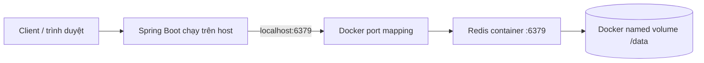
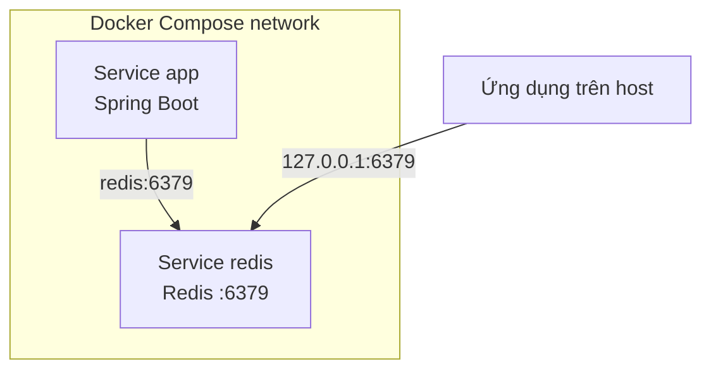

# Khởi tạo Redis cho môi trường phát triển bằng Docker Compose

Trong ứng dụng Spring Boot sử dụng **Spring Data Redis**, cần có một Redis server để thử nghiệm cache, session, bộ đếm hoặc các cấu trúc dữ liệu như Hash, Set và Sorted Set. **Docker Compose** giúp khởi chạy Redis bằng một file YAML có thể dùng lại, thay vì cài trực tiếp Redis lên hệ điều hành và nhớ một chuỗi lệnh khởi động thủ công.

Bài học này xây dựng một Redis **chạy cục bộ cho môi trường phát triển**, sau đó kết nối từ Spring Boot, kiểm tra đọc/ghi dữ liệu, giữ dữ liệu qua lần khởi động lại và xử lý các lỗi phổ biến. Cấu hình được thiết kế để chạy trên máy lập trình viên, không coi là cấu hình production.

## 1. Kết quả cần đạt

Sau khi hoàn thành, máy phát triển có:

- Một Redis server chạy trong Docker container, lắng nghe cổng **6379** bên trong container.
- Cổng Redis được ánh xạ tới **`127.0.0.1:6379`** trên máy phát triển để Spring Boot chạy trực tiếp trên máy có thể kết nối.
- Một **named volume** chứa dữ liệu của Redis, giúp dữ liệu lưu trên volume tồn tại khi container bị xóa và được tạo lại.
- Một **healthcheck** để Compose thể hiện trạng thái Redis đã sẵn sàng trả lời lệnh.
- Cấu hình `spring.data.redis` cho Spring Boot và một phép thử với `StringRedisTemplate`.

Kiến trúc trong trường hợp Spring Boot chạy trên máy host:



`localhost` trong sơ đồ là **localhost của máy chạy Spring Boot**. Khi chuyển Spring Boot sang container khác trong cùng Docker Compose, host kết nối phải đổi thành **tên service `redis`**; không dùng `localhost` của container ứng dụng để tìm Redis.

## 2. Redis, Docker và Docker Compose đảm nhiệm gì?

| Thành phần | Trách nhiệm |
|---|---|
| **Redis** | Xử lý lệnh dữ liệu, ví dụ `SET`, `GET`, `INCR`, `HSET`, `EXPIRE` |
| **Docker image** | Đóng gói chương trình Redis và môi trường chạy đã định nghĩa |
| **Docker container** | Một tiến trình Redis đang chạy từ image, có network và filesystem riêng |
| **Docker Compose** | Khai báo và quản lý các service/container, mạng, volume, cổng, healthcheck bằng YAML |
| **Docker named volume** | Nơi lưu dữ liệu độc lập với vòng đời container |
| **Spring Data Redis** | Thư viện giúp mã Java/Spring Boot thao tác với Redis qua connection factory, template hoặc các tích hợp khác |

Khác biệt quan trọng: **container có thể được thay thế mà không nhất thiết mất dữ liệu**, miễn là dữ liệu cần giữ đã được ghi vào volume và cơ chế persistence của Redis được cấu hình phù hợp. Chỉ tạo volume không đủ: Redis phải thực sự ghi dữ liệu xuống `/data`.

Docker Compose V2 sử dụng cú pháp `docker compose` (có dấu cách). Trong tài liệu và lệnh bên dưới, luôn dùng cú pháp này.

## 3. Điều kiện chuẩn bị

Máy cần có Docker Engine đang hoạt động và Docker Compose V2 plugin. Trên Windows/macOS, có thể dùng Docker Desktop; trên Linux có thể dùng Docker Engine kèm Compose plugin.

Kiểm tra trong terminal hoặc PowerShell:

```bash
docker --version
docker compose version
docker info
```

- `docker --version` xác nhận Docker CLI có mặt.
- `docker compose version` xác nhận plugin Compose hoạt động.
- `docker info` cho biết Docker daemon/engine có thể được liên hệ.

Nếu CLI được cài nhưng Docker Engine chưa chạy, `docker info` thường trả lỗi kết nối daemon. Trên Windows, cần bảo đảm Docker Desktop đã bật và backend ảo hóa/WSL 2 được cấu hình theo hướng dẫn của Docker Desktop nếu sử dụng chế độ đó.

Máy cần truy cập container registry trong lần tải image đầu tiên. Cổng host `6379` cũng cần chưa bị chiếm; nếu đã bị chiếm, có thể đổi phần cổng **bên trái** của port mapping thành `6380` như phần xử lý lỗi.

## 4. Tạo file `compose.yaml`

Đặt một file tên `compose.yaml` ở thư mục gốc của dự án thử nghiệm:

```text
redis-local/
└── compose.yaml
```

Nội dung:

```yaml
services:
  redis:
    image: redis:7.4-alpine
    ports:
      - "127.0.0.1:6379:6379"
    command: ["redis-server", "--appendonly", "yes"]
    volumes:
      - redis_data:/data
    healthcheck:
      test: ["CMD", "redis-cli", "ping"]
      interval: 5s
      timeout: 3s
      retries: 10
      start_period: 5s

volumes:
  redis_data:
```

Bản Redis `7.4-alpine` ở đây là **một ví dụ ghim nhánh phiên bản để dễ lặp lại bài thực hành**. Khi áp dụng cho dự án thực, nên thống nhất phiên bản với nhóm phát triển, kiểm tra bản vá bảo mật và có thể ghim image digest nếu cần tái lập chính xác byte của image. Không phụ thuộc vào tag `latest` một cách vô ý.

### 4.1. Giải thích từng cấu hình

**`services.redis`** là tên service trong Compose. Tên này cũng được dùng để tra cứu Redis bằng DNS nội bộ khi một container ứng dụng khác tham gia cùng Compose network.

**`image: redis:7.4-alpine`** yêu cầu Docker lấy image Redis tương ứng. Alpine giúp image tương đối gọn; việc chọn bản phân phối image phải phù hợp yêu cầu vận hành, công cụ chẩn đoán và chính sách của dự án.

**`ports: "127.0.0.1:6379:6379"`** gồm:

```text
127.0.0.1 : 6379   : 6379
host IP     host port container port
```

- `127.0.0.1`: chỉ bind cổng công bố trên loopback của máy phát triển.
- `6379` thứ nhất: cổng mà chương trình chạy trên **host** kết nối.
- `6379` thứ hai: cổng Redis **bên trong container**.

Bind loopback giúp giảm phạm vi truy cập từ bên ngoài máy. Cách này **không thay thế authentication, phân quyền hoặc network isolation** khi môi trường có yêu cầu bảo mật cao; các container cùng mạng Docker vẫn có thể truy cập service qua mạng nội bộ.

**`command: ["redis-server", "--appendonly", "yes"]`** khởi chạy Redis và bật **AOF (Append Only File)**. Redis ghi lại các thao tác làm thay đổi dữ liệu để hỗ trợ khôi phục, thay vì chỉ dựa vào dữ liệu RAM. Điều này không có nghĩa mọi ghi đều được bảo đảm bền vững tuyệt đối trong mọi sự cố: khả năng mất dữ liệu còn phụ thuộc chính sách đồng bộ đĩa, hệ thống file và cách Redis dừng.

**`volumes: - redis_data:/data`** gắn Docker named volume vào thư mục `/data` của Redis. Khi Redis ghi file persistence tại đây, dữ liệu được lưu ngoài lớp filesystem tạm của container.

**`healthcheck`** chạy lệnh `redis-cli ping` bên trong Redis container. Khi Redis phản hồi thành công, Docker có thể đánh dấu trạng thái `healthy`. Trạng thái này đo được khả năng trả lời lệnh kiểm tra; nó không bảo đảm mọi luồng ứng dụng hoặc mọi yêu cầu dữ liệu đều thành công.

**`volumes.redis_data`** khai báo named volume do Docker Compose quản lý. Docker thường đặt tên volume theo project Compose, giúp các project khác nhau có thể có volume riêng dù dùng chung tên logic `redis_data`.

### 4.2. Vì sao không dùng `container_name`?

Compose tự tạo tên container phù hợp project và service. Bỏ `container_name` giúp tránh xung đột tên toàn cục khi nhiều dự án hoặc nhiều bản sao của môi trường phát triển chạy trên cùng máy. Các lệnh quản trị vẫn gọi service dễ dàng qua `docker compose exec redis ...`.

## 5. Khởi chạy Redis

Mở terminal tại thư mục chứa `compose.yaml`.

Trước khi chạy, có thể yêu cầu Compose đọc và hiển thị cấu hình sau khi xử lý:

```bash
docker compose config
```

Khởi tạo network/volume nếu cần, tải image nếu chưa có và chạy service Redis ở chế độ detached:

```bash
docker compose up -d redis
```

Xem trạng thái:

```bash
docker compose ps
```

Ví dụ trạng thái mong đợi sau khi khởi động:

```text
NAME                 SERVICE   STATUS                   PORTS
redis-local-redis-1  redis     Up ... (healthy)         127.0.0.1:6379->6379/tcp
```

Tên container, thời gian và cách Compose hiển thị cột có thể khác. Điều cần quan tâm là service `redis` đang chạy, healthcheck là `healthy` khi hoàn thành, và port mapping đúng.

Xem log của Redis:

```bash
docker compose logs --tail=100 redis
```

Theo dõi log liên tục:

```bash
docker compose logs -f redis
```

Nhấn `Ctrl+C` để dừng **theo dõi log**, không phải để tắt Redis đang chạy detached.

Nếu cần chủ động chờ Redis healthy trước khi chạy bước phụ thuộc, có thể quan sát `docker compose ps` hoặc dùng cơ chế `depends_on.condition: service_healthy` khi cả ứng dụng và Redis cùng nằm trong một Compose file.

## 6. Kiểm tra Redis bằng `redis-cli`

Image Redis có sẵn công cụ dòng lệnh `redis-cli`. Để chạy lệnh trong container, không cần cài Redis CLI trên máy host.

Kiểm tra kết nối nhanh:

```bash
docker compose exec redis redis-cli PING
```

Kết quả mong đợi:

```text
PONG
```

Mở phiên CLI tương tác:

```bash
docker compose exec redis redis-cli
```

Tại dấu nhắc của Redis, nhập:

```redis
PING
SET demo:greeting "Xin chao Redis" EX 120
GET demo:greeting
TTL demo:greeting
INCR demo:counter
INCR demo:counter
GET demo:counter
DEL demo:greeting
GET demo:greeting
```

Ý nghĩa:

| Lệnh | Điều cần quan sát |
|---|---|
| `PING` | Trả `PONG` khi Redis phản hồi |
| `SET ... EX 120` | Lưu value kiểu String kèm thời hạn 120 giây |
| `GET demo:greeting` | Trả `"Xin chao Redis"` khi key còn hiệu lực |
| `TTL demo:greeting` | Trả số giây còn lại, giảm theo thời gian |
| `INCR demo:counter` | Tăng bộ đếm và trả giá trị mới |
| `DEL demo:greeting` | Xóa key |
| `GET` sau khi xóa | Trả `(nil)` vì key không còn |

`TTL` có thể trả `-1` khi key tồn tại nhưng không có thời hạn, hoặc `-2` khi key không tồn tại. Key `demo:counter` được tạo bởi `INCR` ở đây chưa có TTL; nếu chỉ cần dữ liệu tạm, nên chủ động đặt hạn hoặc xóa sau khi thử.

Thoát Redis CLI bằng:

```redis
QUIT
```

Có thể thao tác thêm với Hash:

```redis
HSET demo:user:1 name "An" level "beginner"
HGET demo:user:1 name
HGETALL demo:user:1
EXPIRE demo:user:1 300
TTL demo:user:1
```

Redis lưu cấu trúc Hash dưới một key. Trường `name` và `level` là field của hash, không phải hai key Redis độc lập.

### 6.1. Phân biệt `PING` bên trong container và kết nối từ host

Lệnh:

```bash
docker compose exec redis redis-cli PING
```

chạy CLI **bên trong** container, nên chủ yếu xác nhận Redis server trong container hoạt động. Nó **chưa chứng minh** chương trình Spring Boot trên host có thể đi qua port mapping `127.0.0.1:6379`.

Nếu máy host có `redis-cli`, có thể thử trực tiếp:

```bash
redis-cli -h 127.0.0.1 -p 6379 PING
```

Nếu host không cài CLI, bài kiểm tra Spring Boot ở phần sau sẽ xác nhận đường kết nối thực tế từ ứng dụng.

## 7. Kết nối từ Spring Boot chạy trực tiếp trên máy

### 7.1. Khai báo dependency

Với Spring Boot sử dụng Gradle Groovy DSL, thêm Spring Data Redis starter:

```groovy
dependencies {
    implementation 'org.springframework.boot:spring-boot-starter-data-redis'
}
```

Starter thường thiết lập Redis connection qua Lettuce và tự cấu hình `RedisConnectionFactory`, `RedisTemplate`, `StringRedisTemplate` khi điều kiện auto-configuration phù hợp. Không cần tự viết connection factory chỉ để kết nối một Redis đơn giản.

Nếu ứng dụng có nhu cầu caching qua `@Cacheable`, Spring Cache có thể được bổ sung riêng:

```groovy
dependencies {
    implementation 'org.springframework.boot:spring-boot-starter-data-redis'
    implementation 'org.springframework.boot:spring-boot-starter-cache'
}
```

Spring Data Redis là thư viện truy cập dữ liệu Redis; Spring Cache là abstraction caching ở mức method. Hai nhu cầu có liên quan nhưng không phải cùng một chức năng.

### 7.2. Khai báo `application.yml`

Dùng cấu hình sau cho Spring Boot 3.x:

```yaml
spring:
  data:
    redis:
      host: ${REDIS_HOST:127.0.0.1}
      port: ${REDIS_PORT:6379}
      timeout: 2s
```

Nếu Spring Boot chạy trên **cùng máy host** với Docker, các giá trị mặc định `127.0.0.1:6379` tương ứng port mapping ở `compose.yaml`.

Cú pháp `${REDIS_HOST:127.0.0.1}` có nghĩa: lấy biến môi trường `REDIS_HOST` nếu có, nếu không dùng `127.0.0.1`. Nhờ đó có thể dùng cùng `application.yml` cho trường hợp chạy trên host hoặc trong một Compose service khác.

Ví dụ dùng `application.properties` thay YAML:

```properties
spring.data.redis.host=${REDIS_HOST:127.0.0.1}
spring.data.redis.port=${REDIS_PORT:6379}
spring.data.redis.timeout=2s
```

Chỉ chọn **một cách cấu hình phù hợp** với dự án và tránh các property trùng nhau khiến khó truy vết giá trị cuối cùng.

### 7.3. Kiểm tra vòng đọc/ghi bằng `StringRedisTemplate`

Thêm một bean tạm để kiểm tra việc Spring Boot kết nối, ghi, đọc và xóa key:

```java
import java.time.Duration;

import org.springframework.boot.CommandLineRunner;
import org.springframework.context.annotation.Bean;
import org.springframework.context.annotation.Configuration;
import org.springframework.data.redis.core.StringRedisTemplate;

@Configuration
public class RedisDevelopmentProbe {

    @Bean
    CommandLineRunner verifyRedisConnection(StringRedisTemplate redis) {
        return args -> {
            String key = "demo:spring:roundtrip";

            redis.opsForValue()
                    .set(key, "spring-boot-connected", Duration.ofMinutes(1));

            String value = redis.opsForValue().get(key);
            System.out.println("Redis round-trip: " + value);

            redis.delete(key);
        };
    }
}
```

Trong log lúc ứng dụng khởi động, kết quả mong đợi:

```text
Redis round-trip: spring-boot-connected
```

Lời gọi ghi/đọc xác minh cả đường kết nối Spring Data Redis, thao tác Redis String và serializer chuỗi của `StringRedisTemplate`. Đoạn mã này chỉ dùng cho **phép thử môi trường**; sau khi xác nhận kết nối, có thể bỏ bean thử nghiệm khỏi ứng dụng.

Một số lưu ý:

- `StringRedisTemplate` làm việc với key/value kiểu chuỗi; khi cần lưu object Java, phải chọn serializer phù hợp với định dạng và nhu cầu tương thích.
- Timeout 2 giây là giá trị minh họa; cần điều chỉnh theo môi trường và yêu cầu ứng dụng.
- Nếu Redis không hoạt động, lời gọi `set`/`get` có thể ném ngoại lệ kết nối hoặc timeout. Chỉ có dependency trong classpath không đồng nghĩa Redis đã sẵn sàng phục vụ.
- Nếu ứng dụng đặt trong package không được Spring quét bean, `RedisDevelopmentProbe` sẽ không chạy. Đặt lớp trong phạm vi component scan của Spring Boot.

### 7.4. Cách xác nhận key từ bên ngoài Spring Boot

Sau khi Spring Boot hoàn thành vòng thử, code đã chủ động `redis.delete(key)`, vì vậy `GET demo:spring:roundtrip` sẽ trả `(nil)`. Để quan sát key tồn tại, có thể tạm bỏ dòng xóa trong một lần thử, sau đó dùng:

```bash
docker compose exec redis redis-cli GET demo:spring:roundtrip
```

Key demo có TTL một phút, nên sẽ tự hết hạn sau khoảng thời gian đó. Khi kiểm tra các ứng dụng thực, nên tránh giữ các key thử nghiệm vô hạn và luôn dùng tiền tố riêng như `demo:`.

## 8. Spring Boot chạy trong Docker Compose: dùng host `redis`

Một lỗi phổ biến là cấu hình Redis host thành `localhost` trong container ứng dụng rồi nhận `Connection refused`.

Nguyên nhân: bên trong container của Spring Boot, `localhost` là **chính container Spring Boot**, không phải Redis container và cũng không phải loopback của host.

Khi hai service nằm trong cùng Compose project/network, ứng dụng dùng **tên service** làm hostname:

```text
Spring Boot trên host:
    spring.data.redis.host=127.0.0.1
    spring.data.redis.port=6379

Spring Boot trong Compose network:
    spring.data.redis.host=redis
    spring.data.redis.port=6379
```

Sơ đồ:



Nếu dự án **đã có Dockerfile cho Spring Boot**, có thể mở rộng `compose.yaml` bằng service `app`:

```yaml
services:
  redis:
    image: redis:7.4-alpine
    ports:
      - "127.0.0.1:6379:6379"
    command: ["redis-server", "--appendonly", "yes"]
    volumes:
      - redis_data:/data
    healthcheck:
      test: ["CMD", "redis-cli", "ping"]
      interval: 5s
      timeout: 3s
      retries: 10

  app:
    build: .
    environment:
      REDIS_HOST: redis
      REDIS_PORT: "6379"
    depends_on:
      redis:
        condition: service_healthy

volumes:
  redis_data:
```

Đây là cấu hình **mở rộng tùy chọn**. `build: .` giả định có Dockerfile và nguồn build phù hợp ở thư mục hiện tại; không thể khởi động service `app` khi những điều kiện đó chưa được chuẩn bị.

`depends_on` kết hợp `condition: service_healthy` yêu cầu Compose đợi healthcheck của Redis thành công trước khi khởi động service app. Điều này chỉ giải quyết **thời điểm khởi động ban đầu**; nếu Redis bị ngắt mạng hoặc restart trong lúc ứng dụng đang chạy, ứng dụng vẫn cần timeout, cơ chế retry hợp lý và cách xử lý lỗi phù hợp.

Các container trong cùng Compose network kết nối qua `redis:6379` **không cần** Redis publish cổng ra host. `ports` chỉ hữu ích khi muốn truy cập Redis từ máy host; có thể bỏ dòng publish nếu mọi client đều chạy trong Compose network.

## 9. Kiểm tra dữ liệu khi Redis/container được khởi động lại

Redis in-memory có thể mất dữ liệu nếu không dùng persistence. Trong cấu hình đang thực hành, hai yếu tố cùng tồn tại:

1. Redis bật `--appendonly yes` để ghi AOF vào storage.
2. Named volume `redis_data` gắn vào `/data` để storage tồn tại độc lập với container.

Kiểm tra với một key không có TTL để tránh bị xóa do hết hạn trong quá trình thử:

```bash
docker compose exec redis redis-cli SET demo:persist "remember-me"
docker compose exec redis redis-cli GET demo:persist
```

Khởi động lại service:

```bash
docker compose restart redis
```

Đọc lại:

```bash
docker compose exec redis redis-cli GET demo:persist
```

Sau khi Redis restart bình thường và AOF đã lưu dữ liệu, mong đợi nhận `"remember-me"`. Đây là phép thử cho **môi trường phát triển và lần restart có kiểm soát**, không phải chứng minh rằng dữ liệu không thể mất trong trường hợp máy mất điện, disk lỗi hoặc failover.

Có thể kiểm tra trạng thái AOF:

```bash
docker compose exec redis redis-cli CONFIG GET appendonly
```

Kết quả mong đợi có giá trị `yes`.

### 9.1. Phân biệt restart, stop, down và xóa volume

| Lệnh | Tác động chính | Named volume |
|---|---|---|
| `docker compose restart redis` | Restart Redis container đang tồn tại | Giữ lại |
| `docker compose stop redis` | Dừng service Redis | Giữ lại |
| `docker compose start redis` | Chạy lại service đã tạo trước đó | Giữ lại |
| `docker compose down` | Dừng và xóa container/network do Compose tạo | **Giữ lại theo mặc định** |
| `docker compose up -d redis` | Tạo/chạy lại Redis, gắn volume đã có | Tái sử dụng |
| `docker compose down -v` | Dừng, xóa container và xóa cả các volume thuộc Compose project | **Dữ liệu trên volume bị xóa** |

**`docker compose down -v` là lệnh có tính phá hủy dữ liệu** đối với các volume thuộc Compose project. Chỉ dùng khi chủ động muốn reset môi trường thử nghiệm và chắc chắn không còn dữ liệu cần giữ. Nếu Compose file quản lý nhiều service, lệnh `down` có thể ảnh hưởng các service cùng project, không chỉ Redis.

Muốn dọn key thử nghiệm cụ thể mà không xóa cả volume, dùng `DEL` theo đúng tên key:

```bash
docker compose exec redis redis-cli DEL demo:persist demo:counter
```

## 10. Cấu hình cổng thay thế khi `6379` đã được sử dụng

Nếu máy phát triển đang chạy một Redis khác hoặc có tiến trình chiếm port 6379, Docker có thể báo lỗi kiểu `port is already allocated` hoặc `bind: address already in use`.

Trong `compose.yaml`, thay:

```yaml
ports:
  - "127.0.0.1:6379:6379"
```

bằng:

```yaml
ports:
  - "127.0.0.1:6380:6379"
```

Lúc này:

```text
Spring Boot trên host → 127.0.0.1:6380 → Redis container:6379
```

Cập nhật Spring Boot host port tương ứng:

```yaml
spring:
  data:
    redis:
      host: 127.0.0.1
      port: 6380
```

Hoặc dùng biến môi trường `REDIS_PORT=6380` nếu đã cấu hình placeholder.

Chạy lại để Compose áp dụng thay đổi cấu hình container:

```bash
docker compose up -d redis
docker compose ps
```

**Không đổi port bên trong container thành 6380 chỉ vì đổi host port.** Các container khác cùng Compose network vẫn truy cập Redis qua `redis:6379`.

## 11. Tùy chọn password và giới hạn an toàn cho development

Ví dụ chính cố ý không bật password để tập trung vào khởi tạo và kiểm tra kết nối trên máy cá nhân với port chỉ bind loopback. Nếu chạy trong máy dùng chung, CI, remote workstation hoặc mạng dễ bị truy cập, cần xem lại xác thực, phân quyền và kết nối mạng.

Đối với **bài tập local** cần thử password, có thể dùng biến môi trường như một cấu hình phụ. Ví dụ phần service Redis:

```yaml
services:
  redis:
    image: redis:7.4-alpine
    environment:
      REDIS_PASSWORD: ${REDIS_PASSWORD:?Set REDIS_PASSWORD first}
    command:
      - sh
      - -c
      - exec redis-server --appendonly yes --requirepass "$${REDIS_PASSWORD}"
    ports:
      - "127.0.0.1:6379:6379"
    volumes:
      - redis_data:/data
    healthcheck:
      test: ["CMD-SHELL", "REDISCLI_AUTH=\"$$REDIS_PASSWORD\" redis-cli ping | grep -q PONG"]
      interval: 5s
      timeout: 3s
      retries: 10

volumes:
  redis_data:
```

Đặt `REDIS_PASSWORD` trong môi trường của tiến trình Compose hoặc file `.env` cục bộ được loại khỏi Git. Với Compose interpolation, `${REDIS_PASSWORD:?...}` được xử lý **trước** khi container chạy; còn `$$` trong command giữ ký hiệu `$` lại để shell bên trong container đọc biến môi trường. Tùy chọn này dùng để học luồng cấu hình, **không phải mẫu quản lý secret production**: environment variables và command line có thể bị người có quyền quản trị Docker truy xuất; còn cần kiểm soát ACL, TLS, secret storage và phạm vi mạng.

Khi có password, Spring Boot phải dùng cùng password:

```yaml
spring:
  data:
    redis:
      host: ${REDIS_HOST:127.0.0.1}
      port: ${REDIS_PORT:6379}
      password: ${REDIS_PASSWORD}
```

Nếu dùng CLI để truy cập server có password, tránh để plaintext password trong command history; có thể dùng biến `REDISCLI_AUTH` theo đúng công cụ Redis CLI. Trên máy thực hành, nên quản lý biến môi trường trong phạm vi phiên làm việc và xóa/rotate khi không cần.

**Lưu ý:** mẫu có password ở trên là **phương án thay thế** cho service Redis trong mục 4, không ghép hai phần `services.redis` có command/healthcheck mâu thuẫn vào cùng file. Khi bật password, `redis-cli ping` không được xác thực sẽ không còn là healthcheck hợp lệ.

## 12. Những lỗi phổ biến và cách xác định nguyên nhân

### 12.1. `docker: command not found` hoặc không kết nối được daemon

Kiểm tra Docker CLI, Compose plugin và Docker Engine:

```bash
docker --version
docker compose version
docker info
```

Nếu CLI có nhưng engine không hoạt động, mở Docker Desktop hoặc khởi động Docker daemon theo cách quản lý của hệ điều hành. Nếu `docker compose` không được nhận diện, cần cài Compose V2 plugin hoặc cập nhật Docker tương ứng.

### 12.2. Container không chạy hoặc luôn `unhealthy`

Quan sát service và log:

```bash
docker compose ps
docker compose logs --tail=100 redis
```

Đọc lỗi trong log để phân biệt image pull, syntax command, quyền truy cập volume, persistence lỗi hoặc cổng bị chiếm. Healthcheck `redis-cli ping` phải chạy trên Redis **không có password** của ví dụ chính; nếu thay cấu hình bảo mật, cũng cần thay healthcheck tương ứng.

### 12.3. `Connection refused` từ Spring Boot

Xác minh lần lượt:

1. Redis service đang chạy: `docker compose ps`.
2. Mapping host port đúng: `127.0.0.1:6379->6379/tcp` hoặc `6380->6379/tcp` nếu đã đổi.
3. Spring Boot chạy trên **host** thì kết nối `127.0.0.1:<host-port>`.
4. Spring Boot chạy **trong Compose** thì kết nối `redis:6379`.
5. Spring Boot có đúng cấu hình hiệu lực, không bị environment variable hoặc profile khác ghi đè.
6. Timeout/log cho biết lỗi kết nối mạng, authentication hay serialization.

`docker compose exec redis redis-cli PING` có thể thành công dù Spring Boot vẫn kết nối sai hostname, vì CLI trong container và ứng dụng trên host đi qua hai đường mạng khác nhau.

### 12.4. `UnknownHostException: redis`

Tên DNS `redis` thường được phân giải **bên trong mạng Docker Compose**, không phải hostname mặc định của máy host. Nếu Spring Boot chạy trực tiếp từ IDE, thay `REDIS_HOST` thành `127.0.0.1`. Nếu Spring Boot chạy trong container, kiểm tra container app có tham gia cùng Compose network với Redis hay không.

### 12.5. `NOAUTH Authentication required`

Redis đã được cấu hình xác thực nhưng Redis client chưa gửi credentials. Kiểm tra môi trường có bật password/ACL hay không; cập nhật `spring.data.redis.password` hoặc cấu hình tương ứng. Đừng tắt xác thực chỉ để bỏ lỗi nếu Redis đang phục vụ nhiều người dùng.

### 12.6. Có dữ liệu lúc chạy, nhưng mất sau khi tạo lại container

Kiểm tra AOF đã bật, volume thực sự mount vào `/data`, command hiện tại và Docker volume có bị xóa hay không. Với ví dụ chính:

```bash
docker compose exec redis redis-cli CONFIG GET appendonly
docker compose exec redis redis-cli INFO persistence
docker compose ps
```

Nếu key có TTL, việc nó biến mất sau một khoảng thời gian có thể hoàn toàn bình thường. Phân biệt **key hết hạn** với **persistence không hoạt động** trước khi kết luận lỗi.

### 12.7. Thay `compose.yaml` nhưng hành vi cũ vẫn xuất hiện

`docker compose restart redis` chỉ restart container hiện có, **không luôn áp dụng thay đổi cấu hình Compose** như image, port mapping hay command. Khi sửa cấu hình khai báo, dùng:

```bash
docker compose up -d redis
```

Compose sẽ đánh giá và tạo lại container khi cần. Hãy xem `docker compose ps` và log để xác nhận cấu hình đang dùng.

### 12.8. Chạy nhiều dự án cùng dùng Redis

Hai Compose project có thể có network/volume riêng, nhưng **không thể cùng bind một host IP/port 127.0.0.1:6379**. Đổi host port cho một project, chẳng hạn `6380`, hoặc chỉ publish cổng ở project cần client trên host truy cập. Không buộc các container trong mỗi Compose project dùng port nội bộ khác nhau.

## 13. Chọn cấu hình local cho từng nhu cầu

| Nhu cầu | Cấu hình phù hợp | Giới hạn cần nhớ |
|---|---|---|
| Thử API `RedisTemplate`, `StringRedisTemplate` | Một Redis container, host port loopback | Dữ liệu test cần key namespace/TTL |
| Thử `@Cacheable`, `@CacheEvict` | Redis + Spring Cache | Cache invalidation và serializer không tự đúng trong mọi tình huống |
| Thử session chia sẻ giữa nhiều Spring Boot instances | Redis + Spring Session và nhiều app instance | Cần kiểm tra expiry, security và session lifecycle |
| Thử ứng dụng/container cùng một network | Service name `redis` | `localhost` trong app container trỏ tới chính app |
| Muốn dữ liệu test còn sau container recreate | AOF + named volume | Không bảo đảm zero data loss trước mọi sự cố |
| Muốn môi trường trống hoàn toàn | Xóa key mục tiêu hoặc chủ động reset test volume | `down -v` xóa dữ liệu volume và có thể ảnh hưởng service khác |
| Muốn Redis chỉ là cache ngắn hạn | Có thể chọn cấu hình persistence tối giản | Khi container lỗi, cache có thể phải tái tạo từ nguồn chính |

Cấu hình cần phản ánh mục đích thử nghiệm. Ví dụ, nếu đang kiểm tra khả năng **fallback khi Redis mất**, có thể cố ý tắt service Redis rồi quan sát hệ thống; nếu đang kiểm tra persistence, cần giữ AOF và volume. Không thể dùng một phép thử `PING` để kết luận về toàn bộ hành vi ứng dụng.

## 14. Quy trình thực hành từ đầu đến cuối

Một lần làm bài theo trình tự:

**Bước 1.** Tạo thư mục `redis-local` và file `compose.yaml` theo mục 4.

**Bước 2.** Trong thư mục đó, chạy:

```bash
docker compose config
docker compose up -d redis
docker compose ps
```

**Bước 3.** Kiểm tra Redis phản hồi và ghi dữ liệu:

```bash
docker compose exec redis redis-cli PING
docker compose exec redis redis-cli SET demo:course "spring-data-redis" EX 300
docker compose exec redis redis-cli GET demo:course
docker compose exec redis redis-cli TTL demo:course
```

**Bước 4.** Trong Spring Boot chạy trên máy host, cấu hình `spring.data.redis.host=127.0.0.1`, `port=6379` và thêm dependency starter. Chạy `RedisDevelopmentProbe` của mục 7.3; quan sát vòng ghi/đọc thành công.

**Bước 5.** Thử persistence với key không TTL:

```bash
docker compose exec redis redis-cli SET demo:persist "remember-me"
docker compose restart redis
docker compose exec redis redis-cli GET demo:persist
```

**Bước 6.** Khi kết thúc buổi học, dừng Redis:

```bash
docker compose stop redis
```

Muốn xóa container nhưng **giữ** named volume để dùng lại:

```bash
docker compose down
```

Lần sau chạy lại:

```bash
docker compose up -d redis
```

Chỉ khi xác nhận toàn bộ dữ liệu demo có thể xóa, và chắc chắn Compose project này không quản lý volume quan trọng khác, mới cân nhắc:

```bash
docker compose down -v
```

## 15. Từ môi trường phát triển đến môi trường triển khai thực

File Compose của bài học là môi trường học tập tối giản. Khi đưa Redis vào hệ thống có người dùng thật, còn phải quyết định:

- Redis chỉ là cache có thể tái tạo, hay chứa dữ liệu cần RPO/RTO nghiêm ngặt?
- Tầng ứng dụng sẽ xử lý Redis timeout/mất kết nối ra sao? Có fallback không, và fallback có gây quá tải database không?
- Chính sách memory limit, eviction, TTL, kích thước key/value được xác định thế nào?
- Có cần authentication/ACL, TLS, network isolation, secret management và audit hay không?
- Có cần backup, restore drill, replication, Sentinel hoặc Redis Cluster theo SLA không?
- Cần theo dõi độ trễ lệnh, số kết nối, memory, eviction, persistence và trạng thái replica thế nào?

Những yêu cầu trên **không tự được giải quyết bằng `docker compose up -d`**. Cấu hình production phải được thiết kế riêng hoặc sử dụng nền tảng Redis được quản lý phù hợp với mục tiêu vận hành.

## Kết luận

Docker Compose giúp tạo một Redis server nhất quán và có thể khởi tạo lại cho việc học **Spring Data Redis**. Bộ cấu hình cơ bản gồm `redis` service, image được chọn rõ ràng, port loopback, AOF, named volume và healthcheck. Khi Spring Boot chạy trên host, dùng `127.0.0.1:<host-port>`; khi Spring Boot chạy trong Compose network, dùng `redis:6379`.

Hãy kiểm tra theo đúng đường truy cập của ứng dụng: **Redis container healthy → Redis CLI trả `PONG` → Spring Boot ghi/đọc qua `StringRedisTemplate` → dữ liệu có thể được khôi phục sau restart nếu persistence được bật**. Khi đã làm chủ môi trường này, có thể tiếp tục thực hành cache, expiration, bộ đếm, session và các kiểu dữ liệu Redis trong Spring một cách chủ động.

