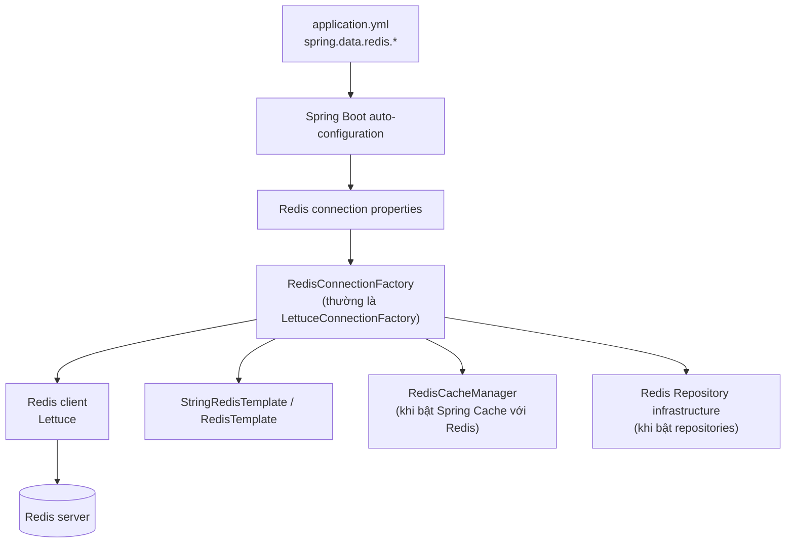
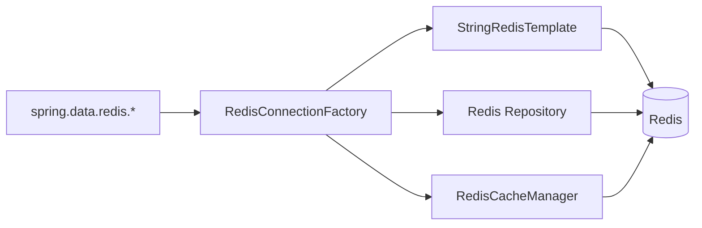

# Cấu hình `spring.data.redis` trong `application.yml`

Trong ứng dụng Spring Boot dùng Spring Data Redis, phần lớn cấu hình kết nối Redis được khai báo bằng nhóm thuộc tính **`spring.data.redis`** trong `application.yml`. Spring Boot đọc các thuộc tính này, tạo đối tượng kết nối thích hợp và cung cấp hạ tầng cho `RedisTemplate`, `StringRedisTemplate`, Redis Repository hoặc Redis Cache sử dụng.

Bài học này đi từ cấu hình tối thiểu đến cách triển khai theo môi trường, giới hạn kết nối, bảo mật TLS và Redis Sentinel/Cluster. Các ví dụ dùng cú pháp phổ biến của **Spring Boot 3.x và Spring Data Redis 3.x**. Với dự án sử dụng phiên bản khác, hãy đối chiếu configuration metadata của đúng phiên bản Spring Boot trước khi sao chép thuộc tính.

## 1. Điều kiện để cấu hình hoạt động

Để Spring Boot kết nối Redis, cần đồng thời có:

1. Một Redis server đang chạy và có thể truy cập từ nơi ứng dụng chạy.
2. Dependency Spring Data Redis trong ứng dụng.
3. Cấu hình `spring.data.redis` trỏ tới đúng Redis endpoint, kèm thông tin xác thực nếu cần.

Ví dụ dùng Gradle Groovy:

```groovy
dependencies {
    implementation 'org.springframework.boot:spring-boot-starter-data-redis'
}
```

Starter trên tích hợp Spring Data Redis và mặc định sử dụng **Lettuce** làm Redis client trong cấu hình Spring Boot thông thường. Khi các điều kiện auto-configuration thỏa mãn, Spring Boot cung cấp một `RedisConnectionFactory` và các Redis template thường dùng. Bạn có thể inject `StringRedisTemplate` vào service mà không cần tự tạo connection factory bằng `new`.

Redis là dịch vụ bên ngoài tiến trình JVM. Khai báo dependency hoặc YAML **không tự khởi chạy Redis server**. Nếu chưa có Redis trên máy, có thể chạy thử một instance cục bộ:

```bash
docker run --name redis-local -p 6379:6379 -d redis:7

redis-cli -h localhost -p 6379 PING
# PONG
```

Đây là ví dụ môi trường học tập cục bộ. Không dùng cách mở cổng Redis không có xác thực để truy cập công khai từ Internet.

## 2. Cấu hình `application.yml` tối thiểu

Nếu Redis chạy tại `localhost:6379`, khai báo:

```yaml
spring:
  data:
    redis:
      host: localhost
      port: 6379
      database: 0
```

Đối với Redis standalone thông thường, cấu hình này có nghĩa:

| Thuộc tính | Giá trị ví dụ | Vai trò |
|---|---|---|
| `spring.data.redis.host` | `localhost` | Hostname hoặc IP của Redis |
| `spring.data.redis.port` | `6379` | Cổng TCP Redis lắng nghe |
| `spring.data.redis.database` | `0` | Logical database trong Redis standalone |

`localhost` được hiểu từ góc nhìn **tiến trình chạy Spring Boot**. Nếu Spring Boot chạy trên máy host và Redis container publish cổng `6379`, `localhost:6379` có thể đúng. Nếu Spring Boot chạy trong một container khác, `localhost` lại chỉ container Spring Boot; thường phải dùng hostname dịch vụ Redis trong Docker Compose hoặc địa chỉ nội bộ phù hợp.

Redis mặc định dùng database số `0` trong chế độ standalone. Tùy cấu hình server, có thể chọn database khác như `1`, nhưng **Redis Cluster chỉ hỗ trợ database `0`**. Không sử dụng `database: 1` trong cấu hình Cluster.

### Cấu trúc YAML và cách Spring Boot bind

YAML là cấu trúc phân cấp, nên:

```yaml
spring:
  data:
    redis:
      host: redis.internal
      port: 6379
```

được Spring Boot bind tương đương các property:

```properties
spring.data.redis.host=redis.internal
spring.data.redis.port=6379
```

Chỉ cần dùng **một dạng** phù hợp với file cấu hình. Trong `application.yml`, phải thụt lề nhất quán bằng khoảng trắng; không dùng tab. Dấu chấm trong key dạng phẳng cũng được Spring Boot hỗ trợ, nhưng cấu trúc phân cấp dễ đọc hơn khi có nhiều tùy chọn.

Với **Spring Boot 3.x**, prefix sử dụng trong bài này là `spring.data.redis`. Nhiều hướng dẫn Spring Boot 2.x cũ dùng `spring.redis.*`; cần kiểm tra phiên bản trước khi áp dụng. Việc viết một key sai hoặc key của phiên bản khác có thể khiến giá trị không được bind như mong đợi và ứng dụng dùng mặc định.

## 3. Sơ đồ từ YAML đến Redis server



Mỗi thành phần có trách nhiệm riêng:

- `application.yml` cung cấp **thông số kết nối**: host, port, password, TLS, timeout và topology.
- `RedisConnectionFactory` áp dụng thông số đó để cấp các Redis connection cần thiết.
- `RedisTemplate` / `StringRedisTemplate` gửi các lệnh Redis từ mã Java.
- Redis Repository ánh xạ entity Java sang dữ liệu Redis và dùng hạ tầng Redis operations.
- `RedisCacheManager` quản lý cache entries cho Spring Cache nếu ứng dụng bật tính năng cache.

Các nhánh này có thể dùng cùng một connection factory. Tuy nhiên serializer, TTL và cách đặt tên key của Template, Repository, Cache **không tự trở thành một cấu hình chung** chỉ vì dùng cùng `spring.data.redis`.

## 4. Các thuộc tính `spring.data.redis` thường gặp

| Thuộc tính | Tác dụng | Lưu ý |
|---|---|---|
| `host` | Host của Redis standalone | Mặc định thường là `localhost` |
| `port` | Cổng TCP của Redis standalone | Mặc định thường là `6379` |
| `database` | Chỉ số logical database | Redis Cluster chỉ có DB 0 |
| `username` | Username Redis ACL | Cần khi hệ thống yêu cầu user cụ thể |
| `password` | Password Redis | Không lưu secret thật vào source code |
| `url` | URI kết nối, ví dụ `redis://...` hay `rediss://...` | Cấu hình thay thế host/port/auth riêng; tránh trộn mâu thuẫn |
| `client-type` | Chọn loại client được hỗ trợ, chẳng hạn `lettuce` | Phụ thuộc starter/driver trên classpath |
| `connect-timeout` | Giới hạn thời gian thiết lập kết nối | Dùng duration như `2s` |
| `timeout` | Timeout cho Redis operation | Dùng duration như `3s` |
| `ssl.enabled` | Bật TLS khi kết nối Redis | Redis endpoint phải hỗ trợ TLS |
| `ssl.bundle` | Chọn SSL bundle đã cấu hình | Hữu ích với CA/certificate riêng |
| `lettuce.pool.*` | Tham số connection pool nếu dùng Lettuce pool | Cần hỗ trợ pool trên classpath |
| `sentinel.master`, `sentinel.nodes` | Khai báo Redis Sentinel | Dùng cho topology Sentinel |
| `cluster.nodes`, `cluster.max-redirects` | Khai báo Redis Cluster | Dùng cho topology Cluster |

`port` là một **số nguyên**, còn `timeout` và `connect-timeout` là **duration**. Viết `timeout: 3s` sẽ thể hiện đơn vị rõ ràng hơn một số trần. Các default và những property được hỗ trợ có thể thay đổi theo phiên bản Spring Boot và Redis driver.

Ví dụ cấu hình standalone với timeout:

```yaml
spring:
  data:
    redis:
      host: localhost
      port: 6379
      database: 0
      client-type: lettuce
      connect-timeout: 2s
      timeout: 3s
```

Trong đó:

- `connect-timeout: 2s` hướng đến thời gian chờ khi thiết lập kết nối.
- `timeout: 3s` đặt giới hạn chờ cho các Redis operations theo cơ chế của client.
- Đây không phải cam kết rằng mọi lời gọi Java sẽ luôn kết thúc trong chính xác 2 hoặc 3 giây: retry, DNS, topology discovery và tầng mạng có thể ảnh hưởng thời gian quan sát thực tế.

## 5. Kết nối có username và password

Nếu Redis yêu cầu xác thực, thêm credential phù hợp:

```yaml
spring:
  data:
    redis:
      host: redis.example.internal
      port: 6379
      username: app-user
      password: ${REDIS_PASSWORD}
      connect-timeout: 2s
      timeout: 3s
```

`${REDIS_PASSWORD}` là **placeholder** của Spring. Khi chạy, Spring lấy biến môi trường `REDIS_PASSWORD`. Nếu biến không có, cấu hình sẽ không được resolve thành công trong ngữ cảnh cần property đó; cách này giúp phát hiện thiếu secret ở môi trường yêu cầu xác thực.

Ví dụ chạy từ một shell có biến môi trường do công cụ triển khai hoặc secret manager cấp trước:

```bash
# Biến REDIS_PASSWORD được cấp từ môi trường chạy
java -jar application.jar
```

Với Redis ACL, `username` có thể là tên user đã cấu hình quyền tương ứng; nếu server chỉ sử dụng cơ chế password của user mặc định, cấu hình `password` có thể đủ. Phải khớp với cách server xác thực thực tế.

**Không** đưa mật khẩu thật vào `application.yml` được commit lên Git, URL chia sẻ, ảnh chụp màn hình hoặc log. Trong hệ thống có nhiều môi trường, nên cấp secret qua secret manager hoặc cơ chế secrets của nền tảng triển khai. Redis password chỉ là xác thực; nếu truyền thông qua mạng không đáng tin cậy, cần TLS.

### Có thể cấu hình qua biến môi trường trực tiếp

Spring Boot hỗ trợ relaxed binding. Ví dụ:

```text
SPRING_DATA_REDIS_HOST=redis.example.internal
SPRING_DATA_REDIS_PORT=6379
SPRING_DATA_REDIS_USERNAME=app-user
SPRING_DATA_REDIS_PASSWORD=(giá trị bí mật do môi trường cấp)
```

Các biến này có thể bind trực tiếp về `spring.data.redis.host`, `.port`, `.username`, `.password` mà không phải lặp lại từng placeholder trong YAML. Khi có nhiều nguồn cấu hình (file, environment, command-line arguments, service connection), **quy tắc ưu tiên cấu hình của Spring Boot** quyết định giá trị cuối cùng. Trong debug, cần xác định giá trị đã được bind từ nguồn nào mà không làm lộ credential.

## 6. Thay host/port bằng connection URL

Một số Redis provider cấp connection URI thay vì từng trường:

```yaml
spring:
  data:
    redis:
      url: ${REDIS_URL}
      connect-timeout: 2s
      timeout: 3s
```

Hai dạng URI thường gặp:

```text
redis://redis.example.internal:6379
rediss://redis.example.internal:6380
```

`redis://` thường chỉ kết nối không TLS; `rediss://` biểu thị kết nối qua TLS. URI có thể chứa thông tin xác thực, nhưng không nên ghi URI chứa password thật vào repository hoặc log.

Trong Spring Boot 3.x, property `url` đóng gói thông tin endpoint và có quyền ưu tiên đối với host, port, username, password riêng theo hợp đồng binding của phiên bản tương ứng. Vì thế, hãy **chọn cấu hình bằng URL hoặc cấu hình theo từng trường** cho cùng một endpoint; tránh tạo hai nguồn thông tin mâu thuẫn. Đừng dùng URL standalone rồi đồng thời cấu hình cluster/sentinel nếu không có chủ đích và tài liệu phiên bản xác nhận tương tác đó.

## 7. Profile: phân tách local, test và production

Một ứng dụng thường chạy ở nhiều môi trường với endpoint khác nhau. Nên tách thông tin mặc định và thông tin riêng từng profile.

### 7.1. Cấu hình chung trong `application.yml`

```yaml
spring:
  application:
    name: redis-demo
  data:
    redis:
      connect-timeout: 2s
      timeout: 3s
```

### 7.2. Profile phát triển trong `application-local.yml`

```yaml
spring:
  data:
    redis:
      host: localhost
      port: 6379
      database: 1
```

### 7.3. Profile production trong `application-prod.yml`

```yaml
spring:
  data:
    redis:
      host: ${REDIS_HOST}
      port: ${REDIS_PORT:6379}
      database: 0
      username: ${REDIS_USERNAME}
      password: ${REDIS_PASSWORD}
      ssl:
        enabled: true
```

`${REDIS_PORT:6379}` sử dụng cổng `6379` làm fallback nếu `REDIS_PORT` không có. Với host, username và password production, ví dụ trên **không đặt fallback**, để không âm thầm chuyển sang Redis development khi cấu hình triển khai bị thiếu.

Chạy với profile tương ứng:

```bash
java -jar application.jar --spring.profiles.active=local

# Trong môi trường triển khai đã cấp các biến REDIS_*
java -jar application.jar --spring.profiles.active=prod
```

Spring Boot sẽ kết hợp cấu hình chung với cấu hình của profile được kích hoạt theo thứ tự ưu tiên. Nếu Redis production không hỗ trợ TLS, hoặc cần cổng TLS khác, phải điều chỉnh chính xác theo endpoint của nhà cung cấp; `ssl.enabled: true` không làm server tự bật TLS.

Có thể dùng các YAML document phân tách bằng `---` trong cùng `application.yml`:

```yaml
spring:
  data:
    redis:
      connect-timeout: 2s

---
spring:
  config:
    activate:
      on-profile: local
  data:
    redis:
      host: localhost
      port: 6379
```

Tuy nhiên, nếu nhiều môi trường có độ khác biệt lớn, các file `application-{profile}.yml` riêng thường dễ quản lý hơn. Profile cũng **không thay thế** secret management.

## 8. Địa chỉ Redis khi chạy bằng Docker Compose

Một lỗi rất thường gặp là đặt `localhost` trong container ứng dụng và kỳ vọng nó truy cập được Redis container khác.

Ví dụ hai service cùng nằm trong mạng mặc định của Compose:

```yaml
# compose.yml - ví dụ minh họa môi trường local
services:
  redis:
    image: redis:7
    ports:
      - "6379:6379"

  app:
    image: my-spring-app:local
    environment:
      SPRING_PROFILES_ACTIVE: docker
      SPRING_DATA_REDIS_HOST: redis
      SPRING_DATA_REDIS_PORT: "6379"
    depends_on:
      - redis
```

Ở đây, hostname `redis` được giải quyết qua mạng Compose. App trong container truy cập `redis:6379`; app chạy trực tiếp trên host (với cổng đã publish) thường truy cập `localhost:6379`.

| Nơi chạy Spring Boot | Nơi chạy Redis | `host` thường dùng |
|---|---|---|
| JVM trực tiếp trên máy | Redis trực tiếp trên máy | `localhost` |
| JVM trực tiếp trên máy | Redis container publish `6379:6379` | `localhost` |
| Container `app` | Container dịch vụ `redis` cùng mạng Compose | `redis` |
| Server/k8s workload | Redis managed service | DNS riêng do hạ tầng cấp |

`depends_on` trong Compose đảm bảo thứ tự khởi tạo container theo điều kiện cơ bản, **không tự đảm bảo Redis đã sẵn sàng nhận lệnh**; để bảo đảm readiness cần healthcheck và chính sách retry phù hợp. Với Spring Boot 3.1+ và Docker Compose integration, Spring Boot còn có cơ chế service connection có thể tự cung cấp chi tiết kết nối. Nếu dự án dùng tính năng này, hãy xem nguồn cấu hình hiệu lực thay vì giả định chỉ có `application.yml`.

## 9. TLS: cấu hình bảo mật kết nối

Nếu Redis endpoint chấp nhận TLS (thường từ dịch vụ quản lý trên cloud hoặc Redis được cấu hình TLS), bật:

```yaml
spring:
  data:
    redis:
      host: redis.secure.internal
      port: 6380
      username: ${REDIS_USERNAME}
      password: ${REDIS_PASSWORD}
      ssl:
        enabled: true
      connect-timeout: 3s
      timeout: 5s
```

Cổng `6380` ở đây **chỉ là ví dụ**; hãy dùng đúng cổng TLS do Redis server hoặc provider cung cấp. Kết nối TLS cần endpoint cấu hình TLS và certificate hợp lệ. Bật TLS ở client nhưng trỏ tới cổng chỉ hỗ trợ plaintext có thể dẫn đến handshake error.

Nếu hạ tầng dùng CA/private certificate riêng, Spring Boot hỗ trợ cấu hình **SSL bundle** và có thể tham chiếu bằng `spring.data.redis.ssl.bundle` (ở các phiên bản hỗ trợ). Ví dụ về cách nối tên bundle:

```yaml
spring:
  data:
    redis:
      host: redis.secure.internal
      port: 6380
      ssl:
        enabled: true
        bundle: redis-client
```

Tên `redis-client` phải trỏ tới một SSL bundle có thực được cấu hình dưới `spring.ssl.bundle.*`, chứa trust material/certificate cần thiết. Bản thân dòng `bundle: redis-client` **không tự tạo certificate**. Tốt nhất cung cấp truststore qua cơ chế secrets/certificates của môi trường triển khai và kiểm tra chain/hostname của server.

TLS bảo vệ đường truyền; authentication và phân quyền Redis ACL vẫn là các vấn đề riêng. Không tắt kiểm tra certificate hoặc hostname để vượt qua lỗi production.

## 10. Timeout và connection pool của Lettuce

Một cấu hình minh họa:

```yaml
spring:
  data:
    redis:
      host: redis.internal
      port: 6379
      client-type: lettuce
      connect-timeout: 2s
      timeout: 3s
      lettuce:
        pool:
          enabled: true
          max-active: 16
          max-idle: 8
          min-idle: 2
          max-wait: 1s
```

Các nhóm thông số:

- `connect-timeout`: chờ thiết lập kết nối.
- `timeout`: giới hạn thời gian thực hiện lệnh Redis theo client.
- `max-active`: số connection tối đa có thể được mượn đồng thời từ pool.
- `max-idle` / `min-idle`: giới hạn connection nhàn rỗi của pool.
- `max-wait`: thời gian chờ một connection từ pool khi pool đã hết connection khả dụng.

Khi bật Lettuce pooling, ứng dụng cần thư viện hỗ trợ pool, thường là Apache Commons Pool 2:

```groovy
dependencies {
    implementation 'org.springframework.boot:spring-boot-starter-data-redis'
    implementation 'org.apache.commons:commons-pool2'
}
```

Không phải ứng dụng nào dùng Lettuce cũng cần pool. Lettuce có khả năng chia sẻ native connection cho nhiều thao tác thông thường. Pool hữu ích trong những tình huống yêu cầu connection riêng hoặc có nhu cầu đặc thù, nhưng thêm pool đồng nghĩa thêm giới hạn tài nguyên và rủi ro chờ khi pool cạn.

**Không chọn `max-active` theo số request HTTP một cách máy móc.** Cần xét loại lệnh Redis, kết nối bị chiếm giữ, số instance app, khả năng server và độ trễ thực tế. Nếu chạy 20 instance, mỗi instance có `max-active: 16`, tổng lượng connection tiềm năng có thể lớn hơn rất nhiều so với 16.

Nếu mục tiêu chỉ là học cách kết nối và gọi lệnh cơ bản, bắt đầu với cấu hình không pool và chỉ bổ sung sau khi có lý do vận hành cụ thể.

## 11. Cấu hình Redis Sentinel

Redis Sentinel hỗ trợ giám sát và chuyển đổi Redis master khi có sự cố. Thay vì cố định một endpoint Redis master, Spring Boot có thể được cấu hình để lấy thông tin master từ các Sentinel node.

```yaml
spring:
  data:
    redis:
      sentinel:
        master: mymaster
        nodes:
          - sentinel-1.internal:26379
          - sentinel-2.internal:26379
          - sentinel-3.internal:26379
      username: ${REDIS_USERNAME}
      password: ${REDIS_PASSWORD}
      connect-timeout: 2s
      timeout: 3s
```

Ở đây:

- `sentinel.master` là **tên master** được Sentinel quản lý, không nhất thiết là hostname thực tế.
- `sentinel.nodes` chứa endpoint các Sentinel server, thông thường trên cổng `26379`.
- `username` và `password` cấp quyền truy cập Redis data nodes khi server yêu cầu.

Nếu **chính Sentinel cũng yêu cầu xác thực**, Spring Boot có nhóm cấu hình riêng như `spring.data.redis.sentinel.username` và `spring.data.redis.sentinel.password` ở phiên bản hỗ trợ; credentials của Sentinel và credentials của Redis data node có thể khác nhau. Hãy xác nhận cấu hình ACL và network của cả hai lớp.

Sentinel không phải Redis Cluster: Sentinel cung cấp cơ chế khám phá/chuyển đổi master của topology replication, còn Cluster chia dữ liệu theo hash slots trên nhiều primary node. Không nên trộn `sentinel.*` với `cluster.*` trong cùng một cấu hình endpoint.

## 12. Cấu hình Redis Cluster

Với Redis Cluster, Redis dữ liệu được phân chia theo nhiều node và hash slots. Khai báo danh sách node để client bootstrap topology:

```yaml
spring:
  data:
    redis:
      cluster:
        nodes:
          - redis-1.internal:6379
          - redis-2.internal:6379
          - redis-3.internal:6379
        max-redirects: 5
      username: ${REDIS_USERNAME}
      password: ${REDIS_PASSWORD}
      connect-timeout: 2s
      timeout: 3s
```

`cluster.nodes` là danh sách node đầu vào giúp client tìm hiểu Cluster. `cluster.max-redirects` kiểm soát mức chuyển hướng Redis Cluster trong những tình huống cần redirect đến node sở hữu hash slot.

Cần ghi nhớ:

- **Không dùng `database: 1`**. Redis Cluster chỉ hỗ trợ database `0`.
- Các node phải công bố địa chỉ có thể truy cập được từ môi trường ứng dụng, không chỉ từ nội bộ network của Redis.
- Các lệnh nhiều key có thể chịu giới hạn về cùng hash slot; thiết kế key và transaction/script phải xét quy tắc Cluster.
- Khi dùng TLS, phải bảo đảm tất cả node được client kết nối đều hỗ trợ TLS và địa chỉ/certificate phù hợp.

Ví dụ này chỉ cho thấy thuộc tính kết nối từ Spring Boot; nó không thay thế việc tạo và vận hành Redis Cluster đúng cấu trúc.

## 13. Kiểm chứng ứng dụng có dùng đúng kết nối

Sau khi cấu hình, cách dễ quan sát là gọi một lệnh thật bằng `StringRedisTemplate`.

```java
import java.time.Duration;
import org.springframework.data.redis.core.StringRedisTemplate;
import org.springframework.stereotype.Service;

@Service
public class RedisConnectivityService {
    private final StringRedisTemplate redis;

    public RedisConnectivityService(StringRedisTemplate redis) {
        this.redis = redis;
    }

    public boolean canWriteAndRead() {
        String key = "demo:connectivity-check";
        String expected = "spring-data-redis-ok";

        redis.opsForValue().set(key, expected, Duration.ofSeconds(30));
        String actual = redis.opsForValue().get(key);
        redis.delete(key);

        return expected.equals(actual);
    }
}
```

Đây là một service minh họa có thể được gọi chủ động trong môi trường thử nghiệm. Nó tạo key ngắn hạn rồi xóa; không nên vô điều kiện chạy thao tác ghi này ở mọi lần startup của ứng dụng production.

Một cách kiểm tra hạ tầng độc lập:

```bash
redis-cli -h localhost -p 6379 PING
# PONG

redis-cli -h localhost -p 6379 INFO server
```

Với Redis cần password, hãy cấp secret an toàn cho CLI (ví dụ từ biến môi trường `REDISCLI_AUTH`) và tránh truyền password trong tham số command có thể bị lưu lại trong shell history hoặc process list. Với Redis TLS, bổ sung lựa chọn `--tls` và trust material phù hợp. Hãy thực hiện kiểm tra từ **cùng môi trường mạng với ứng dụng** để không bỏ sót các khác biệt DNS/firewall.

Nếu ứng dụng dùng Spring Boot Actuator:

```groovy
dependencies {
    implementation 'org.springframework.boot:spring-boot-starter-actuator'
}
```

Actuator có thể cung cấp Redis health indicator khi Redis và actuator health infrastructure được cấu hình phù hợp. Kiểm tra health giúp phát hiện kết nối lỗi, nhưng cần quản lý quyền truy cập và cơ chế công khai endpoint cho môi trường vận hành.

**Lưu ý vòng đời:** việc Spring Boot tạo thành công bean `RedisConnectionFactory` không luôn có nghĩa kết nối Redis thực tế đã được xác nhận. Nhiều lỗi DNS, authentication hoặc network chỉ xuất hiện khi có Redis operation hoặc health probe đầu tiên.

## 14. Liên hệ `spring.data.redis` với Redis Template, Repository và Cache

Sau khi Spring Boot tạo connection factory, bạn có thể dùng Redis bằng nhiều cách, tùy chức năng:



### 14.1. Redis Template

`StringRedisTemplate` thích hợp với key và value dạng chuỗi:

```java
import java.time.Duration;
import org.springframework.data.redis.core.StringRedisTemplate;

public class VerificationCodeStore {
    private final StringRedisTemplate redis;

    public VerificationCodeStore(StringRedisTemplate redis) {
        this.redis = redis;
    }

    public void putCode(String userId, String code) {
        redis.opsForValue().set(
            "verify:" + userId,
            code,
            Duration.ofMinutes(5)
        );
    }
}
```

`spring.data.redis` cung cấp kết nối; `Duration.ofMinutes(5)` trong mã cung cấp TTL **cho key này**. YAML kết nối không mặc định đặt TTL cho mọi key trong Redis.

### 14.2. Redis Repository

Nếu dùng Redis Repository, entity có thể khai báo:

```java
import org.springframework.data.annotation.Id;
import org.springframework.data.redis.core.RedisHash;

@RedisHash(value = "login-sessions", timeToLive = 900)
public class LoginSession {
    @Id
    private String id;
    private String userId;

    public LoginSession() {}

    public String getId() { return id; }
    public void setId(String id) { this.id = id; }
    public String getUserId() { return userId; }
    public void setUserId(String userId) { this.userId = userId; }
}
```

`timeToLive = 900` là **900 giây** cho entity. Nó thuộc cơ chế ánh xạ dữ liệu Repository; không phải `spring.data.redis.timeout` (timeout cho Redis operation).

### 14.3. Redis Cache

Nếu muốn dùng Redis làm nhà cung cấp Spring Cache, cần các phần riêng ngoài cấu hình kết nối:

```groovy
dependencies {
    implementation 'org.springframework.boot:spring-boot-starter-data-redis'
    implementation 'org.springframework.boot:spring-boot-starter-cache'
}
```

```yaml
spring:
  data:
    redis:
      host: localhost
      port: 6379
  cache:
    type: redis
    redis:
      time-to-live: 10m
      cache-null-values: false
```

Thêm `@EnableCaching` vào configuration phù hợp rồi dùng:

```java
import org.springframework.cache.annotation.Cacheable;

@Cacheable(cacheNames = "products", key = "#productId")
public ProductView findProduct(String productId) {
    return productGateway.load(productId);
}
```

`ProductView` và `productGateway` ở đây đại diện cho model và nguồn dữ liệu nghiệp vụ do ứng dụng tự định nghĩa. `spring.cache.redis.time-to-live` là TTL của **cache entries**; nó khác `spring.data.redis.timeout` (timeout truy cập Redis), và khác TTL entity Repository.

Không có lý do để giả định cấu hình serializer của custom `RedisTemplate` sẽ tự áp dụng cho Repository hoặc Cache. Khi thay định dạng value, cần cấu hình đúng tầng sử dụng.

## 15. Những lỗi cấu hình dễ gặp và cách xác định

| Hiện tượng | Nguyên nhân thường gặp | Việc nên kiểm tra |
|---|---|---|
| `Connection refused` | Không có Redis lắng nghe ở host/port đã bind | Redis đã chạy chưa, container có publish port đúng không |
| `UnknownHostException` hoặc không resolve hostname | Sai DNS/hostname; dùng tên Compose từ ngoài network Compose | Môi trường mạng thực sự của JVM, hostname được cấp |
| `NOAUTH` / `WRONGPASS` | Thiếu hoặc sai credential Redis | ACL user, password, secret injection; không in secret |
| TLS handshake thất bại | Client TLS trỏ tới cổng plaintext, CA/hostname không hợp lệ | Cổng TLS, certificate, truststore/bundle |
| Operation timeout | Redis bận, mạng chậm, lệnh lâu, pool quá tải | Redis metrics, latency, timeout, pool và tải thực tế |
| Ứng dụng dùng Redis sai môi trường | Profile chưa active hoặc bị env/service connection override | Active profile và cấu hình hiệu lực (ẩn credential) |
| `localhost` hoạt động ngoài host nhưng lỗi trong Docker | `localhost` trong container trỏ chính container đó | Đổi sang service hostname hoặc endpoint nội bộ |
| `@Cacheable` không có tác dụng | Chỉ khai báo `spring.data.redis`, chưa kích hoạt Spring Cache hoặc lời gọi không qua proxy | Dependency cache, `@EnableCaching`, cache manager, cách gọi |
| Đặt `database: 1` với Cluster | Redis Cluster chỉ hỗ trợ DB 0 | Bỏ lựa chọn database khác 0 |
| Redis key hiển thị dạng binary | Serializer do Template/Repository/Cache dùng | Xác định tầng ghi key, không tùy tiện đổi serializer |

### 15.1. Một ví dụ sai do thụt lề

```yaml
# Sai: host không nằm dưới spring.data.redis
spring:
  data:
    redis:
      port: 6379
  host: redis.internal
```

`spring.host` trong ví dụ không phải `spring.data.redis.host`. Kết quả có thể là Redis vẫn dùng giá trị mặc định `localhost`, dù người viết đã thấy chữ `host` trong YAML.

### 15.2. Một ví dụ nhầm namespace giữa Redis và Cache

```yaml
spring:
  data:
    redis:
      timeout: 2s
  cache:
    redis:
      time-to-live: 5m
```

`timeout` là thời hạn thao tác kết nối/lệnh; `time-to-live` là tuổi thọ entry trong Spring Cache. Hai dòng này không thể hoán đổi vì cùng chứa yếu tố “thời gian”.

### 15.3. Ghi log và quan sát an toàn

Khi debug cấu hình, hãy tập trung vào endpoint hiệu lực, active profile, Redis driver, thời gian timeout, trạng thái health và exception type. Tránh log `RedisProperties` nguyên vẹn vì có thể làm lộ `password` hoặc URI chứa credential. Khi cần bật logging chi tiết cho thư viện Redis, chỉ bật tạm thời ở môi trường được kiểm soát và xem xét nội dung có thể chứa key/value nghiệp vụ.

## 16. Một cấu hình đề xuất để bắt đầu

Đối với ứng dụng Spring Boot 3.x học Spring Data Redis, một cấu hình local nhỏ và rõ ràng là đủ:

```yaml
# application.yml - bắt đầu với Redis standalone local
spring:
  application:
    name: redis-learning
  data:
    redis:
      host: ${REDIS_HOST:localhost}
      port: ${REDIS_PORT:6379}
      database: 0
      connect-timeout: 2s
      timeout: 3s
```

Đi qua các bước:

1. Khởi chạy Redis và xác nhận `PING` nhận `PONG`.
2. Thêm `spring-boot-starter-data-redis` và cấu hình `spring.data.redis`.
3. Khởi chạy Spring Boot trong đúng network và profile.
4. Gọi thử một thao tác `StringRedisTemplate` với key ngắn hạn.
5. Khi chuyển sang môi trường thực, thay endpoint và cung cấp credentials qua cấu hình môi trường; bật TLS nếu endpoint yêu cầu.
6. Chỉ thêm pooling, Sentinel hoặc Cluster khi hạ tầng thực sự dùng các cơ chế đó.

Mỗi lần nhìn thấy một cấu hình Redis, hãy xác định **nơi Redis chạy, ai cung cấp credential, loại topology, timeout, TLS và thành phần Spring nào tiêu thụ kết nối**. Nắm vững sáu điểm đó giúp đọc hiểu `application.yml` và xử lý phần lớn lỗi khởi tạo Spring Data Redis một cách có hệ thống.
