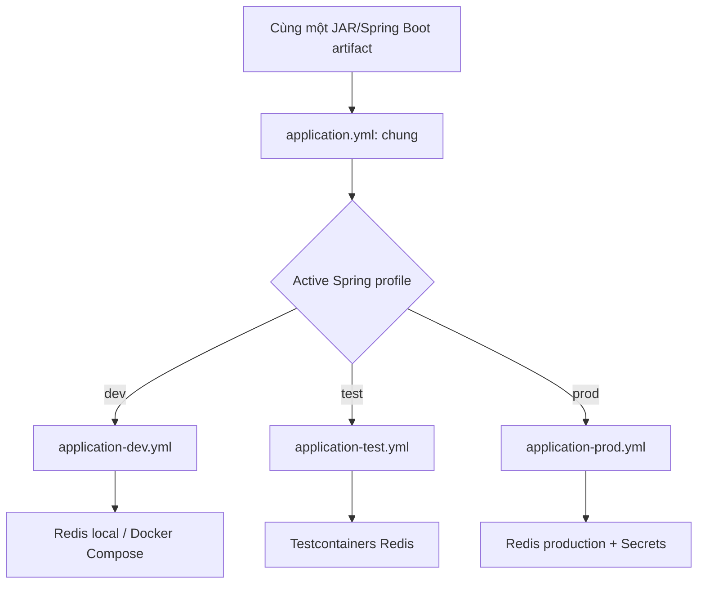

# Tách cấu hình phát triển, kiểm thử và production trong Spring Data Redis

## 1. Mục tiêu: một ứng dụng, nhiều môi trường, một hợp đồng dữ liệu

Spring Data Redis giúp ứng dụng Java thao tác Redis thông qua `RedisTemplate`, `StringRedisTemplate`, repository, Spring Cache, Redis Streams hoặc reactive API. Nhưng triển khai Redis không giống nhau ở development, test và production.

- **Development:** kết nối Redis cục bộ, ít phụ thuộc, thuận tiện reset và debug.
- **Test/CI:** Redis tách biệt, dữ liệu tái lập, không dùng tài nguyên hay bí mật production.
- **Production:** kết nối ổn định, TLS/ACL, secret, giới hạn timeout và tài nguyên, Sentinel/Cluster nếu cần, giám sát, backup và chiến lược failover.

Ví dụ cùng một service:

```java
@Service
public class FeatureFlagService {
    private final StringRedisTemplate redis;

    public FeatureFlagService(StringRedisTemplate redis) {
        this.redis = redis;
    }

    public boolean enabled(String flag) {
        return "1".equals(
                redis.opsForValue().get("feature:" + flag));
    }
}
```

Code service không cần tự hỏi đang ở môi trường nào; Spring Boot tạo Redis connection từ cấu hình runtime. Cần tách **tham số kết nối** mà vẫn giữ **key format, serializer và business semantics** tương thích.

Một cấu hình trộn lẫn nguy hiểm:

```yaml
spring:
  data:
    redis:
      host: redis-production.internal
      username: app
      password: password-committed-to-git
```

Nếu máy developer hoặc CI nạp nhầm file này, test có thể ghi/xóa key production. Ngoài ra secret đã bị lộ trong source control.

**Kết quả mong muốn:** ứng dụng chạy cùng artifact, lựa chọn môi trường một cách rõ ràng, cấu hình đã được kiểm soát; test dùng Redis độc lập; production fail-fast nếu thiếu secret và không chấp nhận các cấu hình local không phù hợp.

## 2. Phân loại cấu hình trước khi tách profile

Không phải mọi property đều nên khác nhau giữa môi trường.

| Loại cấu hình | Ví dụ | Nguyên tắc |
| --- | --- | --- |
| Hợp đồng dữ liệu | Tên key, key serializer, codec JSON, schema version | Dùng chung/phiên bản hóa; test tương thích |
| Chính sách nghiệp vụ | TTL session, cách xử lý cache miss, retry có lũy đẳng | Giữ đúng contract, không thay tùy tiện |
| Kết nối | Host, port, topology, TLS endpoint | Đặt theo môi trường |
| Bí mật | Username/password, client certificate, trust material | Nguồn secret được quản lý ở runtime |
| Vận hành | Connect/command timeout, pool, concurrency | Tối ưu theo tải và SLA |
| Redis server | Persistence, maxmemory, eviction, replication, backup | Hạ tầng từng môi trường, không tự giả định Spring Boot quản lý |
| Quan sát | Log level, tracing sampling, metrics | Dev chi tiết, prod bảo mật/giới hạn volume |
| Test fixture | Key prefix, container, data cleanup | Chỉ test, không được chạy trên Redis production |

Ví dụ thời hạn của token bảo mật có thể là 15 phút theo nghiệp vụ. Không nên biến thành 24 giờ ở production chỉ vì muốn ít expiration hơn. Ngược lại, địa chỉ Redis dev `127.0.0.1:6379` và endpoint private production khác nhau là hợp lý.

### Tách “giá trị” khỏi “hành vi”

Thay host, port và credentials là thay đổi cấu hình vận hành. Thay serializer, key prefix, TTL hoặc cache null policy là thay đổi **ngữ nghĩa dữ liệu**. Nhóm thứ hai cần test migration/compatibility và rollout như một thay đổi chức năng.

## 3. Tổ chức thư mục cấu hình

Một cấu trúc Spring Boot đơn giản:

```text
src/
  main/
    java/
      com/example/catalog/
        RedisSettings.java
        RedisCacheConfig.java
        CatalogService.java
    resources/
      application.yml
      application-dev.yml
      application-prod.yml
  test/
    java/
      com/example/catalog/
        RedisIntegrationTest.java
        RedisSettingsTest.java
    resources/
      application-test.yml
```

Chức năng:

- `application.yml`: cấu hình chung và giá trị mặc định không chứa bí mật.
- `application-dev.yml`: endpoint local, giới hạn tài nguyên thấp, namespace dev.
- `application-test.yml`: chính sách test, endpoint từ Testcontainers.
- `application-prod.yml`: endpoint runtime, TLS/ACL, timeout theo SLA, telemetry.

Sơ đồ:



Không cần viết ba class service Redis khác nhau nếu chỉ khác môi trường kết nối.

## 4. Spring profiles và thứ tự ưu tiên cấu hình

Spring Boot hỗ trợ externalized configuration từ:

- Các file `application.yml`/`application.properties`.
- File theo profile `application-{profile}.yml`.
- Environment variables.
- Java system properties.
- Command-line arguments.
- Config tree, secret provider hoặc config server theo hạ tầng.

Thứ tự ưu tiên thuộc quy tắc Spring Boot; **environment variables hoặc command line có thể override giá trị trong profile file**. Đừng chỉ đọc file YAML rồi kết luận runtime đang sử dụng chính xác những giá trị đó.

Ví dụ chạy dev:

```bash
java -jar catalog-service.jar --spring.profiles.active=dev
```

Ví dụ môi trường POSIX:

```bash
SPRING_PROFILES_ACTIVE=prod java -jar catalog-service.jar
```

Với Windows PowerShell hoặc Kubernetes, dùng cơ chế đặt biến tương ứng.

**Không hardcode active profile `prod` trong file chung** nếu điều đó làm developer vô tình dùng production endpoint. Chọn profile qua script local, IDE run configuration hoặc deployment manifest.

### File profile và YAML nhiều document

Spring Boot còn hỗ trợ một file YAML nhiều document với `spring.config.activate.on-profile`. Ví dụ:

```yaml
app:
  redis:
    namespace: catalog:v1
---
spring:
  config:
    activate:
      on-profile: dev
app:
  redis:
    namespace: catalog:dev:v1
```

Tuy nhiên, nhiều file nhỏ thường dễ review quyền truy cập, config drift và secret injection hơn cho hệ thống có production deployment riêng. Chọn một cấu trúc và ghi rõ nguồn thắng khi một property bị override.

## 5. Cấu hình chung an toàn

Ví dụ `src/main/resources/application.yml`:

```yaml
spring:
  application:
    name: catalog-service
  cache:
    type: redis

app:
  redis:
    namespace: catalog:v1
    cache:
      ttl: 10m
      cache-null-values: false
```

Đây là **custom application properties** cho business cache namespace và TTL; Spring Boot không tự áp dụng `app.redis.*` nếu ứng dụng không bind chúng vào bean/cấu hình tương ứng.

Những thứ không nên đặt trong file chung:

- Redis production password/ACL token.
- Host production dùng chung cho mọi profile.
- TLS client private key.
- Redis URL chứa username/password.
- Cấu hình `FLUSHALL` hoặc quản trị server tự chạy khi startup.
- Một profile active prod mặc định.

Một ứng dụng chạy không có profile rõ ràng nên có behavior an toàn (hoặc fail-fast), không được vô tình rơi vào một Redis production endpoint.

## 6. Development: Redis cục bộ

Ví dụ `application-dev.yml`:

```yaml
spring:
  data:
    redis:
      host: 127.0.0.1
      port: 6379
      connect-timeout: 1s
      timeout: 2s

app:
  redis:
    namespace: catalog:dev:v1
    cache:
      ttl: 2m

logging:
  level:
    org.springframework.data.redis: INFO
```

Dev ưu tiên tự phục vụ và dễ debug. Redis local có thể được khởi động bằng Docker Compose:

```yaml
services:
  redis:
    image: redis:7.4-alpine
    ports:
      - "127.0.0.1:6379:6379"
    command:
      - redis-server
      - --save
      - ""
      - --appendonly
      - "no"
```

Ví dụ chỉ dành cho local/lab: không TLS/ACL, persistence tắt, không replication/HA. Không copy sang production.

### Localhost trong và ngoài Docker

Khi Spring JVM chạy trực tiếp trên laptop, `127.0.0.1:6379` có thể là cổng host map tới Redis container.

Khi Spring app chạy trong **một container khác** cùng Docker Compose network, `127.0.0.1` trỏ về container của app, không phải Redis. Lúc đó host thường là tên Compose service `redis`:

```yaml
spring:
  data:
    redis:
      host: redis
      port: 6379
```

Có thể tạo một dev override riêng qua env var để chạy host/container mà không thay file source thủ công.

### Không debug bằng cách ghi toàn bộ key/value

Dù là dev, Redis key có thể chứa email, session ID, token hoặc dữ liệu khách hàng. Tránh bật logging command arguments không được redact. Dùng một namespace có chủ đích và dữ liệu giả.

## 7. Test profile: cô lập khỏi Redis của máy developer

Ví dụ `src/test/resources/application-test.yml`:

```yaml
spring:
  cache:
    type: redis
  data:
    redis:
      connect-timeout: 2s
      timeout: 2s

app:
  redis:
    namespace: catalog:it:v1
    cache:
      ttl: 30s
```

Không hardcode `host: localhost` trong file này khi test phải dùng Testcontainers: địa chỉ và mapped port được test runtime cung cấp. Nếu CI không chạy được container, test nên báo lỗi rõ, **không fallback sang Redis local hoặc production**.

Unit test cho key builder/serializer/mapper thuần có thể chạy không cần Redis server. Integration test cho TTL, Lua, Streams, Pub/Sub, Redis transaction và connection cần Redis thật hoặc test topology phù hợp.

### Tại sao không dùng một Redis shared cho mọi CI job?

Nếu hai job cùng tạo key:

```text
Job A: SET test:order:42 PAID
Job B: DEL test:order:42
Job A: GET test:order:42 -> nil
```

Test trở nên flaky và có nguy cơ xóa dữ liệu không thuộc job. Redis test riêng, namespace có UUID và cleanup giới hạn giúp giảm va chạm.

## 8. Testcontainers: Redis endpoint động trong JUnit 5

Ví dụ integration test với Spring Boot:

```java
package com.example.catalog;

import static org.assertj.core.api.Assertions.assertThat;

import org.junit.jupiter.api.Test;
import org.springframework.beans.factory.annotation.Autowired;
import org.springframework.boot.test.context.SpringBootTest;
import org.springframework.data.redis.core.StringRedisTemplate;
import org.springframework.test.context.ActiveProfiles;
import org.springframework.test.context.DynamicPropertyRegistry;
import org.springframework.test.context.DynamicPropertySource;
import org.testcontainers.containers.GenericContainer;
import org.testcontainers.junit.jupiter.Container;
import org.testcontainers.junit.jupiter.Testcontainers;
import org.testcontainers.utility.DockerImageName;

@Testcontainers
@SpringBootTest
@ActiveProfiles("test")
class RedisIntegrationTest {

    @Container
    static final GenericContainer<?> REDIS =
            new GenericContainer<>(
                    DockerImageName.parse("redis:7.4-alpine"))
                    .withExposedPorts(6379);

    @DynamicPropertySource
    static void redisProperties(DynamicPropertyRegistry registry) {
        registry.add("spring.data.redis.host", REDIS::getHost);
        registry.add("spring.data.redis.port",
                () -> REDIS.getMappedPort(6379));
    }

    @Autowired
    StringRedisTemplate redis;

    @Test
    void stringRoundTrip() {
        String key = "it:catalog:status:sku-42";

        redis.opsForValue().set(key, "ACTIVE");

        assertThat(redis.opsForValue().get(key))
                .isEqualTo("ACTIVE");
    }
}
```

Các dependency điển hình:

```xml
<dependency>
    <groupId>org.springframework.boot</groupId>
    <artifactId>spring-boot-starter-test</artifactId>
    <scope>test</scope>
</dependency>
<dependency>
    <groupId>org.testcontainers</groupId>
    <artifactId>junit-jupiter</artifactId>
    <scope>test</scope>
</dependency>
<dependency>
    <groupId>org.testcontainers</groupId>
    <artifactId>testcontainers</artifactId>
    <scope>test</scope>
</dependency>
```

Version cần được quản lý bởi BOM/dependency management hoặc khai báo tương ứng của dự án. Image Redis nên được pin theo policy CI, đặc biệt khi muốn so sánh behavior phiên bản.

`@ActiveProfiles("test")` chỉ chọn profile; **nó không tự khởi động Redis**. `@Testcontainers`/`@Container` quản lý Redis container và `@DynamicPropertySource` truyền host/port đã map vào Spring context.

Một số bản Spring Boot hỗ trợ `@ServiceConnection` làm cách thay thế `@DynamicPropertySource`; với `GenericContainer` có thể cần khai báo service name và dependency Boot testcontainers tương ứng. Chọn một cơ chế rõ ràng, đúng phiên bản.

## 9. Cô lập test bằng key namespace và lifecycle

Ngay cả khi một test class dùng Testcontainers riêng, các phương thức có thể cùng chia sẻ Redis state.

Ví dụ:

```java
String prefix = "it:" + UUID.randomUUID() + ":";
String key = prefix + "catalog:status";
```

Mỗi test có prefix riêng để không đụng key test khác. Khi cleanup, chỉ xóa những key do test tạo, có thể giữ danh sách key trong fixture.

Tránh:

```java
// KHÔNG dùng trong helper có thể trỏ tới shared/prod Redis:
redisConnection.serverCommands().flushAll();
```

Một test có bug cấu hình endpoint không được phép xóa toàn bộ Redis. Nếu cần thử `FLUSHALL`, chỉ thực hiện trên Redis container **chắc chắn do test đang sở hữu**, với ranh giới rõ.

### Không dùng database number làm chiến lược cô lập cho Cluster

Redis standalone hỗ trợ nhiều logical DB, nhưng Redis Cluster thông thường chỉ hỗ trợ DB 0. Vì vậy:

```yaml
spring:
  data:
    redis:
      database: 5
```

có thể chạy trên standalone dev và fail trên production Cluster. Test Cluster cần topology Cluster, không dùng logical DB như một biến thể thay thế.

## 10. Production standalone: externalized config, TLS, ACL

Ví dụ `application-prod.yml` cho **Redis standalone/managed primary endpoint**, không phải Sentinel hoặc Cluster:

```yaml
spring:
  data:
    redis:
      host: ${REDIS_HOST}
      port: ${REDIS_PORT:6379}
      username: ${REDIS_USERNAME}
      password: ${REDIS_PASSWORD}
      ssl:
        enabled: true
      connect-timeout: 2s
      timeout: 3s

app:
  redis:
    namespace: catalog:prod:v1
    cache:
      ttl: 10m

management:
  tracing:
    sampling:
      probability: 0.1
```

`${REDIS_HOST}` là Spring placeholder để lấy giá trị từ runtime; `${REDIS_PORT:6379}` có giá trị fallback. Các secret như password không có fallback public. Đây là ví dụ cho namespace cấu hình Spring Boot 3.x; với phiên bản Boot khác, cần đối chiếu tên thuộc tính và hỗ trợ TLS.

Yêu cầu thực tế:

- Redis endpoint ở private network hoặc được bảo vệ đúng chính sách.
- TLS kiểm tra chứng chỉ/hostname hợp lệ.
- ACL user chỉ có những command/key patterns cần thiết.
- Credential không nằm trong repository hoặc JAR.
- Timeout nằm trong SLA của application.
- Resource limits được tính trên tổng số pod/instance.
- Log và trace không chứa password hoặc raw Redis value nhạy cảm.

### Không coi env var là nơi lưu secret hoàn hảo

Biến môi trường có thể được thấy bởi process instrumentation, crash dumps hoặc công cụ vận hành. Ưu tiên secret manager, K8s Secret với RBAC/encryption-at-rest phù hợp, hoặc mounted secret volume có quyền đọc hạn chế. Cơ chế truyền giá trị cần được đánh giá với threat model của tổ chức.

Khi đặt Redis URL, tránh dùng URL chứa credential trong log/command line. Không khai báo đồng thời cả URL và host/port mà không biết Spring Boot version sẽ chọn nguồn nào.

## 11. Sentinel profile: khám phá primary thay vì hardcode

Nếu production dùng Redis primary–replica với Sentinel, cấu hình kết nối cần tới Sentinel endpoints:

```yaml
spring:
  data:
    redis:
      sentinel:
        master: catalog-primary
        nodes:
          - sentinel-1.internal:26379
          - sentinel-2.internal:26379
          - sentinel-3.internal:26379
      username: ${REDIS_USERNAME}
      password: ${REDIS_PASSWORD}
      connect-timeout: 2s
      timeout: 3s
```

Đây là cấu hình **thay thế** standalone, không phải phần bổ sung bên dưới cùng host của standalone.

Tên master group phải khớp cấu hình Sentinel. Sentinel authentication và Redis data-node authentication có thể khác nhau; TLS của Sentinel cũng cần cấu hình đúng theo phiên bản client và hạ tầng.

Sentinel không phải proxy mọi lệnh Redis. Client Sentinel-aware tìm primary hiện tại và gửi lệnh trực tiếp tới Redis data node. Trong failover vẫn có thể gặp:

- Connection refused/timeout trong lúc đổi primary.
- `READONLY` khi kết nối cũ trỏ tới node không còn là primary.
- Ghi cuối chưa kịp replicate có thể không tồn tại trên primary mới.
- Cần reconnect, refresh và idempotency cho thao tác retry.

Dev standalone thường không mô phỏng được các hành vi này. Nếu failover là yêu cầu, phải có staging/test Sentinel riêng.

## 12. Redis Cluster profile: chú ý hash slot và routing

Ví dụ production dùng Cluster:

```yaml
spring:
  data:
    redis:
      cluster:
        nodes:
          - redis-node-1.internal:6379
          - redis-node-2.internal:6379
          - redis-node-3.internal:6379
        max-redirects: 5
      username: ${REDIS_USERNAME}
      password: ${REDIS_PASSWORD}
      ssl:
        enabled: true
      connect-timeout: 2s
      timeout: 3s
```

Các điểm khác biệt quan trọng so với standalone:

1. Redis Cluster phân chia 16.384 hash slots.
2. Multi-key operations hoặc Lua liên quan nhiều key cần đúng hash slot theo contract.
3. Lệnh `SCAN` quét theo node; không có một cursor toàn cluster.
4. Keyspace notifications phát tại node xử lý key, không mặc nhiên được relay tới listener một node.
5. Failover/reshard đổi vị trí sở hữu slot và có thể gây `MOVED`/`ASK`.
6. Cluster không dùng logical DB number khác 0 như standalone.
7. Read routing sang replica có thể gây stale read.

Ví dụ hai key Lua cần cùng slot:

```text
counter:{sku42}:reserved
operation:{sku42}:req-9f3a
```

Cùng hash tag `{sku42}` giúp hai key nằm cùng slot. Không giả định một Lua script nhiều key chạy được trên Cluster chỉ vì nó chạy trên Redis local.

**Đừng trộn Sentinel và Cluster properties trong một cấu hình và hy vọng client tự xác định đúng topology.** Chọn một mode khớp deployment.

## 13. Dùng một `RedisTemplate`, không nhân bản business logic

Với hầu hết use case, code không cần branch theo profile:

```java
@Service
public class OrderStatusCache {

    private final StringRedisTemplate redis;

    public OrderStatusCache(StringRedisTemplate redis) {
        this.redis = redis;
    }

    public String find(String orderId) {
        return redis.opsForValue()
                .get("orders:" + orderId + ":status");
    }

    public void put(String orderId, String status, Duration ttl) {
        redis.opsForValue().set(
                "orders:" + orderId + ":status",
                status,
                ttl);
    }
}
```

Connection factory thay đổi theo cấu hình runtime, còn nghiệp vụ dùng cùng abstraction.

### Khi nào nên có bean theo `@Profile`?

Có thể tách **hành vi chỉ tồn tại ở một môi trường**:

- Dev-only seed data.
- Test fixture publisher.
- Local-only diagnostic endpoint.
- Prod-only exporter hoặc secret integration.
- Mock service trong test khi không muốn kết nối external dependency.

Ví dụ:

```java
@Configuration
@Profile("dev")
public class DevSeedConfig {

    @Bean
    ApplicationRunner sampleData(StringRedisTemplate redis) {
        return args -> redis.opsForValue()
                .setIfAbsent("demo:feature:checkout", "1");
    }
}
```

Ví dụ cần các import Spring tương ứng. Không seed user data production, không chạy `FLUSHALL`, và không đặt dev-only bean ở cấu hình được bật mặc định trên production.

## 14. Bind cấu hình riêng của ứng dụng bằng `@ConfigurationProperties`

Để tránh hardcode `@Value` ở nhiều nơi:

```java
import java.time.Duration;

import jakarta.validation.constraints.NotBlank;
import jakarta.validation.constraints.NotNull;
import org.springframework.boot.context.properties.ConfigurationProperties;
import org.springframework.validation.annotation.Validated;

@Validated
@ConfigurationProperties(prefix = "app.redis")
public record RedisSettings(
        @NotBlank String namespace,
        @NotNull Cache cache) {

    public record Cache(
            @NotNull Duration ttl,
            boolean cacheNullValues) {
    }
}
```

Đăng ký:

```java
@Configuration
@EnableConfigurationProperties(RedisSettings.class)
public class RedisSettingsConfig {
}
```

Ví dụ YAML:

```yaml
app:
  redis:
    namespace: catalog:it:v1
    cache:
      ttl: 30s
      cache-null-values: false
```

Spring relaxed binding hỗ trợ property như `cache-null-values` ánh xạ sang Java field `cacheNullValues` trong các phiên bản hỗ trợ record configuration properties.

Có thể bổ sung validation TTL dương, namespace không trống và các điều kiện bắt buộc. **Fail-fast** giúp phát hiện thiếu cấu hình trước khi ứng dụng nhận traffic.

### Không giấu lỗi bằng default quá thoáng

Nếu production bắt buộc password/TLS nhưng code tự fallback sang kết nối Redis local không có authentication, một deployment sai có thể chạy nhầm backend. Hãy làm rõ property bắt buộc và bảo đảm runtime không được chọn nguồn dự phòng nguy hiểm.

## 15. CacheManager có TTL và prefix theo cấu hình

Ví dụ:

```java
import org.springframework.context.annotation.Bean;
import org.springframework.context.annotation.Configuration;
import org.springframework.data.redis.cache.RedisCacheConfiguration;
import org.springframework.data.redis.cache.RedisCacheManager;
import org.springframework.data.redis.connection.RedisConnectionFactory;

@Configuration
public class RedisCacheConfig {

    @Bean
    RedisCacheManager cacheManager(
            RedisConnectionFactory factory,
            RedisSettings settings) {

        RedisCacheConfiguration config =
                RedisCacheConfiguration.defaultCacheConfig()
                        .entryTtl(settings.cache().ttl())
                        .computePrefixWith(cacheName ->
                                settings.namespace()
                                        + ":" + cacheName + "::");

        if (!settings.cache().cacheNullValues()) {
            config = config.disableCachingNullValues();
        }

        return RedisCacheManager.builder(factory)
                .cacheDefaults(config)
                .build();
    }
}
```

Với cấu hình này, cache name cũng góp phần vào key prefix. Ví dụ:

```text
catalog:dev:v1:products::SKU-42
catalog:it:v1:products::SKU-42
catalog:prod:v1:products::SKU-42
```

**Lưu ý:** tạo bean `RedisCacheManager` tường minh có thể khiến auto-configuration của Spring Boot lùi lại. Code trên không khai báo value serializer nên sử dụng default của version Spring Data Redis tương ứng. Trong ứng dụng có object DTO, cần chủ động định nghĩa và kiểm thử serializer, không giả định default phù hợp và an toàn giữa nhiều phiên bản.

Cache prefix riêng **không phải lớp bảo mật**; kết nối dev/test vẫn phải tách hẳn production bằng mạng/quyền.

## 16. Serializer và schema là hợp đồng xuyên môi trường

Redis lưu bytes, không lưu kiểu Java object theo cách Spring tự nhận ra. Hai RedisTemplate có serializer khác nhau có thể không truy cập được dữ liệu của nhau.

Ví dụ:

```java
StringRedisTemplate stringTemplate;
RedisTemplate<String, ProductSnapshot> typedTemplate;
```

Nếu một service lưu JSON typed còn service khác kỳ vọng JDK serialization, cùng Redis key vẫn có thể gây lỗi đọc.

Những quyết định cần thống nhất:

- Key serializer (thường là UTF-8 String cho tên key).
- Value serializer và trường metadata kiểu.
- JSON schema và version, null behavior.
- Tên key và prefix.
- TTL/expiration.
- Định dạng record trong Redis Streams hoặc payload Pub/Sub.
- Byte compatibility giữa version trước và sau.

Đặc biệt, đổi **key serializer** có thể đổi bytes key và do đó vị trí hash slot trên Redis Cluster.

### Không rollout codec mới bằng thay config đơn giản

Nếu cache cũ là JSON plain còn bản mới dùng JSON+GZIP, bản cũ có thể không đọc được. Một cách an toàn:

```text
Version A: catalog:v1:products::SKU-42 -> JSON plain
Version B: catalog:v2:products::SKU-42 -> JSON+GZIP
```

Trong thời gian rolling deploy, có thể giữ hai prefix và để cache cũ hết TTL. Khi đổi format của dữ liệu không tái tạo được, cần migration/double-read có kiểm soát, không chỉ đổi prefix rồi bỏ dữ liệu.

### Redis Repository và Spring Cache khác nhau

`@RedisHash`/repository mapping có thể tạo Hash và secondary indexes; Spring Cache thường dùng key-value entries. Hai abstraction không nhất thiết cùng serializer/TTL/index behavior. Một profile không nên vô tình đổi từ repository sang generic cache mà không có migration.

## 17. TTL và eviction khác cấu hình application

Ví dụ:

```java
redis.opsForValue().set(
        "session:42:status",
        "ONLINE",
        Duration.ofMinutes(15));
```

TTL này do method đặt, không tự lấy từ `RedisCacheConfiguration.entryTtl(...)`. Tương tự:

- Spring Cache TTL áp dụng cho entry theo cache policy.
- Redis Repository có TTL riêng.
- `EXPIRE`/`GETEX` có thể thay TTL theo command.
- Redis server `maxmemory-policy` có thể eviction key trước TTL.

Test có thể rút TTL một số fixture để kiểm tra expiration, nhưng không được thay đổi business session lifetime đến mức test không còn phát hiện lỗi logic production.

Một key không có sau restart có thể do TTL, eviction, explicit delete hoặc persistence/recovery — không luôn là “mất dữ liệu”. Cấu hình hạ tầng và ứng dụng cần được quan sát cùng nhau.

## 18. Timeout, pool và tổng ngân sách request

Ví dụ:

```yaml
spring:
  data:
    redis:
      connect-timeout: 2s
      timeout: 3s
```

Command timeout 3 giây có thể quá dài nếu HTTP API có deadline 500 ms. Không lấy một giá trị cố định rồi áp mọi operation.

Cần phân biệt:

- Connect timeout.
- Command timeout.
- Pool/connection borrow wait.
- Deadline HTTP request.
- Retry backoff và tổng attempts.
- Lệnh blocking như Redis Streams `XREADGROUP BLOCK`.

Nếu có Lettuce connection pooling và đúng dependency/client configuration:

```yaml
spring:
  data:
    redis:
      lettuce:
        pool:
          max-active: 16
          max-idle: 8
          min-idle: 2
          max-wait: 1s
```

Việc pool settings có hiệu lực phụ thuộc setup và thư viện như `commons-pool2` ở một số cấu hình. Không giả định tăng connections luôn tăng throughput.

Ví dụ production có 40 pods, mỗi pod có tối đa 32 connections, tổng tiềm năng 1.280 connections chưa tính connections từ Pub/Sub, blocking readers và monitoring. Cần tính theo tổng số replicas/pods, không chỉ một instance.

## 19. Retry theo tính lũy đẳng, không theo môi trường

Một lỗi kết nối sau `INCR` có thể xảy ra khi Redis đã tăng counter nhưng client mất response. Retry sẽ tăng lần nữa.

| Lệnh | Có thể retry tự động? | Điều kiện |
| --- | --- | --- |
| `GET` | Thường có thể | Lỗi transient, giới hạn số lần/thời gian |
| `SET key fixedValue` | Có điều kiện | Không đè writer mới; lưu ý TTL |
| `SET ... EX` | Có điều kiện | Retry làm mới TTL |
| `INCR/INCRBY` | Không retry mù | Có thể nhân đôi tăng |
| `LPUSH/RPUSH` | Không retry mù | Có thể tạo phần tử trùng |
| `XADD *` | Không retry mù | Mỗi attempt có thể thêm record mới |
| `PUBLISH` | Không retry mù | Có thể phát message trùng |
| `DEL` | Có điều kiện | Key có thể được tái tạo giữa attempts |

Production thường có nhiều failover/network scenario hơn dev, nhưng **business retry policy không được khác chỉ vì prod là một profile**. Hãy thiết kế idempotency, event ID, version và bounded backoff phù hợp từ đầu.

## 20. Bảo mật Redis ở production: TLS, ACL, private network

Một deployment production nên đánh giá:

1. Redis data nodes sử dụng private network/endpoint được phép.
2. Client kết nối TLS và xác minh certificate/hostname.
3. ACL user có quyền chỉ trên namespace/command thực sự cần.
4. Nếu dùng Sentinel, credentials/TLS của Sentinel có thể tách biệt data nodes.
5. Secret được lưu/rotate theo chính sách, không commit vào Git.
6. Hạn chế quyền `CONFIG`, `FLUSHALL`, `KEYS`, `EVAL` theo nghiệp vụ.
7. Pub/Sub cần channel permissions riêng, không suy từ key permission.
8. Kubernetes network policy và security groups giới hạn nguồn kết nối.
9. Tracing/logs không xuất raw credentials/key/value.
10. Quản trị server được thực hiện qua runbook, không tự phát sinh từ application startup.

### TLS lỗi không nên giải bằng tắt verify

Nguyên nhân có thể là thiếu CA, hostname không khớp, sai TLS port, mTLS chưa cấu hình hoặc Redis Cluster công bố địa chỉ không khớp chứng chỉ. Hãy sửa trust chain/endpoint thay vì tắt hostname verification.

### Secret rotation không tự cập nhật connection hiện hành

Đổi Kubernetes Secret/env var không chắc khiến Spring connection factory tự nhận credential mới. Có thể cần rolling restart, refresh mechanism và bảo đảm client reconnect. Hãy kiểm thử vòng đời secret rotation ở staging.

## 21. Health check: Redis có bắt buộc cho liveness không?

Actuator có thể kiểm tra Redis health:

```yaml
management:
  health:
    redis:
      enabled: true
  endpoint:
    health:
      probes:
        enabled: true
```

Nhưng cần quyết định Redis là dependency **bắt buộc hay tùy chọn**:

- Nếu Redis chỉ cache và ứng dụng fallback DB, Redis outage không nhất thiết khiến app cần restart.
- Nếu Redis giữ session hoặc coordination bắt buộc cho đường request, readiness có thể phải phản ánh dependency.
- Không nên đồng loạt restart tất cả pods qua liveness failure chỉ vì Redis đang failover ngắn.

Liveness thường phản ánh process còn có thể vận hành; readiness phản ánh khả năng nhận traffic theo hợp đồng. Health endpoint chỉ là một phép kiểm tra tại thời điểm ấy, không chứng minh TTL, codec, Streams subscriptions hay Redis Cluster routing đều đúng.

## 22. Theo dõi ở dev và production

Dev có thể dùng tracing sampling cao để kiểm tra:

```yaml
management:
  tracing:
    sampling:
      probability: 1.0
```

Prod có thể sampling thấp hơn tùy traffic và ngân sách:

```yaml
management:
  tracing:
    sampling:
      probability: 0.1
```

Tỷ lệ trên chỉ minh họa. Các chỉ số cần quan tâm:

- Redis command latency và timeout rate.
- Cache hit/miss và fallback rate.
- Connection usage, reconnects, errors.
- Key eviction và Redis memory.
- Replica lag/failover nếu có HA.
- RDB/AOF/backup status nếu Redis giữ state quan trọng.
- Serializer/codec errors sau rolling deployment.
- Pub/Sub subscriber health và Streams pending messages khi dùng.

Không gắn raw Redis key, user ID hoặc token vào low-cardinality metric labels. Dùng các tag ổn định như command, cache name, result và service name.

## 23. Deployment trên Docker/Kubernetes

Ba trường hợp khác nhau:

```text
App chạy trên laptop:
  Redis host = 127.0.0.1 (Redis đã map port ra host)

App chạy trong Compose:
  Redis host = redis (tên service trên Compose network)

App chạy trên Kubernetes:
  Redis host = private Redis Service / managed Redis DNS
  Secrets   = injected bởi runtime
  TLS/ACL   = chính sách production
```

Không hardcode localhost vào image Docker production. Build artifact nên có cùng binary cho dev/test/prod; deployment chọn profile/config.

Ví dụ cấu hình triển khai dạng khái niệm:

```text
ConfigMap / nonsecret:
  SPRING_PROFILES_ACTIVE=prod
  REDIS_HOST=redis.internal
  REDIS_PORT=6379

Secret provider:
  REDIS_USERNAME
  REDIS_PASSWORD
  TLS trust/client material nếu có
```

Một Kubernetes Secret không mặc định thay thế đầy đủ encryption-at-rest, RBAC hay secret rotation. Cần thực hiện chính sách bảo mật của nền tảng.

Với mounted secret files, Spring Boot có thể import bằng config tree theo tính năng externalized configuration của version phù hợp, tránh ghi secret trong manifest công khai.

## 24. Persistence và backup thuộc Redis server, không thuộc RedisTemplate

Redis có thể chạy:

- Chỉ RAM, không RDB/AOF.
- RDB snapshots.
- AOF với fsync policy.
- Cả RDB và AOF.
- Replica/Sentinel/Cluster và backup độc lập.

Một Java code:

```java
redis.opsForValue().set("order:42:status", "PAID");
```

không tự bật persistence và không bảo đảm lệnh đã fsync trước khi method trả. Redis replication bất đồng bộ có thể chưa truyền ghi cuối trước failover.

Với Redis cache có thể rebuild, durability không cần giống database nguồn; nhưng phải bảo vệ cache cold start và tránh cache stampede. Nếu Redis giữ state không thể tái tạo, cần xác định RPO/RTO, backups, restore tests và khả năng mất ghi sau failover.

Đừng dùng cấu hình dev `appendonly no` để suy ra độ bền production; cũng đừng nghĩ bật AOF trong prod tự động có backup độc lập.

## 25. Staging: kiểm tra những gì standalone test không thể chứng minh

Một Redis standalone trong Testcontainers phù hợp với nhiều test:

- Serializer round-trip.
- GET/SET/HSET/INCR.
- TTL và expiration đơn node.
- Lua đơn key.
- Redis Cache behavior.
- Redis Repository mapping.

Nhưng **không thể thay thế** topology tests:

| Tính năng | Redis standalone test | Staging/topology test |
| --- | --- | --- |
| GET/SET/serializer | Có | Có |
| TTL và cache miss | Có | Có |
| Lua nhiều key cùng slot | Không kiểm tra CROSSSLOT | Cần Redis Cluster |
| Sentinel failover | Không | Cần Sentinel topology |
| Cluster `MOVED/ASK` | Không | Cần Cluster |
| Read-from-replica lag | Không | Cần replicas |
| Keyspace notifications nhiều node | Không | Cần Cluster |
| TLS/ACL production | Có thể cấu hình riêng | Nên kiểm tra |
| Load với nhiều pods | Không đủ | Cần tải production-like |
| Persistence/recovery | Có thể lab | Cần kiểm chứng RPO/RTO |

Nếu production dùng Cluster, nên có CI/staging cluster test riêng cho những hàm nhiều key, Lua scripts, scanning và Pub/Sub listener mà code sử dụng.

## 26. Test chính cấu hình đã bind

Ngoài integration Redis operations, kiểm tra profile thực sự nạp đúng namespace/TTL.

```java
import static org.assertj.core.api.Assertions.assertThat;

import java.time.Duration;
import org.junit.jupiter.api.Test;
import org.springframework.beans.factory.annotation.Autowired;
import org.springframework.boot.test.context.SpringBootTest;
import org.springframework.test.context.ActiveProfiles;

@SpringBootTest
@ActiveProfiles("test")
class RedisSettingsTest {

    @Autowired
    RedisSettings settings;

    @Test
    void bindsExpectedTestValues() {
        assertThat(settings.namespace())
                .isEqualTo("catalog:it:v1");
        assertThat(settings.cache().ttl())
                .isEqualTo(Duration.ofSeconds(30));
    }
}
```

Nếu `@SpringBootTest` khởi tạo một bean kết nối Redis ngay khi startup, test này cũng có thể cần Testcontainers. Nếu chỉ test property binding, có thể dùng `ApplicationContextRunner` để giảm phạm vi và tránh kết nối Redis.

Các thuộc tính nên kiểm tra fail-fast:

- Namespace không trống.
- TTL dương.
- Production không dùng localhost hoặc test credentials.
- Không có dev-only seeder trên prod.
- Production Cluster không cấu hình logical database khác 0.
- Required secrets được cấp.
- Codec/key prefix đúng version.

Không dùng property test để thực sự kết nối tới Redis production trong CI.

## 27. Config drift: file giống nhau nhưng runtime khác nhau

Hai production pods có thể chạy cùng image và profile nhưng vẫn khác:

- Một pod giữ secret cũ.
- Một pod có env var override.
- ConfigMap cập nhật nhưng ứng dụng chưa restart.
- Một pod chạy serializer version khác.
- Trust store/certificate khác.
- Custom RedisConnectionFactory override auto-config.
- Một pod kết nối primary khác do failover/topology refresh.
- Network policy của pod/namespace khác.

Cần ghi lại **application version và config revision đã loại bỏ secret**, cùng metrics về endpoint/role ở mức hợp lý. Không mở Actuator environment/config endpoints công khai hoặc log toàn bộ resolved properties.

Rolling restart hoặc cơ chế config refresh cần được định nghĩa; không giả định thay file mounted là bean tự thay đổi.

## 28. Migration và rollback khi thay đổi cache schema

Giả sử version A lưu JSON plain, version B lưu GZIP/binary. Rollout hai phiên bản song song cùng một prefix có thể làm A không deserialize được value do B ghi.

Quy trình an toàn:

1. Xác định value schema/version hiện hành.
2. Test backward/forward compatibility theo nhu cầu.
3. Nếu không tương thích, tách prefix `catalog:v1:` và `catalog:v2:`.
4. Bảo đảm capacity chấp nhận hai tập cache cùng tồn tại khi rolling.
5. Đánh giá cache miss storm của version mới.
6. Cân nhắc dual-read có giới hạn nếu không thể dùng prefix mới.
7. Triển khai canary, đo decode errors/hit rate/latency.
8. Kiểm tra rollback version A không bị buộc đọc binary B.
9. Dọn key cũ theo TTL hoặc một tác vụ vận hành có scope rõ.
10. Không dùng `FLUSHALL` thay cho migration.

Thay TTL từ 10 phút sang 24 giờ cũng là thay đổi chính sách dữ liệu, làm tăng stale window và Redis memory; cần review tương tự.

## 29. Tránh test và development xóa nhầm production

Các lớp bảo vệ nên độc lập:

1. Dev/CI network không có route tới production Redis.
2. Dev/CI credentials không được cấp production permissions.
3. Secret production không xuất hiện trong CI job thông thường.
4. Test endpoint bắt buộc đến từ container được tạo bởi test.
5. Profile test có namespace riêng và không fallback ngầm.
6. Startup guard chặn host production khi active profile dev/test theo chính sách.
7. Mỗi test cleanup chỉ những key mình tạo.
8. Không chạy lệnh `FLUSHALL`, `CONFIG SET`, `CLUSTER FAILOVER` từ application startup.
9. Redis admin account tách khỏi application accounts.
10. Cần audit kết nối theo service identity.

**Prefix không tạo quyền bảo mật.** Một Redis user có quyền rộng vẫn có thể truy cập key khác namespace. Network isolation và ACL là biện pháp chính.

## 30. Startup validation và health không được gây side effect nguy hiểm

Một số ứng dụng muốn kiểm tra Redis lúc start. Cần xem Redis có bắt buộc để phục vụ request không.

Nên:

- Validate properties typed trước khi nhận traffic.
- Kiểm tra secret có mặt nhưng không log giá trị.
- Dùng health probe hoặc một lệnh read-only có chi phí nhỏ khi phù hợp.
- Đặt timeout có giới hạn.
- Để readiness thể hiện trạng thái nếu Redis là dependency bắt buộc.
- Dự kiến nhiều pod khởi động đồng thời không tạo connection storm.

Không nên:

- Tự `FLUSHALL` hoặc xóa key diện rộng.
- Đổi `notify-keyspace-events` trên production tự động.
- Tự thay role primary/replica.
- Chạy `SCAN` toàn cluster ở startup.
- Tự chạy persistence/backup operations từ code ứng dụng không được ủy quyền.

Vận hành Redis server phải do infrastructure/runbook đảm nhiệm, không phải một random application bean.

## 31. Troubleshooting theo môi trường

| Triệu chứng | Nguyên nhân có thể | Cách xử lý |
| --- | --- | --- |
| Production báo `127.0.0.1:6379 refused` | Chạy nhầm profile dev hoặc config override | Xem active profiles và nguồn thuộc tính có che secret |
| CI test kết nối Redis local | Không inject Testcontainers mapped port | Dùng `@DynamicPropertySource`, không fallback localhost |
| Prod báo SSL handshake | CA/hostname/port không khớp | Sửa trust/certificate, không tắt verify |
| Prod báo `NOPERM` | ACL thiếu command/key pattern | Cấp quyền tối thiểu đúng service |
| Dev pass Lua, prod `CROSSSLOT` | Prod là Cluster, test standalone | Chọn hash tags và test cluster |
| Prod báo `READONLY` sau failover | Connection/topology cũ | Sentinel/Cluster-aware reconnect, retry phù hợp |
| Cache hit dev nhưng miss prod | Prefix/serializer/TTL/namespace khác | Kiểm tra key bytes và codec |
| Deserialize exception sau rollout | Hai versions dùng codec không tương thích | Versioned prefix/dual-read/migration |
| Pool tăng nhưng p99 xấu hơn | Too many connections/concurrency | Đo Redis latency, CPU, tổng pods |
| Redis outage gây restart storm | Redis được đưa vào liveness sai | Phân biệt readiness/liveness theo dependency |
| Secret đổi nhưng Redis vẫn auth lỗi | Connection chưa refresh credential | Rolling restart/rotation procedure |
| Cache mất sau pod restart | File persistence trên ephemeral storage | Đánh giá volume, backup, nguồn dữ liệu chính |
| Event Pub/Sub mất trong outage | Pub/Sub không replay | Chọn Redis Streams/outbox nếu cần độ bền |
| Keyspace notification chỉ thấy một node | Subscriptions node-local trong Cluster | Theo dõi từng primary và topology |
| Tracing có key/token bí mật | Log command arguments không redact | Redact telemetry và hạn chế quyền truy cập |

## 32. Hướng dẫn triển khai mẫu từng bước

**Bước 1 — Định nghĩa key/value contract.** Quy định namespace, serializer, schema/version, TTL, cache null policy và ownership.

**Bước 2 — Tạo cấu hình chung.** Đặt các property không nhạy cảm trong `application.yml`, không nhúng production host/password.

**Bước 3 — Tạo profile dev.** Dùng Redis local/Compose, timeout ngắn và namespace dev.

**Bước 4 — Tạo profile test.** Dùng Testcontainers và dynamic host/port; không kết nối tới shared Redis.

**Bước 5 — Tạo configuration properties typed.** Validate namespace/TTL và các điều kiện bắt buộc.

**Bước 6 — Chọn production topology.** Standalone, Sentinel hoặc Cluster; không ghép lẫn.

**Bước 7 — Cấp secret/TLS/ACL.** Dùng private endpoint, certificate trust, least privilege và rotation plan.

**Bước 8 — Kiểm thử production-like.** Test schema/serializer, TTL và cluster/failover/security cases có liên quan.

**Bước 9 — Triển khai canary.** Theo dõi cache miss, decode errors, Redis latency, connection/failover events, memory và fallback.

**Bước 10 — Chuẩn bị rollback.** App version cũ có đọc được cache key/value do version mới tạo không? Có cần versioned prefix không?

**Bước 11 — Vận hành sau release.** Ghi config revision, owner Redis namespace, runbook lỗi kết nối/ACL/TLS và chính sách backup/recovery.

## 33. Checklist trước khi mở traffic production

1. Artifact/JAR giống bản đã kiểm thử, khác nhau chủ yếu bởi external config có kiểm soát.
2. Profile `prod` được bật rõ từ deployment.
3. Runtime không fallback về dev/local host nếu thiếu property.
4. Redis endpoint là private và thuộc đúng môi trường.
5. Secrets không nằm trong Git/JAR/logs.
6. TLS và hostname verification hoạt động.
7. ACL đúng phạm vi command, key và Pub/Sub channel.
8. Connection mode khớp standalone/Sentinel/Cluster thực tế.
9. Key serializer và value codec được kiểm thử.
10. Key prefix/version không gây collision hoặc cache miss storm ngoài dự kiến.
11. TTL/cache null policy đúng nghiệp vụ.
12. Timeout và retry phù hợp latency budget/idempotency.
13. Connection limits tính trên tổng pods, không chỉ một pod.
14. Không bật dev seeder/test reset hoặc admin Redis commands trên prod.
15. Readiness/liveness có ý nghĩa theo vai trò Redis.
16. Metrics Redis latency, timeout, cache hit/miss và connection health có sẵn.
17. Telemetry không chứa raw token, password hoặc Redis value.
18. Sentinel/Cluster failover đã có test/runbook nếu sử dụng.
19. Persistence/backup/RPO/RTO đã được owner xác nhận nếu dữ liệu quan trọng.
20. Secret rotation và rolling restart được chuẩn bị.
21. Có phương án canary/rollback nếu đổi serializer hoặc TTL.
22. CI và developer không có quyền ghi vào production Redis.
23. Đã kiểm tra resolved config ở mỗi deployment revision mà không lộ secret.
24. Có runbook xử lý `NOPERM`, `READONLY`, `CROSSSLOT` và codec error.
25. Các tính năng production-specific không bị bỏ qua hoàn toàn trong test suite.

## 34. Những hiểu lầm thường gặp

**“Chỉ cần ba file YAML là đã cô lập môi trường.”**  
Không. Cần network isolation, quyền Redis khác nhau, secret khác nhau và kiểm soát runtime property overrides.

**“Dùng namespace riêng là đủ ngăn test xóa production.”**  
Không. Một credential có quyền rộng vẫn có thể chạy `FLUSHALL`; cần ACL/mạng và resource isolation.

**“`@ActiveProfiles("test")` tự cung cấp Redis test.”**  
Không. Nó chọn cấu hình; Redis test cần Testcontainers hoặc hạ tầng test được cấp rõ.

**“Redis Cluster giống standalone, chỉ khác nhiều node.”**  
Không. Cluster có hash slots, multi-key restrictions, node-local operations và failover routing.

**“Spring Cache và RedisTemplate tự dùng chung TTL.”**  
Không. Mỗi abstraction và operation có thể có TTL policy riêng.

**“Nếu code Java không đổi thì đổi serializer trong YAML luôn an toàn.”**  
Không. Wire format đã lưu trên Redis có thể không tương thích.

**“Đặt password trong environment variable nghĩa là secret tuyệt đối an toàn.”**  
Không. Cần secret manager, RBAC, rotation và kiểm soát process/telemetry.

**“Chạy GET thành công trong smoke test chứng minh failover/persistence hoạt động.”**  
Không. Nó chỉ xác nhận một phép đọc ở một thời điểm.

**“Tăng Redis pool size luôn cải thiện performance.”**  
Không. Có thể tăng tổng connections, concurrency và áp lực lên Redis.

**“Redis cache down thì phải kill pod.”**  
Không nhất thiết; nếu có fallback, restart storm có thể làm outage nặng hơn.

**“Prod Redis có replica nên ghi đã an toàn và không cần backup.”**  
Không. Replication bất đồng bộ không thay thế persistence/backup.

## 35. Câu hỏi tự kiểm tra

1. Những loại property nào nên nằm trong `application.yml` chung và loại nào cần đặt ở file theo profile?
2. Vì sao không nên commit Redis production password vào bất kỳ file cấu hình nào?
3. `SPRING_PROFILES_ACTIVE` và `@ActiveProfiles` được dùng trong những tình huống khác nhau như thế nào?
4. Vì sao môi trường test không nên fallback Redis localhost khi Testcontainers lỗi?
5. `@DynamicPropertySource` giải quyết vấn đề port mapping nào?
6. Redis standalone test có kiểm tra được lỗi `CROSSSLOT` của Cluster không?
7. Vì sao Redis Cluster không phù hợp với cách tách test bằng logical database số 5?
8. Khi cả Spring app và Redis cùng chạy trong Docker Compose, host Redis thường là gì?
9. Vì sao key serializer có thể ảnh hưởng hash slot trong Redis Cluster?
10. Việc đổi JSON serializer giữa rolling versions có nguy cơ gì?
11. `RedisCacheConfiguration.entryTtl` có tự thay TTL của `opsForValue().set` không?
12. Vì sao `RedisCacheManager` custom bean có thể ảnh hưởng auto-configuration?
13. Khi nào `@Profile("dev")` là phù hợp cho một bean?
14. Tại sao dev/test/prod không nên có ba implementation khác nhau của cùng business rule nếu chỉ khác endpoint?
15. Redis standalone và Sentinel khác nhau ở cách client tìm primary như thế nào?
16. Redis Cluster và Sentinel có thể dùng cùng một config block được không?
17. Khi Redis dùng TLS, tại sao phải xác minh hostname và CA?
18. Vì sao cần tách ACL user cho ứng dụng và tài khoản quản trị?
19. Tăng pool size ảnh hưởng tổng số connections trên nhiều application pods ra sao?
20. Cache chỉ là dependency tùy chọn thì có nhất thiết đưa Redis vào liveness không?
21. Tại sao một biến môi trường mới không chắc tự cập nhật RedisConnectionFactory đang chạy?
22. Vì sao cache prefix tách dev/prod vẫn không thay thế ACL?
23. Redis replication có bảo đảm mọi ghi được primary xác nhận đã bền vững trên disk không?
24. Cần đo những metric nào sau rollout đổi Redis config/serializer?
25. Trong trường hợp nào staging cần tái hiện đúng TLS/ACL/Cluster topology của production?
26. Khi rollback app, vì sao version cũ có thể không đọc được Redis cache value vừa do version mới ghi?
27. Làm sao kiểm tra active profile và config revision mà không tiết lộ secret?
28. Vì sao production không nên có startup hook `FLUSHALL`, `CONFIG SET` hoặc full cluster scan?
29. Khi nào cần dùng một source of truth bền vững thay vì Redis cache-only?
30. Các lớp phòng vệ độc lập nào ngăn CI vô tình ghi dữ liệu vào Redis production?

**Ghi nhớ:** Tách cấu hình phát triển, kiểm thử và production cho Spring Data Redis là bài toán **quản lý vòng đời triển khai**, không chỉ đổi host hoặc password. Giữ một hợp đồng dữ liệu rõ ràng, sử dụng Spring profiles và externalized configuration, chạy Redis test cô lập bằng Testcontainers, quản lý TLS/ACL/secret và đúng topology ở production, kiểm thử codec/TTL/failover thích hợp, và triển khai có metrics, canary, rollback. Không dùng prefix thay thế bảo mật, không để CI phụ thuộc production, và không xem test standalone là bằng chứng mọi behavior Cluster/Sentinel đã đúng.

## Tài liệu tham khảo

- [Spring Boot — Externalized Configuration](https://docs.spring.io/spring-boot/reference/features/external-config.html): nguồn cấu hình, thứ tự ưu tiên và config data.
- [Spring Boot — Profiles](https://docs.spring.io/spring-boot/reference/features/profiles.html): profile-specific config và kích hoạt profile.
- [Spring Boot — Data Redis](https://docs.spring.io/spring-boot/reference/data/nosql.html): Redis auto-configuration và client properties.
- [Spring Boot — Testcontainers](https://docs.spring.io/spring-boot/reference/testing/testcontainers.html): test Redis và dynamic connection.
- [Testcontainers — Java](https://java.testcontainers.org/): container isolation trong JUnit/CI.
- [Spring Data Redis — RedisTemplate](https://docs.spring.io/spring-data/redis/reference/redis/template.html): connection và serialization.
- [Spring Data Redis — Redis Cache](https://docs.spring.io/spring-data/redis/reference/redis/redis-cache.html): RedisCacheManager, TTL và serializer.
- [Spring Data Redis — Redis Cluster](https://docs.spring.io/spring-data/redis/reference/redis/cluster.html): cluster topology và lệnh liên quan slot.
- [Spring Data Redis — Connection Modes](https://docs.spring.io/spring-data/redis/reference/redis/connection-modes.html): Sentinel/standalone/Cluster.
- [Spring Boot — Actuator Endpoints](https://docs.spring.io/spring-boot/reference/actuator/endpoints.html): health và readiness.
- [Redis — Security](https://redis.io/docs/latest/operate/oss_and_stack/management/security/): ACL, TLS và network isolation.
- [Redis — Persistence](https://redis.io/docs/latest/operate/oss_and_stack/management/persistence/): RDB/AOF và durability.
- [Redis — Replication](https://redis.io/docs/latest/operate/oss_and_stack/management/replication/): async replication và failover.
