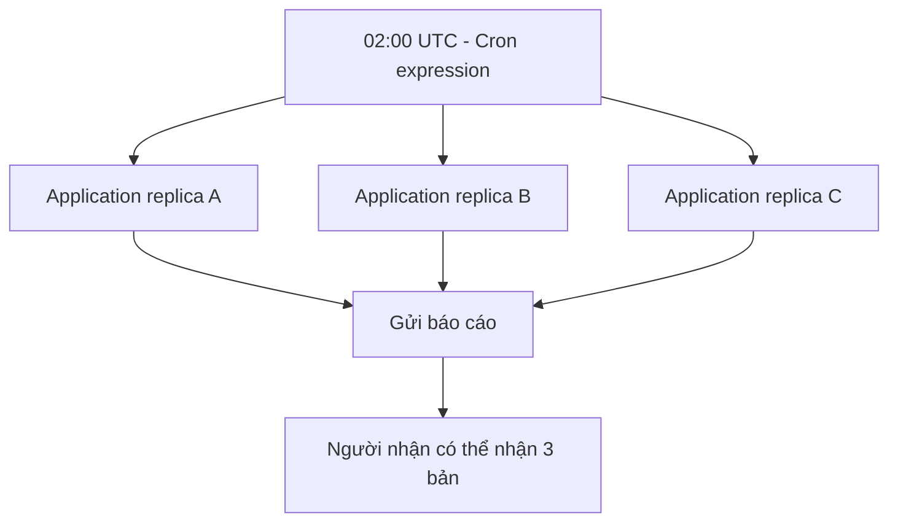
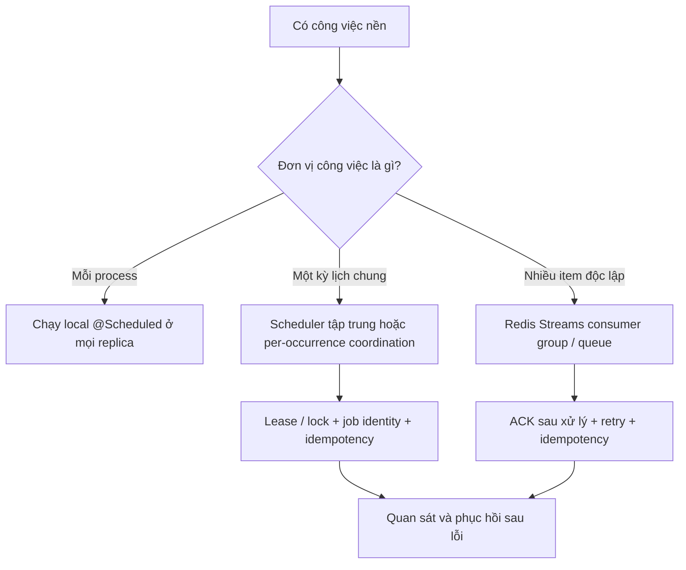
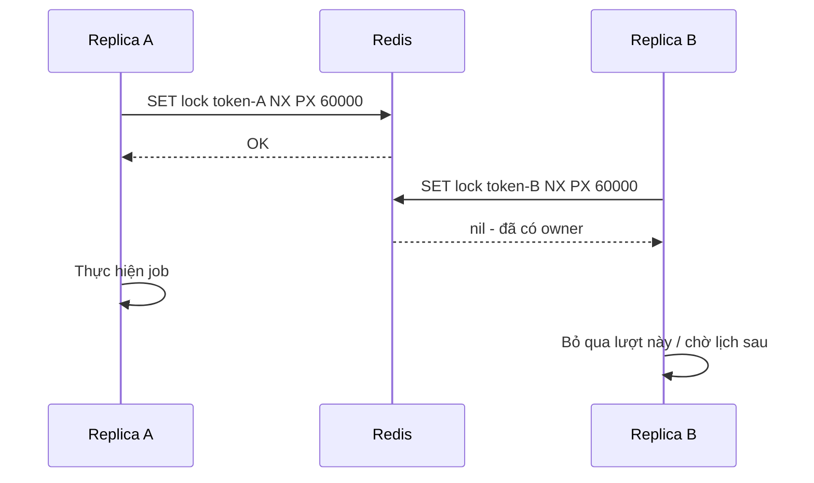
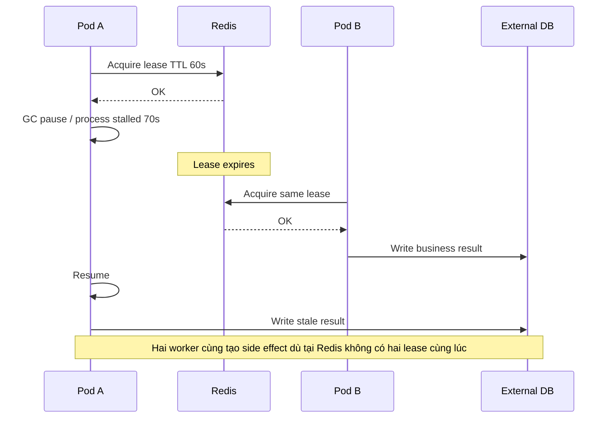
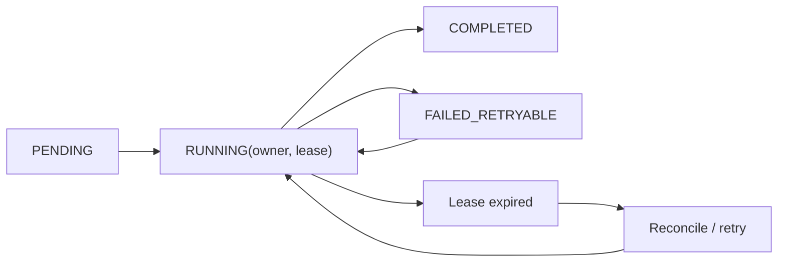
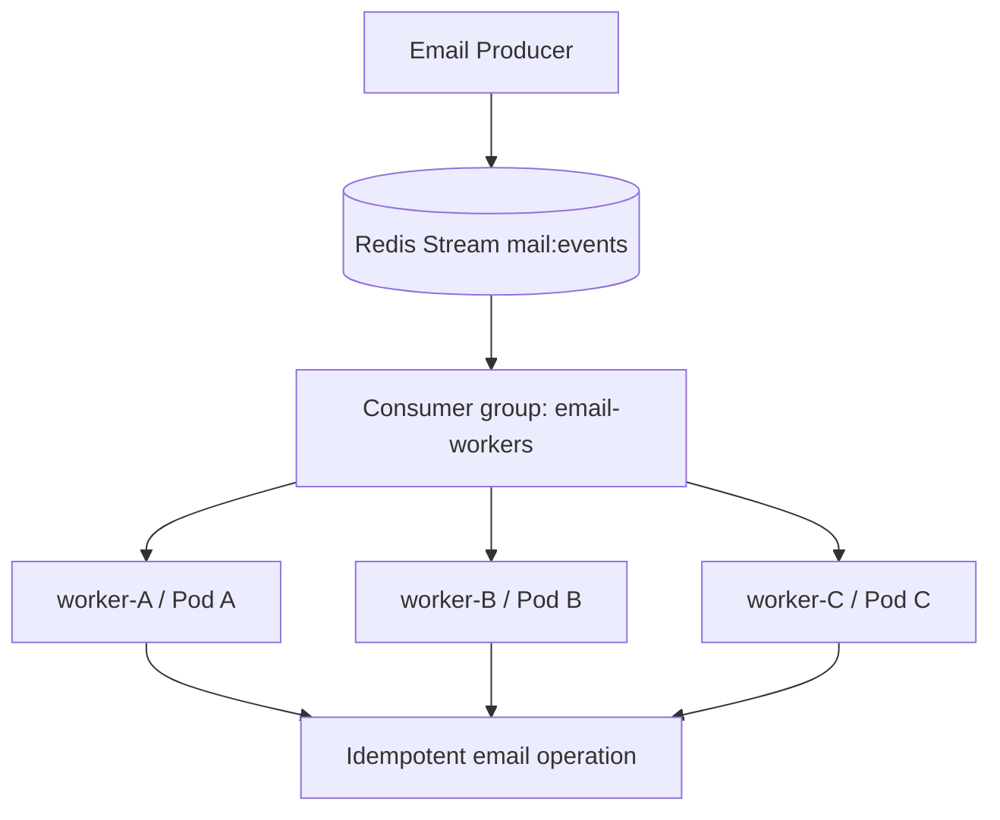
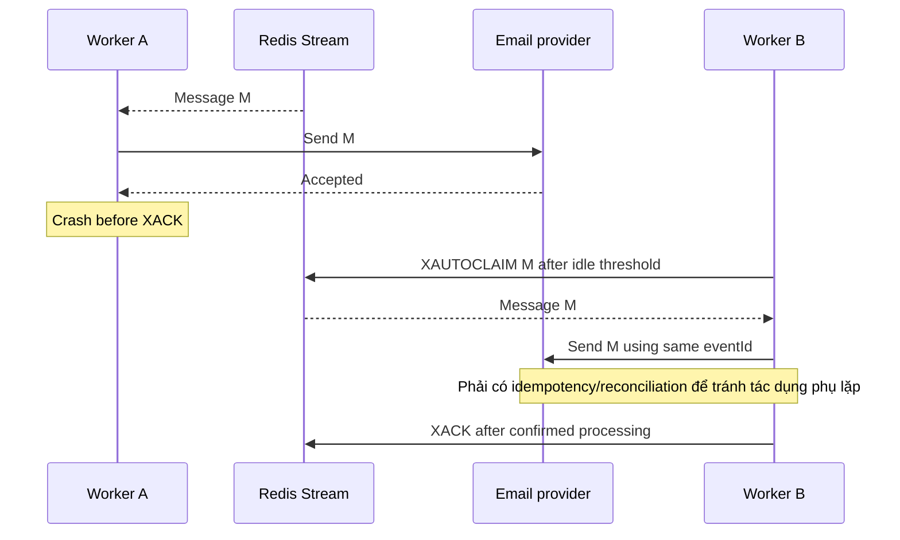

# Triển khai nhiều bản sao ứng dụng và tránh nhân đôi tác vụ nền

Khi triển khai một ứng dụng **Spring Boot + Spring Data Redis** lên Kubernetes, Docker Swarm hoặc nhiều máy chủ, thông thường ta chạy **nhiều bản sao ứng dụng** (*replicas*) để chia tải và tăng khả năng sẵn sàng. Điều này phù hợp cho HTTP requests không giữ trạng thái cục bộ; một bộ cân bằng tải có thể chuyển request tới bất kỳ instance nào.

Nhưng các tác vụ nền thì khác. Một phương thức đánh dấu `@Scheduled` thường được đăng ký **trong mỗi Spring ApplicationContext**. Nếu chạy năm replicas và tất cả cùng bật scheduling, một cron job có thể được kích hoạt **năm lần**, không phải một lần toàn hệ thống. Nếu job gửi email, kết toán cuối ngày, xóa dữ liệu, gia hạn subscription hoặc đồng bộ sang bên thứ ba, hậu quả có thể nghiêm trọng hơn việc CPU bị lãng phí.

**Redis** có thể giúp điều phối bằng một **lease/khóa phân tán** hoặc phân chia công việc qua **Redis Streams consumer group**. Tuy nhiên, cần phân biệt ba mục tiêu:

1. **Không chạy đồng thời:** tại một thời điểm chỉ có tối đa một worker được quyền bắt đầu tác vụ.
2. **Mỗi lịch chạy chỉ xử lý một lần theo nghiệp vụ:** các bản sao đến muộn hoặc retry không tạo thêm một kết quả cho cùng kỳ.
3. **Không bỏ sót và phục hồi được sau lỗi:** worker chết, mất phản hồi hoặc failover vẫn có đường chạy lại an toàn.

Một khóa Redis với TTL chủ yếu giải quyết mục tiêu thứ nhất trong điều kiện đã giả định. **Nó không tự mang lại exactly-once, không tự thay thế trạng thái hoàn thành bền vững và không ngăn mọi race sau failover.**

## 1. Vì sao chạy nhiều replicas làm tác vụ nền bị nhân đôi?

Giả sử ứng dụng có:

```java
import org.springframework.scheduling.annotation.Scheduled;
import org.springframework.stereotype.Component;

@Component
public class DailyReportJob {

    @Scheduled(cron = "0 0 2 * * *", zone = "UTC")
    public void generate() {
        generateDailyReport();
    }

    private void generateDailyReport() {
        // Tổng hợp dữ liệu và gửi báo cáo.
    }
}
```

Đồng thời bật scheduling:

```java
import org.springframework.context.annotation.Configuration;
import org.springframework.scheduling.annotation.EnableScheduling;

@Configuration
@EnableScheduling
public class SchedulingConfiguration {
}
```

Khi deploy ba replicas:

```text
02:00:00 UTC  pod-A  -> generateDailyReport()
02:00:00 UTC  pod-B  -> generateDailyReport()
02:00:00 UTC  pod-C  -> generateDailyReport()
```

Cả ba đều có Spring context và scheduler riêng. `@Scheduled` không tự hỏi Redis hay Kubernetes để xác định “instance lãnh đạo”; vì vậy **không có một scheduler toàn cụm mặc định**.



Điều này xảy ra ngay cả khi cả ba instance cùng dùng **một Redis primary**, **cùng cơ sở dữ liệu SQL** và **cùng cấu hình Spring Boot**. Redis không thể điều phối những thao tác mà ứng dụng chưa thiết kế để điều phối.

### 1.1. Không phải tác vụ nào cũng phải chạy đúng một bản sao

| Loại công việc | Nhiều replica cùng thực hiện? | Lý do |
| --- | --- | --- |
| Thu thập metric trong process | **Đúng**, mỗi replica tự đo | Mỗi process có trạng thái khác nhau |
| Dọn cache **cục bộ** trong process | Thường đúng | Mỗi replica sở hữu cache riêng |
| Làm mới credential hoặc local connection | Thường đúng, theo lifecycle | Tài nguyên thuộc từng instance |
| Gửi báo cáo tổng hợp toàn hệ thống | Thường **không** | Có thể gửi trùng |
| Quét và xử lý mọi job `PENDING` | Cần chia việc hoặc khóa | Các worker có thể xử lý trùng |
| Gửi từng email theo event | Cần hàng đợi và dedup | Không nên broadcast một event cho mọi worker |
| Dọn Redis key theo namespace toàn hệ thống | Cần điều phối/throttle | Nhiều replica quét cùng keyspace gây tải gấp bội |
| Rebuild toàn bộ search index | Cần ownership/phân vùng rõ | Chạy trùng làm tốn tải, có thể ghi đè |

**Quyết định đầu tiên** không phải chọn thư viện khóa, mà là xác định một tác vụ phải chạy **mỗi replica**, **một lần toàn hệ thống**, hay **mỗi item được một worker xử lý**.

## 2. Ba kiểu tác vụ cần ba chiến lược khác nhau



**Một cron job duy nhất** và **hàng nghìn job items** không nên được giải quyết bằng cùng một khóa toàn cục dài hạn. Với hàng đợi, nhiều consumer chạy song song là một lợi thế; điều cần ngăn là **hai worker cùng tạo tác dụng phụ hai lần cho một item**.

## 3. Vì sao synchronized và khóa local không đủ?

```java
private final Object mutex = new Object();

public void doWork() {
    synchronized (mutex) {
        processGlobalJob();
    }
}
```

`mutex` chỉ tồn tại trong **một JVM**. Pod A có mutex A, Pod B có mutex B. Chúng không nhìn thấy nhau.

Tương tự:

- `ReentrantLock` chỉ bảo vệ threads chia sẻ cùng object trong một process.
- `AtomicBoolean running` chỉ ngăn re-entry trong một instance.
- Spring singleton bean chỉ singleton **trong một ApplicationContext**, không singleton trên toàn cụm.
- `@Scheduled(fixedDelay = ...)` điều phối lần chạy **trong cùng scheduler**, không cấm instance khác chạy.
- Chạy một container image giống nhau trên nhiều node không tạo shared memory.

Muốn điều phối replicas phải dùng **một điểm phối hợp chung**: Redis lock, SQL lock/job table, scheduler tập trung, Kubernetes CronJob hoặc một work queue có consumer coordination.

## 4. Redis lease: dùng SET NX PX/EX

Redis có command nguyên tử:

```redis
SET job-lock:cleanup owner-token NX PX 60000
```

Các phần:

| Thành phần | Ý nghĩa |
| --- | --- |
| `job-lock:cleanup` | Tên key đại diện quyền chạy tác vụ |
| `owner-token` | Token ngẫu nhiên riêng của **lần cấp quyền** |
| `NX` | Chỉ đặt key nếu key **chưa tồn tại** |
| `PX 60000` | Đặt TTL 60.000 mili giây cho key trong cùng lệnh |

Nếu set thành công, Redis trả `OK`. Nếu key đã tồn tại, command không cấp lock mới. TTL giúp key tự hết hạn khi process đang giữ lock chết mà không giải phóng.



**Cần đặt TTL nguyên tử ngay khi tạo lock.** Không làm thành hai lệnh độc lập:

```redis
SETNX job-lock:cleanup owner-token
EXPIRE job-lock:cleanup 60
```

Nếu process chết sau `SETNX` nhưng trước `EXPIRE`, lock có thể tồn tại vô thời hạn và làm job ngừng chạy. `SET key value NX PX ttl` tránh cửa sổ đó.

### 4.1. Token không phải tên pod cố định

Không nên dùng mỗi tên instance `pod-A` làm giá trị lock mãi mãi. Token nên là giá trị ngẫu nhiên **mới ở mỗi lần acquire**, ví dụ UUID:

```text
pod-A attempt 1 -> token 3b0f...
pod-A attempt 2 -> token d7ad...
```

Nếu cùng pod khởi động lại hoặc đã mất quyền do TTL, token cũ phải **không thể xóa lock mới** do một lần acquire khác tạo ra.

## 5. Spring Data Redis: cấp Redis lease

`StringRedisTemplate` hỗ trợ `setIfAbsent(key, value, Duration)` để gửi thao tác có điều kiện và TTL:

```java
package com.example.jobs;

import java.time.Duration;
import java.util.Optional;
import java.util.UUID;
import org.springframework.data.redis.core.StringRedisTemplate;
import org.springframework.stereotype.Component;

@Component
public class RedisJobLease {

    private final StringRedisTemplate redis;

    public RedisJobLease(StringRedisTemplate redis) {
        this.redis = redis;
    }

    public Optional<Lease> tryAcquire(
            String lockKey, Duration ttl) {

        if (lockKey == null || lockKey.isBlank()) {
            throw new IllegalArgumentException("lockKey is required");
        }
        if (ttl == null || ttl.isNegative() || ttl.isZero()) {
            throw new IllegalArgumentException("ttl must be positive");
        }

        String token = UUID.randomUUID().toString();

        Boolean acquired = redis.opsForValue()
                .setIfAbsent(lockKey, token, ttl);

        if (Boolean.TRUE.equals(acquired)) {
            return Optional.of(new Lease(lockKey, token));
        }
        if (Boolean.FALSE.equals(acquired)) {
            return Optional.empty();
        }

        // Trong một số execution mode kết quả có thể chưa có ngay.
        // Không chạy job nếu không xác định rõ mình đã có quyền.
        throw new IllegalStateException("Lock acquisition result unknown");
    }

    public record Lease(String key, String token) {
    }
}
```

Ví dụ dùng **lời gọi đồng bộ thông thường**, không sử dụng `setIfAbsent` trong pipeline hay transaction mà kỳ vọng có `Boolean` xác nhận ngay lập tức. Trong Spring Data Redis, tùy execution context, API có thể trả `null`; điều này **không đồng nghĩa đã acquire thành công**.

Khi `RedisConnectionFailureException` hoặc timeout xảy ra sau khi gửi lệnh, lock **có thể đã được tạo** dù client không nhận reply. Nếu outcome không chắc chắn, chọn cách **fail closed**: **không chạy job**, đợi lock hết hạn hoặc có một cơ chế đối soát rõ ràng.

### 5.1. Dùng key có namespace riêng

Ví dụ:

```text
jobs:lock:cleanup:session-cache
jobs:lock:refresh:exchange-rates
jobs:lock:report:daily
```

Chọn một key cho một tài nguyên/tác vụ cần mutual exclusion. Không dùng cùng một lock key cho mọi job không liên quan vì sẽ làm chúng chặn nhau vô ích.

Nếu dùng Redis Cluster, một thao tác lock **một key** có thể định tuyến tới slot sở hữu key. Khi cần script thao tác nhiều key, chúng phải tương thích hash slot theo quy tắc Redis Cluster. Có thể dùng hash tag cho **nhóm key liên quan**, nhưng không gom toàn bộ workload vào một slot nóng không cần thiết.

## 6. Mở khóa phải kiểm tra ownership

Cách mở khóa sai:

```redis
DEL jobs:lock:cleanup:session-cache
```

Vì sao sai?

```text
T0: Pod A acquire lock token-A, TTL=10 giây
T1: Pod A bị dừng rất lâu (GC pause/network)
T2: TTL của token-A hết
T3: Pod B acquire cùng lock key với token-B
T4: Pod A tỉnh dậy, gọi DEL
T5: Lock token-B bị xóa dù B mới là owner hợp lệ
```

Lúc này pod C có thể acquire và chạy đồng thời với B. Vì vậy, chỉ được xóa lock **nếu giá trị key vẫn bằng token của mình**.

### 6.1. Lua compare-and-delete nguyên tử

```lua
-- KEYS[1]: lock key
-- ARGV[1]: owner token của lần acquire hiện tại

if redis.call('GET', KEYS[1]) == ARGV[1] then
    return redis.call('DEL', KEYS[1])
end

return 0
```

Kiểm tra và xóa trong **một script Redis**, nên không có client khác xen vào giữa `GET` và `DEL`.

Không làm hai lệnh ở Java:

```java
// KHÔNG AN TOÀN: giữa GET và DELETE, lock có thể hết hạn/đổi owner.
if (token.equals(redis.opsForValue().get(lockKey))) {
    redis.delete(lockKey);
}
```

### 6.2. Gọi Lua bằng Spring Data Redis

Thêm vào class `RedisJobLease` ở trên:

```java
import java.util.List;
import org.springframework.data.redis.core.script.DefaultRedisScript;

private static final DefaultRedisScript<Long> UNLOCK =
        new DefaultRedisScript<>(
            "if redis.call('GET', KEYS[1]) == ARGV[1] then " +
            "return redis.call('DEL', KEYS[1]) else return 0 end",
            Long.class);

public boolean release(Lease lease) {
    Long result = redis.execute(
            UNLOCK,
            List.of(lease.key()),
            lease.token());
    return Long.valueOf(1L).equals(result);
}
```

`true` nghĩa là script vừa xóa được **lock mà lần acquire đó đang sở hữu**. `false` có thể nghĩa là lock đã hết hạn, đã được người khác thay thế hoặc không còn tồn tại. Không retry `DEL` vô điều kiện chỉ vì `release` không xóa được gì.

Nếu mạng lỗi trong lúc release, lock có thể đã xóa hoặc vẫn còn; TTL bảo vệ khả năng phục hồi cuối cùng. **Không tự sửa bằng `DEL` không điều kiện.**

## 7. Tích hợp với @Scheduled một cách có giới hạn

Một cách tổ chức là để scheduler được chạy ở mọi replica, nhưng mỗi lần chỉ instance có lease mới được gọi worker.

```java
package com.example.jobs;

import java.time.Duration;
import java.util.Optional;
import org.springframework.scheduling.annotation.Scheduled;
import org.springframework.stereotype.Component;

@Component
public class CacheCleanupSchedule {

    private static final String LOCK =
            "jobs:lock:cleanup:session-cache";

    private final RedisJobLease leases;
    private final CacheCleanupWorker worker;

    public CacheCleanupSchedule(
            RedisJobLease leases, CacheCleanupWorker worker) {
        this.leases = leases;
        this.worker = worker;
    }

    @Scheduled(
        fixedDelayString = "${jobs.cache-cleanup.delay-ms:60000}")
    public void cleanupOnce() {
        Optional<RedisJobLease.Lease> acquired =
                leases.tryAcquire(LOCK, Duration.ofSeconds(60));

        if (acquired.isEmpty()) {
            return; // Replica khác đang làm việc.
        }

        try {
            // Một batch nhỏ, có thời gian thực thi chặn trên
            // ngắn hơn TTL, ví dụ 100 key / 20 giây.
            worker.processSmallBoundedBatch();
        } finally {
            leases.release(acquired.get());
        }
    }
}
```

Trong ví dụ, `CacheCleanupWorker` là một service/bean riêng do ứng dụng triển khai. `processSmallBoundedBatch()` phải có giới hạn **thời gian, số key và concurrency**, không phải thao tác quét/xóa toàn bộ dữ liệu không giới hạn.

**Giới hạn của ví dụ:** lease 60 giây **không được tự gia hạn**. Nếu `processSmallBoundedBatch` vượt quá 60 giây vì Redis chậm, JVM pause hoặc process bị treo, replica khác có thể lấy lock khi worker cũ **vẫn đang chạy**. Vì vậy cách này chỉ phù hợp cho job nhỏ/best effort với thời gian có thể kiểm soát và tác dụng phụ có thể xử lý trùng.

Nếu cần loại trừ chặt chẽ cho công việc dài/quan trọng, phải dùng thêm lease renewal có điều kiện, kiểm tra ownership giữa các batch, **fencing** và idempotency ở nguồn dữ liệu đích.

## 8. Lease TTL không phải thời gian chạy tối đa của JVM

Đặt `PX 60000` không khiến Java thread đang làm việc tự dừng sau 60 giây. Redis chỉ xóa key khi TTL hết theo cơ chế expiration.

Một tình huống:



**Mutual exclusion tại Redis trong một thời gian thuê** không phải bằng chứng rằng không có **hai process còn đang thực thi**. Lease không thể “thu hồi” những CPU threads hoặc side effects đang chạy ngoài Redis.

### 8.1. Chọn TTL thế nào?

TTL nên xét:

- Thời gian xử lý bình thường và p99 của job.
- Thời gian worst-case dự kiến theo kích thước batch.
- JVM GC pause và scheduling delay.
- Network timeout, retry/backoff.
- Failover và topology refresh của Redis.
- Thời gian cần cleanup khi worker thực sự đã chết.

TTL càng dài thì khóa của worker chết càng lâu mới được giải phóng; TTL quá ngắn thì nguy cơ hai worker chạy chồng càng cao. Không có một giá trị cố định đúng cho mọi job.

## 9. Lease renewal (heartbeat) phải so khớp token

Nếu job bắt buộc chạy lâu hơn TTL ban đầu, worker có thể gia hạn lease theo chu kỳ. Nhưng việc gia hạn **chỉ được phép khi vẫn sở hữu đúng token**:

```lua
-- KEYS[1] = lock key
-- ARGV[1] = owner token
-- ARGV[2] = TTL mới tính bằng mili giây

if redis.call('GET', KEYS[1]) == ARGV[1] then
    return redis.call('PEXPIRE', KEYS[1], ARGV[2])
end

return 0
```

Gia hạn bằng `PEXPIRE` không điều kiện có thể kéo dài lease của worker khác. Một heartbeat an toàn cần:

1. Chạy **trước khi TTL hết**, có đủ buffer cho network/Redis delay.
2. So sánh token một cách nguyên tử như script trên.
3. Nếu gia hạn thất bại hoặc không rõ kết quả, worker **không được khẳng định mình còn quyền**.
4. Giới hạn số retry/timeout, không busy-loop trong lúc Redis quá tải.
5. Với công việc chia batch, kiểm tra ownership trước các bước tiếp theo khi có thể.
6. Dùng fencing/idempotency ở **tài nguyên đích** để chống những thao tác đã bắt đầu nhưng không thể dừng lại.

**Giới hạn:** ngay cả khi renewal thường hoạt động, một GC pause dài hoặc phân vùng mạng vẫn có thể khiến lease hết hạn. Renewal giúp giảm rủi ro, **không chứng minh exactly-once**.

## 10. Fencing token: bảo vệ tài nguyên đích khỏi worker cũ

Một **fencing token** là giá trị **tăng đơn điệu** dùng để chứng minh mức quyền mới hơn. Hệ thống đích giữ token lớn nhất đã chấp nhận và từ chối yêu cầu có token cũ.

Ví dụ:

```text
Pod A lấy token 104 và bắt đầu ghi.
Lease của A hết.
Pod B lấy token 105 và ghi vào database.
Pod A tỉnh dậy, gửi thao tác với token 104.
Database từ chối vì 104 < 105.
```

Một schema khái niệm:

```sql
CREATE TABLE controlled_resource (
    resource_id       VARCHAR(100) PRIMARY KEY,
    current_value     TEXT,
    last_fence_token  BIGINT NOT NULL
);
```

Khi cập nhật:

```sql
UPDATE controlled_resource
SET current_value = :value,
    last_fence_token = :token
WHERE resource_id = :id
  AND last_fence_token < :token;
```

Ứng dụng phải kiểm tra số dòng được cập nhật. `0` có thể nghĩa là token đã cũ hoặc resource không tồn tại; cần phân loại theo hợp đồng. Bản ghi đầu tiên cần được khởi tạo có `last_fence_token` hợp lệ.

**Điểm quan trọng:** không tự coi `INCR jobs:fence` trong một Redis replication bất đồng bộ là **nguồn fencing token bền vững tuyệt đối qua mọi failover**. Một counter có thể mất cập nhật khi primary đổi. Nếu bảo đảm an toàn mạnh là bắt buộc, token phải đến từ một nguồn có cơ chế cấp phát **đơn điệu và bền vững** thích hợp (ví dụ database có transaction/sequence phù hợp), và tài nguyên đích **thực sự kiểm tra token**.

Redis lock không tự tạo cơ chế fencing trên SQL, object storage hay API bên ngoài. Nếu hệ thống đích không kiểm tra token, một worker đã mất lease vẫn có thể gây tác dụng phụ.

## 11. Redis failover và giới hạn của distributed lock

Redis có thể chạy với Sentinel hoặc Redis Cluster. Trong những mô hình này, replication giữa primary và replica có thể là **bất đồng bộ**.

```text
T1. Pod A SET lock=A NX PX 60000 -> OK trên primary cũ.
T2. Primary cũ chết trước khi replica được promote nhận lock.
T3. Replica mới lên primary nhưng không có lock=A.
T4. Pod B SET lock=B NX PX 60000 -> OK trên primary mới.
```

Pod A từng được xác nhận là owner và có thể vẫn đang chạy tác vụ; pod B cũng được cấp quyền trên primary mới. Đây là lý do **Redis lock kiểu một primary + async replication không phải một cơ chế consensus lock có bảo đảm mạnh qua mọi failover**.

Ngay cả cơ chế lock phân tán nhiều Redis nodes như Redlock cũng cần đánh giá các giả định về thời gian, độ trễ, lỗi đồng thời và mức độ an toàn yêu cầu. Không nên tuyên bố một thuật toán lock bất kỳ tự đạt exactly-once cho tác dụng phụ bên ngoài Redis.

**Cách ra quyết định:**

- Job dọn cache, refresh dữ liệu có thể chạy lặp: Redis lease + idempotency thường phù hợp.
- Job chỉ cần giảm xử lý trùng, có thể retry: Redis lease là một thành phần hữu ích.
- Chuyển tiền, kết toán/sổ cái, cấp phát tài nguyên có ràng buộc mạnh: dùng nguồn sự thật/giao dịch và cơ chế fencing/idempotency phù hợp; không chỉ dựa vào một key Redis.

## 12. Quan trọng: khóa chỉ chống overlap, không chống lặp theo kỳ

Giả sử job chạy lúc 02:00 UTC mỗi ngày và tất cả replicas nhận trigger lệch vài giây:

```text
02:00:00  Pod A acquire lock.
02:00:01  Pod A hoàn thành và release lock.
02:00:03  Pod B mới bắt đầu @Scheduled, acquire lock thành công.
02:00:04  Pod B chạy lại cùng báo cáo.
```

**Không có hai job chạy đồng thời**, nhưng báo cáo vẫn được gửi hai lần. Do vậy phải phân biệt:

| Mục tiêu | Cơ chế |
| --- | --- |
| Ngăn hai job **chạy cùng lúc** | Lease/lock |
| Ngăn cùng một **scheduled occurrence** chạy lại | Job ID theo kỳ + completed/dedup state |
| Chạy lại nếu worker chết trước khi hoàn thành | Trạng thái job có recovery/lease |
| Chống gửi trùng email/charge/payment | Idempotency ở nơi tạo tác dụng phụ |

Đây là lỗi thiết kế phổ biến khi triển khai `@Scheduled` nhiều replicas: chỉ gắn Redis lock và cho rằng job "chạy đúng một lần mỗi ngày".

### 12.1. Thiết kế `jobOccurrenceId`

Một kỳ chạy cần ID ổn định:

```text
jobName       = daily-report
businessDate  = 2026-11-13 (UTC)
occurrenceId  = daily-report:2026-11-13
```

Đừng dùng `UUID.randomUUID()` làm **occurrence ID** ở mỗi replica: như vậy ba replicas sẽ có ba ID khác nhau và không thể deduplicate cùng một kỳ. UUID riêng từng lần **acquire lock** là đúng; ID **kỳ lịch** phải giống nhau ở tất cả replicas.

Nếu lịch phụ thuộc múi giờ nghiệp vụ, dùng `LocalDate`/`ZoneId` phù hợp. “Mỗi 24 giờ” khác “mỗi ngày lịch” ở nơi có DST. Một cron trigger bắt đầu muộn qua ngày mới cũng cần quy định kỳ nghiệp vụ nào đang được xử lý.

## 13. Durable job run table: bảo đảm theo kỳ ở nguồn sự thật

Với nghiệp vụ quan trọng, có thể tạo bảng trạng thái job ở **database giao dịch**:

```sql
CREATE TABLE job_runs (
    job_name       VARCHAR(100) NOT NULL,
    occurrence_id  VARCHAR(160) NOT NULL,
    status         VARCHAR(20) NOT NULL,
    owner_id       VARCHAR(120),
    lease_until    TIMESTAMP,
    started_at     TIMESTAMP,
    finished_at    TIMESTAMP,
    PRIMARY KEY (job_name, occurrence_id)
);
```

Ràng buộc unique ở `(job_name, occurrence_id)` ngăn hai transaction đồng thời **tạo hai bản ghi job khác nhau** cho cùng kỳ. Nhưng chỉ thêm unique constraint **chưa đủ** để đảm bảo phục hồi khi job chết giữa chừng.

Một state machine đơn giản:



Yêu cầu thiết kế:

1. Claim một kỳ chạy bằng transaction/CAS để chỉ một owner được chạy theo trạng thái hiện tại.
2. `COMPLETED` phải được ghi sau khi tác dụng phụ phù hợp đã được xác nhận.
3. Khi owner chết, một worker khác có thể reclaim job quá hạn.
4. Nếu job đã tạo side effect rồi mới chết trước `COMPLETED`, **retry sẽ xảy ra**; side effect phải idempotent.
5. Một transaction SQL chỉ bảo vệ những cập nhật **cùng database**. Nó không tự tạo atomicity với Redis hoặc API gửi email bên ngoài.

### 13.1. Ghi kết quả và marker trong cùng transaction khi có thể

Nếu job chỉ tính toán rồi ghi kết quả vào **cùng database**, có thể đặt:

```text
UPDATE business_summary ...
UPDATE job_runs SET status='COMPLETED' ...
COMMIT
```

trong một transaction có điều kiện/unique hợp lệ. Khi rollback, cả kết quả lẫn marker cùng rollback. Khi commit, cả hai cùng được ghi nhận theo hợp đồng database.

Nếu job gọi nhà cung cấp email/thanh toán ngoài database, cần **outbox**, một API có hỗ trợ idempotency key, hoặc một quy trình xác minh/đối soát. Không thể đặt một transaction SQL xung quanh request mạng rồi coi tất cả thành một commit nguyên tử.

### 13.2. Kết hợp SQL occurrence state với Redis lease

Có thể dùng Redis lease để giảm số worker cùng chạy nặng, còn bảng `job_runs` làm **nguồn sự thật** về trạng thái kỳ chạy. Đây là cách phân quyền rõ:

```text
Redis lease            -> giảm cạnh tranh / overlap best effort
SQL job_runs           -> xác định kỳ, owner, trạng thái hoàn thành
Business idempotency   -> ngăn side effect lặp khi retry/recover
```

Nếu Redis failover làm mất lock, hệ thống vẫn có thể dùng transaction/unique key ở SQL để không commit hai kết quả cho cùng occurrence. Nhưng phải thực sự kiểm tra điều kiện ở đường ghi, không chỉ lưu một bản ghi mang tên job.

## 14. Marker hoàn thành trong Redis: khi nào dùng được?

Với các job chỉ liên quan dữ liệu Redis/có thể tái tạo, có thể dùng:

```text
jobs:run:daily-report:2026-11-13:done
```

để ghi rằng một kỳ đã hoàn tất. Tuy nhiên:

- Hai replica không được thực hiện check-then-set marker bằng các lệnh độc lập rồi tự tin không có race.
- Nếu marker được ghi **trước** tác vụ, crash có thể tạo **bỏ sót**.
- Nếu marker được ghi **sau** tác vụ, crash có thể gây **chạy lại**.
- Marker trên Redis cũng chịu rủi ro replication/persistence/failover.
- TTL của marker phải đủ dài so với toàn bộ cửa sổ retry và thời gian có thể nhận lại trigger.

Với những thao tác **chỉ nằm ở một hash slot Redis**, có thể dùng Lua để kiểm tra marker và cập nhật dữ liệu Redis **trong một script nguyên tử**. Điều đó giúp tránh race giữa các command trên primary hiện tại, nhưng **không làm Redis Sentinel/Cluster replication trở thành commit bền vững toàn hệ thống**.

Với dữ liệu cần tính chính xác pháp lý/tài chính, Redis marker không nên là nguồn sự thật duy nhất.

## 15. Đừng dùng một global lock cho cả hàng đợi công việc

Giả sử hệ thống có 50.000 email cần gửi. Một cách kém hiệu quả:

```text
Replica A acquire global lock
Replica A xử lý toàn bộ 50.000 emails
Replica B, C, D ngồi chờ
```

Hạn chế:

- Một worker trở thành bottleneck.
- Lease phải gia hạn lâu, tăng rủi ro stale owner.
- Worker chết giữa chừng khó xác định item nào đã hoàn thành.
- Khóa không tự cung cấp ACK/retry theo từng item.

Nếu công việc **có thể chia thành các message độc lập**, hãy dùng cơ chế competing consumers, ví dụ **Redis Streams consumer groups** hoặc một message broker phù hợp.

## 16. Redis Streams Consumer Group: chia việc giữa replicas

Redis Streams cho phép nhiều consumer cùng thuộc **một group** và cạnh tranh nhận **các bản ghi mới**. Một message được giao cho một consumer trong group ở mỗi lần phân phối, nhưng có thể được xử lý lại sau failure/reclaim; đó là mô hình **at-least-once**, không phải exactly-once side effect.

Ví dụ dòng:

```redis
XGROUP CREATE mail:events email-workers 0 MKSTREAM
```

`0` nghĩa là group có thể đọc từ đầu các record đang được lưu. Nếu tạo group với `$`, group bắt đầu tại vị trí cuối lúc tạo, phù hợp khi chỉ muốn những bản ghi **được thêm sau đó**.

Producer thêm event:

```redis
XADD mail:events * eventId email-001 to user-101 template welcome
XADD mail:events * eventId email-002 to user-102 template welcome
XADD mail:events * eventId email-003 to user-103 template welcome
```

Consumer A:

```redis
XREADGROUP GROUP email-workers worker-A COUNT 10 BLOCK 2000 STREAMS mail:events >
```

Consumer B:

```redis
XREADGROUP GROUP email-workers worker-B COUNT 10 BLOCK 2000 STREAMS mail:events >
```

`>` dùng để đọc những message **chưa được phân phối cho một consumer trong group**. Nếu tất cả replicas dùng **cùng một group name** nhưng **consumer name khác nhau**, chúng có thể xử lý song song những message mới khác nhau.



### 16.1. Một group khác là một subscription khác

Nếu mỗi replica tạo một **group khác nhau**, mỗi group có thể nhận một bản sao logic của những message tương ứng:

```text
mail-group-A -> thấy message M
mail-group-B -> cũng thấy message M
mail-group-C -> cũng thấy message M
```

Điều đó phù hợp khi ba **ứng dụng/chức năng khác nhau** đều phải nhận event (ví dụ audit, analytics, email), nhưng **không phù hợp** nếu ba replicas cùng một chức năng email chỉ cần chia nhau xử lý.

Ngược lại, cùng group mà dùng cùng **consumer name** trên nhiều process khiến ownership/PEL khó quản lý và làm mất tín hiệu nhận diện worker rõ ràng. Nên đặt consumer name duy nhất cho vòng đời instance, chẳng hạn pod name cộng instance ID khi cần.

## 17. Pending Entries List và ACK sau tác dụng phụ

Khi consumer group phân phối một record, Redis theo dõi record đang chờ xử lý trong **Pending Entries List (PEL)** cho đến khi có `XACK`.

Ví dụ:

```redis
XACK mail:events email-workers 1731000000000-0
```

Thay Record ID minh họa bằng ID thực nhận từ `XREADGROUP`.

**Thứ tự quan trọng:**

```text
1. Đọc message.
2. Xác thực payload / kiểm tra event ID.
3. Xử lý nghiệp vụ có idempotency.
4. Sau khi xử lý thành công bền vững, XACK.
```

Nếu `XACK` **trước** khi gửi email/ghi database, consumer chết sau ACK có thể làm công việc bị bỏ sót. Nếu **ACK sau**, worker có thể chết sau side effect nhưng trước ACK, message còn pending và sẽ được xử lý lại.

Do đó **at-least-once delivery + idempotent processing** là hợp đồng thường thực tế hơn hứa “gửi một lần duy nhất”.

### 17.1. Quan sát pending

```redis
XPENDING mail:events email-workers
XPENDING mail:events email-workers - + 20
```

Các lệnh này giúp biết số record đang pending, owner consumer và độ nhàn rỗi theo khả năng kết quả trả về. Pending không đồng nghĩa chắc chắn consumer chết: một tác vụ chậm vẫn có thể đang xử lý hợp lệ.

Đừng tự động reclaim mọi record pending sau 1 giây khi một email call có thể mất 20 giây; điều đó tạo hai worker xử lý cùng message.

## 18. Phục hồi khi một consumer chết: XAUTOCLAIM

Giả sử Pod A nhận message rồi chết. Message vẫn nằm trong PEL. Pod B có thể lấy những pending entry đủ lâu chưa được xử lý bằng `XAUTOCLAIM` (Redis 6.2+):

```redis
XAUTOCLAIM mail:events email-workers worker-B 60000 0-0 COUNT 100
```

Các tham số:

| Phần | Ý nghĩa |
| --- | --- |
| `mail:events` | Stream |
| `email-workers` | Consumer group |
| `worker-B` | Consumer nhận quyền mới |
| `60000` | Chỉ xét những record có idle ít nhất 60.000 ms |
| `0-0` | Cursor bắt đầu duyệt PEL |
| `COUNT 100` | Số lượng mục tiêu theo batch |

Kết quả gồm **cursor tiếp theo** và các record đã được claim. Phải lặp theo cursor/giới hạn job; đừng giả định một lệnh claim đã quét hết pending. Với các phiên bản Redis mới, response còn có thông tin ID của entry đã bị xóa/trim theo hợp đồng lệnh.

Nếu một message đã được consumer A gửi email nhưng A chết **trước ACK**, B sẽ claim lại và có thể gửi trùng nếu không có idempotency ở tầng gửi.



**`XACK` không xóa record khỏi Stream.** Nó xóa trạng thái pending trong group. Retention/trim của Stream là vấn đề riêng và phải giữ bản ghi đủ lâu cho recovery.

## 19. Spring Data Redis: consumer group ở tầng ứng dụng

Spring Data Redis hỗ trợ `StreamOperations`, `StreamMessageListenerContainer` và trong ứng dụng reactive có các API tương ứng để đọc Streams.

Một phác thảo đọc có kiểm soát bằng `StringRedisTemplate`:

```java
import java.time.Duration;
import java.util.List;
import java.util.UUID;
import org.springframework.data.redis.connection.stream.Consumer;
import org.springframework.data.redis.connection.stream.MapRecord;
import org.springframework.data.redis.connection.stream.ReadOffset;
import org.springframework.data.redis.connection.stream.StreamOffset;
import org.springframework.data.redis.core.StreamReadOptions;
import org.springframework.data.redis.core.StringRedisTemplate;

String consumerName = "mail-worker-" + UUID.randomUUID();

List<MapRecord<String, Object, Object>> records =
        stringRedisTemplate.opsForStream().read(
            Consumer.from("email-workers", consumerName),
            StreamReadOptions.empty()
                    .count(10)
                    .block(Duration.ofSeconds(2)),
            StreamOffset.create(
                    "mail:events",
                    ReadOffset.lastConsumed()));

if (records != null) {
    for (MapRecord<String, Object, Object> record : records) {
        // 1. Lấy eventId và payload, validate.
        // 2. Ghi nhận side effect theo idempotency contract.
        // 3. Chỉ ACK khi tác vụ đã thành công bền vững.
        processEmailIdempotently(record);
        stringRedisTemplate.opsForStream().acknowledge(
                "mail:events", "email-workers", record.getId());
    }
}
```

Trong ví dụ, `processEmailIdempotently` là một phương thức nghiệp vụ **do ứng dụng triển khai**, không phải API của Spring. Đoạn mã minh họa **một lượt poll**, không phải một background worker đầy đủ; vòng đời polling, threads, timeout, shutdown, retry/poison message và recovery PEL cần được tổ chức riêng.

Nếu dùng container listener với acknowledgement tự động, phải hiểu **thời điểm ACK** và xử lý exception. Với side effect không thể thực hiện lặp, không nên chỉ bật auto-ack mà không xem hợp đồng processing.

### 19.1. Không dùng Redis Pub/Sub làm competing queue

Redis Pub/Sub theo kiểu **broadcast**: mọi subscriber đang lắng nghe channel có thể nhận cùng message.

```text
PUBLISH events:email ...
  -> Pod A subscriber
  -> Pod B subscriber
  -> Pod C subscriber
```

Nếu cả ba đều gửi email, tác dụng phụ bị nhân ba. Pub/Sub cũng không có PEL/ACK/replay khi subscriber offline. Khi muốn **chia việc một message cho một worker tại một thời điểm**, dùng consumer group hoặc broker/work queue có hợp đồng phù hợp, không dùng broadcast Pub/Sub.

## 20. Idempotency là lớp bảo vệ bắt buộc cho side effects

Ngay cả khi đã có lock hoặc consumer group, duplicate vẫn có thể phát sinh từ:

- Retry sau network timeout.
- Worker crash sau side effect trước khi ACK.
- Lease expiry/renewal failure.
- Redis failover và replication lag.
- Producer gửi cùng sự kiện nhiều lần.
- Deploy/rollback làm hai phiên bản ứng dụng chạy chồng.

Vì vậy, gắn **idempotency key** ổn định theo nghiệp vụ:

```text
eventId = email-001
idempotencyKey = email:welcome:user-101:campaign-2026-11
```

Nếu nhà cung cấp email/charge có API hỗ trợ idempotency key, chuyển cùng key ở mọi attempt. Nếu không, cần lưu ledger và quy trình đối soát tại nguồn sự thật để tránh side effect lặp.

### 20.1. Ví dụ bảng dedup

```sql
CREATE TABLE processed_events (
    consumer_group  VARCHAR(100) NOT NULL,
    event_id        VARCHAR(160) NOT NULL,
    processed_at    TIMESTAMP NOT NULL,
    PRIMARY KEY (consumer_group, event_id)
);
```

Một cách dùng phù hợp khi side effect **cũng là ghi vào cùng database**:

```text
BEGIN TRANSACTION
  INSERT processed_events ... ON CONFLICT DO NOTHING
  Nếu insert thành công: cập nhật business tables
COMMIT
Sau khi commit: XACK
```

Với PostgreSQL, `INSERT ... ON CONFLICT DO NOTHING` là một kỹ thuật dedup trong transaction. Phải kiểm tra **số dòng insert** để phân biệt event mới với event đã xử lý.

Nếu business update và processed marker cùng transaction thì chúng commit/rollback cùng nhau. Nhưng nếu side effect là **gọi HTTP tới payment/email provider**, không thể đạt atomic commit với SQL chỉ bằng cách thêm một bảng. Khi đó cần outbox, provider idempotency key, trạng thái `UNKNOWN` và reconciliation.

### 20.2. Không tạo event ID mới khi retry

Sai:

```text
Attempt 1: eventId=UUID-A
Attempt 2: eventId=UUID-B
Attempt 3: eventId=UUID-C
```

Ba attempt sẽ trông như ba công việc khác nhau. Đúng là giữ **cùng một idempotency key** theo logical event, còn attempt ID có thể khác để tracing.

## 21. Tác vụ theo thời gian và tác vụ theo dữ liệu nên tách

Một pattern phù hợp ở quy mô lớn:

```text
Scheduler lúc 02:00
    |
    +-- Tạo một job occurrence bền vững
    +-- Phân rã thành 10.000 item IDs
    +-- Publish từng item vào Stream/Queue
                      |
                      +-- Worker A
                      +-- Worker B
                      +-- Worker C
                      +-- Worker D
```

Scheduler chỉ làm công việc **nhẹ và idempotent**: đảm bảo tạo một batch/job identity cho kỳ. Workers xử lý các items có thể retry.

Ưu điểm:

- Không giữ một global lock trong hàng giờ.
- Có thể scale workers theo backlog.
- Dễ đo throughput/pending/DLQ.
- Mỗi item có idempotency key riêng.
- Hỗ trợ partial failure và resume.

**Cần bảo đảm producer không phát hai tập item với ID mới cho cùng kỳ**; tốt nhất tạo các item theo ID xác định từ `occurrenceId` và entity ID hoặc lưu bảng job items có unique constraint.

## 22. Những lựa chọn điều phối khác ngoài Redis lock

Redis không phải giải pháp duy nhất cho mọi scheduler:

| Giải pháp | Phù hợp | Giới hạn cần hiểu |
| --- | --- | --- |
| **Redis lease** (`SET NX PX`) | Job ngắn, best-effort mutual exclusion | Expiry/failover/stale owner; không tự chống lặp theo kỳ |
| **ShedLock với Redis provider** | Bổ sung khóa theo tên cho Spring `@Scheduled` | Cần hiểu `lockAtMostFor`, `lockAtLeastFor`, provider/version và giới hạn Redis |
| **Kubernetes CronJob** | Chạy lịch tại nền tảng thay vì nhúng cron trong mỗi web replica | Job có thể được tạo lại/bỏ lỡ; cần idempotency |
| **Quartz JDBC JobStore cluster** | Scheduler có persistent triggers, misfire/recovery và coordination qua database | Cấu hình cluster/job store; vẫn cần idempotency side effect |
| **Database job_runs/locks** | Job quan trọng gắn với dữ liệu SQL | Cần transaction, lease/recovery và tối ưu contention |
| **Redis Streams consumer group** | Nhiều item độc lập, competing consumers, retry/Pending | At-least-once, dedup/ACK/reclaim cần thiết |
| **Broker chuyên dụng** | Event/task volume lớn, retention/replay/phân vùng theo nhu cầu | Cần vận hành broker và semantics phù hợp |
| **Một Deployment scheduler riêng** | Đơn giản khi ít cron jobs | Replica=1 chưa tự là exactly-once khi restart/rolling update |

Chọn giải pháp theo **đơn vị công việc và mức hậu quả khi lặp/mất**, không theo việc ứng dụng đã có Redis nên “tiện dùng Redis cho mọi thứ”.

## 23. ShedLock với Spring @Scheduled

Thư viện như **ShedLock** có thể cung cấp lớp khóa cho các phương thức Spring scheduled, với storage provider dựa trên Redis hoặc SQL. Ý tưởng khai báo (cần đối chiếu phiên bản ShedLock và cấu hình provider thực tế):

```java
@Scheduled(cron = "0 0 2 * * *", zone = "UTC")
@SchedulerLock(
        name = "dailyReport",
        lockAtMostFor = "PT10M",
        lockAtLeastFor = "PT30S")
public void runDailyReport() {
    // Idempotent business operation.
}
```

Ý nghĩa:

- `lockAtMostFor`: giới hạn tối đa thời gian khóa còn tồn tại theo lease, nhằm không kẹt vĩnh viễn khi owner chết.
- `lockAtLeastFor`: giữ khóa tối thiểu để giảm trường hợp một node chạy quá nhanh và node khác ngay sau đó có thể acquire. Đây không thay thế occurrence ID/dedup.
- `name`: cùng một job trên các replicas phải dùng **cùng tên khóa**.

**Cảnh báo:** đây là đoạn minh họa annotation, chỉ compile khi dự án đã thêm dependency/config ShedLock phù hợp. Spring Framework **không tự có** `@SchedulerLock`; nó là API của thư viện bổ sung.

ShedLock không tự nâng Redis replication thành consistency mạnh, không tự dừng stale worker khi lease hết và không biến một external side effect thành exactly-once. Với `lockAtMostFor` nhỏ hơn thời gian chạy thật, hai bản sao có thể overlap. Các API/provider/phiên bản khác nhau có thể hỗ trợ các tính năng lease extension khác nhau; cần đọc tài liệu đúng phiên bản trước khi triển khai.

## 24. Kubernetes CronJob thay vì cron trong mọi web pod

Nếu hệ thống chạy Kubernetes, có thể **tách scheduler khỏi các replicas phục vụ HTTP**:

```yaml
apiVersion: batch/v1
kind: CronJob
metadata:
  name: daily-report
spec:
  schedule: "0 2 * * *"
  timeZone: "Etc/UTC"
  concurrencyPolicy: Forbid
  startingDeadlineSeconds: 600
  jobTemplate:
    spec:
      backoffLimit: 3
      template:
        spec:
          restartPolicy: OnFailure
          containers:
            - name: report
              image: example.org/report-worker:1.0
              args: ["--job=daily-report"]
```

Địa chỉ image là placeholder. Cần bổ sung cấu hình namespace, service account, resource limits, secrets, logging và policy theo cụm Kubernetes thực tế.

Trong một CronJob:

- `schedule` xác định lịch.
- `timeZone` chọn múi giờ của lịch khi Kubernetes version hỗ trợ.
- `concurrencyPolicy: Forbid` ngăn **job mới của cùng CronJob** chạy chồng khi job trước còn đang active theo logic controller.
- `startingDeadlineSeconds` giới hạn khoảng trễ chấp nhận được để bắt đầu lịch đã bỏ lỡ.
- `backoffLimit` liên quan retry của Job khi pod thất bại.

**Không hiểu `Forbid` là bảo đảm exactly-once toàn hệ thống.** Kubernetes docs lưu ý CronJob có thể không tạo một Job cho một thời điểm hoặc đôi khi có thể tạo nhiều Job; vì vậy workload phải **idempotent**. `concurrencyPolicy` cũng chỉ áp dụng trong phạm vi **cùng một CronJob**, không tự điều phối hai CronJob khác nhau cùng chạy logic tương tự.

Khi dùng CronJob, **không đồng thời giữ `@Scheduled` trong mọi web replica cho cùng tác vụ** nếu không có chủ đích; nếu không hệ thống lại có hai nguồn trigger.

## 25. Quartz clustered scheduler với persistent store

Với hệ thống cần lịch phức tạp, misfire handling, persistent jobs, pause/resume và cluster coordination, có thể cân nhắc **Quartz** dùng JDBC JobStore.

Khác Redis lease tự viết:

- Trigger và job metadata được lưu trong database.
- Nhiều Quartz nodes có thể phối hợp claim trigger theo cơ chế cluster của JobStore.
- Có cơ chế misfire/recovery theo cấu hình.
- Hỗ trợ quản lý lịch chạy hơn một `@Scheduled` đơn giản.

Nhưng **Quartz không làm external side effect có exactly-once**. Nếu node chết sau khi gọi API thanh toán nhưng trước khi ghi hoàn thành job, recovery có thể thực hiện lại. Phải có occurrence identity, idempotency và reconciliation.

Không bật Quartz cluster mode chỉ trên một node rồi tin rằng các scheduler ở node khác đang dùng cấu hình/DB tương ứng. JobStore và cluster identifiers của tất cả nodes phải được cấu hình nhất quán.

## 26. Rolling deployment và graceful shutdown

Nhân đôi tác vụ không chỉ xuất hiện khi chạy nhiều replicas ổn định; **rolling update** cũng làm phiên bản cũ và mới cùng tồn tại:

```text
T0: 3 pod v1 đang chạy
T1: Kubernetes tạo pod v2 mới
T2: Một thời gian có cả v1 + v2
T3: Pod v1 bắt đầu termination
T4: Pod v2 bắt đầu nhận traffic và scheduler chạy
```

Cần:

1. Tránh chạy lại job chỉ vì container startup.
2. Nếu dùng consumer group, mỗi process có consumer identity riêng.
3. Dừng nhận **công việc mới** trước khi shutdown nếu framework hỗ trợ.
4. Cho tác vụ đang chạy có khoảng grace để hoàn tất/ACK.
5. Nếu không hoàn tất trước deadline, dựa vào retry/idempotency thay vì giả định Kubernetes sẽ đợi vô hạn.
6. Không cố release lock của process khác.
7. Đảm bảo phiên bản v1 và v2 tương thích schema/key/stream payload trong giai đoạn overlap.

### 26.1. Shutdown không phải là transaction

Kubernetes gửi tín hiệu chấm dứt và cho pod một grace period, nhưng process có thể bị kill do node failure, OOM hoặc grace hết. `@PreDestroy` hoặc graceful shutdown **không được đảm bảo chạy trong mọi kiểu crash**.

Do đó phải có lease expiry, PEL recovery và idempotency. Không dựa duy nhất vào finally block để giải phóng quyền xử lý.

## 27. Retry, timeout và trạng thái kết quả không chắc chắn

Một job đang acquire lock:

```text
App -> SET key token NX PX 60000
Redis thực thi và trả OK
TCP connection mất trước khi App nhận reply
```

App nhìn thấy timeout nhưng lock có thể đang tồn tại.

**Không làm:**

```java
tryAcquire(lock);
// Timeout -> giả định mình đã acquire và cứ chạy
```

Nếu không nhận được xác nhận rõ, **không có quyền** để chạy job. Có thể đợi TTL hoặc dùng một quy trình điều tra ownership bằng token; nhưng một `GET` sau timeout cũng không loại bỏ mọi race/failover.

Trong Redis Streams:

```text
Worker xử lý message thành công
XACK bị timeout
```

`XACK` có thể đã thực thi hoặc chưa. Message có thể được redeliver/claim, nên xử lý business phải idempotent. Không biến network timeout thành “gửi side effect lại với event ID mới”.

### 27.1. Không retry vô hạn khi Redis lỗi

Nếu Redis không khả dụng:

- Không nên để tất cả replicas busy-loop `SET NX` hàng nghìn lần/giây.
- Dùng exponential backoff, jitter và giới hạn attempts/deadline.
- Ghi metric số lỗi và thời gian không xử lý được job.
- Với job quan trọng, giữ trạng thái cần làm trong nguồn dữ liệu bền vững.
- Có runbook để reschedule/reconcile sau sự cố.

Fail closed cho lock làm giảm nguy cơ chạy trùng, nhưng có thể gây **bỏ lỡ lịch** nếu không có một hệ thống nhắc chạy lại. Cần xác định sự đánh đổi giữa safety và liveness.

## 28. Tránh tạo leader vĩnh viễn từ một key Redis

Một thiết kế nguy hiểm:

```text
SETNX jobs:leader pod-A
```

không có TTL. Nếu Pod A chết, leader key còn mãi; toàn bộ scheduling ngừng.

Một thiết kế khác đặt TTL rồi để leader refresh không kiểm tra token; có thể giữ nhầm lease của process mới.

Nếu thật sự cần **leader election** liên tục:

- Phải định nghĩa lease duration, renewal period và ownership.
- Xử lý stale leader/reconnect/failover.
- Phân biệt leader election với một job occurrence cụ thể.
- Tại tài nguyên có invariant mạnh, dùng fencing/transaction.
- Cân nhắc cơ chế leader election phù hợp với control plane của nền tảng hoặc database có semantics thích hợp.

Nếu chỉ có một cron chạy mỗi ngày, **không nhất thiết xây dựng leader election phức tạp cho mọi replica**. Một scheduler tập trung + idempotency theo occurrence thường dễ bảo trì hơn.

## 29. Kiểm thử tích hợp với nhiều replicas

Unit test gọi `runJob()` một lần không xác minh được coordination. Cần test nhiều Spring contexts/processes chia sẻ **cùng Redis test**.

### 29.1. Kịch bản tối thiểu cho Redis lease

1. Khởi chạy Redis riêng cho test (ví dụ Testcontainers).
2. Tạo hai `RedisJobLease`/contexts cùng trỏ tới Redis.
3. Cho hai threads cùng bắt đầu `tryAcquire` trên **cùng lock key**.
4. Kiểm tra **chỉ một acquire trả `true`** trong điều kiện Redis hoạt động bình thường.
5. Cho owner release qua Lua và xác nhận contender khác sau đó có thể acquire.
6. Tạo tình huống TTL hết và lock được thay bằng token mới.
7. Cho owner cũ gọi release, xác nhận **không xóa token của owner mới**.

Ví dụ phác thảo:

```java
String lockKey = "test:jobs:lock:cleanup";

var first = leaseA.tryAcquire(
        lockKey, Duration.ofSeconds(5)).orElseThrow();

assertThat(leaseB.tryAcquire(
        lockKey, Duration.ofSeconds(5))).isEmpty();

assertThat(leaseA.release(first)).isTrue();

var second = leaseB.tryAcquire(
        lockKey, Duration.ofSeconds(5)).orElseThrow();

// Token cũ không thể xóa lease của B.
assertThat(leaseA.release(first)).isFalse();
assertThat(redis.opsForValue().get(lockKey))
        .isEqualTo(second.token());
```

Đây là đoạn kiểm thử minh họa JUnit/AssertJ; `leaseA`, `leaseB` là instances cùng dùng một Redis. Nó kiểm tra quy tắc acquire/release, **chưa chứng minh tính an toàn khi primary failover**.

### 29.2. Test sự khác nhau giữa overlap và occurrence dedup

Cho Pod A hoàn tất job nhanh và release lock, sau đó Pod B chạy **cùng occurrence** sau 2 giây.

Kỳ vọng của hai loại thiết kế:

```text
Chỉ có Redis lock:
    Pod B có thể chạy lại -> thiết kế chưa chống duplicate occurrence.

Có durable job_runs COMPLETED + unique (job, occurrence):
    Pod B phát hiện kỳ đã xong -> không tạo side effect mới.
```

Đây là testcase quan trọng vì một test chỉ chạy hai threads **đồng thời** dễ bỏ sót trường hợp nhận trigger lệch thời gian.

### 29.3. Test Redis Streams recovery

- Worker A nhận record nhưng chưa ACK rồi dừng.
- Worker B không được coi record pending như record mới `>` ngay lập tức.
- Sau idle threshold phù hợp, B reclaim qua `XAUTOCLAIM`.
- Xử lý lại cùng **eventId** không tạo side effect thứ hai.
- Sau ACK, record không còn trong PEL của group.
- Khi message bị trim/xóa trước recovery, hệ thống có cách phát hiện/mất dữ liệu theo chính sách.

### 29.4. Test shutdown và failover

Trong môi trường thử nghiệm được kiểm soát:

- Mô phỏng JVM pause lâu hơn TTL.
- Tạo timeout trước/sau khi gửi command.
- Rolling deployment với v1/v2 cùng hoạt động.
- Mô phỏng Redis Sentinel/Cluster failover nếu có hạ tầng test phù hợp.
- Quan sát stale lock, duplicate side effect, lost events và thời gian phục hồi.

Không gây failover hoặc cô lập mạng production để thử lock mà không có quy trình vận hành được phê duyệt.

## 30. Quan sát và cảnh báo để phát hiện tác vụ trùng

Một hệ thống điều phối tốt cần giải thích được **ai đang chạy gì, kỳ nào và vì sao**.

| Metric/log field | Ý nghĩa |
| --- | --- |
| `job_name` | Tên job có danh sách giá trị cố định |
| `occurrence_id` | ID kỳ chạy; nên để trong structured log/DB, không tag metric cardinality cao |
| `replica_id` / `pod_name` | Xác định worker, để trong log/tracing theo chính sách |
| `lock_acquired_total` | Số lần được cấp quyền |
| `lock_busy_total` | Số lần thấy worker khác đang giữ lock |
| `lock_error_total` | Lỗi acquire/release/renew |
| `job_duration_seconds` | Thời gian chạy, p95/p99 |
| `job_completed_total` | Số kỳ hoàn thành |
| `job_failed_total` | Số kỳ thất bại |
| `job_duplicate_suppressed_total` | Số lần bị chặn vì occurrence đã hoàn thành |
| `job_stale_fence_rejected_total` | Số lệnh của stale worker bị resource từ chối |
| `stream_pending` | Pending backlog trong consumer group |
| `stream_oldest_pending_age` | Tuổi pending record lâu nhất |
| `dlq_events_total` | Các message chuyển sang kênh xử lý lỗi |

Với Micrometer, các metric nên tag theo **job name, result, environment** có số giá trị hữu hạn, không tag theo `occurrenceId`/UUID cho mỗi lần chạy.

### 30.1. Structured log cho một kỳ

Ví dụ:

```text
event=JOB_ACQUIRE
job=daily-report
occurrence=2026-11-13
replica=report-pod-7c
result=ACQUIRED

event=JOB_COMPLETED
job=daily-report
occurrence=2026-11-13
replica=report-pod-7c
elapsedMs=3248
```

Nếu Pod B ghi:

```text
event=JOB_SKIPPED
job=daily-report
occurrence=2026-11-13
reason=ALREADY_COMPLETED
```

thì đó là dấu hiệu khác với `reason=LOCK_BUSY`: một bên nói **kỳ đã được xử lý**, bên kia chỉ nói **hiện tại có worker giữ quyền**.

### 30.2. Khi nào cần alert?

- Không có completion cho một occurrence sau deadline.
- Có hơn một side effect được ghi nhận cho cùng occurrence/item.
- Lock renewal liên tục thất bại.
- Một job giữ lease lâu bất thường.
- Stream pending/oldest pending age tăng vượt SLO.
- Retry/DLQ tăng mạnh sau deployment/failover.
- Một replica cũ vẫn xử lý sau khi đã bị thay thế.

Đừng chỉ cảnh báo `lock_busy_total` tăng: trong mô hình nhiều replicas, **nhiều instance không lấy được lock** có thể là hành vi hoàn toàn bình thường.

## 31. Một số anti-pattern hay gặp

### 31.1. “Chỉ cần @Scheduled, Spring sẽ tự chọn một replica”

Sai. Scheduling được bật trong từng Spring context. Nhiều replicas có thể cùng chạy.

### 31.2. “Chỉ cần synchronized/static boolean”

Sai. Khóa local không phối hợp được các process khác nhau.

### 31.3. “SETNX rồi EXPIRE trong hai lệnh”

Không an toàn khi crash giữa hai lệnh. Dùng `SET ... NX PX/EX` hoặc API tương đương nguyên tử.

### 31.4. “Release lock bằng DEL bất kể owner”

Sai. Sau TTL, lock có thể thuộc worker mới. Dùng Lua compare-and-delete theo token.

### 31.5. “Có TTL thì chắc chắn không có hai worker cùng chạy”

Sai. Worker cũ có thể vẫn thực thi sau khi lease hết; cần fencing/idempotency và kiểm soát side effect.

### 31.6. “Có lock là mỗi cron chạy đúng một lần”

Sai. Hai replicas có thể acquire nối tiếp sau khi owner trước release. Cần occurrence ID/dedup.

### 31.7. “Redis failover giữ mọi lock đã được ACK”

Không chắc. Replication có thể bất đồng bộ; một lock vừa được tạo có thể chưa tới primary mới.

### 31.8. “XREADGROUP nghĩa là không bao giờ gặp message trùng”

Sai. Pending/reclaim, retry và crash sau side effect trước ACK làm at-least-once processing có thể xử lý lại.

### 31.9. “Một group cho mỗi pod giúp chia đều message”

Sai nếu mục tiêu competing consumers. **Cùng group, khác consumer name** mới là mô hình chia message mới giữa replicas.

### 31.10. “Redis Pub/Sub thay thế hàng đợi competing workers”

Sai. Pub/Sub broadcast cho các subscriber hiện tại và không có ACK/replay.

### 31.11. “ACK trước để không bị duplicate”

ACK trước side effect có thể **mất công việc** khi worker chết. ACK sau xử lý và thiết kế idempotency.

### 31.12. “Một scheduler Deployment replicas=1 là exactly-once”

Không chắc. Rolling update, restart, network failure và lịch chạy lại vẫn có thể tạo overlap/duplicate.

### 31.13. “CronJob concurrencyPolicy: Forbid đủ để không trùng”

Không. Nó giới hạn overlap theo controller trong một CronJob, không tạo exactly-once side effects trên mọi sự cố.

### 31.14. “Retry với operationId mới”

Sai. Thao tác retry phải giữ ID theo logical work item/occurrence, còn attempt ID chỉ phục vụ tracing.

### 31.15. “Mỗi batch đều phải giữ một global lock nhiều giờ”

Không cần thiết. Với nhiều items độc lập, chia theo queue/consumer group và dedup từng item sẽ scale tốt hơn.

## 32. Ma trận chọn giải pháp

| Nhu cầu | Hướng thiết kế ưu tiên |
| --- | --- |
| Mỗi replica cập nhật bộ nhớ/cache riêng | `@Scheduled` local, không dùng global lock |
| Dọn key Redis định kỳ, chạy lặp không nguy hiểm | Redis lease, batch nhỏ, TTL và release theo token |
| Một báo cáo cho mỗi ngày | Occurrence ID + durable completed state; Redis lease hoặc CronJob để giảm overlap |
| Tạo hóa đơn/thu tiền theo kỳ | Database transaction/idempotency key/nguồn sự thật; không chỉ Redis lock |
| 10.000 email items độc lập | Redis Streams consumer group hoặc broker, ACK + dedup |
| Task có thể mất hàng giờ | Chia nhỏ, queue/recovery; hoặc scheduler bền vững + fencing |
| Nhiều lịch phức tạp, misfire/recovery | Quartz JDBC cluster hoặc scheduler quản lý phù hợp |
| Kubernetes workload riêng cho cron | CronJob + idempotent execution |
| Cần giới hạn một writer theo tài nguyên bên ngoài | Lease + fencing token được tài nguyên đích kiểm tra |
| Cần không bỏ sót sau Redis failover | Nguồn công việc bền vững, reconciliation và retry idempotent |

## 33. Quy trình thiết kế một job chạy trên nhiều replicas

Trước khi đưa một `@Scheduled` mới lên production, trả lời:

1. **Đơn vị công việc:** mỗi process, mỗi kỳ lịch, mỗi tenant hay mỗi message?
2. **Nếu chạy trùng thì sao?** Chỉ tốn CPU, gửi trùng email, làm sai tồn kho hay trừ tiền hai lần?
3. **Nếu không chạy thì sao?** Có thể đợi lần sau, hay cần phục hồi ngay?
4. **Occurrence/job ID là gì?** Có ổn định qua retries và replicas không?
5. **Nguồn sự thật nằm ở đâu?** Redis, SQL, một broker hay API bên ngoài?
6. **Coordinator là gì?** Redis lease, DB job table, Kubernetes CronJob, Quartz, Streams?
7. **TTL/timeout được chọn ra sao?** Có vượt được p99 job, GC pause và network jitter không?
8. **Worker cũ bị ngăn thế nào?** Token compare-release, renewal, fencing và idempotency.
9. **Khi worker chết thì ai phục hồi?** Lease expiry, PEL reclaim, misfire/recovery scheduler?
10. **Khi mạng timeout thì outcome được xử lý thế nào?** Không mặc nhiên retry mù.
11. **Khi Redis failover thì sao?** Cấp lại quyền, mất lock/marker, pending recovery.
12. **Khi rolling deployment thì sao?** v1/v2 overlap, schema compatibility, graceful shutdown.
13. **Quan sát bằng gì?** Job run table, lock acquisition logs, pending, latency, error rate.
14. **Thử nghiệm thế nào?** Hai replicas đồng thời, một replica đến muộn, crash trước ACK, crash sau side effect.

Không nhất thiết mọi job có toàn bộ cơ chế trên. Mục tiêu là chọn **mức bảo vệ tương ứng rủi ro** và ghi rõ những gì hệ thống **bảo đảm được**, thay vì gọi một Redis lock là “exactly-once”.

## 34. Tổng kết

Khi Spring Boot chạy nhiều replicas, `@Scheduled` và các background worker **không tự biến thành singleton toàn hệ thống**. Một job có thể chạy ở mọi replica, gây trùng email, báo cáo, thao tác dọn hoặc side effects nghiệp vụ.

**Redis lease** với `SET key token NX PX ttl` giúp giảm chạy đồng thời; phải dùng token riêng và Lua **compare-and-delete** khi release. Tuy nhiên TTL có thể hết khi worker cũ còn chạy, lock có thể mất khi Redis failover, và hai replicas có thể chạy **nối tiếp cùng một kỳ** ngay cả khi không overlap.

Đối với **cron theo kỳ**, dùng `occurrenceId` ổn định, completed state bền vững và idempotency; với nghiệp vụ cần bảo đảm mạnh, dùng transaction/fencing ở nguồn sự thật. Đối với **nhiều items độc lập**, Redis Streams consumer group cho phép competing consumers, còn PEL/`XAUTOCLAIM` và ACK giúp retry/recovery — nhưng vẫn cần idempotent side effects. Kubernetes CronJob, ShedLock hay Quartz có thể giảm công việc điều phối tùy kiến trúc, nhưng không giải quyết mọi failure mode thay cho ứng dụng.

**Quy tắc cốt lõi:** phân biệt **không overlap**, **không trùng một occurrence** và **không mất công việc**. Chọn đúng mức phối hợp, thiết kế recovery, thử nghiệm nhiều replicas thật và đo duplicate/completion thay vì chỉ kiểm tra rằng lock key có tồn tại trong Redis.

### Tài liệu tham khảo

- [Spring Framework — Task Execution and Scheduling](https://docs.spring.io/spring-framework/reference/integration/scheduling.html): `@Scheduled`, scheduling và cấu hình scheduler.
- [Redis — Distributed Locks](https://redis.io/docs/latest/develop/use/patterns/distributed-locks/): Redis locks, token, giới hạn và điều kiện an toàn.
- [Redis — SET](https://redis.io/docs/latest/commands/set/): `NX`, `PX`/`EX` và thao tác đặt key có điều kiện.
- [Redis — EVAL](https://redis.io/docs/latest/commands/eval/): Lua script và tính nguyên tử của lệnh trên Redis.
- [Redis — Replication](https://redis.io/docs/latest/operate/oss_and_stack/management/replication/): đặc điểm replication bất đồng bộ và rủi ro failover.
- [Redis — Streams](https://redis.io/docs/latest/develop/data-types/streams/): nhóm consumer, ACK và pending.
- [Redis — XREADGROUP](https://redis.io/docs/latest/commands/xreadgroup/): competing consumers và delivery state.
- [Redis — XAUTOCLAIM](https://redis.io/docs/latest/commands/xautoclaim/): reclaim pending record bị bỏ dở.
- [Spring Data Redis — Redis Streams](https://docs.spring.io/spring-data/redis/reference/redis/redis-streams.html): `StreamOperations`, stream listeners và consumer groups.
- [Spring Data Redis — RedisTemplate](https://docs.spring.io/spring-data/redis/reference/redis/template.html): `StringRedisTemplate`, thao tác khóa và Lua scripts.
- [ShedLock — Project documentation](https://github.com/lukas-krecan/ShedLock): `@SchedulerLock`, `lockAtMostFor` và các lock providers.
- [Kubernetes — CronJob](https://kubernetes.io/docs/concepts/workloads/controllers/cron-jobs/): concurrency policy, deadline và trách nhiệm idempotency.
- [Quartz — Clustering](https://www.quartz-scheduler.org/documentation/quartz-2.3.0/configuration/ConfigJDBCJobStoreClustering.html): JDBC JobStore và coordination giữa scheduler nodes.
