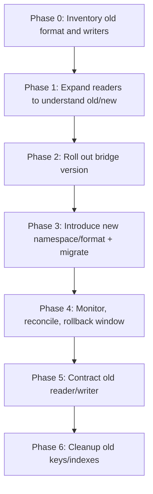

# Di chuyển serializer hoặc keyspace khi nhiều phiên bản cùng chạy trong Spring Data Redis

> **Module:** Spring Data Redis  
> **Chương:** Triển khai  
> **Chủ đề:** Thiết kế quá trình chuyển đổi Redis value serializer, key serializer hoặc keyspace namespace khi các phiên bản Spring Boot cũ và mới cùng hoạt động trong rolling deployment, blue–green, canary hoặc rollback. Trọng tâm là tính tương thích đọc/ghi, vòng đời key, dữ liệu nhất quán và cách triển khai từng giai đoạn an toàn.

## 1. Vấn đề: triển khai bản mới nhưng Redis vẫn chứa dữ liệu của bản cũ

Một ứng dụng Spring Boot sử dụng Redis để lưu cache sản phẩm. Phiên bản V1 ghi Java object qua JDK serializer:

```text
Key:   product:101
Value: Java serialization bytes (AC ED 00 05 ...)
```

Phiên bản V2 muốn lưu JSON:

```text
Key:   product:101
Value: {"schemaVersion":2,"productId":"101","name":"Desk"}
```

Nếu chỉ đổi `RedisTemplate` value serializer rồi deploy V2, hai rủi ro xảy ra:

1. **V2 đọc dữ liệu V1 không giải mã được.** Jackson cố phân tích Java serialized bytes như JSON.
2. **V1 đọc dữ liệu V2 không giải mã được.** JDK serializer không hiểu JSON.
3. Nếu một version ghi lại vào **cùng key**, giá trị có thể luân phiên đổi định dạng theo request.
4. Khi V1 và V2 cùng chạy, lỗi xuất hiện không đều: một pod đọc được, pod khác thất bại.
5. Rollback từ V2 về V1 có thể không an toàn vì Redis đã được ghi bằng định dạng mới.

Hiện tượng tương tự xảy ra khi đổi keyspace:

```text
V1: product:101
V2: cache:catalog:v2:product:101
```

V2 không thấy key V1 nên cache miss. Nếu hai version ghi/xóa khác namespace nhưng dùng chung nguồn nghiệp vụ, có thể xuất hiện **cache stale** hoặc dữ liệu được nhân đôi.

**Ý chính:** Redis là trạng thái dùng chung vượt ra ngoài vòng đời của một Spring Boot pod. Triển khai Java code mới không đồng nghĩa toàn bộ Redis data được nâng cấp theo cùng lúc.

### 1.1. Những tình huống thường phải migration

- Đổi `JdkSerializationRedisSerializer` sang JSON.
- Đổi `GenericJackson2JsonRedisSerializer` sang serializer có DTO/schema cố định.
- Đổi `StringRedisSerializer` hoặc `RedisSerializer` của key.
- Thêm version vào prefix: `user:` → `app:prod:users:v2:`.
- Thêm `tenantId` để tránh trùng key đa khách thuê.
- Chuyển từ String JSON sang Redis Hash.
- Đổi cấu trúc field trong Redis Hash.
- Thay `RedisCacheManager` prefix hoặc value serializer.
- Thay `@RedisHash` keyspace, cách dùng `@Id` hoặc `@Indexed`.
- Chuyển từ một Redis instance sang một instance khác, hoặc standalone sang Cluster.
- Di chuyển session data, idempotency state, counters hoặc Redis Streams.

Không phải tất cả đều dùng cùng chiến lược. **Cache tái tạo được** thường có thể chọn keyspace mới và để dữ liệu cũ tự hết hạn. **Redis là nguồn dữ liệu chuẩn** cần giao thức migration, đối soát và xử lý cạnh tranh chặt chẽ hơn.

## 2. Serializer và keyspace là hai thứ khác nhau

### 2.1. Serializer quyết định bytes thực tế

Redis lưu **bytes**. Java object, JSON, String hay Hash fields chỉ có nghĩa khi client sử dụng serializer/codec phù hợp.

| Thành phần | Ví dụ | Ảnh hưởng nếu thay đổi |
|---|---|---|
| Key serializer | `StringRedisSerializer` | Tên key ở mức bytes; có thể tạo key mới khác hoàn toàn |
| Value serializer | JDK serialization, JSON serializer | Format của String values; phiên bản cũ có thể không đọc |
| Hash key serializer | Cách mã hóa field name | `HGET` field cũ có thể thành miss |
| Hash value serializer | Cách mã hóa field value | Có thể giải mã lỗi hoặc nhầm kiểu |
| Cache key conversion | Spring `ConversionService`, `KeyGenerator` | Tên logical key thay đổi |
| Cache prefix | `RedisCacheConfiguration` | Namespace thay đổi |
| Repository keyspace/indexes | `@RedisHash`, indexes | Entity, secondary indexes hoặc TTL metadata cũ không được tìm thấy |

Một migration chỉ đổi value serializer **không** được quên key serializer, cache prefix và Redis Hash fields nếu chúng cũng thay đổi.

### 2.2. Ví dụ key nhìn giống nhau nhưng bytes khác nhau

Trong Java:

```java
String key = "product:101";
```

Với `StringRedisSerializer`, key thường được ghi dưới dạng UTF-8:

```text
70 72 6f 64 75 63 74 3a 31 30 31
```

Với JDK serialization, Redis key là chuỗi bytes có Java serialization header và metadata; `redis-cli GET product:101` sẽ không tìm thấy key ấy bằng tên UTF-8 thông thường.

Do đó:

> **Đổi key serializer có thể gây “cache miss hàng loạt” dù dữ liệu cũ vẫn tồn tại trong Redis.** Muốn đọc lại phải sử dụng đúng legacy key serializer hoặc đọc đúng raw bytes.

### 2.3. Đổi namespace không tự chuyển value

Ví dụ:

```text
Old key: product:101
New key: app:prod:catalog:v2:product:101
```

Dù format JSON giữa V1 và V2 giống nhau, V2 vẫn miss vì tìm **key khác**. Ngược lại, nếu chỉ đổi JSON serializer nhưng giữ key, sẽ gặp format mismatch.

### 2.4. Redis command và serialization là hai tầng

Redis server không biết `ProductDto` hoặc package Java. Nó nhận `GET key` và trả bytes. Việc một phiên bản app đọc được hay không phụ thuộc **client serializer, DTO mapping và application schema**.

Redis `RENAME`, `COPY`, `DUMP` hay `RESTORE` không tự biến Java serialized value thành JSON mới. Chúng thao tác bytes/key, không chuyển ý nghĩa data model của ứng dụng.

## 3. Rolling deployment, blue–green và canary làm phát sinh mixed-version state

Khi triển khai theo rolling update:

```text
10:00 — Pods: 4 × V1, 0 × V2
10:01 — Pods: 3 × V1, 1 × V2
10:02 — Pods: 2 × V1, 2 × V2
10:03 — Pods: 1 × V1, 3 × V2
10:04 — Pods: 0 × V1, 4 × V2
```

Trong vài phút hoặc vài giờ, V1 và V2 **cùng đọc/ghi Redis**.

Blue–green còn có thể giữ hai fleet song song lâu hơn. Canary có thể chỉ chuyển 1% traffic sang V2 nhưng V2 vẫn chia sẻ Redis keys với V1. Khi rollback, phiên bản cũ lại quay trở về và đọc dữ liệu mà bản mới đã ghi.

### 3.1. Những thứ có thể cùng tồn tại

- **Application code versions:** V1, Bridge, V2.
- **Redis keys:** prefix cũ và prefix mới.
- **Value schemas:** JDK bytes, JSON V1, JSON V2.
- **Cache entries:** các giá trị sinh trước và sau deploy.
- **Writers:** old pods, new pods, background jobs, event consumers.
- **Read paths:** API, scheduled jobs, cache manager, repository và admin scripts.
- **Rollback targets:** version ứng dụng trước đó vẫn còn chạy lại được.

Migrate thành công cần xem tất cả các chiều đó, không chỉ đổi một bean trong Spring.

### 3.2. Các lỗi thường biểu hiện không ổn định

Một canary V2 đọc lại key do V2 mới ghi thì pass. V1 pod tiếp theo dùng cùng key có thể ném exception. User request chạy qua load balancer nên lỗi xảy ra không cố định.

Điều này khiến unit test trên một version hoặc staging không có mixed traffic **không đủ** chứng minh an toàn cho rolling deploy.

## 4. Compatibility matrix: phải biết ai đọc được dữ liệu của ai

Giả sử có các giá trị:

- **F1:** JDK-serialized `ProductV1`.
- **F2:** JSON schema v2.

Các application versions:

- **A1:** chỉ đọc/ghi F1.
- **Abridge:** đọc F1 và F2, ghi F1 theo cấu hình ban đầu.
- **A2:** đọc F1 và F2, ghi F2; có thể dual-write F1 cho rollback trong một giai đoạn.

Ma trận:

| Application | Đọc F1 | Đọc F2 | Ghi mặc định |
|---|---|---|---|
| A1 legacy | Có | Không | F1 |
| Abridge compatible reader | Có | Có | F1 |
| A2 compatible | Có | Có | F2 hoặc dual-write theo protocol |
| A3 final | Không cần sau cutover | Có | F2 |

**Điều kiện an toàn khi hai versions chạy đồng thời:** Mọi bytes một writer có thể tạo trong thời gian đó phải đọc được bởi readers nào thực sự có thể chạm key ấy, hoặc writers phải dùng **namespace tách biệt** để readers cũ không nhìn nhầm bytes mới.

### 4.1. Không ghi format mới lên cùng key khi reader cũ chưa nâng cấp

Không an toàn:

```text
V1 GET product:101 -> đọc F1
V2 SET product:101 -> ghi F2
V1 GET product:101 -> deserialize F2 thất bại
```

Ngay cả khi deployment chỉ chạy V2 một phần nhỏ traffic, Redis key là shared state, không có khái niệm “canary chỉ làm hỏng 1% keys” trừ khi keyspace được tách rõ.

### 4.2. Reader backward compatibility và writer forward compatibility

- **Backward-compatible reader:** bản mới đọc được dữ liệu do bản cũ ghi.
- **Forward-compatible reader:** bản cũ đọc được dữ liệu bản mới ghi.

Bản cũ thường **không** đọc được format mới nếu chưa được chuẩn bị từ trước. Vì vậy deployment order phải thận trọng.

### 4.3. Mixed writers làm bài toán khó hơn mixed readers

Việc V2 đọc được V1 chưa đủ. Nếu V1 tiếp tục ghi vào old key trong khi V2 đọc new key, V2 có thể thấy dữ liệu cũ.

Ví dụ:

```text
t0: V2 warms cache:v2:product:101 = price 100
t1: V1 updates DB price 90
t2: V1 evicts cache:v1:product:101
t3: V2 GET cache:v2:product:101 -> trả price 100 (stale)
```

Không xảy ra serialization exception nhưng **tính đúng của dữ liệu vẫn sai**. Phải thiết kế **cross-version invalidation**, cache TTL/freshness hoặc source version checks.

## 5. Phân loại dữ liệu trước khi chọn chiến lược migration

### 5.1. Cache có thể tạo lại

Ví dụ product catalog cache:

```text
Database/API source -> Redis cache
```

Redis không phải nguồn chuẩn; mất cache gây performance penalty, không được làm mất nghiệp vụ nếu source còn.

Một chiến lược hợp lý có thể là:

1. V2 dùng namespace mới.
2. V2 cache miss đọc nguồn chuẩn.
3. V1 tiếp tục dùng namespace cũ.
4. Các phiên bản đảm bảo invalidation/freshness theo policy.
5. Sau rollback window và TTL, xóa cache cũ có kiểm soát.

Không nhất thiết dual-write tất cả cached values nếu cache có thể rebuild an toàn.

### 5.2. Redis là nguồn dữ liệu chuẩn

Ví dụ:

- Counter dùng để xác định quota/limits.
- Job lease/processing state.
- Session/token state mà mất dữ liệu ảnh hưởng bảo mật.
- Order/payment idempotency record.
- Redis Stream là nguồn công việc còn chờ xử lý.
- Redis Hash là nơi duy nhất giữ trạng thái.

Với các trường hợp này, **không được tạo namespace mới rồi coi miss = chưa có dữ liệu**. Cần kế hoạch canonical writer, conflict resolution, atomicity/CAS, retention, recovery và reconciliation.

### 5.3. Bảng quyết định ban đầu

| Loại dữ liệu | Migrate khuyến nghị | Điểm cần bảo vệ |
|---|---|---|
| Cache catalog có DB nguồn | Versioned namespace + lazy rebuild | Stale data, DB stampede |
| Cache kết quả theo user/tenant | Namespace + verified scope | Cross-user/tenant leakage |
| Session Redis | Compatibility hoặc session migration chuyên biệt | Logout/invalidation, security |
| Idempotency record | Durable ledger/dual-read có kiểm soát | Không xử lý side effect hai lần |
| Counter/quota canonical | Single writer + atomic migration | Không tăng/giảm hai lần |
| Stream/consumer state | Cơ chế chuyển consumer riêng | Không bỏ sót/nhân đôi events |
| Repository entities/indexes | Mapping + index migration | Index orphan/missing |
| Distributed locks | Không đổi key tùy tiện khi holders còn sống | Hai locks cùng bảo vệ một resource |

Migrate cache thường ưu tiên *availability/performance*; migrate authoritative Redis state ưu tiên *correctness/durability*.

## 6. Chiến lược tổng quát: expand → migrate → contract

Một chiến lược triển khai nhiều giai đoạn:



### 6.1. Expand

Nâng khả năng đọc **trước khi** ghi format mới:

- Ứng dụng mới biết cách đọc F1 và F2.
- Schema DTO có converter versioned.
- Key builder biết cả old và new prefixes.
- Metrics nhận diện read hit theo format.
- Error path xác định unrecognized values.
- Reader không âm thầm coi deserialize failure là cache miss nếu đó là dữ liệu quan trọng.

### 6.2. Migrate

Chuyển dần dữ liệu hoặc write path:

- Cache: lazy rebuild từ nguồn chuẩn hoặc warmup.
- Dữ liệu chuẩn: có migration job, writer fencing, CAS/version checks.
- Có thể dùng dual-read, dual-write hoặc read-repair theo điều kiện.
- Bảo đảm dữ liệu mới không làm old app đang chạy lỗi.
- Có rollback checkpoints.

### 6.3. Contract

Chỉ xóa hỗ trợ cũ sau khi:

- Không còn old code cần format cũ.
- Không còn old writers/background workers.
- Rollback window đã hết hoặc rollback target cũng đã compatible.
- Đã quan sát legacy read rate giảm về 0 theo thời gian thích hợp.
- Dữ liệu có retention được xử lý.
- Cleanup không xóa nhầm keys đang được dùng.

**Contract sớm quá** là một nguyên nhân phổ biến của production incidents khi ứng dụng rollback.

## 7. Hai chiến lược migration cơ bản

### 7.1. In-place format change trên cùng Redis key

Ví dụ:

```text
product:101 => bytes F1
product:101 => bytes F2
```

Ưu điểm:

- Không cần namespace mới.
- Không tăng key count gấp đôi.
- Ứng dụng có thể giữ same logical key.

Nhược điểm:

- Old reader dễ bị crash ngay khi gặp F2.
- Rollback khó.
- Cần guarantee mọi reader active hiểu F2 trước switch.
- Concurrent old writer có thể ghi F1 đè F2.
- Không có natural marker để biết format nếu bytes không có envelope đáng tin.

Chỉ nên chọn khi có **reader-first rollout** và kiểm soát writers rất chặt, có schema/version strategy và rollback khả thi.

### 7.2. Versioned keyspace (key prefix mới)

Ví dụ:

```text
product:v1:101 => F1
product:v2:101 => F2
```

Ưu điểm:

- Old app chỉ đụng v1.
- New app có thể độc lập với bytes cũ.
- Rollback về v1 dễ hơn nếu v1 còn được duy trì.
- Dễ quan sát new/old hit ratios.
- Có thể cleanup theo namespace/version.

Nhược điểm:

- Tăng memory/keys trong giai đoạn overlap.
- Dữ liệu có thể diverge nếu một writer chỉ cập nhật v1.
- Cache invalidation phải nghĩ đến cả hai versions.
- Có thể tăng load DB khi V2 cold-start.
- Keyspace migration còn liên quan indexes/TTL/permissions.

**Với cache có thể tái tạo, versioned keyspace thường là lựa chọn dễ kiểm soát hơn in-place format change.**

## 8. Cấu trúc keyspace có version và ranh giới tenant

Một key schema ví dụ:

```text
<app>:<env>:<domain>:<version>:tenant:<tenantId>:<entity>:<id>
```

Ví dụ:

```text
shop:prod:catalog:v1:tenant:t-17:product:p-101
shop:prod:catalog:v2:tenant:t-17:product:p-101
shop:staging:catalog:v2:tenant:t-17:product:p-101
```

### 8.1. Những thông tin không được thiếu

- Application/service namespace.
- Environment.
- Domain/cache purpose.
- Version.
- Tenant hoặc user scope khi dữ liệu có quyền truy cập riêng.
- Entity type và ID.

Không tự dùng raw `tenantId` từ HTTP header. Tenant phải được xác minh qua authentication/authorization. Với key versioning, **không được bỏ tenant scope trong legacy fallback**.

### 8.2. Key builder

```java
public final class ProductCacheKeys {

    private final String namespace;

    public ProductCacheKeys(String namespace) {
        this.namespace = requireComponent(namespace);
    }

    public String v1(String tenantId, String productId) {
        return namespace + ":v1:tenant:"
                + validate(tenantId) + ":product:"
                + validate(productId);
    }

    public String v2(String tenantId, String productId) {
        return namespace + ":v2:tenant:"
                + validate(tenantId) + ":product:"
                + validate(productId);
    }

    private static String requireComponent(String input) {
        if (input == null || input.isBlank()) {
            throw new IllegalArgumentException("namespace required");
        }
        return input;
    }

    private static String validate(String input) {
        if (input == null
                || !input.matches("[A-Za-z0-9_-]{1,64}")) {
            throw new IllegalArgumentException("invalid key component");
        }
        return input;
    }
}
```

Với `namespace="shop:prod:catalog"`:

```text
v1(t-17,p-101) -> shop:prod:catalog:v1:tenant:t-17:product:p-101
v2(t-17,p-101) -> shop:prod:catalog:v2:tenant:t-17:product:p-101
```

Validation tránh để `{}`, `:` hoặc wildcard từ client phá cấu trúc key. Nhưng key schema không thay authorization.

### 8.3. Version ở key khác version trong JSON

Có thể cùng lúc có:

```text
Key version: v2
JSON schemaVersion: 3
```

Điều đó hợp lệ nếu có ý đồ: key version phản ánh namespace và strategy; payload version phản ánh DTO schema. Nhưng phải ghi rõ mapping, không để hai version numbers tự trôi khác nhau mà không có contract.

## 9. Redis serializer trong Spring Data Redis

### 9.1. Những serializers thường gặp

| Serializer | Đặc trưng | Lưu ý migration |
|---|---|---|
| `StringRedisSerializer` | UTF-8 String | Phù hợp key và text value |
| `JdkSerializationRedisSerializer` | Java object serialization bytes | Phụ thuộc Java class/package/serialVersionUID; rủi ro deserialization |
| JSON serializer với DTO rõ | JSON bytes | Cần schema compatibility/version |
| Generic JSON polymorphic serializer | Có type metadata trong một số cấu hình | Có thể phụ thuộc Java class names; hardening polymorphic type handling |
| Custom serializer | Binary/envelope/compression | Phải giữ encoder/decoder/version rõ |
| Hash serializers | Mã hóa Redis Hash fields/values | Đổi field serializer có thể làm HGET miss |

Không nên đổi serializer dựa trên “JSON dễ đọc hơn” mà không kiểm tra lịch sử bytes và mixed-version readers.

### 9.2. JDK serialization cần đặc biệt thận trọng

JDK serialization:

- Thường có Java stream magic bytes `AC ED`.
- Có thể phụ thuộc tên class, package và `serialVersionUID`.
- Dễ hỏng khi refactor domain classes.
- Deserialization từ bytes không tin cậy có thể gây rủi ro an toàn; cần allowlist/trust boundary.
- Không phù hợp để lưu dữ liệu dài hạn nếu khó kiểm soát class evolution.

Nếu phải đọc legacy JDK data, giữ vùng xử lý hẹp, chỉ đọc keys được ủy quyền và trusted Redis, giới hạn class/serializer phù hợp. **Không xây “fallback deserialize mọi bytes bằng mọi serializer” một cách thiếu kiểm soát.**

### 9.3. JSON không mặc định forward-compatible

Ví dụ V1:

```json
{"id":"p-101","price":125000}
```

V2:

```json
{"schemaVersion":2,"productId":"p-101","priceMinor":125000,"currency":"VND"}
```

Nếu V1 serializer dùng DTO field `id`/`price`, nó không tự hiểu `productId`/`priceMinor`. Đổi JSON format vẫn cần mapping.

Khi thêm fields, quy tắc compatibility cần xác định:

- Reader cũ bỏ qua unknown fields hay fail?
- Field cũ có còn giữ nguyên meaning không?
- Default cho missing field là gì?
- Enum mới có được reader cũ chấp nhận không?
- Số tiền là integer minor units hay decimal?
- Timestamp timezone/precision thế nào?
- Null và missing field khác nhau ra sao?

**Schema evolution là hợp đồng dữ liệu**, không chỉ cấu hình serializer.

## 10. Mẫu serializer v2: DTO độc lập Java domain internals

Ví dụ Java 17:

```java
public record ProductCacheV1(
        String id,
        String name,
        long price) {
}

public record ProductCacheV2(
        int schemaVersion,
        String productId,
        String name,
        long priceMinor,
        String currency) {
}
```

Mapper tường minh:

```java
public final class ProductCacheMapper {

    public ProductCacheV2 upgrade(ProductCacheV1 old) {
        if (old == null
                || old.id() == null
                || old.name() == null) {
            throw new IllegalArgumentException("invalid legacy record");
        }

        return new ProductCacheV2(
                2,
                old.id(),
                old.name(),
                old.price(),
                "VND");
    }
}
```

Ở đây ví dụ giả định giá V1 đã tính bằng đơn vị đồng/đơn vị nhỏ nhất phù hợp. Nếu V1 có nghĩa khác (ví dụ giá dạng decimal major unit), **không được chỉ copy** số tiền; cần conversion theo nghiệp vụ.

DTO mới nên tránh đưa toàn bộ Java entity class graph vào cache. Dùng schema/version rõ và tests cho serialization round-trip.

## 11. Ví dụ triển khai dual-read với versioned keyspace

Trường hợp minh họa: Redis là **cache**, database/source API mới là nguồn chuẩn. V1 và V2 đều là JSON qua `StringRedisTemplate`, nhưng DTO khác schema và namespace. Đây là ví dụ dễ quan sát protocol trước khi xử lý JDK legacy.

### 11.1. Hợp đồng

- V2 đọc new key trước.
- Nếu không có new key, có thể đọc old key trong giai đoạn compatibility.
- V1 JSON được map sang V2 DTO.
- V2 cache có TTL.
- Khi old key có TTL còn lại rất ngắn, không tự kéo dài freshness bằng một read-repair vô điều kiện.
- Lỗi decode V1 khác Redis key miss: không silently cast thành DTO mới.
- Chỉ đọc dữ liệu cùng verified tenant scope.
- Source of truth được dùng nếu hai cache versions không còn đáng tin cậy.

### 11.2. Đọc v2, fallback v1 và source

```java
import java.time.Duration;
import java.util.concurrent.TimeUnit;

import com.fasterxml.jackson.core.JsonProcessingException;
import com.fasterxml.jackson.databind.ObjectMapper;
import org.springframework.data.redis.core.StringRedisTemplate;

public class MigratingProductCache {

    private static final Duration NEW_TTL = Duration.ofMinutes(10);

    private final StringRedisTemplate redis;
    private final ObjectMapper mapper;
    private final ProductCacheKeys keys;
    private final ProductCacheMapper converter;
    private final ProductSource source;

    public MigratingProductCache(
            StringRedisTemplate redis,
            ObjectMapper mapper,
            ProductCacheKeys keys,
            ProductCacheMapper converter,
            ProductSource source) {
        this.redis = redis;
        this.mapper = mapper;
        this.keys = keys;
        this.converter = converter;
        this.source = source;
    }

    public ProductCacheV2 get(
            String verifiedTenantId,
            String productId) {

        String v2Key = keys.v2(verifiedTenantId, productId);
        String v1Key = keys.v1(verifiedTenantId, productId);

        String v2Json = redis.opsForValue().get(v2Key);
        if (v2Json != null) {
            ProductCacheV2 v2 = parse(
                    v2Json, ProductCacheV2.class);
            checkV2(v2, productId);
            return v2;
        }

        String v1Json = redis.opsForValue().get(v1Key);
        if (v1Json != null) {
            ProductCacheV1 v1 = parse(
                    v1Json, ProductCacheV1.class);
            ProductCacheV2 upgraded = converter.upgrade(v1);
            checkV2(upgraded, productId);

            // Chỉ warm v2 trong TTL còn lại của v1,
            // để không kéo dài hạn freshness của legacy entry.
            Long remainingMs =
                    redis.getExpire(v1Key, TimeUnit.MILLISECONDS);

            if (remainingMs != null && remainingMs > 0) {
                Duration remaining = Duration.ofMillis(remainingMs);
                Duration ttl = remaining.compareTo(NEW_TTL) < 0
                        ? remaining : NEW_TTL;

                if (!ttl.isZero() && !ttl.isNegative()) {
                    redis.opsForValue().set(
                            v2Key, toJson(upgraded), ttl);
                }
            }

            return upgraded;
        }

        // Cache miss cả hai versions: lấy dữ liệu nguồn chuẩn.
        ProductCacheV2 fresh =
                source.load(verifiedTenantId, productId);
        checkV2(fresh, productId);

        redis.opsForValue().set(
                v2Key, toJson(fresh), NEW_TTL);
        return fresh;
    }

    private static void checkV2(
            ProductCacheV2 value, String expectedProductId) {
        if (value == null
                || value.schemaVersion() != 2
                || !expectedProductId.equals(value.productId())) {
            throw new IllegalStateException(
                    "Incompatible product cache record");
        }
    }

    private <T> T parse(String json, Class<T> type) {
        try {
            return mapper.readValue(json, type);
        } catch (JsonProcessingException ex) {
            throw new IllegalStateException(
                    "Cache schema decode failed", ex);
        }
    }

    private String toJson(Object value) {
        try {
            return mapper.writeValueAsString(value);
        } catch (JsonProcessingException ex) {
            throw new IllegalStateException(
                    "Cache encode failed", ex);
        }
    }
}
```

`ProductSource` là interface do ứng dụng tự cung cấp; nó bắt buộc truy vấn dữ liệu theo verified tenant ID. Trong code production, cần kiểm tra data ownership trong value hoặc domain object khi cache chứa dữ liệu tenant-specific. Ví dụ DTO trên cố ý giản lược thuộc tính tenant; không dùng nó để thay authorization.

### 11.3. Đoạn code trên giải quyết gì và chưa giải quyết gì?

Nó thể hiện:

- New-first dual-read.
- Legacy DTO mapping.
- TTL-bound read-repair.
- Namespace v1/v2 rõ.
- Source fallback.

Nó **chưa** bảo đảm freshness khi một V1 writer cập nhật database nhưng chỉ evict v1 key. Trong trường hợp đó, V2 có thể tiếp tục trả cache cũ. Cần **cross-version invalidation** hoặc chọn chỉ sử dụng v2 khi old writers đã được chuyển sang protocol tương thích.

Nó cũng chưa xử lý:

- Redis connection failure.
- Cache decode failure recovery policy.
- Cache stampede.
- Concurrent writes giữa hai versions.
- Authorization checks chi tiết.
- Expiration race giữa GET và PTTL.
- Distributed transaction với database.

Các vấn đề này phải được giải quyết theo yêu cầu nghiệp vụ, không nên xem một dual-reader là migration hoàn chỉnh.

## 12. Spring Bean để đọc legacy serializer khác với new serializer

Nếu V1 sử dụng `JdkSerializationRedisSerializer` còn V2 dùng JSON String value, chỉ một `StringRedisTemplate` **không thể** tự giải mã dữ liệu JDK cũ.

Có thể tạo hai RedisTemplates với serializers khác nhau trên **cùng connection factory**, nhưng quản lý namespace/keys rõ.

### 12.1. Legacy RedisTemplate ví dụ

```java
import org.springframework.context.annotation.Bean;
import org.springframework.context.annotation.Configuration;
import org.springframework.data.redis.connection.RedisConnectionFactory;
import org.springframework.data.redis.core.RedisTemplate;
import org.springframework.data.redis.serializer.JdkSerializationRedisSerializer;
import org.springframework.data.redis.serializer.StringRedisSerializer;

@Configuration
public class LegacyRedisConfig {

    @Bean("legacyJdkRedisTemplate")
    RedisTemplate<String, Object> legacyJdkRedisTemplate(
            RedisConnectionFactory factory) {

        RedisTemplate<String, Object> template =
                new RedisTemplate<>();
        template.setConnectionFactory(factory);
        template.setKeySerializer(new StringRedisSerializer());
        template.setValueSerializer(
                new JdkSerializationRedisSerializer());
        template.setHashKeySerializer(new StringRedisSerializer());
        template.setHashValueSerializer(
                new JdkSerializationRedisSerializer());
        template.afterPropertiesSet();
        return template;
    }
}
```

**Giả định rất quan trọng:** V1 dùng `StringRedisSerializer` cho keys nhưng dùng JDK cho values. Nếu V1 cũng dùng JDK cho keys, phải dùng đúng legacy key serializer để tìm keys; không thể đổi thành String vì thuận tiện.

Không mở generic JDK deserialization cho dữ liệu đến từ untrusted sources. Redis instance và key namespace phải được kiểm soát nghiêm ngặt.

### 12.2. New StringRedisTemplate + explicit JSON mapping

```java
@Bean("newJsonStringRedisTemplate")
StringRedisTemplate newJsonStringRedisTemplate(
        RedisConnectionFactory factory) {

    return new StringRedisTemplate(factory);
}
```

V2 sử dụng JSON DTO qua Jackson trong service, hoặc có thể cấu hình serializer JSON cụ thể cho `RedisTemplate<String, ProductCacheV2>`.

**Chú ý:** Spring context có thể đã tự tạo `StringRedisTemplate`. Khi thêm nhiều beans cùng type, dùng qualifier/bean name để injection không bị mơ hồ và tránh thay đổi default cho code cũ ngoài ý muốn.

### 12.3. Cách đọc legacy value an toàn hơn

Trong adapter:

```java
Object legacy = legacyJdkRedisTemplate
        .opsForValue()
        .get(legacyKey);

if (legacy instanceof LegacyProduct legacyProduct) {
    // Xác minh tenant/id/field contract,
    // rồi chuyển sang ProductCacheV2.
} else if (legacy != null) {
    throw new IllegalStateException(
            "Unexpected legacy value type");
}
```

`LegacyProduct` là class cũ được application giữ tương thích hoặc một compatibility library kiểm soát chặt. Nếu class cũ đã đổi package/serialVersionUID, việc `instanceof` không tự chữa deserialization failure.

Không tiếp tục đọc legacy JDK bytes vô hạn nếu hệ thống đã có mục tiêu bỏ JDK serializer vì bảo mật/bảo trì. Cần có mốc loại bỏ reader cũ sau khi dữ liệu đã hết vòng đời.

## 13. Serializer định dạng envelope để giảm chi phí migration tương lai

Thay vì dựa hoàn toàn vào Java class type metadata:

```json
{
  "schemaVersion": 2,
  "contentType": "product-cache",
  "payload": {
    "productId": "p-101",
    "name": "Desk",
    "priceMinor": 125000,
    "currency": "VND"
  }
}
```

Reader:

1. Xác định data/schema version.
2. Validate expected content type.
3. Chọn DTO converter phù hợp.
4. Validate tenant/resource identity.
5. Chuyển về domain model ổn định.
6. Từ chối unknown schema nếu không có converter.

### 13.1. Đừng chấp nhận mọi Java class name trong JSON

Một số polymorphic serializers có thể lưu Java type metadata. Để an toàn:

- Không bật Jackson default typing vô hạn chế cho bytes không tin cậy.
- Dùng DTO type allowlist/polymorphic validator theo nhu cầu.
- Không lưu type metadata chỉ để “đỡ viết converter” nếu khiến schema phụ thuộc package/class internals.
- Hạn chế Redis ACL và network.
- Có versioning policy rõ.

### 13.2. Unknown future version

Nếu reader chỉ hiểu schema 1 và 2 nhưng gặp `schemaVersion=3`, nó không nên parse bừa thành 2 rồi viết lại và làm mất fields.

Tùy dữ liệu:

- Cache: coi là incompatible, có thể evict/refetch từ nguồn chuẩn nếu an toàn.
- Canonical state: không ghi đè, fail closed và yêu cầu nâng reader.
- Critical record: đưa vào quarantine/alert/reconciliation.

Không silently drop unknown fields khi chúng có thể ảnh hưởng semantics.

## 14. Dual-read không đồng nghĩa dual-write

**Dual-read**:

```text
GET v2
  -> hit: read v2
  -> miss: GET v1
       -> hit: decode/map/rebuild v2
       -> miss: read source
```

**Dual-write**:

```text
Business update
  -> write v1 representation
  -> write v2 representation
```

Chúng phục vụ mục đích khác nhau:

- Dual-read hỗ trợ chuyển đổi dần dữ liệu.
- Dual-write giúp duy trì readers cũ khi cutover chưa kết thúc.
- Nhưng dual-write có thể tạo **hai trạng thái riêng biệt**, không nguyên tử, không nhất quán.

### 14.1. Dual-write có thể thất bại giữa chừng

```text
SET v1:key -> success
SET v2:key -> timeout/error
```

Hoặc:

```text
SET v2:key -> success
SET v1:key -> error
```

Application không biết chắc hai giá trị đang giống nhau. Khi rollback, old version có thể đọc dữ liệu thiếu.

### 14.2. Cần xác định bản ghi nào là canonical

Ví dụ:

```text
Phase 1: V1 canonical; V2 cache là bản phát sinh.
Phase 2: Source DB canonical; cả v1 và v2 là cache.
Phase 3: V2 canonical sau cutover có kiểm soát, V1 compatibility mirror.
```

Không mô tả “ghi cả hai là an toàn” nếu chưa xác định:

- Thứ tự writes.
- Cách xử lý partial failures.
- Cách reconcile divergence.
- Writer ownership và version.
- TTL cho từng bản ghi.
- Người đọc nào có thể thấy stale data.
- Khi nào an toàn dừng ghi old version.

## 15. Thứ tự triển khai writer-first và reader-first

### 15.1. Writer-first trực tiếp lên key chung: dễ lỗi

Không nên:

```text
1. Bật V2 writer cho product:101 (ghi JSON)
2. V1 readers vẫn đang chạy (đọc JDK bytes)
3. V1 throws deserialization exception
```

### 15.2. Reader-first: an toàn hơn

```text
A1: Legacy reader/writer
Abridge: Reader hiểu F1+F2; writer vẫn ghi F1
A2: Reader hiểu F1+F2; writer có thể ghi F2 theo rollout policy
A3: Reader chỉ F2 sau khi contract
```

Khi mọi pod đã là Abridge trở lên, có thể tiến tới ghi F2 mà không còn reader thuần F1, **nếu** không còn background workers/services V1 và rollback target đã được xét.

### 15.3. Feature flags cho serializer/keyspace

Thay vì để code version tự động đổi writer:

```yaml
app:
  redis-migration:
    read-new-first: false
    write-new-enabled: false
    legacy-read-enabled: true
    dual-invalidate: true
```

Các properties là ví dụ ứng dụng tự định nghĩa, không phải Spring Boot built-in.

Trình tự:

1. Deploy code hỗ trợ cả schemas nhưng `write-new-enabled=false`.
2. Chờ tất cả consumers được nâng version và có metrics.
3. Bật đọc new cho canary có kiểm soát khi dữ liệu new đã an toàn.
4. Bật new writer hoặc migration job theo quy tắc source/canonical.
5. Theo dõi; có thể tắt flag nếu gặp lỗi trước khi mất compatibility.
6. Không dừng legacy reader cho tới khi rollback window kết thúc.

Feature flag có thể được cache/local-config; phải kiểm soát tính nhất quán giữa pods và tránh flip-flop khiến writes không xác định format.

## 16. Cross-version cache invalidation: điểm dễ bị bỏ sót nhất

Giả sử hai namespaces:

```text
catalog:v1:product:101 = price 100
catalog:v2:product:101 = price 100
```

Một V1 pod cập nhật database price thành 90 và chỉ evict `catalog:v1:product:101`. V2 vẫn trả `price 100`.

**Giải pháp phải được triển khai trước khi V2 phục vụ cached state lâu dài.**

### 16.1. Invalidate cả v1 và v2 sau cập nhật nguồn

```java
public void invalidateProduct(
        String verifiedTenantId, String productId) {

    redis.delete(keys.v1(verifiedTenantId, productId));
    redis.delete(keys.v2(verifiedTenantId, productId));
}
```

Với Java, hai `DEL` calls riêng không phải distributed transaction. Nếu một call thất bại, cache một version có thể còn stale. Có thể dùng Spring Redis batch/transaction nếu semantics và same-slot cho phép, nhưng không có atomic transaction chung với database.

### 16.2. After-commit invalidation

Nếu database là source of truth:

```text
DB transaction:
  UPDATE product
  COMMIT
After commit:
  evict v1 + v2 cache keys
```

Không evict quá sớm rồi để một reader repopulate cache bằng DB state chưa commit, khiến stale value tồn tại sau commit.

Với Spring:

```java
@TransactionalEventListener(
        phase = TransactionPhase.AFTER_COMMIT)
public void onProductChanged(ProductChanged event) {
    invalidateProduct(
            event.verifiedTenantId(),
            event.productId());
}
```

`ProductChanged` là event do ứng dụng định nghĩa. `@TransactionalEventListener` chạy sau commit khi có transaction event phù hợp, nhưng **không bảo đảm invalidation được lưu bền vững** nếu application crash ngay sau commit.

Nếu freshness requirement quan trọng, dùng outbox/durable event/repair loop, versioned cache key hoặc kiểm tra source version.

### 16.3. Khi V1 code không biết v2 namespace

Không thể chỉ “thêm invalidation vào V2” rồi giả định V1 writer tự biết v2 cache.

Một số lựa chọn:

1. Deploy bridge version cho toàn bộ writers trước khi bật v2 cached reads.
2. Chuyển writers qua một service/API có quyền invalidate cả namespaces.
3. Dùng event/outbox từ database và một subscriber invalidate cả v1/v2.
4. Dùng TTL ngắn như safety net **chỉ khi business chấp nhận stale window**.
5. Không enable V2 cache lâu dài cho tới khi có cơ chế invalidation tương thích.

**Không có cross-version invalidation thì new namespace có thể tạo lỗi correctness dù serializers hoàn toàn đúng.**

## 17. TTL, expiry và retention khi copy dữ liệu

### 17.1. TTL của old key

Redis TTL trả các giá trị đặc biệt:

- `TTL`/`PTTL > 0`: key còn thời gian sống.
- `-1`: key tồn tại nhưng không có expiration.
- `-2`: key không tồn tại.

Spring Data Redis có các overload như `getExpire(key, TimeUnit.MILLISECONDS)`, thường trả `Long` tương ứng; ngữ cảnh pipeline/transaction có thể có cách biểu diễn kết quả khác.

### 17.2. Không tự kéo dài dữ liệu cũ

Nếu old cache key chỉ còn 30 giây TTL, việc copy sang v2 với TTL 24 giờ khiến một cache entry gần hết hạn được kéo dài không có lý do.

Một chính sách thận trọng cho cache:

\[
TTL_{new} = \min(TTL_{old\_remaining}, TTL_{new\_policy})
\]

Nếu old key không có TTL (`-1`), không tự suy nó luôn fresh. Có thể đọc nguồn chuẩn để rebuild hoặc áp TTL ngắn được business phê duyệt.

### 17.3. Copy GET rồi PTTL có race

```text
t0 GET oldKey => valueA
t1 Other writer updates oldKey => valueB
t2 PTTL oldKey => 5 min
t3 Migrator writes v2Key => valueA
```

Kết quả V2 có thể chứa data cũ. Redis GET và PTTL riêng **không tạo snapshot**. Với cache có eventual consistency được phép, TTL/read repair có thể chấp nhận; với data chuẩn cần version/CAS/atomic transfer.

### 17.4. TTL của nhiều phiên bản

Trong overlap có thể tồn tại:

```text
v1 cache TTL 10 phút
v2 cache TTL 15 phút
```

Nếu writer/invalidation chưa được đồng bộ, v2 có thể stale tối đa 15 phút, không phụ thuộc v1. Cần công bố mức độ mới dữ liệu/freshness SLA và thiết kế retention phù hợp.

### 17.5. Không để migration làm key tăng không kiểm soát

Nếu V1 và V2 cùng có hàng triệu keys, memory gần như có thể tăng gấp đôi trong overlap, chưa tính payload/metadata. Điều này gây:

- Eviction cả dữ liệu cũ/mới.
- Cache hit ratio giảm.
- DB load tăng.
- Latency/CPU tăng.
- OOM nếu `noeviction` hoặc capacity không đủ.
- Replication/persistence overhead tăng.

Cần đo key counts, `used_memory`, memory fragmentation, eviction và TTL distributions.

## 18. Lazy migration, eager backfill và hybrid

### 18.1. Lazy migration (read-repair)

```text
V2 GET v2Key -> miss
V2 GET v1Key -> hit
V2 decode/map -> set v2Key
V2 returns result
```

Ưu điểm:

- Chỉ migrate hot keys.
- Không cần quét toàn bộ Redis.
- Đổi workload sang v2 dần theo traffic.

Nhược điểm:

- Cold keys chưa được migrate.
- Đọc/ghi tăng trên cache miss.
- Có races với old writers.
- Khó xác định migration “hoàn tất” nếu một key lâu không được đọc.
- Không an toàn cho authoritative state nếu thiếu concurrency control.

### 18.2. Eager backfill

Một migration worker duyệt legacy keys, giải mã và ghi version mới.

Ưu điểm:

- Có tiến độ có thể đo.
- Dữ liệu ít được đọc vẫn được chuyển.
- Phù hợp khi cần loại bỏ old format theo deadline.

Nhược điểm:

- Tăng Redis CPU/network.
- Có thể gây cache eviction.
- SCAN không snapshot.
- Key thay đổi/xóa trong lúc migration.
- Converter có thể lỗi với dữ liệu không hợp lệ.
- Cần resumability/checkpoints.

### 18.3. Hybrid

Phổ biến:

1. Deploy dual-read.
2. Backfill hot keys trước hoặc lazy migration.
3. Chạy background backfill với rate limit.
4. Dùng source versions/CAS để tránh overwrite.
5. Theo dõi legacy reads và chưa migrate.
6. Contract sau khi mọi consumers đã sẵn sàng.

### 18.4. Bảng lựa chọn

| Chiến lược | Thích hợp | Rủi ro chính |
|---|---|---|
| New keyspace, cold rebuild | Cache tái tạo được | DB stampede, cache cold starts |
| Lazy read-repair | Cache, ít keys nóng | Race, TTL extension |
| Eager SCAN/backfill | Nhiều keys cần migrate | Tải Redis, no snapshot |
| In-place versioned serializer | Có reader-first và writer control | Old reader không đọc F2 |
| Dual-write | Phải hỗ trợ rollback/old consumers | Partial writes, divergence |
| Separate Redis resource migration | Môi trường/tenant hoặc topology | Synchronization/cutover, replication |
| Single authoritative writer/ledger | Critical Redis data | Cần thiết kế atomicity/recovery phức tạp |

## 19. Backfill theo SCAN: vận hành an toàn

Không dùng `KEYS product:*` trên production dataset lớn. Redis có `SCAN` với cursor để duyệt keyspace theo batch, tuy nhiên:

- `SCAN` **không đảm bảo snapshot** khi keyspace đang thay đổi.
- Một key có thể xuất hiện nhiều lần trong quá trình scan.
- COUNT chỉ là hint.
- Một key có thể hết TTL trước khi được migrate.
- Trên Redis Cluster cần duyệt tất cả primary nodes hoặc dùng client cluster-aware.
- Không scan/deserialize untrusted namespaces.

### 19.1. Vòng lặp logic

```text
cursor = 0
repeat:
    cursor, keys = SCAN cursor MATCH legacyPrefix* COUNT 500
    for each key:
        read old value
        validate ownership/version
        convert to new DTO
        write new key conditionally
        record progress/metrics
until cursor == 0
```

COUNT 500 chỉ minh họa. Chọn batch theo payload sizes và Redis headroom.

### 19.2. RedisTemplate scan mẫu

```java
ScanOptions options = ScanOptions.scanOptions()
        .match("shop:prod:catalog:v1:tenant:*:product:*")
        .count(200)
        .build();

try (Cursor<String> cursor = redis.scan(options)) {
    while (cursor.hasNext()) {
        String oldKey = cursor.next();
        // Validate parsed namespace and tenant.
        // Read, convert, conditionally store new.
        // Rate-limit and record progress.
    }
}
```

Các types thuộc `org.springframework.data.redis.core` và `org.springframework.data.redis.core.ScanOptions`; code minh họa với `StringRedisTemplate` và APIs phù hợp version.

Cảnh báo:

- SCAN API/cursor serialization có thể khác ở Cluster.
- `StringRedisTemplate.scan()` có thể không thực hiện cluster-wide scan như mong muốn trong mọi driver/version; phải kiểm tra behavior.
- Tên key chứa tenant ID cần được xác thực/parse đúng, không chỉ split thô khi ID không được validate.
- Với legacy **JDK-serialized keys**, pattern UTF-8 không tìm key như mong đợi nếu nó không phải String bytes.

### 19.3. Không xóa old key ngay sau copy

Nếu V1 vẫn đang chạy:

```text
Migrator copies v1 -> v2
Migrator deletes v1
V1 GET v1 -> MISS
V1 may repopulate v1/overwrite source
```

Đừng xóa legacy key trong khi old readers/writers còn phụ thuộc. Hãy giữ tới khi cutover/rollback window và TTL phù hợp.

### 19.4. Checkpoint và idempotent job

Backfill phải restart được:

- Migration run ID.
- Cursor/chunk hoặc logical partition checkpoint.
- Keys processed/succeeded/skipped/failed.
- Quarantine malformed records.
- Retry có giới hạn.
- CAS/version check để không overwrite new data.
- Audit errors mà không log PII/value bytes.

**SCAN cursor không là durable global snapshot**: sau restart có thể scan lại hoặc bắt đầu từ 0; migration cần idempotent writes.

## 20. Concurrent writers: tránh overwrite dữ liệu mới bằng bản cũ

Giả sử key v2 đã được ghi bằng dữ liệu mới:

```text
t0 DB/Product version 5 -> V2 cache v2 (version 5)
t1 A delayed migration job reads old v1 (version 4)
t2 Job SET v2 -> version 4 (overwrite newer data)
```

Đây là lỗi migration rất nguy hiểm.

### 20.1. SET NX chỉ giải quyết một phần

Một bản backfill có thể dùng:

```redis
SET newKey json NX EX 600
```

Để không ghi đè new key **đã tồn tại**. Nhưng nó không đảm bảo:

- Value old là mới hơn source.
- New key còn tồn tại khi record old đã stale.
- Concurrent source updates/invalidation sau khi job đọc.
- Redis key bị evict rồi migration cũ tạo lại dữ liệu stale.

Với cache, `SET NX` có thể là một safety measure, không phải consistency proof.

### 20.2. Có data version và CAS

Một record versioned:

```json
{
  "schemaVersion": 2,
  "entityVersion": 42,
  "productId": "p-101",
  "priceMinor": 90000
}
```

Chỉ apply update nếu version candidate **không thấp hơn** version hiện tại, và policy tie-breaking rõ.

Có thể dùng Lua script compare-and-set trên cùng key hoặc optimistic locking ở source DB. Nếu có nhiều Redis keys cần atomic update, Redis Cluster yêu cầu chúng cùng hash slot, và Redis transaction không bao trùm DB.

### 20.3. Ai có quyền tạo entityVersion?

Version phải có nguồn đáng tin:

- Database row version/sequence.
- Authoritative event sequence.
- Một canonical Redis atomic sequence phù hợp.
- Monotonic fencing token mà downstream thực sự kiểm tra.

Không dùng timestamp từ clocks phân tán như một version tuyệt đối nếu đồng hồ lệch có thể gây ghi sai thứ tự.

### 20.4. Migration khi data không có version

Nếu legacy values không có `entityVersion`, không thể xác định bằng mắt cái nào mới hơn. Lựa chọn:

- Rebuild new cache từ DB nguồn chuẩn.
- Tạm dừng/cô lập writes trong cửa sổ rất ngắn có kế hoạch.
- Dùng một canonical writer service để serialize updates.
- Không backfill từ stale legacy key nếu freshness cực kỳ quan trọng.
- Quarantine/đối soát nếu dữ liệu Redis là nguồn chuẩn.

## 21. Dual-write và atomicity trong Redis

### 21.1. Hai SET tuần tự không atomic

```java
redis.opsForValue().set(oldKey, oldPayload);
redis.opsForValue().set(newKey, newPayload);
```

Nếu process crash giữa hai calls, chỉ một format được cập nhật.

### 21.2. MULTI/EXEC cũng có giới hạn

Redis `MULTI`/`EXEC` có semantics transaction của Redis, không phải transaction SQL có rollback cho mọi runtime error. Khi dùng Cluster, multi-key commands phải tuân thủ same-slot constraints.

Ngay cả khi hai Redis writes atomic trên một shard, **không có distributed transaction tự động với database**. Nếu DB commit rồi Redis write fail, hai caches có thể không đồng bộ.

### 21.3. Lua trên cùng hash slot

Với hai keys thuộc cùng slot, một Lua script có thể thực hiện conditional updates atomically trên Redis shard, ví dụ dựa trên entityVersion. Nhưng:

- Phải kiểm soát keys/arguments.
- Không dùng script dài quét toàn keyspace.
- Redis failover/durability vẫn cần đánh giá.
- Không có transaction với external systems.
- Một lần client timeout có thể xảy ra **sau khi** script đã thực thi; retry phải idempotent.

### 21.4. Đừng đưa hai version keys cùng global hash tag

Nếu đặt:

```text
cache:{all}:v1:...
cache:{all}:v2:...
```

toàn bộ keys rơi vào một slot, dễ tạo hot shard. Nếu cần atomic update **theo entity**, hash tag nên nhỏ:

```text
cache:{tenant-t17|product-p101}:v1
cache:{tenant-t17|product-p101}:v2
```

Nhưng hash tag không phải cơ chế authorization; tenant vẫn phải được xác thực.

## 22. RedisCacheManager: đổi serializer và prefix có thể thay toàn bộ cache contract

Ứng dụng có:

```java
@Cacheable(cacheNames = "products", key = "#productId")
public ProductView find(String productId) {
    return source.load(productId);
}
```

Với Spring Cache, key thực được tạo bởi:

- Cache name.
- Prefix strategy.
- KeyGenerator/SpEL expression.
- Cache key conversion/serializer.
- Version/tenant scope nếu có.

Đổi value serializer không bảo đảm cache entries cũ được decode bằng serializer mới.

### 22.1. Khai báo prefix/serializer rõ

Ví dụ cấu hình V2:

```java
@Bean
RedisCacheManager redisCacheManagerV2(
        RedisConnectionFactory factory) {

    RedisCacheConfiguration config =
            RedisCacheConfiguration.defaultCacheConfig()
                    .computePrefixWith(cacheName ->
                            "shop:prod:catalog:v2:cache:"
                            + cacheName + "::")
                    .entryTtl(Duration.ofMinutes(10))
                    .serializeKeysWith(
                            RedisSerializationContext.SerializationPair
                                    .fromSerializer(
                                            new StringRedisSerializer()))
                    .serializeValuesWith(
                            RedisSerializationContext.SerializationPair
                                    .fromSerializer(
                                            new GenericJackson2JsonRedisSerializer()));

    return RedisCacheManager.builder(factory)
            .cacheDefaults(config)
            .build();
}
```

Imports thuộc các packages Spring Data Redis cache/serializer/config và Java `Duration`.

**Lưu ý:** `GenericJackson2JsonRedisSerializer` là một lựa chọn JSON thông dụng nhưng có thể sử dụng polymorphic type metadata tùy cấu hình; dữ liệu trusted và type restrictions phải được xem xét. Với security/high stability, DTO JSON schema cố định có thể tốt hơn.

### 22.2. Mismatch chỉ ở cache serializer

Nếu V1 `RedisCacheManager` dùng JDK value serialization còn V2 chuyển sang JSON **nhưng vẫn cùng prefix**, V1 cache hit trên key do V2 ghi có thể deserialize fail. Cách dễ kiểm soát hơn là thêm namespace v2.

### 22.3. @Cacheable vẫn có cache stampede khi chuyển namespace

V2 dùng prefix mới nên toàn bộ cache nóng thành miss:

```text
V1 product cache warm
V2 product cache cold
N requests -> N database reads
```

Biện pháp:

- Warmup/canary với giới hạn traffic.
- TTL jitter.
- Single-flight/cache stampede protection nếu cần.
- Capacity planning cho DB fallback.
- Không chuyển toàn bộ traffic sang new namespace cùng lúc nếu source không chịu được.
- Metrics hit/miss per version.

### 22.4. @CacheEvict(allEntries=true)

Nếu hai versions dùng chung một cache name hoặc prefix, `allEntries=true` có thể clear phạm vi rộng hơn dự kiến. Nếu V1 chỉ clear v1 cache, V2 có thể vẫn stale. Nếu prefix vô tình bao cả tenants, một evict có thể ảnh hưởng tenants khác.

Cần thiết kế:

- Same keys cho read/write/evict trong từng version.
- Cross-version invalidation sau source changes.
- Tenant-aware keys.
- Không dùng global cache clear như cách “migrate” nếu production có nhiều tenants.

### 22.5. @CachePut

`@CachePut` có thể ghi dữ liệu trực tiếp theo serializer/prefix hiện tại. Nếu V1 và V2 cùng gọi method này lên cùng cache namespace nhưng khác serializers, rủi ro format flip-flop tương tự `RedisTemplate.set()`.

Không chỉ kiểm tra `@Cacheable`, mà cả `@CachePut`, `@CacheEvict`, scheduled cache warmers và cache clear operations.

## 23. Spring Data Redis Repository: entity keys và secondary indexes

Redis Repository có thể sinh nhiều keys ngoài entity:

- Entity Hash.
- Secondary index sets.
- TTL metadata/keyspace bookkeeping.
- Reference/association metadata tùy mapping.
- Keyspace notifications và expired object shadow copies trong cấu hình liên quan.

Ví dụ:

```java
@RedisHash("products")
public class ProductEntity {

    @Id
    private String id;

    @Indexed
    private String category;
}
```

Nếu đổi:

```java
@RedisHash("productsV2")
```

thì không có nghĩa entity cũ được migrate cùng index. Repository V2 có thể không tìm thấy entities hoặc index mới trống.

### 23.1. Đổi @Id có thể làm finder khác đi

Nếu V1 `@Id = productId`, V2 chuyển `@Id = tenantId + ":" + productId`, đường mapping key mới khác cũ. Repository `findById()` V2 không tự đọc legacy key.

### 23.2. Secondary indexes

Nếu repository V2 được phép đọc entity mới nhưng index chưa được backfill, query `findByCategory()` có thể thiếu entries. Ngược lại, index cũ có thể còn references tới keys đã xóa, gây stale index và memory overhead.

Cần:

1. Inventory entity keyspace và index structures.
2. Thiết kế migration cho entity và indexes.
3. Kiểm tra cách Spring Data Redis version hiện tại sinh keys.
4. Backfill indexes hoặc rebuild theo documentation.
5. Test findById và indexed queries.
6. Xem TTL/expired indexes.
7. Chỉ xóa old indexes sau khi old readers/writers dừng.

Không giả định Repository migration chỉ là đổi `RedisSerializer` bean.

## 24. Các cấu trúc Redis khác cũng bị ảnh hưởng

### 24.1. Redis Hash fields

Nếu V1 lưu:

```redis
HSET product:101 name "Desk" price "100000"
```

V2 đổi field names:

```redis
HSET product:v2:101 productName "Desk" priceMinor "100000"
```

Phải migrate cả field names, content semantics, hash key serializer và value serializer. Không chỉ đổi class DTO.

### 24.2. ZSet scores

Nếu thay đơn vị score từ giây sang milli-giây:

```text
V1 timestamp score: 1700000000
V2 timestamp score: 1700000000000
```

Đây là schema migration dù key serializer/value serializer không đổi. Mixed versions có thể đọc sai thời gian hoặc sắp xếp.

### 24.3. Counters

`INCR`/`DECR` có side effect không lũy đẳng. Nếu chuyển counter từ `rate:v1:user:101` sang `rate:v2:user:101`:

- Không được coi v2 missing là zero nếu v1 vẫn có quota đã dùng.
- Không copy counter rồi đồng thời chạy increments ở cả v1/v2 mà không có canonical path.
- Cần atomic migration/consistent quota window hoặc tách theo generation/time interval.
- Redis Cluster key placement ảnh hưởng atomic multi-key operations.

### 24.4. Idempotency keys

Nếu thay namespace của idempotency record:

```text
idem:v1:operation-123
idem:v2:operation-123
```

một retry có thể được coi là **yêu cầu mới**, dẫn tới side effect bị thực thi hai lần.

Cần:

- Cùng logical operation ID qua versions.
- Dual-read/lookup at durable ledger.
- Không hạ TTL retention đột ngột.
- Chặn retry khi outcome cũ chưa rõ.
- Provider/database idempotency nếu operation nhạy cảm.

### 24.5. Distributed locks

Nếu V1 lock:

```text
lock:v1:order:101
```

còn V2 lock:

```text
lock:v2:order:101
```

hai versions có thể cùng vào critical section vì chúng **không tranh cùng lock**.

Với locks và leases, không nên đổi keyspace theo cách đơn giản như cache. Chỉ cutover khi mọi old lock users ngừng hoặc có cùng lock coordination/fencing protocol.

### 24.6. Pub/Sub và Streams

Đổi Pub/Sub channel namespace có thể khiến consumer phiên bản cũ không nhận event mới. Redis Pub/Sub không có replay.

Đổi Redis Stream keys/consumer groups cần kế hoạch riêng:

- Producer cutover.
- Old/new consumer coexistence.
- Pending entries and acknowledgments.
- Consumer group offsets/ownership.
- Event schema compatibility.
- Deduplication/idempotent handling.
- Không xóa old stream trước khi pending work được xác minh.

Không lấy keyspace migration của cache làm khuôn cho Stream work queues.

### 24.7. Session/authorization state

Nếu ứng dụng dùng Spring Session Redis, thay namespace/serializer có thể khiến user bị logout hàng loạt hoặc các sessions còn hiệu lực không được xác minh.

Cần xem:

- Spring Session serialization contract.
- Session key and index structures.
- TTL/expiration.
- Logout/revocation semantics.
- Cookie/session ID handling.
- Sensitive data và trusted deserialization.

**Không tự copy session bytes giữa formats rồi xem như an toàn** khi chưa xác nhận authentication/session semantics.

## 25. Migration giữa hai Redis endpoints/clusters

Đổi keyspace đôi khi đi kèm đổi hạ tầng:

```text
Redis old (standalone) -> Redis new (Cluster)
```

Đây là **data movement migration** cộng thêm format/keyspace migration.

### 25.1. Đừng trộn mọi thay đổi trong một lần nếu có thể

Nếu cùng lúc đổi:

- Redis endpoint.
- Lettuce/Jedis version.
- Key serializer.
- JSON schema.
- Redis Cluster routing.
- TTL.
- Cache prefix.

khi gặp lỗi rất khó phân biệt nguyên nhân. Nên tách deployment phases hoặc có thí nghiệm độc lập cho từng chiều.

### 25.2. Kế hoạch endpoint cutover

1. Xác định canonical source.
2. Triển khai readers biết cả old/new endpoint hoặc chỉ một canonical API.
3. Backfill/replicate dữ liệu theo contract.
4. Đảm bảo writers được chuyển có kiểm soát.
5. Theo dõi replication/copy lag và divergence.
6. Canary traffic.
7. Chốt cutover khi readers/writers nhất quán.
8. Duy trì rollback plan.
9. Cleanup old endpoint sau retention window.

Nếu Redis là authoritative state, chuyển endpoints có thể cần pause writes hoặc giao thức replication/fencing với guarantees phù hợp. Không giả định dùng `DUMP/RESTORE` là có atomic snapshot của toàn hệ thống khi Redis vẫn thay đổi.

### 25.3. Cluster và key hash tags

Với Cluster, một native multi-key Lua/script/transaction yêu cầu keys cùng hash slot. Khi đổi namespace, hash tags có thể thay đổi slot placement.

Ví dụ:

```text
old:{tenant-17|cart-101}:state
new:{tenant-17|cart-101}:state
```

Nếu tags giống nhau, hai keys thường cùng slot; nhưng không nên tạo một hash tag toàn cục `{all}` gây hot shard. Hash tag phục vụ co-location, **không** bảo đảm quyền truy cập tenant.

## 26. Không dùng RENAME như một converter

Redis có `RENAME`, `RENAMENX`, `COPY`, `DUMP` và `RESTORE` với semantics riêng.

### 26.1. RENAME

```redis
RENAME oldKey newKey
```

Nó đổi key name và thường chuyển value cùng TTL sang key mới, nhưng **không** biến JDK bytes thành JSON và có thể overwrite destination. Trên Redis Cluster, key slot constraints/routing phải được xem xét; không thể dùng mọi rename xuyên slots.

### 26.2. RENAMENX

```redis
RENAMENX oldKey newKey
```

Chỉ rename nếu destination chưa tồn tại. Nhưng:

- Không chuyển serializer.
- Di chuyển key làm old reader miss.
- Có concurrency/race với old writer.
- Cần xác nhận TTL và cluster constraints theo deployment.

### 26.3. DUMP/RESTORE

`DUMP` tạo serialized Redis internal value representation phục vụ restore ở Redis, **không** tạo Java DTO JSON. Dùng DUMP/RESTORE không thay thế application schema converter.

### 26.4. COPY

`COPY` sao chép Redis value ở mức Redis data type theo semantics lệnh, không tự chuyển Java serialization hay JSON schemas.

**Khi đổi serializer, phải decode legacy format rồi encode new format hoặc rebuild từ canonical source.**

## 27. Failures và rollback: phải được thiết kế trước cutover

### 27.1. Rollback code không đồng nghĩa rollback dữ liệu

Ví dụ:

```text
V1 writes F1
V2 deploy writes F2
V2 gặp lỗi, rollback app về V1
V1 không đọc F2
```

Rollback có thể làm sự cố nghiêm trọng hơn nếu Redis đã chứa bytes mới cùng key.

### 27.2. Rollback options

- **Versioned namespace:** V1 tiếp tục đọc v1, nếu data cũ được giữ hợp lệ.
- **Dual-write compatibility:** V2 giữ v1 representation trong rollback window, có reconciliation.
- **Reader-first bridge:** rollback tới phiên bản bridge vẫn đọc F1+F2.
- **Pause new writers** trước rollback nếu protocol yêu cầu.
- **Source rebuild:** với cache, xóa v2 namespace có kiểm soát và rebuild v1 từ DB.
- **Recovery tools:** snapshot/reconciliation khi Redis là source of truth, không dùng restore bừa làm mất các writes khác.

### 27.3. Không rollback về version không có compatibility

Trong một số migrations authoritative, sau khi writer switch sang v2, rollback về V1 thuần cũ **không còn an toàn**. Khi đó lựa chọn đúng có thể là rollback về bridge-compatible release hoặc fix-forward.

Phải ghi rõ **rollback target** trong deployment plan, không chỉ “kubectl rollout undo”.

### 27.4. Fallback khi decode lỗi

Một pattern nguy hiểm:

```java
try {
    return parseNew(redis.get(key));
} catch (Exception ex) {
    return null; // Treat as cache miss
}
```

Nó nuốt cả connection failure, corrupt data, unauthorized access và programming bugs.

Thay bằng policy:

- New key missing: đọc old key hoặc source.
- Known legacy format: converter được kiểm thử.
- Unknown format: alert/metrics; cache có thể evict có kiểm soát và rebuild.
- Redis unavailable: fallback DB khi allowed, không tự giả miss.
- Canonical data decode failure: fail closed/reconcile, không overwrite.

## 28. Canary, monitoring và tiêu chí thành công

### 28.1. Metrics cần theo dõi

| Metric đề xuất | Ý nghĩa |
|---|---|
| `redis_migration_reads_total{format="v1"}` | Legacy reads còn bao nhiêu |
| `redis_migration_reads_total{format="v2"}` | New reads tăng ra sao |
| `redis_migration_decode_errors_total` | Không giải mã được old/new |
| `redis_migration_convert_errors_total` | DTO mapping fail |
| `redis_migration_writes_total{format="v1/v2"}` | Writer mix |
| `redis_migration_dual_write_partial_total` | Chỉ một representation được cập nhật |
| `redis_migration_backfill_processed_total` | Progress backfill |
| `redis_migration_backfill_failed_total` | Failed records |
| `redis_migration_reconcile_total` | Số lượng divergence cần xử lý |
| `redis_migration_cache_hit_total{version="v1/v2"}` | Hit ratio từng namespace |
| `redis_migration_stale_detected_total` | Phát hiện stale/mismatch |
| `redis_migration_rollback_trigger_total` | Canary rollback conditions |
| `redis_evicted_keys` | Eviction pressure trong overlap |

Tên metrics là gợi ý do application tự định nghĩa. Không gắn raw Redis key/tenant ID làm labels vì cardinality có thể rất lớn.

### 28.2. Quan sát hệ thống

- HTTP p50/p95/p99 và error rate.
- Redis client command latency, timeouts, connection failures.
- Redis CPU, memory, `evicted_keys`, keyspace hit/miss.
- Database fallback QPS/latency.
- Cache payload sizes và per-version key count.
- Migration job throughput/error rate.
- JVM GC và serialization CPU.
- Redis Cluster per-node hot slots/traffic.

Một migration thành công về decode nhưng khiến memory eviction tăng mạnh vẫn có thể làm production kém ổn định.

### 28.3. Canary checkpoints

Ví dụ mốc:

1. 1% readers đọc namespace v2.
2. Quan sát decode errors, cache hit/miss, DB load.
3. 5% canary, kiểm tra stale detection và invalidation.
4. 25% sau khi không có correctness failures.
5. 100% compatible readers.
6. Bật new writer theo protocol.
7. Chờ rollback window + TTL/retention.
8. Contract old keys.

Phần trăm chỉ là ví dụ, không phải best practice cứng cho mọi tổ chức. Điều kiện đi tiếp nên dựa trên **SLO và correctness**, không chỉ thời gian trôi.

## 29. Kiểm thử compatibility trước production

### 29.1. Test matrix quan trọng

| Writer | Value/keyspace | Reader | Kỳ vọng |
|---|---|---|---|
| V1 | F1/v1 | V1 | Đọc đúng |
| V1 | F1/v1 | Bridge | Đọc đúng |
| V2 | F2/v2 | V1 | Không chạm v2, không crash |
| V2 | F2/v2 | Bridge | Đọc đúng |
| V2 | F2/v2 | V2 | Đọc đúng |
| V1 write after V2 warm | v1 updated | V2 | Không phục vụ v2 stale vượt policy |
| Migration job late | stale old value | V2 newer value | Không overwrite dữ liệu mới |
| Old key expired | v1 missing | V2 | Fallback source theo policy |
| Redis timeout | write outcome unknown | Mixed | Không replay non-idempotent side effect |
| Rollback | V2 data exists | Bridge rollback | Không lỗi deserialize |

### 29.2. Cross-version integration test

Một test chạy hai application versions thật hoặc compatibility fixtures:

1. V1 ghi key/value thực qua legacy serializer.
2. V2 đọc và convert.
3. V2 ghi new format/new namespace.
4. V1 tiếp tục đọc old format an toàn.
5. V1 cập nhật source và invalidate theo protocol.
6. V2 không trả stale value.
7. Tắt V2 writer và rollback bridge.
8. Vẫn đọc được dữ liệu còn hợp lệ.

Mock serializer đơn giản thường không phát hiện được mismatch của raw Redis bytes. Cần test với Redis thật/Testcontainers trong môi trường test.

### 29.3. Key serializer byte-level test

Test một key:

```text
logical name: product:101
legacy raw bytes: ...
new UTF-8 raw bytes: ...
```

Đảm bảo migration job dùng đúng key serializer để tìm old entries. Nếu key bytes cũ là JDK serialization, `StringRedisTemplate.scan()` theo prefix UTF-8 có thể không tìm chúng.

### 29.4. TTL tests

- V1 key còn 10 giây → V2 warm không tự kéo dài 24 giờ.
- `PTTL=-1` → policy không mặc định fresh vô hạn.
- `PTTL=-2` hoặc key vừa expired → xử lý miss/re-read.
- Value đổi giữa GET và PTTL → có control/version hoặc chỉ dùng khi cache consistency cho phép.
- Old/new TTL khác nhau → invalidation vẫn đủ.

### 29.5. Concurrency và race tests

- V1 writes đồng thời V2 read-repair.
- Migration job scan và producer update cùng một key.
- V2 `SET NX` race với cache invalidation.
- Redis Cluster resharding.
- Duplicate SCAN visits.
- Failover và client timeout giữa dual writes.
- Two pods toggling feature flags khác thời điểm.

Không chỉ test single-thread path.

### 29.6. Security and tenant tests

- Hai tenants có cùng product/order ID.
- Legacy fallback không đọc key không tenant scope.
- Converter kiểm tra content type/schema.
- Redis ACL phù hợp namespace mới.
- Không bật unsafe JDK deserialization cho untrusted data.
- Metadata/logs không lộ PII.

## 30. Kế hoạch triển khai minh họa: cache JSON v1 → JSON v2

Giả sử:

```text
Old: shop:prod:catalog:v1:tenant:t17:product:p101
New: shop:prod:catalog:v2:tenant:t17:product:p101
Source: SQL database
```

### Phase A — Inventory

- Liệt kê các Redis consumers và writers.
- Kiểm tra cache key prefix, serializer, TTL, eviction.
- Kiểm tra database source và freshness requirements.
- Kiểm tra `@Cacheable`, `@CachePut`, `@CacheEvict`, scheduled jobs.
- Xác định rollback window, key cardinality và extra RAM.

### Phase B — Deploy compatibility/invalidation

- Deploy code biết cả old/new namespaces.
- Duy trì legacy writer như trước.
- Mọi source writes đều invalidate **cả** v1 và v2.
- Chưa cho old readers phải chạm F2.
- Theo dõi metrics về invalidation errors.

### Phase C — Enable new readers

- V2 bắt đầu đọc v2.
- Fallback old value khi có policy an toàn.
- Rebuild v2 từ source DB khi không chắc freshness.
- Canary tăng dần và đo DB load.
- Không bật new cache nếu old writers chưa biết invalidation và freshness yêu cầu nghiêm ngặt.

### Phase D — Warmup và stabilization

- Lazy migration/backfill theo traffic.
- Giới hạn concurrency/rate.
- Đo extra memory và eviction.
- Theo dõi mismatches bằng sampled compare với source.
- Duy trì rollback bằng v1 cache hoặc rebuild strategy.

### Phase E — Stop legacy consumers

- Xác nhận không còn old pods/jobs.
- Chuyển hết logic sang v2.
- Ngừng legacy writes khi rollback window cho phép.
- Chỉ tắt dual-read khi không còn yêu cầu đọc v1.

### Phase F — Cleanup

- Đợi TTL/retention của v1 hoặc xóa theo scoped SCAN/batch.
- Không dùng `FLUSHDB` trên Redis dùng chung.
- Xóa code converter và feature flags đã hết vòng đời.
- Theo dõi Redis memory/key count giảm.
- Ghi nhận migration hoàn tất.

## 31. Kế hoạch triển khai minh họa: Redis canonical state

Giả sử Redis giữ **quota counter** và không có nguồn DB thay thế.

### 31.1. Mức rủi ro

Không được làm đơn giản:

```text
v1 counter = 42
v2 counter absent => initialize to 0
```

Quota bị reset sai.

### 31.2. Protocol cần thiết

- Xác định one canonical counter version.
- Mọi increments đi qua một abstraction/gateway thống nhất.
- Dùng atomic operation/version/fencing theo thiết kế.
- Có migration record/state.
- Có phase reader compatibility.
- Không chạy hai counters độc lập mà mỗi version chỉ ghi một key.
- Có cách đối soát khi timeout sau write.
- Có cutover chỉ sau khi old writers dừng.
- Xác định rollback target compatible; không rollback blind.
- Chọn Redis durability/replication policy phù hợp.

### 31.3. Khi không thể bảo đảm dual-write atomic

Có thể cần tạm thời chuyển writers sang một **single-writer gateway**, thực hiện migration trong maintenance window có kiểm soát hoặc dùng ledger chuẩn bền vững. “Zero downtime” không phải điều nên tuyên bố nếu không chứng minh được consistency guarantees.

### 31.4. Cảnh báo TTL và failover

Redis TTL/eviction/failover có thể làm canonical state mất nếu cấu hình không phù hợp. Việc migrate không sửa các giới hạn đó; cần retention/durability và business recovery strategy.

## 32. Khi nào có thể xóa old keys?

Không theo một con số ngày tùy ý. Cần kiểm tra:

1. Tất cả active application instances chạy version compatible.
2. Old background tasks, schedulers, consumers đã dừng/nâng cấp.
3. Không còn rollback target nào cần old keys.
4. Legacy read/write metrics về 0 qua khoảng quan sát thích hợp.
5. Cache TTL/retention của old entries đã hết hoặc cleanup được lập kế hoạch.
6. In-flight jobs/leases/idempotency windows đã kết thúc.
7. Không còn Spring Repository secondary indexes/session references cần old keys.
8. Backups/restores và data retention đã được đánh giá.
9. New namespace có capacity ổn định.
10. Có snapshot/rollback/reconciliation nếu dữ liệu cần bền vững.

### 32.1. Delete cẩn thận theo namespace

Có thể dùng SCAN với validated prefix và batched `UNLINK`/`DEL`. Không dùng `KEYS *` hoặc `FLUSHALL` trên production shared Redis. Với Cluster, duyệt từng primary/cluster-aware API.

### 32.2. Old key đã xóa nhưng app rollback

Nếu rollback về V1 chỉ đọc old key, ứng dụng có thể miss hàng loạt. Với cache rebuild được từ DB, hậu quả có thể là DB overload. Với canonical state, có thể mất dữ liệu hoặc sai nghiệp vụ.

Vì vậy old-key cleanup là **một deployment có rủi ro riêng**, không phải hành động vệ sinh vô hại.

## 33. Các sai lầm thường gặp

### 33.1. Đổi RedisTemplate value serializer tại chỗ

V1 và V2 cùng ghi một key nhưng bytes khác nhau, gây lỗi deserialize không đều.

**Thay bằng:** keyspace versioned hoặc reader-first conversion có kiểm soát.

### 33.2. Quên key serializer

V2 dùng UTF-8 keys, V1 dùng JDK-serialized keys; new code tưởng Redis trống.

**Thay bằng:** inventory raw key bytes và dùng legacy template/serializer phù hợp.

### 33.3. Có dual-read nhưng không có cross-version invalidation

V2 namespace mới giữ cache stale khi V1 writer chỉ evict v1.

**Thay bằng:** bridge writer/invalidation, outbox, source version hoặc policy stale rõ.

### 33.4. Chạy dual-write rồi nghĩ sẽ luôn nhất quán

Partial failure hoặc concurrent writes làm v1/v2 diverge.

**Thay bằng:** xác định canonical source, idempotent reconciliation, CAS/version checks.

### 33.5. Migrator ghi đè new value bằng old stale value

Job đọc legacy version 4 trong khi v2 đã được cập nhật version 5.

**Thay bằng:** `SET NX` cho cache khi phù hợp, source version/CAS cho dữ liệu quan trọng.

### 33.6. Read-repair tự reset TTL quá dài

Legacy entry sắp hết hạn được kéo dài thành một ngày.

**Thay bằng:** preserve/bound TTL hoặc rebuild từ canonical source.

### 33.7. SCAN một lần rồi coi dataset là snapshot

SCAN không snapshot khi concurrent writes; có thể lặp hoặc thiếu keys.

**Thay bằng:** idempotent backfill, quét/đối soát lại và writer coordination.

### 33.8. Xóa old keys ngay khi V2 đã canary pass

Old pods/jobs/rollback còn cần old namespace.

**Thay bằng:** contract chỉ sau compatibility window và observed readers/writers.

### 33.9. Dùng RENAME/DUMP như converter serializer

Các lệnh đó không hiểu Java DTO/JSON.

**Thay bằng:** decode legacy → validate/map → encode new, hoặc rebuild nguồn.

### 33.10. Redis CacheManager đổi prefix nhưng giữ key thiếu tenant

Hai tenants có thể vẫn va chạm trong namespace v2.

**Thay bằng:** verified tenant scope ở cache key và source authorization.

### 33.11. Bật polymorphic JSON typing để dễ migrate

Có thể tạo security risk và schema phụ thuộc class internals.

**Thay bằng:** DTO schema/envelope/type allowlist có chủ đích.

### 33.12. Tưởng Redis transaction rollback mọi commands

Redis MULTI/EXEC có semantics khác SQL; lỗi một command không tự hoàn tác mọi command khác.

**Thay bằng:** hiểu atomicity/partial writes và dùng consistent migration protocol.

### 33.13. Đổi lock/idempotency key như đổi cache key

V1 và V2 dùng hai locks/keys độc lập, có thể thực hiện side effect trùng.

**Thay bằng:** giữ logical operation key/coordination chung hoặc cutover quiescent.

### 33.14. Không đo extra memory

Hai namespaces tồn tại lâu có thể làm Redis evict keys và tăng DB load.

**Thay bằng:** capacity plan, TTL, canary và memory/eviction metrics.

### 33.15. Rollback app mà không rollback/giữ compatibility dữ liệu

V1 quay lại nhưng chỉ thấy F2 values hoặc v1 cache đã bị xóa.

**Thay bằng:** rollback target compatible, versioned namespace và data recovery plan.

## 34. Câu hỏi thường gặp

**1. Có thể đổi `JdkSerializationRedisSerializer` sang JSON ngay lập tức không?**

Chỉ an toàn nếu không có old readers/writers đụng cùng keys, và dữ liệu cũ được xử lý. Với rolling deploy, nên dùng namespace v2 hoặc reader-first migration.

**2. Nếu Redis chỉ là cache có cần dual-write không?**

Không luôn. Có thể dùng namespace mới và cache miss rebuild từ DB, nhưng phải bảo đảm cross-version invalidation hoặc freshness window chấp nhận được.

**3. Vì sao old app crash sau khi new app ghi JSON?**

Old app có thể đang dùng JDK deserializer hoặc DTO schema cũ trên cùng key.

**4. Có phải JSON luôn backward-compatible?**

Không. Đổi field names, enum meanings, currency units và null semantics có thể phá reader cũ.

**5. Đổi key serializer có ảnh hưởng tới Redis CLI không?**

Có. Redis key là bytes; khi JDK key serializer được dùng, CLI tìm UTF-8 key không nhất thiết nhìn thấy legacy key.

**6. Nên đặt version ở key hay value?**

Cả hai có vai trò khác nhau. Key version tách namespace/reader compatibility; value schema version hỗ trợ converter. Tùy use case có thể dùng một hoặc cả hai.

**7. Dual-read có chống stale giữa versions không?**

Không. Nó chỉ tìm dữ liệu. Nếu old writer không invalidate new cache, v2 vẫn có thể stale.

**8. Read-repair có cần giữ TTL không?**

Với cache, nên tránh tự kéo dài tuổi dữ liệu cũ. Có thể dùng min remaining TTL và new TTL policy hoặc rebuild từ source.

**9. Dual-write qua hai Redis commands có nguyên tử không?**

Không. Cần same-slot atomic Redis mechanism khi phù hợp, hoặc canonical source/reconciliation. Không có distributed transaction tự động với DB.

**10. Khi nào dùng migration job thay vì lazy migration?**

Khi phải chuyển cả keys ít được truy cập, muốn có tiến độ rõ hoặc dữ liệu không thể coi là cache tái tạo. Migration job vẫn cần xử lý concurrent writers và checkpoint.

**11. SCAN có thấy mọi key một lần không?**

Không đảm bảo với keyspace thay đổi; có thể gặp duplicates và cần idempotent processing. COUNT chỉ là hint.

**12. Có thể xóa old keys sau khi deploy V2 xong không?**

Chỉ sau khi chắc old consumers/rollback không còn cần và retention/correctness được giải quyết.

**13. `@Cacheable` migration khác `RedisTemplate` thế nào?**

Spring Cache còn có prefix, key generator, cache clear/evict và cache manager serialization. Đổi bean có thể thay toàn bộ Redis key contract.

**14. Redis Repository có tự migrate `@RedisHash` và `@Indexed` không?**

Không nên giả định. Entity keys, indexes và TTL metadata cần kế hoạch riêng.

**15. Redis Cluster có ảnh hưởng keyspace migration không?**

Có. Hash tag/slot placement, multi-key commands và per-node scanning cần được xét.

**16. Có thể dùng `RENAME` để đổi JDK object sang JSON không?**

Không. RENAME chỉ đổi tên Redis key, không chuyển bytes/value schema.

**17. Rollback an toàn nhất về version nào?**

Thường là bridge release vẫn đọc cả formats, hoặc legacy version nếu v1 data được duy trì hợp lệ. Không rollback về version không hiểu data hiện tại.

**18. Session/lock/idempotency records có thể migrate như cache không?**

Không đơn giản. Chúng có semantics bảo mật và side effects; đổi key có thể gây logout, hai locks hoặc xử lý trùng.

**19. Làm sao kiểm tra migration đã hoàn tất?**

Dựa trên reader/writer versions, legacy access metrics, backfill/reconciliation, TTL/retention, rollback window và tests; không chỉ số keys v2.

**20. Khi Redis unavailable trong migration thì sao?**

Đặt fail-open/fail-closed theo loại dữ liệu. Cache có thể fallback DB; canonical state có thể cần từ chối/reconcile. Không coi lỗi kết nối là key miss.

## 35. Checklist trước khi triển khai

1. **Inventory mọi Redis writers/readers**, bao gồm jobs, consumers, repository, cache annotations và admin tools.
2. **Ghi nhận key serializer, value serializer, hash serializers và raw bytes** của legacy entries.
3. **Phân loại cache hay nguồn dữ liệu chuẩn** trước khi chọn migration.
4. **Xác định current keyspace/prefix/cache names và TTL**.
5. **Định nghĩa schema DTO, key version và value version** có contract rõ.
6. **Lập compatibility matrix** old/bridge/new readers và writers.
7. **Deploy compatible readers trước** khi cho ghi new bytes lên shared keys.
8. **Cân nhắc namespace v2** để old app không đọc nhầm format.
9. **Có cross-version invalidation** nếu nhiều versions cập nhật source.
10. **Giới hạn TTL và cache freshness**, tránh kéo dài legacy stale values.
11. **Không dùng raw JDK deserialization cho untrusted bytes**.
12. **Thiết kế canonical writer + CAS/versioning/reconciliation** cho dữ liệu quan trọng.
13. **Không dual-write mù** qua các commands không atomic.
14. **Xác định behavior Redis Cluster/hash tags/SCAN** nếu dùng Cluster.
15. **Chuẩn bị extra memory/eviction/DB fallback capacity** cho overlap.
16. **Có metrics format-specific**, decode errors, partial writes và legacy readers.
17. **Canary có kiểm soát và rollback target compatible**.
18. **Test mixed-version concurrency, after-commit invalidation, TTL và failover**.
19. **Không đổi lock/idempotency/session keyspace như cache thông thường**.
20. **Chỉ contract old readers/writers sau rollback window**.
21. **Cleanup scoped keys/indexes có rate limit và audit**, không FLUSH production.
22. **Giữ tenant/security boundaries** khi có legacy fallback.
23. **Chọn rõ cutover trigger/owner/checkpoints** thay vì deploy theo cảm giác.

## 36. Tổng kết

**Di chuyển serializer hoặc keyspace khi nhiều phiên bản Spring Boot cùng chạy là một bài toán tương thích dữ liệu và quản lý writers, không chỉ thay một cấu hình RedisTemplate.**

Cần nhớ:

- **Serializer quyết định bytes; keyspace quyết định nơi tìm dữ liệu.** Thay đổi một trong hai có thể làm old/new versions không đọc được nhau.
- **Rolling deployment tạo mixed-version readers và writers.** Muốn an toàn, phải lập compatibility matrix và triển khai reader-first hoặc tách namespace.
- **Cache có nguồn chuẩn** thường phù hợp với versioned keys, cold rebuild/lazy migration và cross-version invalidation.
- **Redis là nguồn chuẩn** cần canonical writer, operation version, atomicity/CAS và reconciliation; không reset dữ liệu hay chạy hai counters/locks độc lập.
- **Dual-read giúp tương thích; dual-write không tự nguyên tử.** Partial failures và concurrent writers có thể tạo divergence.
- **TTL, SCAN, Redis Cluster, Spring Cache/Repository indexes, session và Pub/Sub** đều là một phần của migration, không chỉ value serializer.
- **Rollback phải giữ compatibility ở dữ liệu**, không chỉ rollback container image.
- **Contract và cleanup chỉ sau khi** old consumers đã dừng, rollback window kết thúc và hệ thống có bằng chứng đúng về data.

Chiến lược có thể vận hành bền vững là **expand → migrate → contract**, có đo đạc, canary, kiểm thử hai phiên bản thật và kế hoạch khôi phục ngay từ đầu.

## Tài liệu tham khảo

- Spring Data Redis — [Redis serialization](https://docs.spring.io/spring-data/redis/reference/redis/template.html): serializers và RedisTemplate.
- Spring Data Redis — [Redis Cache](https://docs.spring.io/spring-data/redis/reference/redis/redis-cache.html): cache prefixes, TTL, cache manager.
- Spring Data Redis — [Redis Repositories](https://docs.spring.io/spring-data/redis/reference/redis/redis-repositories.html): entity mapping, indexes và keyspace.
- Spring Data Redis — [Redis Pipelining](https://docs.spring.io/spring-data/redis/reference/redis/pipelining.html): pipelining và giới hạn.
- Spring Data Redis — [Redis Transactions](https://docs.spring.io/spring-data/redis/reference/redis/transactions.html): MULTI/EXEC/WATCH semantics.
- Spring Data Redis — [Redis Cluster](https://docs.spring.io/spring-data/redis/reference/redis/cluster.html): cluster operations và key slots.
- Redis — [SCAN](https://redis.io/docs/latest/commands/scan/): cursor-based scanning.
- Redis — [SET](https://redis.io/docs/latest/commands/set/): conditional writes và TTL.
- Redis — [TTL](https://redis.io/docs/latest/commands/ttl/): expiration state.
- Redis — [PTTL](https://redis.io/docs/latest/commands/pttl/): millisecond TTL.
- Redis — [RENAME](https://redis.io/docs/latest/commands/rename/): key renaming semantics.
- Redis — [DUMP](https://redis.io/docs/latest/commands/dump/): Redis internal value serialization.
- Redis — [RESTORE](https://redis.io/docs/latest/commands/restore/): restoring Redis-serialized values.
- Redis — [Cluster specification](https://redis.io/docs/latest/operate/oss_and_stack/reference/cluster-spec/): hash slots, hash tags, multi-key restrictions.
- Redis — [Key eviction](https://redis.io/docs/latest/reference/eviction/): maxmemory/eviction trong giai đoạn hai namespaces.
- Spring Framework — [Caching abstraction](https://docs.spring.io/spring-framework/reference/integration/cache.html): `@Cacheable`, `@CachePut`, `@CacheEvict`.
