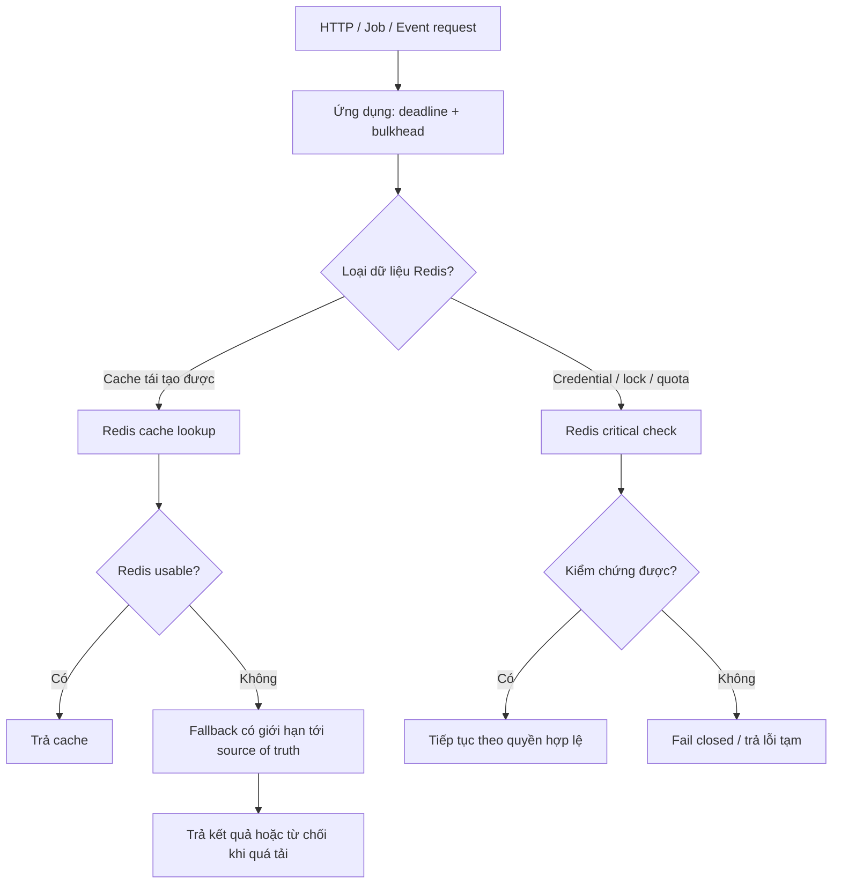
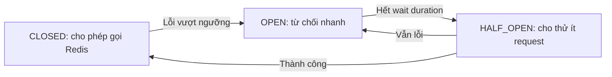
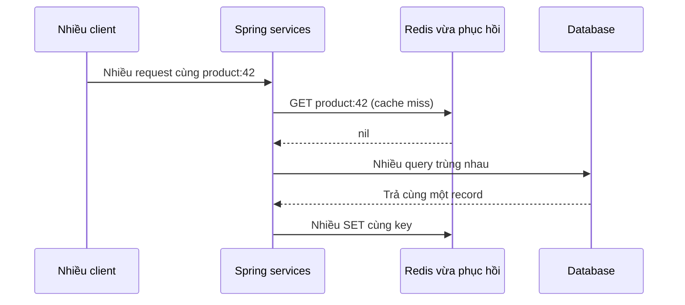
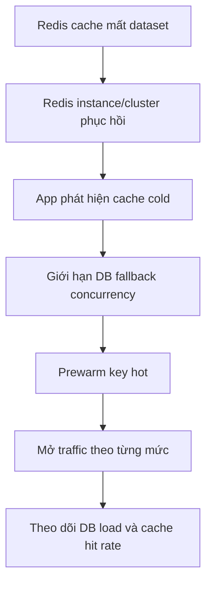

# Chuẩn bị phương án khi Redis chậm, mất kết nối hoặc mất dữ liệu trong Spring Data Redis

Redis thường được đặt trên đường xử lý có tần suất cao của ứng dụng: đọc cache, lưu session, giới hạn tốc độ, giữ mã xác minh, quản lý khóa phân tán, nhận sự kiện qua Redis Streams hoặc lưu những trạng thái tạm thời. Khi Redis hoạt động tốt, các thao tác có thể rất nhanh; nhưng khi Redis **chậm**, **mất kết nối** hoặc **mất dữ liệu**, chính những nơi phụ thuộc Redis lại có thể biến một sự cố hạ tầng thành sự cố toàn hệ thống.

Ví dụ:

- Redis cache bị timeout, ứng dụng đồng loạt chuyển sang truy vấn database và làm database quá tải.
- Redis Cluster failover, một số request nhận lỗi kết nối hoặc kết quả timeout không rõ đã ghi thành công hay chưa.
- Redis dùng làm kho session bị mất dữ liệu sau restart, khiến người dùng phải đăng nhập lại.
- Một key rate limit biến mất vì eviction, khiến bộ đếm giới hạn truy cập bắt đầu lại từ đầu.
- Redis Streams bị mất entry chưa được xử lý; nghiệp vụ tưởng rằng sự kiện đã được giao nhưng thực tế không còn payload để xử lý.
- Replica được promote làm primary sau khi chưa nhận đủ bản ghi; dữ liệu mới ghi trước sự cố có thể không xuất hiện ở primary mới.

Không có một lệnh cấu hình Spring duy nhất giúp mọi ứng dụng “tự phục hồi” trong tất cả tình huống. Phương án tốt cần được thiết kế ở **nhiều lớp**: nhận biết sự cố, phân loại Redis dùng để làm gì, giới hạn thời gian chờ, kiểm soát retry và lưu lượng fallback, chọn hành vi suy giảm chức năng, tổ chức failover, bảo vệ dữ liệu bền, sao lưu–khôi phục, và diễn tập trước khi production gặp lỗi thật.

Bài này xây dựng **kế hoạch triển khai và ứng phó sự cố Redis với Spring Data Redis**. Trọng tâm không phải viết code lạc quan khi Redis luôn sẵn sàng, mà là tạo ra hệ thống có hành vi **rõ ràng, đo được và an toàn khi Redis không đáp ứng kỳ vọng**.

> Nguyên tắc xuyên suốt: **Redis là cache hay nguồn dữ liệu có thẩm quyền?** Câu trả lời quyết định có được bỏ qua lỗi, dùng fallback hoặc tái tạo dữ liệu sau sự cố hay không. Một cache sản phẩm có thể fallback về database; một bước xác minh OTP hoặc một khóa điều khiển thanh toán thì không thể tùy tiện “bỏ qua Redis” để tiếp tục.

## 1. Ba loại sự cố cần phân biệt

### 1.1. Redis chậm nhưng còn trả lời

Ví dụ:

```text
Bình thường:
  cache GET p99 ≈ vài mili-giây

Sự cố:
  cache GET p99 tăng mạnh
  Redis đôi khi vẫn trả giá trị hợp lệ
  Một số request chờ timeout
```

Nguyên nhân có thể:

- CPU của một Redis node quá cao.
- Hot key, big key, lệnh O(N), Lua script nặng.
- Network RTT tăng, packet loss hoặc kết nối chờ lâu.
- Lưu lượng tăng đột biến; connection pool hoặc client queue bị bão hòa.
- Persistence/fork/background tasks tạo áp lực tài nguyên.
- JVM GC, thread pool hoặc serialization chậm ở phía Spring, chứ chưa chắc Redis server chậm.

Khi Redis chậm, mục tiêu đầu tiên là **giới hạn tác động lên request latency và hệ thống phụ thuộc**, không phải tăng timeout vô hạn để chờ Redis.

### 1.2. Redis mất kết nối

Biểu hiện:

```text
RedisConnectionFailureException
Connect timeout
Read/command timeout
Connection reset
DNS lookup failure
TLS handshake failure
WRONGPASS / NOAUTH / NOPERM
```

Không phải tất cả đều cùng bản chất:

- **Mất mạng, node fail:** có thể hồi phục, có thể cần failover.
- **Sai TLS/ACL credential:** cấu hình không hợp lệ; retry liên tục thường không giúp.
- **Timeout sau một lệnh ghi:** không biết chắc lệnh đã thực hiện trên server hay chưa.
- **Topology cũ trong Redis Cluster:** client có thể cần khám phá primary mới.

Khi mất kết nối, cần phân biệt **không thể thực thi lệnh** và **không biết lệnh đã thực thi hay chưa**.

### 1.3. Redis mất dữ liệu

Các dạng mất dữ liệu:

| Dạng | Ví dụ | Hậu quả |
|---|---|---|
| Mất key do TTL | Cache hết hạn đúng thiết kế | Cache miss, có thể tái tạo |
| Eviction vì memory pressure | `maxmemory` và eviction policy loại bỏ key | Mất entry sớm hơn TTL |
| Xóa nhầm | Lệnh `DEL` hoặc thao tác ứng dụng sai | Có thể mất trạng thái cần thiết |
| `FLUSHDB`/`FLUSHALL` | Thao tác quản trị/hệ thống nhầm | Mất dữ liệu diện rộng |
| Restart không đủ persistence | RDB/AOF không lưu được thay đổi gần nhất | Mất bản ghi sau mốc lưu |
| Failover bất đồng bộ | Replica chưa nhận write mới nhất | Mất một số cập nhật gần sự cố |
| Corruption/mất volume | Lỗi disk hoặc cấu hình storage | Có thể cần backup/restore |
| Xóa dữ liệu trong deployment sai môi trường | App/automation thao tác nhầm production | Mất dữ liệu và cần điều tra quyền |

**Key không tồn tại không phải lúc nào cũng là hạ tầng lỗi.** Cache miss do TTL là hoạt động bình thường. Điều quan trọng là phân biệt mất dữ liệu **theo thiết kế**, **do lỗi** và **do thao tác không có thẩm quyền**.

## 2. Bước quyết định: Redis giữ loại dữ liệu nào?

Một ứng dụng có thể cùng lúc dùng Redis cho nhiều vai trò khác nhau.

| Vai trò Redis | Nguồn dữ liệu có thẩm quyền | Khi Redis lỗi, có thể làm gì? |
|---|---|---|
| Cache chi tiết sản phẩm | PostgreSQL / service nguồn | Bỏ qua cache và đọc nguồn, nếu kiểm soát được tải |
| Cache kết quả tính toán | Dữ liệu hoặc công thức có thể tính lại | Tính lại có giới hạn, hoặc trả lỗi tạm thời |
| HTTP session | Có thể Redis là nguồn duy nhất cho session | Yêu cầu đăng nhập lại hoặc dùng cơ chế session dự phòng đã thiết kế |
| OTP / token một lần | Redis có thể là nơi quyết định còn hiệu lực | Không chấp nhận credential khi không xác minh được |
| Rate limiter | Redis giữ counter/quota | Chọn fail-open hay fail-closed theo mức rủi ro cụ thể |
| Distributed lock | Redis giữ lease/owner state | Không bỏ qua lock cho tác vụ cần loại trừ lẫn nhau |
| Redis Streams | Có thể Redis là nguồn event đang chờ xử lý | Cần durability/replay hoặc nguồn event khác có thẩm quyền |
| Trạng thái giỏ hàng tạm | Có thể Redis là nguồn chính | Cần backup, persistence hoặc phương án chấp nhận mất dữ liệu |
| Idempotency key | Redis giữ lịch sử request đã xử lý | Không được retry side effect thiếu kiểm soát khi key biến mất |

### 2.1. Phân loại theo mức tác động nghiệp vụ

Trước khi triển khai, ghi lại cho từng namespace:

```text
redisPurpose: PRODUCT_CACHE
dataOwner: Product Service / PostgreSQL
rebuildable: yes
maximumStaleness: 30 seconds
behaviorWhenUnavailable: bounded DB fallback
criticality: medium
```

Một ví dụ khác:

```text
redisPurpose: PASSWORD_RESET_TOKEN
dataOwner: Redis token registry + account DB checks
rebuildable: no
behaviorWhenUnavailable: reject verification temporarily
criticality: high
```

Chính sách theo **vai trò dữ liệu** an toàn hơn một cấu hình chung kiểu “Redis lỗi thì bỏ qua mọi thứ”.

### 2.2. Vì sao cache được phép fallback mà lock thì không?

Với cache:

```text
Redis GET thất bại
      |
      v
Đọc dữ liệu sản phẩm từ DB
      |
      v
Trả dữ liệu sản phẩm
```

Với lock:

```text
Redis lock thất bại
      |
      v
Không chứng minh được quyền độc quyền
      |
      v
Không thực hiện tác vụ cần mutual exclusion
```

Nếu lock giữ quyền xử lý một giao dịch quan trọng, “Redis down nên cứ chạy tác vụ” có thể tạo **hai worker đồng thời thực hiện cùng side effect**.

## 3. RTO, RPO và SLO: phải thống nhất trước sự cố

Ba khái niệm thường gặp:

- **RTO (Recovery Time Objective):** khoảng thời gian mục tiêu để khôi phục dịch vụ sau sự cố.
- **RPO (Recovery Point Objective):** mức dữ liệu mất tối đa mà nghiệp vụ chấp nhận, tính theo thời gian so với trạng thái trước sự cố.
- **SLO (Service Level Objective):** mục tiêu mức phục vụ đo bằng latency, availability hoặc tỷ lệ lỗi trong một khoảng thời gian.

Ví dụ bảng yêu cầu do team tự đặt:

| Thành phần | RTO minh họa | RPO minh họa | Hành vi tạm thời |
|---|---|---|---|
| Product cache | 15 phút | Không bắt buộc giữ cache | DB fallback giới hạn |
| Session store | 10 phút | Một số session có thể mất theo chính sách | Người dùng có thể cần đăng nhập lại |
| OTP registry | 5 phút | Mã đang hoạt động có thể bị mất | Cho yêu cầu mã mới, không bypass |
| Event stream quan trọng | 5 phút | Gần 0 theo nhu cầu nghiệp vụ | Dừng producer hoặc dùng outbox bền |
| Cart state ở Redis | 10 phút | 1 phút nếu được chấp nhận | Khôi phục từ persistence/backup |

**Đây là giá trị minh họa**, không phải cam kết của Redis hay Spring Data Redis. Không đặt RPO bằng 0 chỉ vì cluster có replica; phải có kiến trúc và kiểm chứng thực sự tương ứng.

### 3.1. RTO thấp không đồng nghĩa RPO thấp

Một Redis Cluster có thể failover nhanh, giúp endpoint phục hồi, nhưng replica được promote có thể chưa nhận một số write. Khi đó:

```text
Availability recovery: nhanh
Recent data preservation: không hoàn toàn
```

Ngược lại, có backup đáng tin nhưng khôi phục chậm thì RPO có thể tốt hơn mà RTO vẫn cao.

### 3.2. Phân loại service criticality

Với từng dependency Redis, nên ghi:

1. Có thể tạm dừng endpoint không?
2. Có thể trả dữ liệu cũ trong bao lâu?
3. Có cần duy trì ghi hay chỉ cho phép đọc?
4. Khi write kết quả không chắc chắn, có thể retry không?
5. Nếu không có Redis, hành động nào phải fail closed?
6. Ai có quyền cho phép khôi phục từ backup?
7. Khi Redis phục hồi, dữ liệu phải được reconcile từ đâu?

Đó là nền tảng cho **runbook**, không chỉ là cấu hình kỹ thuật.

## 4. Ma trận ứng phó theo trạng thái Redis

| Trạng thái | Cache có DB nguồn | OTP/session | Lock/quota quan trọng | Event stream |
|---|---|---|---|---|
| Latency tăng | Fallback có giới hạn, coalescing | Timeout ngắn, trả lỗi tạm nếu không xác minh | Không bỏ qua kiểm soát | Backpressure, điều tiết producer |
| Connection fail | Circuit breaker và DB fallback | Không xác minh được; hướng dẫn retry/cấp lại | Fail closed hoặc chế độ nghiệp vụ riêng | Ngừng ghi hoặc chuyển sang outbox có kiểm soát |
| Failover | Retry có kiểm soát nếu read | Không tự nhận success | Cần xem hiệu lực lease và idempotency | Kiểm tra consumer/producer và duplicate |
| Key mất | Rebuild từ nguồn | Token/session bị vô hiệu, cấp lại hoặc đăng nhập lại | Không coi việc mất lock là có quyền thao tác | Reconcile từ nguồn event bền nếu có |
| Toàn bộ dataset mất | Cache warm-up dần | Theo chính sách buộc xác minh lại | Dừng chức năng có rủi ro | Restore/replay và đối soát |

**Đừng bật fail-open toàn cục.** Đặc biệt với xác thực, quản lý quyền, lock và nhiều kiểu rate limiter bảo mật, fallback “cho qua” có thể nguy hiểm hơn lỗi 503 được xử lý rõ.

## 5. Kiến trúc ba tầng để giới hạn phạm vi sự cố



Thiết kế này cần có trước khi incident xảy ra. Nếu đến khi Redis chết mới quyết định “API nào còn chạy được?”, rủi ro bỏ qua kiểm soát bảo mật và làm nguồn dữ liệu chính quá tải sẽ cao.

## 6. Những chỉ số cần quan sát trước khi Redis sự cố

**Phía Redis server:**

- CPU và memory usage theo node.
- `used_memory`, `maxmemory`, fragmentation, `evicted_keys`.
- Lệnh/giây, command mix, error counters nếu có.
- `SLOWLOG` và Redis latency telemetry.
- `connected_clients`, network input/output.
- `expired_keys`, keyspace size và TTL distribution.
- Persistence status: AOF/RDB save và lỗi ghi.
- Replication lag, role primary/replica, failover events.
- Redis Cluster topology, slot coverage và trạng thái node.

**Phía Spring/Lettuce:**

- Command latency p50/p95/p99 theo loại operation.
- Redis connection error/timeout rate.
- Kết nối đang hoạt động/pending, pool wait nếu dùng pooling.
- Retry count, circuit breaker state, fallback count.
- Cache hit/miss, fallback DB latency và concurrency.
- Số HTTP request lỗi do Redis, endpoint chịu ảnh hưởng.
- Khi dùng Streams: consumer lag, pending entries, retry/dead-letter nếu được thiết kế.

### 6.1. Metric label cần cardinality thấp

Tốt:

```text
redis_operation_duration{
  namespace="product-cache",
  operation="get",
  outcome="timeout"
}
```

Không nên:

```text
redis_operation_duration{
  key="session:person@example.com:token-..."
}
```

Raw Redis key có thể chứa PII hoặc token; mỗi key còn tạo một time series mới khiến monitoring quá tải.

### 6.2. Một dashboard nên giúp trả lời câu hỏi gì?

1. Redis chậm **trên server** hay request chậm ở JVM/network/pool?
2. Sự cố là **một node** hay toàn cluster?
3. Tỷ lệ command timeout tăng bao lâu trước HTTP error?
4. Có eviction/lỗi persistence trước khi dữ liệu biến mất?
5. Fallback DB có đang tạo làn sóng tải thứ hai?
6. Đã có failover hoặc topology refresh chưa?
7. Số workload đang dùng Redis với vai trò critical còn vận hành đúng không?

Alert nên có mức cảnh báo trước ngưỡng outage, không chỉ kiểm tra Redis `PING`.

## 7. Các bước chẩn đoán ban đầu với Redis CLI

Khi được phép truy cập và có credential, thu thập thông tin:

```redis
PING
INFO server
INFO stats
INFO memory
INFO cpu
INFO clients
INFO persistence
INFO replication
INFO commandstats
SLOWLOG GET 20
LATENCY LATEST
```

Đây là **những lệnh quan sát**, nhưng trên managed Redis, ACL có thể cấm một số command. Đừng cấp quyền admin quá rộng cho service application chỉ để dashboard lấy số liệu; sử dụng monitoring/ops identity có quyền phù hợp.

### 7.1. PING có ý nghĩa hạn chế

`PING` thành công trên một node cho thấy node trả lời request đó tại thời điểm ấy. Nó **không chứng minh**:

- Mọi Redis Cluster primary đều reachable.
- Mọi slot được phân bổ.
- Việc đọc/ghi dữ liệu đang đúng.
- AOF/RDB persistence hoạt động.
- Redis replication đã đồng bộ.
- Spring application có cùng network route và credential như người chạy CLI.

Liveness, readiness và data safety là ba câu hỏi khác nhau.

### 7.2. Kiểm tra sự cố bộ nhớ

```redis
INFO memory
INFO stats
```

Nếu `evicted_keys` tăng mạnh và cache miss tăng, có thể Redis đang loại bỏ cache entries do memory pressure.

Với dữ liệu không được phép mất trước TTL, **eviction policy là một phần của correctness**. Một Redis dùng làm token registry, lock hay hàng đợi quan trọng không nên phụ thuộc vào chính sách tự loại bỏ key tùy ý khi đầy RAM.

### 7.3. Kiểm tra persistence

```redis
INFO persistence
```

Một số trường thường hữu ích, tùy Redis version/config:

- Trạng thái bật/tắt AOF.
- Kết quả background save gần nhất.
- Có lỗi ghi RDB/AOF gần đây không.
- Đang rewrite AOF hay tạo RDB snapshot không.
- Tình trạng persistence backlog và write errors.

Lệnh `SAVE` đồng bộ hoặc thao tác quản trị ép snapshot có thể gây tác động; không chạy các lệnh thay đổi persistence trên production chỉ vì thấy `INFO persistence` đáng lo.

## 8. Phân biệt timeout trên client với latency server

Một request Spring gặp timeout có thể bị chậm ở nhiều điểm:

```text
HTTP request
   |
   +-- Chờ executor / scheduler
   |
   +-- Chờ connection/pool
   |
   +-- TCP/TLS network
   |
   +-- Redis command execution
   |
   +-- Network response
   |
   +-- Deserialize và xử lý Java
```

`SLOWLOG` chủ yếu giúp quan sát thời gian thực thi command trên Redis, không bao phủ toàn bộ connection-pool wait, network round trip hay Java serialization.

Nếu:

```text
Spring observed latency = 200 ms
Redis command execution = 1 ms
```

đừng vội thay Redis server. Cần xem network, queue, pool, JVM GC và kích thước response.

### 8.1. Redis chậm vì hot key/big key

Những command có nguy cơ cao khi dữ liệu lớn:

```redis
HGETALL giant:hash
SMEMBERS huge:set
LRANGE huge:list 0 -1
ZRANGE huge:zset 0 -1
KEYS *
```

Giải pháp có thể là `HGET` thay vì `HGETALL`, đọc theo page, `SCAN`/`HSCAN` khi thích hợp, chia dữ liệu hoặc giới hạn retention.

Không “chữa” một `HGETALL` trả 100 MB bằng tăng command timeout lên vài phút rồi để HTTP thread chờ.

## 9. Spring Boot: cấu hình Redis connection và timeout

Ví dụ với **Spring Boot 3.x** và Lettuce, khi Redis là một endpoint standalone:

```yaml
spring:
  data:
    redis:
      client-type: lettuce
      host: redis.internal.example
      port: 6379
      username: ${REDIS_USERNAME}
      password: ${REDIS_PASSWORD}
      connect-timeout: 2s
      timeout: 2s
```

Nếu deployment yêu cầu TLS, cần thêm:

```yaml
spring:
  data:
    redis:
      ssl:
        enabled: true
```

và CA/trust material/mTLS certificate phù hợp nếu Redis server yêu cầu.

**Giá trị 2 giây chỉ minh họa**, không phải cấu hình tối ưu. Timeout phụ thuộc latency mạng bình thường, deadline HTTP, failover behavior, số request đồng thời và ngân sách retry.

### 9.1. Connect timeout khác command timeout

| Cấu hình | Nhóm vấn đề |
|---|---|
| Connect timeout | Mở kết nối tới Redis node |
| Command timeout | Đợi command Redis hoàn thành |
| Pool wait / acquire timeout | Chờ một connection tài nguyên client |
| HTTP deadline | Tổng thời gian endpoint được phép tiêu thụ |
| Resilience layer timeout | Giới hạn việc thực thi cả nhánh Redis/fallback |

Tổng thời gian chờ trong hệ thống có thể **lớn hơn một timeout riêng lẻ**, đặc biệt khi có nhiều retry, pool wait hoặc bước fallback.

### 9.2. Cấu hình theo môi trường và phiên bản

Spring Boot 2.x và 3.x có thay đổi namespace cấu hình Redis:

```properties
# Thường gặp trên Spring Boot 2.x:
spring.redis.timeout=2s

# Thường gặp trên Spring Boot 3.x:
spring.data.redis.timeout=2s
```

Phải đối chiếu phiên bản Spring Boot của dự án. Một property không được bind có thể khiến ứng dụng dùng mặc định khác mong đợi mà không có lỗi rõ ràng.

### 9.3. Không tự sửa bean factory rồi nghĩ properties vẫn áp dụng

Nếu tự khai báo:

```java
@Bean
RedisConnectionFactory redisConnectionFactory() {
    return new LettuceConnectionFactory(myConfig);
}
```

Spring Boot có thể back off auto-configuration của connection factory. Khi đó, không phải mọi property `spring.data.redis.*` tự động được áp lên factory do bạn tạo. Cần cấu hình tường minh hoặc để Boot tạo bean và dùng customizer tương thích.

## 10. Ví dụ cấu hình LettuceClientConfiguration

Khi cần tự tạo connection factory:

```java
package com.example.redis.config;

import java.time.Duration;

import org.springframework.context.annotation.Bean;
import org.springframework.context.annotation.Configuration;
import org.springframework.data.redis.connection.RedisConnectionFactory;
import org.springframework.data.redis.connection.RedisStandaloneConfiguration;
import org.springframework.data.redis.connection.lettuce.LettuceClientConfiguration;
import org.springframework.data.redis.connection.lettuce.LettuceConnectionFactory;

@Configuration
public class RedisConnectionConfig {

    @Bean
    public RedisConnectionFactory redisConnectionFactory() {

        RedisStandaloneConfiguration server =
                new RedisStandaloneConfiguration(
                        "redis.internal.example", 6379);

        LettuceClientConfiguration client =
                LettuceClientConfiguration.builder()
                        .commandTimeout(Duration.ofSeconds(2))
                        .build();

        return new LettuceConnectionFactory(server, client);
    }
}
```

Đây là mẫu minh họa **không bao gồm credentials/TLS**; production cần thêm xác thực và cấu hình bảo mật tương ứng. Không dùng ví dụ tối thiểu này để thay một connection factory production đang có ACL, TLS hoặc topology settings.

### 10.1. Mục tiêu của timeout là giới hạn thiệt hại

Nếu một request HTTP có deadline 3 giây, hãy xác định:

```text
Redis lookup budget     = 0.5s (ví dụ)
Fallback DB budget      = 1.5s (ví dụ)
Business serialization = 0.3s (ví dụ)
Remaining safety margin
```

Các số là minh họa một **deadline budget**, không phải công thức Redis. Nếu Redis được phép chờ 3 giây rồi fallback DB thêm 3 giây, endpoint 3 giây gần như chắc chắn thất bại dù fallback có đúng.

## 11. Không retry vô điều kiện khi Redis timeout

Retry có thể hữu ích với lỗi transient, nhưng cũng có thể:

- Gây **retry storm** khi nhiều instance cùng retry.
- Làm lỗi chậm trở nên nặng hơn.
- Nhân đôi side effect nếu lệnh ghi đã thực thi trước khi mất response.
- Giữ request lâu hơn deadline của API.

### 11.1. Idempotent và non-idempotent khác nhau

Ví dụ các lệnh:

| Lệnh | Retry cùng input sau timeout có luôn an toàn? | Giải thích |
|---|---|---|
| `GET key` | Thường có thể về mặt side effect | Đọc không tự sửa dữ liệu |
| `SET key fixedValue` | Có thể idempotent về value nhưng vẫn có race | Ghi đè cập nhật mới hơn có thể sai |
| `DEL key` | Thường idempotent về trạng thái xóa, nhưng phụ thuộc workflow | Key có thể được tạo lại giữa hai lần |
| `INCR counter` | **Không** | Có thể tăng hai lần |
| `LPUSH key value` | **Không** | Có thể thêm phần tử hai lần |
| `XADD stream * ...` | **Không** | Có thể tạo hai entry khác ID |
| `SET lock NX PX ...` | Không thể retry tùy tiện | Quyền sở hữu lock/lease cần được kiểm tra riêng |
| Lua script thay đổi nhiều key | Phụ thuộc tính chất script | Script có thể đã chạy nhưng response bị mất |

Timeout không chứng minh Redis chưa thực thi lệnh. Nếu lệnh ghi phải được retry, cần **operation ID** hoặc cơ chế idempotency/fencing được thiết kế ở nơi có thẩm quyền.

### 11.2. Backoff và jitter

Nếu retry một thao tác cho phép retry:

```text
Lần 1: thử ngay
Lần 2: chờ backoff ngắn + jitter
Lần 3: chờ backoff lớn hơn + jitter
Hết ngân sách deadline -> dừng và báo lỗi
```

Không cho 1.000 requests cùng retry ở các mốc chính xác 100 ms, 200 ms, 400 ms vì chúng có thể tạo các đợt tải đồng bộ.

### 11.3. Tách retry ở nhiều tầng

Nếu driver reconnect, service dùng Resilience4j retry và HTTP gateway cũng retry, tổng số lần thực thi có thể lớn hơn nhiều so với dự kiến.

Ví dụ:

```text
Gateway retry 3 lần
  Service retry 3 lần
    Driver retry/reconnect tùy tình huống
```

Không nên để từng lớp tự tăng retry vô hạn. Phải có **một ngân sách end-to-end** về số lần thử và thời gian.

## 12. Circuit breaker: giảm gọi Redis khi đang hỏng

Circuit breaker theo dõi thất bại/slow calls và có thể tạm ngăn các request mới vào Redis trong một khoảng thời gian.



Circuit breaker hữu ích khi Redis mất kết nối hoặc latency tăng làm các HTTP threads/request pipelines bị giữ lâu.

### 12.1. Không chỉ dựa vào circuit breaker

Circuit breaker **không bảo đảm**:

- Có kết nối Redis mới được tạo đúng sau failover.
- Ghi lệnh non-idempotent không bị lặp.
- Cache được tái tạo đúng.
- DB fallback không bị overload.
- Có dữ liệu khôi phục nếu Redis mất key.

Nó là một **cơ chế giới hạn thiệt hại**, không thay thế kiến trúc dữ liệu hoặc backup.

### 12.2. Mẫu Resilience4j (ý tưởng tích hợp)

Nếu ứng dụng sử dụng Resilience4j, có thể cấu hình một instance:

```yaml
resilience4j:
  circuitbreaker:
    instances:
      redisProductCache:
        slidingWindowType: COUNT_BASED
        slidingWindowSize: 50
        minimumNumberOfCalls: 20
        failureRateThreshold: 50
        slowCallRateThreshold: 70
        slowCallDurationThreshold: 500ms
        waitDurationInOpenState: 10s
        permittedNumberOfCallsInHalfOpenState: 5
```

**Chỉ khai báo YAML chưa tự bao bọc `RedisTemplate`.** Cần dependency, cấu hình Spring và decorator/annotation tích hợp đúng service method. Ngưỡng trên chỉ minh họa, cần tune từ số liệu thực tế.

Với ứng dụng có nhiều loại Redis workload, không nên dùng một circuit breaker global chung cho cache đọc và token verification rồi áp cùng fallback behavior. Phân nhóm theo mức criticality.

## 13. Bulkhead: bảo vệ nguồn dữ liệu fallback

Giả sử Redis cache ngừng hoạt động:

```text
10.000 request/giây
        |
        v
Redis cache unavailable
        |
        v
10.000 DB queries/giây
        |
        v
DB overload
        |
        v
Toàn hệ thống lỗi nặng hơn Redis outage ban đầu
```

Giải pháp không thể chỉ là “cache fail thì DB fallback”. Cần:

- Giới hạn concurrency của fallback.
- Rate limit những endpoint không thiết yếu.
- Cache local hoặc stale data trong thời gian cho phép.
- Request coalescing/single-flight.
- Trả 429/503 có chính sách khi vượt ngân sách thay vì phá DB.
- Mở rộng DB/read replicas nếu kiến trúc hỗ trợ và đã đánh giá consistency.

### 13.1. Ví dụ giới hạn số fallback đồng thời

Mẫu Java dưới đây minh họa **bulkhead tại một JVM** cho đường fallback:

```java
package com.example.catalog;

import java.util.concurrent.Semaphore;

import org.springframework.stereotype.Service;

@Service
public class ProductFallbackService {

    private final Semaphore fallbackSlots = new Semaphore(32);
    private final ProductRepository repository;

    public ProductFallbackService(ProductRepository repository) {
        this.repository = repository;
    }

    public ProductDto loadFromDatabase(String productId) {
        if (!fallbackSlots.tryAcquire()) {
            throw new FallbackOverloadedException(
                    "Product fallback is currently overloaded");
        }

        try {
            return repository.findDtoById(productId)
                    .orElseThrow(ProductNotFoundException::new);
        } finally {
            fallbackSlots.release();
        }
    }
}
```

`ProductRepository`, `ProductDto` và các exception là thành phần ứng dụng minh họa. Số permit 32 phải được đánh giá theo DB pool, các request khác dùng DB và số instance ứng dụng.

**Bulkhead cục bộ không phải giới hạn toàn cluster ứng dụng.** Nếu có 20 JVM, mỗi JVM cho 32 fallback đồng thời, tổng tải tiềm năng vẫn rất lớn.

## 14. Mẫu Spring Cache: lỗi GET cache và fallback

Khi dùng `@Cacheable`:

```java
@Cacheable(cacheNames = "product-detail", key = "#productId")
public ProductDto findById(String productId) {
    return repository.findDtoById(productId)
            .orElseThrow(ProductNotFoundException::new);
}
```

Nếu Redis cache không hoạt động, Spring Cache thường báo lỗi trong thao tác cache. Với cache **thuần tăng tốc và dữ liệu có nguồn trong database**, có thể chọn lỗi cache GET là **cache miss có kiểm soát**.

Ví dụ một `CacheErrorHandler` riêng:

```java
package com.example.catalog.config;

import org.slf4j.Logger;
import org.slf4j.LoggerFactory;
import org.springframework.cache.Cache;
import org.springframework.cache.annotation.CachingConfigurer;
import org.springframework.cache.annotation.EnableCaching;
import org.springframework.cache.interceptor.CacheErrorHandler;
import org.springframework.context.annotation.Configuration;

@Configuration
@EnableCaching
public class ProductCacheFailureConfig implements CachingConfigurer {

    private static final Logger log =
            LoggerFactory.getLogger(ProductCacheFailureConfig.class);

    @Override
    public CacheErrorHandler errorHandler() {
        return new CacheErrorHandler() {

            @Override
            public void handleCacheGetError(
                    RuntimeException exception,
                    Cache cache,
                    Object key) {
                log.warn("Cache read unavailable; cache={}",
                        cache.getName());
                // Không rethrow: Spring Cache có thể chạy method gốc.
            }

            @Override
            public void handleCachePutError(
                    RuntimeException exception,
                    Cache cache,
                    Object key,
                    Object value) {
                log.warn("Cache write unavailable; cache={}",
                        cache.getName());
                // Không làm hỏng kết quả đọc từ DB khi chỉ cache dữ liệu.
            }

            @Override
            public void handleCacheEvictError(
                    RuntimeException exception,
                    Cache cache,
                    Object key) {
                throw exception;
            }

            @Override
            public void handleCacheClearError(
                    RuntimeException exception,
                    Cache cache) {
                throw exception;
            }
        };
    }
}
```

**Giới hạn quan trọng:**

1. `CacheErrorHandler` thuộc **Spring Cache abstraction**; nó không tự áp cho mọi lời gọi `RedisTemplate`.
2. Bỏ qua lỗi GET/PUT chỉ phù hợp với **cache có thể tái tạo**, không phải session, security token hay rate limiter.
3. Ví dụ rethrow lỗi evict/clear để tránh âm thầm bỏ qua invalidation có thể gây cache stale. Nhưng việc rethrow **không làm database transaction và cache invalidation trở thành atomic**.
4. Đây là lỗi GET cache được chuyển thành đường tải nguồn, nên cần thêm **circuit breaker/bulkhead/fallback limit**, nếu không sẽ tạo cache stampede lên DB.
5. Không log raw `key`/`value` nếu có thể chứa PII hoặc token; không log stack trace từng request khi outage làm log quá tải.
6. Nếu ứng dụng có nhiều cache với rủi ro khác nhau, **một handler global có thể quá rộng**. Tách cache manager/kiến trúc theo nhóm hoặc thiết kế fallback tại service rõ ràng.

### 14.1. Tại sao không “ignore hết” cả evict?

Giả sử:

```text
T1: Redis giữ product:42 = giá cũ
T2: DB cập nhật giá mới thành công
T3: Redis EVICT thất bại
T4: Client khác đọc Redis key còn tồn tại
```

Nếu ứng dụng âm thầm coi T3 như thành công, nó có thể trả **giá cũ** đến khi TTL kết thúc hoặc invalidation khác xảy ra.

Đối với dữ liệu đòi độ mới cao, cần thiết kế **invalidation after commit, versioned cache keys, outbox/retry hoặc đọc DB** trong những thao tác quan trọng. Cấu hình error handler không thay thế các bảo đảm đó.

## 15. Raw RedisTemplate: chỉ fallback khi exception phù hợp

Ứng dụng dùng trực tiếp `StringRedisTemplate` không được `CacheErrorHandler` bảo vệ.

Ví dụ đường đọc cache:

```java
package com.example.catalog;

import org.springframework.dao.QueryTimeoutException;
import org.springframework.data.redis.RedisConnectionFailureException;
import org.springframework.data.redis.core.StringRedisTemplate;
import org.springframework.stereotype.Service;

@Service
public class ProductReadService {

    private final StringRedisTemplate redis;
    private final ProductFallbackService fallback;

    public ProductReadService(
            StringRedisTemplate redis,
            ProductFallbackService fallback) {
        this.redis = redis;
        this.fallback = fallback;
    }

    public ProductDto findProduct(String productId) {
        String key = "cache:product:" + productId;

        try {
            String cached = redis.opsForValue().get(key);
            if (cached != null) {
                return ProductDto.fromCacheValue(cached);
            }
        } catch (RedisConnectionFailureException
                 | QueryTimeoutException unavailable) {
            // Log/metric outcome theo namespace, không in key nhạy cảm.
            // Chỉ fallback vì đây là cache có nguồn dữ liệu chính.
        }

        return fallback.loadFromDatabase(productId);
    }
}
```

Đây là ví dụ thiết kế service; `ProductDto.fromCacheValue` và repository DB là code của dự án.

### 15.1. Không bắt toàn bộ RuntimeException rồi coi là cache miss

Ví dụ không nên:

```java
try {
    return parse(redis.opsForValue().get(key));
} catch (RuntimeException ignored) {
    return repository.loadFromDatabase();
}
```

Nó giấu cả lỗi programming, serializer, invalid data và những lỗi khác, khiến outage khó chẩn đoán.

Nên phân biệt:

- Redis connection/timeout errors.
- Cache miss bình thường.
- Data corruption/serialization lỗi.
- Lỗi DB fallback.
- Lỗi business validation.

Nếu muốn fallback cho một loại lỗi serializer, cần quy tắc tường minh, metric và cách sửa entry lỗi.

### 15.2. Có thể thêm local cache nhưng phải giới hạn staleness

Với dữ liệu cấu hình ít thay đổi, một bounded local cache TTL rất ngắn có thể giúp service trả dữ liệu gần nhất khi Redis tạm mất. Tuy nhiên, đó là **stale-read policy**, không phải mặc định an toàn cho số dư, quyền truy cập hay dữ liệu sau khi vừa cập nhật.

## 16. Redis Reactive: không biến mọi onError thành giá trị hợp lệ

Với `ReactiveStringRedisTemplate`:

```java
Mono<String> value =
        reactiveRedis.opsForValue().get("cache:product:42");
```

Có ba khả năng chính:

1. Phát `onNext(value)` rồi `onComplete` khi key có giá trị.
2. `onComplete` rỗng khi key không tồn tại (không phát `onNext(null)`).
3. Phát `onError` khi Redis/connection/command lỗi.

Không được gộp sai:

```text
Mono.empty()  ≠ Redis outage
Mono.error()  ≠ Cache miss
```

### 16.1. Fallback cho cache reactive

Ví dụ:

```java
public Mono<ProductDto> getProduct(String productId) {
    String key = "cache:product:" + productId;

    Mono<ProductDto> fromRedis =
            reactiveRedis.opsForValue()
                    .get(key)
                    .map(ProductDto::fromCacheValue);

    Mono<ProductDto> fromDb =
            Mono.defer(() ->
                    productRepository.findReactiveById(productId));

    return fromRedis
            .onErrorResume(
                    RedisConnectionFailureException.class,
                    error -> fromDb)
            .onErrorResume(
                    QueryTimeoutException.class,
                    error -> fromDb)
            .switchIfEmpty(fromDb);
}
```

**Quan trọng:** ví dụ này minh họa sự khác biệt giữa cache miss và connection failure, nhưng chưa có bulkhead/circuit breaker để bảo vệ DB; cần thêm chúng nếu đưa vào production.

`Mono.defer` đảm bảo publisher dự phòng được tạo/đăng ký vào lúc cần thiết theo semantics reactive. Với code thực, kiểm tra cancellation/deadline, metrics và retry policy để tránh một HTTP request tạo nhiều DB lookups.

### 16.2. Đừng dùng fallback trong bước xác minh security

Ví dụ sai:

```java
return reactiveRedis.opsForValue()
        .get(otpKey)
        .onErrorReturn("VALID");
```

Đây là **fail-open** trên một credential check. Nếu Redis lỗi, mã chưa được xác minh mà vẫn được coi hợp lệ. Luồng xác minh nên báo lỗi tạm thời, chặn hành động nhạy cảm và cung cấp kênh retry/cấp lại mã.

## 17. Cache stampede sau khi Redis phục hồi

Không chỉ Redis down mới nguy hiểm. Khi Redis quay lại với cache rỗng:



Một cache rỗng sau restart/restore có thể khiến Redis nhanh nhưng **database bị overload**.

### 17.1. Những lớp chống stampede

- **Request coalescing/single-flight** trong một JVM.
- Distributed lease/lock với fencing hoặc TTL nếu cần phối hợp nhiều instance.
- Hạn chế số DB fallback concurrent.
- Thêm jitter vào TTL cache để tránh hết hạn đồng thời.
- Prewarm một số key hot trước khi mở traffic toàn bộ.
- Phân cấp rollout traffic, không cho mọi instance reconnect/fill cache cùng lúc.
- Nếu nghiệp vụ chấp nhận, dùng stale cache từ local cache có TTL ngắn.

### 17.2. Không dùng stale data cho mọi loại dữ liệu

Stale feature flags ít rủi ro có thể được cho phép trong vài giây. Nhưng stale account permissions, giá tại thời điểm thanh toán, tồn kho hoặc trạng thái token phải được đánh giá riêng theo consistency requirements.

## 18. Redis Cluster và Sentinel: cơ chế sẵn sàng khác nhau

| Kiểu triển khai | Mô hình | Điều cần thiết kế ở Spring |
|---|---|---|
| Standalone | Một Redis server/endpoint | Chấp nhận downtime hoặc có cơ chế khôi phục/đường dự phòng |
| Redis Sentinel | Phát hiện primary/failover của replication group | `RedisSentinelConfiguration`, auth tới Sentinel và data nodes |
| Redis Cluster | Dữ liệu chia thành 16.384 hash slot trên nhiều primary | `RedisClusterConfiguration`, seed nodes, topology/redirect |
| Managed Redis | Provider vận hành failover/topology | Dùng đúng endpoint, ACL/TLS và semantics do provider hỗ trợ |

Chuyển ứng dụng từ standalone sang Redis Cluster không tự giải quyết lỗi thiết kế cache fallback, durability hay idempotency.

### 18.1. Redis Sentinel

Ứng dụng thường cần:

- Danh sách Sentinel endpoints.
- Tên primary/master logic mà Sentinel giám sát.
- Credential tới Sentinel nếu yêu cầu.
- Credential tới Redis data nodes.
- TLS config phù hợp cả hai loại endpoint nếu hạ tầng dùng TLS.

Client phải tìm lại primary khi failover. Trong cửa sổ chuyển tiếp, vẫn có thể xuất hiện timeout hoặc một số thao tác ghi thất bại.

### 18.2. Redis Cluster

Redis Cluster có thể trả chuyển hướng:

```text
MOVED <slot> <node>
ASK <slot> <node>
```

Lettuce cluster client có cơ chế theo dõi topology, nhưng muốn phục hồi cần:

- Seed nodes reachable.
- Các địa chỉ node được Redis quảng bá reachable từ JVM.
- Redis Cluster giữ slot coverage và khả năng phục vụ phù hợp.
- Topology refresh/reconnect hoạt động theo phiên bản client.
- ACL/TLS nhất quán trên những node được discover.

### 18.3. Cluster không làm dữ liệu tự mạnh hơn về consistency

Redis Cluster vẫn thường dùng replication bất đồng bộ. Failover có thể phục hồi khả năng phục vụ nhưng **không đảm bảo mọi write vừa ACK ở primary đều đã tồn tại trên replica mới**.

Để RPO chặt chẽ, phải phân tích persistence, replication, cơ chế chờ xác nhận và ranh giới dữ liệu có thẩm quyền; không dùng chữ “cluster” thay cho bảo đảm mạnh.

## 19. Topology refresh của Lettuce

Với Redis Cluster, client giữ topology cũ có thể gửi lệnh đến node không còn sở hữu slot. Lettuce hỗ trợ periodic/adaptive topology refresh theo phiên bản.

Ví dụ Java:

```java
import java.time.Duration;
import io.lettuce.core.cluster.ClusterClientOptions;
import io.lettuce.core.cluster.ClusterTopologyRefreshOptions;

ClusterTopologyRefreshOptions refresh =
        ClusterTopologyRefreshOptions.builder()
                .enablePeriodicRefresh(Duration.ofSeconds(30))
                .enableAllAdaptiveRefreshTriggers()
                .build();

ClusterClientOptions options =
        ClusterClientOptions.builder()
                .topologyRefreshOptions(refresh)
                .build();
```

Đối tượng options này phải được gắn vào `LettuceClientConfiguration` hoặc Boot customizer phù hợp. **Chỉ tạo options object không làm client đang chạy thay đổi cấu hình**.

Chu kỳ 30 giây chỉ minh họa. Refresh dày quá tăng traffic kiểm tra topology; refresh chậm quá làm phản ứng muộn khi cluster đổi. Cần đo theo tần suất failover/resharding và khả năng của driver.

### 19.1. Không nhầm redirect với retry nghiệp vụ

`MOVED`/`ASK` là thông tin định tuyến Redis Cluster. Nó không thể giải quyết side effect lặp của một lệnh `INCR` nếu response timeout. Phân biệt **routing recovery** với **business idempotency**.

## 20. Replication: giảm downtime nhưng không bảo đảm mọi write

Một Redis primary có replica:

```text
Spring app
    |
    v
Primary A -- asynchronous replication --> Replica A'
    |
    v
ACK tới client
```

Có thể xảy ra:

```text
T1: Primary nhận SET key=valueNew
T2: Primary trả ACK cho client
T3: Primary crash trước khi replica nhận thay đổi
T4: Replica được promote
T5: valueNew có thể không tồn tại ở primary mới
```

Đây là kịch bản cần xét khi Redis là nguồn trạng thái quan trọng.

### 20.1. Lệnh WAIT có đủ để cam kết không mất dữ liệu?

Redis có `WAIT` để chờ một số replica xác nhận đã nhận các write trước đó trên connection. Nó **có thể giảm rủi ro** trong một số failure modes, nhưng không biến Redis thành một transaction database đồng bộ hoàn toàn và không đảm bảo write sẽ tồn tại bền vững sau mọi kiểu failure/failover.

Cần phân biệt:

- Replica đã nhận dữ liệu.
- Replica đã ghi dữ liệu bền ra storage.
- Failover chọn replica nào.
- Network partition và trạng thái primary cũ.
- Client đã biết chắc kết quả write hay chưa.

Không đưa `WAIT` vào code rồi tuyên bố RPO bằng 0 mà chưa có bảo đảm end-to-end phù hợp.

### 20.2. Read from replica có thể trả dữ liệu cũ

Nếu Lettuce được cấu hình đọc replica, sau khi ghi lên primary, replica có thể chưa bắt kịp. Khi khắc phục sự cố:

- Tạm chuyển read policy phù hợp sang primary cho dữ liệu cần mới.
- Theo dõi replication lag.
- Không dựa vào replica read cho quyết định yêu cầu read-after-write nghiêm ngặt.

## 21. Persistence: RDB và AOF

Nếu dữ liệu Redis cần tồn tại sau restart, phải hiểu các cơ chế persistence thay vì coi nó như cache memory thuần.

### 21.1. RDB snapshot

RDB ghi ảnh chụp dataset tại những thời điểm được cấu hình hoặc kích hoạt.

Ưu điểm:

- Snapshot thuận tiện cho backup và restore.
- Có thể giảm overhead ghi liên tục so với một số cấu hình AOF.

Hạn chế:

- Những write xảy ra **sau snapshot gần nhất** có thể mất nếu server crash trước snapshot tiếp theo.
- Quá trình snapshot có chi phí CPU/memory/disk nhất định.
- Backup một file RDB không mặc nhiên bảo đảm đã phục hồi được trên hạ tầng mục tiêu.

### 21.2. Append Only File (AOF)

AOF ghi lại những thay đổi theo chiến lược fsync và cơ chế persistence của Redis.

Ví dụ những chế độ fsync:

| Chế độ | Định hướng | Trade-off |
|---|---|---|
| `appendfsync always` | Fsync nhiều hơn, hướng giảm cửa sổ mất dữ liệu | Tăng overhead/latency I/O |
| `appendfsync everysec` | Cân bằng hiệu năng/durability thường dùng | Vẫn có cửa sổ mất dữ liệu khi crash |
| `appendfsync no` | Để hệ điều hành quyết định flush | Cửa sổ và rủi ro mất dữ liệu có thể lớn hơn |

Đây là mô tả trade-off, không phải cam kết chính xác số giây dữ liệu sẽ mất trong mọi sự cố. Kết quả thực tế còn phụ thuộc I/O, crash mode, OS, Redis version, replication và storage.

### 21.3. Kết hợp RDB và AOF

Redis deployment có thể sử dụng cả hai cơ chế. Khi khởi động lại, Redis chọn và đọc các tập persistence theo quy tắc phiên bản/cấu hình tương ứng.

Đừng đổi `appendonly` hoặc cấu hình `save` trên production bằng một script vội vàng. Việc tạo AOF mới, rewrite, disk capacity và restore behavior phải được kiểm tra trong môi trường tương đương.

### 21.4. Ví dụ redis.conf để thảo luận

```conf
# Minh họa, không phải cấu hình mặc định nên copy cho production.
appendonly yes
appendfsync everysec

# Ví dụ quy tắc tạo snapshot RDB:
save 900 1
save 300 10
save 60 10000
```

Các dòng này phải được xét cùng memory, disk throughput, tốc độ write, SLA và môi trường managed Redis. Một số dịch vụ không cho chỉnh trực tiếp `redis.conf` mà dùng parameter group/API riêng.

## 22. Data safety: chỉ bật persistence chưa đủ

Một hệ thống có AOF/RDB nhưng vẫn có thể mất dữ liệu nếu:

- Volume bị hỏng hoặc bị xóa.
- Disk hết dung lượng và persistence bị lỗi.
- Backup nằm trên cùng máy/zone với Redis.
- File backup không thể giải mã hoặc thiếu key.
- Backup đã lâu hơn RPO.
- Có thao tác `FLUSHDB`/`FLUSHALL` được replicate và ghi vào persistence.
- Redis bị lỗi logic trong application xóa/ghi đè dữ liệu quan trọng.

Do đó, cần **backup độc lập, kiểm tra khôi phục và kiểm soát thao tác phá hủy**.

### 22.1. Không dùng Redis key TTL như một cam kết bền vững

TTL cho biết khi nào key không còn hiệu lực; nó không bảo đảm key phải tồn tại đến giây cuối. Key có thể biến mất sớm vì eviction, xóa chủ động, failover hoặc mất persistence.

Nếu dữ liệu không được phép biến mất ngoài deadline, chỉ cấu hình TTL không đủ.

### 22.2. Eviction policy liên quan tới correctness

Một Redis chỉ dùng cho cache có thể phù hợp với eviction. Nhưng nếu cùng instance lưu cả:

```text
cache:product:...
otp:reset-password:...
lock:payment:...
```

thì policy eviction có thể xóa **trạng thái xác minh hoặc lock**, gây tác động vượt xa cache miss.

Phân tách Redis deployment hoặc cấu hình bộ nhớ/chính sách theo nhóm dữ liệu có mức criticality khác nhau có thể an toàn hơn việc trộn mọi loại key trong cùng một instance.

## 23. Backup: sao lưu cái gì và lưu ở đâu?

Một kế hoạch backup cần mô tả:

| Thành phần | Cần quyết định |
|---|---|
| Redis dataset | Snapshot/persistence files theo phương pháp provider hỗ trợ |
| Redis version | Ghi rõ version tương thích để restore |
| Topology | Standalone, Sentinel, Cluster hoặc managed |
| Redis configuration | Memory, persistence, eviction, TLS/ACL, namespaces |
| Secret material | Quản lý riêng qua secret manager, không nhúng vào backup công khai |
| Backup location | Khác failure domain với Redis, phân quyền tối thiểu |
| Encryption | Mã hóa dữ liệu backup at rest/in transit |
| Retention | Bao nhiêu bản, giữ bao lâu theo RPO/compliance |
| Restore time | Thời gian tải dữ liệu, rebuild index và mở traffic |
| Validation | Thử phục hồi và kiểm tra dữ liệu nghiệp vụ |

### 23.1. Backup không thay thế replication

Replication hữu ích cho failover, nhưng thao tác xóa nhầm hoặc corruption logic có thể được lan sang replica.

Ví dụ:

```text
Primary nhận FLUSHDB ngoài ý muốn
      |
      v
Replicas có thể nhận thay đổi tương ứng
      |
      v
Không thể coi replica là backup độc lập trước lỗi logic
```

Backup tách biệt giúp khôi phục trạng thái ở thời điểm trước khi xảy ra lỗi logic, nếu retention phù hợp.

### 23.2. Backup phải qua kiểm thử restore

Một file RDB/AOF tồn tại trên object storage không đủ để khẳng định backup dùng được.

Diễn tập:

1. Tạo Redis instance riêng trong môi trường thử nghiệm.
2. Khôi phục từ snapshot được chọn.
3. Kiểm tra Redis server khởi động và đọc được dataset.
4. So sánh số lượng key/những sample records không nhạy cảm.
5. Kiểm tra TTL và schema/serializer theo điều kiện restore.
6. Kiểm tra các operation Spring Data Redis dự kiến.
7. Đo thời gian khôi phục end-to-end.

Không dùng restore test để ghi đè dataset Redis production.

## 24. Kịch bản khôi phục sau khi mất toàn bộ Redis cache

Khi Redis chỉ là cache:



Nếu dữ liệu có thể tái tạo từ database, **restore cache từ backup có thể không cần thiết**. Đôi khi xóa sạch cache bị hỏng rồi warm-up an toàn tốt hơn phục hồi snapshot cũ.

Tuy nhiên, cần xác định:

- DB có đủ khả năng phục vụ cache miss burst không?
- Key hot nào cần prewarm?
- Có dữ liệu stale đã bị invalidation sau snapshot không?
- Có replay các sự kiện invalidation khi phục hồi cache không?

### 24.1. Rủi ro restore snapshot cache cũ

Giả sử:

```text
T0: Backup cache product:42 price=100
T1: DB đổi price=120 và cache được invalidated
T2: Redis mất dataset
T3: Restore snapshot T0 -> cache có price=100
```

Nếu TTL sau restore còn dài hoặc key cũ được phục hồi, ứng dụng có thể trả **giá cũ**. Với cache không phải nguồn sự thật, nên cân nhắc **không restore cache data** hoặc thực hiện kiểm tra version/clear/warm-up đúng chính sách.

Đây là lý do **phục hồi byte dữ liệu** không đồng nghĩa **phục hồi tính đúng của hệ thống**.

## 25. Khôi phục khi Redis giữ session

Nếu ứng dụng dùng Spring Session lưu trên Redis, mất dataset có thể khiến session keys biến mất.

Biểu hiện:

- Người dùng bị đăng xuất hoặc không còn session hợp lệ.
- Session-dependent flow bị mất trạng thái.
- Một số frontend nhận lỗi authorization hoặc phải thực hiện login lại.

Phương án có thể gồm:

- Chấp nhận và thông báo đăng nhập lại.
- Duy trì session TTL hợp lý và không lưu dữ liệu nghiệp vụ duy nhất trong session.
- Nếu session loss không chấp nhận, thiết kế persistence/backup và HA phù hợp.
- Chống session fixation và xem lại token revocation khi khôi phục.

**Không tạo lại session “đã đăng nhập” chỉ từ cookie không được xác thực hoặc client-supplied user ID** khi Redis session store bị mất.

### 25.1. Session store không phải database nghiệp vụ

Không nên chỉ lưu cart/order/payment state quan trọng trong session Redis mà không có cơ chế lưu bền hoặc xác nhận lại. Session phục vụ workflow, không nhất thiết là hệ thống dữ liệu có thẩm quyền.

## 26. Khôi phục khi Redis giữ OTP/token tạm thời

Một OTP có thể mất trước TTL do failover hoặc eviction. Khi không còn trạng thái xác minh:

- Từ chối token không thể kiểm chứng.
- Cho phép người dùng yêu cầu mã mới với rate limiting/cooldown.
- Không tự động coi token hợp lệ vì “Redis đang lỗi”.
- Không sử dụng mã/token trong log để tái dựng thủ công.

### 26.1. Rủi ro replay nếu khôi phục snapshot cũ

Giả sử:

```text
T0: Token A tồn tại trong snapshot.
T1: Token A được tiêu thụ bằng GETDEL.
T2: Redis crash và khôi phục snapshot T0.
T3: Token A xuất hiện lại.
```

Đây là **token resurrection** do restore snapshot trước thao tác tiêu thụ. Nếu Redis là nguồn duy nhất theo dõi một token đã sử dụng, backup restore có thể tạo cửa sổ replay.

Với hành động nhạy cảm, cần thêm trạng thái **consumed/version/idempotency trong database có thẩm quyền** hoặc cơ chế khác để ngăn side effect lặp, không chỉ dựa vào `GETDEL` và Redis persistence.

## 27. Khôi phục khi Redis giữ distributed lock

Với lock:

```text
Worker A giữ lock:job:42.
Redis primary mất kết nối.
Replica chưa nhận lock state.
Replica được promote.
Worker B có thể thấy lock không tồn tại.
```

Nếu Worker A vẫn đang xử lý tác vụ dựa trên lease cũ, có nguy cơ **hai worker cùng thực hiện tác vụ**.

Phương án:

- Lock có token ngẫu nhiên của owner và unlock bằng compare-and-delete atomic.
- Lease TTL phù hợp, không coi network partition là bằng chứng ownership còn hiệu lực.
- Dùng **fencing token/monotonic version** tại hệ thống tài nguyên đích khi cần loại trừ mạnh.
- Dùng database constraints/idempotency cho side effect quan trọng.
- Với tác vụ cần serializable/strong coordination, đánh giá hệ thống điều phối phù hợp thay vì chỉ dựa vào Redis failover.

Redis HA giảm downtime nhưng không tự giải quyết **distributed mutual exclusion correctness** qua mọi partition.

## 28. Khôi phục khi Redis Streams là hàng đợi

Với `XADD` và consumer group:

```text
Producer -> Redis Stream -> Consumer -> Database
```

Phải nghĩ đến ít nhất:

1. Producer ghi entry thành công nhưng response mất.
2. Consumer xử lý DB thành công nhưng chưa `XACK`.
3. Stream mất dữ liệu chưa xử lý trước failover.
4. Consumer group offset/pending entry thay đổi khi restore snapshot.
5. Stream bị trim quá sớm làm mất payload còn cần.

### 28.1. At-least-once thường kéo theo duplicate processing

Nếu consumer xử lý thành công rồi crash trước `XACK`, entry có thể được giao lại. Vì vậy:

- Consumer xử lý **idempotent** theo event ID hoặc business operation ID.
- Database có unique constraint/transaction phù hợp.
- Có cơ chế pending entry reclaim và timeout theo consumer group.
- Có dead-letter/retry strategy nếu business cần.
- Không đồng nhất “đã XACK” với “DB commit thành công” nếu thứ tự thao tác không được thiết kế đúng.

### 28.2. Outbox cho event quan trọng

Nếu nghiệp vụ chính được ghi vào PostgreSQL:

```text
DB transaction:
   INSERT business state
   INSERT outbox event
COMMIT

Outbox publisher:
   đọc event chưa publish
   XADD tới Redis Stream
   ghi trạng thái publish
```

Outbox giúp **nguồn sự thật bền** giữ event cần phát khi Redis không sẵn sàng. Dù vậy, publisher có thể phát lặp sau timeout; consumer vẫn cần idempotency.

Không được nói “outbox là exactly-once end-to-end” nếu không có chứng minh cho toàn bộ các bước.

## 29. Redis mất một phần key: phát hiện và đối soát

Không phải sự cố nào cũng xóa toàn bộ dataset. Có thể chỉ mất:

- Một prefix namespace do job xóa nhầm.
- Một nhóm key trong một hash slot.
- Những key bị eviction theo loại TTL.
- Một phần cập nhật mới khi failover.

Phương án phát hiện:

1. Theo dõi **tỷ lệ cache miss** theo namespace.
2. Theo dõi `evicted_keys` và replication/persistence errors.
3. Có business invariants/checksums ở nguồn có thẩm quyền.
4. Sampling những key quan trọng để đối chiếu DB.
5. Phát hiện đột biến cardinality và traffic fallback.
6. Khi cần, có công cụ rebuild namespace/index một cách an toàn.

### 29.1. Đừng dùng KEYS * làm phản xạ đầu tiên

Để kiểm tra sự mất key diện rộng, tránh `KEYS *` trên production lớn. Dùng Redis metrics, số key theo namespace khi có sẵn, `SCAN` có giới hạn hoặc công cụ monitoring của provider. Một lần quét tất cả key có thể làm sự cố Redis đang chậm nặng thêm.

### 29.2. Reconciliation không phải copy mù

Ví dụ một Redis cache được phục hồi từ snapshot cũ, DB đã có nhiều thay đổi mới. Rebuild phải xem:

- Version của record.
- Thời điểm dữ liệu nguồn được cập nhật.
- Những entry cần invalidation.
- Trật tự các event cập nhật nếu dùng CDC/outbox.
- Idempotency và batch sizes.

Không đẩy hàng triệu `SET` đồng thời để “làm nóng” cache mà không giới hạn bandwidth và tác động lên DB/Redis.

## 30. Runbook 1 — Khi Redis đột ngột chậm

### Bước 1 — Xác nhận và phân vùng tác động

Ghi lại:

```text
incidentId = INC-REDIS-SLOW-EXAMPLE
timeWindow = 14:00–14:20
affectedServices = catalog-api, checkout-api
symptoms = p99 tăng, Redis timeouts
redisTopology = Cluster 3 primaries
```

Không dùng một alert “Redis slow” để suy ra mọi service đều ảnh hưởng như nhau.

### Bước 2 — Quan sát, không chỉnh ngay

Thu thập:

```redis
INFO stats
INFO memory
INFO cpu
INFO commandstats
SLOWLOG GET 20
LATENCY LATEST
```

Đối chiếu Redis node có CPU cao với endpoint và command mix ở Spring.

### Bước 3 — Kích hoạt biện pháp giảm tải

Tùy loại Redis role:

- Với cache: giới hạn fallback DB, local cache TTL ngắn, giảm traffic endpoint ít thiết yếu.
- Với big-key commands: hạn chế batch job hoặc endpoint đang thực hiện `HGETALL`/`SMEMBERS` quá lớn.
- Với lock/OTP: không bỏ qua xác minh hay mutual exclusion.
- Với Streams: giảm producer rate/backpressure nếu consumer/Redis không theo kịp.

### Bước 4 — Xử lý gốc rễ

Có thể:

- Thay full read bằng paginated/bounded read.
- Bỏ hot key bằng sharding/precompute nếu semantics cho phép.
- Điều chỉnh resource/Redis topology.
- Tìm network packet loss hoặc pool wait.
- Thay đổi timeout và retry budget cho phù hợp.

### Bước 5 — Xác nhận phục hồi

Theo dõi p95/p99, CPU, request failure rate, fallback DB load, retry count và khả năng ghi dữ liệu quan trọng. Đừng đóng incident chỉ vì Redis `PING` trở lại nhanh.

## 31. Runbook 2 — Khi Redis mất kết nối hoàn toàn

### Bước 1 — Nhận diện loại lỗi

| Lỗi | Câu hỏi đầu tiên |
|---|---|
| Connection refused | Endpoint/port có đang lắng nghe không? |
| Connect timeout | DNS, network policy, firewall, route? |
| TLS failure | CA/hostname/client cert có đúng không? |
| `WRONGPASS` | Password/secret version vừa rotate? |
| `NOPERM` | ACL thiếu quyền command/key? |
| Cluster redirect failure | Node đích có reachable không? |
| Redis node crash | HA/failover đã diễn ra chưa? |

### Bước 2 — Giới hạn số request đang chờ

Các biện pháp:

- Circuit breaker mở khi lỗi vượt ngưỡng.
- Timeout ngắn theo request budget.
- Không retry vô hạn.
- Trả lỗi rõ cho những endpoint không thể phục vụ an toàn.
- Với cache, bật DB fallback **có bulkhead**.

### Bước 3 — Khôi phục endpoint hoặc topology

Kiểm tra node/pod/service, DNS, TLS/ACL, Sentinel/Cluster state và managed-provider status. Không “đổi tất cả host về localhost” hay “tắt TLS” để thử trên production.

### Bước 4 — Cho client reconnect có kiểm soát

Lettuce có cơ chế reconnect theo client settings; ứng dụng cần biết:

- Có bao nhiêu connection đồng thời nối lại?
- Có retry storm không?
- Sentinel/Cluster đã công bố primary/slot mới chưa?
- Credentials/certificate còn hợp lệ không?

### Bước 5 — Đưa traffic trở lại dần

Sau khi Redis nhận kết nối:

- Giám sát request p99 và Redis ops/s.
- Giảm tốc độ mở circuit breaker nếu cần.
- Prewarm cache hot có giới hạn.
- Không thả ngay lượng queue/fallback backlog khổng lồ.

## 32. Runbook 3 — Khi Redis bị mất dữ liệu

### Bước 1 — Ngăn phát sinh lỗi thêm

Xác định liệu có một job/application đang tiếp tục `DEL` hoặc `FLUSHDB`, hay key bị eviction vì memory. Nếu còn nguyên nhân phá dữ liệu, **khôi phục ngay sẽ mất tiếp**.

Trong trường hợp suspected destructive automation, cần dừng/thu hồi thao tác gây hại theo quy trình vận hành và lưu bằng chứng audit an toàn.

### Bước 2 — Xác định phạm vi

```text
Affected namespaces
Affected Redis nodes/slots
Approximate loss window
Last known-good backup
Redis persistence / replication status
Business criticality per namespace
```

### Bước 3 — Chọn restore hay rebuild

| Dữ liệu | Hướng xử lý thường hợp lý |
|---|---|
| Pure cache | Rebuild từ database, warm-up dần |
| Session | Theo chính sách logout/khôi phục |
| OTP | Cho phát lại; không tin token cũ không thể chứng minh |
| Critical write state | Restore + reconciliation theo source of truth |
| Streams | Replay từ outbox/log bền nếu có |
| Idempotency state | Dùng ledger/constraint tại nguồn có thẩm quyền |

### Bước 4 — Restore vào môi trường cách ly trước

Nếu thời gian cho phép và phương án yêu cầu backup:

1. Xác thực backup version và integrity.
2. Khôi phục trên Redis isolation/staging.
3. Kiểm tra keyspace/schema/persistence.
4. Đối chiếu với DB ở mốc thời gian phù hợp.
5. Xác định data gap và replay plan.

### Bước 5 — Cutover có kiểm soát

Đưa ứng dụng trở lại Redis được khôi phục theo kế hoạch; kiểm tra connections, ACL/TLS, cache validity, Streams consumer groups, TTL và metrics.

### Bước 6 — Post-incident reconciliation

Đừng xem một Redis instance có đủ số key là đã đúng. Đối chiếu trạng thái nghiệp vụ, xử lý duplicate/missing events và kiểm tra token/lock/idempotency semantics.

## 33. Chọn fail-open hay fail-closed theo chức năng

“Fail-open” nghĩa là bỏ qua một kiểm tra/phụ thuộc để tiếp tục phục vụ. “Fail-closed” nghĩa là từ chối hành động khi điều kiện bắt buộc không thể được xác minh.

| Tình huống | Chính sách gợi ý | Ghi chú |
|---|---|---|
| Đọc cache sản phẩm | Fallback qua source of truth | Có bulkhead, deadline và giới hạn tải |
| Không đọc được session | Không tạo session giả | Login lại hoặc lỗi tạm |
| Không xác minh OTP | Fail closed | Không cấp quyền khi Redis outage |
| Không lấy được distributed lock | Fail closed đối với tác vụ cần lock | Bảo vệ side effect |
| Rate limit cho tài nguyên ít nhạy cảm | Có thể cân nhắc fail-open | Chỉ khi threat model cho phép và có lớp bảo vệ khác |
| Rate limit chống credential stuffing | Thường nghiêng fail-closed/degraded chặt | Không mở vô hạn auth attempts |
| Đọc feature flags | Có thể dùng last-known-good trong TTL giới hạn | Không dùng cho security policy nếu chưa được đánh giá |
| Event stream không khả dụng | Dừng publish hoặc ghi outbox bền | Tránh âm thầm làm mất event |

Không thể đưa một rule fail-open/fail-closed cho mọi rate limiter. Ví dụ một limiter dùng để giữ chi phí API trong ngân sách có chính sách khác với limiter chống đoán mật khẩu.

### 33.1. Security và UX cùng cần được thiết kế

Fail closed không đồng nghĩa trả HTTP 500 không rõ nguyên nhân mãi mãi. Có thể:

- Trả 503 kèm thông điệp thử lại phù hợp.
- Ghi request ID để hỗ trợ khách hàng.
- Cho phép một đường xác minh thay thế được thiết kế sẵn.
- Cấp lại OTP sau khi backend phục hồi, có rate limit.

Điều không nên làm là **tự bỏ qua kiểm tra credential** chỉ để giảm tỷ lệ lỗi.

## 34. Bảo vệ phía database khi Redis fallback

Giả sử Redis cache đọc product bị mất, và mỗi request fallback DB:

```text
Before:
  90% cache hit
  10% DB read

During Redis outage:
  0% cache hit
  100% DB read
```

Nếu tổng traffic trước đó 10.000 requests/s, tải DB có thể tăng rất mạnh.

Các biện pháp:

- Bulkhead/semaphore.
- Read replicas phù hợp consistency.
- Request caching trong thời gian ngắn.
- Result coalescing theo key.
- Rate limit trên endpoint ít quan trọng.
- Return partial response đối với thành phần không bắt buộc.
- Autoscaling có kiểm soát nếu phụ thuộc DB thực sự mở rộng được.

### 34.1. Đừng dùng unlimited fallback

Một fallback “luôn có” dễ làm team tin rằng Redis outage không ảnh hưởng availability. Trên thực tế, nếu DB không chịu nổi full traffic, nó chỉ chuyển sự cố từ Redis sang database.

Phương án tốt phải có **capacity test khi cache miss rate tiến gần 100%**.

## 35. Khả năng phục hồi dữ liệu và idempotency

Một câu hỏi quan trọng sau network timeout:

> Lệnh Redis có thật sự chưa thực thi, hay đã thực thi nhưng response không tới ứng dụng?

Ví dụ:

```redis
INCR invoice:sequence
```

Client timeout, retry và nhận sequence tăng thêm lần nữa. Điều đó có thể làm mất một số sequence hoặc gây side effect sai nếu ID được dùng như business invariant.

### 35.1. Dùng business operation ID

Một cách bảo vệ side effect ở DB:

```text
operationId = request UUID

DB transaction:
  INSERT processed_operation(operationId) với UNIQUE constraint
  APPLY business change
COMMIT
```

Nếu request đến lại, unique constraint giúp nhận biết đã xử lý. Đây là **hình mẫu idempotency**, không phải một đoạn SQL áp dụng nguyên xi cho mọi DB.

### 35.2. Redis lock không thay thế DB invariant

Ngay cả khi một Redis lock đang hoạt động, nghiệp vụ quan trọng vẫn nên có unique constraint/version checks tại DB. Khi Redis bị mất trạng thái lock hoặc failover, invariant ở nguồn dữ liệu có thẩm quyền mới là lớp chặn cuối cùng.

## 36. Diễn tập sự cố trong staging bằng fault injection

Runbook không được xem là đã hoàn thiện nếu chưa thử trong môi trường gần thực tế. Những bài diễn tập:

| Thử nghiệm | Tác động giả lập | Điều cần xác minh |
|---|---|---|
| Redis chậm | Tăng latency/network jitter trong test | Request deadline, breaker, fallback |
| Mất kết nối | Chặn network/tắt container test | Không treo thread vô hạn |
| Reconnect | Cho Redis trở lại | Client nối lại, không retry storm |
| Redis cache rỗng | Xóa dữ liệu **trong test Redis** | Cache warm-up có giới hạn, DB không overload |
| Failover | Dùng topology thử nghiệm | Thời gian phục hồi, stale/missing writes |
| Password rotation | Thay test ACL credential | Canary/reconnect dùng version mới |
| TLS certificate rotation | Thay test certificate | Trust chain, hostname, reconnect |
| Disk full/persistence error | Giả lập trên test Redis | Alert, write failure handling |
| Stream redelivery | Crash consumer sau DB commit trước XACK | Consumer idempotency |
| Lost lock state | Giả lập Redis restart/failover | Tác vụ không vi phạm business invariant |

**Không thử `FLUSHALL`, phá volume hay ngắt network production** như một bước bình thường của bài học. Diễn tập nguy hiểm cần môi trường cách ly hoặc change procedure có phê duyệt phù hợp.

### 36.1. Testcontainers: Redis standalone thử lỗi kết nối

Ví dụ một integration test setup:

```java
import org.junit.jupiter.api.Test;
import org.springframework.boot.test.context.SpringBootTest;
import org.springframework.test.context.DynamicPropertyRegistry;
import org.springframework.test.context.DynamicPropertySource;
import org.testcontainers.containers.GenericContainer;
import org.testcontainers.junit.jupiter.Container;
import org.testcontainers.junit.jupiter.Testcontainers;
import org.testcontainers.utility.DockerImageName;

@Testcontainers
@SpringBootTest
class RedisAvailabilityIT {

    @Container
    static final GenericContainer<?> REDIS =
            new GenericContainer<>(
                    DockerImageName.parse("redis:7.2-alpine"))
                    .withExposedPorts(6379);

    @DynamicPropertySource
    static void redisConnectionProperties(
            DynamicPropertyRegistry registry) {
        registry.add(
                "spring.data.redis.host", REDIS::getHost);
        registry.add(
                "spring.data.redis.port",
                () -> REDIS.getMappedPort(6379));
    }

    @Test
    void contextStartsWithTestRedis() {
        // Bổ sung test cache, fallback và metrics.
    }
}
```

Testcontainers giúp cô lập Redis khỏi môi trường production. Để thử disconnection/latency, có thể bổ sung một network fault proxy như Toxiproxy hoặc một Redis test fixture phù hợp.

### 36.2. Không đặt toàn bộ test vào một Redis shared

Nếu test suite dùng `FLUSHDB` để tạo cold cache, lệnh này phải chạy trên **Redis disposable chỉ dành cho test**. Không chỉ dựa vào việc key có prefix `test:` rồi cho rằng `FLUSHDB` sẽ chỉ xóa prefix đó.

## 37. Diễn tập timeout với Toxiproxy

Một fault proxy có thể nằm giữa ứng dụng và Redis:

```text
Spring app -> Toxiproxy -> Redis test container
```

Có thể cấu hình các tình huống:

- Thêm latency cố định hoặc jitter.
- Cắt kết nối.
- Giảm bandwidth.
- Timeout/packet disruption ở test environment.

Khi đo:

1. Đặt SLO của endpoint trước.
2. Xác nhận Redis đang hoạt động bình thường.
3. Chèn lỗi ở mức đã định.
4. Quan sát số request timeout.
5. Kiểm tra circuit breaker/bulkhead.
6. Xem DB fallback và queue depth.
7. Bỏ fault, xác nhận recovery.

### 37.1. Test phải xác minh hành vi, không chỉ exception

Ví dụ:

```text
Given: Redis read timeout sau 500 ms
When: 100 product GET requests cùng xảy ra
Then:
  API không giữ request quá deadline
  DB fallback không vượt concurrency limit
  Product data vẫn đúng nếu nguồn khả dụng
  Redis lỗi được ghi metric
  Không log raw keys/passwords
```

Với OTP:

```text
Given: Redis unreachable
When: User verify OTP
Then:
  Không đánh dấu verified
  Trả lỗi tạm thời / chỉ dẫn retry
  Không giả lập token hợp lệ
```

## 38. Diễn tập mất dữ liệu với backup/restore

Một bài tập restore thực tế:

1. Tạo dataset Redis **không nhạy cảm** trong test deployment.
2. Bật persistence phù hợp và tạo backup theo phương pháp đã chọn.
3. Tạo thêm write sau backup để mô phỏng data gap.
4. Khởi động một Redis **mới**, không dùng production volume.
5. Khôi phục backup.
6. Xác định những key không có trong snapshot.
7. Thực hiện reconciliation từ nguồn bền nếu có.
8. Đo RTO thực tế và đối chiếu RPO mong muốn.
9. Test Spring Data Redis read/write, serializer, TTL và cache invalidation sau restore.
10. Ghi kết quả, thay đổi runbook nếu còn khoảng trống.

### 38.1. Cẩn trọng với TTL khi restore

Redis lưu expiration dựa trên timestamp theo cơ chế persistence. Sau thời gian khôi phục, những key đã hết hạn có thể không còn tồn tại hoặc bị xem là expired khi được đọc.

Không khẳng định mọi OTP/cache key trong snapshot sẽ phục hồi với **TTL đầy đủ như lúc mới tạo**. Kiểm thử khôi phục phải xem tác động của thời gian đã trôi và chính sách hết hạn.

### 38.2. Không khôi phục token đã dùng mà bỏ qua database check

Nếu snapshot cũ mang lại một token đã được tiêu thụ, điều kiện business tại database phải ngăn replay. Đặc biệt với password reset, ủy quyền và thanh toán, cần version/consumed state trong nguồn có thẩm quyền.

## 39. Quy trình triển khai thay đổi Redis an toàn

Các thay đổi có thể gây outage:

- Thay đổi Redis version.
- Bật/tắt persistence.
- Đổi eviction policy hoặc `maxmemory`.
- Chuyển standalone sang Sentinel/Cluster.
- Thay ACL password hoặc TLS certificate.
- Thay key naming/serializer.
- Thay timeout hoặc retry defaults.
- Thay client Lettuce version/topology refresh.

Trước khi rollout:

1. Có backup/rollback plan tương ứng mức rủi ro.
2. Xác nhận data compatibility và serializer.
3. Có canary service/client kiểm tra Redis operations thật.
4. Quan sát metrics trước và sau.
5. Có rollout/rollback criteria bằng con số.
6. Có người/đội chịu trách nhiệm incident.
7. Đã kiểm tra các namespace Redis critical chứ không chỉ cache GET.

### 39.1. Đừng đổi cấu hình client và server cùng lúc nếu không cần

Ví dụ đổi password, TLS, topology và driver trong một lần triển khai khiến khó xác định nguyên nhân khi xảy ra outage. Ưu tiên chia nhỏ thay đổi, canary và kiểm tra từng pha.

### 39.2. Khi migrate key schema

Nếu từ `cache:product:42` sang `cache:v2:product:42`:

- Đọc schema v2 và fallback có kiểm soát từ v1 nếu cần.
- Ghi version mới trước khi cắt version cũ.
- Có retention/cleanup cho v1.
- Chống stale fill từ writer còn dùng v1.
- Kiểm tra TTL và key serialization.
- Khi Redis outage, không để migration logic tự tạo dữ liệu sai.

## 40. Phân chia trách nhiệm trong incident

Một runbook thường có các vai trò:

| Vai trò | Trách nhiệm |
|---|---|
| Incident commander | Điều phối, ưu tiên giảm tác động, quyết định mở/đóng incident |
| Redis/platform operator | Kiểm tra cluster/Sentinel, persistence, topology, network |
| Application owner | Bật degraded mode, đánh giá fallback và tính đúng nghiệp vụ |
| Database owner | Giám sát DB tải tăng khi cache miss/fallback |
| Security owner | Đánh giá credential/TLS/ACL khi có dấu hiệu sai hoặc lộ |
| SRE/Observability | Thu thập timeline, dashboard, alert, xác nhận phục hồi |

Không cần một người riêng cho từng vai trò ở mọi tổ chức; nhưng phải biết **ai được quyền làm gì**, đặc biệt với restore dữ liệu, failover thủ công, thu hồi credential và các lệnh phá hủy.

### 40.1. Timeline trong postmortem

Ví dụ:

```text
14:02  Redis latency p99 bắt đầu tăng
14:04  Product cache timeouts tăng
14:05  DB fallback concurrency vượt ngưỡng
14:07  Circuit breaker mở, endpoint noncritical bị shed load
14:12  Redis node network ổn định
14:14  Canary reconnect thành công
14:18  Traffic phục hồi dần, DB CPU giảm
14:30  Kiểm tra data consistency và kết thúc incident
```

Timeline là một mẫu để ghi dữ liệu sự cố thực, không phải ví dụ “khôi phục chuẩn 28 phút”. Mục đích giúp team phân biệt **nguyên nhân ban đầu** với các **sự cố lan truyền** do fallback/retry gây ra.

## 41. Mẫu bảng quyết định triển khai trước production

| Quyết định | Cache | Session | OTP | Lock | Stream |
|---|---|---|---|---|---|
| Có nguồn tái tạo? | Thường có | Không luôn | Thường không | Không nên replay mù | Có nếu outbox/log khác |
| Redis unavailable | Bounded fallback | Login lại/lỗi tạm | Fail closed | Dừng tác vụ cần lock | Backpressure/outbox |
| Retry write an toàn? | Phụ thuộc stale overwrite | Phụ thuộc version | Không tự retry consume | Cần owner/fencing | Cần event ID |
| Mất key | Rebuild | Session invalid | Yêu cầu mã mới | Không cấp quyền từ key mất | Reconcile |
| Backup bắt buộc? | Tùy dữ liệu | Tùy RPO | Có thể không restore token | Không xem backup là lease hợp lệ | Tùy nguồn event |
| Alert trọng tâm | Hit/miss, DB load | Login failures | Verification unavailable | Lease/duplicate tasks | Lag/Pending/replay |

Đây là ví dụ phân loại để team xác nhận, không phải policy bảo mật dùng được trực tiếp ở mọi ứng dụng.

## 42. Checklist khả năng chống chịu trước khi go-live

**Tại ứng dụng:**

- [ ] Đã phân loại từng Redis namespace theo cache/critical state/stream/lock.
- [ ] Đã xác định deadline/timeout rõ ràng cho Redis và HTTP request.
- [ ] Retry có giới hạn, jitter và chỉ áp cho thao tác phù hợp.
- [ ] Có circuit breaker hoặc khả năng từ chối nhanh khi Redis hỏng.
- [ ] DB fallback có bulkhead/rate limit/coalescing.
- [ ] Không bỏ qua OTP, authorization hoặc distributed lock khi Redis outage.
- [ ] Write có thể retry được bảo vệ bởi idempotency/version khi cần.
- [ ] Metrics/alerts không chứa credential, token hoặc raw key nhạy cảm.

**Tại Redis/hạ tầng:**

- [ ] Chọn standalone/Sentinel/Cluster/managed theo nhu cầu availability.
- [ ] ACL/TLS và secret rotation có quy trình được kiểm chứng.
- [ ] Có quan sát memory, eviction, persistence, replication và topology.
- [ ] Persistence được cấu hình theo RPO, không chỉ bật mặc định.
- [ ] Backup được mã hóa, tách failure domain và có retention rõ.
- [ ] Đã diễn tập restore vào môi trường cách ly.
- [ ] Có kế hoạch cold-cache warm-up và reconciliation.
- [ ] Đã thử lỗi chậm/mất kết nối/failover bằng môi trường test.

**Tại vận hành:**

- [ ] Có runbook cho chậm, mất kết nối và mất dữ liệu.
- [ ] Có người chịu trách nhiệm điều phối và quyền thao tác được phân định.
- [ ] Có ngưỡng kích hoạt degraded mode/cutover/rollback.
- [ ] Có dashboard quan sát tác động lên database downstream.
- [ ] Có kế hoạch post-incident data consistency verification.

Checklist này là **công cụ chuẩn bị triển khai hệ thống**; nó không phải bước kiểm tra nội dung của tài liệu.

## 43. Bài tập thực hành

### Bài 1 — Phân loại vai trò Redis

Ứng dụng dùng Redis cho product cache, Spring Session, OTP và distributed lock. Lập bảng fail-open/fail-closed khi Redis timeout và giải thích lý do từng lựa chọn.

### Bài 2 — Timeout budget

Một HTTP endpoint có deadline 2 giây. Thiết kế ngân sách cho Redis read, DB fallback và xử lý kết quả. Giải thích vì sao cấu hình Redis timeout 3 giây là không hợp lý trong ví dụ này.

### Bài 3 — Chặn retry storm

Một gateway retry 3 lần, service retry 3 lần và driver reconnect. Hãy mô tả retry amplification, đề xuất một retry budget end-to-end và backoff với jitter.

### Bài 4 — Cache fallback

Tạo một `@Cacheable` đọc dữ liệu từ database. Khi Redis GET lỗi, cho phép fallback có giới hạn. Chứng minh không áp cùng chính sách cho OTP/token verification.

### Bài 5 — Reactive Redis error handling

Viết pipeline `Mono` phân biệt cache miss `Mono.empty()` với Redis connection error `Mono.error(...)`. Chỉ bật DB fallback cho nhóm lỗi đã chọn.

### Bài 6 — Circuit breaker và bulkhead

Giả lập Redis không trả lời trong môi trường test. Giới hạn DB fallback đồng thời, kiểm tra request không treo quá deadline và có metric về số request bị từ chối.

### Bài 7 — Failover và dữ liệu bị thiếu

Phân tích timeline primary ACK một write rồi crash trước khi replica nhận. Giải thích vì sao failover có thể khôi phục availability mà không bảo đảm RPO bằng 0.

### Bài 8 — Backup RDB/AOF

So sánh snapshot RDB và AOF `everysec`. Đề xuất một kế hoạch backup/restore theo RPO và lưu ý vì sao không thể chỉ nhìn file backup tồn tại để khẳng định phục hồi được.

### Bài 9 — Khôi phục cache rỗng

Redis khởi động lại không còn cache. Thiết kế canary warm-up, request coalescing và DB fallback limit để tránh đợt cache stampede.

### Bài 10 — Token resurrection

Token reset mật khẩu được lưu Redis, đã dùng bằng `GETDEL` nhưng snapshot trước đó được restore. Hãy thiết kế trạng thái tại DB để tránh token cũ thực hiện thay đổi mật khẩu lần hai.

### Bài 11 — Redis Streams

Consumer commit DB rồi crash trước `XACK`. Hãy mô tả redelivery và thêm unique operation ID/transaction để tránh xử lý lặp.

### Bài 12 — Distributed lock

Một replica được promote nhưng thiếu lock state. Hãy giải thích tại sao worker cũ và worker mới có thể cùng làm việc, rồi đề xuất fencing/version check tại nguồn tài nguyên.

### Bài 13 — Runbook sự cố

Đặt giả định Redis Cluster primary B CPU 100%, các node khác bình thường. Viết các bước thu thập `INFO`/`SLOWLOG`/latency, xác định hot slot và giảm tải mà không gọi `FLUSHDB`.

### Bài 14 — Restore diễn tập

Trên Redis test container, tạo dữ liệu và backup, thêm write sau backup, restore vào container khác, rồi tính khoảng mất dữ liệu và thời gian phục hồi. Không thao tác trên Redis dùng chung.

### Bài 15 — Chính sách ở môi trường production

Một service lưu cả cache và OTP trong Redis có eviction policy. Phân tích rủi ro và đề xuất tách deployment hoặc thay chính sách memory/durability cho từng nhóm dữ liệu.

## 44. Những sai lầm phổ biến

### 44.1. Bỏ qua mọi lỗi Redis để ứng dụng “vẫn chạy”

Chỉ có thể cân nhắc với dữ liệu cache tái tạo được và có giới hạn fallback. Với OTP, lock, quota và trạng thái xác thực, nó có thể phá correctness/security.

### 44.2. Tăng timeout thật lớn khi Redis chậm

Làm tăng latency, giữ threads/connections lâu, dễ tạo cascading failure. Phải dựa vào deadline budget.

### 44.3. Retry mọi lệnh ghi sau timeout

`INCR`, `LPUSH`, `XADD`, Lua write có thể đã thực hiện; retry có thể tạo duplicate.

### 44.4. Cache fallback không giới hạn

Redis outage có thể chuyển thành DB outage, làm recovery khó hơn.

### 44.5. PING thành công nghĩa là Redis đã khỏe

Không chứng minh memory, persistence, replication, cluster coverage hay latency ứng dụng.

### 44.6. Redis Cluster có replica nên không mất write

Replication thường bất đồng bộ và failover có thể mất cập nhật gần sự cố.

### 44.7. Có AOF nghĩa là không cần backup

AOF vẫn chịu rủi ro disk failure, corruption hoặc xóa logic. Backup độc lập và restore drills vẫn cần.

### 44.8. Có backup nên có thể restore ngay cache snapshot cũ

Cache snapshot cũ có thể phục hồi dữ liệu stale và vi phạm invalidation. Cần xem nguồn sự thật.

### 44.9. Không theo dõi evicted_keys

Key critical có thể mất sớm do memory pressure, gây lỗi khó truy nguyên.

### 44.10. Đồng nhất timeout với lệnh chưa chạy

Lệnh có thể đã thành công và response mất; cần idempotency cho side effects.

### 44.11. Spring @Transactional bao gồm Redis và DB

Không có một ACID transaction chung tự động giữa Redis và database chỉ nhờ annotation. Cần outbox, consistency/version hoặc state machine riêng.

### 44.12. Chỉ thử Redis standalone khi production dùng Cluster

Không phát hiện redirect, cross-slot, failover và topology reachability problems.

### 44.13. Khởi động Redis là xong, không warm-up

Cold cache có thể tạo thác DB queries. Cần load shedding/prewarming.

### 44.14. Dùng Streams nhưng không có replay/idempotency

Consumer có thể nhận lại event; Redis mất entry có thể khiến event không thể xử lý nếu không có nguồn bền.

### 44.15. Dùng Redis lock làm lớp bảo vệ cuối cùng

Lock state có thể mất khi failover; DB invariant/fencing là lớp bảo vệ cần thiết cho nhiều nghiệp vụ quan trọng.

### 44.16. Mất Redis OTP thì cho phép tất cả request xác minh

Đây là lỗi bảo mật. Phải fail closed và có UX cấp lại an toàn.

### 44.17. Backup cùng failure domain

Backup trên cùng volume/node có thể mất cùng lúc với Redis.

### 44.18. Khôi phục backup không đối soát

Không kiểm chứng dữ liệu đúng với database, event log, token/lock semantics có thể dẫn đến replay hoặc stale data.

### 44.19. Đóng incident chỉ vì Redis node đã trả PONG

Cần xác nhận p99, error rate, fallback load, event backlog và correctness sau recovery.

### 44.20. Chaos test phá môi trường production không có guardrail

Thử nghiệm lỗi phải có phạm vi, quyền, rollback và cách ly phù hợp; ưu tiên staging/Testcontainers.

## 45. Bảng ghi nhớ

| Câu hỏi | Trả lời |
|---|---|
| Redis chậm nên làm gì đầu tiên? | Phân vùng tác động, đo Redis/client latency, giới hạn deadline và tải |
| Mất kết nối có nên retry mọi lệnh? | Không; chỉ retry khi semantics và deadline cho phép |
| Timeout có chứng minh lệnh chưa chạy? | Không |
| Cache Redis lỗi có thể fallback DB? | Có nếu dữ liệu tái tạo được và fallback được giới hạn |
| Có thể bỏ qua OTP/lock khi Redis lỗi? | Không với workflow cần kiểm chứng/loại trừ |
| Circuit breaker có thay backup không? | Không; breaker giới hạn calls khi dependency lỗi |
| Bulkhead để làm gì? | Bảo vệ tài nguyên DB/fallback khỏi quá tải đồng loạt |
| Redis Cluster có bảo đảm không mất write không? | Không mặc định |
| RTO là gì? | Mục tiêu thời gian khôi phục dịch vụ |
| RPO là gì? | Mức dữ liệu mất tối đa nghiệp vụ chấp nhận |
| RDB làm gì? | Lưu snapshot dataset theo mốc |
| AOF làm gì? | Ghi log thay đổi theo cơ chế fsync/persistence |
| AOF everysec có RPO bằng 0? | Không thể khẳng định |
| Replica có thay backup không? | Không; lỗi logic có thể lan sang replica |
| Mất toàn bộ cache phải restore backup? | Không nhất thiết; có thể rebuild từ nguồn có thẩm quyền |
| Restore cache cũ có rủi ro gì? | Dữ liệu stale sau invalidation |
| Redis mất token đã dùng có thể gây gì? | Khi restore snapshot cũ, token có thể xuất hiện lại |
| Redis Streams cần gì khi retry/redelivery? | Idempotency, outbox/replay tùy nghiệp vụ |
| Circuit breaker OPEN có nghĩa Redis đã down? | Không nhất thiết; là trạng thái chính sách client |
| Redis PING đủ xác nhận phục hồi? | Không |
| Test outage an toàn bằng gì? | Testcontainers/fault proxy ở môi trường cách ly |
| Sau khi khôi phục cần kiểm tra gì? | Correctness, backlog, latency, fallback load, dữ liệu thiếu/trùng |

**Kết luận:** chuẩn bị phương án cho Redis chậm, mất kết nối hoặc mất dữ liệu không chỉ là đặt timeout cho `LettuceConnectionFactory` hay bật Redis replica. Hệ thống phải xác định **Redis đang đóng vai trò gì**, giới hạn thiệt hại bằng deadline/circuit breaker/bulkhead, chỉ retry khi an toàn, có chế độ suy giảm chức năng theo loại dữ liệu, và quản lý RTO/RPO bằng persistence, backup, restore và reconciliation.

Khi Redis phục hồi, **service có thể chưa thực sự khỏe**: cache rỗng có thể đánh sập DB, snapshot cũ có thể trả dữ liệu lỗi thời, token có thể bị replay và event có thể thiếu hoặc trùng. Một runbook tốt phải xử lý cả **giai đoạn sự cố**, **quá trình phục hồi** và **kiểm chứng tính đúng sau phục hồi**, được diễn tập trên môi trường an toàn trước khi cần dùng thật.

### Tài liệu tham khảo

- [Spring Data Redis — Connecting to Redis](https://docs.spring.io/spring-data/redis/reference/redis/redis-connection.html)
- [Spring Data Redis — Redis Templates](https://docs.spring.io/spring-data/redis/reference/redis/template.html)
- [Spring Data Redis — Transactions](https://docs.spring.io/spring-data/redis/reference/redis/transactions.html)
- [Spring Data Redis — Redis Cluster](https://docs.spring.io/spring-data/redis/reference/redis/cluster.html)
- [Spring Data Redis — Redis Streams](https://docs.spring.io/spring-data/redis/reference/redis/redis-streams.html)
- [Spring Framework — Cache Abstraction](https://docs.spring.io/spring-framework/reference/integration/cache.html)
- [Spring Boot — Redis](https://docs.spring.io/spring-boot/reference/data/nosql.html#data.nosql.redis)
- [Spring Boot — Actuator Metrics](https://docs.spring.io/spring-boot/reference/actuator/metrics.html)
- [Redis — Persistence](https://redis.io/docs/latest/operate/oss_and_stack/management/persistence/)
- [Redis — Replication](https://redis.io/docs/latest/operate/oss_and_stack/management/replication/)
- [Redis — High Availability with Sentinel](https://redis.io/docs/latest/operate/oss_and_stack/management/sentinel/)
- [Redis — Cluster specification](https://redis.io/docs/latest/operate/oss_and_stack/reference/cluster-spec/)
- [Redis — WAIT](https://redis.io/docs/latest/commands/wait/)
- [Redis — INFO](https://redis.io/docs/latest/commands/info/)
- [Redis — SLOWLOG](https://redis.io/docs/latest/commands/slowlog/)
- [Redis — Key eviction](https://redis.io/docs/latest/develop/reference/eviction/)
- [Redis — Streams](https://redis.io/docs/latest/develop/data-types/streams/)
- [Resilience4j — Documentation](https://resilience4j.readme.io/docs)
- [Testcontainers for Java — JUnit 5](https://java.testcontainers.org/test_framework_integration/junit_5/)
