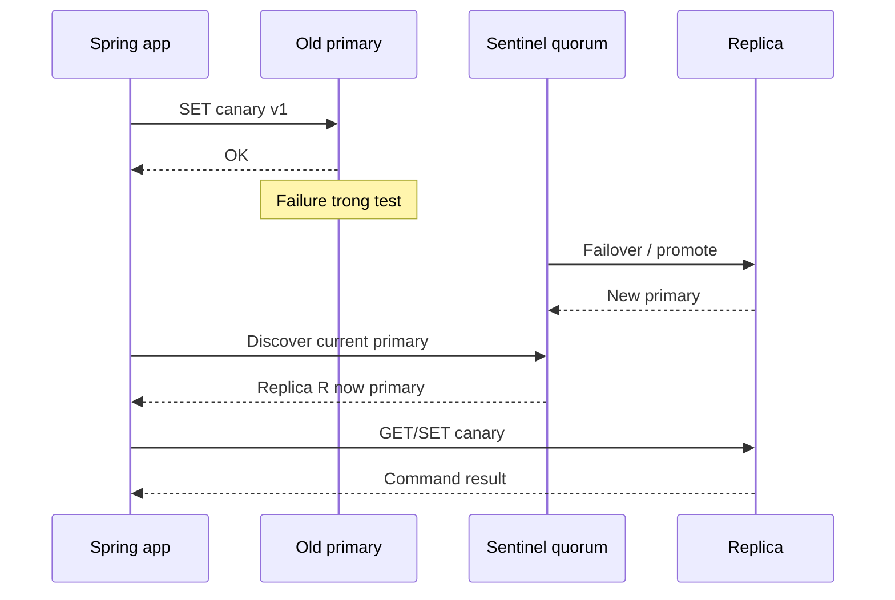

# Kiểm tra sao lưu, phục hồi và diễn tập failover với Spring Data Redis

## 1. Vì sao một hệ thống Redis "có replica" vẫn cần kiểm tra khôi phục?

Giả sử dịch vụ Spring Boot sử dụng Redis để lưu session, cache sản phẩm, trạng thái job và Redis Streams. Redis chạy cùng một primary và hai replica. Dashboard đều báo khỏe; các lời gọi qua `RedisTemplate` vẫn trả về thành công.

Một ngày, đội vận hành gặp một trong những tình huống:

- Một thao tác sai xóa hàng triệu key.
- Một lần triển khai ghi dữ liệu sai định dạng khiến ứng dụng không thể deserialize.
- Redis primary bị mất kết nối và replica được nâng lên làm primary.
- Toàn bộ volume của một node bị mất.
- Bản sao lưu tồn tại nhưng không đọc được vì thiếu file AOF manifest hoặc thiếu key mã hóa.
- Redis đã phục hồi nhưng ứng dụng vẫn trỏ tới primary cũ.
- Người dùng nhận kết quả thành công trước sự cố nhưng write tương ứng không có trên primary mới.

Những tình huống này có thể xảy ra dù đã cấu hình replication. **Replication, failover và backup là ba lớp bảo vệ khác nhau**:

| Thành phần | Mục tiêu chính | Không giải quyết chắc chắn |
|---|---|---|
| **Backup** | Lưu bản dữ liệu có thể dùng để khôi phục về thời điểm trước đó | Chuyển traffic ngay khi primary hỏng |
| **Restore** | Đưa dữ liệu đã sao lưu vào một Redis instance/cụm phù hợp | Tự chứng minh dữ liệu đã đầy đủ và ứng dụng chạy đúng |
| **Replication** | Có bản sao để đọc và hỗ trợ failover | Chống xóa nhầm: lỗi ghi/xóa thường cũng được sao chép |
| **Failover** | Chuyển vai trò primary khi node đang phục vụ gặp sự cố | Bảo đảm mọi write vừa được primary ACK đều đã tồn tại ở replica |
| **Spring Data Redis client recovery** | Khám phá endpoint mới, reconnect, retry theo chính sách | Phục hồi dữ liệu đã mất hoặc làm write không idempotent trở nên an toàn |

Một triển khai chỉ đáng tin khi **đã thử phục hồi từ bản sao lưu** và **đã diễn tập chuyển quyền primary bằng cùng kiểu kết nối mà ứng dụng sử dụng**.

### 1.1. Kết quả cần đạt sau bài học

Bạn sẽ biết cách:

1. Xác định mục tiêu RPO/RTO và các tiêu chí chấp nhận.
2. Kiểm tra cấu hình RDB, AOF, replica và Redis topology.
3. Tạo, bảo quản và xác minh bản sao lưu RDB/AOF đúng cách.
4. Restore trong môi trường cô lập, không ghi đè Redis đang phục vụ.
5. Xác nhận dữ liệu, TTL, Redis data types, serializers và Redis Streams.
6. Diễn tập failover với Sentinel và Redis Cluster.
7. Đo thời gian ứng dụng Spring Data Redis bị gián đoạn và phục hồi.
8. Đánh giá rủi ro mất write, duplicate side effect và tính đúng nghiệp vụ.
9. Viết runbook, dashboard và lịch diễn tập có thể lặp lại.

## 2. Định nghĩa rõ failure model trước khi thử nghiệm

Không thể thiết kế một bài diễn tập có ý nghĩa nếu chỉ nói "giả lập Redis hỏng". Những loại lỗi khác nhau có hậu quả khác nhau:

| Sự cố | Ví dụ | Cơ chế cần kiểm tra |
|---|---|---|
| Process crash | Redis process bị dừng đột ngột | Local persistence và restart |
| Host/VM outage | Máy chủ mất điện hoặc không reachable | Failover và khả năng mất data chưa fsync |
| Network partition | Application không tới được primary | Client timeout, topology discovery, failover |
| Volume loss | Đĩa dữ liệu Redis bị mất | Off-host backup và restore |
| Logical corruption | Ứng dụng ghi sai hoặc xóa nhầm dữ liệu | Point-in-time backup và điều tra thời điểm lỗi |
| Replica lag | Primary ACK trước khi replica nhận write | RPO của failover |
| Cluster node failure | Một primary Cluster không khả dụng | Slot coverage và replica promotion |
| Regional outage | Không dùng được toàn availability zone/region | Khôi phục/cross-region theo khả năng hạ tầng |
| Credential/cert outage | ACL/TLS secret hết hạn hoặc sai | Restore/reconnect với cấu hình bảo mật đầy đủ |

**Không sử dụng một phép thử `kill -9` như bằng chứng đã mô phỏng chính xác mất điện.** Khi chỉ process dừng, bộ đệm của hệ điều hành có thể vẫn tồn tại. Mất điện, volume hỏng và mất cả availability zone cần bài thử riêng.

## 3. RPO và RTO: hai tiêu chí cần định lượng

**RPO — Recovery Point Objective** là mức mất dữ liệu tối đa theo thời gian mà hệ thống được phép chấp nhận sau sự cố.

**RTO — Recovery Time Objective** là khoảng thời gian tối đa để hệ thống khôi phục khả năng phục vụ theo tiêu chí đã định.

Ví dụ:

```text
12:00:00  Bản sao lưu hoàn tất
12:04:00  Redis tiếp tục nhận ghi
12:05:00  Sự cố mất volume
12:09:00  Restore xong, ứng dụng phục vụ bình thường
```

Trong tình huống minh họa, nếu dữ liệu chỉ được phục hồi tới 12:00 thì khoảng điểm phục hồi lùi lại **5 phút**, còn thời gian gián đoạn ứng dụng là **4 phút**. Không nên gộp thành một chỉ số chung "phục hồi trong 5 phút".

### 3.1. Phân biệt mục tiêu với kết quả đo

| Khái niệm | Ví dụ minh họa |
|---|---|
| RPO mục tiêu | Không mất quá 60 giây dữ liệu quan trọng |
| RPO đo trong bài restore | Bản sao lưu gần nhất thiếu khoảng 42 giây dữ liệu |
| RTO mục tiêu | API trở lại trạng thái phục vụ trong 5 phút |
| RTO đo | 4 phút 20 giây đến khi read/write và health tests thành công |

RPO không được suy ra chỉ từ việc `appendfsync everysec` hoặc có một replica. Nó phụ thuộc loại sự cố, thời điểm backup, replication lag và khả năng lưu bền thực tế.

RTO cũng không chỉ là thời gian Redis process báo `PONG`. Cần tính thời gian thay endpoint, đọc file, load dataset, rebuild connections, warm caches và đưa ứng dụng trở lại trạng thái có thể xử lý nghiệp vụ.

## 4. Phân loại dữ liệu Redis trước khi sao lưu

Redis có thể chứa nhiều nhóm dữ liệu với yêu cầu khác nhau:

| Dữ liệu | Nếu mất, hệ thống làm gì? | Hướng kiểm thử |
|---|---|---|
| Cache từ database | Tái tạo bằng cache-aside/cache warming | Đo tốc độ warm và tải fallback vào DB |
| Session | Người dùng có thể phải đăng nhập lại | Kiểm tra TTL/session invalidation và UX |
| Rate-limit counters | Có thể thay đổi quyết định cho phép/từ chối | Xác định fail-open/fail-closed theo rủi ro |
| Distributed locks | Khóa cũ có thể mất hoặc sống lại | Dùng lease/owner token/fencing phù hợp, test stale owner |
| Redis Streams | Record chưa ACK và consumer group state | Kiểm tra pending/replay/duplicate |
| Job progress/checkpoints | Công việc có thể chạy lại hoặc bị bỏ sót | Kiểm tra idempotency và resume |
| Business data không có nguồn khác | Cần lưu bền, backup và đối soát nghiêm ngặt | RPO/RTO rõ, cân nhắc authoritative store phù hợp |

Không nên mặc định dữ liệu Redis đều là cache nên có thể mất. Ngược lại, nếu toàn bộ Redis chỉ chứa cache tái tạo được, việc bật persistence nặng có thể không cần thiết; bài diễn tập cần tập trung vào **khả năng phục hồi cache và kiểm soát tải nguồn chính**.

### 4.1. Ghi rõ nguồn sự thật

Ví dụ đơn hàng được ghi vào PostgreSQL, Redis chỉ chứa cache `order:42:status`. Khi mất Redis, ứng dụng có thể tra PostgreSQL. Nếu Redis là nơi duy nhất lưu trạng thái của một job, mất Redis có thể làm mất tiến độ vĩnh viễn.

Viết ra nguồn sự thật và hướng đối soát giúp xác định dữ liệu nào phải nằm trong backup, dữ liệu nào có thể dựng lại và dữ liệu nào không nên lưu duy nhất ở Redis.

## 5. Chuẩn bị inventory Redis và cấu hình trước buổi diễn tập

Ít nhất cần ghi nhận:

- Redis version, topology: standalone, Sentinel, Cluster hoặc managed service.
- Primary/replica nodes và khu vực triển khai.
- Redis database/keyspaces, naming conventions và hash tags.
- RDB/AOF policy, data directory, dung lượng volume và backup schedule.
- Redis ACL/TLS CA, certificate, secret injection và quyền vận hành.
- Các client dùng Lettuce hay Jedis, phiên bản Spring Data Redis.
- Những dịch vụ có thể ghi Redis và thời điểm tạm dừng ghi khi restore.
- Các phụ thuộc như Streams consumers, scheduler, rate limiter, session manager.
- Hệ thống backup, khóa mã hóa, retention và nơi lưu bản sao.

Các lệnh đọc trạng thái thường hữu ích:

```redis
INFO server
INFO persistence
INFO replication
INFO memory
INFO keyspace
ROLE
```

Nếu dùng Redis Cluster:

```redis
CLUSTER INFO
CLUSTER NODES
CLUSTER SLOTS
```

Redis 7+ còn hỗ trợ:

```redis
CLUSTER SHARDS
```

**INFO và ROLE thường phản ánh node đang kết nối.** Không coi một Redis seed endpoint là kết quả tổng hợp tự động cho toàn bộ Cluster.

## 6. RDB snapshot: bản sao dữ liệu tại một thời điểm

Redis có cơ chế **RDB snapshot** để lưu biểu diễn dataset tại thời điểm snapshot. Các cấu hình tiêu biểu:

```conf
save 900 1
save 300 10
save 60 10000

dbfilename dump.rdb
dir /data
```

Ba dòng `save` trên là ví dụ điều kiện tự lưu tùy Redis version/cấu hình, không phải cam kết snapshot sẽ xảy ra đúng mỗi 900, 300 hoặc 60 giây.

RDB thường phù hợp để:

- Có bản snapshot độc lập mang đi backup.
- Clone một Redis dataset sang môi trường phục hồi.
- Kiểm tra thời gian tải một snapshot và dữ liệu sau restore.

### 6.1. BGSAVE và SAVE

```redis
BGSAVE
```

yêu cầu Redis tạo snapshot ở background khi điều kiện cho phép. Đối với một hệ thống đang phục vụ, đây thường là hướng phù hợp hơn lệnh `SAVE` đồng bộ gây chặn xử lý.

Nhưng `BGSAVE` vẫn có chi phí:

- Fork process, có thể gây pause ngắn.
- Copy-on-write memory khi nhiều write diễn ra.
- CPU và disk I/O để ghi RDB.
- Dung lượng trống đủ cho output.

Không chạy `BGSAVE` trên production chỉ để thử bài học nếu chưa có kế hoạch vận hành và đánh giá tải.

### 6.2. Kiểm tra snapshot hoàn tất

Sau khi yêu cầu background save, quan sát:

```redis
INFO persistence
LASTSAVE
```

Một số field:

```text
rdb_bgsave_in_progress:0
rdb_last_bgsave_status:ok
rdb_last_save_time:...
```

Chỉ coi bản RDB mới đã sẵn sàng để sao lưu khi quá trình background save tương ứng **đã hoàn tất thành công** và file ổn định. `LASTSAVE` giúp nhận biết thời điểm lưu gần nhất, nhưng không tự xác nhận mọi bước copy/upload offsite đã thành công.

### 6.3. Không copy file RDB đang được tạo dở

Một backup job nên đợi BGSAVE hoàn tất rồi sao chép file RDB đã hoàn chỉnh hoặc dùng cơ chế snapshot/storage được hỗ trợ. Không lấy một file tạm đang được ghi rồi coi đó là bản sao lưu hoàn tất.

Redis thường dùng file tạm và chuyển đổi file ở bước hoàn tất; tuy vậy, thao tác backup vẫn phải xác minh file đích là **đúng snapshot, đúng thời điểm và đầy đủ bytes**.

## 7. AOF: lưu diễn tiến thay đổi và phục hồi

Append Only File (AOF) cho phép Redis lưu biểu diễn các thay đổi dữ liệu để phát lại khi khởi động. Ví dụ:

```conf
appendonly yes
appendfsync everysec
```

Ba chính sách thường gặp:

| Chính sách | Ý nghĩa khái quát | Đánh đổi |
|---|---|---|
| `always` | Fsync rất thường xuyên theo quá trình ghi | Độ bền cục bộ mạnh hơn, disk latency/I/O cao hơn |
| `everysec` | Yêu cầu fsync khoảng mỗi giây | Cân bằng thường dùng, vẫn có cửa sổ mất dữ liệu |
| `no` | Để hệ điều hành quyết định đồng bộ thường xuyên | Chi phí fsync chủ động thấp hơn, rủi ro khó dự đoán hơn |

**`appendfsync everysec` không phải cam kết RPO đúng tối đa 1.000 ms** qua mọi sự cố. Disk stall, I/O errors và failover có thể làm thực tế khác.

### 7.1. Process crash khác mất điện

Khi chỉ Redis process crash, OS page cache có thể còn dữ liệu. Khi máy mất điện, dữ liệu chưa fsync có nguy cơ không được lưu bền.

Vì vậy, không dùng phép thử dừng container thông thường làm bằng chứng chính xác cho khả năng chịu mất điện trên phần cứng.

### 7.2. AOF không thay thế backup lịch sử

Nếu ứng dụng `DEL` nhầm dữ liệu, thao tác xóa có thể được ghi vào AOF và replication. Phục hồi Redis từ trạng thái hiện tại sẽ không tự quay về trước khi xóa nhầm.

Backup có retention và nhiều recovery points vẫn cần thiết khi muốn chống lỗi logic hoặc khôi phục phiên bản dữ liệu trước sự cố.

## 8. Redis 7 multi-part AOF: phải bảo toàn cả bộ file

Redis 7 giới thiệu cấu trúc **multi-part AOF**, thường gồm:

1. **Base AOF** — biểu diễn trạng thái nền, có thể chứa RDB preamble.
2. **Incremental AOF** — các thay đổi tiếp tục được append.
3. **Manifest** — mô tả tập file hợp lệ và thứ tự phục hồi.

Mô hình thư mục:

```text
data/
  appendonlydir/
    appendonly.aof.manifest
    appendonly.aof.<sequence>.base.rdb
    appendonly.aof.<sequence>.incr.aof
```

Tên và số file tùy version/configuration. Điều quan trọng là **không chỉ copy một file incremental và bỏ manifest/base**.

### 8.1. Rủi ro copy nhiều file trong lúc AOF rewrite

Giả sử backup copy file A trong khi Redis đang thay manifest để dùng bộ file B. Nếu sao chép từng file theo thời điểm khác nhau mà không giữ một snapshot nhất quán, bản backup có thể chứa manifest mới nhưng thiếu base tương ứng.

Những cách tiếp cận đáng cân nhắc:

- Dùng snapshot filesystem/volume có tính nhất quán phù hợp và kiểm thử restore.
- Dùng RDB snapshot hoàn tất làm điểm backup rõ ràng.
- Dùng cơ chế backup chính thức của managed Redis.
- Nếu cần backup multi-part AOF, dùng quy trình tương thích với phiên bản Redis để lấy **tập file nhất quán cùng manifest**.

Không tự xóa, đổi tên, chắp nối hoặc "sửa" manifest khi chưa có quy trình recovery chính thức.

### 8.2. AOF rewrite không xóa dữ liệu nghiệp vụ theo mục đích

`BGREWRITEAOF` tạo biểu diễn gọn hơn của trạng thái thay vì giữ toàn bộ lịch sử commands. Nó có thể tiêu thụ CPU, copy-on-write memory, disk I/O và dung lượng tạm.

Không chạy AOF rewrite song song với một buổi snapshot stress test trên production nếu chưa tính đến mức tải cộng dồn.

## 9. Khi bật cả AOF và RDB, Redis nạp dữ liệu từ đâu?

Một Redis instance có thể bật cả hai:

```conf
appendonly yes
save 900 1
```

Khi khởi động với bộ persistence hợp lệ, Redis thường ưu tiên AOF nếu AOF được bật, vì AOF có thể phản ánh trạng thái mới hơn RDB snapshot.

Điều này ảnh hưởng trực tiếp tới bài thực hành restore:

```text
Bạn chép dump.rdb vào data directory
Nhưng thư mục đó vẫn còn AOF cũ
Redis khởi động với appendonly yes
Redis có thể nạp AOF thay vì snapshot RDB bạn vừa chép
```

Muốn kiểm thử một bản RDB độc lập, hãy khởi động một Redis test instance với **data directory sạch, chứa đúng snapshot và cấu hình persistence mong muốn**. Không đánh giá restore thành công bằng một file RDB đặt cạnh AOF cũ không rõ nguồn.

### 9.1. Đừng trộn file của nhiều recovery points

Không ghép manifest AOF từ thời điểm T2 với incremental files ở T1, hoặc một `dump.rdb` của shard A với cluster metadata của một cụm không tương thích, rồi hy vọng Redis tự sửa nhất quán.

Một backup set phải có identity, thời điểm tạo, phiên bản Redis, topology, cấu hình và danh sách files được quản lý như **một đơn vị phục hồi**.

## 10. Backup manifest ở tầng vận hành

Ngoài manifest AOF nội bộ của Redis, hệ thống backup nên có **metadata riêng** để xác định một backup set.

Ví dụ mô tả:

```yaml
backup_id: redis-prod-2026-11-13T020000Z
redis_version: "7.x"
topology: sentinel
source_role: replica
snapshot_type: rdb
backup_started_at: "2026-11-13T02:00:00Z"
backup_completed_at: "2026-11-13T02:02:20Z"
source_node: "redis-replica-b"
result: "completed"
files:
  - path: dump.rdb
    sha256: "<recorded-checksum>"
encryption: "enabled"
restore_test_status: "pending"
```

Đây là ví dụ metadata của **backup tool**, không phải cấu trúc file Redis bắt buộc. Với AOF multi-part, danh sách files cần bao gồm các thành phần nhất quán mà Redis yêu cầu.

Metadata nên hỗ trợ:

- Biết bản sao lưu thuộc hệ thống/cluster nào.
- Đối chiếu thời điểm và nguồn backup.
- Kiểm tra checksum và kích thước.
- Xác định Redis version cần để restore.
- Xác định encryption key/key version.
- Lưu kết quả lần restore test gần nhất.

Không nhúng password Redis, private keys hoặc encryption keys dạng plaintext trong manifest.

## 11. Kiểm tra backup: tồn tại file mới chỉ là bước đầu

Một quy trình đánh giá cần tách bốn mức:

**Mức 1 — File existence:** có file và metadata như mong đợi.

**Mức 2 — File integrity:** kích thước/checksum khớp nguồn hoặc upload record, file không bị thiếu/corrupt theo kiểm tra hiện có.

**Mức 3 — Redis readability:** một Redis phiên bản tương thích có thể load file, không báo lỗi AOF/RDB.

**Mức 4 — Application recoverability:** Spring Data Redis có thể kết nối, deserialize đúng data types, kiểm tra TTL và vận hành nghiệp vụ sau restore.

Các mức này tăng dần. **Checksum đúng không đồng nghĩa dữ liệu business đầy đủ**; checksum chỉ chứng minh bytes được đối chiếu.

### 11.1. Kiểm tra checksum

Trên hệ Linux/macOS:

```bash
sha256sum dump.rdb
```

Trên Windows PowerShell:

```powershell
Get-FileHash -Algorithm SHA256 .\dump.rdb
```

Lưu checksum và kích thước cùng backup metadata. Khi tải từ offsite storage về môi trường restore, tính lại checksum để phát hiện lỗi sao chép.

### 11.2. Công cụ kiểm tra file Redis

Redis cung cấp các công cụ như:

```text
redis-check-rdb
redis-check-aof
```

Chúng hỗ trợ kiểm tra định dạng và một số lỗi persistence tùy phiên bản. Với AOF multi-part, phải dùng công cụ theo quy trình tương thích với Redis version và manifest thực tế.

**Không chạy chế độ tự sửa AOF trên bản backup duy nhất.** Một số cách sửa có thể cắt bỏ phần file và mất dữ liệu; luôn tạo bản sao trước khi sửa và lưu nguyên chứng cứ.

## 12. Bảo quản backup khỏi lỗi logic và sự cố diện rộng

Một backup nằm trên **cùng volume** với Redis primary có thể mất cùng lúc khi volume hỏng. Một replica trong cùng cụm cũng có thể nhận lệnh xóa nhầm.

Vì vậy, chiến lược backup cần:

1. Bản sao nằm ngoài failure domain của Redis primary khi yêu cầu.
2. Encryption at rest và encryption in transit.
3. Retention đủ để phát hiện lỗi logic muộn.
4. Access controls riêng cho backup và Redis application.
5. Bảo vệ khỏi xóa hoặc sửa trái phép, ví dụ immutable/object-lock storage khi phù hợp.
6. Kiểm soát tuổi bản sao và cảnh báo backup mới nhất quá cũ.
7. Quy trình restore test định kỳ.
8. Quản lý khóa mã hóa và tình huống khóa không còn truy cập được.

### 12.1. Bản sao lưu Redis có thể chứa dữ liệu nhạy cảm

RDB/AOF có thể chứa session tokens, identifiers, cache dữ liệu cá nhân và trạng thái nghiệp vụ. Không dùng backup production trong môi trường phát triển không được phép, không chia sẻ RDB/AOF qua chat công khai và không bỏ qua chính sách retention/xóa dữ liệu.

Khi restore vào phòng lab, dùng **dữ liệu test hoặc bản đã được xử lý theo quy định bảo mật**.

## 13. Sao lưu từ replica: giảm tải primary nhưng phải hiểu replication lag

Một replica có thể được dùng làm nguồn tạo RDB backup để giảm ảnh hưởng tới primary. Đó là một lựa chọn kiến trúc, không phải luôn tốt hơn trong mọi trường hợp.

Các rủi ro:

- Replica có thể đang trễ so với primary.
- Replica có thể vừa mất/reconnect replication.
- Một bản backup từ replica ở thời điểm T có thể thiếu các write mà primary đã ACK.
- Backup snapshot vẫn có chi phí fork, CPU, memory và disk I/O trên replica.

Trước khi backup từ replica, ghi nhận:

```redis
ROLE
INFO replication
INFO persistence
```

Đánh giá lag và trạng thái master link theo mô hình triển khai. Nếu yêu cầu RPO rất nhỏ, không mặc định backup replica tương đương một snapshot current primary.

### 13.1. WAIT và WAITAOF không thay thế backup

`WAIT` có thể đợi replication acknowledgment theo session/offset; `WAITAOF` trên Redis hỗ trợ có thể đợi một số điều kiện AOF persistence.

Tuy nhiên:

- Chúng không tạo backup lịch sử để cứu dữ liệu xóa nhầm.
- Không thay thế một bản sao ở failure domain độc lập.
- Không tự cung cấp strong-consistency consensus hoặc distributed transaction.
- Không loại trừ yêu cầu kiểm thử khôi phục và đối soát nghiệp vụ.

## 14. Chuẩn bị dữ liệu kiểm thử trước snapshot

Để restore test có ý nghĩa, tạo một bộ **fixture có chủ đích** với nhiều Redis data types:

```redis
SET lab:backup:version v1
HSET lab:backup:user:42 name Linh tier GOLD
SADD lab:backup:features search checkout
ZADD lab:backup:scores 10 user42 20 user99
SET lab:backup:session:42 active EX 3600
XADD lab:backup:events * type CREATED orderId o-101
```

Những key có prefix `lab:backup:` chỉ dùng trong môi trường test.

Đo những điều cần kiểm:

- `GET` value của String.
- `HGETALL` fields của Hash.
- `SMEMBERS` và `ZRANGE ... WITHSCORES`.
- Stream entries và group state nếu fixture có consumer group.
- `PTTL`/`TTL` của session.
- Bản version/canary ghi trước thời điểm snapshot.

### 14.1. Canary ghi trước và sau snapshot

Một bài thử đơn giản để xác định điểm phục hồi:

```text
T0: SET lab:backup:version before-snapshot
T1: BGSAVE hoàn tất, lưu file snapshot
T2: SET lab:backup:version after-snapshot
T3: Restore riêng bản RDB từ T1
```

Ở restore T3, ta kỳ vọng canary phản ánh **trạng thái nằm trong snapshot** chứ không phải dữ liệu ghi sau đó. Với background save, thời điểm dataset được chụp liên quan đến lúc snapshot bắt đầu, **không phải nhất thiết thời điểm BGSAVE hoàn tất**; dùng canary ở thời điểm được kiểm soát để xác định đúng mốc.

Không sử dụng một key duy nhất để kết luận độ bền tất cả dạng dữ liệu; cần bộ fixture đa dạng.

## 15. Kịch bản lab RDB: snapshot rồi restore sang Redis khác

Phần này là hướng dẫn trên **Redis test riêng**; không chạy các thao tác dừng/xóa dữ liệu lên production.

### Bước 1 — Tạo Redis lab với volume riêng

Ví dụ dùng Docker trên máy thử nghiệm có Docker Engine:

```bash
docker run -d \
  --name redis-backup-lab \
  -p 16379:6379 \
  -v redis-backup-lab:/data \
  redis:7.2-alpine \
  redis-server --appendonly yes --save 60 1
```

Volume `redis-backup-lab` là volume của lab, không phải volume production. Bản Redis 7.2 chỉ minh họa; chọn version tương thích với hệ thống cần kiểm tra.

### Bước 2 — Ghi dữ liệu fixture

Sử dụng Redis CLI tới cổng local test:

```bash
redis-cli -p 16379 SET lab:backup:version before-snapshot
redis-cli -p 16379 HSET lab:backup:profile name Linh role MEMBER
redis-cli -p 16379 SET lab:backup:session active EX 3600
```

### Bước 3 — Yêu cầu RDB snapshot

```bash
redis-cli -p 16379 BGSAVE
redis-cli -p 16379 INFO persistence
```

Đợi tới khi `rdb_bgsave_in_progress:0` và trạng thái của lần BGSAVE liên quan báo `ok`.

### Bước 4 — Copy RDB đã hoàn tất

Trong thư mục lab có quyền ghi:

```bash
mkdir -p ./backup
docker cp redis-backup-lab:/data/dump.rdb ./backup/dump.rdb
sha256sum ./backup/dump.rdb
```

Lưu checksum và kích thước vào metadata. Nếu Redis đang sử dụng `dbfilename` hoặc `dir` khác, đường file phải được cập nhật theo cấu hình test thực tế.

### Bước 5 — Ghi một thay đổi sau snapshot

```bash
redis-cli -p 16379 SET lab:backup:version after-snapshot
```

### Bước 6 — Tạo thư mục restore sạch

Trên máy test Linux/macOS:

```bash
mkdir -p ./restore
cp ./backup/dump.rdb ./restore/dump.rdb
```

Không chép file vào volume của instance gốc. Thư mục `./restore` là môi trường độc lập chỉ chứa RDB snapshot đã chọn.

### Bước 7 — Chạy Redis restore độc lập

```bash
docker run --rm -d \
  --name redis-restore-lab \
  -p 16380:6379 \
  -v "$PWD/restore:/data" \
  redis:7.2-alpine \
  redis-server --appendonly no --save ""
```

Ở ví dụ này, Redis restore dùng **RDB** vì `appendonly no` và data directory chỉ có `dump.rdb`. Tùy môi trường Windows/Linux, cú pháp Docker bind mount và quyền file cần được điều chỉnh tương ứng.

### Bước 8 — Kiểm chứng dữ liệu

```bash
redis-cli -p 16380 GET lab:backup:version
redis-cli -p 16380 HGETALL lab:backup:profile
redis-cli -p 16380 PTTL lab:backup:session
```

Kỳ vọng version là `before-snapshot`, không phải thay đổi ở bước 5. TTL đã trôi qua theo thời gian thực nên **không kỳ vọng đúng 3.600.000 ms như lúc tạo key**.

### Bước 9 — Ghi nhận thời gian restore

Đo thời gian từ khi bắt đầu thủ tục restore cho đến khi Redis load xong và các assertions ứng dụng thành công, không chỉ tới lúc container được tạo.

### Bước 10 — Dọn môi trường test

Chỉ xóa container/volume của lab sau khi xác minh đúng identity và đã lưu kết quả cần thiết. Không dùng lệnh xóa với tên biến không được kiểm tra hoặc đường dẫn có thể trỏ tới production.

## 16. Restore AOF: nguyên tắc trước khi thực hành

Nếu mục tiêu là restore **từ AOF**, quy trình khác việc copy RDB:

1. Xác định Redis version và dạng AOF (single-file hay multi-part).
2. Lấy bộ file nhất quán, gồm manifest và các base/incremental files cần thiết.
3. Kiểm tra checksum, quyền file và phiên bản Redis.
4. Khởi tạo instance lab với data directory sạch.
5. Bật AOF theo cấu hình tương thích.
6. Đảm bảo Redis không nạp file cũ không thuộc backup set.
7. Xem Redis startup logs và `INFO persistence`.
8. Xác nhận data types, TTL, Stream state và canary.

Không dùng lệnh `BGREWRITEAOF` để "khôi phục" dữ liệu đã mất: rewrite chỉ sắp xếp lại biểu diễn trạng thái đang có, không tự quay về recovery point trước.

### 16.1. Khi AOF có phần cuối bị cắt

Redis có tùy chọn liên quan đến việc xử lý truncated AOF, ví dụ `aof-load-truncated`. Một số lỗi ở phần cuối có thể được xử lý khi load, nhưng không phải mọi dạng corruption đều được sửa mà không mất dữ liệu.

Nếu Redis không khởi động được, hãy:

- Giữ nguyên một bản backup không chỉnh sửa.
- Chạy công cụ kiểm tra phù hợp trên **bản sao**.
- Ghi nhận bytes hoặc records bị bỏ khi sửa.
- Đối chiếu RPO và business recovery.

Không cho phép tự động sửa file AOF duy nhất trên production bằng một thao tác có thể truncate không kiểm soát.

## 17. Restore xong phải xác nhận gì ngoài PONG?

Redis trả:

```redis
PING
```

là một tín hiệu availability cơ bản, không phải chứng nhận dữ liệu đã đúng.

Tối thiểu cần:

| Hạng mục | Phương pháp |
|---|---|
| Redis startup/load | Xem logs và `INFO persistence` |
| Dataset canary | GET/HGET đúng những key đã ghi trước snapshot |
| Key type | `TYPE` đúng String/Hash/Set/ZSet/Stream |
| TTL | `PTTL` hợp lý, không vô tình xóa TTL hoặc kéo dài session |
| Keyspace | Số key và phân bố keyspace theo backup manifest |
| Serializer | Spring Data Redis đọc ra đúng Java type |
| ACL/TLS | Ứng dụng được xác thực đúng quyền và endpoint |
| Streams state | Entry, consumer groups, PEL/pending phù hợp |
| Cache | Hit/miss và fallback DB có tải chấp nhận được |
| Business correctness | Không có duplicate side effects hoặc missing operations ngoài RPO đã chấp nhận |

### 17.1. Không dựa vào tổng số key chính xác nếu có TTL

Trong lúc backup→restore, một số key có TTL sẽ hết hạn hợp lệ. Vì vậy, số key sau restore có thể nhỏ hơn lúc snapshot mà không nhất thiết là corruption.

Đối chiếu theo **những canary không hết hạn** và nhóm TTL-aware, ghi rõ sự khác biệt được phép thay vì dùng một assertion đếm key cứng nhắc.

## 18. Spring Data Redis cần cùng serialization contract

Redis lưu bytes. Khi Spring Data Redis sử dụng `JdkSerializationRedisSerializer`, String serializer hoặc JSON serializer, dữ liệu restore vẫn là những bytes đã được ghi trước đó.

Nếu ứng dụng được triển khai với serializer mới không tương thích:

```text
Redis restored correctly
  |
  +-- String key serializer changed -> GET looks in wrong keyspace
  |
  +-- JSON schema changed -> deserialization error
  |
  +-- JDK class version changed -> binary value cannot be decoded
```

Do đó, bài restore test phải khởi động **phiên bản ứng dụng dự kiến dùng trong quy trình recovery**. Không chỉ đọc một value bằng `redis-cli` rồi tuyên bố Spring app có thể dùng toàn bộ dữ liệu.

### 18.1. Các trường hợp serializer cần kiểm tra

- Key namespace và key serializer trước/sau restore.
- Value serializer (String, JSON, JDK hoặc serializer khác).
- Hash key và Hash value serializers.
- Redis Streams message decoding nếu có.
- Schema migration và trường dữ liệu tùy chọn.
- TTL/expiration annotations nếu ứng dụng dùng Redis repositories.

Một backup tốt nhưng application version không đọc được dữ liệu có thể làm RTO tăng đáng kể.

## 19. Mẫu Java kiểm tra canary sau restore

Một service dùng StringRedisTemplate:

```java
package com.example.redis.recovery;

import java.util.Map;

import org.springframework.data.redis.core.StringRedisTemplate;
import org.springframework.stereotype.Component;

@Component
public class RedisRestoreProbe {

    private final StringRedisTemplate redis;

    public RedisRestoreProbe(StringRedisTemplate redis) {
        this.redis = redis;
    }

    public void assertFixture() {
        String version = redis.opsForValue()
            .get("lab:backup:version");

        if (!"before-snapshot".equals(version)) {
            throw new IllegalStateException(
                "Unexpected snapshot canary: " + version
            );
        }

        Map<Object, Object> profile = redis.opsForHash()
            .entries("lab:backup:profile");

        if (!"Linh".equals(profile.get("name"))) {
            throw new IllegalStateException(
                "Missing or incorrect restored profile"
            );
        }
    }
}
```

Ở đây data fixture là String/Hash, phù hợp với `StringRedisTemplate`. Trong dự án có objects/JSON, thêm test đọc bằng đúng `RedisTemplate<K,V>` hay repository mà service production sử dụng.

### 19.1. Phân biệt kiểm tra restore và readiness probe

Readiness endpoint có thể kiểm tra Redis connectivity với chi phí thấp. Nhưng bài kiểm tra restore đầy đủ có thể đọc canaries và so schema, nên chạy trong **verification job**, không thực hiện quét/đối soát toàn bộ dataset trên mỗi HTTP health check.

## 20. Redis Streams và trạng thái pending sau phục hồi

Redis Streams thường được dùng cho consumer groups. Một record có thể:

```text
XADD -> lưu entry
XREADGROUP -> worker nhận entry, entry trở thành pending
Business side effect -> đã chạy
XACK -> đánh dấu đã xử lý
```

Nếu worker chết sau side effect nhưng trước `XACK`, record có thể vẫn pending và được giao lại qua recovery/claim.

Một bài restore/failover test cần xét:

- Stream entries có còn tới recovery point phù hợp không?
- Consumer group đã được khôi phục không?
- Các pending entries/PEL có trạng thái nào?
- Có message đang chờ reclaim bằng `XPENDING`/`XAUTOCLAIM` không?
- Handler có idempotent nếu record được xử lý lại không?
- Một sự kiện được producer retry bằng `XADD *` có thể tạo entry mới không?

**Không khẳng định restore Streams sẽ tạo exactly-once processing.** Redis Streams và database/external side effects không cùng một transaction thông thường.

### 20.1. Pub/Sub khác Streams

Redis Pub/Sub không cung cấp backlog bền vững cho subscriber vắng mặt theo cách Redis Streams cung cấp. Một buổi restore RDB/AOF không thể "phát lại" những Pub/Sub messages đã qua mà không được lưu ở cơ chế khác.

Nếu ứng dụng cần replay, dùng Streams hoặc event store phù hợp; đừng gắn RPO Pub/Sub với RDB/AOF như thể mọi message đều được giữ lại.

## 21. TTL sau restore: không reset đồng hồ theo mong muốn

Redis lưu và xử lý expiration theo semantics thời gian thực. Ví dụ một session được tạo với TTL một giờ rồi backup sau 10 phút; restore sau hai giờ không có nghĩa session đó được sống thêm 60 phút.

Kiểm tra bằng:

```redis
PTTL lab:backup:session
TTL lab:backup:session
```

Các giá trị đặc biệt:

| PTTL | Ý nghĩa |
|---|---|
| Số dương | Còn TTL |
| `-1` | Key tồn tại nhưng không có expiry |
| `-2` | Key không tồn tại |

Không dùng việc restore để vô tình hồi sinh session đã hết hạn. Với các key có thời hạn liên quan bảo mật, cần kiểm tra rằng chúng không trở thành hợp lệ ngoài chính sách.

## 22. Failover khác restore

**Failover** chuyển vai trò phục vụ từ một node sang node khác, thường dựa vào replica. Nó không mặc định tạo một recovery point ở quá khứ.

```text
Primary P  -- replication --> Replica R
   |
   X failure
   |
   +-- Sentinel/Cluster promotes R
                  |
                  +--> Client reconnects to new primary
```

Nếu primary P đã nhận lệnh ghi nhưng chưa gửi hoặc replica R chưa áp dụng lệnh, lệnh đó có nguy cơ không còn trên R sau failover.

### 22.1. Replication của Redis thường bất đồng bộ

Ví dụ:

```text
T0: Client SET order:o-101:status PAID -> P
T1: P trả OK
T2: P mất kết nối
T3: Replica R được promote, nhưng chưa nhận write T0
T4: Client đọc R -> không thấy PAID
```

Điều này không tự chứng minh Redis bị lỗi; nó là rủi ro cần thiết kế cho mô hình replication bất đồng bộ.

Một diễn tập đúng phải kiểm tra **những write đã ACK gần thời điểm failover**, không chỉ khả năng GET của key đã tồn tại từ ngày hôm trước.

## 23. Redis Sentinel: diễn tập chuyển primary

Sentinel theo dõi Redis primary/replicas và có thể phối hợp failover khi đủ điều kiện. Một ứng dụng Spring Boot kết nối qua Sentinel nên khai báo master name và nhiều Sentinel nodes.

Ví dụ:

```yaml
spring:
  data:
    redis:
      sentinel:
        master: mymaster
        nodes:
          - sentinel-a.internal:26379
          - sentinel-b.internal:26379
          - sentinel-c.internal:26379
      timeout: 2s
      connect-timeout: 500ms
```

Đây là cấu hình minh họa Spring Boot 3.x. Khi production dùng TLS/ACL hoặc password riêng cho Sentinel và Redis data nodes, phải bổ sung cấu hình theo phiên bản driver và topology thực tế.

### 23.1. Xác định primary hiện tại

Từ một Sentinel test node:

```redis
SENTINEL get-master-addr-by-name mymaster
SENTINEL master mymaster
```

Trên các Redis data nodes:

```redis
ROLE
INFO replication
```

Ghi nhận primary hiện tại, replication trạng thái replicas và thời gian đo. Không khẳng định role dựa trên hostname `redis-1` hoặc pod number vì vai trò có thể thay đổi.

### 23.2. Kích hoạt failover có kiểm soát trong lab

Redis Sentinel có thao tác quản trị:

```redis
SENTINEL FAILOVER mymaster
```

Lệnh này yêu cầu chuyển primary và **làm thay đổi topology**. Chỉ thực hiện trên **Sentinel test cluster** hoặc theo runbook được phê duyệt. Một lựa chọn khác là mô phỏng primary test ngừng hoạt động để quan sát automatic failover khi quorum/điều kiện thỏa.

### 23.3. Quan sát các pha



Tiêu chí:

- Primary mới có role chính xác.
- Spring/Lettuce không cần hardcode IP primary mới.
- Request thất bại trong cửa sổ chuyển đổi được phân loại và giới hạn timeout.
- Sau failover, đọc và ghi đúng node.
- Các write sát thời điểm failover được đối soát.

**Không suy ra mọi write đã ACK đều còn** chỉ vì ứng dụng reconnect thành công.

## 24. Redis Cluster: diễn tập primary failover và slot coverage

Redis Cluster có 16.384 hash slots phân bố giữa primary nodes. Một primary mất kết nối có thể được thay bởi replica phù hợp theo cơ chế cluster failover.

Trước bài diễn tập:

```redis
CLUSTER INFO
CLUSTER NODES
CLUSTER SLOTS
```

Quan sát:

- `cluster_state` và số slot assigned/ok.
- Node IDs, roles, replicas và configuration epoch.
- Slot ranges do primary cần thử nghiệm sở hữu.
- Replication state và khả năng network giữa nodes.

### 24.1. Không thử failover khi cluster đang thiếu slot hoặc mất quorum

Một cluster đã có `cluster_state:fail` hoặc thiếu replica có thể không thể khôi phục sau khi cố tình dừng thêm node. Hãy chọn một cluster lab ổn định có slot coverage phù hợp và topology rõ ràng.

### 24.2. Kích hoạt failover có kiểm soát

Trên một replica phù hợp trong **Redis Cluster test**, Redis có lệnh như:

```redis
CLUSTER FAILOVER
```

Đây là lệnh quản trị **thay đổi vai trò**, không phải lệnh health check. Nó cần được gọi trên replica đúng theo kịch bản và quy tắc Redis. Không chạy trên production chỉ để thực hành.

Một bài test fault injection có thể mô phỏng primary failure riêng, nhưng cần phân biệt planned failover với unplanned outage: thời gian và rủi ro mất write có thể khác nhau.

### 24.3. Sau failover phải xác nhận gì?

1. Slot ownership chuyển sang primary mới phù hợp.
2. Cluster trở về trạng thái có thể phục vụ những slots cần thiết.
3. Lettuce refresh topology hoặc xử lý redirects.
4. GET/SET với key nằm trên slot của node vừa failover tiếp tục hoạt động.
5. Không nhầm lỗi `MOVED`/`ASK` với mất dữ liệu.
6. Theo dõi command timeouts, reconnects và p99.
7. Đối chiếu write consistency trước/sau.

**Một kết nối tới một seed node vẫn khỏe không chứng minh mọi 16.384 slots đều truy cập được.** Test cần dùng key fixtures trên nhiều slot.

## 25. Redis Cluster: khôi phục cả dataset không phải chép một dump.rdb

Một standalone Redis có một dataset độc lập; Redis Cluster phân vùng keys qua nhiều primary. Nếu chỉ lấy RDB từ primary A, bản đó không chứa keys đang ở primary B và C.

Do đó, backup Cluster cần:

- Bản dữ liệu của tất cả primary/shards cần phục hồi.
- Mapping topology/slot ownership, node roles và cấu hình cluster liên quan.
- Một cách quản lý mốc dữ liệu giữa các shards theo yêu cầu consistency.
- Kế hoạch tái tạo cluster rồi nạp/migrate dữ liệu đúng slot.
- Kiểm thử ứng dụng ở chế độ Redis Cluster, không chỉ standalone.

### 25.1. Per-shard snapshot không tự tạo global transaction snapshot

Nếu snapshot A lúc 12:00:00 và snapshot B lúc 12:00:30, một business operation chạm nhiều shards có thể được khôi phục ở những thời điểm khác nhau.

Redis Cluster cũng đặt giới hạn đa key theo hash slot. Nếu nghiệp vụ yêu cầu một ảnh chụp nhất quán xuyên nhiều shards, cần một **quy trình application-level quiescence/snapshot hoặc hệ thống nguồn sự thật** hỗ trợ consistency mong muốn.

### 25.2. Tránh restore file cũ vào node đang thuộc live cluster

Việc thay thẳng RDB/AOF của một node trong cluster production có thể làm dữ liệu không khớp slot ownership, metadata và replication state. Đây không phải một thao tác restore chung an toàn.

Ưu tiên:

- Khôi phục vào một **cluster mới hoặc môi trường cô lập**.
- Dùng quy trình restore theo provider/operator.
- Kiểm chứng dữ liệu rồi lên kế hoạch cutover/replication/migration.

Không tự sao chép file và restart live cluster node khi chưa có runbook dành riêng cho topology đó.

## 26. Spring Data Redis phải tái kết nối như thế nào?

Ứng dụng dùng `RedisTemplate` hoặc `ReactiveRedisTemplate` không nên lưu cứng địa chỉ node primary lâu dài khi hạ tầng có Sentinel/Cluster.

| Hạ tầng | Cách khám phá | Điểm cần kiểm thử |
|---|---|---|
| Standalone | Một hostname/port cố định | Restart/reconnect cùng endpoint; không có automatic failover thực sự |
| Sentinel | Hỏi Sentinel lấy primary | Discovery và reconnect sau primary đổi |
| Redis Cluster | Bảng hash slot→node, redirects/topology refresh | `MOVED`/`ASK`, role change, refresh |
| Managed Redis | Endpoint hoặc SDK do provider hỗ trợ | Cutover, TLS/DNS, provider-specific failover |

### 26.1. Redis Cluster với Lettuce topology refresh

Nếu dự án dùng Lettuce Cluster, có thể cấu hình refresh theo chu kỳ và sự kiện:

```java
import java.time.Duration;
import io.lettuce.core.cluster.ClusterClientOptions;
import io.lettuce.core.cluster.ClusterTopologyRefreshOptions;

ClusterTopologyRefreshOptions refresh =
    ClusterTopologyRefreshOptions.builder()
        .enablePeriodicRefresh(Duration.ofSeconds(30))
        .enableAllAdaptiveRefreshTriggers()
        .build();

ClusterClientOptions options = ClusterClientOptions.builder()
    .topologyRefreshOptions(refresh)
    .build();
```

Phần `options` cần được gắn vào **đúng** `LettuceClientConfiguration` và `LettuceConnectionFactory` dành cho cluster. Đừng tạo cluster options rồi cho rằng Spring Boot đã tự áp dụng nếu factory đang dùng cấu hình khác.

### 26.2. Timeout và reconnect cần giới hạn

Khi failover, một request có thể:

```text
old primary unavailable
 -> connect timeout
 -> reconnect/discover new primary
 -> command retry theo cơ chế driver/policy
 -> success hoặc lỗi
```

Không đặt timeout dài hơn toàn bộ deadline API. Không retry vô hạn khiến request queue và traffic tăng trong thời điểm cluster đang hồi phục.

## 27. Thử nghiệm GET/SET liên tục để đo cửa sổ failover

Một bài test ứng dụng đơn giản có thể ghi canary tăng dần kèm timestamp; đồng thời một consumer kiểm tra GET:

```java
package com.example.redis.recovery;

import java.time.Instant;
import org.springframework.data.redis.core.StringRedisTemplate;
import org.springframework.stereotype.Component;

@Component
public class FailoverCanary {

    private final StringRedisTemplate redis;

    public FailoverCanary(StringRedisTemplate redis) {
        this.redis = redis;
    }

    public void write(String attemptId, long sequence) {
        String value = attemptId + "|" + sequence
            + "|" + Instant.now();
        redis.opsForValue().set("lab:failover:canary", value);
    }

    public String read() {
        return redis.opsForValue().get("lab:failover:canary");
    }
}
```

Ví dụ trên đo được khả năng ghi/đọc canary, nhưng bản thân nó **không phải công cụ đo RPO đầy đủ**. Cần log các attempt IDs và command acknowledgments vào một hệ thống test độc lập, rồi đối chiếu với Redis sau failover.

### 27.1. Không dùng một counter Redis làm nguồn ghi nhận duy nhất

Nếu Redis mất những write cuối, một counter chỉ nằm trong Redis cũng mất theo; bạn sẽ không biết command nào từng được client nhận `OK`.

Trong bài test, lưu timeline/ACKs ở bên ngoài Redis test (ví dụ file log của test coordinator hoặc một database test) để so sánh trước và sau failover.

### 27.2. Quan sát thời gian của ba loại hoạt động

- Last successful write trước khi chuyển role.
- First failed operation và thời gian kết nối gián đoạn.
- First successful write/read sau khi primary mới phục vụ.

Đặt đồng hồ/timestamps và request IDs có thể đối chiếu. Với hệ nhiều máy, clock skew là vấn đề cần cân nhắc; dùng monotonic elapsed-time trong cùng test coordinator để đo duration khi có thể.

## 28. Timeout sau write có thể là kết quả không chắc chắn

Đây là rủi ro cần kiểm thử riêng:

```text
Client -> SET/INCR
Redis thực thi command
Response bị mất
Client nhận timeout
Client retry
```

Với `GET`, retry thường không gây side effect. Nhưng:

| Command | Điều gì có thể xảy ra nếu retry? |
|---|---|
| `INCR` | Tăng hai lần |
| `LPUSH` | Đưa cùng item vào list hai lần |
| `XADD ... *` | Tạo hai entries khác ID |
| `SET key value EX n` | Có thể đặt lại TTL, kéo dài thời hạn |
| `SET NX PX` | Retry trả thất bại dù lần đầu đã tạo khóa |
| `XACK` | Retry có return count khác dù ACK trước đã thành công |

Failover/reconnect không làm các commands tự trở thành exactly-once.

### 28.1. Thiết kế retry

1. Giới hạn số lần và tổng thời gian.
2. Dùng backoff/jitter để tránh burst.
3. Phân loại lỗi mạng/redirect/timeout và lỗi schema/ACL.
4. Đối với write có side effect, giữ một request ID ổn định.
5. Dùng idempotency tại hệ thống nguồn sự thật khi yêu cầu tính đúng.
6. Có reconciliation cho kết quả không chắc chắn.

Không tự retry toàn bộ business transaction gồm PostgreSQL, Redis và external API chỉ vì một Redis call timeout.

## 29. Failover của distributed lock: không mặc định vẫn giữ mutual exclusion

Giả sử:

```text
T0: P nhận SET lock tokenA NX PX 30000 -> OK
T1: P chưa replicate lock tới R
T2: P lỗi, R được promote
T3: B lấy cùng lock với tokenB trên R
T4: A vẫn thực hiện công việc
```

Worker A và B có thể cùng nghĩ mình được phép thao tác. Đây là giới hạn của lock trên Redis với replication bất đồng bộ.

Test cần xác nhận:

- Owner-token unlock không xóa khóa của owner mới.
- TTL và renewal hoạt động theo protocol.
- Stale owner không ghi đè dữ liệu mới nhờ fencing/version check nếu nghiệp vụ yêu cầu.
- Không dùng một lock Redis đơn giản làm đảm bảo tuyệt đối cho tài nguyên có rủi ro cao.

Backup cũng không phải cách giữ nguyên quyền sở hữu lock qua failover; một lock đã phục hồi từ file cũ có thể không phản ánh worker thực sự còn hoạt động.

## 30. Kiểm tra cache warming và fallback sau phục hồi

Với cache-aside:

```text
Redis restore xong nhưng cache rất ít hoặc rỗng
      |
      +-- requests miss
      |
      +-- database nhận lượng truy vấn lớn
      |
      +-- HTTP latency tăng, DB có nguy cơ quá tải
```

Nếu ứng dụng có fallback DB, cần kiểm tra:

- Tỷ lệ cache hit/miss theo thời gian.
- DB queries per second.
- HTTP p95/p99 và error rate.
- Rate limiter/bulkhead khi Redis unavailable.
- Khả năng warm những key phổ biến có giới hạn tải.

**Không coi việc Redis trả PONG là đã khôi phục toàn bộ dịch vụ.** Nếu database bị "thundering herd" sau khi mất cache, RTO thực tế vẫn có thể dài.

### 30.1. Chọn cách warm phù hợp

- Lazy cache-aside cho dữ liệu ít truy cập.
- Warm trước những key phổ biến theo danh sách có kiểm soát.
- Giới hạn concurrent loads để bảo vệ DB.
- Dùng TTL jitter để tránh nhiều key hết hạn đồng thời.
- Không kéo toàn bộ production dataset qua một vòng `KEYS *` gây tải lớn.

## 31. DNS, TLS và ACL trong buổi failover

Một primary mới có thể dùng hostname, IP hoặc certificate khác:

```text
Old primary: redis-a.internal:6380
New primary: redis-b.internal:6380
```

Nếu Spring/Lettuce reconnect tới node B, cần:

- Endpoint B reachable từ app network.
- TLS certificate có SAN khớp hostname.
- Java truststore tin đúng CA.
- Redis ACL user/password được đồng bộ theo chính sách.
- Firewall/service discovery không còn cố định vào A.

Một buổi failover test có thể thất bại không phải vì Redis mất dữ liệu mà vì **TLS hostname mismatch hoặc node mới quảng bá địa chỉ không truy cập được**.

Không sửa bằng cách tắt peer/hostname verification. Sửa SAN, CA trust, advertised addresses và mạng.

## 32. Snapshot và failover trên managed Redis

Managed Redis thường cung cấp:

- Scheduled snapshots và retention theo chính sách.
- On-demand backups.
- Restore ra một instance/cluster mới.
- Automatic failover hoặc multi-zone replication.
- Metrics/sự kiện vận hành riêng.

Nhưng capability, thời điểm snapshot, mức RPO và tác động failover khác nhau giữa các nhà cung cấp và loại dịch vụ.

Khi dùng managed Redis:

1. Đọc chính sách backup/restore của gói đang dùng.
2. Xác định snapshot có bao gồm toàn bộ shards hay không.
3. Kiểm tra có hỗ trợ point-in-time recovery hay chỉ snapshot theo lịch.
4. Kiểm tra restore có giữ nguyên endpoint/ACL/TLS settings không.
5. Thực hiện failover test qua công cụ chính thức, trong môi trường riêng.
6. Ghi lại thời gian provider báo complete so với thời gian ứng dụng thực sự healthy.

Không tự thay file persistence của một node managed Redis hoặc chạy Redis administrative commands mà provider không hỗ trợ.

## 33. Observability: metric nào cần thu trong diễn tập?

| Nhóm | Tín hiệu | Câu hỏi |
|---|---|---|
| Backup | Last successful backup, age, size, checksum | Bản sao lưu gần nhất có dùng được? |
| Restore | Start/end, load time, verification result | RTO thực đo là bao nhiêu? |
| Redis persistence | `rdb_last_bgsave_status`, `aof_last_write_status` | File có đang được ghi đúng? |
| Redis replication | Role, master link, replica lag/offset | Replica có đủ mới để promote? |
| Cluster | `cluster_state`, slot coverage, failover events | Có shard nào không phục vụ? |
| Client | Connect failures, reconnects, timeouts | Spring đã đổi sang node mới? |
| Performance | Redis command p95/p99, API p95/p99 | Người dùng chịu gián đoạn bao lâu? |
| Business | ACKed write loss, duplicate operations | Tính đúng có bị ảnh hưởng? |
| Cache | Hits/misses, DB fallback rate | Hệ thống phụ thuộc có quá tải? |
| Security | TLS/ACL failures, certificate expiry | Node mới có cấu hình bảo mật đúng? |

Trong Redis:

```redis
INFO persistence
INFO replication
INFO stats
INFO clients
INFO memory
```

Với Cluster/Sentinel, bổ sung các chỉ số topology đã nêu.

### 33.1. Đồng bộ mốc thời gian

Một timeline hữu ích:

```text
T0     Test bắt đầu ghi canary
T1     Failover được kích hoạt
T2     Redis primary cũ không phục vụ
T3     New primary được công bố
T4     Spring client reconnect thành công
T5     Write/read và application checks pass liên tục
```

Đo cả **Redis failover duration** và **application-visible outage**. Chúng không nhất thiết bằng nhau.

## 34. Tự động hóa kiểm chứng sau restore

Một verification job nên thực hiện:

1. Kiểm tra Redis role/topology theo mong đợi.
2. Kiểm tra `INFO persistence` và logs khi load.
3. Đọc những canary có kỳ vọng rõ.
4. Kiểm tra nhiều data types, TTL và schemas.
5. Kiểm tra String/Hash/Stream bằng đúng Spring serializers.
6. Kiểm tra keyspace coverage với Cluster.
7. Kiểm tra ACL/TLS, và negative security tests khi phù hợp.
8. Thực hiện một write mới vào keyspace lab để xác nhận app có thể hoạt động.
9. Xóa/dọn dữ liệu lab bằng cơ chế an toàn sau thử nghiệm.
10. Ghi một báo cáo máy đọc được với PASS/FAIL, timestamps, Redis version và backup ID.

Không yêu cầu verification job scan toàn bộ production keyspace trong mỗi lần health check. Những bài kiểm tra sâu nên chạy ở **môi trường restore cô lập** với dữ liệu được phép sử dụng.

### 34.1. Ví dụ schema kết quả diễn tập

```yaml
drill_id: redis-restore-lab-001
backup_id: redis-prod-2026-11-13T020000Z
mode: isolated-restore
result: pass
rpo_observed_seconds: 42
rto_observed_seconds: 260
checks:
  - name: redis-startup
    status: pass
  - name: string-hash-ttl
    status: pass
  - name: spring-serializer
    status: pass
  - name: stream-consumer-recovery
    status: pass
notes: "Giá trị minh họa, không phải kết quả đo thực."
```

Đây là ví dụ format báo cáo, không phải yêu cầu Redis server xuất YAML.

## 35. Diễn tập failure injection: nguyên tắc an toàn

Một buổi diễn tập có thể thử:

- Dừng Redis process ở cluster test.
- Drop network giữa Spring test và Redis test.
- Gây connection timeout hoặc packet loss qua test proxy.
- Failover chủ động bằng Sentinel hoặc Cluster test commands.
- Khởi động lại Spring instance đang dùng endpoint cũ.
- Ngắt một replica test để xem hệ thống còn điều kiện failover không.
- Khôi phục một bản snapshot trước thời điểm một thay đổi canary.

Mỗi tình huống cần có **giới hạn phạm vi và điều kiện dừng**.

**Không tạo network partition, xóa Redis volume, FLUSHALL, đổi ACL hoặc kill primary trên production để thực hành.** Trên production, những thay đổi phá vỡ dịch vụ chỉ được xem xét khi có quy trình vận hành được phê duyệt và khả năng phục hồi tương ứng.

### 35.1. Planned failover khác unplanned crash

Planned failover có thể phối hợp đồng bộ trạng thái tốt hơn vì node cũ vẫn hoạt động trong giai đoạn chuyển giao. Unplanned crash có rủi ro replica lag và kết quả write không chắc chắn cao hơn.

Kết quả của một planned failover thành công không chứng minh RPO/RTO sẽ giống hệt khi power loss hoặc network partition.

## 36. Chẩn đoán: có backup nhưng Redis không khởi động

Những khả năng:

| Biểu hiện | Nguyên nhân có thể |
|---|---|
| Redis báo RDB corrupted | File thiếu/hỏng hoặc không hoàn chỉnh |
| Redis báo AOF manifest error | Bộ file AOF không nhất quán |
| Permission denied khi mở file | Ownership/mount permissions sai |
| Redis nạp dữ liệu cũ không mong đợi | AOF còn trong thư mục và được ưu tiên hơn RDB |
| Không đủ memory để load | Dataset/allocator/giới hạn container không phù hợp |
| Redis process bị kill khi load | OOM hoặc health check/lifecycle cấu hình không hợp lý |
| Redis version không tương thích | Định dạng hoặc tính năng khác phiên bản |
| Redis start được nhưng app lỗi | Serializer/ACL/TLS/namespace/schema không phù hợp |

Quy trình:

1. Giữ nguyên backup gốc.
2. Kiểm tra checksum và metadata.
3. Xem Redis startup log chi tiết.
4. Xác nhận Redis version/build/configuration.
5. Kiểm tra file RDB/AOF trên bản sao.
6. Khôi phục lại trong môi trường cô lập với resource limits phù hợp.
7. Khi Redis start được, tiếp tục kiểm chứng dữ liệu và Spring app.

**Không sửa hoặc xóa file nguồn đầu tiên để "thử cho Redis start"**. Nếu thiếu bằng chứng, việc điều tra sau đó sẽ khó hơn.

## 37. Chẩn đoán: Redis đã failover nhưng ứng dụng vẫn lỗi

Trường hợp:

```text
Sentinel/Cluster: đã có primary mới
Redis CLI: GET/SET tới primary mới thành công
Spring app: RedisConnectionFailureException liên tục
```

Kiểm tra:

- App có dùng RedisStandaloneConfiguration trỏ cố định primary cũ?
- Sentinel master name và nodes đúng chưa?
- Cluster topology refresh có áp dụng vào đúng Lettuce factory?
- Primary mới có IP/DNS reachable từ app không?
- TLS certificate có SAN phù hợp advertised endpoint không?
- Redis ACL user/password có giống policy yêu cầu không?
- Connection pool/queue có giữ nhiều lệnh quá deadline?
- Circuit breaker đã OPEN và chưa tới HALF_OPEN không?

Không coi lỗi kết nối của Spring là bằng chứng Redis failover thất bại. Cần phân biệt **data-plane availability**, **discovery** và **application resilience policy**.

## 38. Chẩn đoán: snapshot restore thành công nhưng ứng dụng trả dữ liệu sai

Ví dụ:

```text
redis-cli GET service:customer:42 -> bytes tồn tại
Spring RedisTemplate GET -> null hoặc deserialize error
```

Khả năng:

1. Key serializer của ứng dụng mới khác key serializer cũ.
2. Value JSON schema/class mappings thay đổi.
3. Hash value serializer không tương thích.
4. Một Redis database khác đang được chọn trong standalone mode.
5. Namespace/key prefix đổi sau deployment.
6. Key hết TTL hợp lệ trong thời gian restore.
7. Spring app đang kết nối sai Redis endpoint/cluster.

Để xác nhận, dùng cùng application version và serializer contract dự kiến. Không ghi đè keys thử trên bản restore duy nhất trước khi phân tích.

## 39. Diễn tập sau deploy và rollback

Backup/restore không chỉ dùng khi server crash. Một deployment thay schema hoặc key naming có thể gây logical corruption.

Trước khi triển khai breaking change:

- Xác định dữ liệu Redis có phải authoritative không.
- Đánh dấu backup set gần thời điểm deploy.
- Ghi lại serializer version/key prefix.
- Kiểm tra rollback code có đọc được dữ liệu Redis được phiên bản mới ghi không.
- Thử khôi phục một bản backup vào môi trường cô lập với bản ứng dụng rollback.
- Ghi rõ phần dữ liệu sẽ mất nếu quay về point-in-time cũ.

**Rollback application không đồng nghĩa rollback Redis dataset.** Nếu bản mới đã ghi định dạng không tương thích, khôi phục code cũ đơn độc có thể không đủ.

### 39.1. Luôn cân nhắc double-write/dual-read migration

Khi thay key schema/serializer trong một hệ đang chạy, migration có thể cần:

- Versioned key prefixes.
- Read-old/write-new trong giai đoạn chuyển.
- Fallback tương thích ngược.
- Migration job có idempotency.
- Thời điểm khóa ghi hoặc cutover được ghi lại.

Đừng tự động restore toàn bộ Redis chỉ vì một nhóm key thay schema; thao tác đó có thể làm mất những write hợp lệ của các nhóm khác kể từ backup.

## 40. Runbook diễn tập tiêu chuẩn

Một runbook nên có đầy đủ:

### Trước buổi diễn tập

1. Chọn một **Redis test/restore environment** rõ ràng.
2. Xác định người chịu trách nhiệm, quyền truy cập và lịch.
3. Chọn failure model: restore snapshot hay Sentinel/Cluster failover.
4. Xác định RPO/RTO mục tiêu và các invariants nghiệp vụ.
5. Chụp trạng thái topology/replication/persistence ban đầu.
6. Tạo fixture có canaries, TTL, Hash, Sets, Streams nếu cần.
7. Bảo đảm backup ID, checksum, version và encryption keys đã sẵn sàng.
8. Chuẩn bị stop conditions và phương án phục hồi test environment.

### Trong buổi diễn tập

9. Bắt đầu ghi timeline bên ngoài Redis test.
10. Tạo backup hoặc kích hoạt kịch bản failover đã chọn.
11. Theo dõi client errors, redirects, timeouts và role changes.
12. Khôi phục từ backup vào môi trường cô lập hoặc đợi primary mới được bầu.
13. Chạy checks Redis role, PING, dataset canary, TTL, serializers và application I/O.
14. Đo lost acknowledged writes trong kịch bản được thiết kế để kiểm tra.
15. Đo thời gian ứng dụng phục hồi theo tiêu chí định trước.

### Sau buổi diễn tập

16. Ghi kết quả PASS/FAIL, RPO/RTO thực đo, gaps và root causes.
17. Đối chiếu các side effects trùng, Streams pending, stale locks nếu liên quan.
18. Xác nhận đã dừng fault injection và hệ test được trả về trạng thái mong muốn.
19. Cập nhật backup policy, runbook, alerts và danh sách remediation.
20. Chỉ tuyên bố hoàn tất mục tiêu khi **các tiêu chí đo được** đã đạt, không chỉ khi một command báo OK.

## 41. Các hiểu nhầm thường gặp

### "Có replica nên không cần backup"

Sai. Replication thường sao chép cả thao tác xóa nhầm/corruption và có thể thiếu write mới nhất.

### "Có bản dump.rdb mới nghĩa là restore chắc chắn thành công"

Sai. Cần kiểm tra checksum, định dạng, nạp trên Redis tương thích và Spring application đọc được dữ liệu.

### "BGSAVE trả lời là file backup đã hoàn tất"

Không. BGSAVE khởi tạo công việc background; cần đợi và xác nhận trạng thái thành công.

### "Copy một file AOF là đủ cho Redis 7+"

Không mặc định. Multi-part AOF có thể yêu cầu base, incremental files và manifest nhất quán.

### "AOF everysec bảo đảm RPO đúng một giây trong mọi sự cố"

Không. Đây là chính sách đồng bộ thường xuyên, không phải cam kết mất dữ liệu tuyệt đối.

### "Primary fsync AOF thì replica mới được promote chắc chắn có write ấy"

Không. Disk persistence của primary khác replication state của replica.

### "Redis PONG nghĩa là RTO đã đạt"

Không nếu ứng dụng chưa reconnect, serializer không đọc được dữ liệu hoặc database fallback đang quá tải.

### "Restore RDB vào thư mục có AOF cũ sẽ luôn dùng RDB"

Không. Khi AOF được bật và hợp lệ, Redis thường ưu tiên AOF khi load.

### "Một RDB từ một node chứa toàn Redis Cluster"

Không. Redis Cluster phân bố dữ liệu giữa nhiều primary/shards.

### "Failover test với Sentinel tương đương diễn tập Redis Cluster"

Không. Hai topology có discovery, slot ownership và failover behavior khác nhau.

### "Retry lệnh ghi sau timeout luôn an toàn"

Không. Redis có thể đã thực thi lệnh trước khi response mất; INCR/XADD có thể bị lặp.

### "Một lần planned failover pass chứng minh chịu được power loss"

Không. Planned switch và mất primary đột ngột có cửa sổ replication/durability khác.

### "Cache rebuild không ảnh hưởng RTO"

Không. Cache miss sau recovery có thể gây bão query lên database và kéo dài thời gian API trở lại khỏe.

### "Restore dữ liệu luôn giữ TTL như lúc snapshot mới được tạo"

Không. Redis expiration dựa vào thời gian thực; key có thể đã hết hạn khi restore.

### "Certificate TLS hợp lệ trên seed nghĩa là mọi Cluster nodes hợp lệ"

Không. Node mới sau failover/redirect có thể có CA/SAN/hostname khác và phải được xác minh riêng.

### "Backup checksum đúng chứng minh mọi nghiệp vụ đều đúng"

Không. Checksum kiểm tra bytes, không xác minh logic business hoặc kết quả ứng dụng.

## 42. Checklist chấp nhận để triển khai và vận hành

| Hạng mục | Điều kiện đạt |
|---|---|
| Backup schedule | Phù hợp RPO và được giám sát |
| Backup integrity | Checksum/size có thể đối chiếu sau upload/download |
| Offsite/independent storage | Backup không bị mất cùng failure domain với Redis |
| Encryption/permissions | Backup không lộ data và khóa giải mã luôn được quản lý |
| Restore test | Đã thực sự khởi động Redis từ một backup riêng |
| Redis version/config | Tương thích với file persistence |
| RDB/AOF consistency | Snapshot hoàn tất hoặc multipart set nhất quán |
| Application serialization | Spring Data Redis đọc đúng values |
| TTL/expiration | Không hồi sinh dữ liệu đã hết hạn ngoài chính sách |
| Redis Streams | Pending/replay/idempotency được kiểm tra |
| Failover role/topology | Primary mới và cluster coverage đúng |
| Client recovery | Lettuce reconnect và refresh theo topology |
| Data correctness | ACKed writes/lost writes được đối soát theo mục tiêu |
| Retry/idempotency | Không duplicate side effects ngoài thiết kế |
| Performance | HTTP p95/p99 và fallback load trở lại mức mục tiêu |
| RPO/RTO | Đã đo thay vì suy luận từ cấu hình |
| Runbook | Người vận hành có thủ tục rõ, an toàn, lặp lại |
| Retest cadence | Diễn tập lặp lại sau những thay đổi đáng kể |

## 43. Kết luận

Trong triển khai Spring Data Redis, **sao lưu**, **phục hồi** và **failover** phải được thiết kế và kiểm thử như ba phần liên quan nhưng độc lập:

- **Backup** tạo recovery points để bảo vệ trước lỗi logic, mất file hoặc mất cả môi trường.
- **Restore** phải được thử trên Redis instance/cluster cô lập với file nhất quán, checksum đúng và phiên bản tương thích.
- **Failover** khôi phục khả năng phục vụ bằng replica/primary mới nhưng không bảo đảm mọi write đã ACK đều còn, đặc biệt với replication bất đồng bộ.
- **Spring Data Redis/Lettuce** phải khám phá đúng endpoint, kết nối lại, xử lý timeout và giữ nguyên serializer/ACL/TLS contract sau thay đổi topology.
- **Bài diễn tập thành công** phải đo RPO/RTO, kiểm tra dữ liệu thực và tác động nghiệp vụ; `PONG` hoặc một startup log thành công chưa đủ.

Điểm ghi nhớ quan trọng nhất: **Bản sao lưu chỉ đáng tin khi đã restore được; failover chỉ đáng tin khi ứng dụng đã phục hồi và dữ liệu sau chuyển quyền được đối soát.** Hãy kiểm thử những hành vi đó định kỳ trong môi trường cô lập, ghi kết quả có thể kiểm chứng và cập nhật runbook theo mỗi thay đổi kiến trúc.

## Tài liệu tham khảo

- [Redis Documentation — Redis Persistence](https://redis.io/docs/latest/operate/oss_and_stack/management/persistence/)
- [Redis Documentation — Backup and Restore](https://redis.io/docs/latest/operate/oss_and_stack/management/persistence/)
- [Redis Documentation — BGSAVE](https://redis.io/docs/latest/commands/bgsave/)
- [Redis Documentation — LASTSAVE](https://redis.io/docs/latest/commands/lastsave/)
- [Redis Documentation — INFO](https://redis.io/docs/latest/commands/info/)
- [Redis Documentation — ROLE](https://redis.io/docs/latest/commands/role/)
- [Redis Documentation — Replication](https://redis.io/docs/latest/operate/oss_and_stack/management/replication/)
- [Redis Documentation — Sentinel](https://redis.io/docs/latest/operate/oss_and_stack/management/sentinel/)
- [Redis Documentation — SENTINEL FAILOVER](https://redis.io/docs/latest/commands/sentinel-failover/)
- [Redis Documentation — Redis Cluster specification](https://redis.io/docs/latest/operate/oss_and_stack/reference/cluster-spec/)
- [Redis Documentation — CLUSTER FAILOVER](https://redis.io/docs/latest/commands/cluster-failover/)
- [Redis Documentation — CLUSTER INFO](https://redis.io/docs/latest/commands/cluster-info/)
- [Redis Documentation — WAIT](https://redis.io/docs/latest/commands/wait/)
- [Redis Documentation — WAITAOF](https://redis.io/docs/latest/commands/waitaof/)
- [Redis Documentation — Redis Streams](https://redis.io/docs/latest/develop/data-types/streams/)
- [Spring Data Redis Reference — Redis Connections](https://docs.spring.io/spring-data/redis/reference/redis/drivers.html)
- [Spring Data Redis Reference — Redis Cluster](https://docs.spring.io/spring-data/redis/reference/redis/connection-modes.html)
- [Spring Data Redis Reference — RedisTemplate](https://docs.spring.io/spring-data/redis/reference/redis/template.html)
- [Spring Data Redis Reference — Reactive Redis Support](https://docs.spring.io/spring-data/redis/reference/redis/reactive.html)
- [Lettuce — Redis Cluster](https://redis.github.io/lettuce/advanced-usage/#cluster)
