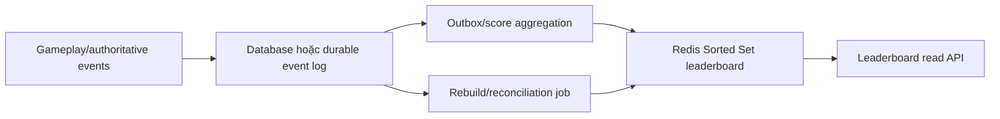
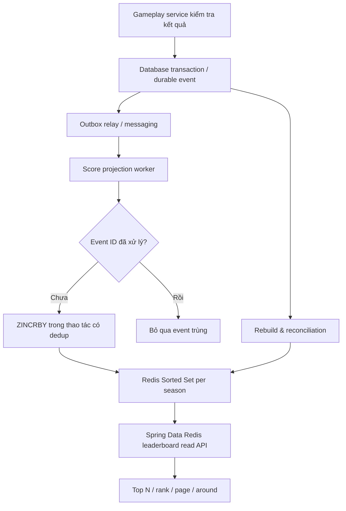

# Triển khai bảng xếp hạng bằng Sorted Set trong Spring Data Redis

## 1. Bài toán thực hành: bảng xếp hạng theo điểm

Giả sử một ứng dụng trò chơi cần hiển thị **10 người chơi có điểm cao nhất** trong một mùa giải. Mỗi trận có thể tăng điểm của một người chơi; người dùng cần biết vị trí hiện tại của mình, xem vài đối thủ xung quanh và chuyển trang để xem thêm kết quả.

Nếu lưu dữ liệu bằng một Hash thông thường rồi tải toàn bộ người chơi để sort ở Java, mỗi yêu cầu xem top 10 có thể tốn nhiều công việc không cần thiết. Redis có một cấu trúc dữ liệu phù hợp hơn: **Sorted Set (ZSet)**.

Với Sorted Set, mỗi thành viên (*member*) có một **score**. Redis duy trì các member theo thứ tự score, cho phép:

- Ghi hoặc cập nhật điểm của người chơi.
- Tăng điểm một cách nguyên tử bằng một Redis command.
- Lấy top N với score.
- Tìm thứ hạng của một người chơi.
- Phân trang bảng xếp hạng.
- Đếm người chơi trong một khoảng điểm.
- Xóa người chơi hoặc xóa bảng của mùa giải cũ.

> Cách ánh xạ cơ bản: **một Redis Sorted Set đại diện một bảng xếp hạng; member là ID người chơi; score là điểm xếp hạng**. Không cần tạo một Redis key cho từng vị trí hạng.

Ví dụ:

```text
Redis key: lb:game:season-2026-w46:scores

member       score
player-102   250
player-201   180
player-305   180
player-411    90
```

Khi hiển thị theo thứ tự giảm dần, người chơi 250 điểm đứng trước những người 180 điểm. Những người bằng điểm cần một chính sách **tie-break** rõ ràng (xem phần sau).

### 1.1. Kết quả mong muốn

Sau bài học, ứng dụng có thể cung cấp những thao tác minh họa:

| Chức năng | API Redis chủ yếu | API Spring Data Redis |
|---|---|---|
| Đặt điểm | `ZADD` | `opsForZSet().add` |
| Cộng điểm | `ZINCRBY` | `opsForZSet().incrementScore` |
| Top 10 | `ZREVRANGE ... WITHSCORES` | `reverseRangeWithScores` |
| Thứ hạng | `ZREVRANK` | `reverseRank` |
| Điểm hiện tại | `ZSCORE` | `score` |
| Tổng người chơi | `ZCARD` | `zCard` |
| Xóa một người | `ZREM` | `remove` |
| Đếm theo điểm | `ZCOUNT` | `count` |
| Xóa mùa cũ | `UNLINK` hoặc `DEL` key | `unlink` / `delete` |
| Giữ bảng trong một thời gian | `EXPIREAT` / `PEXPIREAT` | `expireAt` |

Ứng dụng thực tế còn cần **nguồn điểm đáng tin cậy, kiểm soát ghi trùng, quyền cập nhật điểm, giới hạn bộ nhớ và kế hoạch phục hồi**.

## 2. Sorted Set là gì?

Redis Sorted Set là một tập hợp **member duy nhất**, mỗi member gắn với một score kiểu số thực dấu phẩy động. Redis sắp xếp member tăng dần theo score. Khi cần bảng xếp hạng cao nhất trước, ta đọc theo **thứ tự đảo ngược**.

Ba đặc điểm:

1. **Một member chỉ xuất hiện một lần trong cùng ZSet.** `ZADD` cùng member có thể thay đổi score thay vì tạo hàng thứ hai.
2. **Score là một số có thể so sánh và cập nhật.** `ZINCRBY` cộng delta vào score hiện có, tạo member mới nếu chưa tồn tại.
3. **Redis duy trì cấu trúc đã sắp xếp.** Không cần lấy tất cả member về ứng dụng rồi sort lại để xem top N.

Ví dụ CLI:

```redis
DEL demo:lb:players

ZADD demo:lb:players 120 alice
ZADD demo:lb:players 200 bob
ZADD demo:lb:players 150 carol

ZRANGE demo:lb:players 0 -1 WITHSCORES
# alice 120, carol 150, bob 200

ZREVRANGE demo:lb:players 0 -1 WITHSCORES
# bob 200, carol 150, alice 120
```

`ZRANGE` mặc định đọc từ thấp lên cao theo score; `ZREVRANGE` đọc từ cao xuống thấp. Trên Redis 6.2+, `ZRANGE ... REV` hỗ trợ cùng ý tưởng đọc đảo ngược trong cú pháp mới. `ZREVRANGE` vẫn là lệnh quen thuộc và được Spring Data Redis thể hiện qua các thao tác `reverseRange...`.

### 2.1. ZSet khác Set và Hash thế nào?

| Cấu trúc | Đặc tính | Phù hợp với |
|---|---|---|
| Set | Member duy nhất, không gắn score để xếp hạng | Danh sách user đã tham gia |
| Hash | Nhiều field/value thuộc một key | Thông tin chi tiết người chơi |
| Sorted Set | Member duy nhất, có score và thứ tự | Ranking, top N, phân trang theo điểm |
| List | Thứ tự chèn, cho phép phần tử trùng | Danh sách có thứ tự, queue đơn giản |
| Stream | Entry ID và consumer group, hỗ trợ xử lý sự kiện | Lưu luồng cập nhật điểm, xử lý bất đồng bộ |

Một thiết kế phổ biến là **ZSet giữ chỉ số xếp hạng**, còn thông tin hiển thị như tên/avatar được đọc từ database hoặc cache khác theo ID member.

Đừng đưa JSON hồ sơ người chơi vào member:

```text
Sai member:
{"id":"p42","name":"Alice","avatar":"/alice.png"}
```

Nếu tên/avatar đổi, member string đổi, Redis sẽ xem đó là **một member khác** và dễ tạo bản ghi trùng. Member nên là **ID bất biến**, không chứa thông tin cá nhân không cần thiết.

## 3. Thiết kế dữ liệu cho leaderboard

Mỗi mùa giải có thể có một ZSet key:

```text
lb:game:season-2026-w46:scores
lb:game:season-2026-w47:scores
lb:game:season-2026-w48:scores
```

Trong key:

```text
member = player:<opaque-player-id>
score  = tổng điểm hợp lệ của mùa giải
```

Ví dụ:

```redis
ZADD lb:game:season-2026-w46:scores 180 player:1001
ZADD lb:game:season-2026-w46:scores 240 player:1002
ZADD lb:game:season-2026-w46:scores 120 player:1003
```

### 3.1. Vì sao mỗi mùa cần một key?

Nếu dùng một ZSet duy nhất cho mọi thời gian, ứng dụng phải tìm cách "reset" điểm khi mùa giải chuyển kỳ. Reset toàn bộ key giữa lúc producer còn ghi có thể làm mất cập nhật của mùa mới.

Dùng key theo mùa:

- Phân biệt rõ ranking cũ và mới.
- Tránh trộn điểm của hai mùa.
- Cho phép xem bảng xếp hạng lịch sử.
- Đặt retention/TTL khác nhau cho từng mùa.
- Có thể chốt mùa cũ mà không ngăn mùa mới nhận điểm.
- Dễ xây snapshot và kiểm tra kết quả.

Tên kỳ phải được **chuẩn hóa theo quy tắc nhất quán**. Nếu là tuần theo ISO-8601, cần dùng đúng **week-based year**, không ghép calendar year với week number một cách tùy tiện ở ranh giới cuối năm.

### 3.2. Key pattern và giới hạn input

Nên dùng ID mùa đã được service kiểm tra, ví dụ:

```text
season-2026-w46
season-2026-w47
```

Không trực tiếp ghép một chuỗi người dùng nhập tùy ý vào key:

```java
String key = "lb:game:" + request.getSeason() + ":scores";
```

nếu không có validation. Kiểm tra giới hạn độ dài, ký tự và tên kỳ hợp lệ để tránh tạo vô số key, collision giữa namespace hoặc log chứa dữ liệu ngoài ý muốn.

### 3.3. Member phải ổn định và không chứa secret

Member:

```text
player:1001
```

có thể ổn trong một hệ thống nội bộ nếu ID không nhạy cảm. Nếu ID là email, số điện thoại hoặc token, cần dùng identifier mờ/opaque phù hợp. Redis member có thể xuất hiện khi gọi `ZRANGE`, backup hoặc công cụ vận hành, nên không coi nó là một chỗ lưu bí mật.

## 4. Khởi tạo bảng xếp hạng bằng redis-cli

Dùng key thử nghiệm, không thao tác bảng production:

```redis
DEL demo:leaderboard:week46

ZADD demo:leaderboard:week46 300 p100
ZADD demo:leaderboard:week46 170 p200
ZADD demo:leaderboard:week46 250 p300
ZADD demo:leaderboard:week46 170 p400
ZADD demo:leaderboard:week46  80 p500

ZCARD demo:leaderboard:week46
# (integer) 5
```

### 4.1. Đọc toàn bảng giảm dần

```redis
ZREVRANGE demo:leaderboard:week46 0 -1 WITHSCORES
```

Kết quả theo score giảm dần:

```text
p100 300
p300 250
p400 170
p200 170
p500  80
```

Lưu ý ở cặp đồng điểm 170, lệnh đọc đảo ngược dùng thứ tự member đảo ngược theo thứ tự từ điển ở cùng score. **Không được mặc định đây là quy tắc công bằng về thời điểm đạt điểm.** Nếu doanh nghiệp quy định "ai đạt trước đứng trước", phải thiết kế tie-break riêng.

### 4.2. Cập nhật điểm

```redis
ZADD demo:leaderboard:week46 350 p300
ZREVRANK demo:leaderboard:week46 p300
# (integer) 0
```

`ZADD` trên member `p300` đổi điểm 250 thành 350; nó không tạo một dòng p300 mới.

### 4.3. Cộng điểm

```redis
ZINCRBY demo:leaderboard:week46 50 p200

ZSCORE demo:leaderboard:week46 p200
# "220"
```

`ZINCRBY` thực hiện phép cộng score **nguyên tử đối với một member** trong một Redis command. Hai worker cùng cộng điểm sẽ không gặp kiểu mất cập nhật do cả hai cùng `GET` điểm cũ rồi ghi đè lại, miễn là chúng dùng primitive đúng.

### 4.4. Đọc thứ hạng của một người

```redis
ZREVRANK demo:leaderboard:week46 p100
```

Redis trả vị trí **tính từ 0** khi đọc theo điểm giảm dần:

- Rank Redis 0 → hạng hiển thị 1.
- Rank Redis 1 → hạng hiển thị 2.
- Member không tồn tại → nil/null.

Nếu API trả cho người dùng, thường cần cộng 1. Đừng làm như thể `ZREVRANK` đã là thứ hạng 1-based.

### 4.5. Xóa người chơi

```redis
ZREM demo:leaderboard:week46 p500

ZCARD demo:leaderboard:week46
```

`ZREM` loại member khỏi ZSet. Nếu score đến từ sự kiện nghiệp vụ có thể phát lại, cần có cơ chế tránh một event cũ làm member bị thêm lại sau khi xóa.

## 5. Các lệnh Redis Sorted Set cần nhớ

| Lệnh | Kết quả | Ghi chú |
|---|---|---|
| `ZADD key score member` | Thêm/cập nhật member | Khi member đã tồn tại, score được thay thế |
| `ZINCRBY key delta member` | Score mới | Atomic trên một command |
| `ZSCORE key member` | Score hoặc nil | Không tự trả rank |
| `ZRANK key member` | Thứ hạng tăng dần, 0-based | Điểm thấp trước |
| `ZREVRANK key member` | Thứ hạng giảm dần, 0-based | Điểm cao trước |
| `ZRANGE key start stop` | Danh sách tăng dần | Có `WITHSCORES` |
| `ZREVRANGE key start stop` | Danh sách giảm dần | Top N, pagination |
| `ZRANGE key start stop REV` | Đọc đảo ngược theo cú pháp mới | Redis 6.2+ |
| `ZCARD key` | Tổng member | Không phải tổng điểm |
| `ZCOUNT key min max` | Số member có score trong khoảng | Có hỗ trợ biên mở/đóng |
| `ZREM key member...` | Xóa member | Không xóa những key hồ sơ phụ |
| `ZREMRANGEBYRANK` | Loại member trong khoảng rank | Cẩn thận khi giữ chỉ top K |
| `ZREMRANGEBYSCORE` | Loại theo ngưỡng điểm | Làm thay đổi tập được xếp hạng |
| `ZSCAN` | Duyệt member theo cursor | Không bảo đảm snapshot ổn định khi dữ liệu thay đổi |

### 5.1. Độ phức tạp và ý nghĩa

Các thao tác cập nhật/tìm rank cơ bản trên Sorted Set thường có độ phức tạp **logarithmic theo số member**; đọc một đoạn ranking còn phụ thuộc số item trả về. Điều này phù hợp với nhiều bảng xếp hạng lớn vì không cần sort toàn bộ ở phía Java cho từng request.

Tuy vậy:

- Đọc top 10 và đọc top 1 triệu có chi phí khác nhau.
- Trả cùng lúc cả triệu member có thể gây tốn network và heap.
- Một ZSet rất lớn chiếm bộ nhớ đáng kể.
- Mọi thao tác trên một ZSet key trong Redis Cluster tập trung vào node sở hữu slot đó.
- Nhiều client cùng cập nhật một key có thể biến key thành **hot key**.

Không chọn Redis Sorted Set với giả định mọi bảng xếp hạng lớn đều miễn phí về CPU và RAM.

## 6. Spring Boot và Spring Data Redis: chuẩn bị dự án

Ví dụ minh họa dùng Spring Boot 3.x, Spring Data Redis và Java 17+.

### 6.1. Dependencies với Gradle

```groovy
plugins {
    id 'java'
    id 'org.springframework.boot' version '<SPRING_BOOT_VERSION>'
    id 'io.spring.dependency-management' version '<DEPENDENCY_MANAGEMENT_VERSION>'
}

java {
    toolchain {
        languageVersion = JavaLanguageVersion.of(17)
    }
}

dependencies {
    implementation 'org.springframework.boot:spring-boot-starter-data-redis'
    implementation 'org.springframework.boot:spring-boot-starter-web'

    testImplementation 'org.springframework.boot:spring-boot-starter-test'
    testImplementation 'org.testcontainers:testcontainers'
    testImplementation 'org.testcontainers:junit-jupiter'
}

tasks.named('test') {
    useJUnitPlatform()
}
```

Các giá trị `<SPRING_BOOT_VERSION>` và `<DEPENDENCY_MANAGEMENT_VERSION>` là **placeholder cần thay bằng phiên bản tương thích trong dự án**, không phải file build có thể chạy nguyên xi. Với dự án đã dùng Spring Boot BOM/plugin, không cần lặp cấu hình quản lý phiên bản.

Nếu chỉ viết service không có REST endpoint, không cần web starter. Ví dụ trong bài có controller nên bao gồm starter web.

### 6.2. Redis connection

```yaml
spring:
  data:
    redis:
      host: localhost
      port: 6379
      connect-timeout: 2s
      timeout: 3s
```

`spring.data.redis.*` là prefix phổ biến ở Spring Boot 3.x. Với Boot 2.x, các property thường là `spring.redis.*`; không sao chép một prefix từ dự án khác mà không kiểm tra phiên bản.

Trong production, host, TLS, Redis ACL user/password và các thông số pool nên lấy từ cấu hình môi trường/secret manager. Không hardcode mật khẩu vào source.

### 6.3. Vì sao StringRedisTemplate?

`StringRedisTemplate` tự serialize key và value dạng String, thuận tiện để:

- Quan sát CLI bằng `ZRANGE`.
- Dùng member là player ID.
- Tránh bất đồng key serializer khi debug.
- Dễ tương thích giữa các service.

Nếu dùng `RedisTemplate<String, Player>` với serializer tùy chỉnh, cần bảo đảm member của ZSet có **identity ổn định**. Không đưa một object dễ thay đổi vào member rồi kỳ vọng Redis sẽ nhận ra đó vẫn là cùng player.

## 7. Thiết kế service quản lý bảng xếp hạng

Ta sẽ xây một `LeaderboardService` cung cấp:

- `setScore`: đặt score tuyệt đối cho player.
- `addPoints`: cộng thêm điểm.
- `top`: đọc N người có điểm cao nhất.
- `page`: phân trang.
- `standing`: lấy thứ hạng và điểm của một người.
- `countPlayers`: đếm thành viên.
- `removePlayer`: xóa member.

### 7.1. DTO kết quả

```java
package com.example.leaderboard;

public record LeaderboardEntry(
        String playerId,
        long rank,
        double score
) {
}
```

`rank` dùng thứ hạng **hiển thị 1-based**. Kiểu `double` phù hợp với Redis score interface. Nếu nghiệp vụ chỉ có điểm nguyên, hãy ràng buộc chúng là số nguyên có thể biểu diễn chính xác trong Redis double, không dùng trực tiếp kiểu này để tính tiền.

### 7.2. Triển khai LeaderboardService đầy đủ

```java
package com.example.leaderboard;

import java.util.ArrayList;
import java.util.List;
import java.util.Optional;
import java.util.Set;
import java.util.regex.Pattern;

import org.springframework.data.redis.core.StringRedisTemplate;
import org.springframework.data.redis.core.ZSetOperations;
import org.springframework.stereotype.Service;

@Service
public class LeaderboardService {

    private static final Pattern ID_PATTERN =
            Pattern.compile("[A-Za-z0-9_-]{1,64}");

    private static final int MAX_PAGE_SIZE = 100;
    private static final long MAX_OFFSET = 10_000L;

    private final StringRedisTemplate redis;

    public LeaderboardService(StringRedisTemplate redis) {
        this.redis = redis;
    }

    private String key(String season) {
        validateId(season, "season");
        return "lb:game:" + season + ":scores";
    }

    private String member(String playerId) {
        validateId(playerId, "playerId");
        return "player:" + playerId;
    }

    private static void validateId(String id, String field) {
        if (id == null || !ID_PATTERN.matcher(id).matches()) {
            throw new IllegalArgumentException(
                    "Invalid " + field
            );
        }
    }

    private static void validateScore(double score) {
        if (!Double.isFinite(score) || score < 0) {
            throw new IllegalArgumentException(
                    "Score must be finite and non-negative"
            );
        }
    }

    public void setScore(
            String season, String playerId, double score) {

        validateScore(score);

        // ZADD: ghi điểm tuyệt đối hoặc cập nhật member cũ.
        redis.opsForZSet().add(
                key(season),
                member(playerId),
                score
        );
    }

    public double addPoints(
            String season, String playerId, long points) {

        if (points <= 0) {
            throw new IllegalArgumentException(
                    "Points must be positive"
            );
        }

        Double newScore = redis.opsForZSet().incrementScore(
                key(season),
                member(playerId),
                points
        );

        if (newScore == null) {
            throw new IllegalStateException(
                    "No score returned by Redis"
            );
        }

        return newScore;
    }

    public Optional<LeaderboardEntry> standing(
            String season, String playerId) {

        String key = key(season);
        String member = member(playerId);

        Long zeroBasedRank =
                redis.opsForZSet().reverseRank(key, member);

        if (zeroBasedRank == null) {
            return Optional.empty();
        }

        Double score =
                redis.opsForZSet().score(key, member);

        if (score == null) {
            // Hai lệnh riêng: có thể đã có ghi/xóa xen vào.
            return Optional.empty();
        }

        return Optional.of(new LeaderboardEntry(
                playerId,
                zeroBasedRank + 1,
                score
        ));
    }

    public List<LeaderboardEntry> top(
            String season, int limit) {

        if (limit < 1 || limit > MAX_PAGE_SIZE) {
            throw new IllegalArgumentException(
                    "limit must be between 1 and 100"
            );
        }

        return page(season, 0, limit);
    }

    public List<LeaderboardEntry> page(
            String season, long pageIndex, int pageSize) {

        if (pageIndex < 0
                || pageSize < 1
                || pageSize > MAX_PAGE_SIZE) {
            throw new IllegalArgumentException(
                    "Invalid page"
            );
        }

        long offset = Math.multiplyExact(
                pageIndex, (long) pageSize
        );

        if (offset > MAX_OFFSET) {
            throw new IllegalArgumentException(
                    "Page offset too large"
            );
        }

        long end = offset + pageSize - 1;

        Set<ZSetOperations.TypedTuple<String>> tuples =
                redis.opsForZSet().reverseRangeWithScores(
                        key(season),
                        offset,
                        end
                );

        if (tuples == null || tuples.isEmpty()) {
            return List.of();
        }

        List<LeaderboardEntry> result =
                new ArrayList<>(tuples.size());

        long rank = offset + 1;

        for (ZSetOperations.TypedTuple<String> tuple : tuples) {
            if (tuple.getValue() == null
                    || tuple.getScore() == null) {
                throw new IllegalStateException(
                        "Unexpected leaderboard entry"
                );
            }

            String storedMember = tuple.getValue();

            if (!storedMember.startsWith("player:")) {
                throw new IllegalStateException(
                        "Unexpected leaderboard member"
                );
            }

            String playerId =
                    storedMember.substring("player:".length());

            result.add(new LeaderboardEntry(
                    playerId,
                    rank++,
                    tuple.getScore()
            ));
        }

        return result;
    }

    public long countPlayers(String season) {
        Long count = redis.opsForZSet().zCard(key(season));
        return count == null ? 0L : count;
    }

    public boolean removePlayer(
            String season, String playerId) {

        Long removed = redis.opsForZSet().remove(
                key(season),
                member(playerId)
        );

        return removed != null && removed > 0;
    }
}
```

Các API trong ví dụ là những thao tác thông dụng của `ZSetOperations`. Đoạn này trình bày cốt lõi data access; chưa thực hiện phân quyền cập nhật điểm, idempotency của event, chính sách đóng mùa giải hoặc source-of-truth persistence.

### 7.3. Vì sao setScore và addPoints phải tách?

`setScore` gọi `ZADD`: **ghi giá trị điểm tuyệt đối**.

`addPoints` gọi `ZINCRBY`: **cộng thêm một lượng điểm**.

Ví dụ:

```text
Score ban đầu = 100

setScore(120) -> 120
setScore(120) -> 120

addPoints(20) -> 140
addPoints(20) -> 160
```

Hai lệnh `ZADD` giống nhau có thể idempotent về score. Hai lệnh `ZINCRBY` giống nhau **không idempotent**: đều cộng thêm điểm.

Đây là khác biệt quan trọng khi producer gửi event qua queue có khả năng retry hoặc Redis reply bị mất.

### 7.4. Boolean của add không có nghĩa thất bại khi false

Spring `ZSetOperations.add` thường trả Boolean cho biết member **mới** có được thêm vào không. Nếu member đã có và score được cập nhật, kết quả có thể là `false`. Điều đó không đồng nghĩa Redis từ chối thay đổi.

Đừng viết:

```java
if (!Boolean.TRUE.equals(redis.opsForZSet()
        .add(key, member, score))) {
    throw new IllegalStateException("Cannot save score");
}
```

vì cập nhật score của member cũ có thể là tình huống hoàn toàn bình thường.

Tương tự, khi thao tác trong pipeline hoặc transaction, một số API có thể trả `null` do reply chưa được xử lý trực tiếp; đừng dùng return value của một pipeline command như khi gọi đơn lẻ.

## 8. Thực hành chạy các thao tác qua Spring service

Giả sử ứng dụng gọi:

```java
leaderboardService.setScore(
        "season-2026-w46", "p100", 300
);

leaderboardService.setScore(
        "season-2026-w46", "p200", 150
);

leaderboardService.setScore(
        "season-2026-w46", "p300", 220
);

leaderboardService.addPoints(
        "season-2026-w46", "p200", 100
);
```

Score sau cùng:

```text
p100 = 300
p200 = 250
p300 = 220
```

Đọc top 3:

```java
List<LeaderboardEntry> top =
        leaderboardService.top("season-2026-w46", 3);
```

Kết quả minh họa:

```json
[
  {"playerId": "p100", "rank": 1, "score": 300.0},
  {"playerId": "p200", "rank": 2, "score": 250.0},
  {"playerId": "p300", "rank": 3, "score": 220.0}
]
```

Tra cứu người chơi:

```java
Optional<LeaderboardEntry> standing =
        leaderboardService.standing(
                "season-2026-w46",
                "p200"
        );
```

Kết quả:

```text
playerId = p200
rank     = 2
score    = 250.0
```

Đừng xem ví dụ này là bằng chứng đã có kiến trúc chống gian lận: các method ghi điểm phải chỉ được gọi từ workflow đã xác thực thành tích.

## 9. Tạo REST API chỉ đọc bảng xếp hạng

Một controller đơn giản có thể cung cấp top và thứ hạng cá nhân. **Không nên công khai endpoint tăng điểm trực tiếp cho bất kỳ người dùng nào.**

```java
package com.example.leaderboard;

import java.util.List;

import org.springframework.http.ResponseEntity;
import org.springframework.web.bind.annotation.GetMapping;
import org.springframework.web.bind.annotation.PathVariable;
import org.springframework.web.bind.annotation.RequestMapping;
import org.springframework.web.bind.annotation.RequestParam;
import org.springframework.web.bind.annotation.RestController;

@RestController
@RequestMapping("/api/leaderboards")
public class LeaderboardController {

    private final LeaderboardService leaderboard;

    public LeaderboardController(LeaderboardService leaderboard) {
        this.leaderboard = leaderboard;
    }

    @GetMapping("/{season}/top")
    public List<LeaderboardEntry> top(
            @PathVariable String season,
            @RequestParam(defaultValue = "10") int limit) {

        return leaderboard.top(season, limit);
    }

    @GetMapping("/{season}/page")
    public List<LeaderboardEntry> page(
            @PathVariable String season,
            @RequestParam(defaultValue = "0") long page,
            @RequestParam(defaultValue = "20") int size) {

        return leaderboard.page(season, page, size);
    }

    @GetMapping("/{season}/players/{playerId}")
    public ResponseEntity<LeaderboardEntry> standing(
            @PathVariable String season,
            @PathVariable String playerId) {

        return leaderboard.standing(season, playerId)
                .map(ResponseEntity::ok)
                .orElseGet(() ->
                        ResponseEntity.notFound().build());
    }
}
```

Thử nghiệm:

```http
GET /api/leaderboards/season-2026-w46/top?limit=10
GET /api/leaderboards/season-2026-w46/page?page=1&size=20
GET /api/leaderboards/season-2026-w46/players/p200
```

Trong production cần thêm:

- Authorization nếu leaderboard không công khai.
- Rate limiting và quota cho API.
- Kiểm tra format season và player IDs.
- Chuẩn hóa lỗi `IllegalArgumentException` thành HTTP 400 thay vì để lỗi lan thành HTTP 500.
- Giới hạn `size` và `page` để không tạo reply lớn.
- Cache HTTP hoặc application cache cho các trang top rất nóng nếu phù hợp.
- Không trả PII từ Redis member trong response.

### 9.1. Không để người dùng tự đặt điểm

Một endpoint kiểu:

```http
POST /api/leaderboards/season-2026-w46/players/p200/score
{"score": 9999999}
```

nếu cho client thông thường gọi sẽ tạo lỗ hổng gian lận. Điểm phải được **xác nhận bởi server từ sự kiện nghiệp vụ đáng tin cậy**: hoàn thành trận, xác nhận kết quả, xử lý thanh toán hợp lệ hoặc kiểm tra kết quả của một tác vụ.

Controller leaderboard có thể chỉ đọc. Các cập nhật ZSet đi qua một service nội bộ/consumer được phân quyền, có event ID và audit record.

## 10. Xếp hạng giảm dần và thứ hạng bắt đầu từ 0

Để hiển thị người chơi nhiều điểm nhất:

```redis
ZREVRANK lb:game:season-2026-w46:scores player:p100
```

hoặc trên Redis hỗ trợ cú pháp mới:

```redis
ZRANK lb:game:season-2026-w46:scores player:p100 REV
```

Redis trả **zero-based rank**. Người dùng thường mong muốn hạng 1, 2, 3, nên ứng dụng cộng 1.

| Redis `ZREVRANK` | Hạng hiển thị |
|---:|---:|
| 0 | 1 |
| 1 | 2 |
| 2 | 3 |
| nil | Chưa có trên bảng |

Nếu không có member, `reverseRank` trả `null`. Không biến `null` thành hạng 0 hay hạng cuối cùng khi chưa có yêu cầu nghiệp vụ như vậy.

### 10.1. Đọc rank và score bằng hai command có race

Trong `LeaderboardService.standing`, code gọi:

```java
Long rank = redis.opsForZSet().reverseRank(key, member);
Double score = redis.opsForZSet().score(key, member);
```

Đây là **hai command riêng**. Giữa chúng có thể có worker cập nhật score, nên API có thể trả rank từ thời điểm A và score từ thời điểm B.

Với dashboard gần realtime, độ sai lệch rất nhỏ có thể được chấp nhận theo SLA. Nếu yêu cầu một kết quả **atomic snapshot** rank + score, có thể dùng Redis Lua script/Function phù hợp để gọi `ZREVRANK` và `ZSCORE` trong một server-side execution, đồng thời xác định behavior khi member vắng mặt.

Pipeline hai command giúp giảm round-trip nhưng **không bảo đảm không có command của client khác xen giữa**.

## 11. Xử lý trường hợp nhiều người bằng điểm

Đây là phần quyết định ý nghĩa của "thứ hạng".

### 11.1. Thứ tự mặc định của Redis khi bằng score

Redis Sorted Set sắp xếp tăng dần theo score. Khi hai member có **score bằng nhau**, Redis dùng thứ tự từ điển của member làm tiêu chí bổ sung. Khi lấy reverse range, thứ tự từ điển tương ứng cũng đảo.

Ví dụ:

```redis
DEL demo:leaderboard:ties

ZADD demo:leaderboard:ties 100 alice
ZADD demo:leaderboard:ties 100 bob
ZADD demo:leaderboard:ties 100 carol

ZREVRANGE demo:leaderboard:ties 0 -1 WITHSCORES
```

Ở trường hợp này, các member có thể xuất hiện theo thứ tự đảo chữ cái:

```text
carol 100
bob   100
alice 100
```

Vì thế `ZREVRANK` trả một vị trí riêng cho mỗi member, dù cùng 100 điểm. Đừng tuyên bố "Redis tự hiểu người đạt điểm sớm hơn sẽ đứng trước".

### 11.2. Ba cách định nghĩa rank

Giả sử score:

```text
p100 = 300
p200 = 250
p300 = 250
p400 = 200
```

| Loại rank | Kết quả thường mong muốn | Cách hiểu |
|---|---|---|
| **Ordinal rank** | 1, 2, 3, 4 | Mỗi member một vị trí theo order ổn định |
| **Competition rank** | 1, 2, 2, 4 | Bằng điểm cùng hạng; hạng sau có khoảng trống |
| **Dense rank** | 1, 2, 2, 3 | Bằng điểm cùng hạng; hạng sau liên tiếp |

`ZREVRANK` cung cấp **ordinal position** theo thứ tự Redis. Nếu UI yêu cầu competition rank, có thể tính:

```text
competitionRank(player) =
    1 + số member có score > score(player)
```

Trong Redis CLI, để đếm những entry có score lớn hơn 250:

```redis
ZCOUNT demo:leaderboard:ties (250 +inf
```

Ký hiệu `(250` biểu thị biên dưới **exclusive**, tức không tính người có score đúng 250. Ví dụ cụ thể ở trên chỉ là bảng score minh họa; muốn thử phải tạo dữ liệu tương ứng trong key đang được `ZCOUNT`.

**Không dùng công thức `1 + ZREVRANK` nếu product requirement yêu cầu hạng đồng điểm.**

### 11.3. Dense rank phức tạp hơn

Dense rank cần đếm số **mức score khác nhau** cao hơn score của người chơi, không phải số member có score lớn hơn. Redis ZSet không cung cấp một lệnh đơn giản kiểu `COUNT DISTINCT score` cho toàn bảng mà không xây cấu trúc phụ hoặc tính toán.

Các lựa chọn:

- Chấp nhận ordinal ranking của Redis và mô tả rõ quy tắc.
- Tính competition rank bằng `ZCOUNT` theo score.
- Duy trì một projection phụ cho số lượng từng score nếu cần dense rank ở quy mô lớn.
- Tính rank khi đọc từ source khác nếu truy vấn không quá thường xuyên.
- Dùng batch/snapshot nếu muốn thứ hạng cố định vào thời điểm chốt mùa.

Không duy trì một index phụ "distinct scores" một cách ngây thơ nếu không xử lý việc người chơi thay đổi score và score count trở về 0.

### 11.4. Tie-break theo thời điểm đạt điểm

Một yêu cầu thường gặp: "Ai đạt 100 điểm trước sẽ đứng cao hơn người đạt 100 sau".

Không thể suy ra mốc này từ `ZREVRANK` mặc định. Có thể thiết kế:

1. Lưu score thực và thời điểm đạt score trong một nguồn dữ liệu đáng tin cậy.
2. Xây snapshot đã sort theo score giảm, timestamp tăng, player ID để ổn định.
3. Hoặc dùng một composite ranking score có quy tắc và giới hạn số học đã được chứng minh.
4. Giữ audit trail để xử lý khi event đến muộn hoặc bị sửa.

**Cẩn thận composite score kiểu `score * 10^13 - timestamp`**: Redis score là double, không thể biểu diễn chính xác mọi số nguyên lớn. Cách đóng gói có thể làm tròn và phá thứ tự mong muốn. Nếu tie-break công bằng quan trọng, nên đưa quy tắc đó vào thiết kế dữ liệu ngay từ đầu thay vì "cộng một chút số thập phân" vào điểm.

## 12. Score là double: giới hạn độ chính xác

Redis dùng số kiểu double cho score của Sorted Set. Double biểu diễn chính xác **mọi số nguyên** trong vùng an toàn đến một ngưỡng nhất định, nhưng không thể biểu diễn chính xác mọi số thực và mọi số nguyên cực lớn.

### 12.1. Với điểm nguyên

Dùng delta nguyên trong `ZINCRBY` là hợp lý khi tổng điểm nằm trong giới hạn biểu diễn chính xác của IEEE-754 double, đặc biệt nên tránh vượt quá ngưỡng **2^53** khi mỗi điểm đơn vị phải được phân biệt.

```text
2^53 = 9.007.199.254.740.992
```

Nếu leaderboard chỉ có vài triệu điểm nguyên, vấn đề này thường chưa xuất hiện. Nhưng với hệ thống gom điểm trên hàng tỷ sự kiện hoặc dùng điểm như số tiền, phải đánh giá kỹ.

### 12.2. Không dùng Sorted Set để lưu số dư tiền chỉ vì có score

Các score dạng:

```text
0.1
0.2
0.3
```

có thể gặp đặc điểm làm tròn của binary floating point. Với các giá trị tài chính, hãy dùng số nguyên đơn vị nhỏ nhất trong giới hạn an toàn hoặc một nguồn dữ liệu kế toán phù hợp; Redis ZSet leaderboard chỉ nên là **projection để hiển thị rank**, không phải sổ cái tài chính.

### 12.3. Validate đầu vào

Trước khi gọi `ZADD`:

- Không nhận NaN.
- Không nhận vô cực nếu nghiệp vụ không có khái niệm đó.
- Không nhận score âm nếu luật chơi yêu cầu không âm.
- Giới hạn điểm tối đa để tránh overflow/abuse.
- Kiểm tra score/delta theo source of truth, không tin input từ client.

`Double.isFinite(score)` là một kiểm tra cơ bản trong Java nhưng chưa phải toàn bộ business validation.

## 13. Phân trang leaderboard

Một API thường không tải toàn bộ người chơi. Spring Data Redis có:

```java
redis.opsForZSet().reverseRangeWithScores(
        key, startInclusive, endInclusive
);
```

**Cả hai biên rank đều inclusive**. Với pageIndex bắt đầu từ 0 và pageSize:

```text
start = pageIndex * pageSize
end   = start + pageSize - 1
```

Ví dụ pageSize = 20:

| Page index | Redis start | Redis end | Hạng hiển thị |
|---:|---:|---:|---|
| 0 | 0 | 19 | 1–20 |
| 1 | 20 | 39 | 21–40 |
| 2 | 40 | 59 | 41–60 |

Nếu gửi `end = start + pageSize`, trang sẽ có thể chứa **21 phần tử** thay vì 20. Đây là lỗi off-by-one rất phổ biến.

### 13.1. Limit không chỉ để bảo vệ CPU

Giới hạn `pageSize` bảo vệ:

- Thời gian đọc Redis.
- Băng thông response.
- Bộ nhớ JVM khi deserialize.
- Kích thước JSON response.
- CPU controller/service.
- Rủi ro một client dùng API để enumerate toàn bộ leaderboard.

Trong ví dụ service, `MAX_PAGE_SIZE = 100` và `MAX_OFFSET = 10_000` là **giới hạn minh họa**, cần điều chỉnh theo yêu cầu sản phẩm và hiệu năng.

### 13.2. Pagination trên bảng đang thay đổi không phải snapshot cố định

Giả sử người dùng đọc page 0, rồi giữa hai lần đọc có một người chơi tăng điểm và nhảy lên đầu bảng. Khi người dùng đọc page 1, một player có thể lặp lại hoặc một player khác bị bỏ qua do thứ tự đã thay đổi.

Đây là đặc điểm của **offset pagination trên tập kết quả đang thay đổi**.

Nếu yêu cầu một phiên xem leaderboard nhất quán:

- Tạo snapshot ở một mốc thời gian/version.
- Dùng một ZSet key immutable cho bảng đã chốt.
- Dùng snapshot ID trong API.
- Hoặc thiết kế cursor/keyset paging theo cặp score + member với quy tắc xử lý tie rõ ràng.

Không thể chỉ thay offset bằng `lastScore` nếu có nhiều người bằng score: cần xử lý member tie-break để không bỏ sót hoặc lặp.

## 14. Lấy người chơi xung quanh vị trí hiện tại

Một UX phổ biến là hiển thị:

```text
Hạng 148: player-A
Hạng 149: player-B
Hạng 150: you
Hạng 151: player-C
Hạng 152: player-D
```

Cách đơn giản:

1. Gọi `reverseRank(key, member)` để lấy zero-based rank.
2. Tính `start = max(0, rank - radius)`.
3. Tính `end = rank + radius`.
4. Gọi `reverseRangeWithScores(key, start, end)`.
5. Ánh xạ sang rank 1-based.

Ví dụ method:

```java
public List<LeaderboardEntry> aroundPlayer(
        String season, String playerId, int radius) {

    if (radius < 0 || radius > 20) {
        throw new IllegalArgumentException("Invalid radius");
    }

    String key = "lb:game:" + season + ":scores";
    String member = "player:" + playerId;

    Long position = redis.opsForZSet()
            .reverseRank(key, member);

    if (position == null) {
        return List.of();
    }

    long start = Math.max(0, position - radius);
    long end = position + radius;

    var tuples = redis.opsForZSet()
            .reverseRangeWithScores(key, start, end);

    // Ánh xạ kết quả theo thứ tự trả về,
    // rank hiển thị bắt đầu bằng start + 1.
    // Đồng thời validate season/playerId theo service policy.
    return convertTuples(tuples, start);
}
```

Đây là **mảnh code minh họa thuật toán**, không phải method có thể dán nguyên vào class ở mục 7 vì `convertTuples` chưa được định nghĩa. Khi triển khai, nên trích logic chuyển `TypedTuple` thành `LeaderboardEntry` của `page` thành helper và gọi lại.

### 14.1. Race giữa đọc rank và range

Giống `standing`, hai commands có thể xen cập nhật:

```text
ZREVRANK you -> 149
Có người chơi khác tăng điểm làm you xuống hạng 151
ZREVRANGE 147 151 -> khung kết quả mới
```

Kết quả có thể không đặt bạn đúng giữa danh sách. Với UX realtime chấp nhận eventual consistency, điều này có thể không đáng lo. Với yêu cầu snapshot chính xác, dùng một thao tác server-side hoặc snapshot version phù hợp.

## 15. Đếm người chơi theo khoảng điểm

Redis có:

```redis
ZCOUNT demo:leaderboard:week46 100 199
```

Lệnh đếm số member có score từ 100 đến 199, theo semantics biên mặc định inclusive.

Ví dụ câu hỏi:

- Bao nhiêu người có điểm từ 0 đến 99?
- Bao nhiêu người từ 100 đến 499?
- Có bao nhiêu người đạt trên 1000?

Trong Spring Data Redis:

```java
Long count = redis.opsForZSet()
        .count(
                "lb:game:season-2026-w46:scores",
                100.0,
                499.0
        );
```

`ZSetOperations.count` dùng hai mốc kiểu double, thông thường **inclusive**. Nếu cần biên exclusive để tính competition rank, dùng Redis range syntax phù hợp qua command hỗ trợ hoặc một server-side script; đừng lấy `count(score, +infinity)` inclusive rồi coi là "người có điểm cao hơn", vì nó còn tính cả những người đồng điểm.

### 15.1. Thống kê điểm khác thứ hạng

Ví dụ:

```text
120 người đạt 100–199 điểm
75 người đạt 200–299 điểm
12 người đạt 300–399 điểm
```

Các thống kê này phục vụ dashboard phân phối điểm. Nhưng nếu cần giải thưởng top 10%, hãy quyết định:

- 10% theo **tổng số member hiện tại** hay số người đủ điều kiện?
- Có loại bot, tài khoản bị khóa, thành tích vô hiệu không?
- Khi đồng điểm ở ngưỡng giải thưởng, có trao cho tất cả hay dùng tie-break?
- Kết quả được chốt tại thời điểm nào?

Redis cung cấp primitive đếm/rank, không tự quyết định luật giải thưởng.

## 16. Cập nhật điểm đồng thời: ZINCRBY khác GET rồi SET

### 16.1. Cách dễ bị mất cập nhật

Giả sử hai worker cùng cộng 10 điểm:

```text
Score ban đầu = 100

Worker A: ZSCORE -> 100
Worker B: ZSCORE -> 100

Worker A: ZADD 110
Worker B: ZADD 110

Kết quả cuối = 110, lẽ ra là 120.
```

Vòng đọc-sửa-ghi qua hai Redis commands gây **lost update**.

### 16.2. Dùng ZINCRBY

```redis
ZINCRBY lb:game:season-2026-w46:scores 10 player:p100
```

Nếu hai worker cùng chạy, Redis thực thi hai command cộng điểm và kết quả tổng sẽ tăng 20 (nếu không có những command khác thay score). Đây là primitive atomic trên một member.

Trong Spring Data Redis:

```java
Double updated = redis.opsForZSet().incrementScore(
        "lb:game:season-2026-w46:scores",
        "player:p100",
        10.0
);
```

**Nhưng atomic increment không chống event bị xử lý hai lần.** Nếu cùng `eventId` được giao lại do retry và hai lần `ZINCRBY` đều chạy, score vẫn tăng hai lần hợp lệ theo góc nhìn Redis.

## 17. Event trùng và idempotency: không cộng điểm hai lần

Trong kiến trúc có queue/Stream, ít nhất một lần giao lại là tình huống cần dự kiến:

```text
Producer phát ScoreEarned(eventId=evt-42, player=p100, points=10)
        |
        v
Consumer gọi ZINCRBY -> thành công
        |
        x  Process chết trước khi ACK
        |
        v
Event evt-42 được giao lại
        |
        v
Consumer gọi ZINCRBY lần nữa -> cộng trùng 10 điểm
```

Không thể sửa bằng cách dùng `ZINCRBY` thay `ZADD` đơn thuần. Cần **định danh event duy nhất** và trạng thái đã áp dụng.

### 17.1. Hai hướng bảo đảm đúng điểm

**Hướng A — điểm tuyệt đối từ nguồn có thẩm quyền.**

Một database ghi tổng điểm đúng. Redis chỉ là projection:

```text
DB cập nhật score=230
Outbox event PlayerScoreChanged(playerId=p100, version=42, score=230)
Consumer làm mới Redis ZSet
```

Một event trùng cùng version/score có thể được xử lý idempotent, nhưng **event đến ngược thứ tự** vẫn có thể làm score quay lùi nếu consumer chỉ dùng `ZADD` và không kiểm tra version.

Khi có nhiều event đến không theo thứ tự, cần version check và update atomic hoặc rebuild từ source.

**Hướng B — cộng điểm có event dedup trong Redis.**

Dùng một cấu trúc ghi nhận event IDs đã áp dụng và tăng score trong cùng một thao tác Lua/Redis Function, cùng ranh giới key/slot cần thiết.

Cách này phù hợp với một số workload, nhưng vẫn phải xét persistence/replication, retention dedup và thứ tự xử lý event.

### 17.2. Lua script minh họa dedup + ZINCRBY

Giả sử có hai Redis keys:

```text
lb:{season-2026-w46}:scores
lb:{season-2026-w46}:processed-events
```

Hai key dùng cùng hash tag `{season-2026-w46}` nên thuộc cùng hash slot trong Redis Cluster. Không dùng chung một hash tag cho mọi mùa giải nếu cần phân tán tải theo kỳ.

Script:

```lua
-- KEYS[1] = Sorted Set điểm
-- KEYS[2] = Set lưu event ID đã xử lý
-- ARGV[1] = eventId
-- ARGV[2] = member/playerId
-- ARGV[3] = số điểm cộng (số nguyên dương)

local eventId = ARGV[1]
local player = ARGV[2]
local points = tonumber(ARGV[3])

if not eventId or eventId == ''
   or not player or player == ''
   or not points or points <= 0
   or points ~= math.floor(points) then
    return redis.error_reply('INVALID_ARGUMENTS')
end

-- Kiểm tra type TRƯỚC khi tạo dấu vết event.
local scoresType = redis.call('TYPE', KEYS[1]).ok
local eventsType = redis.call('TYPE', KEYS[2]).ok

if scoresType ~= 'none' and scoresType ~= 'zset' then
    return redis.error_reply('WRONGTYPE_SCORES')
end

if eventsType ~= 'none' and eventsType ~= 'set' then
    return redis.error_reply('WRONGTYPE_EVENTS')
end

if redis.call('SISMEMBER', KEYS[2], eventId) == 1 then
    return 0
end

redis.call('SADD', KEYS[2], eventId)
redis.call('ZINCRBY', KEYS[1], points, player)

return 1
```

Kết quả:

- `1`: event mới được ghi nhận và tăng điểm.
- `0`: event ID đã có nên bỏ qua việc cộng điểm lại.
- Error: input/type không hợp lệ theo các kiểm tra đã định.

Vì Redis thực thi script như một đơn vị không bị các command khác chen vào, hai worker cùng gửi **cùng eventId** đến những key này sẽ không đồng thời vượt qua bước `SISMEMBER` rồi cộng hai lần.

### 17.3. Một giới hạn quan trọng: Lua script không rollback mọi write

Redis script có tính **atomic về sự xen kẽ thực thi**, nhưng nếu script gặp lỗi runtime **sau khi đã chạy một write**, Redis không tự rollback tất cả thay đổi trước lỗi.

Ví dụ trên kiểm tra kiểu key trước khi thực hiện `SADD` để giảm một nguyên nhân lỗi dự đoán được. Đó không phải bảo đảm giao dịch ACID đầy đủ cho mọi tình huống.

Đối với tính đúng đắn nghiêm ngặt:

- Validate input và schema trước khi ghi.
- Giới hạn điểm tối đa và số lần cập nhật.
- Có nguồn dữ liệu/audit để đối soát.
- Thiết kế idempotency/consistency khi xảy ra failover.
- Không tuyên bố "exactly once end-to-end" chỉ vì một script chạy atomic trên master.

### 17.4. Spring Data Redis gọi script

Ví dụ ở mức tích hợp:

```java
import java.util.List;

import org.springframework.data.redis.core.StringRedisTemplate;
import org.springframework.data.redis.core.script.DefaultRedisScript;

public class IdempotentScoreUpdater {

    private final StringRedisTemplate redis;
    private final DefaultRedisScript<Long> script;

    public IdempotentScoreUpdater(
            StringRedisTemplate redis,
            String luaSource) {

        this.redis = redis;

        DefaultRedisScript<Long> redisScript =
                new DefaultRedisScript<>();

        redisScript.setScriptText(luaSource);
        redisScript.setResultType(Long.class);
        this.script = redisScript;
    }

    public boolean apply(
            String season,
            String eventId,
            String playerId,
            long points) {

        // Tất cả đầu vào cần validate ở tầng service.
        String hashTag = "{" + season + "}";

        String scoresKey = "lb:" + hashTag + ":scores";
        String seenKey =
                "lb:" + hashTag + ":processed-events";

        Long result = redis.execute(
                script,
                List.of(scoresKey, seenKey),
                eventId,
                "player:" + playerId,
                Long.toString(points)
        );

        return Long.valueOf(1).equals(result);
    }
}
```

`luaSource` trong ví dụ phải được tải từ một resource/script do ứng dụng quản lý (chẳng hạn classpath) hoặc cấp trong cấu hình an toàn. Lớp trên minh họa `DefaultRedisScript`; nó **chưa có implementation lấy Lua từ file** và chưa triển khai policy validation/expiry.

**Cần nhất quán key naming.** Ví dụ script dùng `lb:{season}:scores`, khác namespace demo `lb:game:season:scores` ở service trước đó. Trong một ứng dụng thực, phải chọn **một key factory duy nhất**. Nếu cần Redis Cluster multi-key script, key factory có thể tạo:

```text
lb:game:{season-2026-w46}:scores
lb:game:{season-2026-w46}:processed-events
```

rồi cả service thường và script đều sử dụng chúng.

### 17.5. Retention của dedup set

Nếu `processed-events` giữ mọi event ID mãi, memory của Redis sẽ tăng theo tổng số event đã xử lý. Nếu xóa dedup IDs quá sớm, một event cũ được retry hoặc replay lại sẽ bị cộng điểm lần nữa.

Retention phải bao phủ:

- Khoảng thời gian sự kiện có thể được giao lại.
- Thời gian replay/backfill được phép.
- Thời gian mùa giải còn nhận cập nhật.
- Thời gian sửa lỗi/reconciliation.
- Chính sách archive của nguồn event.

Một lựa chọn khác là dựa trên outbox/database có unique constraint theo eventId. Với bảng xếp hạng có lượng event rất lớn, lưu hàng tỷ event IDs trong một Redis Set có thể không kinh tế.

### 17.6. Không dùng SADD rồi ZINCRBY thành hai command độc lập

Sai nếu cần atomic dedup:

```java
Boolean newEvent = redis.opsForSet()
        .add(seenKey, eventId) > 0;

if (newEvent) {
    redis.opsForZSet().incrementScore(
            scoresKey, playerId, points);
}
```

Đây là hai commands; nếu process chết sau khi đánh dấu event đã xử lý nhưng trước khi cộng điểm, retry sẽ thấy event đã có và **bỏ qua cộng điểm vĩnh viễn**. Lua script/transaction phù hợp có thể thu hẹp khoảng trống này. Trong source code thực còn phải xử lý return type đúng của `SetOperations.add` (số Long) và không viết phép so sánh null-unsafe.

## 18. Tính nhất quán khi có nhiều nguồn cập nhật điểm

Một leaderboard có thể nhận điểm từ:

- Kết quả trận được chốt.
- Cộng thưởng theo sự kiện.
- Trừ điểm do vi phạm.
- Admin điều chỉnh.
- Quy trình hoàn tiền/hủy giao dịch.
- Tính lại toàn bộ score sau phát hiện lỗi.

Nếu một luồng dùng `ZINCRBY`, luồng khác dùng `ZADD` score tuyệt đối, các thao tác có thể ghi đè lẫn nhau nếu không có quy tắc nhất quán.

Ví dụ:

```text
DB tính score đúng = 200
Worker A chuẩn bị ZADD 200

Worker B nhận thưởng mới, ZINCRBY +20 -> 220
Worker A gửi ZADD 200 sau đó -> 200

Phần thưởng bị mất khỏi projection.
```

Không thể sửa chỉ bằng "Redis xử lý command atomic" vì thứ tự hai commands hợp lệ nhưng nghiệp vụ sai.

Các lựa chọn:

1. **Một nguồn duy nhất** quyết định score và publish version tăng đơn điệu.
2. Consumer áp dụng update chỉ khi version mới hơn version hiện tại.
3. Mọi thay đổi đi qua cùng một event pipeline được tuần tự hóa theo player.
4. Ghi điểm đúng ở database, rồi rebuild Redis projection khi cần.
5. Với updates có điều kiện nhiều key, dùng Lua/Function phù hợp và key cùng slot.

Một solution leaderboard production nên ghi rõ **ai có quyền setScore, ai có quyền incrementScore**, và version của score được xác nhận ở đâu.

## 19. Làm mới và chốt bảng xếp hạng theo mùa

### 19.1. Không xóa một key đang được producer sử dụng

Một cron job cuối tuần:

```redis
DEL lb:game:current:scores
```

có rủi ro:

- Producer đang cập nhật key này.
- Consumer xử lý lại event tuần trước sau khi key đã reset.
- Request top N đang đọc.
- Không còn snapshot để giải quyết tranh chấp.
- Mất điểm lịch sử không thể khôi phục.

Thay vào đó dùng **key theo kỳ** và routing season từ event business:

```text
event.timestamp/seasonId -> chọn key của mùa tương ứng

lb:game:season-2026-w46:scores
lb:game:season-2026-w47:scores
```

Người chơi không bị mất điểm chỉ vì một biến `currentWeek` thay đổi ở giữa quá trình xử lý event cũ.

### 19.2. Season ID phải dựa trên quy tắc thời gian thống nhất

Ví dụ Java dùng ISO tuần:

```java
import java.time.Instant;
import java.time.LocalDate;
import java.time.ZoneOffset;
import java.time.temporal.WeekFields;

public final class SeasonId {

    private SeasonId() {
    }

    public static String isoWeek(Instant eventTime) {
        LocalDate date = eventTime
                .atZone(ZoneOffset.UTC)
                .toLocalDate();

        int week = date.get(
                WeekFields.ISO.weekOfWeekBasedYear());

        int year = date.get(
                WeekFields.ISO.weekBasedYear());

        return "season-" + year
                + "-w" + String.format("%02d", week);
    }
}
```

Ví dụ dùng UTC để mọi service có cùng mốc. Nếu luật chơi tính theo múi giờ của giải đấu, thay bằng ZoneId đã được quy định và lưu rõ trong event. Không tính mùa bằng đồng hồ server theo local timezone khác nhau giữa các pod.

Đặc biệt ở cuối tháng 12/đầu tháng 1, **ISO week-based year** có thể khác calendar year. Dùng `WeekFields.ISO.weekBasedYear()` giúp tránh đặt event vào một season sai.

### 19.3. Chốt leaderboard

Khi mùa kết thúc:

1. Chốt phạm vi event hợp lệ và deadline nhận event muộn.
2. Đảm bảo các consumer cập nhật điểm đã bắt kịp.
3. Đối soát với nguồn event/score có thẩm quyền.
4. Tạo snapshot kết quả và audit record nếu có giải thưởng.
5. Khóa nghiệp vụ không cho cập nhật bảng đã chốt.
6. Công bố kết quả dựa trên snapshot đã được duyệt.
7. Giữ Redis leaderboard cũ đủ theo retention/replay policy.

**Chốt bảng** là business workflow, không chỉ là chạy `EXPIRE` rồi coi bảng điểm cuối cùng đúng.

## 20. TTL cho leaderboard

TTL áp dụng cho **Redis key Sorted Set**, không phải một member cụ thể:

```redis
EXPIRE lb:game:season-2026-w46:scores 1209600
```

Trong ví dụ trên, TTL là 1.209.600 giây (14 ngày). Khi key hết hạn, toàn bộ members/score trong bảng biến mất.

### 20.1. Dùng mốc hết hạn tuyệt đối cho mùa

Nếu muốn giữ một mùa đến một thời điểm cụ thể, có thể dùng `EXPIREAT` hoặc API `expireAt` trong Spring Data Redis.

```java
import java.time.Instant;

Instant expireAt = Instant.parse(
        "2026-12-01T00:00:00Z"
);

redis.expireAt(
        "lb:game:season-2026-w46:scores",
        expireAt
);
```

Đây là mốc minh họa, không phải quy tắc retention cho mọi giải đấu.

**Không đặt lại TTL 14 ngày sau mỗi lần người chơi ghi điểm** nếu yêu cầu là "giữ bảng đến 14 ngày sau khi chốt mùa". Nếu mỗi update lại `EXPIRE 14d`, một mùa cũ có event đến muộn có thể được kéo dài retention ngoài dự kiến.

### 20.2. ZADD/ZINCRBY có xóa TTL key không?

Khi một ZSet key đã có TTL, các thao tác thay đổi **nội dung ZSet** như `ZADD`/`ZINCRBY` thông thường không tự thay TTL của key theo cách `SET` thay thế String key. Tuy nhiên, nếu key đã hết hạn và được tạo lại, nó là key mới và sẽ **không tự có TTL cũ**.

Vì vậy, nếu retention là điều kiện bắt buộc, phải thiết kế logic tạo key và đặt expiry nhất quán, hoặc dùng một script khi cần bảo đảm tạo entry kèm expiry.

### 20.3. Trường hợp cần giữ lịch sử lâu dài

Nếu kết quả ranking có giá trị audit, giải thưởng hoặc tranh chấp, không nên chỉ giữ trên Redis với TTL ngắn. Hãy chốt và lưu kết quả vào nguồn bền vững có backup/retention phù hợp, rồi sử dụng Redis như lớp truy vấn nhanh.

## 21. Leaderboard là cache hay nguồn dữ liệu chính?

Một hệ thống có thể dùng Redis theo hai mô hình.

### 21.1. Redis là projection/cache



Trong mô hình này:

- Database/event log giữ lịch sử và score đúng.
- Redis được dựng lại từ dữ liệu nguồn khi mất.
- Mất Redis gây cache miss/độ trễ rebuild, **không mất thành tích gốc**.
- Source quyết định các điều chỉnh điểm, tranh chấp và idempotency.
- Redis giúp đọc top N/rank nhanh.

Đây là mô hình phù hợp với nhiều hệ thống leaderboard có yêu cầu correctness cao.

### 21.2. Redis là nơi duy nhất giữ điểm

```text
Gameplay event -> ZINCRBY in Redis
Không có database/event log nào giữ kết quả
```

Trong trường hợp này, mất Redis hoặc failover mất write có thể làm **mất điểm vĩnh viễn**. Cần xem xét:

- AOF/RDB persistence và RPO.
- Replication, Sentinel/Cluster và failover.
- Backup độc lập, restore drill.
- Memory/eviction policy phù hợp.
- Cách xử lý timeout sau write với kết quả không chắc chắn.
- Khả năng replay/đối soát điểm.
- Có cần dùng database giao dịch hoặc durable event log thay vì Redis-only không.

Redis replication mặc định bất đồng bộ; master có thể xác nhận write trước khi replica nhận được. Sentinel/Cluster không tự biến mọi `ZINCRBY` thành một commit không thể mất.

## 22. Redis Cluster: một ZSet key nằm ở một hash slot

Redis Cluster chia key theo hash slot. Mỗi ZSet key được quản lý bởi một node sở hữu slot đó.

Đặt:

```text
lb:game:season-2026-w46:scores
```

trên Redis Cluster **không tự động phân tán từng member của cùng ZSet qua tất cả nodes**.

Hệ quả:

- Một bảng lớn có thể tập trung RAM lên một node.
- Mọi `ZINCRBY` cho bảng đó đi tới node tương ứng.
- Một bảng quá nóng có thể giới hạn throughput theo node đó.
- Thêm Redis nodes không tự làm một ZSet key được sharding theo member.
- Khi dùng Lua nhiều key, tất cả keys liên quan thường phải cùng slot.

### 22.1. Phân tán bằng nhiều bảng nhỏ

Nếu sản phẩm chấp nhận leaderboard theo vùng/game mode:

```text
lb:game:region-a:season-2026-w46:scores
lb:game:region-b:season-2026-w46:scores
lb:game:region-c:season-2026-w46:scores
```

Các key này có thể phân bố qua nhiều slots. Nhưng bảng **global top 10** lúc này không còn là một `ZREVRANGE` đơn giản; cần cơ chế merge top candidates từ nhiều partitions hoặc một projection toàn cục.

### 22.2. Hash tag cho script nhiều key

Nếu script dedup cần score ZSet và seen-events Set trong cùng slot:

```text
lb:game:{season-2026-w46}:scores
lb:game:{season-2026-w46}:processed-events
```

Nhờ hash tag `{season-2026-w46}`, hai key cùng hash slot.

Không dùng một hash tag cố định `{leaderboard}` cho **mọi** mùa/game/region nếu muốn phân phối tải; như vậy mọi key bị dồn về một slot.

### 22.3. Không tự "split leaderboard" rồi cộng ranks tùy tiện

Rank trong mỗi partition không đủ để suy ra global rank. Một player đứng hạng 3 ở region A có thể đứng hạng 200 trên toàn hệ thống. Nếu cần global leaderboard chính xác, phải có cơ chế tổng hợp cập nhật theo hợp đồng nhất quán riêng.

## 23. Khi số người chơi rất lớn

Một bảng với vài triệu member có thể vẫn sử dụng Redis Sorted Set, nhưng nên dự trù:

- Bộ nhớ cho member strings, score và cấu trúc Sorted Set.
- Overhead của Redis allocator.
- Phân phối key theo Redis node.
- Peak cập nhật/giây và peak read QPS.
- Tốc độ tạo bảng theo mùa.
- Lượng dữ liệu lịch sử còn lưu.
- Thời gian backup/restore.
- Truy vấn top N và API phân trang sâu.
- Chi phí hydration thông tin người chơi từ database.

### 23.1. Tránh lưu hồ sơ trong member

Đừng lưu member là JSON 1 KB thay vì ID 20 byte chỉ để tránh một lần đọc profile. Nếu có 5 triệu member, chênh lệch kích thước này có thể làm tăng bộ nhớ đáng kể và làm việc update profile phá identity của member.

Một mô hình:

```text
ZSet: member=playerId, score=score
Database/Profile cache: playerId -> displayName/avatar
```

Khi trả top 20, lấy 20 player IDs rồi batch-load/hydrate profile. Thiết kế chú ý quyền riêng tư và tình huống player bị xóa hoặc thay tên.

### 23.2. Giới hạn top và số trang sâu

`ZREVRANGE key 0 9` trả 10 members. `ZREVRANGE key 0 999999` trả hàng triệu members và có thể gây latency lớn, network burst và JVM heap pressure.

Đặt quota/limit cho read API và cân nhắc:

- Top 10/100 thường được yêu cầu nhiều.
- Khoảng rank quanh người chơi.
- Phân trang có giới hạn offset.
- Snapshot đã chốt cho truy vấn lịch sử.
- Cache response top N ngắn hạn.
- Materialized snapshots hoặc search/database cho truy vấn sâu.

### 23.3. Tránh giữ chỉ top K nếu tổng điểm vẫn cần tích lũy

Có thể có ý tưởng:

```redis
ZREMRANGEBYRANK leaderboard 0 <last-low-rank>
```

để chỉ giữ top 1.000. Nhưng nếu một người bị loại khỏi ZSet rồi tiếp tục nhận điểm qua `ZINCRBY`, Redis sẽ tạo member mới với **chỉ delta mới**, không phải tổng điểm lịch sử. Người đó khó có cơ hội leo hạng đúng.

Vì vậy, chỉ giữ top K trong ZSet là hợp lý nếu **tổng điểm chuẩn vẫn nằm nơi khác** và projection có thể được tính lại đúng, hoặc luật chơi cho phép loại người chơi khỏi bảng vĩnh viễn.

Nếu yêu cầu ranking toàn bộ người chơi, không trim những member điểm thấp chỉ để tiết kiệm bộ nhớ mà không có cơ chế rebuild.

## 24. Kiểm thử tích hợp với Testcontainers

Mock `ZSetOperations` phù hợp để unit test nhánh xử lý service, nhưng không chứng minh Redis thật sắp xếp score và trả rank như mong muốn.

Một integration test dùng Testcontainers có thể xác nhận:

- `ZADD` và `ZINCRBY` cập nhật đúng.
- Top N giảm dần theo score.
- `ZREVRANK` là 0-based ở Redis, 1-based ở DTO.
- Member không tồn tại trả Optional.empty().
- Cùng member được update chứ không tạo duplicate.
- Key của hai mùa tách nhau.
- Xóa member ảnh hưởng rank và cardinality.

### 24.1. Testcontainers + @DynamicPropertySource

```java
package com.example.leaderboard;

import static org.assertj.core.api.Assertions.assertThat;

import java.util.List;
import java.util.UUID;

import org.junit.jupiter.api.AfterEach;
import org.junit.jupiter.api.BeforeEach;
import org.junit.jupiter.api.Test;
import org.springframework.beans.factory.annotation.Autowired;
import org.springframework.boot.test.context.SpringBootTest;
import org.springframework.data.redis.core.StringRedisTemplate;
import org.springframework.test.context.DynamicPropertyRegistry;
import org.springframework.test.context.DynamicPropertySource;
import org.testcontainers.containers.GenericContainer;
import org.testcontainers.junit.jupiter.Container;
import org.testcontainers.junit.jupiter.Testcontainers;
import org.testcontainers.utility.DockerImageName;

@SpringBootTest
@Testcontainers
class LeaderboardServiceIT {

    @Container
    static final GenericContainer<?> REDIS =
            new GenericContainer<>(
                    DockerImageName.parse("redis:7.4-alpine"))
                    .withExposedPorts(6379);

    @DynamicPropertySource
    static void redisProperties(
            DynamicPropertyRegistry registry) {

        registry.add(
                "spring.data.redis.host",
                REDIS::getHost
        );

        registry.add(
                "spring.data.redis.port",
                () -> REDIS.getMappedPort(6379)
        );
    }

    @Autowired
    LeaderboardService service;

    @Autowired
    StringRedisTemplate redis;

    private String season;

    @BeforeEach
    void newSeason() {
        season = "test-" + UUID.randomUUID();
    }

    @AfterEach
    void cleanup() {
        redis.delete("lb:game:" + season + ":scores");
    }

    @Test
    void topIsOrderedByDescendingScore() {
        service.setScore(season, "p100", 10);
        service.setScore(season, "p200", 30);
        service.setScore(season, "p300", 20);

        List<LeaderboardEntry> top =
                service.top(season, 3);

        assertThat(top)
                .extracting(LeaderboardEntry::playerId)
                .containsExactly("p200", "p300", "p100");

        assertThat(top)
                .extracting(LeaderboardEntry::rank)
                .containsExactly(1L, 2L, 3L);
    }

    @Test
    void incrementIsAtomicForSingleMemberCommand() {
        service.setScore(season, "p100", 100);

        double updated = service.addPoints(
                season, "p100", 25);

        assertThat(updated).isEqualTo(125.0);

        assertThat(service.standing(season, "p100"))
                .get()
                .extracting(LeaderboardEntry::score)
                .isEqualTo(125.0);

        assertThat(service.countPlayers(season))
                .isEqualTo(1L);
    }

    @Test
    void missingPlayerDoesNotHaveRank() {
        assertThat(
                service.standing(season, "unknown")
        ).isEmpty();
    }

    @Test
    void updatingMemberDoesNotDuplicatePlayer() {
        service.setScore(season, "p100", 10);
        service.setScore(season, "p100", 50);

        assertThat(service.countPlayers(season))
                .isEqualTo(1L);

        assertThat(service.standing(season, "p100"))
                .get()
                .extracting(LeaderboardEntry::score)
                .isEqualTo(50.0);
    }
}
```

Giả định dự án có `@SpringBootApplication` trong package tree phù hợp và dependency Testcontainers đã được khai báo. Nếu test nằm ngoài application package, cần chỉ định class cấu hình cụ thể cho `@SpringBootTest`.

Ví dụ này sử dụng Redis container **standalone**. Nó không kiểm thử Redis Cluster cross-slot, failover, TLS/ACL hoặc tính đúng đắn của Redis persistence.

### 24.2. Vì sao không FLUSHALL trong @AfterEach?

Test tạo một key độc lập theo UUID và chỉ xóa key đó:

```java
redis.delete("lb:game:" + season + ":scores");
```

Nếu dùng Redis container chung giữa test classes, `FLUSHALL` có thể phá dữ liệu của các test khác đang chạy song song. Mỗi test nên dọn đúng namespace/key mà nó sở hữu.

### 24.3. Kiểm thử tie và pagination

Thêm test:

```java
@Test
void paginationUsesZeroBasedOffsets() {
    service.setScore(season, "p1", 50);
    service.setScore(season, "p2", 40);
    service.setScore(season, "p3", 30);

    List<LeaderboardEntry> secondPage =
            service.page(season, 1, 2);

    assertThat(secondPage)
            .extracting(LeaderboardEntry::playerId)
            .containsExactly("p3");

    assertThat(secondPage.get(0).rank())
            .isEqualTo(3L);
}
```

Test tie riêng nên kiểm chứng đúng **chính sách đã chọn**: nếu dùng rank ordinal mặc định, các member bằng điểm vẫn có những vị trí khác nhau; nếu yêu cầu competition rank, phải có logic bổ sung và test đó.

### 24.4. Kiểm thử cập nhật đồng thời

Có thể tạo nhiều task đồng thời gọi `addPoints` với cùng player để xác nhận không bị lost update khi sử dụng `ZINCRBY`. Tuy nhiên:

- Test phải đợi tất cả futures hoàn thành.
- Mỗi task chỉ gửi một event hợp lệ; test **không** chứng minh chống xử lý duplicate event.
- Dùng Redis thật, không mock.
- Nếu connection timeout hoặc task lỗi, phải fail test thay vì bỏ qua.
- Không dùng kết quả này làm bằng chứng Redis failover không mất write.

`ZINCRBY` bảo đảm atomicity của một increment tại server; end-to-end event processing vẫn cần dedup nếu queue có redelivery.

## 25. Kiểm tra bằng redis-cli khi service đã chạy

Sau khi gọi endpoint/service cập nhật điểm, có thể kiểm tra Redis:

```redis
TYPE lb:game:season-2026-w46:scores
# zset

ZCARD lb:game:season-2026-w46:scores

ZREVRANGE lb:game:season-2026-w46:scores 0 9 WITHSCORES

ZREVRANK lb:game:season-2026-w46:scores player:p100

ZSCORE lb:game:season-2026-w46:scores player:p100

TTL lb:game:season-2026-w46:scores
```

Các dấu hiệu:

- `TYPE` phải là `zset`, không phải String hoặc Hash.
- `ZCARD` là số member.
- `ZREVRANGE` phải hiển thị đúng order score.
- `ZREVRANK` trả 0-based rank.
- `ZSCORE` là score của member, không phải rank.
- `TTL` trả -1 nếu key có tồn tại nhưng chưa có expiry; -2 nếu key không tồn tại, theo Redis semantics thông thường.

Nếu `StringRedisTemplate` và CLI thấy giá trị khác nhau, kiểm tra Redis host/port, database index, key prefix, member serializer và environment trước khi kết luận ZSet đã mất dữ liệu.

## 26. Quan sát và metrics cho leaderboard

Một bảng xếp hạng nhiều người chơi có thể ổn ở chức năng nhưng vẫn gây áp lực vận hành.

### 26.1. Redis-side

Các lệnh hữu ích:

```redis
ZCARD lb:game:season-2026-w46:scores
MEMORY USAGE lb:game:season-2026-w46:scores
INFO memory
INFO stats
INFO commandstats
SLOWLOG GET 20
```

`MEMORY USAGE` là ước lượng bộ nhớ của một key theo Redis command; không nên dùng một mẫu duy nhất để suy ra chính xác memory của toàn cluster hoặc backup size.

`SLOWLOG` tập trung vào thời gian Redis xử lý command, không bao gồm toàn bộ network RTT; một API chậm có thể do client serialization hoặc downstream profile service mà không xuất hiện trong slowlog.

### 26.2. Application-side

Các metric gợi ý tự instrument qua Micrometer:

| Metric | Ý nghĩa |
|---|---|
| `leaderboard.score.update.success` | Số cập nhật thành công |
| `leaderboard.score.update.duplicate` | Số event đã bị dedup |
| `leaderboard.score.update.failure` | Lỗi update |
| `leaderboard.top.read.duration` | Thời gian lấy top N |
| `leaderboard.rank.read.duration` | Thời gian lấy rank |
| `leaderboard.player.count` | Member count theo bảng/kỳ |
| `leaderboard.rebuild.duration` | Thời gian rebuild projection |
| `leaderboard.rebuild.lag` | Độ trễ dữ liệu so với nguồn chuẩn |
| `leaderboard.request.page.size` | Phân phối pageSize |
| `leaderboard.redis.timeout` | Timeout theo loại thao tác |

Đây là **những tên metric minh họa**, không phải các metric Spring Data Redis tự động xuất ra.

### 26.3. Không gắn playerId làm metric label

Không nên:

```java
Counter.builder("leaderboard.score.update")
        .tag("player", playerId)
        .register(meterRegistry)
        .increment();
```

Nếu có một triệu player, label này có thể tạo một triệu time series và còn tiết lộ ID. Dùng nhãn ít cardinality như game mode, region đã chuẩn hóa, season hiện tại, operation/result.

Nếu cần tìm lỗi theo player/event cụ thể, dùng structured log/tracing có quyền truy cập phù hợp và opaque correlation ID theo policy, không biến mọi player thành metric label.

## 27. Bảo mật và chống gian lận

Một leaderboard không chỉ là một bài toán đọc dữ liệu nhanh. Score ảnh hưởng trải nghiệm, giải thưởng và niềm tin của người chơi.

### 27.1. Không cho client tự cộng điểm qua Redis

- Không công khai Redis credentials cho frontend.
- Không cho client tự gọi `ZADD` hoặc `ZINCRBY`.
- Không cho REST endpoint ghi điểm chấp nhận arbitrary score từ user thông thường.
- Sự kiện tăng điểm phải được xác nhận từ workflow gameplay/server-side hợp lệ.
- Khi có event ID, phải có idempotency và policy replay.

### 27.2. Redis ACL cho service cập nhật và service đọc

Có thể tách:

- **Leaderboard reader:** chỉ có quyền đọc ZSet ở namespace phù hợp.
- **Score writer:** có quyền ghi ZSet, nhưng không phải quyền toàn Redis.
- **Rebuild/admin worker:** quyền cập nhật/reset namespace theo runbook.
- **Monitoring:** quyền đọc metadata, không quyền xóa/dọn.

Redis ACL hỗ trợ giới hạn lệnh/key pattern theo engine version, nhưng không thay thế authentication/authorization tại API.

### 27.3. Chú ý quyền riêng tư

Nếu leaderboard công khai:

- Chỉ hiển thị tên/avatar đã được phép public.
- Member ID có thể là opaque ID.
- Không dùng email/phone/token làm member hoặc key.
- Có cơ chế xử lý người dùng xóa tài khoản/ẩn danh.
- Có chính sách retention kết quả lịch sử và backup.
- Nếu cần chống bot/cheating, kết quả từ authoritative source phải được xác minh trước khi đưa vào bảng.

**Ẩn member bằng HMAC/UUID không tự ngăn một service có quyền Redis đọc value hoặc cập nhật score.**

## 28. Lỗi thường gặp và cách chẩn đoán

| Triệu chứng | Nguyên nhân có thể | Hướng xử lý |
|---|---|---|
| Top 10 toàn điểm thấp | Dùng `rangeWithScores` thay vì `reverseRangeWithScores` | Đọc thứ tự giảm dần |
| Hạng của người đầu là 0 | Quên rank Redis bắt đầu từ 0 | Cộng 1 ở DTO |
| Một player có hai "dòng" | Dùng hai member strings khác nhau | Chuẩn hóa immutable player ID |
| `ZADD` trả false nhưng score đã đổi | False có thể nghĩa member không mới | Không coi false là thất bại cập nhật |
| Score tăng hai lần | Retry `ZINCRBY` cùng event | Event ID dedup và source of truth |
| Điểm bị mất cập nhật | Đọc `ZSCORE` rồi ghi `ZADD` ở nhiều worker | Dùng `ZINCRBY`/server-side atomic |
| Điểm quay lùi | Event score tuyệt đối đến sai version | Version check/reconciliation |
| Hai người bằng điểm có thứ hạng khác | `ZREVRANK` là ordinal ranking | Xác định competition/dense rank |
| Bảng rất lớn và API chậm | Đọc quá nhiều member / deep paging | Limit, snapshot, page-size policy |
| Redis memory tăng | Giữ nhiều mùa hoặc seen event IDs không TTL | Retention/capacity plan |
| Điểm mùa mới lẫn mùa cũ | Dùng key chung hoặc season timezone sai | Key theo period, ISO week-year |
| Bảng biến mất sau vài ngày | TTL đặt trên whole ZSet key | Kiểm tra `TTL` và retention |
| Key có điểm nhưng GET trả WRONGTYPE | ZSet là type khác String | Dùng `ZSCORE`/`ZRANGE` |
| Trả score sai sau deserialize | Member/key serializer không thống nhất | Dùng StringRedisTemplate hoặc serializer phù hợp |
| Score có phần thập phân bất ngờ | Double precision hoặc delta không phải số nguyên | Validate và chuẩn hóa điểm |
| Lua script báo CROSSSLOT | Score key và dedup key ở khác slot | Hash tag chung có chủ đích |
| Dữ liệu không nhất quán sau failover | Async replication hoặc missing source reconciliation | RPO/restore/rebuild |
| User chỉnh điểm qua API | Endpoint write không có authorization | Chỉ cho workflow server-side |
| Một group score không được cập nhật | Worker lỗi/Stream lag/outbox issue | Đo consumer backlog và rebuild |
| Top có user đã xóa | Chưa `ZREM` hoặc projection stale | Reconciliation và account deletion policy |

## 29. Một tình huống triển khai end-to-end

Giả sử hệ thống có 1 triệu người chơi và phát sinh các event:

```json
{
  "eventId": "evt-2026-000042",
  "seasonId": "season-2026-w46",
  "playerId": "p100",
  "points": 15,
  "eventType": "MATCH_COMPLETED"
}
```

Một kiến trúc có thể là:



### Bước 1: xác nhận sự kiện

Gameplay backend kiểm tra kết quả trận, xác thực player và xác định phần thưởng. Không tin client tự khai `points=15`.

### Bước 2: lưu bền vững

Ghi event hoặc cập nhật điểm ở source of truth, có event ID và schema version. Nếu dùng outbox, business commit và outbox event nằm trong cùng transaction database.

### Bước 3: cập nhật Redis

Projection worker tiêu thụ event; dùng score tuyệt đối có version check hoặc increment có dedup để tránh trùng.

### Bước 4: cung cấp API đọc

`LeaderboardService` đọc top N/rank từ ZSet. Các thông tin hiển thị player được lấy/hydrate theo ID từ nguồn đã có quyền đọc.

### Bước 5: theo dõi chênh lệch

Quan sát độ trễ từ event đã commit đến khi Redis projection cập nhật. Nếu worker chậm, API có thể hiển thị điểm cũ dù Redis vẫn sẵn sàng.

### Bước 6: chốt mùa

Chờ worker bắt kịp, đối soát score, tạo snapshot bất biến, công bố kết quả và đặt TTL/archival cho Redis key theo policy.

### Bước 7: phục hồi

Nếu Redis mất dataset, rebuild từ source of truth. Nếu Redis là nguồn duy nhất, phải dùng backup/persistence và chấp nhận RPO/RTO tương ứng, không mặc định có thể tái tạo từ event cũ.

## 30. Bài tập mở rộng

Để hiểu rõ Sorted Set trong thực tế, có thể triển khai thêm những tình huống sau:

### Bài tập A: bảng xếp hạng top 5

Tạo 10 người chơi với score khác nhau; trả đúng 5 người điểm cao nhất, gồm hạng 1–5. Kiểm tra khi tổng số người chơi nhỏ hơn 5.

### Bài tập B: thứ hạng người chơi

Viết API trả `rank` và `score` của một player. Xử lý case player chưa tham gia, không tự trả hạng 0.

### Bài tập C: đồng điểm

Tạo hai member có score bằng nhau. Quan sát `ZREVRANK` và `ZREVRANGE`, sau đó giải thích sự khác biệt giữa ordinal và competition rank.

### Bài tập D: xử lý event trùng

Gửi cùng một event ID hai lần vào worker cộng điểm. Xác nhận tổng điểm chỉ được cộng một lần khi dùng cơ chế dedup phù hợp.

### Bài tập E: mùa giải mới

Tạo hai key của hai mùa, ghi cùng player với hai score khác nhau. Xác nhận mỗi mùa có top/rank độc lập và không xóa nhầm key mùa còn dùng.

### Bài tập F: kiểm thử pagination

Với 25 players và pageSize=10, xác nhận page 0 có 10, page 1 có 10, page 2 có 5. Kiểm tra boundary pageIndex âm, pageSize=0, pageSize vượt limit.

### Bài tập G: restore Redis projection

Xóa một ZSet trong môi trường test, rebuild nó từ dataset event/score giả lập. Xác nhận top và rank sau rebuild khớp với mốc dữ liệu nguồn.

Các bài tập này thuộc **nội dung thực hành dành cho người học**; không yêu cầu tác vụ viết Markdown hiện tại phải chạy build hoặc QA nội dung.

## 31. Kết luận

Redis **Sorted Set** là một cấu trúc dữ liệu rất phù hợp để xây bảng xếp hạng theo điểm. Bằng các lệnh `ZADD`, `ZINCRBY`, `ZREVRANGE`, `ZREVRANK`, `ZSCORE` và `ZCARD`, ứng dụng có thể cập nhật điểm, đọc top N, tra cứu vị trí và phân trang mà không phải tải toàn bộ thành viên về Java để sort.

Trong Spring Data Redis, `StringRedisTemplate.opsForZSet()` cung cấp API dễ dùng cho các thao tác này. Một thiết kế thực hành rõ ràng là **một ZSet cho mỗi mùa giải**, member là player ID ổn định và score là điểm đã được server xác thực. REST API chỉ đọc bảng xếp hạng, còn update phải đi qua workflow nghiệp vụ có quyền.

Để triển khai production, cần xử lý thêm những điểm mà Sorted Set không giải quyết tự động: **0-based rank và đồng điểm**, độ chính xác của double, **duplicate event khi dùng ZINCRBY**, version/out-of-order updates, consistency giữa các commands, TTL/chốt mùa, một key nóng trong Redis Cluster, bảo vệ quyền riêng tư và khả năng rebuild từ nguồn dữ liệu bền vững.

Khi hiểu rõ ranh giới này, Sorted Set trở thành một **read model xếp hạng nhanh và linh hoạt**, không phải một lời hứa ngầm về tính đúng đắn của điểm, exactly-once hay độ bền dữ liệu.

## Tài liệu tham khảo

- [Redis — Sorted sets data type](https://redis.io/docs/latest/develop/data-types/sorted-sets/)
- [Redis — ZADD](https://redis.io/docs/latest/commands/zadd/)
- [Redis — ZINCRBY](https://redis.io/docs/latest/commands/zincrby/)
- [Redis — ZREVRANGE](https://redis.io/docs/latest/commands/zrevrange/)
- [Redis — ZRANGE](https://redis.io/docs/latest/commands/zrange/)
- [Redis — ZREVRANK](https://redis.io/docs/latest/commands/zrevrank/)
- [Redis — ZSCORE](https://redis.io/docs/latest/commands/zscore/)
- [Redis — ZCOUNT](https://redis.io/docs/latest/commands/zcount/)
- [Redis — Cluster specification](https://redis.io/docs/latest/operate/oss_and_stack/reference/cluster-spec/)
- [Spring Data Redis — RedisTemplate](https://docs.spring.io/spring-data/redis/reference/redis/template.html)
- [Spring Data Redis — ZSetOperations API](https://docs.spring.io/spring-data/redis/docs/current/api/org/springframework/data/redis/core/ZSetOperations.html)
- [Spring Boot — Redis](https://docs.spring.io/spring-boot/reference/data/nosql.html#data.nosql.redis)
