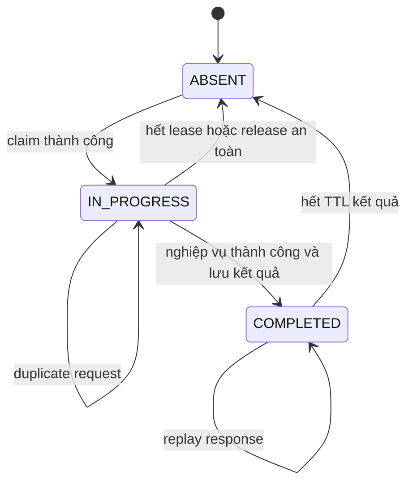
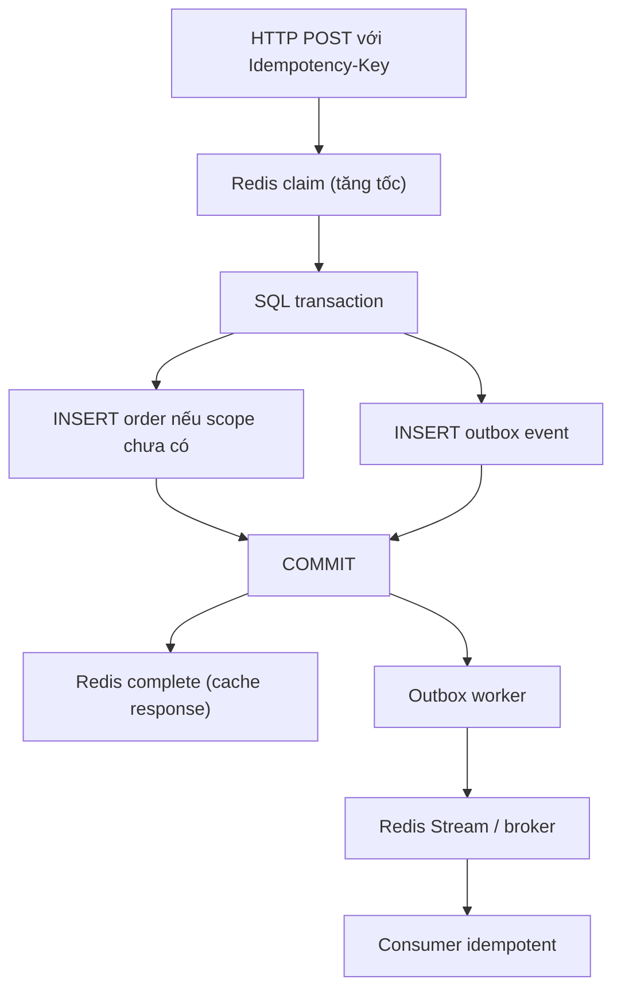

# Chống xử lý trùng bằng khóa lũy đẳng có TTL trong Spring Data Redis

## 1. Bài toán thực hành: vì sao một yêu cầu có thể đến nhiều lần?

Giả sử người dùng nhấn **Đặt hàng**. Ứng dụng Spring Boot nhận HTTP `POST /api/orders`, ghi đơn hàng vào database rồi trả `201 Created`. Ngay sau khi database đã commit, kết nối mạng bị ngắt. Client không nhận được phản hồi nên gửi lại request.

```text
Client                  Spring Boot                  Database
  | POST order #1           |                          |
  |------------------------>| INSERT order              |
  |                         |------------------------->|
  |                         |<------------------- COMMIT|
  |      X (mất response)   |                          |
  |                         |                          |
  | POST order #1 lần nữa   |                          |
  |------------------------>| INSERT order lần nữa?     |
  |                         |------------------------->|
```

Nếu mỗi lần nhận POST đều tạo đơn hàng mới, người dùng có thể bị tạo hai đơn, giữ hàng hai lần hoặc tính phí hai lần. Đây không nhất thiết là lỗi của client: retry là hành vi phổ biến khi gặp timeout, mất kết nối hoặc HTTP 5xx.

Một nguyên nhân khác là **hai request đồng thời**, chẳng hạn người dùng nhấn nút hai lần, gateway tự retry, hoặc hai worker nhận cùng event. Một process Spring Boot đơn lẻ có thể tránh trùng trong bộ nhớ, nhưng khi chạy nhiều pod/instance, các process phải chia sẻ cơ chế phối hợp.

**Idempotency** (tính lũy đẳng) là khả năng xử lý việc gửi lại **cùng một thao tác logic** mà không gây thêm tác động nghiệp vụ ngoài lần đầu. Đối với API tạo tài nguyên, client thường gửi một **`Idempotency-Key`** đại diện cho ý định thực hiện thao tác đó.

Redis được dùng làm bộ nhớ trạng thái nhanh:

- Request đầu tiên có thể **chiếm quyền xử lý** cho key.
- Request trùng trong lúc xử lý nhận trạng thái **đang xử lý**, thay vì khởi động công việc thứ hai.
- Request trùng sau khi hoàn tất được **trả lại kết quả đã lưu** hoặc tham chiếu tới kết quả nghiệp vụ.
- **TTL** tự dọn những key đã quá cửa sổ retry, giúp không giữ vô hạn dữ liệu.
- Redis command hoặc Lua script nguyên tử giúp nhiều instance không đồng thời giành cùng một key.

Tuy nhiên, **Redis key có TTL không tự bảo đảm exactly-once cho thanh toán hoặc thao tác với hệ thống ngoài**. Bài thực hành này tách rõ cơ chế dedup nhanh trong Redis và ràng buộc nghiệp vụ bền vững ở nguồn dữ liệu chính.

### Mục tiêu sau bài học

Bạn có thể:

1. Phân biệt request ID, idempotency key, khóa phân tán, rate limiting và TTL.
2. Thiết kế key theo user/tenant/endpoint, gắn **request fingerprint** để không dùng lại key cho nội dung khác.
3. Hiểu giới hạn của `SET key value NX EX` và nâng cấp thành trạng thái `IN_PROGRESS` / `COMPLETED`.
4. Dùng Lua script để claim, hoàn tất, đọc lại phản hồi và chỉ giải phóng khi đúng owner.
5. Gọi script từ `StringRedisTemplate` trong Spring Data Redis.
6. Kết hợp một **unique constraint ở database** để bảo vệ tác động nghiệp vụ khi Redis hết TTL hoặc gặp failover.
7. Xử lý timeout, retry, crash, lease hết hạn, concurrent requests và xóa dữ liệu theo TTL.
8. Xây dựng integration test và giám sát các chỉ số idempotency trong môi trường nhiều instance.

---

## 2. Khái niệm cơ bản

### 2.1. Một request logic khác với một HTTP attempt

Một **logical request** là một ý định nghiệp vụ: “tạo đơn cho giỏ hàng này”. Một ý định có thể được gửi bằng nhiều **HTTP attempts**.

```text
Ý định nghiệp vụ: Tạo Order A
  ├── Attempt 1: timeout ở client
  ├── Attempt 2: retry sau 2 giây
  └── Attempt 3: retry từ gateway

Cả ba gửi cùng Idempotency-Key
=> Chỉ được tạo một Order A theo hợp đồng đã thỏa thuận.
```

Ngược lại, một người dùng cố ý đặt hai đơn khác nhau phải sử dụng hai khóa khác nhau; không nên dedup mọi `POST /api/orders` chỉ vì body giống nhau.

### 2.2. Idempotency-Key

Client tạo một key khó đoán cho **một ý định nghiệp vụ** và tái sử dụng key đó cho các lần retry cùng ý định:

```http
POST /api/orders HTTP/1.1
Content-Type: application/json
Idempotency-Key: d44fdf6b-6983-4c3b-93b4-aee58fca482a

{"sku":"BOOK-100","quantity":2}
```

Khóa không phải bearer token để xác thực. Server vẫn phải xác minh danh tính, quyền và trạng thái tài khoản. Khóa chỉ giúp nhận biết những lần gửi lại cùng thao tác.

### 2.3. TTL của khóa lũy đẳng

TTL giúp Redis tự loại bỏ trạng thái sau một khoảng thời gian:

```redis
SET idem:v1:sample processing NX EX 120
```

Lệnh trên chỉ tạo key khi chưa tồn tại (`NX`) và đặt hạn 120 giây (`EX`) trong **một command nguyên tử**.

Nhưng TTL trả lời câu hỏi **“Redis giữ dấu vết bao lâu?”**, không phải câu hỏi **“hệ thống vĩnh viễn không bao giờ tạo trùng?”**. Khi TTL hết, một request cũ có thể được xem như mới nếu không có ràng buộc bền vững khác.

### 2.4. Khóa lũy đẳng không phải rate limiter

| Cơ chế | Câu hỏi | Ví dụ |
|---|---|---|
| Idempotency | Yêu cầu này có phải lần gửi lại cùng thao tác không? | Một order chỉ tạo một lần |
| Rate limiter | Chủ thể này được gửi bao nhiêu thao tác trong thời gian nhất định? | 60 request/phút |
| Distributed lock | Worker nào được truy cập tài nguyên trong lúc này? | Một worker cập nhật báo cáo |
| Unique constraint | Có thể tồn tại hai bản ghi có cùng định danh nghiệp vụ không? | Một order cho một scope key |
| TTL | Dữ liệu/trạng thái được giữ tới khi nào? | Lưu kết quả replay 24 giờ |

Các cơ chế có thể kết hợp, nhưng không thay thế nhau.

---

## 3. Mô hình trạng thái cho một idempotency key

Dùng ba tình huống chính:



Ý nghĩa:

| Trạng thái | Ý nghĩa | Hành vi request cùng key và cùng payload |
|---|---|---|
| `ABSENT` | Redis chưa có key hoặc key đã hết hạn | Thử claim và bắt đầu xử lý |
| `IN_PROGRESS` | Một request đã nhận quyền xử lý | Không tự chạy lại; báo đang xử lý |
| `COMPLETED` | Đã có kết quả của request trước | Replay kết quả đã lưu |
| `CONFLICT` (kết quả so sánh) | Key đã tồn tại nhưng payload khác | Trả lỗi, không chạy nghiệp vụ |

`CONFLICT` không nhất thiết là trạng thái được lưu trong Redis; đó là **quyết định** khi thấy một key được sử dụng với request fingerprint khác.

### 3.1. Hai giai đoạn TTL

Thiết kế thực hành dùng:

- **Processing lease TTL:** ví dụ 120 giây khi `IN_PROGRESS`. Bảo vệ khỏi key kẹt vĩnh viễn nếu worker chết.
- **Result retention TTL:** ví dụ 24 giờ khi `COMPLETED`. Cho phép client retry và nhận lại kết quả trong cửa sổ đã công bố.

```text
T0          T1                 T2                        T3
|-----------|------------------|-------------------------|
claim       nghiệp vụ thành công                         TTL kết quả hết
            và complete

Lease IN_PROGRESS: chỉ dùng trong giai đoạn xử lý
Retention COMPLETED: bắt đầu khi complete thành công
```

Không nhất thiết cả hai TTL giống nhau. Một thời gian xử lý tối đa 2 phút không có nghĩa client chỉ được retry trong 2 phút.

### 3.2. Lựa chọn HTTP response

Một hợp đồng API có thể chọn:

| Tình huống | HTTP mẫu | Ý nghĩa |
|---|---|---|
| Request đầu đã thành công | `201 Created` | Đã tạo tài nguyên |
| Retry sau thành công | Replay `201` và body cũ | Không tạo tài nguyên mới |
| Request trùng đang xử lý | `409 Conflict` với `Retry-After`, hoặc `202 Accepted` theo hợp đồng | Chưa có kết quả cuối để replay |
| Cùng key, payload khác | `409 Conflict` | Key không được tái sử dụng cho ý định khác |
| Thiếu key ở endpoint bắt buộc | `400 Bad Request` | Client cần gửi key hợp lệ |
| Redis không khả dụng | `503 Service Unavailable` hoặc fallback bền vững được thiết kế | Không mặc định bỏ qua cơ chế chống trùng |

`202` hay `409` cho request đang chạy là một **quyết định API**. Ví dụ trong bài dùng `409` cùng `Retry-After`; một API async có endpoint theo dõi job có thể dùng `202`.

---

## 4. Vì sao “SET NX EX rồi DEL” chưa đủ cho mọi nghiệp vụ?

Phiên bản tối giản:

```redis
SET idem:v1:order:<key> 1 NX EX 60
```

Nếu Redis trả `OK`, request được phép đi tiếp. Nếu trả nil, key đã tồn tại.

Ví dụ Spring Data Redis:

```java
Boolean first = redis.opsForValue().setIfAbsent(
        redisKey,
        "1",
        Duration.ofSeconds(60)
);

if (Boolean.TRUE.equals(first)) {
    // Chạy nghiệp vụ.
} else {
    // Từ chối hoặc đợi; không chạy nghiệp vụ lần hai.
}
```

### Ưu điểm

- `SET NX EX` là một thao tác nguyên tử.
- Dễ triển khai.
- TTL tự dọn key cũ.
- Nhiều instance cùng gọi vẫn chỉ một caller thắng claim trên Redis primary tương ứng.

### Hạn chế 1 — Không trả lại kết quả của request đầu

Nếu client mất phản hồi `201` rồi retry, Redis chỉ nói “key tồn tại”. Client không biết order ID nào đã được tạo.

### Hạn chế 2 — Không phân biệt đang chạy với đã hoàn tất

Một key giá trị `"1"` không nói request đang thực thi hay đã xử lý xong.

### Hạn chế 3 — TTL có thể hết khi xử lý chưa xong

```text
T0: Request A SET NX EX 60 -> OK, bắt đầu xử lý 90 giây.
T60: Key hết TTL.
T61: Request B SET NX EX 60 -> OK.
T62: A và B cùng đang thực hiện side effect.
```

TTL không đóng vai trò fencing token tại database hoặc cổng thanh toán.

### Hạn chế 4 — Xóa khóa sai thời điểm gây duplicate

Nếu gọi `DEL` ngay sau khi nghiệp vụ thành công, client retry sẽ không thấy dấu vết và có thể tạo order mới. Với API cần replay, **khi thành công phải giữ trạng thái COMPLETED trong cửa sổ retry**, không xóa lập tức.

### Hạn chế 5 — Redis có thể mất state sau failover

Replication Redis thông thường bất đồng bộ. Một key đã được primary xác nhận có thể chưa tới replica khi failover. Nếu key mất, request lặp có thể được claim lại.

**Kết luận:** `SET NX EX` thích hợp cho **dedup best-effort trong một khoảng ngắn**. Với API cần lưu kết quả và phân biệt request trùng, nên có state machine; với nghiệp vụ không được tạo trùng, cần thêm bảo vệ bền vững.

---

## 5. Xác định phạm vi một idempotency key

Không nên sử dụng trực tiếp:

```text
idem:<client-supplied-key>
```

vì hai người dùng khác nhau có thể vô tình hoặc cố ý gửi cùng một khóa. Một request cần có **scope**:

```text
tenant + authenticated user/client + HTTP method + resource/action + client key
```

Ví dụ một scope logic:

```text
tenant=t-12
subject=user-93
operation=POST /api/orders
idempotencyKey=d44fdf6b-6983-4c3b-93b4-aee58fca482a
```

Ta có thể tạo một hash của scope rồi đặt key Redis:

```text
idem:v1:{<scope-digest>}
```

Dấu ngoặc nhọn dùng hash tag Redis Cluster. Với **một key mỗi script** như bài này, hash tag không bắt buộc; khi mở rộng sang nhiều key liên quan một scope, quy tắc hash slot sẽ quan trọng.

### 5.1. Không dùng identity do client tự khai

Không lấy `X-User-Id` hoặc `X-Tenant-Id` chưa xác thực làm scope. Lấy danh tính từ Spring Security principal/JWT đã được kiểm tra, hoặc từ API key đã được xác minh. Với tenant, kiểm tra người dùng thật sự thuộc tenant đó.

### 5.2. Kiểm tra format và entropy của client key

Ví dụ yêu cầu client gửi UUID hoặc chuỗi ngẫu nhiên đủ mạnh:

```text
Độ dài cho phép: 16–128 ký tự
Ký tự cho phép: chữ, số, dấu chấm, gạch dưới, gạch ngang
Khuyến nghị: UUID ngẫu nhiên mới cho mỗi ý định nghiệp vụ
```

Không dùng timestamp giây hoặc ID tăng liên tục dễ đoán nếu hệ thống khác có thể dựa vào tính khó đoán của key. Tuy vậy, **idempotency key không phải credential**, nên không lấy entropy của nó làm lớp bảo vệ authorization.

### 5.3. Không ghi raw key vào logs

Một idempotency key có thể chứa identifier của người dùng, và trạng thái request có thể chứa response cá nhân. Nên log theo request trace ID đã kiểm soát và action/outcome, không log nguyên header hoặc payload nhạy cảm.

### 5.4. Request fingerprint

**Cùng key nhưng khác request** phải được từ chối.

Ví dụ:

```http
Idempotency-Key: d44fdf6b-6983-4c3b-93b4-aee58fca482a

{"sku":"BOOK-100","quantity":2}
```

Sau đó client gửi lại cùng key:

```http
Idempotency-Key: d44fdf6b-6983-4c3b-93b4-aee58fca482a

{"sku":"BOOK-100","quantity":5}
```

Đây không còn là retry của cùng thao tác. Server phải trả `409 Conflict` thay vì replay một kết quả không khớp hoặc tạo đơn mới.

Request fingerprint thường được tạo từ **phương thức, endpoint, phiên bản contract và các trường nghiệp vụ có ý nghĩa** sau khi canonicalize:

\[
fingerprint =
SHA256(method \Vert route \Vert version \Vert canonicalBusinessPayload)
\]

Không nhất thiết hash nguyên JSON raw theo byte: hai JSON có cùng nội dung nhưng khác thứ tự field có thể được xem là cùng yêu cầu nếu API định nghĩa canonicalization như vậy.

---

## 6. Chọn Redis Hash để lưu trạng thái

Với một key, lưu các field:

```text
Redis key:
  idem:v1:{8e6c...scope-hash...}

Type: HASH

state         = IN_PROGRESS
fingerprint   = 0baf...sha256-of-canonical-request...
owner         = 0af6...uuid-worker-claim...
responseStatus
contentType
responseBody
TTL          = 120000 ms khi IN_PROGRESS
```

Khi hoàn tất:

```text
state          = COMPLETED
fingerprint    = ...
owner          = ...
responseStatus = 201
contentType    = application/json
responseBody   = {"orderId":"...","status":"CREATED"}
TTL            = 86400000 ms
```

**Owner token** là một chuỗi UUID mới cho **mỗi lần claim**. Nó giúp script chỉ cho phép request đã claim hiện tại ghi kết quả hoặc release khóa.

Không dùng client-supplied idempotency key làm owner token vì các request retry đều có cùng key. Owner phải được server tạo riêng cho từng lần thực thi.

### Vì sao Hash thay vì String?

Một hash cho phép lưu trạng thái, fingerprint, owner và kết quả trong **cùng một Redis key**. Lua script có thể kiểm tra nhiều field và cập nhật chúng nguyên tử. TTL vẫn áp dụng cho **cả key**, không phải từng field.

Đối với phản hồi lớn, không nên lưu nguyên body trong Redis Hash. Có thể chỉ lưu order ID và mã trạng thái rồi tái dựng response từ database; phần thực hành giữ response ngắn để dễ theo dõi.

---

## 7. Cấu trúc dự án thực hành

Một ứng dụng Spring Boot mô phỏng:

```text
src/main/
├── java/com/example/idempotency/
│   ├── IdempotencyScriptConfig.java
│   ├── RedisIdempotencyStore.java
│   ├── IdempotencyKeyFactory.java
│   ├── OrdersController.java
│   └── OrderWriter.java
└── resources/
    ├── application.yml
    └── redis/
        ├── idem-claim.lua
        ├── idem-complete.lua
        └── idem-release.lua
```

Ba script là:

- `idem-claim.lua`: atomically claim hoặc trả quyết định đang xử lý, xung đột, đã hoàn tất.
- `idem-complete.lua`: chỉ owner hiện tại có thể ghi response và đổi TTL kết quả.
- `idem-release.lua`: chỉ xóa claim chưa hoàn tất khi **đã chứng minh chưa có side effect**.

Những đường dẫn này là cấu trúc **ví dụ của ứng dụng**; trong lượt viết bài này không cần tạo các file code riêng.

### 7.1. Dependency Gradle

```kotlin
dependencies {
    implementation("org.springframework.boot:spring-boot-starter-web")
    implementation("org.springframework.boot:spring-boot-starter-data-redis")

    // Nguồn chuẩn trong ví dụ dùng PostgreSQL/JdbcTemplate.
    implementation("org.springframework.boot:spring-boot-starter-jdbc")
    runtimeOnly("org.postgresql:postgresql")

    testImplementation("org.springframework.boot:spring-boot-starter-test")
    testImplementation("org.testcontainers:junit-jupiter")
    testImplementation("org.testcontainers:testcontainers")
}
```

Dự án cần dependency management/BOM và Java version phù hợp Spring Boot đang dùng. Ví dụ Java phía dưới dùng `record` và text block, phù hợp với Java 17 trở lên.

### 7.2. Cấu hình kết nối Redis

```yaml
spring:
  data:
    redis:
      host: localhost
      port: 6379
      connect-timeout: 1s
      timeout: 2s
```

Đây là cấu hình minh họa Redis standalone local. Production cần authentication, TLS, topology Sentinel/Cluster hoặc managed Redis, timeout và capacity phù hợp.

**Lưu ý:** Redis `timeout: 2s` ở driver không đồng nghĩa với processing lease 120 giây. Một cái là **giới hạn chờ phản hồi lệnh**; cái kia là **thời gian giữ quyền xử lý logic**.

---

## 8. Lua script thứ nhất: claim nguyên tử

Đặt ở `src/main/resources/redis/idem-claim.lua`.

Đầu vào:

- `KEYS[1]`: idempotency Redis key.
- `ARGV[1]`: request fingerprint.
- `ARGV[2]`: owner token của attempt hiện tại.
- `ARGV[3]`: processing lease tính bằng milliseconds.

Đầu ra là một bảng với phần tử đầu tiên là quyết định:

- `ACQUIRED`.
- `IN_PROGRESS` kèm TTL còn lại.
- `COMPLETED` kèm response đã lưu.
- `CONFLICT` nếu fingerprint khác.

```lua
-- redis/idem-claim.lua

local key = KEYS[1]
local fingerprint = ARGV[1]
local owner = ARGV[2]
local leaseMs = tonumber(ARGV[3])

if not fingerprint or fingerprint == ''
        or not owner or owner == ''
        or not leaseMs or leaseMs <= 0 then
    return redis.error_reply('invalid idempotency claim arguments')
end

-- Toàn bộ check/ghi nằm trong một script: không có
-- request khác chen vào giữa EXISTS và HSET/PEXPIRE.
if redis.call('EXISTS', key) == 0 then
    redis.call(
        'HSET', key,
        'state', 'IN_PROGRESS',
        'fingerprint', fingerprint,
        'owner', owner
    )

    redis.call('PEXPIRE', key, leaseMs)

    return {'ACQUIRED'}
end

local oldFingerprint =
        redis.call('HGET', key, 'fingerprint')

if oldFingerprint ~= fingerprint then
    return {'CONFLICT'}
end

local state = redis.call('HGET', key, 'state')

if state == 'COMPLETED' then
    -- Lấy kết quả ngay trong script; tránh race giữa
    -- việc kiểm tra trạng thái và một HGET bên ngoài.
    return {
        'COMPLETED',
        redis.call('HGET', key, 'responseStatus') or '',
        redis.call('HGET', key, 'contentType') or '',
        redis.call('HGET', key, 'responseBody') or ''
    }
end

if state == 'IN_PROGRESS' then
    local remainingMs = redis.call('PTTL', key)
    return {'IN_PROGRESS', tostring(remainingMs)}
end

return redis.error_reply('unknown idempotency state')
```

### 8.1. Vì sao phải cùng một Lua script?

Cách không an toàn:

```text
Request A: EXISTS key -> false
Request B: EXISTS key -> false
Request A: HSET...
Request B: HSET...
=> Cả A và B đều tưởng mình có quyền.
```

Trong Redis script, kiểm tra tồn tại và đặt trạng thái diễn ra như một thao tác nguyên tử ở Redis server. Chỉ một attempt chiếm được key ban đầu.

### 8.2. Vì sao không gia hạn TTL cho request bị trùng?

Script **không** kéo dài lease khi nhận `IN_PROGRESS`. Nếu mỗi retry tự gia hạn TTL, một client liên tục gửi lại có thể khiến trạng thái kẹt không hết hạn.

Chỉ worker đang sở hữu claim, nếu thực sự cần, mới được phép gia hạn qua cơ chế riêng kiểm tra owner và điều kiện xử lý. Phần sau sẽ giải thích vì sao lease extension vẫn không tạo bảo đảm exactly-once.

### 8.3. Vì sao trả response trong cùng script?

Nếu claim script chỉ trả `COMPLETED` rồi Java mới `HGETALL`, key có thể hết TTL giữa hai lệnh. Trả snapshot của response ngay trong script giảm một race condition không cần thiết.

Nếu response đã lưu rất lớn, trả nó trong script cũng tốn network và memory. Khi đó nên lưu một reference tới kết quả bền vững ở database thay vì chứa một response lớn trong Redis.

---

## 9. Lua script thứ hai: chỉ owner được hoàn tất

Đặt ở `src/main/resources/redis/idem-complete.lua`.

Đầu vào:

- `KEYS[1]`: Redis key.
- `ARGV[1]`: owner token đã claim.
- `ARGV[2]`: HTTP status được lưu.
- `ARGV[3]`: content type an toàn, ví dụ `application/json`.
- `ARGV[4]`: response body ngắn.
- `ARGV[5]`: result retention TTL milliseconds.

Trả `1` nếu lưu thành công, `0` nếu key không còn, owner khác hoặc trạng thái không hợp lệ.

```lua
-- redis/idem-complete.lua

local key = KEYS[1]
local owner = ARGV[1]
local status = ARGV[2]
local contentType = ARGV[3]
local responseBody = ARGV[4]
local retentionMs = tonumber(ARGV[5])

if not owner or owner == ''
        or not status or status == ''
        or not contentType or contentType == ''
        or not responseBody
        or not retentionMs or retentionMs <= 0 then
    return redis.error_reply('invalid idempotency completion arguments')
end

if redis.call('EXISTS', key) == 0 then
    return 0
end

if redis.call('HGET', key, 'state') ~= 'IN_PROGRESS' then
    return 0
end

if redis.call('HGET', key, 'owner') ~= owner then
    return 0
end

redis.call(
    'HSET', key,
    'state', 'COMPLETED',
    'responseStatus', status,
    'contentType', contentType,
    'responseBody', responseBody
)

redis.call('PEXPIRE', key, retentionMs)

return 1
```

### 9.1. Owner check bảo vệ điều gì?

Tình huống:

```text
T0   A claim owner=A, TTL=120s.
T120 Key hết hạn trước khi A hoàn tất.
T121 B claim owner=B.
T122 A cố ghi COMPLETED bằng owner=A.
```

Script không cho A ghi đè state của B vì owner không khớp.

Nhưng **đây chỉ bảo vệ Redis state**. Nếu A đã gửi yêu cầu tạo order tới database hoặc payment provider, owner check ở Redis không thể thu hồi side effect đó. Muốn bảo vệ tác động nghiệp vụ, phải có unique constraint, fencing hoặc idempotency ở hệ thống thực sự thực hiện side effect.

### 9.2. TTL sau khi hoàn tất

Khi script cập nhật `COMPLETED`, nó đặt **retention TTL mới**. Ví dụ kết quả tồn tại 24 giờ kể từ lúc hoàn tất, đủ để replay theo hợp đồng API.

Khi TTL kết quả hết, Redis không còn nhớ request cũ. Bởi vậy thời gian giữ response phải được công bố và phù hợp với **cửa sổ retry thực tế** của client/gateway. Nếu nghiệp vụ không cho phép tạo trùng sau TTL, phải còn lớp bền vững ở database.

---

## 10. Lua script thứ ba: chỉ release khi chắc chắn an toàn

Đặt ở `src/main/resources/redis/idem-release.lua`.

```lua
-- redis/idem-release.lua

local key = KEYS[1]
local owner = ARGV[1]

if redis.call('EXISTS', key) == 0 then
    return 0
end

if redis.call('HGET', key, 'state') ~= 'IN_PROGRESS' then
    return 0
end

if redis.call('HGET', key, 'owner') ~= owner then
    return 0
end

return redis.call('DEL', key)
```

**Chỉ gọi release khi có bằng chứng chắc chắn chưa có tác động nghiệp vụ**, ví dụ validation thất bại **trước** khi gửi bất kỳ write nào tới database hoặc service ngoài.

Không dùng:

```java
try {
    createOrder();
} finally {
    redis.delete(idempotencyKey);
}
```

Cách trên vừa xóa dấu vết sau thành công, vừa có thể làm retry tạo thêm một đơn mới.

### Khi timeout không rõ kết quả

Nếu database commit thành công nhưng Spring Boot timeout ngay sau đó, **không thể khẳng định request chưa có side effect**. Khi trạng thái không chắc chắn:

- Không tự xóa claim để cho request khác chạy ngay.
- Ghi nhận tình huống cần đối soát.
- Nếu có nguồn bền vững chứa idempotency scope, đọc lại kết quả từ đó.
- Khi lease hết, một retry có thể claim lại, nhưng lớp database phải vẫn chặn duplicate.
- Không coi việc chờ TTL hết là giải pháp bảo đảm exactly-once cho payment.

---

## 11. Nạp Lua scripts vào Spring Data Redis

`RedisTemplate.execute(RedisScript, keys, args)` thực thi script trên Redis. Dùng `DefaultRedisScript` làm bean để không phải xây dựng script mới cho mỗi request.

**`IdempotencyScriptConfig.java`**

```java
package com.example.idempotency;

import java.util.List;

import org.springframework.context.annotation.Bean;
import org.springframework.context.annotation.Configuration;
import org.springframework.core.io.ClassPathResource;
import org.springframework.data.redis.core.script.DefaultRedisScript;
import org.springframework.data.redis.core.script.RedisScript;

@Configuration
public class IdempotencyScriptConfig {

    @Bean("claimIdempotencyScript")
    RedisScript<List> claimScript() {
        DefaultRedisScript<List> script =
                new DefaultRedisScript<>();

        script.setLocation(
                new ClassPathResource("redis/idem-claim.lua")
        );
        script.setResultType(List.class);

        return script;
    }

    @Bean("completeIdempotencyScript")
    RedisScript<Long> completeScript() {
        DefaultRedisScript<Long> script =
                new DefaultRedisScript<>();

        script.setLocation(
                new ClassPathResource("redis/idem-complete.lua")
        );
        script.setResultType(Long.class);

        return script;
    }

    @Bean("releaseIdempotencyScript")
    RedisScript<Long> releaseScript() {
        DefaultRedisScript<Long> script =
                new DefaultRedisScript<>();

        script.setLocation(
                new ClassPathResource("redis/idem-release.lua")
        );
        script.setResultType(Long.class);

        return script;
    }
}
```

`DefaultRedisScript` quản lý nội dung/checksum script theo cơ chế của Spring Data Redis, thường sử dụng đường thực thi script phù hợp với Redis server và driver.

Dùng `StringRedisTemplate` để key và args là String. Script claim trả **mảng giá trị**, nên `resultType = List.class`; complete/release trả số nguyên, nên `Long.class`.

### Lưu ý về serializer của MULTI result

Tùy Spring Data Redis version và result serializer, phần tử bảng Lua có thể được deserialize thành `String` hoặc vẫn là `byte[]`. Adapter dưới đây chuyển cả hai dạng về chuỗi để minh họa cách xử lý ổn định.

---

## 12. Java adapter: RedisIdempotencyStore

Bắt đầu bằng mô hình kết quả:

**`IdempotencyDecision.java`**

```java
package com.example.idempotency;

import java.time.Duration;

public record IdempotencyDecision(
        Kind kind,
        CachedResponse cachedResponse,
        Duration retryAfter
) {
    public enum Kind {
        ACQUIRED,
        IN_PROGRESS,
        COMPLETED,
        CONFLICT
    }

    public record CachedResponse(
            int status,
            String contentType,
            String body
    ) {
    }
}
```

Adapter Redis:

**`RedisIdempotencyStore.java`**

```java
package com.example.idempotency;

import java.nio.charset.StandardCharsets;
import java.time.Duration;
import java.util.List;

import org.springframework.beans.factory.annotation.Qualifier;
import org.springframework.data.redis.core.StringRedisTemplate;
import org.springframework.data.redis.core.script.RedisScript;
import org.springframework.stereotype.Component;

@Component
public class RedisIdempotencyStore {

    private final StringRedisTemplate redis;
    private final RedisScript<List> claimScript;
    private final RedisScript<Long> completeScript;
    private final RedisScript<Long> releaseScript;

    public RedisIdempotencyStore(
            StringRedisTemplate redis,
            @Qualifier("claimIdempotencyScript")
            RedisScript<List> claimScript,
            @Qualifier("completeIdempotencyScript")
            RedisScript<Long> completeScript,
            @Qualifier("releaseIdempotencyScript")
            RedisScript<Long> releaseScript
    ) {
        this.redis = redis;
        this.claimScript = claimScript;
        this.completeScript = completeScript;
        this.releaseScript = releaseScript;
    }

    public IdempotencyDecision begin(
            String key,
            String fingerprint,
            String owner,
            Duration processingLease
    ) {
        long leaseMs = positiveMillis(processingLease);

        List<?> result = redis.execute(
                claimScript,
                List.of(key),
                fingerprint,
                owner,
                Long.toString(leaseMs)
        );

        if (result == null || result.isEmpty()) {
            throw new IllegalStateException(
                    "Invalid Redis claim response"
            );
        }

        String kind = asText(result.get(0));

        return switch (kind) {
            case "ACQUIRED" ->
                    new IdempotencyDecision(
                            IdempotencyDecision.Kind.ACQUIRED,
                            null,
                            Duration.ZERO
                    );

            case "CONFLICT" ->
                    new IdempotencyDecision(
                            IdempotencyDecision.Kind.CONFLICT,
                            null,
                            Duration.ZERO
                    );

            case "IN_PROGRESS" -> {
                if (result.size() != 2) {
                    throw new IllegalStateException(
                            "Invalid in-progress response"
                    );
                }

                long remainingMs =
                        Long.parseLong(asText(result.get(1)));

                yield new IdempotencyDecision(
                        IdempotencyDecision.Kind.IN_PROGRESS,
                        null,
                        Duration.ofMillis(
                                Math.max(0, remainingMs)
                        )
                );
            }

            case "COMPLETED" -> {
                if (result.size() != 4) {
                    throw new IllegalStateException(
                            "Invalid completed response"
                    );
                }

                var cached =
                        new IdempotencyDecision.CachedResponse(
                                Integer.parseInt(
                                        asText(result.get(1))
                                ),
                                asText(result.get(2)),
                                asText(result.get(3))
                        );

                yield new IdempotencyDecision(
                        IdempotencyDecision.Kind.COMPLETED,
                        cached,
                        Duration.ZERO
                );
            }

            default -> throw new IllegalStateException(
                    "Unknown Redis decision: " + kind
            );
        };
    }

    public boolean complete(
            String key,
            String owner,
            int status,
            String contentType,
            String responseBody,
            Duration resultRetention
    ) {
        long ttlMs = positiveMillis(resultRetention);

        if (status < 100 || status > 599) {
            throw new IllegalArgumentException(
                    "Invalid HTTP response status"
            );
        }

        Long saved = redis.execute(
                completeScript,
                List.of(key),
                owner,
                Integer.toString(status),
                contentType,
                responseBody,
                Long.toString(ttlMs)
        );

        return Long.valueOf(1L).equals(saved);
    }

    public boolean releaseIfOwnedAndSafe(
            String key,
            String owner
    ) {
        Long deleted = redis.execute(
                releaseScript,
                List.of(key),
                owner
        );

        return Long.valueOf(1L).equals(deleted);
    }

    private static long positiveMillis(Duration duration) {
        if (duration == null
                || duration.isZero()
                || duration.isNegative()) {
            throw new IllegalArgumentException(
                    "TTL must be positive"
            );
        }

        long millis = duration.toMillis();

        if (millis <= 0) {
            throw new IllegalArgumentException(
                    "TTL too small for millisecond resolution"
            );
        }

        return millis;
    }

    private static String asText(Object value) {
        if (value instanceof String s) {
            return s;
        }

        if (value instanceof byte[] bytes) {
            return new String(bytes, StandardCharsets.UTF_8);
        }

        throw new IllegalStateException(
                "Unexpected Redis response value: " +
                        (value == null
                                ? "null"
                                : value.getClass().getName())
        );
    }
}
```

### Adapter đang bảo đảm điều gì?

- Claim và trạng thái bên Redis được thao tác atomically qua Lua.
- Có fingerprint để phát hiện key bị dùng với payload khác.
- Chỉ owner đã claim có thể hoàn tất hoặc release.
- Completed response có TTL riêng.
- Java không phải gửi `EXISTS`/`HSET`/`PEXPIRE` thành các round trip riêng.

### Adapter chưa bảo đảm điều gì?

- Redis không mất key khi primary crash/failover.
- Một worker không tiếp tục xử lý DB sau khi lease đã hết.
- External payment provider chỉ thu tiền đúng một lần.
- Response sau `complete` luôn đến được client.
- Một key không bao giờ được tái sử dụng sau khi TTL kết quả hết.
- Mọi lỗi Redis/driver đều được phản hồi đúng HTTP nếu chưa có exception mapping.

Đó là trách nhiệm của **lớp nghiệp vụ bền vững**, chính sách API và vận hành.

---

## 13. Thiết kế scope digest và fingerprint

Để không lưu raw principal và raw client key trong Redis key, có thể dùng SHA-256 cho dữ liệu scope ở ví dụ. Với yêu cầu bảo vệ thông tin nhạy cảm cao hơn, cân nhắc HMAC với secret server-side.

**`IdempotencyKeyFactory.java`**

```java
package com.example.idempotency;

import java.nio.charset.StandardCharsets;
import java.security.MessageDigest;
import java.security.NoSuchAlgorithmException;
import java.util.HexFormat;

public final class IdempotencyKeyFactory {

    private IdempotencyKeyFactory() {
    }

    public static String scopeHash(
            String authenticatedSubject,
            String clientKey
    ) {
        requireClientKey(clientKey);

        // Route/method là hằng số do server kiểm soát.
        return sha256(
                "v1\nPOST\n/api/orders\n" +
                authenticatedSubject + "\n" +
                clientKey
        );
    }

    public static String redisKey(String scopeHash) {
        return "idem:v1:{" + scopeHash + "}";
    }

    public static String fingerprint(
            String sku,
            int quantity
    ) {
        if (sku == null
                || !sku.matches("[A-Z0-9-]{1,40}")
                || quantity <= 0
                || quantity > 1000) {
            throw new IllegalArgumentException(
                    "Invalid order request"
            );
        }

        // Canonical form rõ ràng cho DTO chỉ có hai field
        // và sku đã bị giới hạn ký tự.
        return sha256(
                "v1\nPOST\n/api/orders\n" +
                sku + "\n" +
                quantity
        );
    }

    public static void requireClientKey(String clientKey) {
        if (clientKey == null
                || !clientKey.matches(
                        "[A-Za-z0-9._-]{16,128}"
                )) {
            throw new IllegalArgumentException(
                    "Invalid Idempotency-Key"
            );
        }
    }

    private static String sha256(String input) {
        try {
            byte[] digest = MessageDigest
                    .getInstance("SHA-256")
                    .digest(
                            input.getBytes(StandardCharsets.UTF_8)
                    );

            return HexFormat.of().formatHex(digest);
        } catch (NoSuchAlgorithmException ex) {
            throw new IllegalStateException(
                    "SHA-256 unavailable",
                    ex
            );
        }
    }
}
```

### Vì sao cần cả scope hash và fingerprint?

- **Scope hash:** xác định một idempotency record, được ràng buộc với người dùng và client key.
- **Fingerprint:** xác minh các lần retry vẫn có cùng nội dung nghiệp vụ.

Nếu chỉ có scope hash mà không lưu fingerprint, một client vô tình tái sử dụng key cho số lượng hàng khác có thể nhận lại kết quả cũ mà không biết request bị từ chối.

### Khi hệ thống có nhiều tenant hoặc endpoint

Cần đưa **trusted tenant identity** vào scope, không chỉ principal name. Nếu nhiều API có thể nhận cùng key, cần quyết định scope theo endpoint hay toàn API; giá trị trong code mẫu đang cố định vào `POST /api/orders`.

Nếu request chứa map, array hoặc nhiều field tùy chọn, canonicalization phải được định nghĩa rõ (thứ tự, số thực, múi giờ, null/absent, chữ hoa-thường). Không dùng cách nối chuỗi đơn giản cho một payload tùy ý có thể chứa dấu phân cách gây nhập nhằng.

---

## 14. Chỉ Redis không đủ: bảo vệ đơn hàng bằng unique constraint

Bây giờ giả sử request A đã tạo order ở PostgreSQL, nhưng Redis bị mất state `IN_PROGRESS`/`COMPLETED` vì:

- Processing lease hết trước khi hoàn tất.
- Redis restart hoặc failover sang replica chưa nhận write.
- Redis hết memory/evict key.
- Result TTL đã hết và client retry cũ.
- `complete` bị timeout sau khi database đã commit.

Nếu không có lớp bảo vệ khác, request B có thể tạo order thứ hai.

Với demo **tạo order trong một database**, ta lưu `scopeHash` vào chính bản ghi order và đặt **unique constraint**.

### 14.1. Schema PostgreSQL minh họa

```sql
CREATE TABLE demo_orders (
    id UUID PRIMARY KEY,
    scope_hash VARCHAR(64) NOT NULL UNIQUE,
    request_hash VARCHAR(64) NOT NULL,
    user_ref VARCHAR(128) NOT NULL,
    sku VARCHAR(40) NOT NULL,
    quantity INTEGER NOT NULL CHECK (quantity > 0),
    status VARCHAR(32) NOT NULL,
    created_at TIMESTAMPTZ NOT NULL DEFAULT NOW()
);
```

Ý nghĩa:

- `scope_hash` là **định danh bền vững cho một logical request**.
- `UNIQUE(scope_hash)` khiến hai transaction không thể commit hai hàng order với cùng scope.
- `request_hash` giúp phát hiện cùng key nhưng payload khác **ngay cả khi Redis record đã hết TTL**.
- Record trong database giữ nguyên tắc chống trùng dài hơn Redis response cache.

**Lưu ý về retention:** nếu ứng dụng xóa order hoặc xóa `scope_hash` trước khi mọi retry cũ có thể xảy ra, bảo đảm bền vững cũng mất. Cần chính sách retention cho marker nghiệp vụ hoặc ledger idempotency phù hợp.

### 14.2. Vì sao dùng constraint ở đúng nơi có side effect?

Chỉ riêng Redis claim không ngăn hai worker đã sở hữu claim ở hai thời điểm khác nhau cùng ghi database. Unique constraint được database thực thi ở **điểm tạo tài nguyên**, nên vẫn bảo vệ bản ghi order khi Redis không còn trạng thái.

Nếu một request tạo nhiều bản ghi SQL, cần thực hiện side effect và idempotency marker trong **cùng transaction** để tránh commit một phần. Nếu gọi hệ thống ngoài như cổng thanh toán, unique constraint trong DB **không điều khiển được external side effect**; cần thêm idempotency ở provider và orchestration/outbox.

---

## 15. OrderWriter: ghi hoặc đọc lại đơn đã tồn tại

Ví dụ dùng Spring JDBC với PostgreSQL. `JdbcTemplate` và `@Transactional` cho phép lưu bản ghi order trong transaction SQL.

**`OrderWriter.java`**

```java
package com.example.idempotency;

import java.util.List;
import java.util.UUID;

import org.springframework.jdbc.core.JdbcTemplate;
import org.springframework.stereotype.Service;
import org.springframework.transaction.annotation.Transactional;

@Service
public class OrderWriter {

    public record CreateOrderRequest(
            String sku,
            int quantity
    ) {
    }

    public record OrderResponse(
            String orderId,
            String status
    ) {
    }

    public static final class RequestMismatchException
            extends RuntimeException {
        public RequestMismatchException() {
            super("Idempotency key already belongs to another payload");
        }
    }

    private record StoredOrder(
            UUID id,
            String requestHash,
            String status
    ) {
    }

    private final JdbcTemplate jdbc;

    public OrderWriter(JdbcTemplate jdbc) {
        this.jdbc = jdbc;
    }

    @Transactional
    public OrderResponse createOrGet(
            String subject,
            String scopeHash,
            String requestHash,
            CreateOrderRequest request
    ) {
        UUID proposedId = UUID.randomUUID();

        jdbc.update(
                """
                INSERT INTO demo_orders
                    (id, scope_hash, request_hash,
                     user_ref, sku, quantity, status)
                VALUES (?, ?, ?, ?, ?, ?, 'CREATED')
                ON CONFLICT (scope_hash) DO NOTHING
                """,
                proposedId,
                scopeHash,
                requestHash,
                subject,
                request.sku(),
                request.quantity()
        );

        List<StoredOrder> rows = jdbc.query(
                """
                SELECT id, request_hash, status
                FROM demo_orders
                WHERE scope_hash = ?
                """,
                (rs, rowNum) -> new StoredOrder(
                        rs.getObject("id", UUID.class),
                        rs.getString("request_hash"),
                        rs.getString("status")
                ),
                scopeHash
        );

        if (rows.size() != 1) {
            throw new IllegalStateException(
                    "Order idempotency row not visible"
            );
        }

        StoredOrder stored = rows.get(0);

        if (!stored.requestHash().equals(requestHash)) {
            throw new RequestMismatchException();
        }

        return new OrderResponse(
                stored.id().toString(),
                stored.status()
        );
    }
}
```

### 15.1. Hai request đồng thời vào DB

Với PostgreSQL và isolation thông dụng `READ COMMITTED`, `INSERT ... ON CONFLICT DO NOTHING` trên unique key có thể đợi transaction cạnh tranh quyết định commit/rollback. Sau đó câu `SELECT` ở **statement riêng** có thể thấy hàng đã commit.

Lớp này thể hiện một mô hình **insert-or-read** cho demo PostgreSQL. Nó không tự áp dụng nguyên xi cho mọi database hay isolation level; nếu dùng `SERIALIZABLE` hoặc có workflow phức tạp, cần thiết kế retry transaction và test cạnh tranh theo engine thực tế.

### 15.2. Điều gì được bảo vệ?

- Tối đa một order row có cùng `scope_hash`.
- Request retry cùng payload đọc lại order ID cũ.
- Request cùng key nhưng payload khác bị từ chối dựa trên `request_hash`, kể cả khi Redis đã quên record.
- Redis có thể tăng tốc dedup, nhưng database vẫn chặn duplicate order record.

### 15.3. Giới hạn của ví dụ

- Đây là demo tạo **một bản ghi order**; chưa có inventory reservation, payment, email, event, saga.
- Nếu gửi yêu cầu thanh toán tới provider trước khi transaction commit, có thể bị thu tiền dù transaction rollback; phải thiết kế riêng.
- Khi mở rộng nghiệp vụ, cần đưa những thay đổi SQL có thể commit cùng marker vào cùng transaction hoặc dùng outbox/saga/idempotent consumer.
- Trong hệ thống có dữ liệu nhạy cảm, cần policy bảo vệ `user_ref` và retention của idempotency marker.

---

## 16. HTTP Controller: xử lý request đầu và các lần retry

Controller nhận `Idempotency-Key` từ client. Ví dụ dùng API trả JSON ngắn và có một `Principal` đã được authentication layer xác minh.

**`OrdersController.java`**

```java
package com.example.idempotency;

import java.security.Principal;
import java.time.Duration;
import java.util.UUID;

import com.fasterxml.jackson.core.JsonProcessingException;
import com.fasterxml.jackson.databind.ObjectMapper;

import org.springframework.dao.DataAccessException;
import org.springframework.http.HttpHeaders;
import org.springframework.http.MediaType;
import org.springframework.http.ResponseEntity;
import org.springframework.http.HttpStatus;
import org.springframework.web.bind.annotation.*;
import org.springframework.web.server.ResponseStatusException;

@RestController
@RequestMapping("/api/orders")
public class OrdersController {

    private static final Duration PROCESSING_LEASE =
            Duration.ofMinutes(2);

    private static final Duration RESULT_RETENTION =
            Duration.ofHours(24);

    private final RedisIdempotencyStore gate;
    private final OrderWriter orders;
    private final ObjectMapper mapper;

    public OrdersController(
            RedisIdempotencyStore gate,
            OrderWriter orders,
            ObjectMapper mapper
    ) {
        this.gate = gate;
        this.orders = orders;
        this.mapper = mapper;
    }

    @PostMapping
    public ResponseEntity<String> create(
            @RequestHeader("Idempotency-Key") String clientKey,
            @RequestBody OrderWriter.CreateOrderRequest request,
            Principal principal
    ) {
        if (principal == null) {
            throw new ResponseStatusException(
                    HttpStatus.UNAUTHORIZED
            );
        }

        try {
            IdempotencyKeyFactory.requireClientKey(clientKey);

            // Validation và canonicalization có chủ đích
            // trước khi chiếm Redis key.
            String fingerprint =
                    IdempotencyKeyFactory.fingerprint(
                            request.sku(),
                            request.quantity()
                    );

            String subject = principal.getName();

            String scopeHash =
                    IdempotencyKeyFactory.scopeHash(
                            subject,
                            clientKey
                    );

            String redisKey =
                    IdempotencyKeyFactory.redisKey(scopeHash);

            String owner = UUID.randomUUID().toString();

            IdempotencyDecision decision = gate.begin(
                    redisKey,
                    fingerprint,
                    owner,
                    PROCESSING_LEASE
            );

            switch (decision.kind()) {
                case CONFLICT:
                    return ResponseEntity.status(409)
                            .cacheControl(
                                    org.springframework.http.CacheControl
                                            .noStore()
                            )
                            .body(
                                "{\"error\":\"IDEMPOTENCY_KEY_REUSED\"}"
                            );

                case IN_PROGRESS: {
                    long waitMs =
                            decision.retryAfter().toMillis();

                    long retrySeconds = Math.max(
                            1,
                            (waitMs + 999) / 1000
                    );

                    return ResponseEntity.status(409)
                            .header(
                                    HttpHeaders.RETRY_AFTER,
                                    Long.toString(retrySeconds)
                            )
                            .cacheControl(
                                    org.springframework.http.CacheControl
                                            .noStore()
                            )
                            .body(
                                "{\"error\":\"REQUEST_IN_PROGRESS\"}"
                            );
                }

                case COMPLETED: {
                    var previous = decision.cachedResponse();

                    return ResponseEntity
                            .status(previous.status())
                            .contentType(
                                    MediaType.parseMediaType(
                                            previous.contentType()
                                    )
                            )
                            .header("Idempotency-Replayed", "true")
                            .cacheControl(
                                    org.springframework.http.CacheControl
                                            .noStore()
                            )
                            .body(previous.body());
                }

                case ACQUIRED:
                    // Đi tiếp phía dưới.
                    break;
            }

            // Chính database unique constraint là lớp
            // bảo vệ bền vững khi Redis mất state.
            var order = orders.createOrGet(
                    subject,
                    scopeHash,
                    fingerprint,
                    request
            );

            String body = toJson(order);

            boolean completed = gate.complete(
                    redisKey,
                    owner,
                    201,
                    MediaType.APPLICATION_JSON_VALUE,
                    body,
                    RESULT_RETENTION
            );

            if (!completed) {
                // Không chắc lease còn thuộc owner hiện tại.
                // Không bịa ra kết quả Redis COMPLETED.
                // DB đã có idempotency marker, retry có thể
                // đọc lại order thay vì tạo mới.
                throw new ResponseStatusException(
                        HttpStatus.SERVICE_UNAVAILABLE,
                        "Idempotency completion not confirmed"
                );
            }

            return ResponseEntity.status(201)
                    .contentType(MediaType.APPLICATION_JSON)
                    .header("Idempotency-Replayed", "false")
                    .cacheControl(
                            org.springframework.http.CacheControl
                                    .noStore()
                    )
                    .body(body);

        } catch (IllegalArgumentException ex) {
            throw new ResponseStatusException(
                    HttpStatus.BAD_REQUEST,
                    "Invalid idempotency key or request"
            );
        } catch (OrderWriter.RequestMismatchException ex) {
            throw new ResponseStatusException(
                    HttpStatus.CONFLICT,
                    "Idempotency key used with different payload"
            );
        } catch (DataAccessException ex) {
            // Ở endpoint tạo order, fail-closed khi không
            // xác nhận được trạng thái Redis/DB.
            throw new ResponseStatusException(
                    HttpStatus.SERVICE_UNAVAILABLE,
                    "Request state unavailable"
            );
        }
    }

    private String toJson(Object body) {
        try {
            return mapper.writeValueAsString(body);
        } catch (JsonProcessingException ex) {
            throw new IllegalStateException(
                    "Cannot serialize response",
                    ex
            );
        }
    }
}
```

**Đây là mã thực hành mô tả luồng chính**, không phải API thanh toán sẵn sàng production. Nên có `@ControllerAdvice` chuẩn hóa error response và mapping các loại lỗi nghiệp vụ theo hợp đồng thực tế; ví dụ chưa đưa mọi validation/observability/security concern vào một controller.

### 16.1. Luồng request đầu tiên

```text
Client POST key=K, body=A
  |
  v
Tính scopeHash(K, principal) và fingerprint(A)
  |
  v
Redis claim -> ACQUIRED
  |
  v
PostgreSQL createOrGet(scopeHash, fingerprint, A)
  |
  v
SQL unique constraint giữ một order
  |
  v
Redis complete -> COMPLETED + response + TTL 24h
  |
  v
HTTP 201 + orderId
```

### 16.2. Retry khi request trước đã hoàn thành

```text
Client POST key=K, body=A lần nữa
  |
  v
Redis claim -> COMPLETED + response cũ
  |
  v
Không gọi OrderWriter
  |
  v
HTTP 201 + orderId cũ
Header Idempotency-Replayed: true
```

### 16.3. Retry trong lúc đang xử lý

```text
Client POST key=K, body=A lần nữa
  |
  v
Redis claim -> IN_PROGRESS
  |
  v
HTTP 409
Retry-After: N
Không tạo order mới
```

Client không nên retry lập tức trong một vòng lặp chặt. Dùng `Retry-After`, backoff và jitter trong giới hạn retry budget.

### 16.4. Cùng key nhưng đổi payload

```text
POST key=K, body=A  -> ACQUIRED/COMPLETED
POST key=K, body=B  -> CONFLICT
```

Nếu Redis record đã hết TTL, `OrderWriter` vẫn kiểm tra `request_hash` ở database để phát hiện tái sử dụng key khác payload, miễn bản ghi idempotency bền vững vẫn được giữ.

---

## 17. Chạy thử API bằng curl

Giả sử ứng dụng đã bật authentication, người dùng có phiên hợp lệ, database/schema đã được tạo và Redis hoạt động. Thay header xác thực bằng cơ chế thực tế của dự án.

### 17.1. Request đầu tiên

```bash
curl -i -X POST http://localhost:8080/api/orders \
  -H 'Content-Type: application/json' \
  -H 'Idempotency-Key: d44fdf6b-6983-4c3b-93b4-aee58fca482a' \
  -d '{"sku":"BOOK-100","quantity":2}'
```

Kết quả minh họa:

```http
HTTP/1.1 201 Created
Content-Type: application/json
Idempotency-Replayed: false
Cache-Control: no-store

{"orderId":"a276d131-7d67-4a04-ae3f-4a3c9aa17530","status":"CREATED"}
```

### 17.2. Gửi lại cùng key và body

Gửi lệnh curl tương tự lần nữa.

Kết quả minh họa:

```http
HTTP/1.1 201 Created
Content-Type: application/json
Idempotency-Replayed: true
Cache-Control: no-store

{"orderId":"a276d131-7d67-4a04-ae3f-4a3c9aa17530","status":"CREATED"}
```

Order ID **không thay đổi**. Sau lần đầu hoàn tất, request này được trả trực tiếp từ Redis `COMPLETED` nếu key còn TTL.

### 17.3. Dùng lại key cho số lượng khác

```bash
curl -i -X POST http://localhost:8080/api/orders \
  -H 'Content-Type: application/json' \
  -H 'Idempotency-Key: d44fdf6b-6983-4c3b-93b4-aee58fca482a' \
  -d '{"sku":"BOOK-100","quantity":5}'
```

Kết quả mong đợi:

```http
HTTP/1.1 409 Conflict
Cache-Control: no-store

{"error":"IDEMPOTENCY_KEY_REUSED"}
```

Nếu Redis record hết TTL nhưng database vẫn còn marker, request vẫn phải bị chặn ở tầng database.

### 17.4. Request trùng khi chưa hoàn tất

Nếu request A đang xử lý và key còn `IN_PROGRESS`:

```http
HTTP/1.1 409 Conflict
Retry-After: 37
Cache-Control: no-store

{"error":"REQUEST_IN_PROGRESS"}
```

`Retry-After` tính theo **giây** khi đưa vào HTTP header. Giá trị là gợi ý về thời điểm lease có thể hết, **không phải cam kết request sẽ thành công sau đúng 37 giây**.

---

## 18. Điểm thất bại và cách phục hồi

Một luồng tạo đơn có ít nhất các điểm lỗi sau:

| Điểm lỗi | Redis có thể thấy | Database có thể thấy | Phải làm gì? |
|---|---|---|---|
| Trước claim | ABSENT | Chưa ghi | Client có thể retry |
| Sau claim, trước ghi DB | IN_PROGRESS | Chưa ghi | Chờ lease; release nếu chắc chắn chưa có side effect |
| DB đang transaction | IN_PROGRESS | Chưa commit hoặc đang tranh chấp | Không chạy lại thiếu điều kiện; DB unique kiểm soát |
| Sau DB commit, trước complete | IN_PROGRESS | Đã có order | Retry đọc lại order qua unique scope |
| Sau complete, trước HTTP response | COMPLETED | Đã có order | Replay response cũ |
| Redis key hết TTL sau complete | ABSENT | Order vẫn còn | DB unique ngăn tạo trùng |
| Redis failover mất key | Có thể ABSENT | Order vẫn còn | DB unique ngăn tạo trùng; kiểm tra dữ liệu |
| Redis có state nhưng DB rollback | Có thể IN_PROGRESS | Không có order | Lease hết/reconciliation rồi retry an toàn |
| Request payload khác | CONFLICT | Có thể có order cũ | 409, không thay đổi order |

### 18.1. Sự cố “DB đã commit nhưng Redis chưa complete”

Đây là tình huống quan trọng nhất:

```text
A claim Redis
A INSERT order
DB COMMIT
A crash trước Redis complete
B retry
```

Nếu B đến khi Redis còn `IN_PROGRESS`, B nhận 409/Retry-After.

Nếu B đến sau khi lease hết, B claim được key. Nhưng `OrderWriter.createOrGet` gặp unique scope đã tồn tại, nên trả lại **order cũ**. B ghi lại Redis COMPLETED và trả cùng ID.

Vì vậy Redis là lớp **chống trùng nhanh và lưu response tạm**, còn database là lớp **chống trùng bền vững** của thao tác tạo order.

### 18.2. Có nên tự xóa Redis khi bất kỳ exception nào xảy ra?

Không. Exception có thể xuất hiện **sau khi side effect đã xảy ra**. Nếu tự release key ở mọi catch/finally, hai request có thể chạy gần nhau và tạo tác động trùng trong thành phần không có unique constraint.

Chỉ release nếu:

- Validation thất bại trước khi gọi bất cứ thao tác ghi nào.
- Logic xác định chắc chắn business operation chưa bắt đầu.
- Có bằng chứng transaction đã rollback và không có side effect ngoài DB.
- Việc giải phóng và retry đã được thiết kế cho các caller đang cạnh tranh.

Nếu không chắc, giữ claim cho tới khi lease hết và để nguồn bền vững quyết định kết quả.

---

## 19. Lease, heartbeat và giới hạn của owner token

Giả sử xử lý đơn có lúc mất 4 phút, nhưng processing lease chỉ 2 phút. Key có thể hết hạn khi owner vẫn chạy.

Một cách xử lý là **gia hạn lease có kiểm tra owner**, ví dụ Lua:

```lua
-- redis/idem-heartbeat.lua
-- KEYS[1]: idempotency key
-- ARGV[1]: owner token
-- ARGV[2]: lease extension milliseconds

local key = KEYS[1]
local owner = ARGV[1]
local leaseMs = tonumber(ARGV[2])

if not leaseMs or leaseMs <= 0 then
    return 0
end

if redis.call('EXISTS', key) == 0 then
    return 0
end

if redis.call('HGET', key, 'state') ~= 'IN_PROGRESS' then
    return 0
end

if redis.call('HGET', key, 'owner') ~= owner then
    return 0
end

return redis.call('PEXPIRE', key, leaseMs)
```

### Heartbeat cải thiện gì?

- Worker còn sống và thực sự nắm owner có thể giữ lease khi xử lý lâu.
- Request duplicate tiếp tục thấy `IN_PROGRESS`.
- Một worker cũ không gia hạn được key đã bị worker khác claim.

### Heartbeat không giải quyết gì?

Giả sử worker A bị pause dài do GC/network, lease hết, worker B claim rồi bắt đầu xử lý. A tỉnh lại và **vẫn tiếp tục ghi vào database hoặc payment provider**. Redis không tự ngăn lệnh business của A.

Đây là lý do cần:

- Unique constraint hoặc conditional write ở nguồn dữ liệu cuối.
- **Fencing token** tăng đơn điệu và được nguồn nhận write kiểm tra nếu dùng distributed lock cho tài nguyên hỗ trợ fencing.
- External provider idempotency key khi gọi dịch vụ thanh toán.
- State machine nghiệp vụ bền vững hoặc outbox/saga khi có nhiều side effect.

**Owner UUID chỉ là proof of ownership cho Redis record hiện tại, không phải fencing token toàn hệ thống.**

---

## 20. TTL phải dài bao nhiêu?

TTL nên được chọn từ hợp đồng nghiệp vụ, không phải từ một “best practice 24 giờ” áp dụng máy móc.

### 20.1. Processing lease

Cần xét:

- Thời gian xử lý request bình thường và p99.
- Ngân sách HTTP timeout của gateway/client.
- Độ dài thao tác DB và transaction.
- Có job async tiếp tục chạy sau HTTP response không.
- Có heartbeat/lease extension không.
- Chi phí khi một claim kẹt chặn retry lâu.
- Rủi ro hai worker overlap khi lease hết sớm.

Ví dụ: một endpoint đặt hàng thường hoàn tất dưới 5 giây có thể chọn lease dài hơn rất nhiều mức này để chịu jitter. Nhưng nếu một tác vụ có thể xử lý 30 phút, không nên dùng lease 2 phút mà không có cơ chế phối hợp phù hợp.

### 20.2. Result retention

Cần xét:

- Client/gateway có thể retry trong bao lâu?
- Mobile app có thể offline rồi gửi lại sau bao lâu?
- SLA endpoint và quy tắc hỗ trợ lỗi mạng?
- Response có chứa PII hoặc secret không?
- Redis memory có chịu được số lượng key giữ lại?
- Marker bền vững ở database tồn tại tới khi nào?

Ví dụ:

```text
processingLease = 2 phút
resultRetention = 24 giờ
durable DB marker = theo vòng đời order
```

Chính sách này có thể phù hợp với một API tạo order; không nên tự sao chép cho mọi API.

### 20.3. Công thức ước lượng key cardinality

Giả sử hệ thống có 100 logical requests/s, mỗi request tạo một Redis record hoàn tất và retention 24 giờ. Ở trạng thái ổn định, số key COMPLETED xấp xỉ:

\[
100 \times 60 \times 60 \times 24
= 8{,}640{,}000\ \text{keys}
\]

Đây mới là số lượng bản ghi; chưa tính bộ nhớ hash, key, allocator overhead, response body, replica/AOF và cache khác.

Nếu mỗi record giữ response lớn, chi phí có thể rất cao. Cân nhắc:

- Giữ chỉ status và resource ID.
- Trả response được tái dựng từ database khi retry.
- Giới hạn kích thước response lưu Redis.
- Giảm retention nếu hợp đồng retry cho phép.
- Phân nhóm chính sách theo loại API.
- Theo dõi key count và memory theo namespace.

---

## 21. HTTP 5xx, validation và trạng thái lỗi

Một câu hỏi thiết kế quan trọng: **có lưu response lỗi vào idempotency record không?**

Không có đáp án duy nhất. Phải phân biệt:

### 21.1. Validation thất bại trước side effect

Ví dụ body có `quantity = -1`, business write chưa bắt đầu.

Có thể trả `400` mà không claim key, như controller demo. Client được sửa payload và thử lại với cùng key nếu hợp đồng cho phép. Hoặc API có thể lưu deterministic validation result nếu muốn replay hoàn toàn. Cần tài liệu hóa.

### 21.2. Business rejection chắc chắn không có side effect

Ví dụ sản phẩm đã ngừng bán và chưa có order nào được tạo.

Có thể chọn lưu một response lỗi cố định, hoặc release claim khi đã biết chắc an toàn. Nếu giải phóng claim, lần retry có thể đánh giá lại rule khi dữ liệu sản phẩm thay đổi.

### 21.3. Timeout sau khi gửi write

Không thể kết luận side effect đã hay chưa diễn ra. **Không tự lưu “500 = business thất bại” rồi cho phép retry tạo mới**. Cần đối soát với nguồn nghiệp vụ.

### 21.4. Thành công nhưng finalize Redis thất bại

Database đã có order, Redis chưa chắc có `COMPLETED`. Có thể trả lỗi tạm thời và hướng client retry sau; sau khi claim lại, unique constraint đảm bảo không tạo thêm order.

Với sản phẩm thực tế, có thể thiết kế API tra cứu kết quả theo idempotency key trong nguồn bền vững để giảm thời gian phải chờ lease hết.

### 21.5. Đừng cache response tùy tiện

Response có thể chứa:

- Session cookie.
- Token xác thực.
- Dữ liệu cá nhân.
- Thông tin thanh toán.
- Headers thay đổi theo thời gian.
- Nội dung quá lớn.

Không lưu tràn lan toàn bộ `ResponseEntity`, raw headers hoặc `Set-Cookie` vào Redis. Đối với idempotency, thường chỉ cần **resource ID và trạng thái nghiệp vụ**, rồi dựng lại response một cách an toàn.

---

## 22. Idempotency cho thanh toán: giới hạn của Redis

Với thanh toán, tác động quan trọng nằm ở **payment provider** chứ không chỉ trong PostgreSQL.

Tình huống nguy hiểm:

```text
A claim Redis
A gọi payment provider
Provider đã thu tiền
A timeout trước khi nhận response
Redis lease hết
B claim lại
B gọi provider lần nữa
```

Unique constraint trên bảng order không nhất thiết ngăn provider thu tiền hai lần nếu lệnh gọi provider được thực hiện trước/ngoài ràng buộc DB.

### Thiết kế phù hợp hơn

1. Tạo **payment intent ID** bền vững với unique constraint theo logical request.
2. Gọi provider bằng **provider idempotency key** tương ứng khi provider hỗ trợ.
3. Lưu trạng thái payment intent và mã giao dịch provider theo quy trình bền vững.
4. Nếu timeout, **tra cứu/reconcile** trạng thái ở provider, không tự giả định chưa thu tiền.
5. Dùng outbox/saga để điều phối tác vụ tiếp theo và retry an toàn.
6. Redis chỉ làm lớp dedup nhanh, lock ngắn hạn hoặc cache trạng thái có TTL.
7. Bảo vệ mọi đường side effect, kể cả callback/webhook bị gửi nhiều lần.

**Kết luận:** hệ thống có thể đạt **at-least-once delivery + idempotent processing** nhờ marker bền vững, thay vì kỳ vọng Redis lock tạo exactly-once cho toàn bộ hệ phân tán.

---

## 23. Khi nào nên dùng transactional outbox?

Giả sử tạo order phải đồng thời phát `OrderCreated` vào Redis Stream:

```text
SQL INSERT order thành công
Redis XADD OrderCreated thất bại
=> Order tồn tại nhưng consumer không nhận event
```

Ngược lại:

```text
Redis XADD thành công
SQL transaction rollback
=> Event nói có order, nhưng DB không có
```

Vì SQL và Redis không tự tạo một transaction phân tán nguyên tử, có thể dùng **transactional outbox**:



- Order và ý định phát event commit cùng transaction SQL.
- Outbox worker có thể retry gửi event.
- Event có thể được gửi lặp khi worker timeout, nên consumer phải idempotent.
- Redis idempotency record có TTL và có thể bị mất; unique constraint và outbox là lớp bền vững.

Không nên gọi `@Transactional` của Spring là bảo đảm Redis và SQL cùng commit. Transaction manager SQL thông thường không biến Redis operation thành một phần của cùng giao dịch atomic.

---

## 24. Redis Cluster, replication và failover

### 24.1. Một key mỗi script

Các script trong ví dụ chỉ truy cập `KEYS[1]`. Cách này tương đối thuận tiện khi chạy trên Redis Cluster vì mỗi lệnh/script tác động lên một hash slot.

Nếu sau này thêm một key registry, counter hoặc response key riêng, phải xem giới hạn **multi-key cùng hash slot** cho script trong Redis Cluster, và khai báo đầy đủ key qua `KEYS`.

### 24.2. Replication thường bất đồng bộ

Một key `COMPLETED` đã được primary xác nhận có thể chưa tới replica trước khi primary chết. Sau promote replica, client có thể không còn thấy key.

Điều này **không vi phạm unique constraint DB**, nhưng gây replay cache miss và phải thực thi đường create-or-get lại. Với payment provider, cần idempotency ở provider/ledger.

### 24.3. WAIT không đồng nghĩa durable exactly-once

Redis `WAIT` có thể giúp chờ replica xác nhận tiến độ replication theo semantics của connection. Nhưng:

- Không tự biến Redis thành consensus database.
- Không đảm bảo dữ liệu đã fsync tới disk của mọi replica.
- Không thay unique constraint của source of truth.
- Không giải quyết timeout giữa Redis và HTTP client hoặc database/provider.

### 24.4. Memory eviction nguy hiểm cho idempotency

Nếu Redis dùng `maxmemory-policy` cho phép eviction key idempotency trước TTL, duplicate window có thể ngắn hơn thiết kế.

Nếu cơ chế chống trùng quan trọng:

- Không dùng Redis dedup record làm lớp bảo vệ duy nhất.
- Tách workload/instance phù hợp và giám sát memory/evictions.
- Cân nhắc policy `noeviction`/capacity theo workload, nhưng cần hiểu ảnh hưởng khi Redis từ chối write do OOM.
- Giữ marker bền vững ở database.

---

## 25. Keyspace bảo mật và quyền truy cập

Khóa idempotency tuy không phải token đăng nhập nhưng vẫn liên quan thao tác người dùng. Không lưu nguyên raw client key, bearer token, email hoặc số thẻ trong Redis key.

Đề xuất:

```text
idem:v1:{scope-hash}
```

Với dữ liệu cá nhân có nguy cơ suy đoán, có thể dùng **HMAC SHA-256** từ secret phía server thay vì chỉ SHA-256 đơn thuần. HMAC key cần đặt trong secret manager, có kế hoạch rotation và version hóa.

### Kiểm soát quyền

- Redis ACL chỉ cấp quyền cho namespace và command cần thiết.
- Dùng TLS khi phù hợp topology.
- Hạn chế `FLUSHALL`, `CONFIG SET`, `MONITOR` cho tài khoản ứng dụng.
- Không log `responseBody` có dữ liệu nhạy cảm.
- Không lấy client key làm label của Micrometer/Prometheus.
- Giới hạn kích thước header, request body và response lưu trong Redis.
- Không expose script error/Redis key raw cho client.

### Bảo vệ chống lạm dụng

Một client có thể cố tình gửi **mỗi lần một key mới** để né dedup và khiến Redis tạo rất nhiều state. Vì vậy cần kết hợp:

- Authentication và authorization.
- Rate limiting theo subject/API key.
- Giới hạn số logical requests.
- Quota/memory monitoring.
- Validation các trường nghiệp vụ.
- TTL và result size limit.

Idempotency không phải cơ chế chống spam request với key mới.

---

## 26. Các thông số cần thống nhất khi triển khai

Một bảng policy minh họa:

| Thông số | Giá trị ví dụ | Tác động |
|---|---|---|
| Idempotency scope | user + `POST /api/orders` + client key | Tránh trùng giữa người dùng/endpoint |
| Client key format | UUID ngẫu nhiên | Ít va chạm ngoài ý muốn |
| Request fingerprint | SHA-256 của DTO canonical | Phát hiện cùng key khác payload |
| Processing lease | 120 giây | Tránh claim kẹt vĩnh viễn |
| Completed retention | 24 giờ | Replay response sau timeout/retry |
| Response lưu Redis | status + order ID JSON | Giảm chi phí và rò rỉ dữ liệu |
| Duplicate đang chạy | 409 + Retry-After | Client không bắt đầu side effect lần nữa |
| Key khác payload | 409 | Không chấp nhận reuse |
| Redis outage | 503 hoặc DB fallback có bảo đảm | Không bypass dedup tùy tiện |
| DB unique scope | Bắt buộc cho demo order | Chống tạo trùng sau khi Redis mất key |
| Retry HTTP | Bounded exponential backoff + jitter | Tránh retry storm |
| TTL result sau expiry | Có thể claim lại; DB vẫn chống trùng | Cần retention marker bền vững |
| External payment | Provider idempotency + reconciliation | Không dựa chỉ Redis |

Các giá trị trên chỉ phục vụ ví dụ. Một endpoint async dài nhiều giờ hay một dịch vụ tốc độ cao sẽ cần thiết kế lease/retention/response khác.

---

## 27. Kiểm thử đơn vị: logic quyết định của API

Unit test với Mockito nên kiểm tra business branching mà không cần Redis thật:

1. `ACQUIRED` → gọi `OrderWriter.createOrGet` đúng một lần.
2. `COMPLETED` → trả response đã lưu, không gọi business service.
3. `IN_PROGRESS` → trả 409/202 theo contract, không gọi business service.
4. `CONFLICT` → trả 409, không ghi DB.
5. `complete` trả false → không khẳng định completion, báo tình trạng tạm thời.
6. Redis timeout → không bỏ qua idempotency một cách vô điều kiện.
7. Client key không hợp lệ hoặc request body sai → từ chối trước claim.
8. Cùng body canonical cho ra cùng fingerprint.
9. Scope của hai người dùng khác nhau cho ra hai id khác nhau.
10. Không gắn raw client key vào log.

Unit test không chứng minh Lua thực thi nguyên tử. Muốn kiểm tra race giữa 20 caller, phải dùng Redis thật.

---

## 28. Integration test với Redis thật và Testcontainers

Đặt Redis trong Testcontainers để test không phụ thuộc server chạy sẵn trên máy developer. Cấu hình Spring Boot có thể dùng:

```java
@Testcontainers
@SpringBootTest
class IdempotencyRedisIT {

    private static final int REDIS_PORT = 6379;

    @Container
    static final GenericContainer<?> REDIS =
            new GenericContainer<>(
                    DockerImageName.parse("redis:7.4-alpine")
            ).withExposedPorts(REDIS_PORT);

    @DynamicPropertySource
    static void redisProperties(DynamicPropertyRegistry registry) {
        registry.add(
                "spring.data.redis.host",
                REDIS::getHost
        );

        registry.add(
                "spring.data.redis.port",
                () -> REDIS.getMappedPort(REDIS_PORT)
        );
    }

    @Autowired
    RedisIdempotencyStore store;

    // Các test tạo key khác nhau và cleanup ở @AfterEach.
}
```

Ví dụ cần imports tương ứng:

```java
import org.junit.jupiter.api.Test;
import org.springframework.beans.factory.annotation.Autowired;
import org.springframework.boot.test.context.SpringBootTest;
import org.springframework.test.context.DynamicPropertyRegistry;
import org.springframework.test.context.DynamicPropertySource;
import org.testcontainers.containers.GenericContainer;
import org.testcontainers.junit.jupiter.Container;
import org.testcontainers.junit.jupiter.Testcontainers;
import org.testcontainers.utility.DockerImageName;
```

Khi dùng static container cùng Spring context caching, cần quản lý vòng đời container và `ApplicationContext` nhất quán. Không để context được tái sử dụng với một container đã dừng.

### 28.1. Test claim và complete

```java
@Test
void firstClaimWinsAndLaterCallReplays() {
    String key = "it:idem:" + UUID.randomUUID();
    String fingerprint = "fp-a";
    String ownerA = UUID.randomUUID().toString();
    String ownerB = UUID.randomUUID().toString();

    try {
        var first = store.begin(
                key,
                fingerprint,
                ownerA,
                Duration.ofSeconds(30)
        );
        assertThat(first.kind())
                .isEqualTo(IdempotencyDecision.Kind.ACQUIRED);

        var duplicate = store.begin(
                key,
                fingerprint,
                ownerB,
                Duration.ofSeconds(30)
        );
        assertThat(duplicate.kind())
                .isEqualTo(
                        IdempotencyDecision.Kind.IN_PROGRESS
                );

        assertThat(store.complete(
                key,
                ownerA,
                201,
                "application/json",
                "{\"orderId\":\"order-1\"}",
                Duration.ofMinutes(10)
        )).isTrue();

        var replay = store.begin(
                key,
                fingerprint,
                UUID.randomUUID().toString(),
                Duration.ofSeconds(30)
        );

        assertThat(replay.kind())
                .isEqualTo(
                        IdempotencyDecision.Kind.COMPLETED
                );

        assertThat(replay.cachedResponse().body())
                .contains("order-1");
    } finally {
        // Chỉ xóa key mà test sở hữu.
        redis.delete(key);
    }
}
```

Trong test class này cần inject thêm `StringRedisTemplate redis` và imports JUnit/AssertJ/`Duration`/`UUID` phù hợp.

### 28.2. Test khác fingerprint

```java
@Test
void sameKeyDifferentPayloadIsConflict() {
    String key = "it:idem:" + UUID.randomUUID();

    try {
        var first = store.begin(
                key, "fp-original", "owner-a",
                Duration.ofSeconds(10)
        );

        var second = store.begin(
                key, "fp-changed", "owner-b",
                Duration.ofSeconds(10)
        );

        assertThat(first.kind())
                .isEqualTo(
                        IdempotencyDecision.Kind.ACQUIRED
                );

        assertThat(second.kind())
                .isEqualTo(
                        IdempotencyDecision.Kind.CONFLICT
                );
    } finally {
        redis.delete(key);
    }
}
```

### 28.3. Test owner khác không complete được

```java
@Test
void onlyCurrentOwnerCanFinalize() {
    String key = "it:idem:" + UUID.randomUUID();

    try {
        store.begin(
                key, "fp-a", "owner-a",
                Duration.ofSeconds(20)
        );

        boolean wrongOwner = store.complete(
                key,
                "owner-b",
                201,
                "application/json",
                "{\"ok\":true}",
                Duration.ofHours(1)
        );

        assertThat(wrongOwner).isFalse();

        boolean actualOwner = store.complete(
                key,
                "owner-a",
                201,
                "application/json",
                "{\"ok\":true}",
                Duration.ofHours(1)
        );

        assertThat(actualOwner).isTrue();
    } finally {
        redis.delete(key);
    }
}
```

---

## 29. Concurrency test: nhiều caller cùng chiếm một key

Một integration test quan trọng là **nhiều request thật tới Redis đồng thời** nhưng chỉ một attempt nhận `ACQUIRED`.

Ví dụ ý tưởng với `CountDownLatch`:

```java
@Test
void onlyOneConcurrentCallerAcquires() throws Exception {
    String key = "it:idem:" + UUID.randomUUID();

    int workers = 12;
    ExecutorService pool = Executors.newFixedThreadPool(workers);

    CountDownLatch start = new CountDownLatch(1);
    List<Future<IdempotencyDecision.Kind>> futures =
            new ArrayList<>();

    try {
        for (int i = 0; i < workers; i++) {
            futures.add(pool.submit(() -> {
                start.await();

                return store.begin(
                        key,
                        "same-fingerprint",
                        UUID.randomUUID().toString(),
                        Duration.ofSeconds(30)
                ).kind();
            }));
        }

        start.countDown();

        int acquired = 0;
        int inProgress = 0;

        for (var future : futures) {
            var kind = future.get(10, TimeUnit.SECONDS);

            if (kind == IdempotencyDecision.Kind.ACQUIRED) {
                acquired++;
            }

            if (kind == IdempotencyDecision.Kind.IN_PROGRESS) {
                inProgress++;
            }
        }

        assertThat(acquired).isEqualTo(1);
        assertThat(inProgress).isEqualTo(workers - 1);
    } finally {
        pool.shutdownNow();
        redis.delete(key);
    }
}
```

Imports chính:

```java
import java.time.Duration;
import java.util.ArrayList;
import java.util.List;
import java.util.UUID;
import java.util.concurrent.CountDownLatch;
import java.util.concurrent.ExecutorService;
import java.util.concurrent.Executors;
import java.util.concurrent.Future;
import java.util.concurrent.TimeUnit;
```

Test này chứng minh **Redis script claim nguyên tử trong kịch bản đã thử**, không chứng minh toàn hệ thống exactly-once khi Redis failover, network partition hoặc external payment provider có side effect.

### Cần dùng cả database integration test

Để chứng minh lớp bền vững, nên chạy thêm PostgreSQL integration test:

1. Hai caller dùng cùng `scope_hash`.
2. Cả hai thử `OrderWriter.createOrGet`.
3. Database chỉ có **một** row order với scope đó.
4. Hai caller nhận **cùng order ID**.
5. Cùng scope nhưng `request_hash` khác bị từ chối.
6. Sau khi xóa Redis idempotency key, gọi lại vẫn không tạo row mới.
7. Nếu process crash sau SQL commit trước Redis complete, retry vẫn đọc order cũ.

Redis integration test và database integration test **kiểm tra hai lớp bảo vệ khác nhau**, đều cần thiết cho thiết kế này.

---

## 30. Test TTL: kiểm tra hết hạn mà không dựa vào sleep cứng

Cần kiểm thử hai giai đoạn TTL:

### 30.1. Processing lease có TTL

Sau `begin(... Duration.ofSeconds(30))`, dùng Redis thật:

```java
Long pttl = redis.getExpire(
        key,
        TimeUnit.MILLISECONDS
);

assertThat(pttl)
        .isNotNull()
        .isGreaterThan(0L)
        .isLessThanOrEqualTo(30_000L);
```

### 30.2. Complete đổi sang TTL kết quả

Sau `complete(... Duration.ofMinutes(10))`:

```java
Long resultTtl = redis.getExpire(
        key,
        TimeUnit.MILLISECONDS
);

assertThat(resultTtl)
        .isNotNull()
        .isGreaterThan(0L)
        .isLessThanOrEqualTo(600_000L);
```

### 30.3. Key hết TTL thì có thể claim lại

Dùng processing lease ngắn, polling có deadline và kiểm tra claim lại. Nếu dùng Awaitility:

```java
org.awaitility.Awaitility.await()
        .atMost(Duration.ofSeconds(5))
        .untilAsserted(() ->
                assertThat(redis.hasKey(key)).isFalse()
        );
```

Để chạy đoạn này cần test dependency Awaitility phù hợp. Không nên `Thread.sleep(1000)` và đòi chính xác đến millisecond, vì scheduling/CI/network ảnh hưởng thời gian quan sát.

### 30.4. Kiểm tra TTL = -1 là lỗi

Với một idempotency key đang có state, nếu `PTTL` trả `-1`, key không có expiration. Đây có thể là bug làm key tích lũy vô hạn hoặc block retry mãi.

Giám sát và integration test nên xác minh mọi key `IN_PROGRESS`/`COMPLETED` được tạo qua adapter đều có TTL dương.

---

## 31. Test những tình huống lỗi và mất kết nối

Các trường hợp nên diễn tập trong môi trường Redis/DB thử nghiệm riêng:

| Kịch bản | Kỳ vọng |
|---|---|
| Redis mất kết nối trước claim | API không thực hiện side effect nếu chưa có fallback đủ an toàn |
| Redis timeout trong claim | Không tự kết luận đã claim hay chưa; kiểm tra tình huống ambiguous |
| Worker crash khi IN_PROGRESS | Lease hết; retry được đối soát qua DB |
| DB commit thành công, complete không chạy | Retry không tạo order mới |
| Complete thành công, response mất | Retry nhận response cũ |
| Redis failover thiếu key | DB unique vẫn giữ một order |
| Processing lease hết trong khi worker còn chạy | Owner check tránh ghi đè Redis state; DB ngăn duplicate |
| Request cùng key khác fingerprint | 409 ở Redis hoặc DB |
| Complete với owner sai | Không được ghi COMPLETED |
| Release với owner sai | Không xóa claim người khác |
| Redis memory pressure/eviction | Không làm duplicate business effect |
| Client retry sau result TTL | DB vẫn trả order cũ nếu marker còn được giữ |

Không cần fault injection lên production. Dùng Testcontainers, database test và kịch bản có kiểm soát.

---

## 32. Monitoring và logging cho idempotency

Một số metric nên đo:

| Metric | Ý nghĩa |
|---|---|
| `idempotency_claim_total{outcome}` | Số lần claim ACQUIRED/IN_PROGRESS/COMPLETED/CONFLICT |
| `idempotency_complete_total{result}` | Số lần finalize thành công/thất bại |
| `idempotency_redis_error_total{operation}` | Lỗi Redis trong claim/complete/release |
| `idempotency_replay_total` | Response được trả từ kết quả cũ |
| `idempotency_db_conflict_total` | Database phát hiện scope đã tồn tại |
| `idempotency_processing_duration` | Thời gian giữa claim và complete |
| `idempotency_in_progress_age` | Thời gian các claim xử lý quá lâu |
| `idempotency_reconcile_total` | Số trường hợp phải đọc lại nguồn nghiệp vụ |
| Redis memory/key count | Chi phí giữ trạng thái theo TTL |
| HTTP 409/503 rate | Tác động tới client, không gộp mọi 409 thành lỗi hệ thống |

Không gắn `Idempotency-Key`, `scopeHash`, order ID, user ID hoặc raw request body vào metric labels; đó là high-cardinality data và có thể nhạy cảm.

### Log một claim

Ví dụ log an toàn:

```text
component=idempotency
operation=claim
endpoint=POST /api/orders
outcome=IN_PROGRESS
traceId=opaque-trace-id
durationMs=3
```

Với request cụ thể, có thể dùng trace ID để đối chiếu các thành phần. Cần che/redact client key và payload khi có dữ liệu nhạy cảm.

### Cảnh báo cần thiết

- Tỷ lệ `IN_PROGRESS` kéo dài tăng bất thường.
- Nhiều claim mất key/complete trả false.
- Redis errors tăng sau deploy.
- Kết quả replay bị lỗi deserialize.
- Database unique conflict vượt baseline (có thể do retry storm).
- Redis memory tăng nhanh vì retention dài hoặc response lớn.
- Nhiều request đang chờ lease lâu hơn SLO.

Một tỷ lệ replay cao **không tự luôn là lỗi**: có thể client retry hợp lệ khi mạng không ổn định. Cần đối chiếu HTTP timeout, gateway retry policy và trạng thái nghiệp vụ.

---

## 33. Tránh các lỗi thiết kế phổ biến

| Sai lầm | Hậu quả | Cách khắc phục |
|---|---|---|
| `GET` rồi `SET` kiểm tra key | Hai request cùng thấy chưa tồn tại | `SET NX EX` hoặc Lua claim nguyên tử |
| `SET NX` nhưng quên TTL | Key kẹt mãi sau crash | Ghi kèm TTL trong cùng lệnh |
| Dùng cùng key cho mọi user | Người dùng này có thể chặn người dùng khác | Scope theo trusted identity/tenant |
| Dùng body raw làm key | Lộ dữ liệu, dài và khó chuẩn hóa | Key ngẫu nhiên + scope hash |
| Cùng key khác body vẫn replay | Trả sai kết quả, không phát hiện client bug | Request fingerprint + 409 |
| Sau thành công `DEL` khóa ngay | Retry tạo thêm tác động | Lưu COMPLETED với retention TTL |
| TTL ngắn hơn xử lý thực tế | Nhiều worker có thể chạy overlap | Lease phù hợp + DB uniqueness/fencing |
| Coi owner UUID là fencing token DB | Worker cũ vẫn có thể ghi DB | Constraint/conditional write ở nguồn cuối |
| Timeout thì release claim vô điều kiện | Side effect có thể đã xảy ra | Reconcile trạng thái, chỉ release khi chắc chắn an toàn |
| Redis COMPLETED nhưng response chứa secret | Lộ token/PII trong Redis/backup | Chỉ lưu response tối thiểu, bảo mật dữ liệu |
| Chỉ dùng Redis chống duplicate thanh toán | Failover/TTL cho phép chạy lại provider | Provider idempotency và payment ledger |
| Thử lại mọi HTTP 409 liên tục | Retry storm | Retry-After, backoff, jitter |
| Dùng cùng key cho hai đơn mới cố ý | Yêu cầu thứ hai bị coi duplicate | Client tạo key mới cho ý định mới |
| Redis mất state là tạo order mới ngay | Có thể trùng business effect | DB unique scope, create-or-get |
| Chỉ kiểm tra “Redis trả OK” | Không xác minh semantics dưới concurrent load | Integration test claim/complete/TTL |
| TTL 24h nhưng client retry sau 7 ngày | Redis không nhớ lần đầu | DB marker retention phù hợp |
| Để nhiều pod giữ response khổng lồ | Redis memory tăng nhanh | Giới hạn kích thước, lưu reference |
| Gắn idempotency key vào metric label | High cardinality và rò rỉ | Label operation/outcome/policy |
| Dùng Redis Pub/Sub để bảo đảm hoàn tất payment | Subscriber có thể bỏ lỡ event | Durable outbox/queue và idempotent consumer |
| Gọi `@Transactional` rồi tin Redis và DB cùng commit | Không có distributed transaction tự động | Transaction marker ở DB và reconciliation |

---

## 34. Trường hợp nào không cần Redis idempotency gate?

Không phải mọi endpoint cần cùng mức phức tạp.

### 34.1. GET thuần đọc

Một GET không tạo side effect thường đã có tính lũy đẳng về mặt HTTP semantics. Không cần Redis key cho mỗi lần GET chỉ để tránh gửi lại. Cache và rate limit là vấn đề khác.

### 34.2. Một update với resource ID cố định và conditional write

Ví dụ `PUT /resources/{id}` ghi đè cùng một biểu diễn có thể đã idempotent theo thiết kế. Nếu cần chống lost update, có thể dùng ETag/`If-Match` hoặc version constraint thay vì lưu từng HTTP attempt.

### 34.3. Database có thể giải quyết trực tiếp

Nếu nghiệp vụ đơn giản và database unique constraint theo request scope là đủ, Redis có thể chỉ tăng hiệu năng chứ không bắt buộc. Thêm Redis khiến hệ thống có nhiều failure mode hơn; nên có lý do cụ thể như cần chặn duplicate đang xử lý và replay response nhanh.

### 34.4. Tác vụ không có side effect đáng kể

Một thao tác tính toán idempotent và rẻ có thể xử lý lại an toàn. Dù vậy, nếu chi phí tính toán cao, dedup còn hữu ích để giảm tải.

**Quy tắc thiết kế:** chọn mức bảo vệ theo tác động của duplicate, chứ không đặt Redis idempotency cho mọi request chỉ vì có thể.

---

## 35. Checklist trước khi đưa cơ chế vào production

1. Client có quy tắc tạo key mới cho **mỗi ý định nghiệp vụ** không?
2. API có nêu endpoint nào yêu cầu `Idempotency-Key` không?
3. Scope có dựa trên **authenticated identity** và tenant đáng tin không?
4. Có fingerprint để chặn cùng key khác payload không?
5. Key và state có tránh raw token/PII không?
6. Claim có nguyên tử và đặt TTL ngay lúc tạo không?
7. State có phân biệt `IN_PROGRESS` và `COMPLETED` không?
8. Owner token có được tạo mới theo attempt không?
9. Script complete/release có kiểm tra owner không?
10. Result retention có đủ cho retry policy của client/gateway không?
11. Có giới hạn kích thước response lưu Redis không?
12. Có hành vi HTTP rõ cho đang xử lý/đã hoàn tất/xung đột/lỗi Redis không?
13. Redis timeout có bị hiểu nhầm là thao tác chưa thực hiện không?
14. Có unique constraint hoặc idempotent write tại nguồn side effect không?
15. Với external payment, provider có idempotency và reconciliation không?
16. Nếu crash sau DB commit trước Redis complete, retry có trả cùng kết quả không?
17. Nếu lease hết nhưng worker cũ vẫn chạy, DB/provider có ngăn duplicate không?
18. Nếu Redis failover hoặc key bị eviction, business effect vẫn chỉ xảy ra theo policy không?
19. Có test concurrency và TTL trên Redis thật không?
20. Có test database concurrent insert và request fingerprint mismatch không?
21. Có metric claim outcomes, finalize errors, latency và memory không?
22. Có chính sách TTL/retention phù hợp bảo mật và backup không?
23. Có phương án version hóa key/contract khi đổi thuật toán không?
24. Có runbook cho claim kẹt, Redis outage và reconciliation không?

---

## 36. Bài tập mở rộng

### Bài tập 1 — Chặn duplicate khi nhấn nút hai lần

Tạo API gửi email chào mừng có `Idempotency-Key`. Hai request đồng thời phải chỉ tạo một bản ghi yêu cầu gửi email. Nếu email provider không hỗ trợ idempotency, sử dụng outbox và idempotent worker hoặc một ledger gửi để giảm rủi ro gửi trùng.

### Bài tập 2 — Thay đổi fingerprint

Dùng cùng key nhưng thay `quantity` từ 2 sang 3. Kiểm tra API trả 409 và database không thay đổi order cũ. Sau đó xóa Redis key test và kiểm tra constraint/database vẫn chặn reuse key khác payload.

### Bài tập 3 — Crash giữa hai bước

Giả lập crash ngay sau khi database commit nhưng trước `idem-complete.lua`. Sau khi lease hết, retry cùng key phải trả cùng order ID; số row theo `scope_hash` vẫn là 1.

### Bài tập 4 — TTL quá ngắn

Cho processing lease 100 ms nhưng nghiệp vụ ngủ giả lập 1 giây trong môi trường test. Cho hai caller cùng key và quan sát cả hai có thể vượt qua Redis claim ở hai thời điểm khác nhau. Chứng minh unique constraint ở database vẫn giữ một order row.

### Bài tập 5 — Response lớn

Giả sử response JSON 100 KiB. Tính lại memory cần thiết cho 100 request/s với retention 24 giờ. Thiết kế cách chỉ lưu order ID trong Redis để giảm memory và giảm rủi ro lộ dữ liệu.

### Bài tập 6 — Retry sau Redis failover

Trong môi trường Redis replication test riêng, gây failover sau khi request đã commit DB. Quan sát trường hợp Redis không còn record hoàn tất và chứng minh create-or-get từ DB vẫn bảo vệ duplicate.

### Bài tập 7 — Nhiều tenant

Hai tenant gửi cùng key và cùng body. Xác minh scope hash khác nhau, và các request của tenant A không xem/replay response của tenant B. Kiểm tra Spring Security principal/tenant được lấy từ nguồn đã xác thực.

### Bài tập 8 — Payment provider

Thiết kế một payment intent có unique business key, provider idempotency key và quy trình reconcile khi provider timeout. Viết sơ đồ chỉ ra Redis nằm ở lớp nào và thành phần nào thực sự ngăn double-charge.

---

## 37. Ghi nhớ cuối cùng

Cơ chế thực hành có thể tóm tắt thành ba lớp:

```text
Lớp 1 — Client/API contract
  Idempotency-Key cho cùng logical request
  Request fingerprint để chặn reuse khác payload
  HTTP 201 replay / 409 in-progress / 409 conflict

Lớp 2 — Redis tốc độ cao
  Claim atomically bằng Lua / SET NX EX
  IN_PROGRESS có processing lease TTL
  COMPLETED có response retention TTL
  Owner token chống finalize/release sai claim

Lớp 3 — Nguồn nghiệp vụ bền vững
  Unique constraint / transactional idempotency marker
  Create-or-get kết quả cũ khi Redis mất state
  Provider idempotency, outbox và reconciliation nếu có side effect ngoài DB
```

**TTL giúp dọn trạng thái; Lua giúp nhiều instance không cùng claim ở một thời điểm; database/provider mới phải bảo vệ tác động nghiệp vụ không được lặp lại.**

Với Spring Data Redis, dùng `StringRedisTemplate.execute(RedisScript, ...)` để triển khai state machine nguyên tử và lưu response replay. Nhưng không đánh đồng “chỉ một request claim Redis” với “toàn bộ hệ phân tán thực hiện side effect đúng một lần”.

Khi thiết kế tốt, client có thể retry an toàn trong điều kiện mạng không đáng tin, ứng dụng không tạo đơn hàng trùng, và Redis không giữ vô hạn trạng thái của từng request.

### Tài liệu tham khảo

- [Spring Data Redis — Redis Scripting](https://docs.spring.io/spring-data/redis/reference/redis/scripting.html)
- [Spring Data Redis — RedisTemplate](https://docs.spring.io/spring-data/redis/reference/redis/template.html)
- [Spring Data Redis — ValueOperations API](https://docs.spring.io/spring-data/redis/reference/api/java/org/springframework/data/redis/core/ValueOperations.html)
- [Redis — SET](https://redis.io/docs/latest/commands/set/)
- [Redis — PEXPIRE](https://redis.io/docs/latest/commands/pexpire/)
- [Redis — PTTL](https://redis.io/docs/latest/commands/pttl/)
- [Redis — HSET](https://redis.io/docs/latest/commands/hset/)
- [Redis — EVAL](https://redis.io/docs/latest/commands/eval/)
- [Redis — Scripting with Lua](https://redis.io/docs/latest/develop/programmability/eval-intro/)
- [Redis — Replication](https://redis.io/docs/latest/operate/oss_and_stack/management/replication/)
- [Spring Framework — Transaction Management](https://docs.spring.io/spring-framework/reference/data-access/transaction.html)
- [HTTP Semantics — RFC 9110](https://www.rfc-editor.org/rfc/rfc9110.html)
