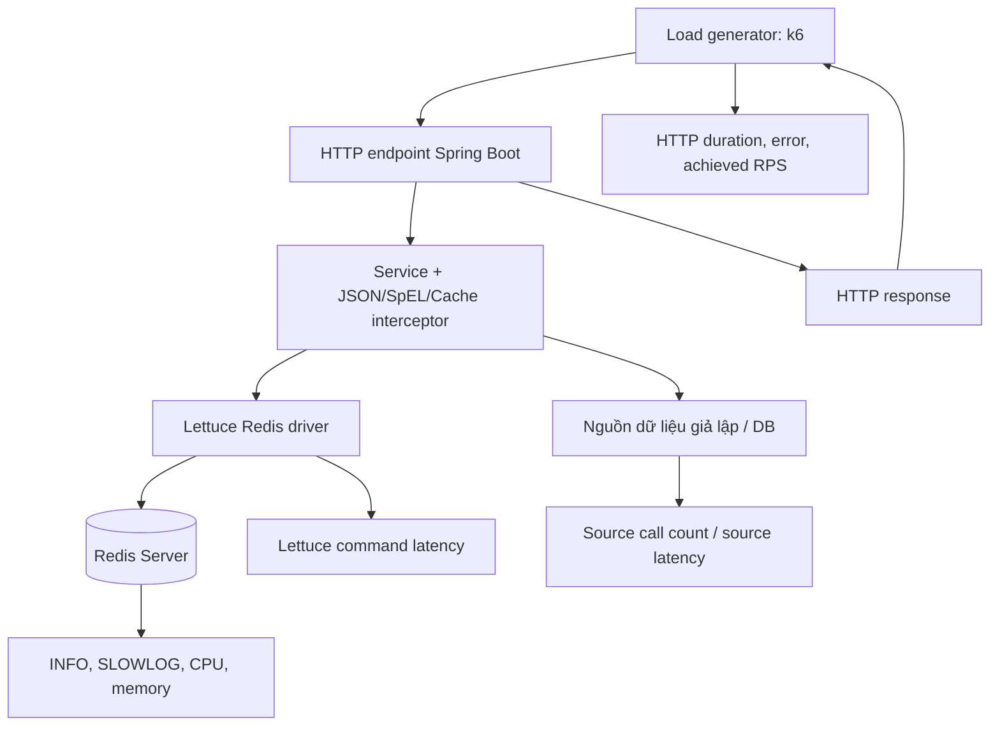
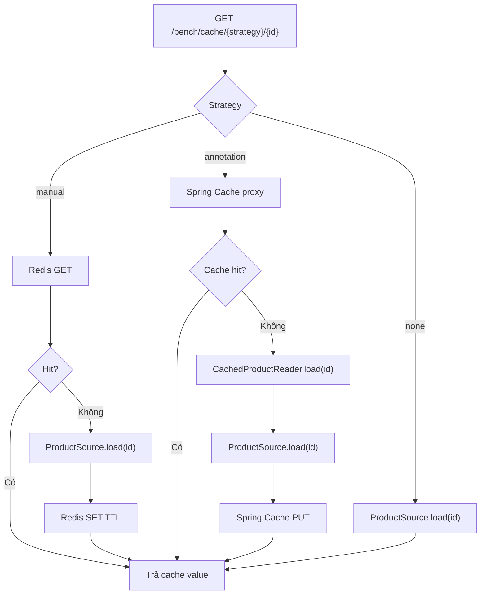
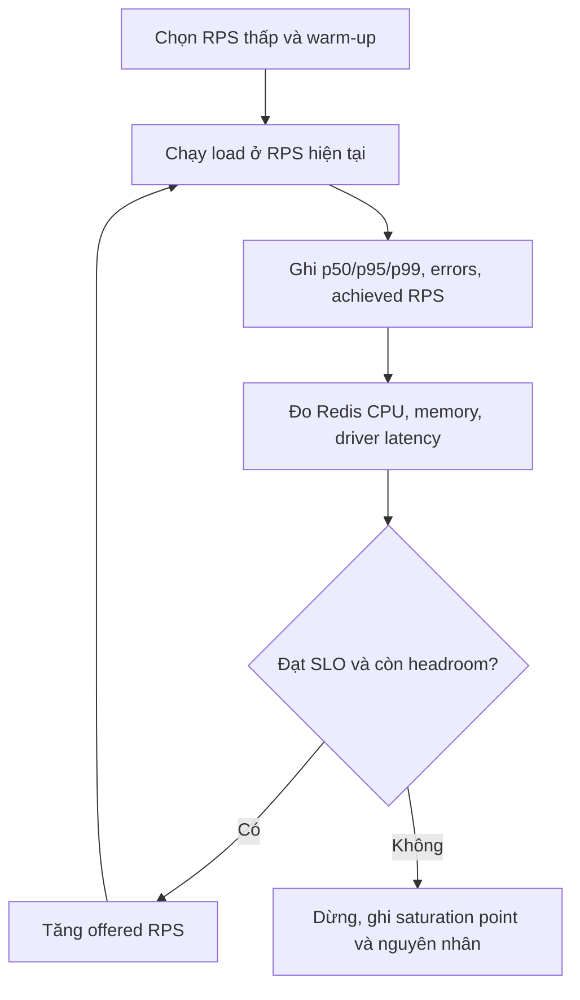
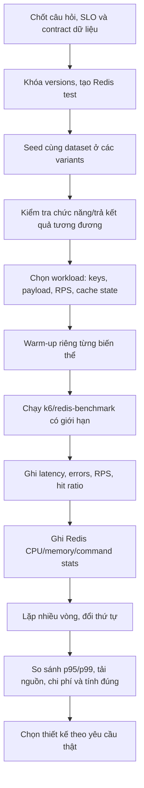

# Đo tải và so sánh cấu trúc dữ liệu hoặc chiến lược cache

Trong **Spring Data Redis**, chọn Redis String, Hash, Set, Sorted Set hoặc một cấu trúc khác không chỉ là quyết định “lưu được dữ liệu hay không”. Mỗi lựa chọn có đặc điểm khác nhau về **số lệnh**, **số byte trên mạng**, **bộ nhớ trên Redis**, **chi phí serialize/deserialize**, **khả năng cập nhật từng phần** và **giới hạn khi dữ liệu tăng**. Tương tự, chọn **không cache**, **cache-aside thủ công** hoặc **Spring Cache `@Cacheable`** ảnh hưởng tới hiệu năng end-to-end, tỷ lệ cache hit, hành vi khi TTL hết và tải lên nguồn dữ liệu gốc.

Muốn chọn giải pháp cho production, không nên chỉ dựa vào câu “Redis rất nhanh” hay một lần chạy `redis-benchmark` với key có vài byte. Cần **một thí nghiệm có thể lặp lại**, kiểm soát workload, đo cùng loại kết quả và biết cách đọc throughput, p95/p99, lỗi, hit ratio, bộ nhớ cũng như công sức vận hành.

Bài thực hành có hai thí nghiệm chính:

1. **Cấu trúc dữ liệu:** lưu cùng một sản phẩm bằng **Redis String chứa JSON** và **Redis Hash chứa các field**, rồi so sánh đọc nguyên bản ghi, đọc một trường và cập nhật một trường.
2. **Chiến lược cache:** so sánh **đọc trực tiếp nguồn dữ liệu**, **cache-aside qua `StringRedisTemplate`** và **Spring Cache `@Cacheable` dùng RedisCacheManager** trên cùng một business operation.

Kết quả mẫu trong bài chỉ để minh họa **cách báo cáo**; chúng **không phải số liệu đo thực tế** của bất kỳ Redis cluster hoặc dự án cụ thể nào.

## 1. Mục tiêu học tập

Sau khi hoàn thành, bạn cần có thể:

- Thiết kế workload công bằng khi so sánh các cấu trúc Redis hoặc các cơ chế cache.
- Phân biệt **benchmark lệnh Redis thuần** với **benchmark HTTP + Spring Boot + Redis + nguồn dữ liệu**.
- Đọc **throughput**, **latency p50/p95/p99**, error rate và offered load/achieved load.
- Giải thích vì sao cùng một Redis command có thể cho kết quả khác nhau khi payload, concurrency, key distribution và tỷ lệ cache hit thay đổi.
- Dùng Spring Data Redis thực hành với `opsForValue()`, `opsForHash()` và `@Cacheable`.
- Dùng `redis-benchmark` đo command-level và **k6** tạo tải HTTP có kiểm soát.
- Quan sát Spring Boot Actuator/Micrometer, Lettuce và `INFO`/`SLOWLOG` trên Redis.
- Kiểm tra tính đúng đắn của dữ liệu trước khi diễn giải hiệu năng.
- Đưa ra quyết định dựa trên **yêu cầu truy vấn, độ trễ, bộ nhớ, tính nhất quán và chi phí vận hành**, không chỉ một con số RPS.

## 2. Bắt đầu từ giả thuyết, không bắt đầu từ công cụ

Một thí nghiệm tốt có **câu hỏi** và **giả thuyết có thể bị bác bỏ**.

| Thí nghiệm | Câu hỏi | Giả thuyết cần kiểm tra |
| --- | --- | --- |
| A1 — đọc toàn sản phẩm | String JSON hay Hash cho độ trễ thấp hơn khi luôn cần toàn bộ field? | Lựa chọn phụ thuộc kích thước JSON, số field, serializer và network |
| A2 — chỉ đọc giá | `HGET` so với `GET` toàn JSON rồi parse? | Hash có thể giảm byte và chi phí deserialize khi chỉ cần một field |
| A3 — cập nhật giá | `HSET` một field so với `GET`/sửa JSON/`SET`? | Hash có thể giảm read-modify-write, nhưng phải xét đồng thời/TTL |
| B1 — cache 0% hit | Cache-aside có làm request nhanh hơn khi mọi request miss? | Cache có thể chậm hơn vì thêm Redis round trip |
| B2 — cache 90% hit | Cache có giảm p95 và tải nguồn dữ liệu? | Có thể nếu chi phí nguồn dữ liệu cao hơn Redis và serializer |
| B3 — nhiều request cùng miss | Cache có ngăn N request cùng gọi nguồn? | Không mặc định; có thể xảy ra cache stampede |
| B4 — TTL/eviction | Hit ratio và latency thay đổi thế nào khi key hết hạn/bị evict? | Miss burst có thể tạo p99 spike |

**Phải đo đúng operation tương đương.** Nếu một phương án chỉ đọc `price`, phương án kia đọc toàn object, chúng không có cùng payload đầu ra. Thí nghiệm đó vẫn hữu ích để chứng minh **lợi ích projection theo yêu cầu**, nhưng không được gọi là “Hash luôn nhanh hơn String” từ kết quả ấy.

## 3. Các lớp đo cần được phân biệt



| Phép đo | Có gì trong phạm vi? | Điều không tự chứng minh |
| --- | --- | --- |
| `redis-benchmark` | Lệnh Redis từ load client đến server và reply | Không đo HTTP, Spring AOP, serializer Java, cache hit/miss |
| k6 HTTP load test | Trọn đường HTTP request/response từ generator | Không tách được Redis vs DB nếu thiếu instrumentation |
| Micrometer Timer ở service | Đo đoạn code đã được instrument | Không đo đầy đủ chi phí bên ngoài đoạn code |
| Lettuce command Timer | Độ trễ lệnh theo driver | Không chỉ là CPU time của Redis Server |
| Redis `SLOWLOG` | Thời gian thực thi command phía server vượt ngưỡng | Không gồm network và deserialize JVM |
| Redis `INFO memory` | Bộ nhớ server ở một thời điểm | Không quy trực tiếp thành byte cho mỗi object nếu không trừ baseline |

Đừng cộng thời gian đo từ nhiều tầng như thể chúng độc lập: **HTTP latency đã bao gồm Redis driver latency** trên đường gọi tương ứng. Các metric được dùng để phân rã, không phải cộng thêm lần nữa.

## 4. Định nghĩa chỉ số và đơn vị trước khi chạy

### 4.1. Throughput, RPS và achieved load

Throughput có thể được mô tả là:

```text
completed_requests_per_second =
    số request hoàn tất trong cửa sổ / số giây đo
```

Trong benchmark command-level:

```text
Redis commands/second
```

không đồng nghĩa với:

```text
HTTP requests/second
```

Một HTTP request có thể tạo **nhiều Redis commands**, còn một Redis pipeline có thể truyền nhiều commands trong một network round trip.

Với k6 `constant-arrival-rate`, phân biệt:

- **Offered load:** tốc độ request generator dự kiến phát.
- **Achieved load:** request thực sự bắt đầu/hoàn tất trong khoảng đo.
- **Dropped iterations:** lượt lẽ ra phải bắt đầu nhưng generator không có đủ VUs/tài nguyên để khởi tạo theo lịch.

Nếu yêu cầu 1.000 RPS mà generator chỉ hoàn tất 700 RPS và có nhiều `dropped_iterations`, không được ghi “Redis đạt 1.000 RPS”.

### 4.2. Percentiles khác average

| Chỉ số | Ý nghĩa |
| --- | --- |
| p50 | 50% mẫu có thời gian không vượt mức này |
| p95 | 95% mẫu có thời gian không vượt mức này |
| p99 | 99% mẫu có thời gian không vượt mức này |
| Mean | Trung bình cộng, có thể bị tail lớn ảnh hưởng |
| Max | Mẫu cao nhất trong lần chạy, rất nhạy với ngoại lệ |

Ví dụ một mẫu với phần lớn request nhanh nhưng 1% request mất 1 giây có thể có mean vẫn chấp nhận được, trong khi **p99 rất xấu**. Với API có latency SLO, p95/p99 thường quan trọng hơn mean.

Một percentile chỉ có ý nghĩa nếu mẫu đủ lớn và workload ổn định; p99 của 30 requests không có sức thuyết phục như p99 của hàng trăm nghìn requests dưới tải đại diện.

### 4.3. Error rate

```text
error_rate = failed_requests / attempted_requests
```

Định nghĩa failed rõ ràng: HTTP 5xx, timeout, kết quả sai, kết nối bị reset hoặc response không đạt hợp đồng. Không chỉ đếm HTTP 500 mà bỏ qua timeout khi gateway đóng kết nối.

### 4.4. Cache hit ratio

```text
hit_ratio = cache_hits / (cache_hits + cache_misses)
```

Hit ratio phải đo tại **đường lookup cache**, không lấy `Redis GET count` làm hit: `GET` có thể trả `null`, thuộc tác vụ khác hoặc xảy ra trong retry. Đếm số lần chạy nguồn dữ liệu là một tín hiệu bổ trợ, nhưng không tự đủ để suy ra hit ratio chính xác khi có self-invocation, concurrent misses và nhiều lớp cache.

### 4.5. Memory footprint

Quan sát:

```redis
INFO memory
DBSIZE
MEMORY USAGE bench:product:string:1
MEMORY USAGE bench:product:hash:1
```

`MEMORY USAGE` trả ước lượng bộ nhớ của key tại Redis. Nó không bao gồm đầy đủ chi phí Java heap, network, index bên ngoài key hoặc chi phí của những key metadata khác trong ứng dụng.

Một cách so sánh tổng thể tốt hơn là đo **chênh lệch used_memory sau khi tải dataset lớn** so với baseline, cùng số key, với các biến Redis persistence/fragmentation và workload được kiểm soát.

## 5. Quy tắc để kết quả có thể tin cậy

Trước mỗi phép đo:

1. **Khóa phiên bản:** Redis, Spring Boot, Spring Data Redis, Lettuce, Java, k6 và OS/container.
2. **Giữ cùng môi trường:** CPU, RAM, network path, TLS, deployment topology và Redis configuration.
3. **Giữ cùng dataset:** số key, kích thước object, độ dài field và phân phối key.
4. **Giữ cùng workload:** request mix, arrival rate, concurrency, hot-key distribution, tỷ lệ cache hit/cold.
5. **Tách warm-up khỏi measurement:** JVM JIT, TCP connection, connection pool và cache prewarming.
6. **Không có job nền bất thường:** backup, AOF rewrite, snapshot, import lớn hoặc benchmark khác chạy cùng Redis nếu không phải đối tượng thử.
7. **Không để load generator thành bottleneck:** theo dõi CPU/RAM của máy chạy k6, dropped iterations và network.
8. **Lặp nhiều lần:** chạy từng cấu hình nhiều vòng, đổi thứ tự để giảm hiệu ứng của nhiệt CPU/JIT/tăng dần bộ nhớ.
9. **Ghi lỗi và tính đúng:** benchmark trả nhanh nhưng thiếu dữ liệu hay stale value không phải chiến thắng.
10. **Báo cáo cả hạn chế:** các con số chỉ áp dụng cho điều kiện đo được công bố.

Một lượt thử có thể chia:

```text
30–60 giây warm-up
120–300 giây measurement
30 giây cooldown/cleanup có kiểm soát
Lặp 5 lần mỗi biến thể, hoán đổi thứ tự A/B
```

Các khoảng trên là **tham số gợi ý để bắt đầu**, không phải chuẩn áp dụng mọi hệ thống. Workload chạy lâu, hệ thống chậm nóng lên hoặc có GC/AOF rewrite có thể cần cửa sổ dài hơn.

## 6. Chuẩn bị Redis test tách biệt

Không chạy benchmark ghi tải hoặc các lệnh dọn dữ liệu trên Redis production. Có thể dùng Redis container riêng:

```sh
docker run --rm -d \
  --name redis-bench-lesson \
  -p 6380:6379 \
  redis:7.4-alpine
```

**Lưu ý:** image `redis:7.4-alpine` chỉ là ví dụ phiên bản khóa cho phép so sánh lặp lại. Trong dự án thật phải chọn image/phiên bản theo policy hạ tầng và ghi lại image digest; không dùng tag `latest` cho các lượt đo cần tái lập.

Kiểm tra:

```sh
redis-cli -h 127.0.0.1 -p 6380 PING
redis-cli -h 127.0.0.1 -p 6380 INFO server
redis-cli -h 127.0.0.1 -p 6380 INFO memory
redis-cli -h 127.0.0.1 -p 6380 CONFIG GET maxmemory
redis-cli -h 127.0.0.1 -p 6380 CONFIG GET maxmemory-policy
```

Trong production, Redis cần auth/TLS/network isolation theo chính sách; các lệnh trên giả định **Redis local chỉ cho thử nghiệm**.

### 6.1. Tránh nhầm benchmark local với production

Docker trên máy cá nhân có thể giới hạn CPU, RAM hoặc chạy qua mạng ảo. Kết quả có giá trị **so sánh tương đối trong cùng setup**, không phải con số throughput chắc chắn cho hạ tầng production. Với benchmark phục vụ quyết định triển khai lớn, cần môi trường đại diện và mạng tương đồng.

Không chạy Redis và k6 cùng một CPU bị giới hạn rồi kết luận Redis chậm khi thực tế load generator đang tranh CPU với Redis.

### 6.2. Ghi metadata của run

Lưu tối thiểu:

```text
date_utc:
git_commit:
java_version:
spring_boot_version:
spring_data_redis_version:
lettuce_version:
redis_version:
redis_topology: standalone / sentinel / cluster
machine_cpu_ram:
redis_maxmemory_policy:
app_replicas:
load_generator_machine:
dataset_keys:
payload_bytes:
key_distribution:
request_rate:
run_duration:
warmup_duration:
result_path:
```

Nếu không ghi những tham số này, một lần benchmark nhanh hơn 20% sau ba tháng có thể chỉ do thay phần cứng hoặc payload nhỏ hơn, không do kiến trúc dữ liệu.

## 7. Chuẩn bị Spring Boot mẫu

Thêm dependencies vào một project Spring Boot 3.x, Java 17+ có quản lý dependency từ Spring Boot:

```groovy
dependencies {
    implementation 'org.springframework.boot:spring-boot-starter-web'
    implementation 'org.springframework.boot:spring-boot-starter-data-redis'
    implementation 'org.springframework.boot:spring-boot-starter-cache'
    implementation 'org.springframework.boot:spring-boot-starter-actuator'
    runtimeOnly 'io.micrometer:micrometer-registry-prometheus'

    testImplementation 'org.springframework.boot:spring-boot-starter-test'
    testImplementation 'org.testcontainers:junit-jupiter'
}
```

Không cần tạo thêm một build tool chỉ để chạy bài này nếu dự án đã dùng Gradle/Maven; điều quan trọng là sử dụng **cùng dependency versions** giữa những biến thể.

Ví dụ cấu hình:

```yaml
spring:
  application:
    name: redis-benchmark-lesson
  data:
    redis:
      host: 127.0.0.1
      port: 6380
      connect-timeout: 2s
      timeout: 3s

server:
  port: 8080

management:
  endpoints:
    web:
      exposure:
        include: "health,metrics,prometheus"
  metrics:
    tags:
      application: ${spring.application.name}
```

Actuator endpoint và endpoint benchmark nên **chỉ expose trong môi trường test có kiểm soát**, không mở trực tiếp lên Internet. Trong production có thể dùng một management port riêng, auth và network policy.

Ứng dụng chính:

```java
package com.example.redisbench;

import org.springframework.boot.SpringApplication;
import org.springframework.boot.autoconfigure.SpringBootApplication;
import org.springframework.cache.annotation.EnableCaching;

@SpringBootApplication
@EnableCaching
public class BenchmarkApplication {

    public static void main(String[] args) {
        SpringApplication.run(BenchmarkApplication.class, args);
    }
}
```

`@EnableCaching` cho phép Spring tạo **cache interceptor/proxy** đối với những bean có annotation cache. Không đồng nghĩa các lời gọi `this.cachedMethod()` trong cùng bean sẽ qua proxy.

## 8. Thí nghiệm A: String JSON so với Redis Hash

Chọn một đối tượng:

```java
package com.example.redisbench;

public record ProductView(
        String id,
        String title,
        long priceCents,
        String category) {
}
```

**String JSON**:

```text
Key:   bench:product:string:101
Type:  string
Value: {"id":"101","title":"Keyboard","priceCents":259900,"category":"IT"}
```

**Redis Hash**:

```text
Key:  bench:product:hash:101
Type: hash
Fields:
    id         -> 101
    title      -> Keyboard
    priceCents -> 259900
    category   -> IT
```

Cả hai biểu diễn được **cùng thông tin**. Nhưng các thao tác đọc/ghi có thể khác nhau:

| Operation | String JSON | Hash |
| --- | --- | --- |
| Lưu toàn đối tượng | `SET key json EX ttl` | `HSET key field value ...` rồi đặt TTL |
| Đọc toàn đối tượng | `GET key` + deserialize JSON | `HGETALL key` + map fields |
| Đọc chỉ giá | `GET key` + parse JSON | `HGET key priceCents` |
| Sửa chỉ giá | Thường phải đọc, parse, cập nhật, serialize, `SET` | `HSET key priceCents value` |
| Một key TTL | `SET ... EX` có thể gắn TTL trong một lệnh | TTL của Hash áp dụng toàn key; cần đặt riêng hoặc dùng script |
| Phát hiện object version | Field/version trong JSON | Field/version trong Hash |

**Lưu ý:** Redis String không nhất thiết luôn dùng JSON, có thể là MessagePack/Protobuf/binary. Redis Hash cũng có thể dùng serializer nhị phân. Benchmark này so sánh **hai biểu diễn đã chọn**, không chứng minh mọi String hoặc mọi Hash nói chung.

### 8.1. Kiểm tra trực tiếp bằng Redis CLI

```redis
SET bench:product:string:101 '{"id":"101","title":"Keyboard","priceCents":259900,"category":"IT"}' EX 1800
HSET bench:product:hash:101 id 101 title Keyboard priceCents 259900 category IT
EXPIRE bench:product:hash:101 1800

TYPE bench:product:string:101
TYPE bench:product:hash:101

GET bench:product:string:101
HGETALL bench:product:hash:101
HGET bench:product:hash:101 priceCents

MEMORY USAGE bench:product:string:101
MEMORY USAGE bench:product:hash:101
```

Lệnh `MEMORY USAGE` có thể cho thấy Hash tiêu tốn ít hay nhiều bộ nhớ hơn String tùy số field, độ dài tên field, encoding và cấu hình Redis. Không có kết luận cố định rằng một Hash luôn nhỏ hơn JSON.

### 8.2. Spring Data Redis: một service so sánh

```java
package com.example.redisbench;

import com.fasterxml.jackson.core.JsonProcessingException;
import com.fasterxml.jackson.databind.ObjectMapper;
import java.time.Duration;
import java.util.Map;
import org.springframework.data.redis.core.StringRedisTemplate;
import org.springframework.stereotype.Service;

@Service
public class ProductShapeStore {

    private static final Duration TTL = Duration.ofMinutes(30);
    private static final String STRING_PREFIX = "bench:product:string:";
    private static final String HASH_PREFIX = "bench:product:hash:";

    private final StringRedisTemplate redis;
    private final ObjectMapper mapper;

    public ProductShapeStore(
            StringRedisTemplate redis, ObjectMapper mapper) {
        this.redis = redis;
        this.mapper = mapper;
    }

    public void saveString(ProductView product) {
        try {
            redis.opsForValue().set(
                    STRING_PREFIX + product.id(),
                    mapper.writeValueAsString(product),
                    TTL);
        } catch (JsonProcessingException ex) {
            throw new IllegalStateException("Cannot encode product JSON", ex);
        }
    }

    public void saveHash(ProductView product) {
        String key = HASH_PREFIX + product.id();
        Map<String, String> fields = Map.of(
                "id", product.id(),
                "title", product.title(),
                "priceCents", Long.toString(product.priceCents()),
                "category", product.category());

        redis.opsForHash().putAll(key, fields);
        redis.expire(key, TTL);
    }

    public ProductView readString(String id) {
        String json = redis.opsForValue().get(STRING_PREFIX + id);
        if (json == null) {
            return null;
        }

        try {
            return mapper.readValue(json, ProductView.class);
        } catch (JsonProcessingException ex) {
            throw new IllegalStateException("Cannot decode product JSON", ex);
        }
    }

    public ProductView readHash(String id) {
        Map<Object, Object> values =
                redis.opsForHash().entries(HASH_PREFIX + id);
        if (values.isEmpty()) {
            return null;
        }

        return new ProductView(
                (String) values.get("id"),
                (String) values.get("title"),
                Long.parseLong((String) values.get("priceCents")),
                (String) values.get("category"));
    }

    public Long readPriceFromHash(String id) {
        Object value = redis.opsForHash()
                .get(HASH_PREFIX + id, "priceCents");
        return value == null ? null
                : Long.parseLong((String) value);
    }

    public Long readPriceFromJson(String id) {
        ProductView product = readString(id);
        return product == null ? null : product.priceCents();
    }
}
```

Trong ví dụ, `ObjectMapper` được Spring Boot tạo từ Jackson khi auto-configuration phù hợp. Hash field/value dùng `StringRedisTemplate` nên được mã hóa như các chuỗi. `Map.of(...)` không hỗ trợ `null`; dataset benchmark phải có đủ field hợp lệ.

**Quan trọng về TTL và atomicity:** `saveString` dùng một lệnh `SET` kèm TTL, trong khi `saveHash` ghi Hash rồi `EXPIRE` trong hai lệnh riêng. Nếu ứng dụng chết giữa hai lệnh, Hash có thể chưa có TTL. Đây là **khác biệt thật của cách triển khai**, không phải một đặc tính cố hữu rằng Hash không bao giờ gắn TTL an toàn được: có thể dùng Lua script để gộp `HSET` và `EXPIRE` nguyên tử trên cùng key. Khi đánh giá write latency, phải công bố rằng phương án Hash hiện tại gửi **hai command**.

### 8.3. Đọc nguyên bản ghi và đọc projection là hai workload

Trong case A1, gọi:

```java
ProductView a = store.readString("101");
ProductView b = store.readHash("101");
```

Kết quả phải tương đương về `id`, `title`, `priceCents`, `category`. Độ trễ bao gồm lệnh Redis và bước chuyển bytes sang `ProductView`.

Trong case A2, gọi:

```java
Long a = store.readPriceFromJson("101");
Long b = store.readPriceFromHash("101");
```

**Cùng đầu ra** là giá nhưng đường đi khác: String đọc + parse JSON nguyên bản ghi, Hash chỉ đọc field. Nếu Hash nhanh hơn, kết luận đúng là **trong workload đọc một field, mô hình Hash/HGET phù hợp hơn**, không phải mọi truy vấn Hash đều nhanh hơn mọi truy vấn String.

### 8.4. Cập nhật một field và race condition

Với Redis Hash:

```java
redis.opsForHash().put(
        "bench:product:hash:101", "priceCents", "299900");
```

Redis `HSET` thay field trực tiếp. Với String JSON, một implementation thông thường:

```text
GET JSON
deserialize
thay price
serialize
SET JSON
```

Đường String có nguy cơ **lost update** nếu hai writers đọc cùng bản JSON rồi ghi đè nhau. Khi dùng version/CAS (`WATCH`, Lua) sẽ thêm chi phí và phức tạp, nhưng tăng correctness. Không so sánh “Hash HSET một lệnh” với “String GET/SET không bảo vệ race” rồi quên khác biệt **tính đúng đắn dưới concurrency**.

Hash vẫn cần quy tắc đồng thời khi cập nhật nhiều field có liên hệ bất biến nghiệp vụ. `HSET` một field nguyên tử không bảo đảm toàn bộ operation đa field/đa key của service là transaction.

## 9. Seed dữ liệu có kiểm soát

Để hai phương án xử lý **cùng một dataset**, cần tạo trước một số lượng sản phẩm xác định:

```java
package com.example.redisbench;

import org.springframework.boot.ApplicationRunner;
import org.springframework.context.annotation.Bean;
import org.springframework.context.annotation.Configuration;

@Configuration
public class BenchmarkSeedConfiguration {

    @Bean
    ApplicationRunner seedBenchmarkProducts(ProductShapeStore store) {
        return args -> {
            for (int i = 0; i < 1000; i++) {
                ProductView p = new ProductView(
                        Integer.toString(i),
                        "Product-" + i,
                        10000L + i,
                        "category-" + (i % 10));
                store.saveString(p);
                store.saveHash(p);
            }
        };
    }
}
```

Đây là **seed cho môi trường benchmark chuyên biệt**, không nên copy vào ứng dụng production để ghi 2.000 key ở mỗi lần startup. Seed có thể mất thời gian vì thực hiện nhiều round trips; hãy **đợi seed hoàn tất rồi mới warm-up/đo**.

Trong thí nghiệm dữ liệu lớn, tăng `1000` lên số key mục tiêu và công bố cùng độ dài title/value, độ dài ID, số field. Tăng số lượng key nhưng giữ payload quá nhỏ có thể cho kết quả khác hẳn với product JSON thực tế có nhiều thuộc tính.

Nếu dùng TTL 30 phút như ví dụ, phải đảm bảo toàn bộ warm-up + measurement diễn ra trước khi dataset hết hạn. Nếu TTL là biến được thử, dùng một nhóm thí nghiệm **riêng** thay vì để key tự hết hạn giữa lượt so sánh A/B không chủ đích.

## 10. REST endpoints để đo qua HTTP

Tạo controller chỉ phục vụ môi trường test:

```java
package com.example.redisbench;

import org.springframework.http.ResponseEntity;
import org.springframework.web.bind.annotation.GetMapping;
import org.springframework.web.bind.annotation.PathVariable;
import org.springframework.web.bind.annotation.RequestMapping;
import org.springframework.web.bind.annotation.RestController;

@RestController
@RequestMapping("/bench/shape")
public class ShapeBenchmarkController {

    private final ProductShapeStore store;

    public ShapeBenchmarkController(ProductShapeStore store) {
        this.store = store;
    }

    @GetMapping("/string/{id}")
    public ResponseEntity<ProductView> readString(@PathVariable String id) {
        ProductView value = store.readString(id);
        return value == null
                ? ResponseEntity.notFound().build()
                : ResponseEntity.ok(value);
    }

    @GetMapping("/hash/{id}")
    public ResponseEntity<ProductView> readHash(@PathVariable String id) {
        ProductView value = store.readHash(id);
        return value == null
                ? ResponseEntity.notFound().build()
                : ResponseEntity.ok(value);
    }

    @GetMapping("/string-price/{id}")
    public ResponseEntity<Long> priceFromString(
            @PathVariable String id) {
        Long value = store.readPriceFromJson(id);
        return value == null
                ? ResponseEntity.notFound().build()
                : ResponseEntity.ok(value);
    }

    @GetMapping("/hash-price/{id}")
    public ResponseEntity<Long> priceFromHash(
            @PathVariable String id) {
        Long value = store.readPriceFromHash(id);
        return value == null
                ? ResponseEntity.notFound().build()
                : ResponseEntity.ok(value);
    }
}
```

**Test A1:** `/bench/shape/string/{id}` so với `/bench/shape/hash/{id}`. Cả hai trả cùng JSON DTO.

**Test A2:** `/bench/shape/string-price/{id}` so với `/bench/shape/hash-price/{id}`. Cả hai chỉ trả cùng số `priceCents`.

Tránh test String endpoint trả 60 byte nhưng Hash endpoint trả 5 KB rồi kết luận dựa trên HTTP p99 mà không biết payload khác nhau. Khi đầu ra tương đương, chi phí serialization ở HTTP gần tương đương, giúp quan sát chênh lệch ở đường Redis nhiều hơn.

**Giới hạn:** các endpoint này không tự xác thực ID, không có rate limiting, không có kiểm soát truy cập. Chỉ đưa vào **profile/môi trường benchmark cách ly**; không public trên production.

## 11. Benchmark Redis thuần bằng redis-benchmark

`redis-benchmark` là công cụ đi kèm Redis, thích hợp cho phép đo **command-level**. Ví dụ:

```sh
redis-benchmark \
  -h 127.0.0.1 -p 6380 \
  -t get,set \
  -n 100000 \
  -c 50 \
  -d 512 \
  -P 1
```

Ý nghĩa các tham số phổ biến:

| Tham số | Ý nghĩa |
| --- | --- |
| `-h`, `-p` | Redis host và port |
| `-t get,set` | Chọn nhóm benchmark lệnh mặc định |
| `-n 100000` | Số requests benchmark cho workload được chọn theo quy tắc công cụ |
| `-c 50` | Số kết nối đồng thời của công cụ |
| `-d 512` | Kích thước value benchmark tính bằng byte |
| `-P 1` | Pipeline depth bằng 1, tránh vô tình đo pipelining |

Nếu muốn xem tác dụng của pipelining:

```sh
redis-benchmark \
  -h 127.0.0.1 -p 6380 \
  -t get,set -n 100000 -c 50 -d 512 -P 16
```

**Không so sánh kết quả `-P 16` với `-P 1` rồi nói Redis đã xử lý từng lệnh nhanh hơn cùng tỷ lệ.** Pipeline thay đổi số round trips và khả năng giữ nhiều command đang chờ, nên đây là một biến workload khác.

### 11.1. redis-benchmark chưa đủ cho Spring Data Redis

Kết quả từ `redis-benchmark` không bao gồm:

- Spring MVC/Tomcat/Netty và HTTP network stack.
- `@Cacheable` AOP interceptor/SpEL.
- Jackson JSON serialization/deserialization.
- Logic truy vấn nguồn dữ liệu khi cache miss.
- Connection configuration thực tế của ứng dụng.
- JVM JIT/GC và thread pool ứng dụng.
- Hành vi response body/HTTP status.

Vì vậy sử dụng `redis-benchmark` để biết **nền tảng lệnh Redis và ảnh hưởng pipeline/concurrency**, rồi dùng HTTP load test để đánh giá **đường ứng dụng thật**.

### 11.2. Không dùng workload khác semantics chỉ vì tên lệnh giống

Một `GET` key có 512 byte trong redis-benchmark không đại diện cho một `GET` cache entry 100 KB rồi deserialize JSON phức tạp. Khi so sánh, phải tái tạo key size, value size, số lượng key và tỷ lệ đọc/ghi phù hợp.

Đối với Hash, Set, ZSET, có thể dùng các workload chuyên dụng hoặc gọi lệnh qua một driver/script có dataset seed trước. Nhưng không chỉ chạy `SET`/`GET` rồi khẳng định đã đo `HGETALL` hoặc `ZSCAN`.

## 12. Tạo tải HTTP bằng k6

**k6** giúp mô tả arrival rate, duration, VUs, status checks và xuất latency percentiles. Ví dụ một script `bench.js` dùng chung cho các endpoint; đây là **ví dụ file để người học tạo trong môi trường benchmark của mình**, không phải tệp được ghi bởi worker STEP 4.

```javascript
import http from 'k6/http';
import { check } from 'k6';
import exec from 'k6/execution';

const baseUrl = __ENV.BASE_URL || 'http://127.0.0.1:8080';
const pathPrefix = __ENV.PATH_PREFIX || '/bench/shape/string';
const pool = Number(__ENV.KEY_POOL || 1000);
const rate = Number(__ENV.RATE || 100);
const duration = __ENV.DURATION || '2m';

export const options = {
  scenarios: {
    steady: {
      executor: 'constant-arrival-rate',
      rate: rate,
      timeUnit: '1s',
      duration: duration,
      preAllocatedVUs: Number(__ENV.VUS || 50),
      maxVUs: Number(__ENV.MAX_VUS || 200),
      gracefulStop: '10s',
    },
  },
  thresholds: {
    http_req_failed: ['rate<0.01'],
    http_req_duration: ['p(95)<250'],
  },
};

function chooseId(iteration) {
  // Phân phối đều theo một tập ID cố định.
  return String(iteration % pool);
}

export default function () {
  const id = chooseId(exec.scenario.iterationInTest);
  const response = http.get(`${baseUrl}${pathPrefix}/${id}`, {
    tags: { workload: 'redis-benchmark-lesson' },
    timeout: '5s',
  });

  check(response, {
    'status is 200': (r) => r.status === 200,
    'response non-empty': (r) => r.body !== null && r.body.length > 0,
  });
}
```

Các ngưỡng `p(95)<250` ms và lỗi dưới 1% chỉ là ví dụ để k6 đánh dấu run không đạt mục tiêu. Khi chọn SLO thực tế, thay chúng bằng mục tiêu sản phẩm.

Nếu `KEY_POOL` không hợp lệ hoặc bằng 0, logic chọn ID sẽ sai; trong bộ script production-grade cần validate các biến môi trường trước khi chạy.

### 12.1. Lệnh chạy

```sh
# Đo String JSON, đọc toàn object
k6 run -e RATE=200 -e KEY_POOL=1000 \
  -e PATH_PREFIX=/bench/shape/string bench.js

# Đo Redis Hash, đọc toàn object
k6 run -e RATE=200 -e KEY_POOL=1000 \
  -e PATH_PREFIX=/bench/shape/hash bench.js

# Đo đọc riêng price từ JSON
k6 run -e RATE=200 -e KEY_POOL=1000 \
  -e PATH_PREFIX=/bench/shape/string-price bench.js

# Đo đọc riêng price bằng HGET
k6 run -e RATE=200 -e KEY_POOL=1000 \
  -e PATH_PREFIX=/bench/shape/hash-price bench.js
```

Trong các câu lệnh trên, cùng key pool và arrival rate giúp giảm khác biệt. Để tăng độ tin cậy, chạy **nhiều vòng đổi thứ tự**: A/B/B/A hoặc chọn thứ tự ngẫu nhiên có kiểm soát, thay vì luôn chạy String trước rồi Hash sau.

### 12.2. Vì sao chọn constant-arrival-rate?

Benchmark dạng **closed-loop VUs** thường đợi request xong rồi mới gửi request tiếp. Khi server chậm, chính bộ phát tải tự giảm tốc, khiến latency/throughput dễ bị diễn giải sai.

`constant-arrival-rate` thiết lập lịch phát request gần với **open-loop offered load**: nếu server chậm, cần nhiều VUs hơn để giữ arrival rate. Vì vậy phải kiểm tra `dropped_iterations`, số VUs được sử dụng và CPU của generator.

Không nên tăng VUs vô hạn chỉ để đạt RPS khi server quá tải; cần dừng ở giới hạn an toàn và ghi lại **điểm gãy throughput/latency**.

## 13. Phân phối key: uniform và hot key

Workload phân phối ID đều trên 1.000 key chưa chắc giống traffic thật. Trong nhiều sản phẩm, một nhóm nhỏ item được đọc nhiều hơn phần còn lại.

Ví dụ mô hình:

```text
Uniform:
  1.000 key có xác suất gần bằng nhau

Hot-key:
  80% request vào 20% số key
  20% request vào 80% số key còn lại
```

Những khác biệt có thể xuất hiện:

- Hot key đọc nhiều có thể **tăng cache hit ratio** nếu cache đủ lớn.
- Hot key ghi nhiều có thể **tăng contention** hoặc làm một Redis Cluster slot/node chịu tải cao.
- Uniform distribution trên keyspace lớn có thể tạo **nhiều cache miss hơn** khi giới hạn bộ nhớ.
- Dataset quá nhỏ và luôn warm có thể làm benchmark đánh giá quá cao hiệu quả cache.

Để tạo workload hot key, nên xây dựng một trace ID cố định/seeded để các biến thể dùng **cùng chuỗi requests**, thay vì gọi `Math.random()` với các phân phối ngẫu nhiên khác nhau trong từng run rồi so sánh một chênh lệch nhỏ.

### 13.1. Các chiều workload cần ghi

| Chiều | Giá trị thử |
| --- | --- |
| Key pool | 100, 1.000, 100.000 |
| Payload | 128 B, 1 KB, 10 KB, 100 KB |
| Read/write mix | 100/0, 95/5, 80/20 |
| Arrival rate | 100, 500, 1.000 RPS và tăng dần |
| Key distribution | Uniform, hot-key |
| TTL | 30 s, 5 phút, 30 phút |
| Cache state | Cold, warm, steady |
| Cache hit ratio | 0%, 50%, 90%, 99% mục tiêu |
| Replicas | 1 vs nhiều application instances |
| Topology | Standalone vs Cluster/Sentinel nếu sản phẩm dùng |

Không cần chạy **mọi tổ hợp** trong bảng vì số case bùng nổ. Chọn một baseline và thay **một hoặc hai biến có chủ đích** mỗi lần, rồi mở rộng khi thấy yếu tố ảnh hưởng lớn.

## 14. Thí nghiệm B: không cache, cache-aside và @Cacheable

Giả sử một business operation đọc tên sản phẩm từ một nguồn dữ liệu có độ trễ nhất định. Ba cách tổ chức:



Nên đo **cùng một kiểu response và cùng ID** cho cả ba chiến lược, đồng thời bảo đảm cache có namespace tách biệt để kết quả của biến thể này không làm ấm cache của biến thể khác.

### 14.1. Vì sao cần một nguồn dữ liệu có thể đếm lượt gọi?

Nếu hai endpoint đều trả `"Product-101"`, không biết cache có thật sự hit hay không. Một nguồn dữ liệu có `Counter` giúp chứng minh cache đã giảm số lượt tải:

```text
10.000 HTTP requests
Source.load được gọi 10.000 lần -> no-cache
Source.load được gọi 1.050 lần  -> cache hit nhiều, có miss ban đầu
```

Đây chỉ là tín hiệu minh họa; dưới concurrency có thể có nhiều request cùng miss và cùng gọi nguồn. Cần có thêm metric hit/miss tại cache layer nếu muốn tỷ lệ chính xác.

## 15. Service nguồn dữ liệu giả lập

Trong benchmark học tập, có thể mô phỏng nguồn dữ liệu mất khoảng 15 ms. Đây **không phải phép đo database thật**; nó giúp cô lập lợi ích giảm source calls.

```java
package com.example.redisbench;

import java.util.concurrent.TimeUnit;
import java.util.concurrent.atomic.AtomicLong;
import org.springframework.stereotype.Component;

@Component
public class FakeProductSource {

    private final AtomicLong loads = new AtomicLong();

    public String load(String id) {
        loads.incrementAndGet();

        try {
            TimeUnit.MILLISECONDS.sleep(15);
        } catch (InterruptedException ex) {
            Thread.currentThread().interrupt();
            throw new IllegalStateException(
                    "Source operation interrupted", ex);
        }

        return "Product-" + id + "|v1";
    }

    public long loadCount() {
        return loads.get();
    }
}
```

**Hạn chế của `sleep`:** nó chiếm một request thread trong thời gian chờ, không mô phỏng chính xác connection pool, SQL query plan, network retries hay CPU load của database thật. Tốt cho so sánh sơ bộ, **không phù hợp để kết luận sizing production**. Với quyết định thực tế, chạy thêm một vòng với database/read source thật hoặc một service mô phỏng sát latency distribution.

Không reset counter giữa những request đang chạy; nếu cần dùng counter để báo cáo, ghi snapshot trước/sau một run không có traffic khác.

## 16. Cache-aside thủ công với StringRedisTemplate

```java
package com.example.redisbench;

import java.time.Duration;
import org.springframework.data.redis.core.StringRedisTemplate;
import org.springframework.stereotype.Service;

@Service
public class ManualProductCache {

    private static final String PREFIX = "bench:cache:manual:";
    private static final Duration TTL = Duration.ofMinutes(5);

    private final StringRedisTemplate redis;
    private final FakeProductSource source;

    public ManualProductCache(
            StringRedisTemplate redis, FakeProductSource source) {
        this.redis = redis;
        this.source = source;
    }

    public String load(String id) {
        String key = PREFIX + id;
        String cached = redis.opsForValue().get(key);
        if (cached != null) {
            return cached;
        }

        String loaded = source.load(id);
        redis.opsForValue().set(key, loaded, TTL);
        return loaded;
    }
}
```

Đây là **cache-aside**:

1. Đọc cache.
2. Nếu hit, trả kết quả.
3. Nếu miss, tải nguồn.
4. Ghi cache kèm TTL.
5. Trả kết quả.

**Cần hiểu giới hạn:** nhiều threads/processes cùng miss một key có thể cùng gọi `source.load(id)` và cùng `SET`. Nếu có thay đổi dữ liệu nguồn, một nguồn đọc cũ có thể ghi cache sau một nguồn đọc mới. Không coi ví dụ này là giải pháp chống stampede hoặc bảo đảm consistency hoàn chỉnh.

## 17. Spring Cache @Cacheable qua bean proxy thực

```java
package com.example.redisbench;

import org.springframework.cache.annotation.Cacheable;
import org.springframework.stereotype.Service;

@Service
public class AnnotatedProductCache {

    private final FakeProductSource source;

    public AnnotatedProductCache(FakeProductSource source) {
        this.source = source;
    }

    @Cacheable(cacheNames = "benchProducts", key = "#p0")
    public String load(String id) {
        return source.load(id);
    }
}
```

`@Cacheable` chỉ có tác dụng đúng khi lời gọi đi qua **Spring-managed proxy**. Nếu một method trong chính `AnnotatedProductCache` gọi `this.load(id)`, caching có thể bị bypass trong proxy mode. Đối với benchmark, controller phải inject bean `AnnotatedProductCache` từ ApplicationContext, không `new AnnotatedProductCache(...)`.

### 17.1. RedisCacheManager cùng TTL và serializer

```java
package com.example.redisbench;

import java.time.Duration;
import org.springframework.context.annotation.Bean;
import org.springframework.context.annotation.Configuration;
import org.springframework.data.redis.cache.RedisCacheConfiguration;
import org.springframework.data.redis.cache.RedisCacheManager;
import org.springframework.data.redis.connection.RedisConnectionFactory;
import org.springframework.data.redis.serializer.RedisSerializationContext;
import org.springframework.data.redis.serializer.StringRedisSerializer;

@Configuration
public class BenchmarkCacheConfiguration {

    @Bean
    public RedisCacheManager cacheManager(
            RedisConnectionFactory connectionFactory) {

        RedisCacheConfiguration options =
                RedisCacheConfiguration.defaultCacheConfig()
                        .entryTtl(Duration.ofMinutes(5))
                        .computePrefixWith(
                                cache -> "bench:cache:annotation:"
                                        + cache + "::")
                        .serializeValuesWith(
                                RedisSerializationContext
                                        .SerializationPair.fromSerializer(
                                                new StringRedisSerializer()))
                        .disableCachingNullValues();

        return RedisCacheManager.builder(connectionFactory)
                .cacheDefaults(options)
                .build();
    }
}
```

Đoạn này chọn **RedisCacheManager** tường minh, tránh vô tình benchmark một `ConcurrentMapCacheManager` trong JVM. Nó giữ TTL 5 phút như cache thủ công và dùng String serializer cho value dạng `String`.

Tuy nhiên, cách tạo key vật lý khác:

```text
Manual:
  bench:cache:manual:101

Spring Cache:
  bench:cache:annotation:benchProducts::101
```

Sự khác nhau về độ dài tên key là một phần của implementation. Nếu cần so sánh **cùng độ dài key** hoặc footprint byte-level, tạo quy ước tên tương đương. Trong bài này, mục tiêu B là **so sánh chiến lược cache ở cấp ứng dụng**, nên những chi phí framework/key conversion thực tế được giữ trong phép đo.

Không thêm một CacheManager khác với cùng tên rồi để Spring chọn tùy ý. Kiểm tra bean `CacheManager` thực sự là `RedisCacheManager`.

## 18. Controller so sánh ba chiến lược

```java
package com.example.redisbench;

import org.springframework.web.bind.annotation.GetMapping;
import org.springframework.web.bind.annotation.PathVariable;
import org.springframework.web.bind.annotation.RequestMapping;
import org.springframework.web.bind.annotation.RestController;

@RestController
@RequestMapping("/bench/cache")
public class CacheBenchmarkController {

    private final FakeProductSource source;
    private final ManualProductCache manual;
    private final AnnotatedProductCache annotated;

    public CacheBenchmarkController(
            FakeProductSource source,
            ManualProductCache manual,
            AnnotatedProductCache annotated) {
        this.source = source;
        this.manual = manual;
        this.annotated = annotated;
    }

    @GetMapping("/none/{id}")
    public String noCache(@PathVariable String id) {
        return source.load(id);
    }

    @GetMapping("/manual/{id}")
    public String manual(@PathVariable String id) {
        return manual.load(id);
    }

    @GetMapping("/annotation/{id}")
    public String annotation(@PathVariable String id) {
        return annotated.load(id);
    }
}
```

Với cùng `id`, ba endpoint trả chuỗi tương đương:

```text
Product-101|v1
```

Điểm khác nhau là **đường lấy giá trị**. Khi k6 gọi `/bench/cache/annotation/{id}`, nó đi qua bean proxy Spring Cache đã inject.

Thử thủ công:

```sh
curl -s http://localhost:8080/bench/cache/none/101
curl -s http://localhost:8080/bench/cache/manual/101
curl -s http://localhost:8080/bench/cache/annotation/101
```

Không bật các endpoint này trong môi trường có dữ liệu thật; benchmark handler có thể tạo tải và key số lượng lớn mà không kiểm soát như một API production.

## 19. Chạy thí nghiệm cache

Để tạo tải cùng arrival rate và key pool, dùng `bench.js` ở trên:

```sh
# Không cache:
k6 run -e RATE=200 -e KEY_POOL=1000 \
  -e PATH_PREFIX=/bench/cache/none bench.js

# Cache-aside thủ công:
k6 run -e RATE=200 -e KEY_POOL=1000 \
  -e PATH_PREFIX=/bench/cache/manual bench.js

# Spring Cache @Cacheable:
k6 run -e RATE=200 -e KEY_POOL=1000 \
  -e PATH_PREFIX=/bench/cache/annotation bench.js
```

Nhưng trước khi so sánh phải chọn **chế độ cache**:

### 19.1. Cold cache

Mỗi key chưa có entry trước khi run. Những request đầu tiên là miss.

Để tạo cold run công bằng:

- Chỉ xóa những key thuộc **namespace benchmark riêng**, không `FLUSHALL` Redis dùng chung.
- Hoặc chọn một **cache prefix/version mới cho mỗi run**, tránh vô tình hưởng dữ liệu của lượt trước.
- Ghi lại thời điểm reset và số key ban đầu.
- Bảo đảm không có request warm-up từ biến thể khác đi vào cùng namespace.

**Không được chạy warm-up rồi tuyên bố đó là cold cache test.**

### 19.2. Warm cache

Seed trước mọi key trong workload để phần lớn request là hit. Ví dụ gọi mỗi ID một lần vào endpoint cache:

```sh
# Bash minh họa trong môi trường benchmark độc lập:
for i in $(seq 0 999); do
  curl -sf "http://127.0.0.1:8080/bench/cache/manual/$i" \
    > /dev/null
done
```

Với Spring Cache annotation, thay `/manual/` thành `/annotation/`. `seq` và redirect ở ví dụ dùng POSIX shell, không phải PowerShell.

Không đưa thời gian prewarm vào measurement chính nếu câu hỏi là **steady-state hit latency**. Nếu benchmark là cold-start SLO, lại phải **tính cả** thời gian warm-up và source load.

### 19.3. Mixed hit/miss

Thay đổi key pool lớn hơn lượng key đã seed trong cache, hoặc phân phối truy cập hot/cold. Đo hit ratio **thực** từ instrumented cache lookup thay vì chỉ giả định “key pool 1.000 thì chắc 90% hit”.

Một số tình huống có thể làm ratio khác dự kiến:

- TTL hết giữa run.
- Redis eviction do `maxmemory`.
- Concurrent misses cùng key.
- Cache key expression khác giữa các request.
- Key bị invalidated bởi một writer khác.
- Test không reset dữ liệu từ lần chạy trước.

### 19.4. Đánh giá công bằng khi no-cache luôn chậm

Nếu `FakeProductSource` ngủ 15 ms và warm cache chỉ mất vài ms, cache có thể thắng rất rõ. Nhưng kết quả này chủ yếu chứng minh **bỏ qua một nguồn chậm có lợi**.

Để hiểu **overhead thuần của Spring Cache**, thử thêm một biến thể nguồn dữ liệu rất nhanh, thậm chí không sleep, rồi quan sát chi phí Redis/network/AOP. Khi nguồn tải dưới 1 ms, Redis cache từ xa có thể **không đem lại lợi ích latency**, dù nó vẫn có thể giúp giảm tải database khi concurrency lớn.

## 20. Thứ tự chạy và ngăn hiệu ứng nhiễu

Không chạy:

```text
Run 1: String
Run 2: Hash
```

rồi vội kết luận nếu String luôn chạy trên JVM cold, Hash luôn chạy sau JIT warm-up.

Một thiết kế cân bằng:

```text
Warm-up độc lập cả hai đường.
Đợt 1: String -> Hash
Đợt 2: Hash -> String
Đợt 3: String -> Hash
Đợt 4: Hash -> String
Đợt 5: randomized order
```

Ghi toàn bộ kết quả từng run, trung vị (*median*) giữa các run và khoảng biến thiên. Không chọn **run nhanh nhất** của phương án A so với **run chậm nhất** của B.

### 20.1. Load test đồng thời hai biến thể có nên không?

Nếu cùng chạy String và Hash vào **một Redis instance** cùng lúc, chúng cạnh tranh CPU/network/memory với nhau; kết quả không còn là benchmark độc lập.

Có thể dùng thử đồng thời để đánh giá **workload hỗn hợp thực tế**, nhưng phải gọi rõ là mixed workload và so sánh ở cùng tỷ lệ đọc/ghi. Trong thí nghiệm A/B cơ bản, nên chạy riêng từng biến thể và giữ background load cố định.

## 21. Tải tăng theo từng bậc: tìm điểm gãy

Một cách hữu ích là thử:

```text
100 RPS -> 250 RPS -> 500 RPS -> 1000 RPS -> 1500 RPS
```

Mỗi bậc giữ đủ lâu để đo p95/p99 ổn định. Dừng khi:

- Error rate vượt SLO.
- p99 vượt latency budget.
- CPU Redis/app vượt giới hạn an toàn.
- k6 có nhiều `dropped_iterations`.
- Redis memory/eviction tăng đến mức không đại diện.
- Backlog/tail latency tiếp tục tăng sau khi rate đã ổn định.



Không nên chỉ đo “throughput cao nhất” rồi bỏ qua p99. Một service có thể tăng throughput bằng cách xếp hàng request lâu, khiến người dùng chịu latency không chấp nhận được.

## 22. Quan sát Spring Boot và Lettuce khi chạy tải

Với Actuator/Micrometer:

```sh
curl -s http://localhost:8080/actuator/health
curl -s http://localhost:8080/actuator/metrics
curl -s http://localhost:8080/actuator/prometheus
```

Những meter thường hữu ích:

- `http.server.requests` ở các ứng dụng/phiên bản có metric tương ứng.
- `jvm.memory.used`, JVM GC, thread pool/server connections.
- `lettuce.command.firstresponse` và `lettuce.command.completion` nếu Lettuce Micrometer recorder đã được cấu hình.
- Cache metrics khi provider hỗ trợ và cache đã được instrument.
- Application-specific Counter/Timer của nguồn dữ liệu và cache lookup.

**Không mặc định** mọi Spring Boot version/driver tự xuất `lettuce.command.*` hoặc Redis cache hit ratio. Kiểm tra danh sách `/actuator/metrics` thực tế và cách tạo `LettuceConnectionFactory`.

### 22.1. PromQL đo mean command latency

Nếu Prometheus có series Timer của Lettuce:

```promql
sum(rate(lettuce_command_completion_seconds_sum{command="GET"}[5m]))
/
sum(rate(lettuce_command_completion_seconds_count{command="GET"}[5m]))
```

Kết quả là **mean completion latency** trong 5 phút, thường đơn vị giây. Không gọi đó là p95.

### 22.2. PromQL đo p95 khi có histogram

Chỉ khi đã cấu hình histogram và có `_bucket`:

```promql
histogram_quantile(
  0.95,
  sum by (le, command) (
    rate(lettuce_command_completion_seconds_bucket{command="GET"}[5m])
  )
)
```

Nếu metric không có `_bucket`, hãy kiểm tra cấu hình phân phối; không kết luận Redis p95 bằng 0 chỉ vì truy vấn trả rỗng.

**Không tính p95 toàn cụm bằng trung bình cộng p95 của từng application instance.** Percentile không cộng/trung bình như counter.

### 22.3. Nên có Counter/Timer cho nguồn dữ liệu thật

Khi thay `FakeProductSource` bằng PostgreSQL/HTTP service thực, instrument:

```text
source_load_total{source="catalog"}
source_load_duration{operation="findProduct"}
source_errors_total{source="catalog"}
```

Tag `source`/`operation` phải có số giá trị ít. Không đưa `productId`, `userId`, Redis key hay request ID vào metric tags.

## 23. Quan sát Redis Server

Trên Redis **test** đang benchmark:

```redis
INFO cpu
INFO memory
INFO stats
INFO commandstats
INFO clients
SLOWLOG GET 20
LATENCY LATEST
```

Các tín hiệu:

| Tín hiệu | Ý nghĩa khi so sánh |
| --- | --- |
| CPU Redis | Lệnh/serializer phía server có đang bão hòa không? |
| `used_memory` | Bộ nhớ tăng theo dataset hoặc cache entries |
| `evicted_keys` | Benchmark đã chạm giới hạn memory chưa? |
| `expired_keys` | TTL có làm key hết hạn giữa measurement không? |
| `cmdstat_get/hget/hgetall` | Tỷ lệ loại lệnh đúng như workload thiết kế không? |
| `SLOWLOG` | Có lệnh O(N) hoặc thao tác tốn server CPU không? |
| `connected_clients` | Có leak kết nối hay số client bất thường không? |
| Network input/output | Payload lớn có làm băng thông thành bottleneck không? |

### 23.1. Redis Slow Log không đo end-to-end

`SLOWLOG` phản ánh thời gian thực thi command **trên Redis Server**, không bao gồm network RTT, queueing driver, thời gian mượn connection hoặc deserialize ở JVM.

Nếu:

```text
k6 HTTP p99:                  180 ms
Lettuce command p99:           25 ms
Redis SLOWLOG:             gần trống
```

thì chưa đủ để nói Redis hoàn toàn vô can. Có thể cần xem source latency, thread pool, GC, network, nhiều Redis commands/request và thời gian trả response.

## 24. Đo kích thước dữ liệu và chi phí bộ nhớ

Đối với String vs Hash, sau khi seed đồng bộ:

```redis
MEMORY USAGE bench:product:string:101
MEMORY USAGE bench:product:hash:101
```

Thực hành thêm:

```redis
TYPE bench:product:string:101
TYPE bench:product:hash:101
OBJECT ENCODING bench:product:string:101
OBJECT ENCODING bench:product:hash:101
```

`OBJECT ENCODING` mô tả **biểu diễn nội bộ** Redis, không thay `TYPE`. Một Hash nhỏ có thể dùng một encoding tiết kiệm bộ nhớ, rồi đổi encoding khi số field/độ dài field vượt ngưỡng cấu hình.

**Tránh đo một key đại diện rồi nhân tuyến tính mà không kiểm tra.** Overhead mỗi key, tên key, allocator, rehash và encoding thay đổi theo kích thước dataset. Một phép thử bộ nhớ tốt cần thử 1.000, 100.000 và 1.000.000 keys trong giới hạn môi trường, trừ baseline và báo cáo cả total footprint.

### 24.1. Đừng so sánh dữ liệu không cùng schema

Một Redis Hash được tách thành 1.000 field có thể lớn hơn một String JSON nén mạnh. Ngược lại, Hash vài field nhỏ có thể hiệu quả. Nếu String chứa một JSON object nhiều field nhưng Hash chỉ giữ `price`, đây không phải cùng dữ liệu.

Giữ **cùng số field và giá trị logic** trong benchmark toàn object; với projection, nêu rõ bài toán chỉ cần trả một phần thông tin.

## 25. Cache TTL, memory và eviction là một phần của chiến lược

Spring Data Redis cache có thể đặt TTL cho entry:

```java
RedisCacheConfiguration.defaultCacheConfig()
        .entryTtl(Duration.ofMinutes(5));
```

Cache-aside thủ công:

```java
redis.opsForValue().set(key, loaded, Duration.ofMinutes(5));
```

Nếu cache entry tồn tại lâu, hit ratio thường có cơ hội cao hơn, nhưng stale data cũng có thể tồn tại lâu hơn nếu không được invalidated. TTL ngắn làm giảm stale window nhưng tăng cache miss và tải source.

| TTL | Lợi ích có thể có | Chi phí |
| --- | --- | --- |
| 30 giây | Staleness window ngắn | Tần suất reload nguồn cao |
| 5 phút | Giảm source load nếu truy cập lặp | Dữ liệu có thể cũ trong TTL nếu không evict |
| 1 giờ | Hit ratio có thể cao với dữ liệu ổn định | Cần chính sách invalidation nếu dữ liệu đổi |

Giá trị trên chỉ là gợi ý thử; phải chọn theo **yêu cầu freshness**, không tối ưu p99 rồi bỏ qua tính đúng đắn.

### 25.1. Eviction do thiếu bộ nhớ

`maxmemory-policy` ảnh hưởng cách Redis xử lý khi vượt `maxmemory`. Nếu dùng cache với `allkeys-lru` hoặc policy khác, entry có thể bị evict **trước khi TTL hết**.

Khi benchmark, theo dõi:

```redis
INFO memory
INFO stats
```

Nếu cache hit ratio giảm mà `evicted_keys` tăng mạnh, vấn đề có thể là **dung lượng cache/key distribution**, không nhất thiết là Spring Cache chậm.

Đừng tự thay `maxmemory`/eviction policy của Redis production chỉ để chạy bài thực hành. Dùng Redis test độc lập, ghi policy thực tế vào kết quả và kiểm tra lại với cấu hình gần production khi cần.

### 25.2. Cache miss storm sau khi nhiều key hết hạn cùng lúc

Nếu tất cả key được seed cùng một lúc với TTL giống nhau, chúng có thể hết hạn gần đồng thời:

```text
T0: prewarm 100.000 keys
T0 + 5 phút: rất nhiều keys hết TTL
T0 + 5 phút: request miss tăng mạnh
T0 + 5 phút: nguồn dữ liệu quá tải
```

Các hướng giảm:

- TTL jitter có kiểm soát khi tính nhất quán cho phép.
- Prewarm những key quan trọng theo lịch.
- Stale-while-revalidate ở lớp cache có hợp đồng rõ.
- Single-flight/locking theo key khi nguồn dữ liệu rất đắt.
- Rate limit/backpressure cho source và giới hạn concurrent reloads.

Benchmark warm cache không phát hiện đầy đủ failure mode này; cần **một thí nghiệm TTL expiry riêng**.

## 26. Cache stampede và đồng thời khi cùng key miss

Hai clients:

```text
Client A -> GET key -> null -> SELECT database
Client B -> GET key -> null -> SELECT database
Client C -> GET key -> null -> SELECT database
```

Cả ba có thể cùng tải nguồn rồi cùng `SET`. Với cache-aside thuần, đây không tự là lỗi Redis; nó là hành vi của **thao tác đọc-qua-cache không có phối hợp reload**.

`@Cacheable(sync = true)` có thể đề nghị cache provider đồng bộ việc tính toán cùng key:

```java
@Cacheable(
        cacheNames = "benchProducts",
        key = "#p0",
        sync = true)
public String load(String id) {
    return source.load(id);
}
```

**Không mặc định** `sync=true` với RedisCacheManager mang lại **distributed mutex exactly-once trên mọi JVM/process**. Phạm vi đồng bộ và cách triển khai phụ thuộc provider/writer/version; phải kiểm thử bằng **nhiều application instances** nếu yêu cầu đó quan trọng.

Thí nghiệm hữu ích:

1. Xóa **một key cache benchmark riêng**.
2. Cho 50 requests cùng truy cập ID đó gần đồng thời.
3. Đo số lượt `FakeProductSource.load` thực sự chạy.
4. So sánh `manual`, `annotation` và cấu hình `sync=true` tương ứng.
5. Thử lại với **hai app replicas** cùng một Redis.
6. Ghi độ trễ tail và tác động lên source, không chỉ số requests thành công.

Nếu có lệnh Redis hoặc lock trong giải pháp chống stampede, phải tính cả overhead đó khi so sánh.

## 27. Tính đúng đắn cần đi cùng hiệu năng

Một cache “nhanh hơn” nhưng trả **stale value** có thể không được chấp nhận.

Ví dụ sản phẩm đổi giá:

```text
T0: source = 259900, cache = 259900
T1: source được cập nhật = 299900
T2: cache chưa bị evict => request trả 259900
```

Cách xử lý tùy nghiệp vụ:

- **TTL-only:** cho phép dữ liệu cũ trong một khoảng.
- **Write-through/update cache:** cập nhật nguồn rồi cache với sequencing phù hợp.
- **Invalidate on write:** evict cache sau khi cập nhật nguồn thành công.
- **Versioned values:** kiểm tra version hoặc dùng key version.
- **Transaction/outbox:** đồng bộ invalidation đáng tin cậy hơn khi nhiều hệ thống tham gia.

Khi benchmark, ghi:

```text
freshness_requirement:
  cache may be stale up to 5 minutes

correctness_checks:
  no missing responses
  no wrong tenant data
  price field matches contract
```

Đừng chỉ tối ưu latency trên một bộ dữ liệu bất biến nếu ứng dụng thực tế có read/write mix đáng kể.

### 27.1. Không làm mất quyền truy cập dữ liệu giữa tenants

Một cache key chỉ dùng `productId` có thể gây **cache collision** nếu `productId` trùng giữa tenant:

```text
tenant-1 / product-101
tenant-2 / product-101
```

Trong production, key phải chứa định danh tenant theo hợp đồng truy cập. Benchmark dùng key `id` đơn giản cho môi trường một tenant; không copy nguyên quy tắc đó vào multi-tenant service.

## 28. Những biến ảnh hưởng mạnh tới kết quả

### 28.1. Serializer

So sánh:

```text
StringRedisTemplate + UTF-8 strings
RedisTemplate<String, Object> + JSON
RedisTemplate<String, Object> + JDK serialization
RedisCacheManager + configured value serializer
```

Các cấu hình trên có thể tạo **byte payload khác nhau** và chi phí deserialize khác nhau. Nếu mục tiêu là so sánh Redis structures, nên giữ serializer nhất quán hoặc ghi rõ serializer là biến đang thử. Nếu mục tiêu so sánh **chiến lược ứng dụng thật**, giữ đúng cấu hình dự định triển khai.

### 28.2. Số Redis commands trên mỗi logical operation

String full read: thường `GET`.

Hash full read: thường `HGETALL`.

Hash full write + TTL: có thể `HSET` + `EXPIRE`.

Cache-aside miss: `GET` + source load + `SET`.

Spring Cache miss: cache lookup + source load + cache put, kèm overhead interceptor/key conversion.

**Không được phân tích latency chỉ theo tên lệnh.** Hãy đếm số command và network round trips cho **một operation**; một đường đi có nhiều lệnh nhỏ có thể chậm hơn một lệnh lớn do RTT dù mỗi lệnh riêng đều rất nhanh.

### 28.3. Pipelining

Pipelining giảm số lần phải chờ reply liên tiếp, nhưng không làm Redis server bỏ qua công việc của các command.

```text
GET k1 -> đợi
GET k2 -> đợi
GET k3 -> đợi

so với:

GET k1
GET k2
GET k3
đọc replies
```

Khi so sánh phương án có pipeline với không pipeline, phải đặt đó là **thí nghiệm riêng**. Pipeline quá lớn còn có thể làm phình bộ nhớ của client/server, và pipeline **không phải transaction**.

### 28.4. Connection và topology

Redis standalone trong cùng máy khác Redis Cluster qua network:

- Network RTT có thể chi phối hiệu năng.
- TLS có overhead.
- Redis Cluster có routing theo hash slot, `MOVED`/`ASK`, nhiều primary.
- Hot key hoặc hash tag dùng chung có thể dồn tải một slot.
- Read replica có thể có stale data; không coi một read strategy nhanh hơn là tương đương về consistency.
- Khi failover, retry/reconnect ảnh hưởng p99 và error rate.

Thí nghiệm cơ bản nên cố định topology. Nếu production dùng Cluster, phải chạy thêm thí nghiệm **trên Cluster có slot/key distribution tương đương**, không dùng standalone làm bằng chứng cuối cùng.

## 29. Redis Hash có luôn tốt hơn JSON String?

Không. Câu trả lời tùy **access pattern**.

### Khi JSON String có thể hợp lý

- Thường **đọc và ghi cả object**.
- Dùng schema DTO/JSON nhất quán với API.
- Có thể sử dụng một binary serializer/nén phù hợp.
- Muốn thao tác một Redis key đơn giản với TTL trong một `SET`.
- Object có số field tương đối ổn định và không cần cập nhật từng field thường xuyên.

### Khi Redis Hash có thể hợp lý

- Cần **đọc/cập nhật một vài field** thường xuyên.
- Muốn dùng `HINCRBY`/field operations đúng semantics.
- Cần tránh đọc/serialize cả object khi chỉ lấy một thuộc tính.
- Có nhiều field nhỏ và Redis encoding cho Hash phù hợp với dataset.

### Khi cả hai chưa phù hợp

- Cần join, filter/sort phức tạp trên nhiều triệu records.
- Cần query chính xác theo nhiều chỉ mục toàn Cluster.
- Cần transaction mạnh qua nhiều aggregates hoặc nguồn dữ liệu.
- Một Hash/JSON object có thể tăng vô hạn kích thước.
- Cần truy vấn/lọc dữ liệu theo schema động với đặc điểm của một search engine.

Khi đó cần thiết kế index/read model hoặc chọn datastore phù hợp, không chỉ đổi `GET` thành `HGETALL`.

## 30. So sánh Set và Sorted Set cho bài toán unique/membership

Thực hành A tập trung String/Hash, nhưng **cùng phương pháp benchmark** áp dụng cho cấu trúc khác nếu giữ **ngữ nghĩa truy vấn tương đương**.

Ví dụ cần lưu ID user của một nhóm:

```redis
SADD bench:members:set u-101 u-102 u-103
ZADD bench:members:zset 100 u-101 200 u-102 300 u-103
```

| Câu hỏi | Set | Sorted Set |
| --- | --- | --- |
| User có thuộc nhóm? | `SISMEMBER` | `ZSCORE` kiểm tra có member |
| Số member | `SCARD` | `ZCARD` |
| Có thứ tự theo score? | Không | Có |
| Lấy top N | Không trực tiếp theo score | `ZRANGE`/reverse range |
| Duyệt tăng dần không cần thứ tự | `SSCAN` | `ZSCAN` |
| Bộ nhớ mỗi member | Tùy encoding và giá trị | Thường thêm score/index phục vụ thứ tự |

Đừng benchmark `SCARD` so với `ZRANGE key 0 -1` rồi kết luận Set nhanh hơn: hai command trả **kết quả khác nhau**. So sánh đúng nhu cầu: membership với membership, cardinality với cardinality, hoặc đánh giá chi phí bổ sung của khả năng sắp thứ tự.

### 30.1. Cardinality không phải scan toàn bộ

Nếu chỉ muốn đếm số member, dùng `SCARD` hoặc `ZCARD` thay vì `SMEMBERS`/`ZRANGE 0 -1` rồi đếm trong Java. Với collection lớn, full-return dễ tạo tác động tới network và JVM.

### 30.2. Đo thêm thao tác update/range

Nếu workload thường xuyên cần top 20, Sorted Set có chức năng phù hợp:

```redis
ZRANGE bench:members:zset 0 19 REV WITHSCORES
```

Nhưng Set không có khái niệm score; nếu giả lập top 20 từ Set bằng `SMEMBERS` + sort trong Java, đó là **so sánh hai kiến trúc thực hiện cùng yêu cầu** và cần tính cả chi phí duy trì score/sort ngoài Set.

## 31. Benchmark Spring Cache @Cacheable có những bẫy nào?

### 31.1. Bypass AOP proxy

```java
AnnotatedProductCache cache = new AnnotatedProductCache(source);
cache.load("101");
```

Đoạn trên gọi object Java thuần, không phải bean proxy của Spring. Annotation có thể không chạy. Benchmark sẽ vô tình đo **no-cache** rồi kết luận `@Cacheable` vô dụng.

Hãy inject `AnnotatedProductCache` từ context qua controller/bean khác, và xác nhận load source giảm trong warm hit test.

### 31.2. CacheManager bị thay bằng RAM cache

Nếu Spring context có `ConcurrentMapCacheManager` thay vì `RedisCacheManager`, kết quả rất nhanh có thể chỉ là **in-memory cache**, không phải Redis. Kiểm tra CacheManager thực tế và key Redis sau khi gọi.

### 31.3. Khác TTL, serializer hoặc prefix

Hai cache có TTL khác nhau sẽ có hit ratio khác nhau. Hai serializer khác nhau có thể cho footprint/network khác nhau. Bài test B cần giữ những tham số đó **tương đương hoặc công bố là biến nghiên cứu**.

### 31.4. Test không làm nóng cache

Một benchmark chỉ đo 100 requests trên 1.000 distinct IDs với cold cache sẽ nhìn thấy gần như toàn miss, dễ làm người đọc nghĩ caching không hiệu quả ngay cả khi production lặp truy cập key nhiều lần.

### 31.5. Tất cả request chỉ dùng một ID

Điều này có thể đẩy hit ratio rất cao nhưng không đại diện hệ thống với hàng triệu sản phẩm; còn tạo hot key. Test cả warm hit với key pool tương đương production.

### 31.6. Chỉ đếm số lần gọi target rồi bỏ lỗi Redis

`@Cacheable` có thể lỗi khi đọc/ghi cache do Redis connection, `WRONGTYPE` hoặc serializer. Phải theo dõi HTTP errors và Redis command errors. Một benchmark “siêu nhanh” nhưng luôn trả lỗi/empty result không hợp lệ.

## 32. Tình huống dữ liệu thay đổi trong lúc đo

Benchmark `read only` rất hữu ích nhưng chưa đủ cho hệ thống có write traffic.

Thiết lập:

```text
80% GET product
15% UPDATE price
5% INVALIDATE cache
```

Các câu hỏi:

- Write có làm giảm read p99?
- Cache invalidation có chậm khi nhiều writers?
- Có stale read được chấp nhận theo hợp đồng không?
- Redis memory có tăng vì key version?
- Có race update field trong String JSON read-modify-write không?
- Cache eviction có tạo miss burst tới source không?

Đối với String JSON, nếu cập nhật `price` cần đọc object, sửa và ghi lại, phải tính đủ các lệnh/trường hợp CAS. Với Hash, `HSET` một field có thể đơn giản hơn nhưng không thể thay thế toàn bộ kiểm tra bất biến nghiệp vụ.

## 33. Tính chi phí/tải nguồn, không chỉ HTTP latency

Một cache có thể giảm tải nguồn dữ liệu mạnh dù HTTP p95 chỉ cải thiện ít, đặc biệt nếu request path còn các bước khác.

Ghi trong báo cáo:

```text
HTTP completed RPS
HTTP p50/p95/p99
Redis GET/SET command rate
Redis CPU/memory
Source load calls/sec
Source p95 latency
Cache hit/miss ratio
Error rate
```

Với cùng 1.000 HTTP requests:

```text
No-cache:
  1.000 source reads

Cache-aside (90% hit giả định):
  khoảng 100 cache misses + source reads
```

Sự khác nhau ảnh hưởng tải database/HTTP upstream, nhưng **không thể suy ra chính xác 100 source reads** nếu có concurrent misses, prewarming, lỗi và expiry. Đo thật theo source counter/timer.

## 34. Báo cáo kết quả: mẫu không bịa số liệu thật

Một bảng kết quả nên có đủ điều kiện thí nghiệm:

| Run | Phương án | Offered RPS | Achieved RPS | p50 (ms) | p95 (ms) | p99 (ms) | Error % | Hit % |
| --- | --- | ---: | ---: | ---: | ---: | ---: | ---: | ---: |
| Ví dụ 1 | No cache | 200 | 198 | 19 | 31 | 53 | 0.0 | — |
| Ví dụ 2 | Cache-aside warm | 200 | 200 | 3 | 7 | 11 | 0.0 | 95 |
| Ví dụ 3 | `@Cacheable` warm | 200 | 200 | 4 | 8 | 13 | 0.0 | 95 |

**Toàn bộ con số trong bảng là giả định minh họa cách điền báo cáo, không phải kết quả đo.** Người học phải thay bằng số lấy từ k6, Micrometer và Redis trong từng run.

Ở bảng A (cấu trúc dữ liệu), nên tách:

| Operation | String JSON | Hash | Điều cần so sánh |
| --- | --- | --- | --- |
| Read full object | `GET` + Jackson decode | `HGETALL` + map | p95/p99, bytes, CPU/JVM |
| Read price | `GET` + decode | `HGET` | latency, network bytes |
| Update price | Read-modify-write + CAS nếu cần | `HSET` + checks | correctness, commands, write latency |
| Memory per dataset | Tổng used memory sau seed | Tổng used memory sau seed | Byte delta/key và key count |

### 34.1. Không lấy benchmark “nhanh nhất” làm kết luận

Ví dụ hai phương án:

```text
A: p95 = 5.1, 5.3, 5.4, 5.2, 5.5 ms
B: p95 = 4.9, 6.0, 5.0, 6.1, 5.1 ms
```

Chọn 4.9 ms của B và 5.5 ms của A để nói “B nhanh hơn 11%” là cherry-picking. Cần báo cáo median/variation, điều kiện chạy và nếu muốn đưa ra kết luận thống kê thì dùng phương pháp đánh giá phù hợp.

### 34.2. Những câu hỏi cần trả lời khi kết thúc

- Chênh lệch lớn bao nhiêu so với **biến thiên giữa các run**?
- p95/p99 có đạt **latency SLO**?
- Throughput có giữ ổn định khi offered load tăng?
- Error rate, timeout và dropped iterations có tăng?
- Phương án nhanh hơn có dùng **nhiều RAM** hoặc source load hơn không?
- Kết quả có đúng khi có write, TTL, eviction và multi-instance?
- Việc sửa lỗi, migration schema và vận hành phức tạp hơn bao nhiêu?

Nếu chênh lệch 2% nhưng độ biến thiên 5%, chưa có cơ sở chắc chắn để chọn kiến trúc chỉ vì con số đó.

## 35. Một mẫu biên bản thí nghiệm có thể tái lập

```yaml
benchmark_name: "redis-product-shape"
date_utc: "YYYY-MM-DD"
versions:
  java: "17"
  spring_boot: "3.x"
  redis: "7.4"
topology:
  redis: "standalone test container"
  app_replicas: 1
dataset:
  keys_per_variant: 1000
  fields_per_product: 4
  key_distribution: "uniform"
  ttl_minutes: 30
workload:
  type: "HTTP GET"
  offered_rps: 200
  duration_seconds: 120
  warmup_seconds: 30
  k6_vus: 50
measurements:
  http_p50_ms: null
  http_p95_ms: null
  http_p99_ms: null
  achieved_rps: null
  errors_percent: null
  redis_used_memory_delta_bytes: null
  redis_cpu_percent: null
notes:
  - "Số null phải thay bằng kết quả đo thật."
  - "Không dùng bảng này như kết quả benchmark có sẵn."
```

Với cache benchmark, bổ sung:

```yaml
cache:
  strategy: "none | manual | annotation"
  state: "cold | warm | mixed"
  ttl_seconds: 300
  hit_ratio_measured: null
  source_calls: null
  source_latency_p95_ms: null
```

Chọn một nơi lưu results/graphs riêng, giữ run metadata và k6 summaries để người khác có thể lặp lại thí nghiệm trên cùng commit và môi trường.

## 36. Redis Cluster làm thay đổi kết luận như thế nào?

Redis Cluster phân phối key vào **16.384 hash slots**. Với một số access patterns:

- `GET`, `HGET`, `HSET` một key được driver cluster-aware định tuyến tới primary sở hữu slot.
- Một hot key nằm trên **một slot**, không tự phân tán lệnh của chính key đó lên nhiều primary.
- Gắn cùng hash tag cho mọi sản phẩm có thể dồn toàn bộ dataset về một slot, che mất lợi ích scale-out.
- Một multi-key command như `MGET`, `SINTER`, Lua trên nhiều key phải tuân thủ hạn chế cùng slot theo lệnh/Cluster.
- Pipelining hoặc pipeline được driver định tuyến theo node có semantics khác single connection.
- Trong reshard/failover, `MOVED`/`ASK`, retry và stale reads có thể ảnh hưởng p99.

Nếu production dùng Cluster, benchmark standalone chỉ là **baseline học tập**, không đại diện đầy đủ cho routing/topology.

Đề xuất thêm test:

```text
1 primary  -> cùng workload
3 primaries -> key distribution đồng đều
3 primaries -> hot-key dồn một slot
3 primaries -> một replica failover trong load test
```

Đây là các **scenario để thiết kế**, không phải một chỉ dẫn gây failover trên production. Khi thử failure injection phải dùng môi trường chuyên biệt, kiểm soát tác động và đo cả tính đúng đắn của dữ liệu.

## 37. Khi đo xóa hàng loạt, quét keyspace và collection lớn

Một số benchmark dễ tạo kết quả đẹp nhưng gây hại khi dùng production:

```java
redis.keys("bench:*");
redis.opsForHash().entries(veryLargeHash);
redis.opsForSet().members(veryLargeSet);
redis.opsForZSet().range(veryLargeZSet, 0, -1);
```

`KEYS` duyệt toàn keyspace; các lệnh full-return có thể tốn CPU, network và JVM heap. Nếu workload thực tế cần duyệt nhiều phần tử:

- Dùng `SCAN`, `HSCAN`, `SSCAN`, `ZSCAN` theo cursor với batch.
- Nhớ `COUNT` chỉ là **hint**, không phải giới hạn tuyệt đối.
- Cursor có thể trả phần tử lặp và không cho snapshot.
- Trên Cluster, scope scan phụ thuộc node/API.
- Dùng các lệnh cardinality như `SCARD`, `HLEN`, `ZCARD`, `LLEN`, `XLEN` nếu chỉ cần số lượng.
- Với key rất lớn cần xóa, cân nhắc `UNLINK` và giám sát memory freeing.

Đừng benchmark một phương án “tải hết rồi lọc trong Java” trên 100 phần tử rồi áp dụng cho 100 triệu phần tử.

## 38. Những lỗi thường gặp khi đo tải

### 38.1. Chỉ chạy một lần

Một run có thể chịu GC pause, CPU scheduling, network jitter hoặc Redis background operation. Phải lặp nhiều lần và xem độ biến thiên.

### 38.2. Không warm-up JVM

Run đầu có thể chậm do class loading và JIT. Nếu luôn đo A trước, B sau, kết luận sẽ bị thiên lệch.

### 38.3. Đo cache khi chưa xác nhận proxy

Tạo `@Cacheable` service bằng `new` hoặc gọi `this.cachedMethod()` làm annotation bị bypass; thực chất benchmark không cache.

### 38.4. So sánh Redis Cache với in-memory CacheManager

Kết quả chênh lệch lớn là do nơi lưu khác nhau, không phải chỉ vì `@Cacheable` so với manual cache.

### 38.5. So sánh key có kích thước khác xa

100 byte JSON với Hash 20 KB không phải cùng dataset. Kiểm tra logical fields và serialized payload.

### 38.6. Khác cache hit ratio

Một phương án hit 99%, phương án kia hit 50% không phải phép so sánh overhead công bằng. Phải giữ cùng distribution và trạng thái cache, hoặc công bố hit ratio là biến đang thử.

### 38.7. Chỉ xem average

Mean đẹp có thể che p99 rất chậm. Báo cáo p50/p95/p99, error rate và throughput cùng lúc.

### 38.8. Load generator bị bão hòa

k6 không tạo đủ arrival rate do thiếu VUs/CPU, nên throughput đo được thấp. Xem `dropped_iterations`, CPU và đạt/không đạt offered rate.

### 38.9. Redis và k6 cạnh tranh cùng CPU

Test local trên laptop có thể đo bottleneck của máy test hơn là Redis. Tách generator và server hoặc ít nhất ghi rõ môi trường và resource limits.

### 38.10. Tăng VUs nhưng không biết RPS thực

VUs là độ đồng thời, không phải throughput cố định. Dùng arrival-rate scenario khi muốn kiểm soát offered RPS.

### 38.11. Bỏ qua source load và tính nhất quán

Cache p95 thấp nhưng source bị quá tải khi TTL hết hoặc trả dữ liệu cũ có thể không chấp nhận được.

### 38.12. Lấy một lệnh Redis làm toàn bộ application latency

`redis-benchmark GET` không bao gồm Spring MVC, cache interceptor và Jackson. Cần đo end-to-end riêng.

### 38.13. Thay nhiều biến cùng lúc

Đổi String sang Hash, đổi serializer, tăng pipeline depth và chuyển sang Cluster trong cùng một run khiến không biết yếu tố nào tạo chênh lệch.

### 38.14. Cache cũ còn từ lần chạy trước

Một biến thể vô tình warm cache còn biến thể khác cold. Tách key namespaces và có quy trình reset rõ ràng.

### 38.15. Tuyên bố throughput tối đa mà không có SLO

Một server đạt 10.000 RPS với p99 = 5 giây không đáp ứng API SLO 200 ms. Ghi “sustainable RPS while p99 meets target”.

### 38.16. Xóa dữ liệu rộng để reset

`FLUSHALL` hoặc `KEYS *` trên Redis chia sẻ là thao tác nguy hiểm. Chỉ dùng Redis test độc lập hoặc dọn namespace có ownership rõ.

### 38.17. Không kiểm tra lỗi/response sai

Nếu endpoint trả 404 hoặc 500 nhanh hơn, benchmark có thể báo latency “cải thiện” trong khi chức năng thất bại. Cần check status và semantics cơ bản của response.

### 38.18. Dựa vào một số memory usage không có baseline

`used_memory` gồm overhead Redis/process và allocator. Đo delta trên dataset đủ lớn và ghi cấu hình memory/encoding.

## 39. Quy trình thực hành tổng hợp



Các bước đề xuất:

**Bước 1:** Viết hai giả thuyết riêng cho dữ liệu và cache; không cố gộp mọi lựa chọn trong một kết quả.

**Bước 2:** Dùng một Redis test riêng, ghi phiên bản và cấu hình, giới hạn CPU/RAM nếu cần.

**Bước 3:** Seed String và Hash cùng dữ liệu; xác nhận chúng biểu diễn cùng `ProductView`.

**Bước 4:** Chạy test đọc toàn object, đọc `price` và cập nhật `price` theo từng nhóm.

**Bước 5:** Cấu hình Spring Cache RedisCacheManager và manual cache có TTL/serializer phù hợp.

**Bước 6:** Đo no-cache, cache-aside, `@Cacheable` trong trạng thái cold, warm và mixed; ghi source load count.

**Bước 7:** Tăng offered RPS từng bậc và ghi điểm khi latency/error vượt SLO.

**Bước 8:** Thu thập Actuator, Lettuce và Redis server metrics trong cùng khoảng thời gian với k6.

**Bước 9:** Lặp lại nhiều lần, hoán đổi thứ tự, đọc median và sự biến thiên.

**Bước 10:** Ghi kết luận gồm **workload**, **độ đúng**, **hiệu năng**, **bộ nhớ**, **độ phức tạp triển khai** và **giới hạn**.

## 40. Đưa ra quyết định kiến trúc

| Nhu cầu chính | Hướng thường nên thử trước | Điều phải xác minh |
| --- | --- | --- |
| Đọc cả object nhỏ, ít cập nhật từng field | String JSON | Kích thước value, serializer, TTL, update concurrency |
| Đọc/cập nhật một field thường xuyên | Redis Hash | `HGET`/`HSET`, encoding, số field và TTL |
| Chỉ kiểm tra membership | Redis Set | `SISMEMBER`, cardinality, memory |
| Cần ranking/top N | Redis Sorted Set | Score updates, range queries, memory |
| Nguồn dữ liệu rẻ và ít traffic lặp | Có thể không cần cache | Cache miss overhead, correctness |
| Nguồn dữ liệu chậm, nhiều read lặp | Cache-aside hoặc Spring Cache | Hit ratio, invalidation, TTL, stampede |
| Muốn annotation và ít code lặp | `@Cacheable` + RedisCacheManager | AOP proxy, key generation, serializer, config |
| Muốn điều khiển cache read/write rất đặc biệt | Manual `RedisTemplate` | Correctness, race, metrics, error handling |
| Dataset quá lớn/cross-shard query phức tạp | Index/read model/datastore phù hợp | Scaling, query semantics, consistency |

Không có một cấu trúc dữ liệu hay cache strategy chiến thắng mọi workload. Nếu `HGET` nhanh hơn `GET` JSON trong phép đo projection, đó là bằng chứng về **access pattern đã thử**. Nếu `@Cacheable` và manual cache có p95 gần nhau, có thể chọn `@Cacheable` vì độ đơn giản hoặc manual vì cần semantics tùy biến — phải cân nhắc chi phí phát triển, quan sát và vận hành.

## 41. Tổng kết

**Đo tải và so sánh cấu trúc dữ liệu hoặc chiến lược cache** là một bài thực hành về **phương pháp đo**, không phải tìm một con số lớn nhất từ `redis-benchmark`.

Với Redis String/Hash/Set/Sorted Set, cần đảm bảo phép so sánh thực hiện **cùng yêu cầu nghiệp vụ**, cùng dataset và có tính cả network, serializer, memory, TTL và các lệnh bổ sung. Với cache-aside hoặc Spring Cache, cần đo **cold/warm/mixed hit ratio**, tải nguồn dữ liệu, tính nhất quán khi ghi và hành vi khi nhiều request cùng cache miss.

Sử dụng `redis-benchmark` cho **lệnh Redis thuần**, k6 cho **HTTP end-to-end**, Spring Boot Actuator/Micrometer và Lettuce cho **client/driver instrumentation**, và Redis `INFO`/`SLOWLOG` cho **phía server**. Báo cáo **offered vs achieved RPS, p50/p95/p99, errors, hit ratio, memory và source calls**, lặp lại các lần chạy và công bố rõ môi trường.

Một quyết định có chất lượng không chỉ nói “Hash nhanh hơn 10%” hoặc “cache giúp tăng RPS”. Nó phải nói rõ: **nhanh hơn dưới workload nào, có đúng dữ liệu không, dùng bao nhiêu bộ nhớ, p99 có đạt SLO không, và hệ thống sẽ vận hành ra sao khi TTL hết, Redis failover hoặc traffic tăng**.

### Tài liệu tham khảo

- [Redis — Data Types](https://redis.io/docs/latest/develop/data-types/): String, Hash, Set, Sorted Set, Stream và mô hình truy cập.
- [Redis — Benchmarking](https://redis.io/docs/latest/operate/oss_and_stack/management/optimization/benchmarks/): những yếu tố cần kiểm soát khi đo throughput/latency.
- [Redis — redis-benchmark](https://redis.io/docs/latest/operate/oss_and_stack/management/optimization/benchmarks/): công cụ benchmark command-level.
- [Redis — MEMORY USAGE](https://redis.io/docs/latest/commands/memory-usage/): ước lượng bộ nhớ một key.
- [Redis — INFO](https://redis.io/docs/latest/commands/info/) và [SLOWLOG](https://redis.io/docs/latest/commands/slowlog/): quan sát server và command execution.
- [Redis — SCAN](https://redis.io/docs/latest/commands/scan/): duyệt cursor và giới hạn so với full-return operations.
- [Spring Data Redis — RedisTemplate](https://docs.spring.io/spring-data/redis/reference/redis/template.html): `opsForValue`, `opsForHash`, serializer và các operations.
- [Spring Data Redis — Redis Cache](https://docs.spring.io/spring-data/redis/reference/redis/redis-cache.html): `RedisCacheManager`, TTL, writer và cấu hình cache.
- [Spring Framework — Cache Abstraction](https://docs.spring.io/spring-framework/reference/integration/cache.html): `@Cacheable`, AOP proxy và cache semantics.
- [Spring Boot — Actuator Metrics](https://docs.spring.io/spring-boot/reference/actuator/metrics.html): Micrometer, HTTP metrics, Prometheus và instrumentation.
- [Lettuce — Observability](https://redis.github.io/lettuce/advanced-usage/observability/): driver command latency, Micrometer và tracing.
- [Grafana k6 — Executors](https://grafana.com/docs/k6/latest/using-k6/scenarios/executors/): constant-arrival-rate, VUs và load generation.
- [Grafana k6 — Metrics](https://grafana.com/docs/k6/latest/using-k6/metrics/reference/): HTTP duration, failed requests, checks và dropped iterations.
