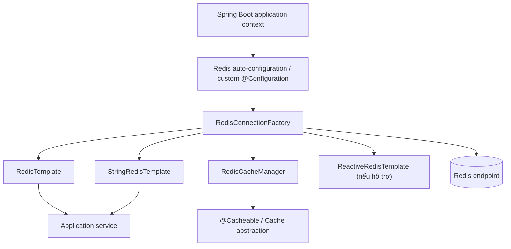

# Ứng dụng không tạo được ConnectionFactory hoặc Template trong Spring Data Redis

## 1. Hiểu đúng tình huống: không có bean hay không kết nối được Redis?

Khi Spring Boot khởi động, một lỗi liên quan đến Redis có thể xuất hiện dưới dạng:

```text
UnsatisfiedDependencyException
BeanCreationException
NoSuchBeanDefinitionException
NoUniqueBeanDefinitionException
RedisConnectionFailureException
RedisSystemException
```

Các tên exception trông giống nhau trong một stack trace dài, nhưng có thể xảy ra ở **những giai đoạn khác nhau**:

1. **Không có bean definition phù hợp:** Spring không tìm thấy `RedisConnectionFactory`, `RedisTemplate` hoặc `StringRedisTemplate` để inject.
2. **Có bean definition nhưng khởi tạo thất bại:** Spring tạo bean rồi lỗi vì cấu hình, dependency hoặc vòng phụ thuộc.
3. **Bean khởi tạo được nhưng Redis không truy cập được:** connection factory đã tồn tại, nhưng command `PING`/`GET`/`SET` thất bại do mạng, TLS, xác thực hoặc Redis server.
4. **Bean có thật nhưng inject sai loại:** cần `RedisTemplate<String, Product>`, trong khi context chỉ có template generic khác; hoặc có nhiều factory/template nên Spring không biết chọn.
5. **Bean xuất hiện trong một môi trường nhưng thiếu ở môi trường khác:** profiles, test slices, component scanning hoặc auto-configuration conditions thay đổi.

Bài này hướng dẫn chẩn đoán theo thứ tự **giai đoạn thất bại → nguyên nhân gốc → sửa đúng tầng**, thay vì thêm bean bừa bãi mỗi khi thấy một lỗi Redis.

### Một lỗi điển hình

```text
APPLICATION FAILED TO START

Parameter 0 of constructor in
com.example.catalog.ProductCacheService
required a bean of type
'org.springframework.data.redis.core.StringRedisTemplate'
that could not be found.
```

Trong trường hợp này, thông báo nói rằng Spring không tìm thấy bean cần inject. Việc đầu tiên không nên làm là tăng Redis timeout, vì chưa có bằng chứng ứng dụng đã gửi lệnh tới Redis.

Ngược lại:

```text
org.springframework.data.redis.RedisConnectionFailureException:
Unable to connect to Redis
Caused by: java.net.ConnectException: Connection refused
```

có thể xảy ra khi ứng dụng đã có `RedisTemplate`/connection factory và một đoạn code gọi Redis thật, thường ở startup hook hoặc request đầu tiên.

**Nguyên tắc:** tìm exception sâu nhất có ý nghĩa trong chuỗi `Caused by`, xem bean/method nào đang được tạo hoặc gọi, rồi mới quyết định phải sửa dependency, bean graph, profile hay network.

## 2. Bean graph cơ bản của Spring Data Redis

Các thành phần chính:

- `RedisConnectionFactory`: abstraction tạo connection tới Redis; implementation thường gặp là `LettuceConnectionFactory` hoặc `JedisConnectionFactory`.
- `RedisTemplate<K,V>`: API đồng bộ để thao tác key/value, Hash, List, Set, Sorted Set...
- `StringRedisTemplate`: template chuyên dùng Redis key và value kiểu String.
- `ReactiveRedisConnectionFactory`: abstraction kết nối cho reactive Redis.
- `ReactiveRedisTemplate<K,V>` và `ReactiveStringRedisTemplate`: API reactive tương ứng.
- `RedisCacheManager`: quản lý Spring Cache trên Redis, cần Redis connection và cấu hình serializer/TTL.
- Redis Repository infrastructure: dùng mapping, key-value operations và những thành phần được bật theo cấu hình.

Quan hệ điển hình:



Nếu thiếu `RedisConnectionFactory`, nhiều bean phụ thuộc phía trên có thể không được tạo. Nếu chỉ thiếu một `RedisTemplate<String, ProductSnapshot>`, connection factory vẫn có thể hoàn toàn bình thường.

Vì thế cần biết **bean nào thật sự thiếu** thay vì coi mọi lỗi có tên Redis đều cùng nguyên nhân.

## 3. Bảng tra cứu nhanh từ triệu chứng

| Triệu chứng | Tầng nghi ngờ đầu tiên | Kiểm tra ưu tiên |
| --- | --- | --- |
| Không tìm thấy `RedisConnectionFactory` | Dependency, auto-configuration, custom bean | Starter/driver, condition report, package/configuration |
| Không tìm thấy `StringRedisTemplate` | Auto template bean, connection factory | Có một factory phù hợp không; bean custom có thay thế default không |
| Không tìm thấy `RedisTemplate<String, Product>` | Generic type/qualifier | Template được khai báo với đúng kiểu generic chưa |
| Có hai `RedisConnectionFactory` | Bean ambiguity | `@Primary`, `@Qualifier`, tạo template chỉ rõ factory |
| `BeanCreationException` | Constructor/init method/config | Đọc `Caused by` sâu nhất, kiểm tra circular dependency |
| `NoClassDefFoundError` hoặc `ClassNotFoundException` | Classpath/dependencies | Driver và version dependency |
| `NoSuchMethodError` | Mismatch version thư viện | Dependency tree, BOM, override |
| `Connection refused` | Host/port/server/network | Endpoint, container network, Redis đang nghe |
| `UnknownHostException` | DNS/service name | Host cấu hình, DNS trong container/Kubernetes |
| `WRONGPASS`/`NOAUTH`/`NOPERM` | Authentication/ACL | Username, password, ACL command và key pattern |
| SSL handshake/certificate error | TLS/trust | TLS port, certificate chain, hostname, mTLS |
| `READONLY` sau failover | Topology/routing | Đang ghi vào replica, Sentinel/Cluster config |
| `CROSSSLOT` | Redis Cluster operation | Multi-key cùng hash slot, Lua KEYS |
| Test pass local, fail CI | Test context/profile/endpoint | `@ActiveProfiles`, Testcontainers, dynamic properties |
| Cache chạy nhưng `@Autowired RedisTemplate` fail | Template bean matching | Kiểu generic, name, qualifier, context |
| Bean tồn tại nhưng `GET` lỗi | Runtime Redis connection | Không nhầm bean creation với server availability |

Bảng là điểm bắt đầu; cùng một triệu chứng có thể có nhiều nguyên nhân. Bước tiếp theo luôn là đọc stack trace và condition report của runtime đang lỗi.

## 4. Đọc stack trace theo đúng thứ tự

Một stack trace Spring Boot thường có nhiều lớp exception:

```text
Error creating bean with name 'productController'
  Unsatisfied dependency through constructor parameter 0
    Error creating bean with name 'productService'
      Unsatisfied dependency through constructor parameter 1
        No qualifying bean of type
        'RedisTemplate<java.lang.String, ProductSnapshot>'
        available
```

Nguyên nhân gần nhất với code cần sửa là **thiếu đúng loại template**, không phải `ProductController`.

Ví dụ khác:

```text
Error creating bean with name 'redisTemplate'
  Invocation of init method failed
    IllegalArgumentException:
      RedisConnectionFactory is required
```

Ở đây template có thể được định nghĩa nhưng không được gắn connection factory.

Một ví dụ nữa:

```text
Error creating bean with name 'redisConnectionFactory'
  Caused by: IllegalStateException:
    Invalid Redis sentinel configuration
```

Tầng cấu hình factory mới là điểm điều tra.

### Cách đọc thực tế

1. Xác định tên **bean đầu tiên bị báo thất bại**.
2. Theo chuỗi `Caused by` đến lỗi sâu nhất có ý nghĩa.
3. Ghi lại **class/constructor/method `@Bean`** gây lỗi.
4. Kiểm tra đây là **bean definition missing**, **bean instantiation failure** hay **Redis command runtime failure**.
5. Xem active profiles và condition evaluation.
6. Sửa một nguyên nhân đã xác định rồi chạy lại đúng trường hợp lỗi.

Không nên che lỗi gốc bằng:

```java
try {
    // create RedisTemplate...
} catch (Exception ignored) {
    return null;
}
```

Bean method trả null hoặc nuốt exception có thể gây lỗi dependency khó hiểu hơn ở bước sau.

## 5. Dependency tối thiểu để Spring Boot cấu hình Redis

Với ứng dụng Spring Boot dùng Spring Data Redis, dependency thường là:

```xml
<dependency>
    <groupId>org.springframework.boot</groupId>
    <artifactId>spring-boot-starter-data-redis</artifactId>
</dependency>
```

Hoặc Gradle:

```gradle
implementation("org.springframework.boot:spring-boot-starter-data-redis")
```

Starter thường đưa Spring Data Redis và Redis client phù hợp vào classpath theo dependency management của Spring Boot, điển hình là Lettuce.

Nếu ứng dụng chỉ khai báo một module Spring Data Redis mà tự exclude driver, cần kiểm tra đầy đủ client dependency.

### Vì sao không thêm một version driver ngẫu nhiên để sửa lỗi?

Spring Boot dependency management thường đã định nghĩa version tương thích cho:

- Spring Framework.
- Spring Data Redis.
- Lettuce hoặc Jedis.
- Micrometer/Netty và những thư viện liên quan.

Nếu tự thêm `lettuce-core` với version bất kỳ, có thể tạo:

```text
NoSuchMethodError
NoClassDefFoundError
LinkageError
ClassCastException
```

Những lỗi này không giải quyết được bằng thay Redis host hoặc tăng timeout.

**Khuyến nghị:** ưu tiên BOM/dependency management của Spring Boot; chỉ override version khi có lý do và kiểm tra tương thích. Không trộn phiên bản Spring Data Redis từ release train khác với Spring Boot đang dùng mà thiếu đánh giá.

### Đừng exclude auto-configuration vô tình

Nếu ứng dụng có cấu hình:

```java
@SpringBootApplication(
    exclude = RedisAutoConfiguration.class
)
```

hoặc property `spring.autoconfigure.exclude` chứa Redis auto-configuration, các bean Redis mặc định có thể không được tạo.

Nếu exclusion có chủ đích vì ứng dụng dùng custom factory/template, cần bảo đảm những bean tự tạo thực sự đáp ứng injection.

## 6. Redis auto-configuration cần điều kiện phù hợp

Spring Boot tự động cấu hình Redis **theo điều kiện**, không phải cứ có một file `application.yml` với `spring.data.redis.host` là chắc chắn mọi bean sẽ xuất hiện.

Những điều kiện liên quan có thể gồm:

- Classpath chứa Spring Data Redis, client driver và classes mà auto-config yêu cầu.
- Chưa có bean custom khiến auto-config backing off.
- Có một `RedisConnectionFactory` phù hợp để tạo template.
- Không exclude auto-configuration.
- Kiểu ứng dụng và những phần auto-config liên quan có được bật trong test context không.
- Conditions theo bean name/type/generic type của version Spring Boot hiện hành.

Ví dụ, khi ứng dụng tự định nghĩa một `RedisConnectionFactory`, Spring Boot có thể **không tạo thêm factory mặc định**. Nếu factory custom sai, lỗi sẽ xuất hiện ngay cả khi properties `spring.data.redis.host` đúng.

Đừng suy rằng `@ConditionalOnMissingBean` là một cơ chế fallback khi bean custom thất bại. Condition quyết định có đăng ký bean khác hay không; nó không tự cứu một bean custom khởi tạo lỗi.

## 7. Xem Condition Evaluation Report

Spring Boot có công cụ giúp hiểu tại sao auto-configuration được áp dụng hoặc bị bỏ qua.

Chạy local/test:

```bash
java -jar catalog-service.jar --debug
```

Hoặc trong môi trường test thích hợp, bật debug cho condition evaluation theo cơ chế Spring Boot.

Report thường có phần:

```text
Positive matches:
  ...

Negative matches:
  RedisAutoConfiguration ...
  RedisReactiveAutoConfiguration ...
  ...
```

Tên chính xác và lý do condition thay đổi theo version. Đọc lý do:

- Class nào thiếu?
- Bean nào đã tồn tại làm auto-config backing off?
- Có nhiều connection factory mà không có single candidate?
- Template mặc định bị một bean cùng tên/type thay thế?
- Auto-config bị exclude?

Nếu Actuator cung cấp endpoint `/actuator/conditions`, có thể xem condition report **trên môi trường được bảo vệ**. Không mở endpoint này công khai trên production vì nó có thể lộ thông tin nội bộ ứng dụng.

### Debug đúng điều cần hỏi

Thay vì hỏi “Spring Boot có Redis không?”, hãy kiểm tra:

```text
Có RedisConnectionFactory bean chưa?
Có StringRedisTemplate bean chưa?
Có RedisTemplate bean tên redisTemplate chưa?
Có bean RedisTemplate<String, Product> phù hợp chưa?
Factory nào được inject vào template?
Auto-config nào backing off, vì bean nào?
```

Câu trả lời giúp thu hẹp nguyên nhân nhanh hơn việc thử thay hàng loạt YAML properties.

## 8. Cấu hình Redis host/port theo Spring Boot version

Ví dụ phổ biến trên Spring Boot 3.x:

```yaml
spring:
  data:
    redis:
      host: localhost
      port: 6379
      connect-timeout: 2s
      timeout: 3s
```

Ở một số phiên bản Spring Boot cũ hơn, namespace Redis properties phổ biến là `spring.redis.*` thay vì `spring.data.redis.*`. Không kết luận một đoạn YAML đúng cho mọi bản Spring Boot.

**Kiểm tra đúng version đang chạy**, không chỉ version được khai báo trong một file khác mà có thể bị dependency management override.

Nếu properties sai tên, ứng dụng có thể dùng giá trị mặc định mà người viết không dự kiến. Chẳng hạn một app chạy trong container cố kết nối `localhost:6379` vì cấu hình host thật không được bind.

Cần kiểm tra:

- Active profile.
- Tên property theo version.
- Thứ tự ưu tiên property sources.
- Environment variables đang override.
- Bean `RedisConnectionFactory` có do Boot tạo hay do code custom tạo.
- Redis topology là standalone, Sentinel hay Cluster.

## 9. Lỗi bean không tồn tại: `NoSuchBeanDefinitionException`

Ví dụ:

```text
No qualifying bean of type
'org.springframework.data.redis.connection.RedisConnectionFactory'
available
```

Kiểm tra theo thứ tự:

1. Có dependency `spring-boot-starter-data-redis` không?
2. Driver Redis phù hợp có ở runtime classpath không?
3. Có exclude `RedisAutoConfiguration` không?
4. Custom `@Configuration` nằm trong component scan không?
5. Có `@Profile` hoặc `@ConditionalOnProperty` làm bean không được tạo không?
6. Test có load đúng configuration/context không?
7. Có xung đột version hoặc lỗi class loading không?
8. Condition report nói gì?

Ví dụ một service:

```java
@Service
public class RedisHealthService {

    private final RedisConnectionFactory factory;

    public RedisHealthService(RedisConnectionFactory factory) {
        this.factory = factory;
    }
}
```

Nếu context không có factory, constructor injection thất bại ngay. Nếu factory tồn tại nhưng Redis host chưa mở, injection có thể thành công và lỗi chỉ phát sinh khi kết nối thực sự được dùng.

### Không sửa bằng `new LettuceConnectionFactory()` ở mọi service

Tạo factory rải rác ngoài Spring context có thể:

- Bỏ qua connection properties/TLS/ACL của ứng dụng.
- Không được Spring quản lý lifecycle.
- Tạo nhiều tài nguyên/connection không cần thiết.
- Gây khác biệt cấu hình giữa service và cache manager.
- Khó thay topology khi dùng Cluster/Sentinel.

Nên để Spring quản lý bean factory, dùng auto-configuration hoặc một bean custom tập trung, rõ trách nhiệm.

## 10. Cấu hình thủ công `LettuceConnectionFactory` đúng cách

Nếu cần tự tạo factory (ví dụ ứng dụng cần một endpoint Redis riêng), có thể dùng:

```java
package com.example.redis;

import org.springframework.context.annotation.Bean;
import org.springframework.context.annotation.Configuration;
import org.springframework.data.redis.connection.RedisPassword;
import org.springframework.data.redis.connection.RedisStandaloneConfiguration;
import org.springframework.data.redis.connection.lettuce.LettuceConnectionFactory;

@Configuration
public class StandaloneRedisConfig {

    @Bean
    public LettuceConnectionFactory redisConnectionFactory() {
        RedisStandaloneConfiguration server =
                new RedisStandaloneConfiguration("127.0.0.1", 6379);

        // Nếu Redis test có ACL:
        // server.setUsername("app");
        // server.setPassword(RedisPassword.of("example-only"));

        server.setDatabase(0);
        return new LettuceConnectionFactory(server);
    }
}
```

Là một bean do Spring quản lý, `LettuceConnectionFactory` có lifecycle phù hợp theo contract Spring. Không nhất thiết tự gọi `afterPropertiesSet()` trong method `@Bean` vì container sẽ gọi initialization callbacks.

**Cảnh báo:** đây là cấu hình standalone/local. Không copy nguyên endpoint hoặc password minh họa sang production. Với TLS, Sentinel hoặc Cluster, cần cấu hình factory/client configuration tương ứng.

Nếu custom factory được tạo, auto-configuration có thể lùi lại và **không áp dụng các Redis properties mặc định nữa** cho factory đó. Khi đó việc thay `application-prod.yml` sẽ không có tác dụng nếu factory custom hardcode host/port.

### Khi nào nên ưu tiên auto-config?

Nếu chỉ cần host, port, password, timeout và topology mà Spring Boot phiên bản hiện hành hỗ trợ bằng properties, auto-config thường đơn giản hơn và dễ vận hành. Chỉ tạo factory custom khi có lý do thực tế: nhiều backend Redis, client options đặc biệt, network/TLS integration riêng hoặc cần điều khiển rõ lifecycle.

## 11. `RedisTemplate` phải gắn đúng connection factory

Một bean template tạo thủ công:

```java
@Bean
public RedisTemplate<String, String> customRedisTemplate(
        RedisConnectionFactory connectionFactory) {

    RedisTemplate<String, String> template =
            new RedisTemplate<>();

    template.setConnectionFactory(connectionFactory);

    StringRedisSerializer stringSerializer =
            new StringRedisSerializer();

    template.setKeySerializer(stringSerializer);
    template.setValueSerializer(stringSerializer);
    template.setHashKeySerializer(stringSerializer);
    template.setHashValueSerializer(stringSerializer);

    return template;
}
```

Các import chính:

```java
import org.springframework.context.annotation.Bean;
import org.springframework.data.redis.connection.RedisConnectionFactory;
import org.springframework.data.redis.core.RedisTemplate;
import org.springframework.data.redis.serializer.StringRedisSerializer;
```

Nếu `RedisTemplate` được khai báo qua `@Bean` và container quản lý lifecycle, Spring sẽ thực hiện initialization callbacks thích hợp.

### Một mẫu lỗi phổ biến

```java
@Bean
RedisTemplate<String, String> brokenTemplate() {
    RedisTemplate<String, String> template =
            new RedisTemplate<>();
    // Thiếu setConnectionFactory(...)
    return template;
}
```

Khi bean được initialize hoặc sử dụng, có thể gặp lỗi liên quan tới connection factory null.

### Không trộn RedisTemplate với StringRedisTemplate tùy ý

`StringRedisTemplate` được thiết kế cho String keys và String values:

```java
@Bean
StringRedisTemplate namedStringTemplate(
        RedisConnectionFactory factory) {
    return new StringRedisTemplate(factory);
}
```

Nếu ứng dụng đã có bean auto-configured tương ứng, không cần tạo duplicate. Tạo hai bean StringRedisTemplate cùng type có thể dẫn tới ambiguous injection.

Ngoài ra, key và value serializers phải tương thích với dữ liệu đã lưu. Một string template đọc key được lưu bằng JDK key serializer có thể không thấy key mong đợi dù Redis server vẫn hoạt động.

## 12. Generic injection: có RedisTemplate nhưng Spring vẫn nói thiếu

Xem ví dụ service:

```java
@Service
public class ProductCacheService {

    private final RedisTemplate<String, ProductSnapshot> redis;

    public ProductCacheService(
            RedisTemplate<String, ProductSnapshot> redis) {
        this.redis = redis;
    }
}
```

Nếu application context chỉ có một bean:

```java
RedisTemplate<Object, Object>
```

thì **không được giả định** nó tự đáp ứng injection `RedisTemplate<String, ProductSnapshot>`. Spring có xét type/generic type của injection point và bean definition; generic mismatch có thể là nguyên nhân trực tiếp.

### Cách sửa đúng: bean typed, serializer typed

```java
@Configuration
public class ProductRedisConfig {

    @Bean("productRedisTemplate")
    RedisTemplate<String, ProductSnapshot> productRedisTemplate(
            RedisConnectionFactory factory) {

        RedisTemplate<String, ProductSnapshot> template =
                new RedisTemplate<>();

        template.setConnectionFactory(factory);
        template.setKeySerializer(
                new StringRedisSerializer());

        template.setValueSerializer(
                new Jackson2JsonRedisSerializer<>(
                        ProductSnapshot.class));

        return template;
    }
}
```

Các kiểu `ProductSnapshot`/serializer phải được khai báo/import trong dự án. Nếu DTO chứa `Instant` hoặc polymorphism, cần ObjectMapper tương thích với cấu hình Jackson đang dùng; ví dụ tập trung vào chuyện bean typed.

Inject rõ ràng:

```java
@Service
public class ProductCacheService {

    private final RedisTemplate<String, ProductSnapshot> redis;

    public ProductCacheService(
            @Qualifier("productRedisTemplate")
            RedisTemplate<String, ProductSnapshot> redis) {
        this.redis = redis;
    }
}
```

**Đừng ép cast** `RedisTemplate<Object,Object>` sang `RedisTemplate<String,ProductSnapshot>` để che generic mismatch. Cast không thay serializer và có thể dẫn tới runtime decode lỗi.

### Tên bean cũng quan trọng

Spring Boot có những bean thông dụng như `redisTemplate` và `stringRedisTemplate`. Một bean do bạn tự định nghĩa với tên trùng có thể khiến auto-config không tạo bean mặc định tương ứng. Lỗi này thường gây ngạc nhiên khi project đổi tên bean hoặc thêm `@Bean("redisTemplate")`.

Để chẩn đoán, kiểm tra **cả type, name, qualifier và số lượng candidate**, không chỉ kiểm tra có bất kỳ RedisTemplate nào tồn tại.

## 13. Có hai `RedisConnectionFactory`: `NoUniqueBeanDefinitionException`

Một ứng dụng có thể dùng Redis để cache và một Redis khác cho session/queue:

```text
catalogRedisConnectionFactory
sessionRedisConnectionFactory
```

Nếu một template khai báo:

```java
@Bean
StringRedisTemplate redisTemplate(RedisConnectionFactory factory) {
    return new StringRedisTemplate(factory);
}
```

Spring có thể không biết inject factory nào, dẫn đến:

```text
No qualifying bean of type RedisConnectionFactory available:
expected single matching bean but found 2
```

### Chỉ định bằng `@Qualifier`

```java
@Configuration
public class MultipleRedisConfiguration {

    @Bean("catalogStringRedisTemplate")
    StringRedisTemplate catalogStringRedisTemplate(
            @Qualifier("catalogRedisConnectionFactory")
            RedisConnectionFactory factory) {

        return new StringRedisTemplate(factory);
    }

    @Bean("sessionStringRedisTemplate")
    StringRedisTemplate sessionStringRedisTemplate(
            @Qualifier("sessionRedisConnectionFactory")
            RedisConnectionFactory factory) {

        return new StringRedisTemplate(factory);
    }
}
```

Inject tại service:

```java
public CatalogService(
        @Qualifier("catalogStringRedisTemplate")
        StringRedisTemplate redis) {
    this.redis = redis;
}
```

Nếu cần một default cho nhiều dependency khác, có thể đánh dấu một factory `@Primary`. Tuy nhiên **không dùng `@Primary` tùy tiện để che ranh giới nghiệp vụ** giữa Redis session và Redis cache: một template kết nối nhầm backend có thể ghi dữ liệu vào hệ thống không đúng mục đích.

### Auto-configuration có thể thay đổi khi có nhiều factory

Một số template mặc định của Spring Boot chỉ được tạo khi có một candidate RedisConnectionFactory phù hợp. Với hai factory không có primary, condition có thể không thỏa, nên cả `redisTemplate` hoặc `StringRedisTemplate` mặc định không xuất hiện dù **cả hai factory đều tồn tại**.

Đây là lý do cần xem condition report khi thêm factory thứ hai vào project.

## 14. `@Primary` khác `@Qualifier`

| Cơ chế | Dùng khi nào | Rủi ro nếu lạm dụng |
| --- | --- | --- |
| `@Primary` | Chọn bean mặc định khi có nhiều candidate | Các service dùng nhầm backend nếu quên qualifier |
| `@Qualifier` | Chỉ rõ bean cần tại injection point | Đổi tên bean mà không cập nhật injection |
| Custom bean name | Định danh bean cho phụ thuộc cụ thể | Có thể trùng tên bean auto-configured |
| Generic type | Phân biệt template theo K/V type | Type không phản ánh endpoint/serializer thực tế |
| `@Profile` | Chỉ tạo bean ở profile phù hợp | Bean thiếu trong test/prod nếu profile sai |
| `@ConditionalOnProperty` | Bật bean theo feature flag/config | Property thiếu hoặc value khác làm bean biến mất |

Một thiết kế rõ ràng cho nhiều Redis backends thường có **connection factory và template theo tên nghiệp vụ**, ví dụ `catalogRedisTemplate` và `sessionRedisTemplate`, thay vì một factory global không biết chủ sở hữu.

## 15. Bean `@Configuration` không được component scan

Spring Boot mặc định component scan từ package chứa class có `@SpringBootApplication` và các package con.

Ví dụ:

```text
com.example.catalog.CatalogApplication
com.example.catalog.config.RedisConfig     -> thường được scan
com.other.redis.RedisConfig                -> không mặc nhiên được scan
```

Nếu custom RedisConfig nằm ngoài phạm vi scan, bean method `@Bean` trong class ấy không được đăng ký.

Các cách sửa:

- Chuyển config vào package con phù hợp.
- Import tường minh cấu hình với `@Import(RedisConfig.class)`.
- Cấu hình component scan theo kiến trúc package của ứng dụng.
- Nếu dùng multi-module, bảo đảm module chứa config có trên runtime classpath.

**Không nên mở `@ComponentScan("com")` quá rộng** chỉ để tìm một bean; điều đó có thể kéo vào các config ngoài ý muốn, tạo bean trùng hoặc làm thay đổi test context.

### Phân biệt classpath và component scan

Một class có trong JAR không có nghĩa Spring sẽ tạo bean từ nó. Nó cần được đăng ký qua component scanning, import, auto-configuration hoặc cấu hình tương ứng.

## 16. `@Profile` và conditional annotations làm bean biến mất

Một custom config:

```java
@Configuration
@Profile("dev")
public class LocalRedisConfiguration {

    @Bean
    RedisConnectionFactory redisConnectionFactory() {
        return new LettuceConnectionFactory("localhost", 6379);
    }
}
```

Bean chỉ tồn tại khi active profile là `dev`. Nếu test chỉ bật `test` và auto-configuration bị exclude hoặc không có driver, factory sẽ thiếu.

Một điều kiện khác:

```java
@Bean
@ConditionalOnProperty(
        prefix = "app.redis",
        name = "enabled",
        havingValue = "true")
RedisTemplate<String, String> customTemplate(
        RedisConnectionFactory factory) {
    // ...
}
```

Nếu `app.redis.enabled` không tồn tại hoặc không bằng `true`, method không được tạo theo điều kiện đó.

Kiểm tra:

1. Active profiles thực tế.
2. ConditionalOnProperty name/value và `matchIfMissing`.
3. Environment overrides.
4. Config class có được load không.
5. Condition report.

Không giải quyết bằng `@Autowired(required = false)` nếu Redis là dependency bắt buộc của service: nó chuyển lỗi khởi động rõ ràng thành NullPointerException hoặc hành vi thiếu kiểm soát về sau.

## 17. Vòng phụ thuộc khiến bean creation thất bại

Một lỗi:

```text
BeanCurrentlyInCreationException:
Requested bean is currently in creation
```

có thể xảy ra khi:

```text
RedisConfig -> ProductService
ProductService -> RedisTemplate
RedisTemplate -> RedisConfig
```

Ví dụ anti-pattern: một `@Configuration` cần inject service nghiệp vụ trong constructor, trong khi service lại inject template được tạo bởi chính configuration đó.

Cách xử lý:

- Redis infrastructure config chỉ phụ thuộc connection properties và framework types.
- Service nghiệp vụ phụ thuộc template, **không ngược lại**.
- Tách serializer/mapping thành bean độc lập nếu cần.
- Không gọi service nghiệp vụ để seed dữ liệu trong lúc chính template của service đó đang được tạo.
- Nếu cần seed, dùng một startup runner sau khi context được tạo, với giới hạn môi trường và không chạy lệnh phá dữ liệu.

Không bật cơ chế cho phép circular references chỉ để giấu thiết kế phụ thuộc vòng. Vòng dependency thường phản ánh ranh giới config/logic cần được tách.

## 18. Lỗi do khai báo bean tự gọi lẫn nhau hoặc quản lý lifecycle sai

Những mẫu cần tránh:

```java
@Bean
RedisTemplate<String, String> redisTemplate() {
    RedisTemplate<String, String> t = new RedisTemplate<>();
    t.setConnectionFactory(redisConnectionFactory());
    return t;
}
```

Trong `@Configuration` proxy mode chuẩn, một lời gọi bean method có thể được Spring intercept để lấy bean hiện có. Nhưng nếu configuration class bị đổi sang `proxyBeanMethods = false` hoặc bean method được gọi thủ công, lời gọi trên có thể **tạo thêm một factory instance** ngoài dự định.

Ưu tiên dependency injection qua method parameter:

```java
@Bean
RedisTemplate<String, String> redisTemplate(
        RedisConnectionFactory factory) {
    RedisTemplate<String, String> t = new RedisTemplate<>();
    t.setConnectionFactory(factory);
    return t;
}
```

Cách này rõ ràng hơn, dễ test hơn và không phụ thuộc vào lời gọi giữa bean methods.

### Không khởi tạo bean managed bằng `new` tại service

```java
// Không nên nếu muốn dùng bean đã cấu hình:
RedisTemplate<String, String> redis =
        new RedisTemplate<>();
```

Object này chưa có connection factory, serializers/lifecycle phù hợp. Hãy inject bean từ Spring context.

## 19. Bean `StringRedisTemplate` có thật nhưng constructor vẫn báo lỗi

Một số tình huống:

- Có nhiều `StringRedisTemplate` và không có `@Primary`/`@Qualifier`.
- Template có tên khác với qualifier được yêu cầu.
- Một custom template được khai báo với generic khác type injection.
- Test dùng context bị rút gọn và không import config.
- `@MockBean`/mock bean hoặc test overrides đã thay bean thật trong phạm vi test.
- Có bean nằm trong child/parent application context không phải context nơi service đang được inject.
- Một custom `BeanFactoryPostProcessor` hoặc auto-config exclusion đã thay bean definitions.

Khi chẩn đoán, cần xem danh sách bean thực của context hiện tại, không chỉ tìm thấy chữ `StringRedisTemplate` trong code.

### Lấy danh sách bean trong môi trường chẩn đoán

Có thể dùng một đoạn debug **chỉ chạy ở local/test**:

```java
@Bean
@Profile("dev")
ApplicationRunner redisBeanInventory(
        ApplicationContext context) {

    return args -> {
        Map<String, RedisConnectionFactory> factories =
                context.getBeansOfType(
                        RedisConnectionFactory.class);

        Map<String, RedisTemplate> templates =
                context.getBeansOfType(RedisTemplate.class);

        factories.keySet().forEach(name ->
                System.out.println("Redis factory bean: " + name));

        templates.keySet().forEach(name ->
                System.out.println("Redis template bean: " + name));
    };
}
```

Thêm import cho các kiểu Spring/Java liên quan. Đoạn code chỉ in **bean names**, không in password/connection URL hoặc value của key.

Lưu ý `getBeansOfType(...)` có thể khiến một số bean được khởi tạo tùy ngữ cảnh; chỉ dùng khi đã chủ động debug, không biến thành endpoint công khai hoặc startup diagnostic bắt buộc trên production.

## 20. Phân biệt bean creation failure và kết nối runtime failure

Spring Data Redis có thể tạo `LettuceConnectionFactory` thành công ngay cả khi Redis server chưa sẵn sàng; connection thật có thể được mở khi command được gọi, tùy cấu hình client/lifecycle.

Ví dụ:

```java
@Autowired
StringRedisTemplate redis;
```

Injection thành công không chứng minh Redis reachable.

Ngược lại, nếu ứng dụng có startup code:

```java
@PostConstruct
void warmup() {
    redis.opsForValue().get("warmup:key");
}
```

Redis chưa sẵn sàng có thể làm bean chứa `@PostConstruct` khởi tạo lỗi. Stack trace có thể xuất hiện dưới dạng `BeanCreationException` ở bean warmup, nhưng nguyên nhân thật là **Redis command failure** bên trong startup hook.

Nên phân biệt:

| Trạng thái | Điều biết được |
| --- | --- |
| Có factory bean | Spring biết cách tạo Redis connection |
| Có template bean | Redis operations có API để gọi |
| `PING` thành công | Endpoint trả lời ở thời điểm kiểm tra |
| `GET/SET` thành công | Command, serializer, ACL và route của thao tác đó hoạt động |
| App startup thành công | Bean graph đã được tạo; không chứng minh mọi Redis command hoạt động |
| Health UP | Một phép kiểm tra hiện tại thành công; không chứng minh failover/persistence |

Không dùng `PING` thành công để kết luận một Redis user có quyền `SET`/`EVAL`/`XREADGROUP` hay Redis Cluster multi-key luôn hoạt động.

## 21. Phép kiểm tra kết nối an toàn, có giới hạn

Khi đã xác nhận bean tồn tại, trong môi trường cho phép có thể kiểm tra:

```bash
redis-cli -h 127.0.0.1 -p 6379 PING
```

Với TLS và CA thích hợp (ví dụ định hướng, điều chỉnh theo hạ tầng):

```bash
redis-cli --tls --cacert /path/to/ca.pem \
  -h redis.example.internal -p 6380 PING
```

Cần xác thực theo cơ chế an toàn của môi trường; không đưa password vào command-line history hoặc output tool. Trên một số môi trường managed Redis, chỉ client được cấp quyền/mạng mới có thể kết nối.

### Các loại lỗi thường gặp

| Lỗi | Ý nghĩa thường thấy |
| --- | --- |
| Connection refused | Host có thể truy cập nhưng không có service nghe port, hoặc kết nối bị từ chối |
| Connection timed out | Network/filter/firewall hoặc Redis không phản hồi trong ngân sách |
| UnknownHostException | DNS/service name không phân giải được |
| SSLHandshakeException | TLS protocol, certificate chain, hostname hoặc mTLS |
| NOAUTH/WRONGPASS | Chưa xác thực hoặc thông tin xác thực sai |
| NOPERM | ACL user thiếu quyền command/key/channel |
| READONLY | Lệnh ghi đang đến replica hoặc node đổi role |
| MOVED/ASK | Routing theo slot trong Redis Cluster, cần cluster-aware client |
| CROSSSLOT | Các key của lệnh nhiều key không cùng hash slot |
| WRONGTYPE | Data type của key không phù hợp command |

Đừng “sửa” TLS error bằng cách tắt certificate verification hoặc “sửa” ACL bằng cấp quyền `+@all` cho mọi ứng dụng.

## 22. Localhost trong Docker/Kubernetes là nguồn lỗi rất phổ biến

Một YAML:

```yaml
spring:
  data:
    redis:
      host: localhost
      port: 6379
```

có thể đúng khi ứng dụng Java chạy **trực tiếp trên laptop**, còn Redis container map port lên host.

Nhưng khi app và Redis ở hai container cùng Docker Compose:

```text
App container
  127.0.0.1 -> app container, KHÔNG PHẢI Redis container

Redis container
  service hostname -> redis
```

Trong Compose:

```yaml
spring:
  data:
    redis:
      host: redis
      port: 6379
```

Trong Kubernetes, dùng DNS/service endpoint phù hợp, không mặc định là localhost. Managed Redis còn có thể yêu cầu private networking, DNS và TLS.

**Khi thấy `Connection refused: localhost:6379` trong container, trước tiên kiểm tra profile/host runtime, không tạo thêm một RedisTemplate bean.**

## 23. Profiles và config precedence làm factory kết nối nhầm endpoint

Ví dụ dự án có:

```text
application.yml
application-dev.yml
application-test.yml
application-prod.yml
```

Môi trường production phải bật profile rõ:

```bash
java -jar app.jar --spring.profiles.active=prod
```

Nhưng có thể một environment variable override file:

```text
SPRING_DATA_REDIS_HOST=127.0.0.1
```

Khi đó bean vẫn được tạo, nhưng kết nối tới địa chỉ không mong muốn.

Tình huống khác: custom `LettuceConnectionFactory` dùng hardcoded host, khiến mọi property `spring.data.redis.host` không ảnh hưởng factory ấy.

Cách điều tra:

1. Xác định profile đang active.
2. Xem condition report để biết factory do ai tạo.
3. Kiểm tra nguồn property có thứ tự ưu tiên cao.
4. Đối chiếu endpoint đã cấu hình mà không in secret.
5. Xác nhận config class custom có đọc property hay không.
6. Đảm bảo test không fallback Redis production/shared khi thiếu container.

Không chỉ sửa một file YAML rồi kết luận đã giải quyết nếu một `@Bean` custom hoàn toàn bỏ qua YAML đó.

## 24. Lỗi authentication và Redis ACL

Một cấu hình production có thể có:

```yaml
spring:
  data:
    redis:
      host: ${REDIS_HOST}
      port: ${REDIS_PORT:6379}
      username: ${REDIS_USERNAME}
      password: ${REDIS_PASSWORD}
```

Các placeholder là Spring property placeholders; giá trị phải được cấp từ runtime/secret manager. Không đặt password thật trong repository hoặc ví dụ học tập.

Với Redis ACL, username và password phải khớp Redis user được cấp. Sai thông tin có thể tạo lỗi ở connection/authentication stage, không nhất thiết là thiếu bean.

Một client đã AUTH thành công nhưng không có quyền `GET`, `SET`, `PSUBSCRIBE` hoặc `EVAL` có thể gặp `NOPERM` khi chạy command.

### Kiểm tra quyền theo thao tác

| Use case | Lệnh/quyền cần xem |
| --- | --- |
| Cache String | `GET`/`SET`/`DEL`, TTL commands nếu có |
| Redis Hash | `HGET`/`HSET`/`HGETALL` |
| Spring Cache eviction | `DEL` hoặc chiến lược cleanup tương ứng |
| Lua | `EVAL`/`EVALSHA` và các lệnh bên trong script |
| Redis Pub/Sub | `SUBSCRIBE`/`PSUBSCRIBE`, channel patterns |
| Redis Streams | `XADD`/`XREADGROUP`/`XACK` và consumer commands |
| Diagnostics | `PING`, `INFO` tùy quyền |

Đừng thử sửa `NoSuchBeanDefinitionException` bằng đổi ACL: ở giai đoạn chưa có bean, Redis chưa chắc đã được liên hệ.

## 25. TLS handshake lỗi khi bean được dùng

Ví dụ production:

```yaml
spring:
  data:
    redis:
      ssl:
        enabled: true
      host: ${REDIS_HOST}
      port: ${REDIS_PORT:6380}
```

Lỗi có thể do:

- Kết nối TLS vào cổng plaintext.
- Kết nối plaintext vào cổng TLS.
- CA certificate chưa được JVM trust.
- Hostname không khớp certificate.
- Redis server yêu cầu mutual TLS.
- Cluster topology trả endpoint mà certificate không hợp lệ đối với client.
- Proxy/load balancer dùng TLS termination khác dự kiến.

Cần sửa TLS configuration theo hạ tầng/phiên bản driver. Không vô hiệu hóa hostname verification để “test cho pass” rồi đưa cấu hình đó vào production.

Một số phiên bản Spring Boot/Redis client hỗ trợ SSL bundles hoặc client config tùy biến; cần đối chiếu version thay vì giả định mọi property TLS đều có mặt.

## 26. Sentinel và Cluster không phải standalone nhiều host

### Sentinel

Redis Sentinel giúp client tìm primary hiện hành của một master group. Ví dụ cấu hình định hướng:

```yaml
spring:
  data:
    redis:
      sentinel:
        master: catalog-primary
        nodes:
          - sentinel-1.internal:26379
          - sentinel-2.internal:26379
          - sentinel-3.internal:26379
```

Sai tên master, endpoint Sentinel hoặc credentials/TLS của Sentinel có thể làm connection factory hoặc connection runtime thất bại.

### Cluster

Redis Cluster có nhiều primary chia hash slots:

```yaml
spring:
  data:
    redis:
      cluster:
        nodes:
          - redis-node-a.internal:6379
          - redis-node-b.internal:6379
          - redis-node-c.internal:6379
        max-redirects: 5
```

Nếu dùng `RedisStandaloneConfiguration` trỏ tới một node Cluster rồi mong client tự xử lý mọi slot, ứng dụng có thể gặp redirect hoặc lệnh không hoạt động đúng. Cần factory/driver cluster-aware.

Trong Cluster:

- Multi-key commands cần tuân thủ hash slot.
- Database number khác 0 không được dùng như standalone.
- `SCAN` cơ bản thuộc phạm vi node.
- Keyspace notifications thuộc node phát sinh event.
- Topology refresh cần phù hợp failover/reshard.

**Một lỗi `CROSSSLOT` không phải vì thiếu template.** Nó chứng minh đã có đường thực thi command tới Redis nhưng thao tác vi phạm ràng buộc Cluster.

## 27. Lỗi reactive: cần ReactiveRedisConnectionFactory và template phù hợp

Ví dụ:

```java
@Service
public class ReactiveProductCache {

    private final ReactiveStringRedisTemplate redis;

    public ReactiveProductCache(
            ReactiveStringRedisTemplate redis) {
        this.redis = redis;
    }

    public Mono<String> find(String sku) {
        return redis.opsForValue().get(
                "catalog:status:" + sku);
    }
}
```

Nếu context chỉ có imperative `RedisTemplate` hoặc `StringRedisTemplate`, nó không tự chuyển thành `ReactiveStringRedisTemplate`. Reactive template cần Redis reactive connection factory/driver support phù hợp.

Lettuce thường hỗ trợ reactive trong Spring Data Redis; không mặc định Jedis configuration có cùng reactive API.

Các bước kiểm tra:

1. Có đúng Spring Data Redis starter và driver hỗ trợ reactive không?
2. Có `ReactiveRedisConnectionFactory` bean không?
3. Có `ReactiveRedisTemplate`/`ReactiveStringRedisTemplate` phù hợp không?
4. Reactive auto-config có bị exclude/back off không?
5. Có custom connection factory chỉ hỗ trợ imperative không?
6. Test context có import reactive Redis auto-config không?

Không sửa bằng cách gọi `.block()` trên imperative template hoặc ép generic cast. Chọn đúng API và cách cấu hình.

## 28. Khi kết hợp Spring Cache và RedisTemplate

Ứng dụng có thể dùng:

```java
@Cacheable(cacheNames = "productCache", key = "#sku")
public ProductSnapshot findProduct(String sku) {
    return repository.load(sku);
}
```

Một lỗi `RedisCacheManager` không có bean khác với lỗi `RedisTemplate`. Cache abstraction phụ thuộc `CacheManager` tương ứng; application có thể có `StringRedisTemplate` chạy bình thường nhưng không có RedisCacheManager theo mong đợi vì:

- Chưa bật/định cấu hình caching phù hợp.
- Cache auto-config chọn provider khác.
- Có custom CacheManager thay thế.
- Redis connection factory không phải single candidate.
- Profile/condition không đăng ký custom RedisCacheManager.

Cần kiểm tra:

```text
CacheManager bean thực tế là gì?
RedisCacheManager được tạo hay không?
Bean redisConnectionFactory nào được dùng?
Tên cache và serializer được cấu hình ra sao?
```

Không sử dụng sự tồn tại của `StringRedisTemplate` như bằng chứng mọi `@Cacheable` sẽ dùng Redis.

### Một custom CacheManager có thể thay auto-configuration

Nếu ứng dụng khai báo:

```java
@Bean
CacheManager cacheManager() {
    return new ConcurrentMapCacheManager();
}
```

thì `@Cacheable` có thể dùng cache in-memory thay vì Redis theo cách chọn CacheManager. Đó là vấn đề bean/configuration, không phải lỗi Redis host.

## 29. Redis Repository tạo lỗi vì configuration infrastructure

Nếu ứng dụng dùng repository:

```java
@RedisHash("profiles")
public class Profile {
    @Id
    private String id;
    private String displayName;
}
```

và:

```java
public interface ProfileRepository
        extends CrudRepository<Profile, String> {
}
```

cần những thành phần repository infrastructure được bật/scan phù hợp. Một custom configuration sai bean name hoặc thiếu RedisKeyValue operations có thể làm repository context khởi tạo lỗi.

Cần phân biệt:

- Không tìm thấy repository bean vì interface không được scan/enable.
- Repository bean được tạo nhưng thiếu dependency RedisKeyValue/connection.
- Mapping entity lỗi do annotation/constructor/serialization.
- Command runtime lỗi khi save/find.

Nếu bật `@EnableRedisRepositories` thủ công, hãy kiểm tra base packages và factory/operations references tương ứng, nhất là dự án nhiều Redis backends. Không bật annotation ở package quá rộng khiến một repository loại khác bị nhận nhầm.

## 30. Test context: `@SpringBootTest` khác test slice

Một service chạy bình thường nhưng unit test báo:

```text
No qualifying bean of type 'StringRedisTemplate'
```

có thể vì bài test **không load toàn bộ application context**.

Ví dụ một controller slice:

```java
@WebMvcTest(ProductController.class)
class ProductControllerTest {
    // Chỉ dựng phần MVC cần kiểm thử.
}
```

Nó không tự đảm bảo các bean Redis của ứng dụng sẽ được tạo. Nếu controller/service cần Redis, có thể mock service ở ranh giới phù hợp thay vì khởi động Redis trong một test controller thuần.

Một integration test:

```java
@SpringBootTest
@ActiveProfiles("test")
class ProductRedisIntegrationTest {
    // Dùng Redis test độc lập.
}
```

sẽ load context rộng hơn, nhưng vẫn cần đúng connection properties và Redis test server.

### Không “sửa” unit test bằng hardcode Redis production

Nếu test cần kiểm tra logic service mà không quan tâm network, dùng mock/template stub theo scope phù hợp. Nếu cần kiểm tra thật codec, TTL, Lua, transaction, Streams hoặc Pub/Sub, dùng Redis Testcontainers.

Mục tiêu là test đúng ranh giới và độc lập với production, không phải ép mọi test lên full application context.

## 31. Ví dụ Testcontainers để chẩn đoán bean trong môi trường test

Một integration test tối thiểu:

```java
package com.example.redis;

import static org.assertj.core.api.Assertions.assertThat;

import org.junit.jupiter.api.Test;
import org.springframework.beans.factory.annotation.Autowired;
import org.springframework.boot.test.context.SpringBootTest;
import org.springframework.data.redis.connection.RedisConnectionFactory;
import org.springframework.data.redis.core.StringRedisTemplate;
import org.springframework.test.context.ActiveProfiles;
import org.springframework.test.context.DynamicPropertyRegistry;
import org.springframework.test.context.DynamicPropertySource;
import org.testcontainers.containers.GenericContainer;
import org.testcontainers.junit.jupiter.Container;
import org.testcontainers.junit.jupiter.Testcontainers;
import org.testcontainers.utility.DockerImageName;

@Testcontainers
@SpringBootTest
@ActiveProfiles("test")
class RedisBeanIntegrationTest {

    @Container
    static final GenericContainer<?> REDIS =
            new GenericContainer<>(
                    DockerImageName.parse("redis:7.4-alpine"))
                    .withExposedPorts(6379);

    @DynamicPropertySource
    static void redisSettings(DynamicPropertyRegistry registry) {
        registry.add("spring.data.redis.host", REDIS::getHost);
        registry.add("spring.data.redis.port",
                () -> REDIS.getMappedPort(6379));
    }

    @Autowired
    RedisConnectionFactory factory;

    @Autowired
    StringRedisTemplate template;

    @Test
    void createsBeansAndCanRoundTrip() {
        assertThat(factory).isNotNull();
        assertThat(template).isNotNull();

        String key = "it:redis:bean:" + java.util.UUID.randomUUID();

        template.opsForValue().set(key, "ACTIVE");

        assertThat(template.opsForValue().get(key))
                .isEqualTo("ACTIVE");
    }
}
```

Test cho biết hai điều:

1. Spring context có các bean được inject.
2. Lệnh String SET/GET hoạt động với Redis endpoint của test.

Không có nghĩa production TLS, ACL, Cluster, Sentinel failover hoặc typed JSON serializer đều đã được kiểm chứng.

Nếu test thất bại ngay ở context startup, quay về condition report và stack trace; nếu bean có rồi nhưng SET/GET lỗi, điều tra kết nối/runtime command.

### Không fallback Redis local khi Docker chưa sẵn sàng

Testcontainers dùng mapped port động. Nếu môi trường CI không có Docker runtime phù hợp, test nên fail rõ hoặc được phân nhóm bỏ qua theo chính sách; đừng fallback `localhost:6379` và vô tình kết nối vào Redis khác.

## 32. Dependency version mismatch: lỗi không thuộc Redis server

Các dấu hiệu:

```text
java.lang.NoSuchMethodError
java.lang.NoClassDefFoundError
java.lang.ClassNotFoundException
java.lang.IncompatibleClassChangeError
```

Ví dụ một library được compile với method mới của Lettuce, nhưng runtime classpath lại có Lettuce cũ. Spring không thể tạo factory dù Redis server hoàn toàn khỏe.

Kiểm tra:

- Boot version đang chạy.
- Spring Data Redis version.
- Lettuce/Jedis version.
- Những dependency transitive bị kéo từ module khác.
- Overrides trong `dependencyManagement`/Gradle constraints.
- Shaded JAR, fat JAR đóng gói nhầm version.
- Java runtime version và binary compatibility.
- Netty dependency conflicts nếu có.

Không “chữa” bằng đổi Redis password hoặc tăng timeout. Cần căn chỉnh dependency graph.

**Lưu ý phạm vi STEP 4:** bài học chỉ nêu phương pháp phân tích; việc thực thi build/test dependency tree trên dự án cụ thể cần thực hiện ở quy trình kỹ thuật phù hợp, không phải bắt buộc cho mọi lỗi bean.

## 33. Circular dependency và lazy initialization che triệu chứng

Một bean có thể được khởi tạo muộn tùy Spring configuration hoặc application startup. Khi dùng lazy injection:

```java
@Lazy
@Autowired
RedisTemplate<String, String> redis;
```

application có thể startup nhưng lỗi bean xuất hiện khi service được gọi. Điều này không sửa nguyên nhân thiếu bean/cấu hình; nó chỉ dời thời điểm phát hiện.

Đặc biệt, đừng bật global lazy initialization để tránh một BeanCreationException mà không hiểu gốc. Production có thể nhận traffic rồi mới gặp lỗi đầu tiên, khiến sự cố khó xử lý hơn.

Nếu Redis là dependency bắt buộc, nên xác nhận bean configuration và readiness theo mức độ cần thiết, không đợi user request đầu tiên để phát hiện lỗi định nghĩa bean.

Nếu Redis là cache tùy chọn, có thể thiết kế fallback rõ ràng; tuy nhiên fallback nên ở business boundary, không phải bằng cách trả null RedisTemplate rồi để mọi service xử lý ngầm.

## 34. Kiểm tra bean type thực tế và constructor signature

Một constructor:

```java
public PriceService(RedisTemplate<String, BigDecimal> redis) {
    this.redis = redis;
}
```

phải có bean phù hợp về type/generic. Tương tự:

```java
public PriceService(
        @Qualifier("priceRedisTemplate")
        RedisTemplate<String, BigDecimal> redis) {
    this.redis = redis;
}
```

nếu `@Bean` mang tên `productRedisTemplate` thì qualifier không khớp.

Một số dự án inject interface khác:

```java
RedisOperations<String, BigDecimal>
```

`RedisTemplate` implements RedisOperations, nhưng match theo generic và qualifier vẫn phải phù hợp. Tránh cố tạo mọi loại RedisOperations chung chung rồi kỳ vọng serializer chính xác.

Trong trường hợp nhiều generic templates, naming/qualifier tường minh giúp tránh những thay đổi khó đoán khi có thêm một bean mới.

## 35. Một cấu hình hoàn chỉnh cho standalone Redis với template typed

Ví dụ cấu hình thực hành:

```java
package com.example.catalog;

import org.springframework.context.annotation.Bean;
import org.springframework.context.annotation.Configuration;
import org.springframework.data.redis.connection.RedisConnectionFactory;
import org.springframework.data.redis.core.RedisTemplate;
import org.springframework.data.redis.serializer.StringRedisSerializer;
import org.springframework.data.redis.serializer.Jackson2JsonRedisSerializer;

@Configuration
public class CatalogRedisTemplateConfig {

    @Bean("catalogProductTemplate")
    public RedisTemplate<String, ProductSnapshot> productTemplate(
            RedisConnectionFactory factory) {

        RedisTemplate<String, ProductSnapshot> template =
                new RedisTemplate<>();

        template.setConnectionFactory(factory);
        template.setKeySerializer(
                new StringRedisSerializer());

        template.setValueSerializer(
                new Jackson2JsonRedisSerializer<>(
                        ProductSnapshot.class));

        template.setHashKeySerializer(
                new StringRedisSerializer());

        return template;
    }
}
```

Service:

```java
@Service
public class CatalogProductStore {

    private final RedisTemplate<String, ProductSnapshot> redis;

    public CatalogProductStore(
            @Qualifier("catalogProductTemplate")
            RedisTemplate<String, ProductSnapshot> redis) {
        this.redis = redis;
    }

    public void put(ProductSnapshot snapshot) {
        redis.opsForValue().set(
                "catalog:product:" + snapshot.sku(),
                snapshot,
                Duration.ofMinutes(10));
    }

    public ProductSnapshot find(String sku) {
        return redis.opsForValue().get(
                "catalog:product:" + sku);
    }
}
```

Minh họa DTO:

```java
public record ProductSnapshot(
        String sku,
        String title,
        long priceCents) {
}
```

Mẫu được tập trung vào:

- Bean được Spring quản lý.
- Factory được inject vào template.
- Serializer key/value tương ứng type.
- Bean name có qualifier rõ.
- Service không tự new factory/template.

Các import `@Service`, `@Qualifier`, `Duration` cần được thêm theo project. Cấu hình TLS/ACL/topology được xử lý ở connection factory tự động hoặc custom theo môi trường.

Đây là ví dụ cho String key và JSON value typed; không dùng cùng serializer cho Redis counter muốn `INCR` trực tiếp, hoặc áp codec DTO này lên các cache chứa nhiều Java types.

## 36. Tránh nhầm lỗi serializer với lỗi bean creation

Giả sử template bean được tạo thành công, nhưng khi `get(...)`:

```text
SerializationException
Could not read JSON
Cannot deserialize value
```

Đó thường là lỗi **codec hoặc dữ liệu trong Redis**, không phải `RedisConnectionFactory` thiếu.

Các nguyên nhân:

- Value cũ lưu bằng JDK serialization, version mới đọc JSON.
- Hai service dùng cùng key nhưng khác serializer.
- JSON schema đã đổi class/field.
- Jackson thiếu Java Time module cho `Instant`/`LocalDateTime`.
- Một service ghi raw String còn service khác đọc DTO.
- Redis Hash field/value serializer không tương thích.
- Generic polymorphic type metadata không hợp lệ/không an toàn.

Nếu lỗi xuất hiện khi bean serializer được tạo (ví dụ ObjectMapper custom bean bị lỗi), đó là bean creation failure. Nhưng nếu chỉ khi đọc một key cụ thể mới lỗi, cần xem payload format và migration.

Không thay factory hoặc Redis host chỉ vì deserialize thất bại sau khi Redis đã trả bytes thành công.

## 37. Chẩn đoán trong ứng dụng nhiều module

Một project nhiều module có thể có:

```text
catalog-api
catalog-service
redis-adapter
shared-config
```

Các lỗi thường gặp:

1. Module `redis-adapter` không được khai báo runtime dependency của app.
2. Class `RedisConfig` nằm ngoài component scan.
3. Một module exclude Redis auto-config để chạy unit test nhưng exclusion lọt sang app.
4. Có hai bean factory từ hai module, gây ambiguity.
5. Bean `RedisTemplate<String, Product>` bị khai báo package-specific khác và qualifier không trùng.
6. Một module chứa dependency Lettuce/Jedis version khác.
7. Config shared đặt host cứng, override profile của app.

Thiết kế tốt hơn:

- Chỉ một nơi sở hữu wiring Redis infrastructure cho mỗi endpoint.
- Export service/repository abstraction ở module ngoài; hạn chế phụ thuộc RedisTemplate tràn lan.
- Nếu có nhiều Redis backend, đặt tên bean theo role.
- Tránh duplicated `@Configuration` được import hai lần.
- Phân loại dependency compile/test/runtime rõ ràng.

Một module có class `RedisTemplateConfig` trên classpath không tự bảo đảm Spring đã load class đó thành configuration.

## 38. Khi Spring Boot và Spring Data Redis đã đổi phiên bản

Các tên API/property/auto-config conditions có thể thay đổi theo major/minor version. Khi nâng Spring Boot, cần kiểm tra:

- Đường namespace properties Redis.
- Starter/driver dependency management.
- Package và class của Lettuce/Jedis connection factories.
- Constructors/serialization APIs.
- Reactive auto-configuration.
- Cache configuration defaults.
- Testcontainers integration annotations.
- Spring Boot native/AOT compatibility nếu ứng dụng build native.
- Những custom bean names/tags trước đây dựa vào auto-config internals.

Tránh sao chép một snippet từ phiên bản khác rồi kết luận thiếu Redis server. Nếu thấy `NoSuchMethodError` trong Spring Data Redis/Lettuce classes, ưu tiên kiểm tra dependency alignment.

### Có nên pin mọi dependency version?

Khi dùng Boot parent/BOM, nhiều dependency đã được quản lý. Chỉ pin/override có chủ đích, ghi lại lý do và kiểm tra transitive dependencies, thay vì đặt version lẻ ở mỗi module.

## 39. Quy trình chẩn đoán từng bước khi ứng dụng không khởi động

Dùng trình tự sau để tránh nhảy sai tầng:

### Bước 1 — Thu lỗi đầy đủ

Lấy stack trace khởi động và tìm `Caused by` sâu nhất.

Phân loại vào một trong các nhóm:

```text
A. Missing bean (NoSuchBeanDefinition)
B. Ambiguous bean (NoUniqueBeanDefinition)
C. Bean construction/init failure
D. Class loading/linkage failure
E. Redis network/auth/TLS failure trong startup hook
F. Serializer/runtime command failure
```

### Bước 2 — Đọc injection point

Bean nào thiếu? `RedisConnectionFactory`, `StringRedisTemplate`, `RedisTemplate<String, DTO>` hay `ReactiveRedisTemplate`?

Ghi lại **generic type**, **qualifier** và **bean name**.

### Bước 3 — Kiểm tra dependency và auto-config

Xác định starter/driver trên runtime classpath, exclusions và version alignment. Xem condition report, không suy từ file cấu hình tồn tại.

### Bước 4 — Kiểm tra package scanning/profiles

Có `@Configuration` được load không? `@Profile`/`@ConditionalOnProperty` có đang loại bean không?

### Bước 5 — Kiểm tra số lượng factories/templates

Nếu có hai RedisConnectionFactory, chọn explicit qualifier hoặc primary theo thiết kế. Nếu một template custom trùng bean name mặc định, xem nó đã thay auto bean nào.

### Bước 6 — Kiểm tra template wiring

Template tự tạo đã set factory chưa? Serializer có khớp key/value type không? Bean method được Spring quản lý chưa?

### Bước 7 — Chỉ sau khi bean graph hợp lệ, kiểm tra Redis endpoint

Host/port, container DNS, TLS, ACL, Sentinel/Cluster. Kiểm tra một command nhỏ trong môi trường phù hợp.

### Bước 8 — Tách lỗi command khỏi lỗi config

`PING` thành công chưa đủ; thử đúng command/serializer nghiệp vụ trên Redis test hoặc staging.

### Bước 9 — Kiểm tra môi trường test/CI

Test slice có load Redis config không? Testcontainers có cấp mapped port? Có risk fallback Redis khác không?

### Bước 10 — Ghi nguyên nhân và phép kiểm chứng

Một bản tóm tắt hữu ích:

```text
Root cause:
  ProductService injected RedisTemplate<String, ProductSnapshot>
  but context only contained RedisTemplate<Object, Object>.

Fix:
  Define typed productRedisTemplate and qualifier.

Verification:
  Spring context starts in test profile.
  Typed SET/GET round-trip succeeds against isolated Redis.
```

Bài học là phân biệt nguồn gốc lỗi, không phải thay đồng thời dependency, TLS, profile và serializer khiến không biết sửa gì đã hiệu quả.

## 40. Sơ đồ quyết định chẩn đoán

```mermaid
flowchart TD
    A["Ứng dụng lỗi liên quan Redis"] --> B{"Bean có bị thiếu?"}
    B -->|"Có"| C["Kiểm tra starter, driver, auto-config, profiles, scan"]
    C --> D{"Có nhiều candidate?"}
    D -->|"Có"| E["Chọn @Qualifier / @Primary có chủ đích"]
    D -->|"Không"| F["Kiểm tra bean name, generic type, exclusions"]
    B -->|"Không"| G{"Bean creation/init thất bại?"}
    G -->|"Có"| H["Đọc Caused by: null factory, circular dependency, classpath"]
    G -->|"Không"| I{"Command kết nối thất bại?"}
    I -->|"Có"| J["Host/DNS/port/TLS/ACL/topology"]
    I -->|"Không"| K["Codec, business operation, TTL, Redis data type"]
    E --> L["Chạy đúng test context / endpoint cô lập"]
    F --> L
    H --> L
    J --> L
    K --> L
```



Phép kiểm chứng phải có cả context injection và command thích hợp; một factory bean khác với một Redis connection thực sự chạy.

## 41. Những hiểu lầm thường gặp

**“Redis server không chạy nên Spring không thể tạo `RedisTemplate`.”**  
Không nhất thiết. Factory/template có thể được tạo trước khi mở connection thật. Xem stack trace để biết lỗi ở giai đoạn nào.

**“Thêm `spring.data.redis.host` sẽ tự tạo mọi bean dù thiếu starter.”**  
Không. Auto-configuration cần đúng classes/driver/conditions.

**“Có một `RedisTemplate<Object,Object>` là inject được mọi `RedisTemplate<String,T>`.”**  
Không được giả định; generics và qualifiers có ý nghĩa trong bean matching.

**“Hai connection factory sẽ tự được chọn theo template name.”**  
Không mặc định. Cần explicit wiring hoặc single primary candidate phù hợp.

**“Bean tồn tại thì Redis chắc chắn reachable.”**  
Không. Bean graph và network/authentication là hai lớp khác nhau.

**“Redis `PING` thành công chứng minh cache serializer chạy đúng.”**  
Không. PING không parse JSON, không kiểm tra key/value bytes hay ACL của mọi command.

**“`@Profile("dev")` config vẫn được load trong test profile.”**  
Không, trừ khi profile phù hợp cũng active hoặc điều kiện được thiết kế khác.

**“`@WebMvcTest` phải tự tạo RedisTemplate như full app.”**  
Không. Slice test có phạm vi auto-config và bean khác full context.

**“Tạo một `new RedisTemplate<>()` tại service giống inject template managed.”**  
Không. Object tự tạo thiếu wiring/lifecycle/serializer đã cấu hình.

**“`BeanCreationException` luôn là lỗi class constructor.”**  
Không. Nó có thể bao bọc lỗi từ một Redis command trong startup hook hoặc lỗi dependency sâu.

**“Đổi ACL giải quyết `NoSuchBeanDefinitionException`.”**  
Không. ACL chỉ tác động khi client giao tiếp Redis; missing bean là vấn đề Spring context.

**“Dùng Redis Cluster giống standalone nên chỉ cần thay host.”**  
Không. Cluster cần client mode, hash-slot semantics và topology handling.

**“ReactiveStringRedisTemplate tự xuất hiện nhờ có StringRedisTemplate.”**  
Không. Reactive connection/template có điều kiện và driver support riêng.

**“Nếu tạo custom ConnectionFactory thì toàn bộ Spring Boot Redis properties vẫn tự áp dụng.”**  
Không chắc. Custom factory có thể thay auto-config và tự quản lý connection settings.

**“Tắt SSL verification giúp sửa lỗi production nhanh.”**  
Không nên. Nó bỏ cơ chế xác thực endpoint, tạo rủi ro bảo mật.

**“Test dùng Redis localhost của CI là ổn nếu chạy pass.”**  
Không. Nó có thể che cấu hình sai, bị nhiễu từ job khác hoặc vô tình dùng Redis không thuộc test.

## 42. Checklist xử lý lỗi dành cho người vận hành

1. Lỗi xảy ra khi Spring tạo context hay khi gọi Redis command?
2. Exception gốc sau chuỗi `Caused by` là gì?
3. Bean nào bị thiếu/khởi tạo thất bại?
4. Injection point yêu cầu type/generic/qualifier nào?
5. Runtime classpath có Redis starter và driver đúng version không?
6. Có `NoSuchMethodError`/class loading mismatch không?
7. Redis auto-configuration có bị exclude không?
8. Condition Evaluation Report cho biết lý do nào?
9. Custom `@Configuration` có được scan/import không?
10. `@Profile` hoặc conditional property có loại bean không?
11. Có nhiều RedisConnectionFactory hoặc RedisTemplate cùng type không?
12. `@Primary`/`@Qualifier` có phản ánh đúng backend nghiệp vụ không?
13. Custom template đã được gắn đúng connection factory chưa?
14. Serializer key/value có đúng loại DTO và Redis data format không?
15. Có vòng dependency giữa Redis config và service không?
16. Active profile và property precedence có đúng không?
17. Factory đang dùng host/port do file config hay hardcode?
18. Trong Docker/Kubernetes, localhost có trỏ nhầm container không?
19. DNS/port/TLS/ACL production có hợp lệ không?
20. Sentinel/Cluster mode có đúng topology thực tế không?
21. Có lỗi khác như `READONLY`/`CROSSSLOT`/`WRONGTYPE` không?
22. Reactive service có ReactiveRedisConnectionFactory không?
23. Test slice có cố inject bean Redis không nằm trong context không?
24. Testcontainers có cấp host/port động và resource isolation không?
25. Có nguy cơ test/dev dùng Redis production vì fallback không?
26. Một test SET/GET/serializer đúng type đã chạy trên Redis **test riêng** chưa?
27. Có tránh log password, raw Redis key/value nhạy cảm khi debug không?
28. Sửa lỗi đã được ghi lại với root cause thay vì chỉ thay timeout chưa?

## 43. Câu hỏi tự kiểm tra

1. `RedisConnectionFactory` và `RedisTemplate` có quan hệ dependency thế nào?
2. Vì sao một `RedisTemplate` tồn tại không chứng minh Redis server reachable?
3. Khác biệt giữa `NoSuchBeanDefinitionException` và `NoUniqueBeanDefinitionException` là gì?
4. Khi injection `RedisTemplate<String, Product>` thất bại nhưng có template generic, cần kiểm tra gì?
5. Vai trò của `@Qualifier` so với `@Primary` trong ứng dụng hai Redis backend?
6. Vì sao custom factory bean có thể làm Boot auto-config backing off?
7. Làm sao dùng condition evaluation để biết bean không được tạo vì điều kiện nào?
8. Vì sao đặt `@Configuration` ngoài component scan làm bean không có?
9. `@Profile("dev")` có được áp dụng nếu runtime chỉ active `test` không?
10. Một RedisTemplate tạo bằng `new` thiếu những thứ gì so với bean managed?
11. Tại sao một `@PostConstruct` gọi Redis có thể tạo BeanCreationException dù RedisTemplate đã tồn tại?
12. Lỗi `Connection refused localhost:6379` trong Docker gợi ý kiểm tra điều gì?
13. Khi Redis yêu cầu TLS, tại sao kết nối plaintext có thể thất bại?
14. `NOAUTH` và `NOPERM` khác nhau như thế nào?
15. Redis Sentinel và Cluster cần cấu hình connection khác nhau ra sao?
16. Lỗi `CROSSSLOT` có phải bằng chứng thiếu connection factory không?
17. Vì sao reactive Redis cần factory/template riêng?
18. `@WebMvcTest` có tự tạo đủ Redis infrastructure của full app không?
19. Testcontainers giải quyết những rủi ro nào của Redis test shared?
20. Vì sao không nên hardcode Redis production credentials trong YAML?
21. Lỗi deserialization một key cũ khác lỗi bean creation ở giai đoạn nào?
22. Khi upgrade Boot/Spring Data Redis, tại sao `NoSuchMethodError` gợi ý dependency mismatch?
23. Có thể dùng `PING` thành công để xác nhận Redis Repository mapping đúng không?
24. Nếu hai template cùng type, service nên inject bằng cơ chế nào?
25. Vì sao không nên dùng lệnh `FLUSHALL` để “reset” Redis trong lúc debug lỗi bean?
26. Khi bean Redis không cần thiết cho một controller unit test, giải pháp phù hợp là gì?
27. Nếu có factory custom hardcode localhost, thay `spring.data.redis.host` có tác dụng không?
28. Một bản báo cáo root cause tốt cần những thông tin nào?

**Ghi nhớ:** Khi Spring Data Redis không tạo được `ConnectionFactory` hoặc `Template`, cần bắt đầu bằng **exception gốc và bean graph**: classpath, auto-configuration conditions, profiles, package scanning, type/generic, bean name và `@Qualifier`. Chỉ khi bean đã tồn tại mới điều tra kết nối Redis, TLS, ACL, network và topology. Đừng nhầm lỗi BeanCreation/NoSuchBean với Redis timeout hoặc serializer. Tách nguyên nhân, sửa đúng tầng, rồi xác minh bằng Spring context và Redis test độc lập.

## Tài liệu tham khảo

- [Spring Boot — Spring Data Redis](https://docs.spring.io/spring-boot/reference/data/nosql.html): Redis starter, client và auto-configuration.
- [Spring Boot — Auto-configuration](https://docs.spring.io/spring-boot/reference/using/auto-configuration.html): điều kiện, exclusions và debug report.
- [Spring Boot — Externalized Configuration](https://docs.spring.io/spring-boot/reference/features/external-config.html): nguồn thuộc tính và thứ tự ưu tiên.
- [Spring Boot — Profiles](https://docs.spring.io/spring-boot/reference/features/profiles.html): cấu hình bean theo môi trường.
- [Spring Data Redis — Redis Connection](https://docs.spring.io/spring-data/redis/reference/redis/redis-connections.html): connection factory và Redis client.
- [Spring Data Redis — RedisTemplate](https://docs.spring.io/spring-data/redis/reference/redis/template.html): template lifecycle, serializers và operations.
- [Spring Data Redis — Reactive Redis](https://docs.spring.io/spring-data/redis/reference/redis/reactive.html): reactive connection factory và reactive template.
- [Spring Data Redis — Redis Cluster](https://docs.spring.io/spring-data/redis/reference/redis/cluster.html): topology và hash-slot constraints.
- [Spring Data Redis — Redis Repositories](https://docs.spring.io/spring-data/redis/reference/redis/redis-repositories.html): repository infrastructure.
- [Spring Boot — Testcontainers](https://docs.spring.io/spring-boot/reference/testing/testcontainers.html): dùng Redis container cho integration test.
- [Spring Framework — Dependency Injection](https://docs.spring.io/spring-framework/reference/core/beans/dependencies/factory-collaborators.html): resolution của bean dependencies.
- [Redis — Security](https://redis.io/docs/latest/operate/oss_and_stack/management/security/): authentication, ACL, network và TLS.
