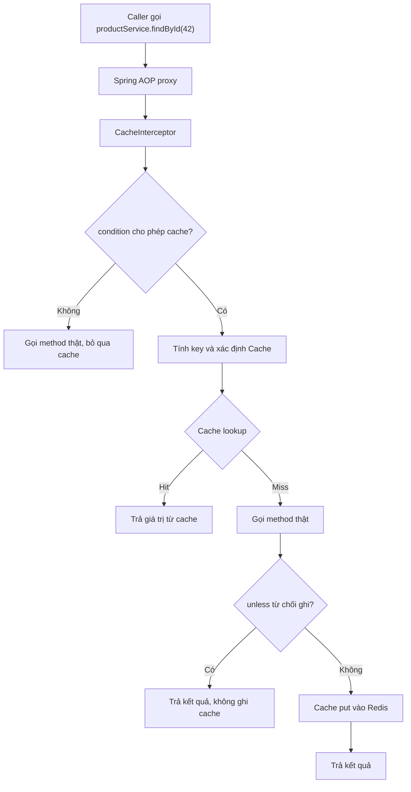
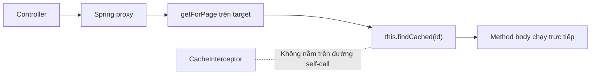
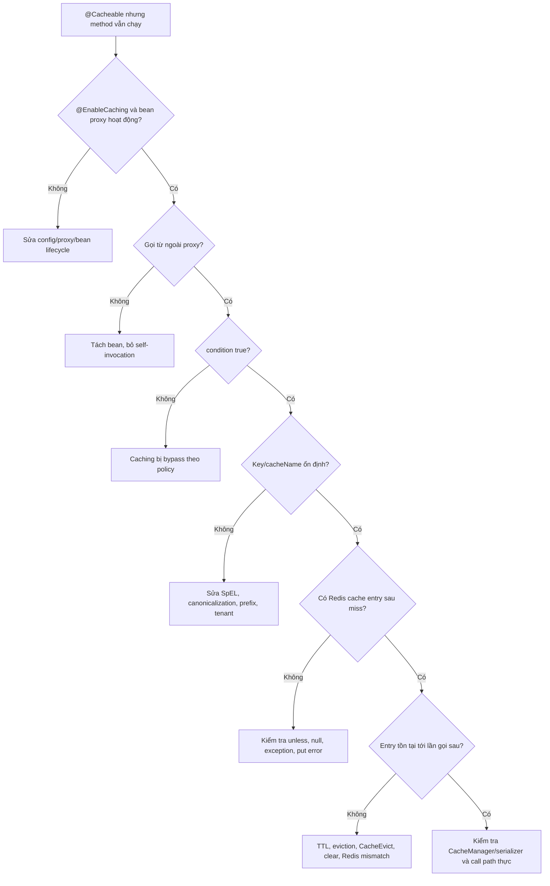

# Cache không có hiệu lực do proxy, khóa hoặc điều kiện trong Spring Data Redis

Một lỗi thường gặp khi dùng `@Cacheable` với Spring Boot và Spring Data Redis là: **đã đánh dấu method cần cache nhưng mỗi lần gọi vẫn truy vấn database, gọi API bên ngoài hoặc thực hiện phép tính đắt đỏ**. Đôi khi Redis hoàn toàn không có key; đôi khi key có tồn tại nhưng ứng dụng vẫn không dùng nó; có lúc một endpoint cache đúng còn endpoint khác gọi cùng method lại cache sai.

Chẳng hạn:

```java
@Cacheable(cacheNames = "products", key = "#id")
public Product findById(String id) {
    return database.findById(id).orElseThrow();
}
```

Ta kỳ vọng lần gọi đầu chạy `database.findById`, lần thứ hai cùng ID trả từ Redis. Nhưng thực tế có thể:

- Lời gọi không đi qua **Spring AOP proxy**, nên `@Cacheable` không được thực thi.
- `@EnableCaching` chưa bật hoặc method không thuộc một Spring-managed bean.
- Key được tạo khác nhau giữa các request: tên tham số không resolve, thứ tự tham số thay đổi, tenant/locale bị bỏ sót hoặc serializer/prefix không như dự kiến.
- `condition` luôn sai, khiến Spring bỏ qua cả đọc lẫn ghi cache.
- `unless` đánh giá đúng, nên kết quả được tính nhưng **không được đưa vào cache**.
- Method trả `null`, `Optional.empty()` hoặc ném exception; quy tắc cache/serializer không giống giả định.
- Cache name, `CacheManager` hoặc môi trường Redis không đúng: ứng dụng dùng cache in-memory, Redis database khác hoặc cache đã hết TTL.
- Phần cập nhật dữ liệu liên tục gọi `@CacheEvict`, làm entry vừa lưu lại bị xóa.

Bài học này cung cấp **mô hình hoạt động, cách tái hiện, mã sửa lỗi, công cụ chẩn đoán và các bài kiểm thử** cho ba nhóm nguyên nhân chính: **proxy**, **khóa (key)** và **điều kiện**. Các vấn đề `CacheManager`, TTL, invalidation và transaction được trình bày vì chúng thường tạo ra triệu chứng giống hệt.

> Điểm cần nhớ: **`@Cacheable` thuộc Spring Cache abstraction**, còn Redis là một trong các backend có thể được `CacheManager` sử dụng. Thêm dependency Spring Data Redis hoặc gọi `RedisTemplate` thành công **không tự chứng minh** các lời gọi `@Cacheable` đang sử dụng Redis.

## 1. Mô hình đúng của một cache hit

Một method cache được Spring gọi qua proxy theo luồng:



Đây là giản lược luồng phổ biến của `@Cacheable`: thứ tự chi tiết và behavior phụ thuộc annotation/options/cache implementation. Để chẩn đoán, hãy phân biệt **method body có được gọi không**, **cache lookup có xảy ra không** và **cache put có xảy ra không**.

### 1.1. Cùng một dữ liệu trả về không chứng minh có cache hit

Hai lời gọi:

```java
Product a = service.findById("42");
Product b = service.findById("42");
```

có thể trả cùng nội dung ngay cả khi database bị truy vấn hai lần. Phải đo **số lần method thật thực thi**, SQL/HTTP downstream, cache metrics hoặc Redis operations.

Một quan sát hữu ích:

```text
Call #1: cache miss -> database load -> cache put
Call #2: cache hit  -> không gọi database
```

Nếu database vẫn bị gọi, cần xác định cache không được áp dụng, cache miss vì key khác, entry biến mất hay bị điều kiện bỏ qua.

### 1.2. Cache hit không nhất thiết có một câu lệnh GET mà bạn nhìn thấy ngay

Với Spring Cache, provider có thể khác nhau; nếu dùng local cache thì không có Redis GET. Redis Cache có thể thực hiện lệnh Redis tương ứng nhưng key vật lý có prefix/serializer riêng. Không kết luận “không cache” chỉ vì tự kiểm tra sai key ở Redis CLI.

## 2. Chuẩn bị ví dụ Spring Boot dùng Redis Cache

Dependency Maven:

```xml
<dependency>
    <groupId>org.springframework.boot</groupId>
    <artifactId>spring-boot-starter-cache</artifactId>
</dependency>
<dependency>
    <groupId>org.springframework.boot</groupId>
    <artifactId>spring-boot-starter-data-redis</artifactId>
</dependency>
```

Gradle:

```gradle
implementation("org.springframework.boot:spring-boot-starter-cache")
implementation("org.springframework.boot:spring-boot-starter-data-redis")
```

Trong Spring Boot 3.x, cấu hình phát triển minh họa:

```yaml
spring:
  cache:
    type: redis
    redis:
      time-to-live: 10m
      cache-null-values: false
      use-key-prefix: true
  data:
    redis:
      host: localhost
      port: 6379
      timeout: 2s
```

Nếu production dùng ACL hoặc TLS, bổ sung username/password từ secret manager, TLS trust material và cấu hình phù hợp. Không nhúng password thật vào YAML trong Git.

**Lưu ý về phiên bản:** ví dụ dựa trên phong cách Spring Boot 3.x; Spring Boot 2.x có property Redis namespace khác. Các thuộc tính cache Boot chỉ có tác dụng theo auto-configuration thực tế, không nhất thiết được áp dụng nếu đã tự khai báo `CacheManager` riêng.

### 2.1. Bật caching

```java
import org.springframework.boot.SpringApplication;
import org.springframework.boot.autoconfigure.SpringBootApplication;
import org.springframework.cache.annotation.EnableCaching;

@SpringBootApplication
@EnableCaching
public class CatalogApplication {
    public static void main(String[] args) {
        SpringApplication.run(CatalogApplication.class, args);
    }
}
```

`@EnableCaching` kích hoạt infrastructure xử lý annotation caching. Chỉ có `@Cacheable` trên source code mà không có infrastructure tương ứng thì method hoạt động như method Java thông thường.

### 2.2. Một method cache cơ bản

```java
package com.example.catalog;

import org.springframework.cache.annotation.Cacheable;
import org.springframework.stereotype.Service;

@Service
public class ProductQueryService {

    private final ProductRepository repository;

    public ProductQueryService(ProductRepository repository) {
        this.repository = repository;
    }

    @Cacheable(cacheNames = "product-by-id", key = "#p0")
    public ProductDto findById(String productId) {
        return repository.findDtoById(productId)
                .orElseThrow(ProductNotFoundException::new);
    }
}
```

`ProductRepository`, `ProductDto` và `ProductNotFoundException` đại diện các lớp nghiệp vụ. Sử dụng `#p0` thay cho `#productId` giúp ví dụ không phụ thuộc metadata tên tham số lúc biên dịch.

### 2.3. Thứ cần quan sát

Với cùng một ID:

```text
Lần 1: repository.findDtoById("42") được gọi
Lần 2: repository.findDtoById("42") không được gọi
```

Sau đó mới kiểm tra Redis có entry `product-by-id` tương ứng. Đừng bắt đầu bằng việc đoán key name từ annotation.

## 3. Nguyên nhân nhóm A: lời gọi không đi qua Spring proxy

Theo cơ chế Spring Cache **proxy mode** thông thường, `@Cacheable` được áp dụng thông qua advice của Spring AOP. Method thật không tự biết nó đã được cache. Advice chạy khi caller gọi **đối tượng proxy do Spring quản lý**.

```text
Controller
   |
   v
Spring proxy(ProductQueryService)
   |
   +-- CacheInterceptor
   |
   v
ProductQueryService target method
```

Nếu bạn gọi target trực tiếp, interceptor có thể không chạy.

### 3.1. Self-invocation: lỗi thường gặp nhất

```java
@Service
public class ProductService {

    public ProductDto getForPage(String id) {
        return findCached(id);
    }

    @Cacheable(cacheNames = "products", key = "#p0")
    public ProductDto findCached(String id) {
        return loadExpensiveProduct(id);
    }

    private ProductDto loadExpensiveProduct(String id) {
        // Tải DB hoặc gọi remote service.
        return ...;
    }
}
```

Trong `getForPage`, lời gọi `findCached(id)` thực chất là:

```java
this.findCached(id);
```

Nó được thực hiện **bên trong chính target object**, không đi qua proxy.

Sơ đồ:



Kết quả: gọi `getForPage("42")` nhiều lần có thể chạy `loadExpensiveProduct` nhiều lần dù `findCached` mang `@Cacheable`.

### 3.2. Chỉ gọi trực tiếp từ bên ngoài mới đi qua advice

Nếu controller inject bean:

```java
@RestController
public class ProductController {

    private final ProductService products;

    public ProductController(ProductService products) {
        this.products = products;
    }

    @GetMapping("/products/{id}")
    public ProductDto get(@PathVariable String id) {
        return products.findCached(id);
    }
}
```

Lời gọi `products.findCached(id)` thông thường đi qua proxy và có thể cache. Điều này giải thích tại sao **một đường API cache đúng, đường API khác cache sai** khi một đường gọi method trực tiếp còn đường kia gọi vòng qua method khác cùng class.

### 3.3. Cách sửa ưu tiên: tách method cache sang bean riêng

```java
@Service
public class CachedProductReader {

    private final ProductRepository repository;

    public CachedProductReader(ProductRepository repository) {
        this.repository = repository;
    }

    @Cacheable(cacheNames = "products", key = "#p0")
    public ProductDto findById(String id) {
        return repository.findDtoById(id)
                .orElseThrow(ProductNotFoundException::new);
    }
}
```

Một service điều phối khác:

```java
@Service
public class ProductPageService {

    private final CachedProductReader cachedReader;

    public ProductPageService(CachedProductReader cachedReader) {
        this.cachedReader = cachedReader;
    }

    public ProductDto getForPage(String id) {
        return cachedReader.findById(id);
    }
}
```

Đường gọi:

```text
Controller -> ProductPageService
           -> CachedProductReader proxy
           -> CacheInterceptor
           -> target nếu cache miss
```

Cách này dễ đọc, dễ test và tránh tự tham chiếu proxy.

### 3.4. Có nên tự inject bean của chính mình?

Một số dự án dùng self-injection hoặc `AopContext.currentProxy()` để buộc lời gọi đi qua proxy. Chúng làm tăng coupling với AOP, có thể gặp circular dependency và yêu cầu cấu hình expose proxy; không phải hướng sửa mặc định.

**Ưu tiên tách trách nhiệm thành các bean**. Chỉ dùng self-proxy workaround khi team hiểu rõ lifecycle/cấu hình và đã có test chứng minh advice thực sự chạy.

## 4. Method private, final, static và visibility

Trong proxy mode, lời khuyên phổ biến nhất là đặt cache annotation lên **public method có thể được proxy intercept** của Spring-managed bean.

Ví dụ dễ sai:

```java
@Service
public class ProductService {

    @Cacheable("products")
    private ProductDto load(String id) {
        return ...;
    }
}
```

Method `private` không được proxy advice chặn theo cách thông thường. Gọi nó từ method khác trong class không biến nó thành method được cache.

### 4.1. Final method

```java
@Cacheable("products")
public final ProductDto load(String id) {
    return ...;
}
```

Với **class-based/CGLIB proxy**, method `final` không thể được override để thêm advice. Nếu code dựa vào proxy kiểu đó, cache annotation không hoạt động như mong đợi.

**Nuance:** với interface/JDK proxy, proxy intercept lời gọi qua interface trước khi forward tới target; vấn đề final cần đánh giá theo cơ chế proxy thực tế, không kết luận mọi final method trong mọi kiểu proxy luôn giống nhau.

### 4.2. Final class

Một `final class` không thể được subclass bởi class-based proxy. Khi muốn dùng Spring AOP proxy class, cần loại bỏ `final` hoặc chọn thiết kế có interface/proxy phù hợp.

### 4.3. Kotlin

Kotlin class/method mặc định `final`. Dự án Spring Kotlin thường dùng plugin `kotlin-spring`/all-open để những class có stereotype Spring được mở cho proxy khi cần.

Nếu annotation cache không chạy trên Kotlin service, hãy xác minh build plugin và cơ chế proxy của bean. Đừng sửa Redis TTL khi gốc lỗi là AOP method không intercept được.

### 4.4. Static method và constructor

Một lời gọi static không được thực hiện trên Spring instance proxy. Constructor và quá trình khởi tạo object cũng không phải nơi lý tưởng để mong cache advice chạy. Đặt nghiệp vụ cache vào method instance của bean, gọi sau khi context và proxy đã sẵn sàng.

## 5. Bean phải do Spring quản lý

Sai:

```java
ProductQueryService service =
        new ProductQueryService(repository);

service.findById("42");
```

Đối tượng tạo bằng `new` không phải bean proxy do Spring quản lý; annotation cache trên class không tự tạo interception.

Đúng:

```java
@RestController
public class CatalogController {

    private final ProductQueryService products;

    public CatalogController(ProductQueryService products) {
        this.products = products;
    }

    @GetMapping("/products/{id}")
    public ProductDto get(@PathVariable String id) {
        return products.findById(id);
    }
}
```

Dependency injection nhận bean từ Spring container, có cơ hội được áp proxy/cache advice.

### 5.1. Thiếu component scanning

Nếu package của `@Service` không nằm trong phạm vi component scan, service có thể không thành bean. Khi app vẫn chạy vì có code khởi tạo thủ công, cache annotation trên object đó không phát huy tác dụng.

Kiểm tra:

- Package của `@SpringBootApplication` so với `@Service`.
- `@ComponentScan` tùy chỉnh có bỏ sót package không.
- Có nhiều bean cùng kiểu dẫn đến inject nhầm không.
- Bean do `@Bean` tạo có được áp advice không.

### 5.2. Gọi trong @PostConstruct

```java
@PostConstruct
public void warmup() {
    findById("42");
}
```

Đây là self-call trong quá trình init; không nên giả định `@Cacheable` được áp dụng. Nếu cần warm-up, dùng một bean khác gọi **proxy của service cache** sau khi context khởi tạo xong, ví dụ qua `ApplicationReadyEvent` trong một bean điều phối phù hợp.

### 5.3. Bean scope và proxy

Singleton, request-scoped, các scoped proxy hoặc factory bean có thể tạo chuỗi proxy phức tạp. Với sự cố khó, kiểm tra **bean thực tế được inject** và đường gọi, thay vì suy diễn từ tên class trong source code.

## 6. JDK dynamic proxy và class-based proxy

Spring AOP thường dùng:

| Kiểu | Cách hoạt động | Điều cần chú ý |
|---|---|---|
| JDK dynamic proxy | Proxy triển khai interface | Caller thường tương tác qua interface; method được gọi phải thuộc interface proxy |
| Class-based proxy (CGLIB) | Tạo subclass của class | Không override final/private methods |

Việc chọn proxy phụ thuộc cấu hình Spring Boot/AOP và những bean liên quan. Không nên coi mọi ứng dụng đều dùng cùng loại proxy.

Ví dụ interface:

```java
public interface ProductReader {
    ProductDto load(String id);
}
```

Implementation:

```java
@Service
public class ProductReaderImpl implements ProductReader {

    @Override
    @Cacheable(cacheNames = "products", key = "#p0")
    public ProductDto load(String id) {
        return ...;
    }
}
```

Khi dùng interface proxy, controller inject `ProductReader` và gọi `load` qua interface để có đường đi rõ ràng.

### 6.1. Đặt annotation ở implementation hay interface?

Spring proxy mode có thể đọc metadata caching từ nhiều vị trí tùy cơ chế, nhưng để dễ hiểu và giảm phụ thuộc vào cách phát hiện annotation giữa JDK proxy/class proxy/AspectJ, thường nên đặt `@Cacheable` trên **concrete implementation method** và test trên proxy thực.

Đặc biệt khi chuyển sang AspectJ weaving, annotation chỉ được khai báo trên interface có thể không được nhận diện như trên concrete class. Đừng chỉ thay `proxyTargetClass` rồi khẳng định đã sửa triệt để.

### 6.2. Kiểm tra bean có phải AOP proxy

Trong bài kiểm tra chẩn đoán:

```java
import org.springframework.aop.support.AopUtils;

@Autowired
ProductReader productReader;

@Test
void beanIsProxied() {
    assertThat(AopUtils.isAopProxy(productReader))
            .isTrue();
}
```

Điều này **chỉ chứng minh bean là AOP proxy**, chưa chứng minh riêng cache advice đã áp đúng method. Bean cũng có thể được proxy vì `@Transactional` hoặc interceptor khác.

Test quyết định vẫn là: **cùng key gọi hai lần, method body chạy bao nhiêu lần?**

## 7. AspectJ mode có sửa self-invocation không?

`@EnableCaching` mặc định thường dùng proxy-based advice. Spring còn hỗ trợ cấu hình AspectJ mode khi có weaving và dependency cần thiết.

Khác biệt khái niệm:

```text
Proxy mode:
    chỉ lời gọi qua proxy được intercept

AspectJ weaving mode:
    bytecode được woven theo aspect;
    có thể intercept những self-invocations tương ứng
```

AspectJ có thể xử lý nhiều vấn đề self-invocation nhưng đưa thêm yêu cầu build/runtime weaving, classloader và quan sát triển khai. **Không tự đổi sang AspectJ chỉ để sửa một method** nếu tách bean là đủ.

Nếu chọn AspectJ, phải kiểm tra:

- Dependency aspect phù hợp.
- Compile-time hoặc load-time weaving.
- Annotation được nhận diện ở concrete class/method.
- Quy trình chạy test/production thực sự có weaving.
- Ảnh hưởng của các advice khác tới method.

## 8. Nguyên nhân nhóm B: cache key thay đổi hoặc bị tạo sai

Giả sử proxy hoạt động, `condition` cho phép cache và Redis đang kết nối tốt. Nếu request vẫn miss mỗi lần, hãy kiểm tra **key**.

Spring Cache cần một key để tìm entry:

```text
cacheName + generatedKey
       |
       v
Redis physical key (prefix + serialization)
```

Hai request “cùng một sản phẩm” theo nghiệp vụ có thể tạo **hai key khác nhau** do dữ liệu đầu vào hoặc cách chuyển đổi key.

### 8.1. Default key generation

Khi không khai báo `key` hay `keyGenerator`:

```java
@Cacheable("products")
public ProductDto findById(String id) { ... }
```

Spring Cache mặc định sử dụng `SimpleKeyGenerator` với nguyên tắc khái quát:

| Số tham số | Key logic mặc định |
|---|---|
| Không tham số | `SimpleKey.EMPTY` |
| Một tham số | Chính đối tượng tham số đó |
| Nhiều tham số | `SimpleKey` chứa các tham số |

Vì thế:

```java
@Cacheable("products")
public ProductDto findById(String id, Locale locale) { ... }
```

không có cùng key với method chỉ nhận `id`. Và gọi cùng ID nhưng khác `locale` sẽ tạo key logic khác.

### 8.2. Key mặc định có thể thay đổi khi signature đổi

Trước:

```java
ProductDto findById(String id)
```

Sau refactor:

```java
ProductDto findById(String id, boolean includeDetails)
```

Key logic thay đổi từ một String thành composite `SimpleKey`. Nếu ứng dụng có hai phiên bản cùng truy cập Redis, key schema và cache hit rate có thể khác nhau.

Hãy xem key generation là một phần của **cache schema**, không phải chi tiết vô hại.

## 9. SpEL key: #id, #p0 và tên tham số

Ví dụ:

```java
@Cacheable(cacheNames = "products", key = "#id")
public ProductDto findById(String id) { ... }
```

`#id` chỉ resolve được khi Spring có metadata tên tham số phù hợp. Nếu build không giữ tên tham số hoặc lớp đã được biên dịch khác cấu hình, biểu thức có thể không giải được như dự kiến.

Thông thường, Spring có thể báo:

```text
Null key returned for cache operation
```

Một trong các nguyên nhân là SpEL tham chiếu tên tham số không khả dụng. **Đừng tự diễn giải mọi lỗi key null đều do tên tham số**; một số biểu thức thực sự có thể tính ra null.

### 9.1. Cách an toàn theo vị trí

```java
@Cacheable(cacheNames = "products", key = "#p0")
public ProductDto findById(String id) {
    ...
}
```

Hoặc:

```java
@Cacheable(cacheNames = "products", key = "#a0")
public ProductDto findById(String id) {
    ...
}
```

Hoặc:

```java
@Cacheable(
        cacheNames = "products",
        key = "#root.args[0]")
public ProductDto findById(String id) {
    ...
}
```

Các cách này không phụ thuộc vào tên Java parameter `id` được giữ trong bytecode. Đánh đổi là khi đổi thứ tự tham số, phải sửa key expression tương ứng.

### 9.2. Giữ tên tham số trong Java build

Khi muốn dùng `#id` vì readability, build phải cung cấp metadata tên tham số, ví dụ compiler flag:

```text
-parameters
```

Với Spring Boot plugin/build tool hiện đại, flag này có thể đã được cấu hình tự động, nhưng nên xác minh **artifact thực tế đang chạy**, nhất là khi dự án có nhiều module hoặc bytecode transformation.

### 9.3. So sánh #p0 với #root.methodName

```java
@Cacheable(
        cacheNames = "products",
        key = "#root.methodName + ':' + #p0")
```

Biểu thức có thể thêm tên method vào key. Nó hữu ích nếu cùng một cache region được nhiều method sử dụng, nhưng cũng làm key đổi khi rename method. Thường dễ vận hành hơn nếu **mỗi nhóm dữ liệu có cache name riêng**.

## 10. Key collision giữa các method

Giả sử:

```java
@Cacheable(cacheNames = "catalog", key = "#p0")
public ProductDto findProduct(String id) {
    ...
}

@Cacheable(cacheNames = "catalog", key = "#p0")
public CategoryDto findCategory(String id) {
    ...
}
```

Nếu cả hai gọi với `id = "42"`, chúng tạo cùng key trong cùng cache name.

Hậu quả:

- Method tìm Category có thể nhận dữ liệu Product.
- Serializer/deserializer có thể lỗi kiểu.
- Key tồn tại nhưng giá trị không đúng.
- Điều tra thấy “cache vẫn có”, nhưng hành vi ứng dụng kỳ lạ.

### 10.1. Sửa bằng cache region tách biệt

```java
@Cacheable(cacheNames = "product-by-id", key = "#p0")
public ProductDto findProduct(String id) { ... }

@Cacheable(cacheNames = "category-by-id", key = "#p0")
public CategoryDto findCategory(String id) { ... }
```

Đây là cách dễ hiểu khi hai loại dữ liệu có vòng đời và TTL khác nhau.

### 10.2. Hoặc dùng prefix ổn định

```java
@Cacheable(cacheNames = "catalog", key = "'product:' + #p0")
public ProductDto findProduct(String id) { ... }

@Cacheable(cacheNames = "catalog", key = "'category:' + #p0")
public CategoryDto findCategory(String id) { ... }
```

Nhưng một cache region chung sẽ khó tách chính sách TTL, invalidation và serializer theo loại dữ liệu hơn.

## 11. Bỏ sót tenant, locale, authorization scope trong key

Ví dụ nguy hiểm:

```java
@Cacheable(cacheNames = "dashboard", key = "#p0")
public DashboardDto load(
        String dashboardId,
        String tenantId) {
    ...
}
```

Key chỉ có dashboard ID. Nếu các tenant dùng cùng dashboard ID logic, một tenant có thể nhận nội dung của tenant khác.

### 11.1. Ràng buộc đủ tất cả input ảnh hưởng kết quả

```java
@Cacheable(
        cacheNames = "dashboard",
        key = "#p1 + ':' + #p0")
public DashboardDto load(
        String dashboardId,
        String tenantId) {
    ...
}
```

Trong ví dụ, `#p1` là tenantId và `#p0` là dashboardId. Nếu có locale hoặc permission scope làm thay đổi kết quả, phải tiếp tục ràng buộc vào key hoặc thiết kế cache tại lớp dữ liệu không chứa tùy biến quyền.

### 11.2. Tránh ghép chuỗi mơ hồ

```text
tenantId = "ab"
id       = "c"
=> "abc"

tenantId = "a"
id       = "bc"
=> "abc"
```

Đây là collision. Dùng delimiter với escaping/canonicalization, structured key object hoặc key generator ổn định.

Nếu đưa dấu `:` vào key, cần quy tắc escape hoặc encode để tránh trường hợp các thành phần cũng chứa dấu đó. Với cache đa tenant, tính **đúng ranh giới tenant** quan trọng hơn việc tối ưu vài byte tên key.

### 11.3. Không cache dữ liệu phân quyền chỉ bằng user input

Ngay cả khi key chứa tenantId, method vẫn phải kiểm tra **quyền hiện tại của caller** trước khi trả dữ liệu nhạy cảm. Nếu proxy trả cache hit trước khi method body chạy, authorization đặt **chỉ trong method body** có thể bị bypass trên cache hit tùy thiết kế advice/security.

Với dữ liệu nhạy cảm, nên tách bước authorization bắt buộc khỏi lookup cache hoặc bảo đảm access control được áp dụng độc lập trên mọi request.

## 12. Mutable object làm cache key

Ví dụ:

```java
@Cacheable(cacheNames = "search-results")
public SearchResult search(SearchFilter filter) {
    ...
}
```

Nếu `SearchFilter` dùng default object identity trong `equals/hashCode`, hai object có nội dung giống nhau vẫn có thể tạo key logic khác.

Nếu filter mutable và hashCode thay đổi, kết quả lookup có thể càng khó dự đoán.

### 12.1. Chuẩn hóa đầu vào thành key ổn định

Ví dụ:

```java
public record SearchKey(
        String keyword,
        int page,
        int size,
        String sort) {
}
```

Giá trị canonical:

```java
SearchKey key = new SearchKey(
        keyword.trim().toLowerCase(Locale.ROOT),
        page,
        size,
        sort);
```

Tốt nhất, cache method nhận các scalar/immutable value và key generator rõ ràng:

```java
@Cacheable(
        cacheNames = "search-results-v2",
        key = "#p0 + ':' + #p1 + ':' + #p2")
public SearchResult search(
        String normalizedKeyword,
        int page,
        String sort) {
    ...
}
```

Nếu input có delimiter hoặc ký tự đặc biệt, dùng encoding/canonicalization phù hợp thay vì tin phép nối chuỗi đơn giản cho mọi miền giá trị.

### 12.2. Array và collection

Một array hoặc collection chứa cùng nội dung nhưng thứ tự khác có thể sinh key khác tùy key generator và cấu trúc dữ liệu. Nếu thứ tự thực sự không ảnh hưởng kết quả, hãy chuẩn hóa trước khi cache (ví dụ sort danh sách ID khi hợp lệ).

Ngược lại, nếu thứ tự ảnh hưởng kết quả, **không** sort chỉ để tăng hit rate vì sẽ tạo collision logic.

## 13. Redis physical key khác Spring logical key

Với cấu hình Spring Data Redis Cache thông thường, key thực tế thường gồm:

```text
<cacheName>::<convertedKey>
```

Ví dụ:

```java
@Cacheable(cacheNames = "product-by-id", key = "#p0")
public ProductDto findById(String id) { ... }
```

Một physical key có thể là:

```text
product-by-id::42
```

Nhưng đây **không phải format bất biến**. `RedisCacheConfiguration` có thể:

- Tắt prefix.
- Tạo prefix theo function riêng.
- Dùng cache name đã được version hóa.
- Áp conversion/key serializer khác.
- Chọn Redis connection/database/cluster khác.

### 13.1. Vì sao redis-cli GET products:42 trả nil?

Vì Spring có thể đã ghi:

```text
product-by-id::42
```

chứ không phải:

```text
products:42
```

Hãy xác định đúng `cacheNames`, key generator, prefix và Redis DB/Cluster trước khi kết luận “cache không ghi”.

### 13.2. Xác minh bằng SCAN có giới hạn

Trên Redis test hoặc môi trường được phép:

```bash
redis-cli --scan --pattern 'product-by-id*'
```

Hoặc:

```redis
SCAN 0 MATCH product-by-id* COUNT 100
```

Không dùng `KEYS *` trên Redis production có nhiều key để debug một cache entry. `SCAN` vẫn có chi phí và không tạo snapshot nguyên tử; lấy mẫu có giới hạn.

### 13.3. Serializer của Spring Cache khác StringRedisTemplate

`StringRedisTemplate` dùng serializers dành cho String, nhưng Spring `RedisCacheManager` có cấu hình key/value serialization riêng. Không nên giả định:

```java
redis.opsForValue().get("product-by-id::42")
```

luôn đọc được `ProductDto` trong cache dưới dạng chuỗi JSON. Value cache có thể được serialize theo định dạng khác, ví dụ Java serialization hoặc JSON serializer tùy cấu hình.

Với debug:

- Dùng `CacheManager.getCache(cacheName).get(key, Type.class)` để kiểm tra qua cùng abstraction khi phù hợp.
- Với Redis CLI, chủ yếu kiểm tra sự tồn tại và TTL của physical key.
- Không tự deserialise dữ liệu không đáng tin bằng cấu hình Java serializer bất cẩn.

## 14. Null key và SpEL lỗi

Một số biểu thức:

```java
key = "#id"
key = "#p0.id"
key = "#p1.tenantId"
```

có thể tính ra `null` khi:

- Tham số tên `id` không resolve.
- `#p0` là null.
- `#p0.id` là null.
- Index tham số sai sau refactor.
- Một object chưa được khởi tạo hoặc property không tồn tại.

Spring Cache không chấp nhận cache key null cho những thao tác thông thường; có thể ném exception thay vì lặng lẽ cache miss.

### 14.1. Chẩn đoán đúng cách

1. Xem biểu thức `key` hiện tại.
2. Xác định signature method trong binary thực tế.
3. Kiểm tra `#p0`/`#a0` có phù hợp không.
4. Kiểm tra input null và property resolution.
5. Xem stack trace/trace mức phù hợp.
6. Không “sửa” bằng một key hằng khiến mọi request dùng chung entry.

### 14.2. Đừng chữa bằng key="'fixed'"

```java
@Cacheable(cacheNames = "products", key = "'fixed'")
public ProductDto findById(String id) {
    ...
}
```

Mọi ID sẽ dùng cùng một cache key; đây là **cache collision nghiêm trọng**, không phải cách sửa lỗi SpEL.

## 15. Nguyên nhân nhóm C: condition và unless

Spring Cache cho phép kiểm soát khi nào caching xảy ra.

Ví dụ:

```java
@Cacheable(
        cacheNames = "products",
        key = "#p0",
        condition = "#p1",
        unless = "#result == null")
public ProductDto load(String id, boolean allowCache) {
    return repository.findDtoById(id).orElse(null);
}
```

Ở đây:

- `condition` được đánh giá theo input **trước khi cache lookup**. Khi false, Spring bỏ qua cơ chế caching của operation đó.
- `unless` được đánh giá sau khi method được thực thi trên cache miss, để quyết định **không ghi kết quả**.

### 15.1. Phân biệt bằng bảng

| Thuộc tính | Thời điểm | Khi biểu thức là true |
|---|---|---|
| `condition` | Trước cache lookup/method execution | Cho phép caching path của operation |
| `unless` | Sau khi method tính ra kết quả | **Veto cache put**, không lưu kết quả |

Với `condition`, true **không bảo đảm hit**; vẫn có thể miss vì key chưa tồn tại. Với `unless`, true không có nghĩa method trả lỗi; method vẫn có thể trả kết quả bình thường nhưng không được lưu.

### 15.2. Ví dụ bốn cuộc gọi

Giả sử:

```java
load("42", false);
load("42", false);
load("42", true);
load("42", true);
```

Nếu method trả dữ liệu không null và Redis hoạt động:

| Lần gọi | allowCache | Điều gì xảy ra? |
|---|---|---|
| 1 | false | Bypass cache, gọi DB |
| 2 | false | Tiếp tục bypass, gọi DB |
| 3 | true | Cache lookup; nếu miss thì gọi DB rồi put |
| 4 | true | Hit nếu entry chưa hết hạn/bị evict |

Nếu input `allowCache=false`, đừng đi tìm lỗi TTL/Redis vì Spring **chủ động không sử dụng cache**.

## 16. Lỗi SpEL condition không khớp ý định

Ví dụ:

```java
@Cacheable(
        cacheNames = "products",
        key = "#p0",
        condition = "#p1 == true")
public ProductDto load(String id, boolean cacheEnabled) {
    ...
}
```

Nếu tầng gọi luôn truyền `false` vì bug mapping/cấu hình, caching sẽ không bao giờ được thực hiện.

Một ví dụ khác:

```java
@Cacheable(
        cacheNames = "search",
        key = "#p0",
        condition = "#p0.length() < 3")
public SearchResult search(String query) {
    ...
}
```

Nếu query phần lớn dài hơn hoặc bằng ba ký tự, cache luôn bị bypass. Chưa chắc code sai cú pháp; **policy** có thể sai.

### 16.1. Khi condition phụ thuộc security context

Điều kiện có thể dựa vào thông tin authorization/session thông qua bean hoặc tham số. Cần nhớ condition kiểm soát **bật/tắt cache**, không thay thế authorization.

Nếu người dùng không được phép xem dữ liệu, method hoặc một security interceptor khác vẫn phải thực hiện kiểm tra phù hợp kể cả khi có cache hit. Không đặt toàn bộ kiểm tra quyền **chỉ trong body method** nếu cache hit có thể bypass body.

### 16.2. Condition không có #result

Ví dụ sai về ý tưởng:

```java
@Cacheable(
        cacheNames = "products",
        condition = "#result != null")
```

Tại thời điểm `condition` được đánh giá, kết quả method chưa có. Điều kiện dựa vào kết quả phải chuyển sang `unless`:

```java
@Cacheable(
        cacheNames = "products",
        unless = "#result == null")
```

## 17. Unless không phải điều kiện trước khi gọi method

Giả sử:

```java
@Cacheable(
        cacheNames = "products",
        key = "#p0",
        unless = "#result == null")
public ProductDto find(String id) {
    return repository.findDtoById(id).orElse(null);
}
```

Nếu ID không tồn tại:

```text
Call 1 -> DB trả null -> unless true -> không lưu
Call 2 -> DB trả null -> unless true -> không lưu
Call 3 -> DB trả null -> unless true -> không lưu
```

Đây là hành vi **đúng theo annotation**. Nó có thể trông giống “cache không hoạt động”, nhưng thật ra chính sách không cache null đang hoạt động.

### 17.1. Negative caching là quyết định nghiệp vụ

Caching “không tìm thấy” trong thời gian ngắn đôi khi giảm tải:

```text
product:unknown -> NOT_FOUND với TTL ngắn
```

Nhưng phải cân nhắc:

- Một sản phẩm được tạo sau khi cache “not found” có thể tạm thời không được thấy.
- Không được dùng cached absence để bypass authorization.
- Cần giới hạn TTL và key cardinality để tránh cache pollution.
- Spring Cache có chính sách cache null và serializer riêng.

Không chỉ xóa `unless` mà bỏ qua cấu hình `cache-null-values`, TTL và hiệu lực dữ liệu.

### 17.2. Optional và #result

Spring Cache hỗ trợ một số return wrapper như `Optional` và có behavior unwrapping ở cache abstraction. Với các Spring version hỗ trợ, `#result` trong `unless` của `Optional<T>` được diễn giải theo giá trị business được unwrap, không phải bắt buộc chính là object `Optional`.

Vì vậy:

```java
@Cacheable(
        cacheNames = "products",
        unless = "#result == null")
public Optional<ProductDto> find(String id) {
    ...
}
```

có thể từ chối cache khi `Optional.empty()`. **Kiểm chứng behavior theo Spring Framework version đang dùng**, nhất là với các kiểu async/reactive và custom wrappers.

## 18. Condition true nhưng cache vẫn không ghi do exception

`@Cacheable` không tự biến exception của method thành một giá trị cache hợp lệ.

Ví dụ:

```java
@Cacheable(cacheNames = "products", key = "#p0")
public ProductDto findRequired(String id) {
    return repository.findDtoById(id)
            .orElseThrow(ProductNotFoundException::new);
}
```

Khi method ném `ProductNotFoundException`:

```text
Lần 1: cache miss -> method throw
Lần 2: cache miss -> method throw
```

Mỗi lần vẫn đi DB, nhưng đây không phải bằng chứng proxy không làm việc. Muốn caching “not found”, cần thiết kế **negative cache value** hoặc một service khác có policy rõ ràng, không chỉ thêm `unless`.

## 19. @Cacheable(sync = true) không sửa được mọi cache miss

Một số ứng dụng dùng:

```java
@Cacheable(
        cacheNames = "products",
        key = "#p0",
        sync = true)
public ProductDto load(String id) {
    return repository.findDtoById(id).orElseThrow();
}
```

`sync = true` yêu cầu cache provider đồng bộ việc load cùng key khi có cạnh tranh; kết quả và khả năng hỗ trợ phụ thuộc provider.

Điều này có thể giúp tránh nhiều thread cùng tính một key trên cache miss, **nhưng không phải là lời hứa distributed single-flight xuyên mọi JVM/pod**. Phải đánh giá `RedisCache` và framework version cụ thể.

### 19.1. Những ràng buộc cần nhớ

Với `@Cacheable(sync = true)`, Spring Cache có các hạn chế API quan trọng, chẳng hạn:

- Không kết hợp `unless` trên cùng operation.
- Chỉ khai báo một cache.
- Không phối hợp các cache operations không tương thích trên cùng method.

Không thêm `sync = true` như một “mẹo” để sửa `condition=false`, key sai, self-invocation hay `CacheManager` nhầm. Nó không xử lý các nguyên nhân đó.

## 20. @CachePut và @CacheEvict có thể làm tưởng như cache không tồn tại

`@Cacheable` dùng giá trị cache nếu có; `@CachePut` **luôn gọi method** và sau đó cập nhật cache theo kết quả.

Ví dụ:

```java
@CachePut(cacheNames = "products", key = "#p0.id")
public ProductDto update(ProductDto product) {
    return repository.save(product);
}
```

Nếu người dùng đặt `@CachePut` nhưng mong method không chạy ở lần thứ hai, đó là hiểu sai annotation.

### 20.1. Phân biệt

| Annotation | Behavior cốt lõi |
|---|---|
| `@Cacheable` | Có thể bỏ qua method nếu cache hit |
| `@CachePut` | Method được thực thi; kết quả được đưa vào cache theo policy |
| `@CacheEvict` | Xóa entry/vùng cache theo điều kiện |
| `@Caching` | Gộp nhiều cache operations theo khai báo |

### 20.2. Evict liên tục

Giả sử một endpoint gọi:

```java
@CacheEvict(cacheNames = "products", key = "#p0")
public void touch(String id) {
    ...
}
```

nhiều lần giữa các request đọc. Key `products::42` có thể được tạo rồi xóa liên tục, khiến `@Cacheable` hầu như luôn miss.

Chẩn đoán phải xem **toàn bộ code ghi/xóa cùng cacheName và key schema**, không chỉ method đọc.

### 20.3. beforeInvocation

`@CacheEvict` mặc định thường chỉ evict sau khi method chạy thành công:

```java
@CacheEvict(cacheNames = "products", key = "#p0")
public void deleteProduct(String id) {
    repository.deleteById(id);
}
```

Với:

```java
@CacheEvict(
        cacheNames = "products",
        key = "#p0",
        beforeInvocation = true)
```

entry bị evict trước method; kể cả method lỗi sau đó, eviction đã xảy ra. Chọn chế độ theo semantics nghiệp vụ, không dùng `beforeInvocation=true` chỉ để “thấy Redis DEL sớm”.

## 21. Transaction và cache invalidation

Một method có thể đồng thời:

```java
@Transactional
@CacheEvict(cacheNames = "products", key = "#p0")
public ProductDto updatePrice(String id, Money price) {
    ...
}
```

Nhưng **database transaction và Redis cache operation không tự thuộc một ACID transaction chung**. Thứ tự advice/callback và thời điểm commit có thể ảnh hưởng tới sự nhất quán.

Một tình huống:

```text
T1: DB update bắt đầu trong transaction
T2: Cache entry bị evict
T3: Reader khác miss và tải DB state cũ
T4: Reader khác ghi lại cache state cũ
T5: DB commit state mới
```

Điều này có thể tạo cache stale dù `@CacheEvict` đã chạy. Trong một số cấu hình, cache operation xảy ra sau commit, nhưng **không nên đoán chỉ từ thứ tự annotation trong source**.

### 21.1. Thiết kế invalidation after commit

Một pattern là publish event nghiệp vụ trong transaction và xử lý invalidation sau commit:

```java
public record ProductChanged(String productId) {}
```

```java
@Service
public class ProductCommandService {

    private final ProductRepository repository;
    private final ApplicationEventPublisher events;

    public ProductCommandService(
            ProductRepository repository,
            ApplicationEventPublisher events) {
        this.repository = repository;
        this.events = events;
    }

    @Transactional
    public void changePrice(String id, Money newPrice) {
        repository.updatePrice(id, newPrice);
        events.publishEvent(new ProductChanged(id));
    }
}
```

Một bean listener:

```java
@Component
public class ProductCacheInvalidationListener {

    @TransactionalEventListener(
            phase = TransactionPhase.AFTER_COMMIT)
    @CacheEvict(
            cacheNames = "products",
            key = "#p0.productId()")
    public void onProductChanged(ProductChanged event) {
        // CacheEvict advice xóa cache entry khi event handler được gọi.
    }
}
```

Đây là một mẫu **best-effort after-commit invalidation** trong cùng ứng dụng. Nếu process crash sau DB commit trước khi listener xử lý Redis, invalidation có thể bị bỏ sót. Với yêu cầu tin cậy cao, cân nhắc **transactional outbox, event delivery bền, versioned cache key** hoặc reconciliation.

### 21.2. Không tự giả định @CacheEvict chạy nếu là self-invocation

`@CacheEvict` và `@CachePut` cũng dựa vào proxy-mode cache advice. Nếu method gắn annotation được gọi bởi `this.method()` trong cùng bean, nó có thể bị bypass tương tự `@Cacheable`.

## 22. CacheManager khác hoặc không phải RedisCacheManager

Một trường hợp thường gặp: dự án có Redis kết nối hoạt động nhưng `@Cacheable` đang dùng:

```text
ConcurrentMapCacheManager
```

hoặc một cache manager khác. Khi đó:

- Endpoint có thể vẫn cache trong RAM.
- Redis CLI không thấy key.
- Mỗi pod có cache riêng nên request cân bằng tải có hit/miss không đồng đều.
- Restart ứng dụng làm cache biến mất, không liên quan Redis TTL.

### 22.1. Cache abstraction cần CacheManager

`@EnableCaching` cung cấp infrastructure AOP, còn `CacheManager` quyết định backend và cấu hình các cache regions.

Các backend thường có:

```text
RedisCacheManager
CaffeineCacheManager
ConcurrentMapCacheManager
Custom CacheManager
```

Thêm dependency Redis không tự loại bỏ một `@Bean CacheManager` khác trong code.

### 22.2. Quan sát bean type

Ví dụ trong integration test:

```java
@Autowired
CacheManager cacheManager;

@Test
void cachingUsesRedisManager() {
    assertThat(cacheManager)
            .isInstanceOf(RedisCacheManager.class);
}
```

Import cần thiết:

```java
import org.springframework.cache.CacheManager;
import org.springframework.data.redis.cache.RedisCacheManager;
```

Test này chỉ có ý nghĩa nếu application định dùng **một RedisCacheManager cụ thể** cho annotation đang xét.

### 22.3. Nhiều cache manager

Nếu ứng dụng có Caffeine và Redis cùng lúc:

```java
@Cacheable(
        cacheNames = "products",
        cacheManager = "redisCacheManager",
        key = "#p0")
public ProductDto findById(String id) {
    ...
}
```

Tên `redisCacheManager` phải khớp bean thật. Nếu có `cacheResolver` tùy chỉnh, cần xem cách nó lựa chọn cache. Không giả định `spring.cache.type=redis` luôn thắng các bean/override riêng.

### 22.4. CachingConfigurer

Một class implements `CachingConfigurer` có thể chọn `CacheManager` hoặc `CacheResolver` mặc định cho caching infrastructure. Nếu một project vừa khai báo nhiều manager vừa custom `CachingConfigurer`, chẩn đoán phải xem **configuration thực tế**, không chỉ YAML.

## 23. RedisCacheManager và TTL: cache đúng nhưng entry hết hạn quá nhanh

Một lý do làm method chạy mỗi lần là **cache entry đã hết hạn trước lần gọi tiếp theo**.

Ví dụ:

```yaml
spring:
  cache:
    type: redis
    redis:
      time-to-live: 1s
```

Nếu request cách nhau 2 giây:

```text
Call #1 -> miss, put với TTL 1s
2 giây sau
Call #2 -> key hết hạn, miss, method chạy lại
```

Đây là cache có hiệu lực nhưng **TTL không phù hợp với access pattern**.

### 23.1. Kiểm tra TTL vật lý

Nếu xác định physical key là `products::42`:

```redis
TTL products::42
PTTL products::42
EXISTS products::42
```

Kết quả TTL:

| Giá trị | Ý nghĩa |
|---|---|
| Số không âm | Thời gian còn lại (giây/ms) |
| `-1` | Key tồn tại nhưng không có expiration |
| `-2` | Key không tồn tại hoặc đã hết hạn |

`TTL = -2` không chứng minh proxy lỗi; có thể key chưa được tạo, đã hết hạn, bị evict/xóa hoặc bạn đang kiểm tra nhầm Redis database.

### 23.2. TTL khi Redis CacheManager tự tạo

Ví dụ khai báo manager tường minh:

```java
@Bean
RedisCacheManager redisCacheManager(
        RedisConnectionFactory connectionFactory) {

    RedisCacheConfiguration defaults =
            RedisCacheConfiguration.defaultCacheConfig()
                    .entryTtl(Duration.ofMinutes(10))
                    .disableCachingNullValues();

    return RedisCacheManager.builder(connectionFactory)
            .cacheDefaults(defaults)
            .build();
}
```

Đừng vừa cấu hình `spring.cache.redis.time-to-live` vừa tự tạo manager rồi mặc định chúng đã hợp nhất. Khi xây manager bằng tay, xác định chính xác TTL đến từ đâu.

### 23.3. Không có TTL không đồng nghĩa lỗi proxy

Với nhiều cấu hình Redis Cache, TTL có thể mặc định là không giới hạn nếu không đặt cụ thể. Lúc đó `TTL key` trả `-1` nhưng caching vẫn có thể hoạt động bình thường.

Phải phân biệt:

- **Không có TTL:** entry có thể sống đến khi bị evict/xóa.
- **TTL quá ngắn:** entry nhanh chóng miss.
- **Không có key:** có thể do proxy/condition/unless hoặc nơi lưu khác.

## 24. Kiểm tra Redis instance, database và môi trường

Một ứng dụng có thể dùng:

```yaml
spring:
  data:
    redis:
      host: redis-prod.internal
      database: 1
```

Trong khi bạn mở `redis-cli` vào Redis local database 0.

Kết luận “Spring không ghi cache” từ CLI local khi app kết nối production là sai — còn có thể là rủi ro bảo mật nếu bạn quét sai môi trường.

### 24.1. Những câu hỏi cần xác định

- Spring đang kết nối host/port/cluster nào?
- Có Redis Sentinel/Cluster redirect tới node khác không?
- Đang dùng logical database nào? Redis Cluster dùng database 0 theo mô hình của Cluster.
- Cache prefix có chứa environment/namespace/version không?
- App có nhiều `RedisConnectionFactory` hoặc `CacheManager` không?
- Redis CLI có cùng quyền/route/TLS với app không?
- Có một proxy/cache local ở tầng khác không?

Không in password hoặc raw token vào log chỉ để biết endpoint Redis. Ghi endpoint/namespace đã được phép hiển thị và connection factory type là đủ cho chẩn đoán ban đầu.

## 25. Cùng một ID nhưng key có cách viết khác

Ví dụ:

```text
"42"
"042"
" 42 "
"42 "
"product-42"
```

Các giá trị đó có thể được ứng dụng coi là cùng business entity nhưng Redis xem như key khác.

Tương tự:

```text
en-US
en_US
EN-us
```

Nếu key chứa locale hoặc mã người dùng, phải có bước canonicalization nhất quán.

### 25.1. Chuẩn hóa trước khi gọi cache method

Ví dụ:

```java
public ProductDto getProduct(String rawId) {
    String normalized = rawId.trim();
    return cachedReader.findById(normalized);
}
```

Chuẩn hóa ở lớp gọi giúp key được tạo từ input đã thống nhất. Nhưng quy tắc normalize **phải đúng về nghiệp vụ**: với nhiều ID, khoảng trắng hoặc chữ hoa/thường có thể là thông tin phân biệt hợp lệ.

### 25.2. Đừng canonicalize hai giá trị thực sự khác nhau

Nếu hệ thống coi `"ab"` và `"AB"` là hai customer ID khác nhau, việc `toLowerCase()` trước caching sẽ tạo collision và trả sai customer. Hit rate không được ưu tiên hơn tính đúng dữ liệu.

## 26. Cache key phiên bản hóa

Một DTO/schema thay đổi:

```text
Old: ProductDto v1
New: ProductDto v2
```

Nếu cả hai bản dùng chung:

```text
products::42
```

new app có thể đọc dữ liệu cũ hoặc serializer không khớp. Một chiến lược:

```java
@Cacheable(
        cacheNames = "product-by-id-v2",
        key = "#p0")
```

Tách cache name/version giảm rủi ro khi deploy rolling update. Cần chính sách dọn key v1 về sau.

### 26.1. Khi nào key version gây miss có chủ đích?

Sau nâng cấp schema, miss ban đầu có thể là **cache migration theo thiết kế**. Không coi miss rate tăng ngắn hạn là lỗi AOP nếu toàn bộ request sau đó hit đúng trong namespace v2.

## 27. Spring Cache annotations và giá trị trả về đặc biệt

### 27.1. Null

Tùy cache provider/config:

- Null có thể được cache bằng đại diện đặc biệt.
- Null có thể bị cấm, tạo lỗi cache put.
- `unless="#result == null"` có thể chủ động ngăn ghi.

Đừng coi việc method trả null lặp lại là bằng chứng `@Cacheable` không chạy khi chính policy yêu cầu không cache null.

### 27.2. Optional

Spring Cache có hỗ trợ unwrap cho `Optional` trong những phiên bản phù hợp. Thử trả `Optional.empty()` rồi kiểm tra cache policy thực tế; không giả định mọi custom wrapper đều được xử lý giống `Optional`.

### 27.3. Collection rỗng

```java
@Cacheable(
        cacheNames = "product-search",
        unless = "#result.isEmpty()")
public List<ProductDto> search(String keyword) {
    ...
}
```

Một danh sách rỗng sẽ không được cache theo annotation này, khiến các query không có kết quả luôn chạy DB.

Đây có thể là chính sách hợp lý để tránh lưu query ngẫu nhiên, hoặc có thể là nguyên nhân tải DB tăng vì các truy vấn phổ biến nhưng không có dữ liệu.

### 27.4. Lazy collections và stream

Không nên tùy tiện cache một đối tượng mang state/lifecycle như Java `Stream` hoặc một lazy database cursor rồi trông đợi serializer Redis lưu đầy đủ nội dung. Cache value nên là DTO/materialized immutable representation có contract serialize rõ ràng.

### 27.5. Async/reactive return types

Một số phiên bản Spring Framework hiện đại hỗ trợ caching `CompletableFuture` và reactive return values theo các semantics cụ thể. Tuy nhiên, hỗ trợ retrieval bất đồng bộ còn phụ thuộc cache provider/version.

Khi ứng dụng dùng Reactor:

- Xác định Spring Framework và Spring Data Redis version.
- Kiểm tra thực tế cache lưu value hoàn tất hay wrapper.
- Không mặc định annotation trên mọi `Flux` stream lớn là cách caching phù hợp.
- Kiểm tra concurrency/cancellation/error semantics.

Nếu ứng dụng cần cache rõ ràng theo Redis Reactive API, có thể cân nhắc service dùng `ReactiveRedisTemplate` với TTL và serialization tường minh thay vì đoán behavior của annotation.

## 28. @Cacheable không tự cache mọi exception

Khi method ném exception, cache put thông thường không diễn ra. Ví dụ:

```java
@Cacheable(cacheNames = "rates", key = "#p0")
public RateDto loadRate(String symbol) {
    return remoteApi.fetch(symbol); // Có thể throw timeout.
}
```

Nếu remote API liên tục timeout:

```text
Call 1 -> miss -> timeout -> không put
Call 2 -> miss -> timeout -> không put
Call 3 -> miss -> timeout -> không put
```

Cache không thay thế circuit breaker, retry policy hoặc fallback cho dependency bị lỗi. Chẩn đoán cần phân biệt “method body chạy vì không cache” và “method chạy nhưng không có giá trị hợp lệ để lưu”.

## 29. Cache ErrorHandler: Redis bị lỗi nhưng method vẫn chạy

Một hệ thống có thể cấu hình `CacheErrorHandler` để **bỏ qua lỗi cache GET** và tiếp tục method gốc. Khi Redis lỗi:

```text
Cache lookup -> exception
ErrorHandler -> swallow GET error
Method body -> chạy DB
Cache put -> có thể tiếp tục lỗi
```

Người phát triển thấy method chạy mọi lần, tưởng `@Cacheable` bị vô hiệu, nhưng nguyên nhân thật là **Redis cache backend không khả dụng và error handler đang cho fallback**.

### 29.1. Bảo đảm error handler có chủ đích

`CacheErrorHandler` thuộc Spring Cache abstraction; nó không quản lý mọi `RedisTemplate` operation. Không nên cấu hình một handler global “bỏ qua mọi lỗi” nếu cache region chứa security state hoặc invalidation quan trọng.

Với cache có DB nguồn, bỏ qua GET/PUT failure có thể hợp lý **nếu DB fallback được giới hạn**. Với `@CacheEvict` failure, việc bỏ qua có thể để cache stale tồn tại sau DB update.

### 29.2. Metric quan trọng

Ghi:

```text
cache_operation_outcome{
  cache="products",
  operation="get",
  outcome="error"
}
```

Không gắn raw cache key hoặc PII vào metric label.

## 30. Quy trình chẩn đoán 10 bước

Khi nhận báo cáo **“@Cacheable không có tác dụng”**, nên đi theo trình tự:

### Bước 1 — Xác định phép đo

Hỏi cụ thể:

```text
Method body có chạy mỗi lần không?
Repository/HTTP downstream có chạy mỗi lần không?
Redis GET/SET có xảy ra không?
Redis key có xuất hiện không?
Khi gọi từ Controller và khi gọi nội bộ có khác nhau không?
```

Đừng chỉ dựa vào “endpoint vẫn trả kết quả chậm”.

### Bước 2 — Xác nhận @EnableCaching

Kiểm tra:

- Application context có bật caching không?
- Bean có `@Service`/`@Component` hoặc `@Bean` phù hợp không?
- Có cấu hình proxy/cache bị profile tắt không?

### Bước 3 — Xác định đường gọi

Nếu:

```java
this.findCached(id);
```

hoặc gọi private method từ cùng class, ưu tiên sửa proxy boundary trước.

### Bước 4 — Kiểm tra method interceptability

Xem:

- Public/non-final theo proxy type.
- Final class/Kotlin all-open.
- Interface-based method invocation.
- Method được gọi trên bean proxy thật hay object tạo bằng `new`.

### Bước 5 — Xem CacheManager

Kiểm tra bean type và `cacheManager`/`cacheResolver` annotation. Xác nhận đang dùng Redis thay vì local map hoặc manager khác.

### Bước 6 — Xem cacheNames

`cacheNames = "products"` có trùng những nơi khác cần đọc/xóa không? Có lỗi đánh máy hoặc namespace v1/v2 không?

### Bước 7 — Xem key

Kiểm tra SpEL, `#p0`, metadata `-parameters`, tenant/locale, input normalization, serializer và prefix.

### Bước 8 — Xem condition/unless

Đối chiếu dữ liệu request thực:

```text
condition false => bypass
unless true => không put sau method
```

Xem null, empty result và exception.

### Bước 9 — Xem expiration/invalidation

Kiểm tra TTL, eviction, cache clear, `@CacheEvict` và đường cập nhật cùng key. Xác nhận Redis instance/database đúng.

### Bước 10 — Tái hiện bằng integration test

Gọi **qua Spring bean proxy**, sử dụng cùng ID hai lần, đếm method invocations và xác nhận Redis cache entry bằng API phù hợp. Sau đó test các trường hợp khác ID, điều kiện false và TTL.

## 31. Decision tree: từ triệu chứng đến nguyên nhân



Cây trên dùng để phân loại nhanh, không phải thuật toán có thể khẳng định nguyên nhân duy nhất. Một ứng dụng có thể đồng thời mắc lỗi self-invocation **và** TTL quá ngắn.

## 32. Bật log chẩn đoán phù hợp

Trong môi trường dev/test:

```yaml
logging:
  level:
    org.springframework.cache: TRACE
    org.springframework.cache.interceptor: TRACE
    org.springframework.data.redis.cache: DEBUG
```

Mức log và nội dung chi tiết phụ thuộc framework version. Với Redis/Lettuce protocol logging quá chi tiết, có nguy cơ lộ key/values/password hoặc tạo tải rất lớn.

### 32.1. Những tín hiệu cần tìm

Nếu proxy/cache interceptor hoạt động, có thể quan sát log liên quan:

```text
Computed cache key
Cache lookup / hit / miss
Cache condition bypass
Cache put / evict
Cache operation error
```

Không phải mọi phiên bản Spring log chính xác những dòng trên. Hãy coi chúng là **nhóm thông tin cần tìm**, không phải các literal bắt buộc xuất hiện.

### 32.2. Không bật TRACE vĩnh viễn

Trên production:

- Log có thể chứa Redis key chứa user ID hoặc token.
- Lưu lượng cao tạo log rất lớn.
- Dữ liệu từ request và SpEL có thể vô tình lộ PII.

Ưu tiên metrics có cardinality thấp và logging có thời hạn ở môi trường kiểm soát. Không phát log toàn bộ serialized cache value.

## 33. Quan sát qua CacheManager

Ví dụ đọc bằng Spring Cache abstraction:

```java
@Autowired
CacheManager cacheManager;

public void inspect(String productId) {
    Cache cache = cacheManager.getCache("product-by-id");

    if (cache == null) {
        throw new IllegalStateException("Cache region not found");
    }

    Cache.ValueWrapper result = cache.get(productId);

    // Dùng kết quả có/không ở môi trường debug.
    // Không log value nếu có dữ liệu nhạy cảm.
    boolean present = result != null;
}
```

Với key biểu thức `#p0` và String ID, có thể dùng `productId` như trên; nếu có custom converter/keyGenerator, phải tạo **cùng logical key**.

### 33.1. Cache.get có thể null vì nhiều lý do

- Entry không tồn tại.
- TTL đã hết.
- Cache đang ở backend khác.
- Bạn kiểm tra sai cacheName/key.
- Conditional caching chưa từng put.
- Entry bị xóa.

Muốn xác định nguyên nhân, cần kết hợp method invocation count, Redis key/TTL, log và config.

### 33.2. Redis Cache statistics

Spring Data Redis có khả năng cung cấp một số cache statistics khi được bật theo API/version tương ứng. Ví dụ một RedisCacheManager builder có hỗ trợ:

```java
RedisCacheManager.builder(connectionFactory)
        .cacheDefaults(cacheConfig)
        .enableStatistics()
        .build();
```

Chú ý: thống kê này có thể là **local view trên từng ứng dụng instance**, không phải bảng đếm hit/miss toàn Redis Cluster. Một số metrics còn phụ thuộc Boot Actuator/Micrometer integration. Không kết luận “không có metric cache” nghĩa là cache disabled; có thể statistics chưa được bật.

## 34. Test nhỏ nhất: chứng minh method thật chỉ chạy một lần

Ta có thể tạo một service có bộ đếm để quan sát proxy mà không phụ thuộc DB.

```java
package com.example.cache;

import java.util.concurrent.atomic.AtomicInteger;
import org.springframework.cache.annotation.Cacheable;
import org.springframework.stereotype.Service;

@Service
public class DemoCachedLookup {

    private final AtomicInteger executions =
            new AtomicInteger();

    @Cacheable(cacheNames = "demo-products", key = "#p0")
    public String load(String id) {
        int current = executions.incrementAndGet();
        return "product-" + id + "-load-" + current;
    }

    public int executionCount() {
        return executions.get();
    }
}
```

Một test:

```java
@Autowired
DemoCachedLookup service;

@Test
void sameKeyUsesCachedValue() {
    String id = "product-" + UUID.randomUUID();
    int before = service.executionCount();

    String first = service.load(id);
    String second = service.load(id);

    assertThat(second).isEqualTo(first);
    assertThat(service.executionCount())
            .isEqualTo(before + 1);
}
```

Test phải inject `service` từ Spring context có `@EnableCaching` và Redis `CacheManager`. Nếu tự tạo service bằng `new`, nó không kiểm tra proxy.

### 34.1. Vì sao dùng ID ngẫu nhiên?

Nếu Redis test còn entry `demo-products::product-42` từ lần chạy trước, lần gọi đầu **đã hit** và bộ đếm không tăng, làm test khó diễn giải. ID ngẫu nhiên giảm collision giữa các lần test.

Tuy vậy, test vẫn nên dùng Redis disposable hoặc cleanup rõ ràng; ID ngẫu nhiên không thay thế việc cô lập dữ liệu.

### 34.2. Test một ID khác

```java
String a = service.load("a-" + UUID.randomUUID());
String b = service.load("b-" + UUID.randomUUID());
```

Hai ID khác nhau nên không cùng cache entry. Nếu nhận cùng object không đúng hoặc bộ đếm không tăng cho ID mới, có thể key bị hardcode/collision.

## 35. Integration test với Redis thật bằng Testcontainers

Dependency kiểm thử thông dụng:

```xml
<dependency>
    <groupId>org.springframework.boot</groupId>
    <artifactId>spring-boot-starter-test</artifactId>
    <scope>test</scope>
</dependency>
<dependency>
    <groupId>org.testcontainers</groupId>
    <artifactId>junit-jupiter</artifactId>
    <scope>test</scope>
</dependency>
```

Ví dụ test với một Redis container riêng:

```java
package com.example.cache;

import static org.assertj.core.api.Assertions.assertThat;

import java.util.UUID;

import org.junit.jupiter.api.Test;
import org.springframework.beans.factory.annotation.Autowired;
import org.springframework.boot.test.context.SpringBootTest;
import org.springframework.test.context.DynamicPropertyRegistry;
import org.springframework.test.context.DynamicPropertySource;
import org.testcontainers.containers.GenericContainer;
import org.testcontainers.junit.jupiter.Container;
import org.testcontainers.junit.jupiter.Testcontainers;
import org.testcontainers.utility.DockerImageName;

@Testcontainers
@SpringBootTest(properties = {
        "spring.cache.type=redis",
        "spring.cache.redis.time-to-live=10m"
})
class DemoCachedLookupIT {

    @Container
    static final GenericContainer<?> REDIS =
            new GenericContainer<>(
                    DockerImageName.parse("redis:7.2-alpine"))
                    .withExposedPorts(6379);

    @DynamicPropertySource
    static void redisProperties(DynamicPropertyRegistry registry) {
        registry.add(
                "spring.data.redis.host", REDIS::getHost);
        registry.add(
                "spring.data.redis.port",
                () -> REDIS.getMappedPort(6379));
    }

    @Autowired
    DemoCachedLookup cachedLookup;

    @Test
    void repeatedInvocationUsesRedisCache() {
        String key = "id-" + UUID.randomUUID();
        int before = cachedLookup.executionCount();

        String first = cachedLookup.load(key);
        String second = cachedLookup.load(key);

        assertThat(first).isEqualTo(second);
        assertThat(cachedLookup.executionCount())
                .isEqualTo(before + 1);
    }
}
```

Điều kiện để test có ý nghĩa:

- Application test có `@EnableCaching`.
- `DemoCachedLookup` là Spring bean được scan.
- Cấu hình thực sự chọn `RedisCacheManager`.
- Không có một `CacheManager` khác override.
- Container runtime có thể chạy Redis.

Đoạn này minh họa một lớp integration test; khi áp dụng, sử dụng cấu hình test dự án và đúng Spring Boot/Testcontainers version.

### 35.1. Dùng Redis thật khác gì ConcurrentMapCacheManager?

Test với local map có thể chứng minh AOP/key/condition hoạt động ở Spring Cache, nhưng **không chứng minh** Redis connection, serialization, TTL hoặc prefix đúng.

Muốn chẩn đoán Spring Data Redis, cần có ít nhất một integration test đi qua Redis thật hoặc hạ tầng test tương đương.

### 35.2. Không cần kiểm tra full serialized value để chứng minh caching

Việc xác nhận method body chỉ chạy một lần và manager là RedisCacheManager thường đủ cho hợp đồng cơ bản. Muốn xác nhận key/prefix/TTL cụ thể, bổ sung phép đo Redis phù hợp theo cấu hình serializer đã chọn.

## 36. Test condition=false

Service:

```java
@Service
public class ConditionalLookup {

    private final AtomicInteger executions =
            new AtomicInteger();

    @Cacheable(
            cacheNames = "conditional-demo",
            key = "#p0",
            condition = "#p1",
            unless = "#result == null")
    public String load(String id, boolean allowCache) {
        executions.incrementAndGet();
        return "value-" + id;
    }

    public int executions() {
        return executions.get();
    }
}
```

Test:

```java
@Autowired
ConditionalLookup conditional;

@Test
void conditionFalseRunsMethodEveryTime() {
    String key = "id-" + UUID.randomUUID();
    int before = conditional.executions();

    conditional.load(key, false);
    conditional.load(key, false);

    assertThat(conditional.executions())
            .isEqualTo(before + 2);
}
```

Đây là kết quả **mong đợi**, không phải bug. Nếu test với `true`, lần hai có thể hit và execution count chỉ tăng một lần.

### 36.1. Test phải kiểm tra cả hai nhánh

Một bộ test tốt:

```text
allowCache=false -> method chạy hai lần
allowCache=true  -> method chạy một lần cho cùng key
```

Nếu chỉ test nhánh true, dễ bỏ qua trường hợp production luôn truyền false.

## 37. Test unless từ chối lưu giá trị

Một service khác:

```java
@Service
public class NullableLookup {

    private final AtomicInteger executions =
            new AtomicInteger();

    @Cacheable(
            cacheNames = "nullable-demo",
            key = "#p0",
            unless = "#result == null")
    public String find(String id) {
        executions.incrementAndGet();
        return id.startsWith("missing-")
                ? null
                : "value-" + id;
    }

    public int executions() {
        return executions.get();
    }
}
```

Test:

```java
@Test
void unlessPreventsCachingNull() {
    String id = "missing-" + UUID.randomUUID();
    int before = nullable.executions();

    assertThat(nullable.find(id)).isNull();
    assertThat(nullable.find(id)).isNull();

    assertThat(nullable.executions())
            .isEqualTo(before + 2);
}
```

Sau đó thử ID không bắt đầu bằng `missing-`: lần đầu trả value và ghi cache, lần thứ hai hit, execution count tăng một.

### 37.1. Kiểm tra empty list

Nếu annotation:

```java
unless = "#result.isEmpty()"
```

hãy test riêng:

- List rỗng: method chạy lặp.
- List không rỗng: cache hit ở lần hai.

Đừng chỉ kiểm tra null nếu hệ thống thực tế trả collection rỗng.

## 38. Test self-invocation

Tạo một bean:

```java
@Service
public class SelfInvocationDemo {

    private final AtomicInteger executions =
            new AtomicInteger();

    public String outer(String id) {
        return cachedInner(id);
    }

    @Cacheable(cacheNames = "self-call-demo", key = "#p0")
    public String cachedInner(String id) {
        executions.incrementAndGet();
        return "value-" + id;
    }

    public int executions() {
        return executions.get();
    }
}
```

Test minh họa:

```java
@Autowired
SelfInvocationDemo demo;

@Test
void selfCallBypassesProxyCache() {
    String id = "id-" + UUID.randomUUID();
    int before = demo.executions();

    demo.outer(id);
    demo.outer(id);

    assertThat(demo.executions())
            .isEqualTo(before + 2);
}
```

Ở proxy mode thông thường, test cho thấy lời gọi bên trong target bypass advice. Nếu gọi trực tiếp `demo.cachedInner(id)` từ test, đường gọi đi qua proxy và hành vi có thể khác.

**Sửa bằng cách tách cached method sang bean riêng**, không đổi Redis key hoặc TTL để che vấn đề.

## 39. Kiểm thử key collision và tenant isolation

Test cache đúng không chỉ là hit. Nó phải **không trả dữ liệu của đối tượng khác**.

Giả sử:

```java
@Cacheable(
        cacheNames = "tenant-products",
        key = "#p0")
public ProductDto load(String productId, String tenantId) {
    ...
}
```

Test cần:

```text
load("42", "tenant-A") -> Product A
load("42", "tenant-B") -> Product B
```

Nếu hai lần trả Product A, đó là lỗ hổng cache isolation, thường vì key bỏ sót tenant. Sửa:

```java
@Cacheable(
        cacheNames = "tenant-products",
        key = "#p1 + ':' + #p0")
```

Sau sửa, test nên kiểm tra cả:

- Mỗi tenant nhận đúng dữ liệu.
- Lặp cùng tenant/ID có cache hit.
- Các ID khác nhau không collision.
- Định dạng key xử lý input có delimiter an toàn.

### 39.1. Cache hit sai còn nguy hiểm hơn không cache

Cache không hoạt động gây giảm hiệu năng; cache hit sai có thể gây **lộ dữ liệu hoặc kết quả nghiệp vụ sai**. Với hệ thống đa tenant, không chỉ tối ưu hit rate — ưu tiên phân vùng dữ liệu/authorization đúng.

## 40. @Cacheable có thể bị xóa ngay bởi @CacheEvict trên một đường khác

Ví dụ luồng:

```text
Request A: find("42") -> cache miss -> put
Request B: touch("42") -> evict
Request C: find("42") -> cache miss
Request D: touch("42") -> evict
Request E: find("42") -> cache miss
```

Từ góc nhìn người đo repository, mọi request đọc đều chạy DB. Nhưng cache thật ra **được ghi và bị invalidated liên tục**.

### 40.1. Tìm tất cả thao tác cùng cache region

Trong codebase ứng dụng cần xem:

```text
@Cacheable(cacheNames="products")
@CachePut(cacheNames="products")
@CacheEvict(cacheNames="products")
@Caching(...)
cacheManager.getCache("products").clear()
RedisTemplate DELETE/UNLINK phù hợp physical key
```

Nếu direct Redis deletion bypass Spring Cache naming/serialization, nó có thể xóa nhầm hoặc không xóa được entry mong muốn. Kết luận phải dựa vào physical Redis key thật.

### 40.2. Eviction bằng allEntries

```java
@CacheEvict(cacheNames = "products", allEntries = true)
public void refreshCatalog() {
    ...
}
```

Nếu được gọi rất thường xuyên, toàn bộ cache region có thể bị clear liên tục. Trong Spring Cache, `allEntries=true` nghĩa là xóa toàn region chứ không chỉ một key; không kết hợp tùy tiện với một key expression như thể nó chỉ xóa record hiện tại.

## 41. Sự khác nhau giữa RedisTemplate và @Cacheable

Ví dụ:

```java
redis.opsForValue().set("product:42", json);
```

không đồng nghĩa:

```java
@Cacheable(cacheNames = "products", key = "#p0")
public ProductDto find(String id) { ... }
```

sẽ thấy entry tương ứng.

Lý do:

- Physical key có thể là `products::42`.
- Value serializer có thể khác.
- TTL khác.
- Redis connection factory/database khác.
- Một cache manager có thể không phải Redis.

Muốn chia sẻ dữ liệu giữa `RedisTemplate` và `RedisCacheManager`, phải thiết kế rõ **cùng key schema, serializer, TTL, version và consistency**. Không mặc định chúng dùng cùng format chỉ vì cùng Redis server.

## 42. Mục tiêu debug: tìm “điểm bỏ qua” đầu tiên

Thay vì sửa đồng thời năm cấu hình, kiểm tra từ ngoài vào:

```text
1. Controller/service có gọi bean do Spring inject không?
2. Bean có cache advice không?
3. Condition có true?
4. Cache region được resolve?
5. Key được tính chính xác?
6. Cache hit/miss?
7. Method đã trả kết quả phù hợp?
8. Unless có veto?
9. Cache put thành công?
10. Entry tồn tại đủ lâu tới request sau?
```

Khi tìm thấy bước đầu tiên khác kỳ vọng, sửa đúng lớp đó. Ví dụ:

| Bước sai | Sửa gì? | Không cần sửa gì trước mắt? |
|---|---|---|
| Self-invocation | Tách bean/proxy boundary | Redis TTL |
| `condition=false` | Chính sách biểu thức/input | Cluster topology |
| `#id` null | Metadata tham số/`#p0` | Serializer value |
| CacheManager local | Bean selection | Redis memory |
| `unless=true` | Policy lưu result | Redis connection |
| Key hết TTL | TTL/rebuild policy | CGLIB |
| Evict liên tục | Invalidation path | Đổi key hằng |

## 43. Phân tích một số tình huống thực tế

### 43.1. “Gọi từ Controller thì cache, gọi từ scheduled job thì không”

Giả sử controller gọi `productService.findById` từ bên ngoài, còn scheduled job nằm trong chính `ProductService` và gọi `this.findById`.

**Khả năng cao:** self-invocation. Tách job orchestration sang bean khác hoặc tách cached reader riêng.

### 43.2. “Chạy local có cache, lên CI không cache”

Kiểm tra:

- Profile/config `spring.cache.type`.
- `@EnableCaching` trong context test.
- CacheManager có bị thay bằng ConcurrentMapCacheManager ở test không.
- Parameter metadata (compiler `-parameters`).
- Redis container/host/port.
- Cache entry TTL và test isolation.

**Không** đổi query DB ngay khi chưa biết test đang dùng cùng cache provider.

### 43.3. “Redis có key nhưng mọi request vẫn vào DB”

Khả năng:

- Key thuộc một cache region khác.
- CacheManager đang dùng backend khác.
- Key expression biến đổi theo request.
- Condition bypass caching.
- Redis key được thêm bởi code khác nhưng Spring Cache lookup dùng physical key khác.
- Value serialization/lookup lỗi và error handler bỏ qua GET error.

Chẩn đoán bằng exact cacheName/key, bean type và logs, không chỉ `EXISTS` một key đoán được.

### 43.4. “Cache hit được năm giây rồi mất”

Kiểm tra TTL thực:

```redis
PTTL product-by-id::42
```

và cấu hình `spring.cache.redis.time-to-live` hoặc RedisCacheConfiguration. Nếu TTL 5 giây theo policy, method chạy lại sau đó là đúng.

### 43.5. “Cùng ID nhưng mỗi người dùng thấy kết quả khác, cache lẫn dữ liệu”

Đây không chỉ là lỗi performance mà có thể là **isolation/security bug**. Kiểm tra tenant, role, locale, feature flags và những tham số ảnh hưởng kết quả; đừng lưu view cá nhân hóa vào cache key chỉ gồm ID công khai.

### 43.6. “@CachePut hoạt động nhưng @Cacheable vẫn miss”

Kiểm tra:

- Cache name giống nhau không.
- Key expression của Put và Cacheable có cùng format không.
- Return value được serialize cùng kiểu không.
- TTL/eviction có xảy ra giữa hai request không.
- Có annotation trên proxy path khác nhau không.

Ví dụ `@CachePut(key="#p0.id")` và `@Cacheable(key="#p0")` có thể cùng trả String ID nếu input tương ứng, nhưng nếu update nhận DTO và cached read nhận ID với normalization khác, chúng có thể ghi hai key khác nhau.

### 43.7. “@CacheEvict không xóa được key”

Kiểm tra self-invocation, `beforeInvocation`, method exception, cache manager khác, cache name/key khác, serializer/prefix hoặc code đang gọi clear trên một region khác.

### 43.8. “Đổi Redis host nhưng behavior cache không đổi”

Có thể:

- Ứng dụng đang dùng local cache.
- Connection factory được custom và không bind property mới.
- Pod chưa rollout với config mới.
- Có nhiều RedisConnectionFactory/CacheManager.
- Test đang gọi proxy/bean khác với dự kiến.

Không sử dụng sự khác biệt ở Redis CLI một mình làm kết luận.

## 44. Những lỗi phổ biến cần tránh

### Lỗi 1 — Gọi @Cacheable bằng this.method()

Self-invocation bypass proxy mode. Tách bean hoặc thay kiến trúc lời gọi.

### Lỗi 2 — Đặt @Cacheable trên private method

Method private không được advice bởi proxy thông thường.

### Lỗi 3 — Dùng final method với class-based proxy

Không override được, nên không có interception như mong đợi.

### Lỗi 4 — Khởi tạo service bằng new

Không phải Spring bean proxy, annotation chỉ còn là metadata trên class.

### Lỗi 5 — Quên @EnableCaching

Annotation có thể được compile nhưng cache interceptor không được kích hoạt.

### Lỗi 6 — Chỉ nhìn RedisTemplate rồi nghĩ @Cacheable dùng cùng key

Hai API có serializer/prefix/manager khác nhau.

### Lỗi 7 — Dùng #id khi tên tham số không resolve

SpEL có thể tính ra null; dùng `#p0` hoặc cấu hình compiler metadata.

### Lỗi 8 — Dùng key hằng để “sửa” lỗi null key

Mọi input dùng chung entry, tạo collision và trả dữ liệu sai.

### Lỗi 9 — Bỏ sót tenant/locale/user scope

Cache hit có thể trả dữ liệu sai hoặc lộ dữ liệu giữa tenant.

### Lỗi 10 — Dùng mutable object/identity làm cache key

Hai request tương đương có thể tạo key khác, hoặc mutable key làm behavior khó dự đoán.

### Lỗi 11 — Không nhận ra condition=false

Spring chủ động bypass caching, không phải Redis hỏng.

### Lỗi 12 — Không nhận ra unless=true

Method chạy xong nhưng Spring không ghi result; query rỗng có thể luôn miss.

### Lỗi 13 — Coi exception của method là kết quả cache được

Method throw thông thường không tạo cache entry.

### Lỗi 14 — Dùng @CachePut nhưng đòi method không chạy

`@CachePut` luôn thực thi method, khác `@Cacheable`.

### Lỗi 15 — Evict quá rộng hoặc quá thường xuyên

`allEntries=true` hoặc invalidation liên tục làm cache hit rate rất thấp.

### Lỗi 16 — Tự khai báo CacheManager rồi trông chờ Boot properties ghi đè

Bean tùy chỉnh có thể thay thế auto-config; TTL/serializer không tự áp.

### Lỗi 17 — Không kiểm tra Redis DB/Cluster đang kết nối

CLI đọc nhầm server/DB dẫn tới chẩn đoán sai.

### Lỗi 18 — Chỉ xác nhận AopUtils.isAopProxy

Bean có thể được proxy vì transaction chứ không phải cache; cần test method invocation thực tế.

### Lỗi 19 — Tăng TTL để sửa self-invocation

Tăng TTL không giúp khi CacheInterceptor không chạy.

### Lỗi 20 — Bật sync=true để sửa condition hoặc key sai

`sync` giải quyết một số vấn đề concurrent load khi provider hỗ trợ, không khắc phục bypass/cache key mismatch.

### Lỗi 21 — Bỏ qua cache GET error rồi không đo DB fallback

Redis outage có thể biến thành DB overload; cần metrics/bulkhead.

### Lỗi 22 — Coi @Transactional và @CacheEvict là transaction chung

Database commit và Redis invalidation không tự nguyên tử.

### Lỗi 23 — Chỉ test bằng mock repository/cache

Mock không chứng minh Redis key serializer/TTL thực tế.

### Lỗi 24 — Dùng KEYS * trên production

Có thể làm Redis bị nghẽn; dùng SCAN có phạm vi và ngân sách.

### Lỗi 25 — Log toàn bộ cache key/result để debug

Có thể lộ PII, token hoặc dữ liệu nội bộ, tạo log volume rất lớn.

## 45. Checklist chẩn đoán

Trước khi báo “Spring Redis Cache không hoạt động”, ghi rõ:

| Hạng mục | Câu hỏi kiểm chứng |
|---|---|
| Annotation | Có `@EnableCaching` trong context đang chạy? |
| Spring bean | Method nằm trong bean Spring quản lý? |
| Proxy boundary | Lời gọi qua proxy, không phải self-call? |
| Method | Public/non-final hoặc phù hợp proxy type? |
| Bean lifecycle | Không trông chờ cache trong constructor/@PostConstruct? |
| CacheManager | Bean thực sự là RedisCacheManager hay manager khác? |
| Cache name | Region đúng, không bị sai chính tả/version? |
| SpEL key | Resolve đúng input, có metadata tham số? |
| Key isolation | Có đủ tenant/locale/security scope? |
| Physical key | Đúng prefix, serializer, Redis DB/Cluster? |
| Condition | Có true với input request thực tế? |
| Unless | Có veto cache put? |
| Return value | Null/empty/exception? |
| TTL | Entry hết hạn trước lần gọi thứ hai? |
| Invalidation | Có `@CacheEvict`/clear/delete khác? |
| Error handler | Có swallow Redis errors và fallback? |
| Test | Gọi cùng ID hai lần qua proxy, body chạy một lần? |

Đây là checklist **kỹ thuật cho người vận hành/chẩn đoán ứng dụng**, không phải một bước QA cho nội dung tài liệu.

## 46. Bài tập thực hành

### Bài 1 — Sửa self-invocation

Cho:

```java
@Service
class OrderService {
    public OrderView getView(String id) {
        return findCached(id);
    }

    @Cacheable("orders")
    public OrderView findCached(String id) {
        return loadFromDatabase(id);
    }
}
```

Giải thích vì sao `getView` gọi nhiều lần vẫn có thể load DB. Tách `findCached` sang một bean reader riêng và mô tả đường đi qua proxy.

### Bài 2 — Kiểm tra tên tham số

Viết method `findById(String id)` với `key="#id"` và một phiên bản dùng `key="#p0"`. Thảo luận ảnh hưởng của compiler flag `-parameters`.

### Bài 3 — Key collision

Hai method dùng chung `cacheNames="catalog"`, cùng `key="#p0"` nhưng trả hai DTO khác loại. Thiết kế lại cache names và viết test chứng minh không có collision.

### Bài 4 — Cache đa tenant

Một dashboard có cùng ID ở hai tenant. Viết `@Cacheable` key bao gồm tenantId và dashboardId, nêu cách kiểm tra authorization cả khi cache hit.

### Bài 5 — Condition false

```java
@Cacheable(
    cacheNames = "products",
    condition = "#p1")
ProductDto load(String id, boolean allowCache);
```

Viết hai test: `allowCache=false` chạy method hai lần, `true` cache hit ở lần thứ hai.

### Bài 6 — Unless với null

Viết service `find(String id)` trả null cho ID không tồn tại và `unless="#result == null"`. Đếm số lần method chạy khi gọi hai lần cùng ID bị thiếu.

### Bài 7 — Unless với danh sách rỗng

Sử dụng `unless="#result.isEmpty()"`. Kiểm thử một query trả danh sách rỗng và một query trả danh sách không rỗng.

### Bài 8 — @CachePut so với @Cacheable

Tạo method cập nhật bằng `@CachePut` và method đọc bằng `@Cacheable`. Thiết kế cùng cache name/key format; chứng minh put luôn chạy nhưng read có thể hit.

### Bài 9 — @CacheEvict bị self-call

Một service update DB rồi gọi `this.clearCache(id)` với `@CacheEvict`. Giải thích vì sao cache có thể không được xóa. Sửa bằng bean boundary và cân nhắc after-commit invalidation.

### Bài 10 — TTL quá ngắn

Đặt TTL 1 giây. Gọi cùng key ngay lập tức và sau 2 giây. Đo body execution count và Redis PTTL, giải thích vì sao lần sau miss.

### Bài 11 — Phân biệt CacheManager

Khởi động app với RedisCacheManager, sau đó một test profile dùng ConcurrentMapCacheManager. Xác định sự khác nhau ở Redis key, cache hit và vòng đời cache.

### Bài 12 — Testcontainers

Dùng Redis container để test `@Cacheable` thật. Xác minh hai lời gọi cùng ID qua Spring proxy chỉ thực thi method body một lần.

### Bài 13 — Error handler fallback

Giả lập Redis cache GET timeout. Với cache dữ liệu có DB nguồn, thiết kế fallback có bulkhead và metric; chứng minh không được áp cùng policy cho OTP/authorization checks.

### Bài 14 — Phân tích dấu hiệu production

Cho logs:

```text
Redis has key product-by-id::42
Method findById executed 100 times
CacheManager = ConcurrentMapCacheManager
```

Hãy xác định giả thuyết ưu tiên và các kiểm tra tiếp theo. Giải thích vì sao một Redis key tồn tại không chứng minh Spring Cache đang dùng nó.

### Bài 15 — Trình bày kết quả chẩn đoán

Viết một báo cáo ngắn:

```text
Symptom:
Expected:
Actual:
Cache manager:
Proxy call path:
Cache name / logical key:
Redis physical key / TTL:
Condition / unless:
Root cause:
Fix:
Validation:
```

Không điền raw token hoặc dữ liệu nhạy cảm.

## 47. Bảng ghi nhớ

| Câu hỏi | Trả lời |
|---|---|
| `@Cacheable` hoạt động qua cơ chế nào mặc định? | Spring Cache advice trên AOP proxy |
| `this.cachedMethod()` có đi qua proxy không? | Không trong proxy mode thông thường |
| Cách sửa self-invocation ưu tiên? | Tách cached method sang Spring bean khác |
| Method private có được cache bằng proxy thông thường? | Không |
| Vì sao final method gây vấn đề? | Class-based proxy không thể override final method |
| Vì sao tạo service bằng new làm cache không chạy? | Object không phải Spring-managed proxy |
| Thiếu cấu hình gì khiến annotation bị bỏ qua? | Có thể thiếu `@EnableCaching` |
| `#p0` nghĩa là gì? | Tham số thứ nhất theo vị trí |
| `#id` có rủi ro gì? | Cần metadata tên tham số tương ứng |
| Không khai báo key thì Spring dùng gì? | `SimpleKeyGenerator` mặc định |
| Hai method dùng chung cacheName và key có rủi ro? | Collision hoặc trả sai kiểu/dữ liệu |
| Key đa tenant phải chứa gì? | Các thành phần làm khác kết quả, gồm tenant/scope phù hợp |
| Redis key luôn là cacheName::key? | Không; prefix/serializer có thể custom |
| `condition=false` gây gì? | Bypass caching operation |
| `unless=true` gây gì? | Không put kết quả sau method |
| `#result` có dùng trong condition trước invocation không? | Không nên; kết quả chưa tồn tại |
| Method throw exception có tự tạo cache entry? | Thông thường không |
| `@CachePut` có bỏ qua body khi hit? | Không; luôn gọi method |
| `@CacheEvict(allEntries=true)` làm gì? | Evict cả cache region |
| `TTL=-2` có chứng minh proxy lỗi không? | Không; chỉ nói key không tồn tại/đã hết hạn |
| RedisTemplate GET đúng key có luôn đọc được value RedisCache không? | Không; serialization có thể khác |
| `sync=true` có bảo đảm single-flight trên mọi pod? | Không mặc định; phụ thuộc provider |
| Có AopUtils.isAopProxy là đủ? | Chưa; cần chứng minh cache advice hoạt động |
| Bật TRACE có rủi ro gì? | Có thể lộ key/value và tạo log volume lớn |
| Test quan trọng nhất? | Hai lần gọi cùng key qua proxy, method body chỉ chạy một lần |

**Kết luận:** khi `@Cacheable` có vẻ “không có hiệu lực”, nguyên nhân thường nằm ở **đường gọi qua proxy**, **cache key/cache region** hoặc **chính sách `condition`/`unless`**, chứ không nhất thiết do Redis hỏng. Đầu tiên hãy chứng minh bean thực sự được Spring quản lý, lời gọi đi qua cache advice và method có thể được intercept. Sau đó đối chiếu key logic với physical Redis key, bao gồm prefix, serializer, tenant/locale và đúng CacheManager.

Cuối cùng, kiểm tra vì sao một entry có thể **không được ghi** (unless, null, exception, cache error) hoặc **bị mất trước lần đọc sau** (TTL, eviction, @CacheEvict, clear, schema/version). Một bài integration test gọi qua proxy và đếm method invocations, cùng việc quan sát Redis key/TTL có kiểm soát, thường đủ để phân biệt những nguyên nhân vốn trông giống nhau qua HTTP response.

### Tài liệu tham khảo

- [Spring Framework — Cache Abstraction](https://docs.spring.io/spring-framework/reference/integration/cache.html)
- [Spring Framework — Declarative Annotation-based Caching](https://docs.spring.io/spring-framework/reference/integration/cache/annotations.html)
- [Spring Framework — Cache Annotations: Key Generation](https://docs.spring.io/spring-framework/reference/integration/cache/annotations.html#cache-annotations-cacheable-key)
- [Spring Framework — AOP Proxying Mechanisms](https://docs.spring.io/spring-framework/reference/core/aop/proxying.html)
- [Spring Framework — Understanding AOP Proxies](https://docs.spring.io/spring-framework/reference/core/aop/proxying.html#_understanding_aop_proxies)
- [Spring Framework — Cacheable API](https://docs.spring.io/spring-framework/docs/current/javadoc-api/org/springframework/cache/annotation/Cacheable.html)
- [Spring Framework — CacheErrorHandler API](https://docs.spring.io/spring-framework/docs/current/javadoc-api/org/springframework/cache/interceptor/CacheErrorHandler.html)
- [Spring Data Redis — Redis Cache](https://docs.spring.io/spring-data/redis/reference/redis/redis-cache.html)
- [Spring Data Redis — RedisCacheManager API](https://docs.spring.io/spring-data/redis/reference/api/java/org/springframework/data/redis/cache/RedisCacheManager.html)
- [Spring Data Redis — RedisCacheConfiguration API](https://docs.spring.io/spring-data/redis/reference/api/java/org/springframework/data/redis/cache/RedisCacheConfiguration.html)
- [Spring Boot — Caching](https://docs.spring.io/spring-boot/reference/io/caching.html)
- [Spring Boot — Redis](https://docs.spring.io/spring-boot/reference/data/nosql.html#data.nosql.redis)
- [Redis — TTL](https://redis.io/docs/latest/commands/ttl/)
- [Redis — SCAN](https://redis.io/docs/latest/commands/scan/)
- [Testcontainers for Java — JUnit 5](https://java.testcontainers.org/test_framework_integration/junit_5/)
