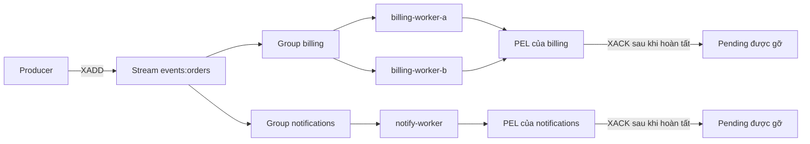
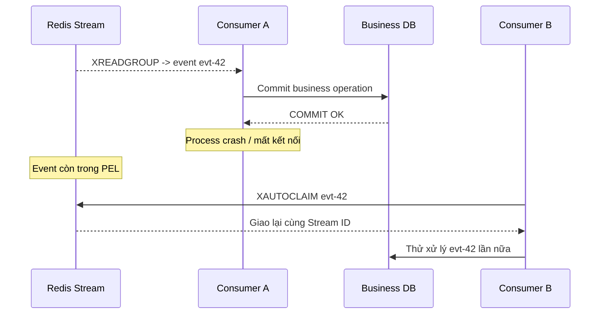
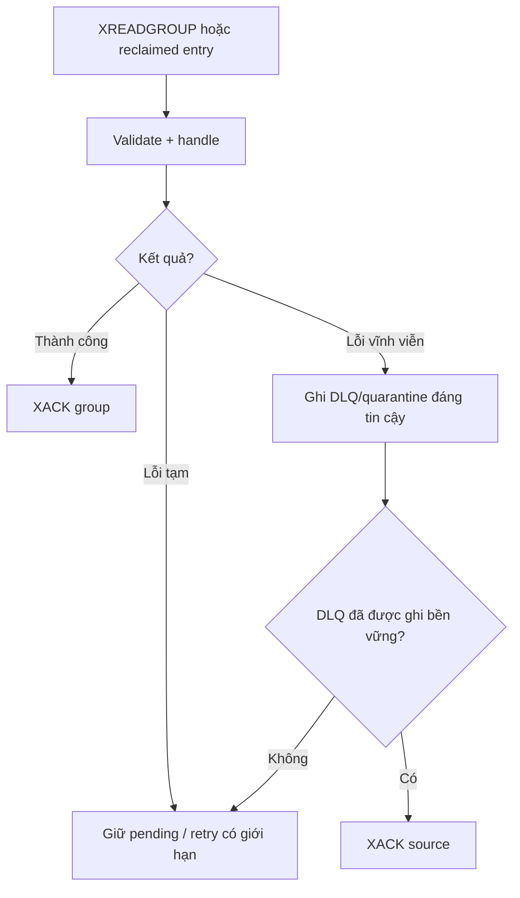
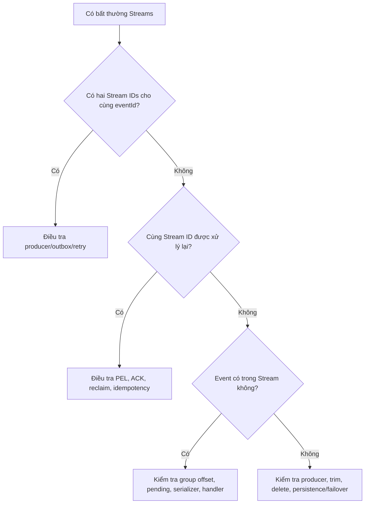

# Chẩn đoán Redis Streams bị lặp bản ghi, tăng pending hoặc bỏ sót dữ liệu trong Spring Data Redis

## 1. Tình huống: Redis vẫn hoạt động nhưng kết quả nghiệp vụ không đúng

Redis Streams thường được dùng trong Spring Data Redis để chuyển event hoặc công việc từ producer đến consumer group. Một hệ thống có thể chạy khỏe về mặt kết nối nhưng xuất hiện những hiện tượng sau:

- Một đơn hàng được xử lý hai lần dù producer chỉ định phát một event.
- Một số event xuất hiện nhiều lần trong Stream.
- Pending Entries List (PEL) ngày càng lớn, worker vẫn còn sống nhưng không hết việc.
- Consumer mới đọc được event mới mà không đọc lại những event cũ đang pending.
- Group có vẻ bắt kịp nhưng doanh nghiệp báo thiếu đơn hàng hoặc thiếu notification.
- Tăng số worker không cải thiện tình hình; một số event còn bị chuyển qua xử lý lại nhiều lần.
- Stream có TTL/trim, event chưa được xử lý đã biến mất.

Ba nhóm biểu hiện **lặp bản ghi, tăng pending, bỏ sót dữ liệu** có thể liên quan nhau nhưng không có cùng nguyên nhân. Muốn sửa đúng cần phân biệt:

1. **Lặp khi ghi:** một event nghiệp vụ được producer thêm nhiều lần bằng `XADD`.
2. **Giao lại khi đọc:** một entry có Stream ID duy nhất được giao nhiều lần vì chưa `XACK`.
3. **Side effect lặp:** một giao dịch ở hệ thống đích được thực hiện nhiều lần, dù Stream entry chỉ tồn tại một lần.
4. **Chưa giao:** event nằm sau vị trí đọc của consumer group.
5. **Đã giao nhưng kẹt:** event nằm trong PEL và worker chưa hoàn thành.
6. **Mất payload hoặc bỏ qua offset:** event không còn khả dụng cho luồng tiêu thụ hiện tại.

> **Không thể chữa mọi lỗi bằng cách xóa PEL, tăng số consumer hoặc đổi offset thành `$`.** Những thao tác ấy có thể làm số liệu đẹp hơn nhưng khiến mất dấu các event chưa được xử lý.

Bài học này cung cấp mô hình chẩn đoán, các lệnh Redis CLI, ví dụ Spring Data Redis, cách quản lý ACK/idempotency, những rủi ro retention và runbook vận hành.

## 2. Redis Stream, consumer group và PEL: mô hình cần nắm

Redis Stream là một log được sắp xếp theo **Stream ID**. Producer dùng `XADD` để thêm entry. Consumer group dùng `XREADGROUP` để phân phối công việc giữa các consumer.



Trong một consumer group, các entry mới thường được chia cho các consumers, thay vì mọi consumer đều nhận mọi event. Nhưng **mỗi group có tiến độ và PEL riêng**.

Cùng một Stream entry có thể được giao cho group `billing` và group `notifications`. Đây **không phải lỗi ghi trùng**: hai group độc lập có chủ đích xử lý cùng event cho những mục đích khác nhau.

### 2.1. Các trạng thái thường gặp của một entry đối với một group

```text
Entry được XADD
    |
    | Chưa được giao cho group
    v
[Undelivered backlog]
    |
    | XREADGROUP ... >
    v
[Delivered, có thông tin PEL]
    |
    +-- handler chưa hoàn tất --> vẫn pending
    |
    +-- consumer crash --> vẫn pending
    |
    +-- được claim sang consumer khác --> vẫn pending, owner đổi
    |
    +-- xử lý thành công và XACK --> ra khỏi PEL
```

`XACK` **không tự xóa entry khỏi Stream**; nó chỉ xác nhận entry trong phạm vi group. Vì vậy entry còn hiện trong `XRANGE` sau khi đã ack là bình thường.

### 2.2. Hai bộ đếm quan trọng không giống nhau

| Chỉ số | Nguồn quan sát | Có ý nghĩa gì? |
|---|---|---|
| Group lag | `XINFO GROUPS`, trường `lag` nếu biết | Số entry còn chưa được giao cho group |
| Pending count | `XINFO GROUPS` hoặc `XPENDING` | Số entry đã giao nhưng chưa được ACK trong group |
| Stream length | `XLEN` hoặc `XINFO STREAM` | Số entry hiện còn trong Stream, kể cả entry đã ACK |
| Consumer pending | `XINFO CONSUMERS` | Pending do một logical consumer sở hữu |
| Pending idle time | `XPENDING` chi tiết | Thời gian kể từ lần giao/activity phù hợp với Redis semantics |
| Delivery count | `XPENDING` chi tiết | Số lần giao/claim theo metadata được Redis quản lý |

`lag = 0` không có nghĩa mọi entry đã xử lý xong: group có thể giao hết event nhưng PEL còn rất lớn. `pending = 0` cũng không có nghĩa group đã đọc hết event mới.

## 3. Chẩn đoán đầu tiên: bị lặp ở đâu?

Giả sử nghiệp vụ có `eventId=evt-42` và Stream entry ID `1763000000000-0`.

### 3.1. Lặp bản ghi trong Stream

```text
Stream ID             eventId
1763000000000-0       evt-42
1763000000010-0       evt-42
```

Đây là **hai Stream entries** khác nhau cùng đại diện cho một event nghiệp vụ. Khả năng cao producer đã `XADD` hai lần, có retry sau timeout hoặc hệ thống phát event lặp.

### 3.2. Giao lại cùng một entry

```text
Stream ID             eventId    delivery attempt
1763000000000-0       evt-42     worker-a lần 1
1763000000000-0       evt-42     worker-b lần 2
```

Đây là **một Stream entry** nhưng bị giao lại vì còn pending hoặc được reclaim. Redis Streams consumer group hỗ trợ recovery kiểu at-least-once khi ứng dụng thiết kế ACK phù hợp; giao lại là hành vi cần dự kiến.

### 3.3. Side effect bị lặp dù event chỉ ghi một lần

```text
Redis XADD evt-42: 1 entry

worker-a gọi downstream: charge/order/update -> thành công
worker-a crash trước XACK

worker-b đọc lại pending evt-42
worker-b gọi downstream một lần nữa -> side effect lặp
```

Ở đây giải pháp không phải chỉ tìm lỗi `XADD`. Hệ thống cần **idempotency của nghiệp vụ**, nghĩa là cùng event ID không làm cập nhật quan trọng bị thực hiện hai lần.

### 3.4. Bảng phân biệt

| Dấu hiệu | Nơi cần kiểm tra | Hướng xử lý |
|---|---|---|
| Nhiều Stream ID cho cùng `eventId` | `XRANGE`/event store/producer logs | Producer idempotency/outbox |
| Một Stream ID xuất hiện nhiều lượt xử lý | `XPENDING`, owner/idle/delivery count | ACK/recovery/idempotent handler |
| Mỗi group xử lý một lần cùng event | `XINFO GROUPS`, group names | Có thể là thiết kế đúng |
| Một entry có hai consumer xử lý song song sau claim | Recovery threshold và handler duration | Điều chỉnh claim, fencing/idempotency |
| Chỉ downstream bị tăng đôi, event log không lặp | Transaction/ACK gap | Dedupe tại side-effect boundary |
| UI hiển thị bản ghi trùng nhưng DB chỉ có một | Projection/refresh/cache | Kiểm tra key và consumer logic, không kết luận Stream trùng |

Không suy luận nguyên nhân chỉ từ số dòng trên màn hình. Phải xác định **Stream ID, business event ID, group name, consumer name và trạng thái side effect**.

## 4. Các lệnh Redis quan sát an toàn

Khi bắt đầu điều tra, ưu tiên **lệnh chỉ đọc** trên đúng Stream và group:

```redis
TYPE events:orders
XLEN events:orders
XINFO STREAM events:orders
XINFO GROUPS events:orders
XINFO CONSUMERS events:orders billing
XPENDING events:orders billing
XPENDING events:orders billing - + 20
XREVRANGE events:orders + - COUNT 10
```

Mục tiêu:

- Xác định Stream key đúng kiểu `stream`.
- Kiểm tra tổng entry hiện còn, ID đầu/cuối và retention.
- Xem group last-delivered ID và lag nếu Redis tính được.
- Xem pending tổng và per-consumer.
- Lấy mẫu một số entry gần đây để kiểm tra business event ID.

`XREVRANGE` truy vấn theo Stream ID giảm dần; nó **không phải lệnh trả các event đã được xử lý thành công gần nhất**.

### 4.1. XPENDING chi tiết

```redis
XPENDING events:orders billing IDLE 60000 - + 20
```

Tìm tối đa 20 pending entries có idle ít nhất 60 giây. Tùy phiên bản Redis, mỗi entry thường có:

```text
stream-id
consumer-owner
idle-milliseconds
delivery-count
```

Đừng hiểu delivery count lớn là bằng chứng chắc chắn downstream đã xử lý thành công nhiều lần. Nó chỉ cho biết lịch sử giao/reclaim theo metadata Redis; business success phải quan sát riêng.

### 4.2. Lưu ý quyền truy cập

Một monitoring user chỉ cần quyền đọc metadata. Không tự cấp quyền `FLUSHALL`, `XGROUP DESTROY`, `XGROUP SETID`, `XACK` hoặc `XAUTOCLAIM` cho dashboard nếu nó không có trách nhiệm sửa trạng thái.

Khi điều tra dữ liệu nhạy cảm, tránh in full payload vào logs/tickets. Có thể dùng Stream ID, business event ID đã phân loại và các số liệu metadata.

## 5. Bộ dữ liệu minh họa có thể tự chạy

Dùng namespace riêng trong môi trường thử nghiệm:

```redis
DEL demo:streams:diag:orders
XGROUP CREATE demo:streams:diag:orders billing 0-0 MKSTREAM

XADD demo:streams:diag:orders * eventId evt-A orderId o-101 type CREATED
XADD demo:streams:diag:orders * eventId evt-B orderId o-102 type PAID
XADD demo:streams:diag:orders * eventId evt-C orderId o-103 type CREATED

XLEN demo:streams:diag:orders
XINFO GROUPS demo:streams:diag:orders
```

Redis tự sinh những Stream IDs có dạng `milliseconds-sequence`. Khi cần ACK, hãy sử dụng **ID thực tế trả về**, không dùng `evt-A` như Stream ID.

### 5.1. Consumer nhận hai event

```redis
XREADGROUP GROUP billing worker-a COUNT 2 STREAMS demo:streams:diag:orders >
```

Sau đó:

```redis
XPENDING demo:streams:diag:orders billing
XINFO GROUPS demo:streams:diag:orders
```

Khi không có thao tác đồng thời khác, nhóm đã được giao hai entry nên pending tăng khoảng 2; còn một entry mới chưa giao.

### 5.2. ACK chỉ một event

```redis
XACK demo:streams:diag:orders billing <STREAM_ID_CUA_EVT_A>
XPENDING demo:streams:diag:orders billing
```

Pending còn một entry, nhưng `XLEN` vẫn có thể là 3. Đó là hành vi đúng.

### 5.3. Đọc pending của chính consumer

```redis
XREADGROUP GROUP billing worker-a COUNT 10 STREAMS demo:streams:diag:orders 0
```

Dùng ID `0` (hoặc `0-0`) với group để đọc lại **những pending entries thuộc logical consumer `worker-a`** theo cơ chế history mode. Đây không phải đọc những event mới sau group cursor.

### 5.4. Consumer khác chỉ đọc entry mới với dấu >

```redis
XREADGROUP GROUP billing worker-b COUNT 10 STREAMS demo:streams:diag:orders >
```

`worker-b` không tự nhận pending cũ của `worker-a` chỉ vì worker-a ngừng hoạt động. Nó sẽ nhận entry mới chưa giao, còn pending cũ cần flow recovery.

Không tự chạy `XACK` hoặc `XGROUP SETID` trên Stream production để tái hiện, vì đó là thao tác thay đổi trạng thái thật.

## 6. Nguyên nhân ghi trùng: producer retry XADD sau timeout

Một producer viết:

```redis
XADD events:orders * eventId evt-42 orderId o-42 type CREATED
```

Nếu Redis thực thi xong nhưng phản hồi bị mất do connection reset:

```text
Producer -> Redis: XADD ... *
Redis đã tạo Stream ID A
Redis -> Producer: reply bị mất

Producer nhận timeout và retry XADD ... *
Redis tạo Stream ID B
```

Kết quả: **hai entries có hai Stream IDs khác nhau**, cùng `eventId=evt-42`.

`XADD *` tạo ID mới mỗi lần. Nó không biết hai calls mang cùng event ID nghiệp vụ.

### 6.1. Chống ghi trùng ở producer

Có vài chiến lược:

- **Transactional outbox** trong database: ghi business state và outbox event trong một database transaction, relay có thể gửi lại; consumers vẫn phải idempotent.
- **Idempotency key** tại producer/integration: ghi nhận eventId đã được gửi theo mô hình có thể xác minh outcome.
- **Cơ chế ghi có điều kiện trong Redis**: script/Function đánh dấu ID và `XADD` atomic trong một server-side execution khi cùng key slot phù hợp.
- **Chấp nhận at-least-once delivery** và dedupe ở consumer theo business event ID.

Không xem việc đặt một Stream ID cố định là giải pháp chung: Stream IDs phải thỏa thứ tự tăng của Redis và những ràng buộc khi có nhiều producer. Một ID nghiệp vụ ngẫu nhiên không thể tùy tiện dùng làm Stream ID.

### 6.2. Điều kiện nhận diện producer duplicate

Đối chiếu:

1. `eventId` và mã business action.
2. Có bao nhiêu Stream IDs cùng chứa `eventId`.
3. Producer send attempts và retry reason.
4. Thời điểm gửi và Redis connection errors.
5. Outbox/DB có event duy nhất hay hai lần tạo nghiệp vụ.
6. Consumer có idempotency để không thực hiện side effect hai lần không.

Nếu một event thực sự được phát hai lần bởi upstream nghiệp vụ, sửa consumer thôi có thể chỉ che lỗi ở tầng gốc.

## 7. Nguyên nhân xử lý trùng: handler hoàn tất nhưng chưa ACK

Mô hình điển hình:



Đây là một rủi ro cơ bản của việc chọn **ACK sau khi side effect đã bền vững**. Nếu ACK trước khi xử lý, bạn lại có nguy cơ mất công việc:

```text
XREADGROUP -> XACK -> gọi database
                     \
                      process crash -> event đã ack, DB chưa cập nhật
```

Vì vậy không có một vị trí `XACK` đơn giản nào tự cung cấp exactly-once giữa Redis và database khác.

### 7.1. Giải pháp: xử lý nghiệp vụ idempotent

Gắn mỗi event một ID bất biến như `evt-42`; tại database đích, thao tác cập nhật business state và ghi nhận event đã xử lý cần xảy ra trong **cùng transaction**.

Ví dụ schema PostgreSQL:

```sql
CREATE TABLE processed_stream_events (
    consumer_group VARCHAR(100) NOT NULL,
    event_id VARCHAR(200) NOT NULL,
    processed_at TIMESTAMPTZ NOT NULL DEFAULT now(),
    PRIMARY KEY (consumer_group, event_id)
);
```

Trong transaction nghiệp vụ:

```sql
BEGIN;

INSERT INTO processed_stream_events (consumer_group, event_id)
VALUES ('billing', 'evt-42')
ON CONFLICT DO NOTHING;

-- Chỉ thực hiện UPDATE/INSERT nghiệp vụ khi INSERT ở trên
-- thực sự tạo bản ghi mới (row count = 1).
-- Nếu row count = 0, event đã được xử lý trước đó.

COMMIT;
```

Đoạn SQL minh họa nguyên tắc; code thực phải kiểm tra row count và đặt các updates cần bảo vệ trong cùng transaction. Không ghi marker "đã xử lý" rồi commit trước, sau đó mới thực hiện business update ở transaction khác.

Sau khi transaction hoàn tất thành công, consumer có thể `XACK`. Nếu ACK mất hoặc lỗi mạng, event được giao lại thì **database đã có marker** và handler không làm side effect thêm một lần.

### 7.2. Chỉ dùng Stream ID để dedupe hay business event ID?

- **Stream ID** giúp nhận diện một entry duy nhất trong một Stream và phục vụ ACK, pending, claim.
- **Business event ID** giúp nhận diện một hành động nghiệp vụ khi producer có thể phát hai Stream entries khác nhau cho cùng hành động.
- Một event có thể phải được xử lý ở nhiều groups. Bảng dedup cần phân biệt consumer group/processing purpose nếu mỗi group có side effect riêng.
- Với dữ liệu event từ nhiều Stream sources, có thể phải thêm source/tenant vào dedup namespace.

Nếu chỉ dedupe theo Stream ID, hai `XADD *` của cùng event ID vẫn có hai Stream IDs nên cả hai có thể tạo side effect. Nếu chỉ dedupe theo event ID nhưng trộn nhiều business action khác nhau vào cùng namespace, có thể chặn nhầm sự kiện hợp lệ.

## 8. ACK thành công nghĩa là gì?

`XACK stream group id...` trả về **số pending references đã được xóa** khỏi PEL của group.

Ví dụ:

```redis
XACK events:orders billing 1763000000000-0
```

Kết quả có thể là:

- `1`: đúng một pending entry được ack.
- `0`: ID đó không có pending reference tương ứng trong group tại thời điểm gọi, đã ack trước, bị thay đổi trạng thái hoặc không đúng group/ID.

`XACK` không xác nhận rằng một API bên ngoài đã thực thi chính xác một lần; Redis chỉ cập nhật **metadata của consumer group**.

### 8.1. Những lỗi ACK phổ biến

| Lỗi | Hậu quả |
|---|---|
| Quên gọi `XACK` | PEL tăng dù handler xử lý thành công |
| Chỉ ACK khi method không ném lỗi nhưng callback async chưa hoàn tất | ACK sớm, có nguy cơ mất xử lý |
| ACK trong `finally` bất kể exception | Mất khả năng retry job lỗi |
| Dùng sai group name | Không ack pending đúng group |
| Dùng sai Stream ID | Pending không giảm |
| Dùng `eventId` nghiệp vụ thay Stream ID | ACK trả 0 hoặc command không hợp lệ |
| ACK khi mới enqueue local task, chưa commit downstream | Redis cho là hoàn tất nhưng business chưa xong |
| ACK lỗi mạng, code mặc định thành công | Trạng thái PEL không chắc chắn |
| Dùng consumer group auto-ack không hiểu semantics | Có thể không kiểm soát được thời điểm ACK |

Không nên "sửa" pending bằng cách ack tất cả IDs chưa biết trạng thái nghiệp vụ. Nó có thể khiến công việc bị mất vĩnh viễn khỏi quy trình recovery.

## 9. XINFO GROUPS: lag và pending khác nhau

```redis
XINFO GROUPS events:orders
```

Các trường phổ biến:

| Trường | Ý nghĩa |
|---|---|
| `name` | Group |
| `consumers` | Số consumer có metadata |
| `pending` | Tổng số pending của group |
| `last-delivered-id` | Vị trí cuối được group giao |
| `entries-read` | Logical counter dùng hỗ trợ tính lag (version phù hợp) |
| `lag` | Số entry chưa giao nếu Redis tính được |

Redis 7.0 bổ sung `entries-read`/`lag` theo cơ chế logical counter. Redis version cũ có thể không có chúng.

### 9.1. Lag cao, pending thấp

Có thể vì:

- Consumer không poll hoặc không kết nối.
- Group tạo sai offset và còn một lượng lịch sử lớn phải đọc.
- Worker đọc quá chậm do thread starvation hoặc blocked command.
- Consumer đang ở group/key khác với producer.
- Producer nhanh hơn tốc độ delivery.

Kiểm tra đọc từ `>`, consumer health, polling logs, network/ACL, ingress và group name.

### 9.2. Lag thấp, pending cao

Có thể vì:

- Consumer đọc rất nhanh nhưng handler xử lý chậm.
- Worker nhận batch lớn và không ACK.
- Worker crash.
- Recovery flow không xử lý pending cũ.
- Handler liên tục ném exception nhưng consumer tiếp tục nhận thêm event.
- ACK gửi sai Stream/group/ID.

Khi đó tăng polling rate có thể **làm PEL lớn hơn**. Cần giải quyết handler, ACK, idempotency và bounded concurrency.

### 9.3. Lag có thể là null/unknown

Khi group ở offset tùy ý hoặc Stream bị xóa/trim ở khoảng làm Redis không thể suy ra logical lag chính xác, `lag` có thể là `null`.

Không được:

```text
lag = null -> đổi thành 0
```

trong exporter/dashboard. Null nghĩa **chưa biết**, không phải đã xử lý hết. Dùng thêm `last-delivered-id`, pending, ingress/ACK rate và mốc Stream còn lưu.

### 9.4. XLEN không phải backlog

`XLEN` đếm các entry **hiện còn lưu** trong Stream. Nó không quan tâm một group đã ack hay chưa.

```text
XLEN = 100.000
billing lag = 0
billing pending = 0
```

Đây có thể là một Stream vẫn giữ toàn bộ lịch sử nhưng group đã bắt kịp. Công thức `lag = XLEN - pending` là sai.

## 10. Pending tăng vì consumer chỉ đọc entry mới

Khi consumer group đọc bằng:

```redis
XREADGROUP GROUP billing worker-a STREAMS events:orders >
```

dấu `>` nghĩa là đọc những entry **chưa từng được giao cho group**. Nó không phải lệnh "đọc tất cả pending còn tồn tại".

Một worker có thể restart và tiếp tục gọi `>` mãi mãi; các event mà nó nhận trước khi crash vẫn pending, nhưng không xuất hiện trong lượt đọc mới đó.

### 10.1. Đọc lịch sử pending của chính consumer

```redis
XREADGROUP GROUP billing worker-a COUNT 20 STREAMS events:orders 0
```

Trong history mode, ID `0` (hoặc `0-0`) cho phép đọc những pending entries **thuộc consumer name đang dùng** từ ID đó.

Điểm quan trọng:

- History mode không thay thế consumer group cursor chung.
- Nó không đọc pending thuộc consumer khác một cách tự động.
- Với ID khác `>`, một số option như `BLOCK`/`NOACK` không có cùng tác dụng như khi đọc entry mới; phải đối chiếu semantics phiên bản.
- Nếu startup logic luôn tạo tên consumer mới, nó không thấy PEL của tên cũ bằng cách đọc history của tên mới.

### 10.2. Reclaim pending của consumer đã chết

Muốn worker khác tiếp quản pending, dùng `XCLAIM` hoặc `XAUTOCLAIM` theo Redis version/hợp đồng vận hành, không chỉ tăng số consumer.

```redis
XAUTOCLAIM events:orders billing worker-b 60000 0-0 COUNT 50
```

Ví dụ chỉ reclaim những pending entries đã idle tối thiểu 60.000 ms. Cần xem cursor trả về và tiếp tục từ cursor đó để duyệt các entry thích hợp.

**Không reclaim quá sớm**: worker-a có thể còn xử lý job dài hợp lệ, dẫn tới hai workers cùng thực hiện side effect.

## 11. XPENDING và XINFO CONSUMERS: tìm consumer kẹt

Dùng:

```redis
XPENDING events:orders billing
XPENDING events:orders billing - + 20
XPENDING events:orders billing IDLE 60000 - + 20
XINFO CONSUMERS events:orders billing
```

### 11.1. Đọc các trường pending

Một pending entry chi tiết thường có:

- Stream ID.
- Consumer owner.
- Idle time (ms).
- Delivery count.

Ví dụ giả định:

```text
ID                    owner       idle(ms)   deliveries
1763000000000-0       worker-a    420000     1
1763000000100-0       worker-b    1500       3
1763000000200-0       worker-c    70000      8
```

Cách diễn giải:

- Entry đầu idle 7 phút, có thể worker-a đã chết hoặc job hợp lệ chạy lâu.
- Entry thứ hai đã giao nhiều lần nhưng idle gần đây, cần xem cơ chế claim.
- Entry thứ ba giao nhiều lần và vẫn lỗi; có thể là poison message.

Các dữ liệu này **không đủ** để kết luận handler đã commit side effect hay chưa. Phải đối chiếu DB/log nghiệp vụ bằng event ID.

### 11.2. Consumer idle/inactive

`XINFO CONSUMERS` hiển thị metadata theo consumer. Trong Redis 7.2+, `idle` và `inactive` có cách hiểu khác nhau: khoảng cách từ tương tác được thử và từ tương tác thành công tương ứng theo cơ chế version đó. Không áp cách hiểu phiên bản mới cho mọi server cũ.

Consumer idle cao không chắc chết: nó có thể không có việc mới hoặc đang xử lý một tác vụ dài. Nên kết hợp heartbeat, handler duration, last ACK, process readiness và restart count.

### 11.3. Không xóa consumer để "làm sạch" metric

`XGROUP DELCONSUMER` thay đổi metadata group. Nếu consumer vẫn có pending, việc xóa metadata trước khi chuyển/giải quyết pending có thể làm mất dấu công việc.

Hãy lấy mẫu PEL, xác định chủ sở hữu cũ và chạy recovery có kiểm soát. Chỉ dọn consumer metadata khi biết rõ trạng thái pending và chính sách Redis đang dùng.

## 12. Recovery với XAUTOCLAIM: đúng ngưỡng, đúng cursor

`XAUTOCLAIM` giúp tìm pending entries đủ idle và chuyển quyền sở hữu sang consumer mới. Lệnh trả về cursor và entries được claim; Redis 7.0+ còn có thể báo các ID đã bị xóa mà nó dọn metadata reference trong quá trình quét.

Ví dụ:

```redis
XAUTOCLAIM events:orders billing recovery-worker 120000 0-0 COUNT 100
```

Ý nghĩa:

| Thành phần | Diễn giải |
|---|---|
| `events:orders` | Stream key |
| `billing` | Consumer group |
| `recovery-worker` | Consumer tiếp quản |
| `120000` | Min idle 120 giây |
| `0-0` | Cursor bắt đầu |
| `COUNT 100` | Giới hạn công việc/kết quả mỗi lần |

### 12.1. Cursor và vòng quét

Không nên chỉ gọi một lần rồi coi đã xử lý toàn PEL. Lệnh có thể trả cursor tiếp theo; logic recovery cần sử dụng cursor đó và thực hiện các lượt phù hợp theo tài liệu Redis version.

Khi cursor trả `0-0`, một vòng quét đã đi hết phạm vi hiện tại, **không có nghĩa tất cả pending đều được giải quyết**: có thể vẫn còn entry chưa đạt min-idle hoặc được giữ bởi worker đang chạy.

### 12.2. Đặt min-idle-time thực tế

Nếu handler p99 thường mất 90 giây, reclaim sau 10 giây có thể gây xử lý song song. Dùng:

- Handler duration p95/p99.
- Heartbeat/lease nếu job rất dài.
- Timeout của downstream call.
- Worker shutdown/drain policy.
- Idempotency ở database.
- Retry budgets và DLQ.

Đặt min idle cao quá khiến pending thật sự chết không được xử lý trong SLA; đặt quá thấp khiến duplicate side effects tăng.

### 12.3. XCLAIM so với XAUTOCLAIM

- `XCLAIM` phù hợp khi bạn đã có một danh sách pending IDs cần chuyển.
- `XAUTOCLAIM` quét PEL theo min idle và cursor, thuận tiện cho recovery loop.
- Cả hai **không tự khử trùng side effects**.
- Cả hai không thể khôi phục payload đã bị trim/xóa khỏi Stream.

Trong ứng dụng Java, có thể gọi qua những API Spring Data Redis có hỗ trợ phiên bản tương ứng hoặc Redis connection/driver. Hãy kiểm tra chữ ký thực tế của `StreamOperations.autoClaim` ở Spring Data Redis version đang chạy thay vì sao chép code từ phiên bản khác.

## 13. Poison message: một entry gây lỗi mãi mãi

Một số message hỏng có thể làm handler lặp lỗi:

- Payload thiếu field bắt buộc.
- JSON schema không tương thích.
- Reference đến entity đã bị xóa.
- Business invariant vi phạm.
- Dữ liệu cũ không còn được code mới hỗ trợ.
- Downstream luôn từ chối do lý do nghiệp vụ không thể retry.

Nếu worker cứ nhận, ném exception và không ack, event nằm trong PEL. Recovery lại claim, thử xử lý, rồi lặp vô hạn.

### 13.1. Phân loại lỗi

| Loại lỗi | Ví dụ | Cách xử lý |
|---|---|---|
| Tạm thời | Database timeout, HTTP 503 | Retry có backoff/limit |
| Không thể retry như cũ | Schema invalid, required field missing | Quarantine/DLQ và điều tra |
| Không chắc outcome | HTTP timeout sau request gửi tiền | Xác minh bằng idempotency/transaction |
| Authorization | Token hết hạn, ACL sai | Sửa cấu hình; không spam retry vô hạn |
| Dữ liệu phụ thuộc chưa có | Event đến trước entity | Chờ/đệm có giới hạn, hoặc xử lý theo thứ tự |
| Hệ thống quá tải | Thread pool/DB connections hết | Backpressure, giới hạn concurrency |

Không dùng delivery count như một thước đo tuyệt đối "đã xử lý lỗi N lần". Một số lượt delivery có thể do khởi động lại hoặc recover, không phải một handler failure mới.

### 13.2. DLQ/quarantine và ACK

Luồng thường dùng:



**Không ACK message nguồn trước khi việc ghi DLQ đáng tin cậy** nếu event đó bắt buộc phải giữ. Nếu DLQ khác hạ tầng, luôn có rủi ro giữa hai hệ thống; cần idempotent DLQ producer hoặc transaction/outbox phù hợp.

DLQ nên giữ:

- Original Stream ID, event ID và source.
- Error category, attempt/retry metadata.
- Schema version và correlation ID.
- Payload hoặc reference theo chính sách bảo mật.
- Thời điểm quarantine.
- Quy trình replay an toàn.

Không copy mọi PII/token vào DLQ và log với retention dài nếu không có yêu cầu nghiệp vụ.

## 14. Bỏ sót vì tạo group từ dấu $ thay vì 0-0

Khi tạo group:

```redis
XGROUP CREATE events:orders billing $
```

dấu `$` có nghĩa khởi tạo group ở **cuối Stream hiện tại**. Group chỉ nhận những entry mới được ghi sau thời điểm tạo group khi đọc `>`.

Ví dụ:

```text
Stream đã chứa:
  event A
  event B
  event C

Tạo group bằng $
Sau đó thêm:
  event D

Consumer XREADGROUP ... >
=> Nhận D, không tự nhận A/B/C.
```

Đây là **một quyết định offset**, không phải Redis tự làm mất dữ liệu. Nếu mục tiêu là xử lý toàn bộ dữ liệu còn tồn tại, cần tạo group từ:

```redis
XGROUP CREATE events:orders billing 0-0
```

hoặc một Stream ID checkpoint cụ thể được khôi phục theo runbook.

### 14.1. Đừng tự đổi offset của group đang production

`XGROUP SETID` có thể thay group last-delivered ID, làm thay đổi phạm vi entry mới khi consumer đọc tiếp. Đặt về đầu có thể phát lại một loạt event; đặt gần cuối có thể bỏ qua event chưa giao.

Trước khi thay đổi:

1. Xác định hiện có pending hay không.
2. Snapshot metadata group/Stream IDs.
3. Xác định business event nào thực sự chưa xử lý.
4. Đảm bảo handler idempotent.
5. Thực hiện trong maintenance/recovery plan đã được duyệt.
6. Theo dõi backlog và kết quả ở hệ thống đích.

Không dùng `XGROUP DESTROY` rồi tạo lại với `$` như mẹo xóa pending: thao tác đó bỏ trạng thái group và có thể khiến event cũ bị bỏ sót.

## 15. Bỏ sót vì dùng ReadOffset.latest() sai ngữ cảnh

Spring Data Redis cung cấp `ReadOffset` để mô tả vị trí đọc. Cần phân biệt đọc standalone và đọc trong consumer group.

| Ngữ cảnh | Ý nghĩa offset thường dùng | Kết quả |
|---|---|---|
| `XREAD` không dùng group, từ ID xác định | Đọc entry sau mốc ID | Có thể replay từ checkpoint |
| `XREAD` dùng latest/`$` | Chờ entry mới sau thời điểm bắt đầu lệnh | Dễ bỏ qua entry tới giữa hai lần poll |
| `XREADGROUP` với `>` | Entry mới chưa giao cho group | Phù hợp vòng poll chính |
| `XREADGROUP` với `0`/ID lịch sử | Pending của cùng consumer | Phục hồi pending của chính name |
| Nhận pending consumer khác | `XCLAIM`/`XAUTOCLAIM` | Ownership chuyển theo chính sách |

Với polling group Spring Data Redis, cách điển hình:

```java
StreamOffset.create(
        "events:orders",
        ReadOffset.lastConsumed()
);
```

Khi được dùng trong group read, `lastConsumed()` đại diện ý tưởng đọc những entry **chưa giao cho group** (Redis ID `>`).

### 15.1. Dấu $ trong vòng poll standalone có thể làm rơi event

Giả sử một consumer không dùng group gọi `XREAD STREAMS key $` trong từng lần poll. Mỗi lần lấy "latest hiện tại" làm offset, event xuất hiện giữa hai lượt poll có thể đã tồn tại trước lúc lệnh mới bắt đầu và bị bỏ qua.

Để không bỏ event, standalone reader cần giữ **last seen Stream ID** và đọc từ ID đó, thay vì reset latest ở mỗi vòng lặp.

Với consumer group, dùng group semantics và recovery riêng cho pending, không tự hoán đổi `ReadOffset.latest()` và `ReadOffset.lastConsumed()`.

## 16. Bỏ sót vì trim, delete hoặc TTL

Redis Streams có thể bị xóa payload dù event chưa được consumer xử lý:

```redis
XTRIM events:orders MAXLEN ~ 100000
```

hoặc producer:

```redis
XADD events:orders MAXLEN ~ 100000 * eventId evt-new ...
```

Khi producer nhanh hơn consumer, entry ở đầu log có thể bị trim trước khi group nhận. Tương tự:

- `XDEL` xóa một entry.
- `DEL`/`UNLINK` xóa toàn Stream key.
- `EXPIRE` trên key làm toàn Stream hết hạn.
- Một job dọn dữ liệu xử lý nhầm namespace.
- Việc restore từ snapshot cũ có thể thiếu những entry được ghi sau mốc backup.
- Cơ chế backup/failover không đủ cho RPO.

### 16.1. XACK không phải xóa payload

Trong Redis Streams truyền thống, `XACK` chỉ xóa pending reference trong group; `XLEN` không tự giảm. Vì vậy không nên dùng `XACK` như một cơ chế retention.

Ngược lại, `XTRIM`/`XDEL` loại payload khỏi Stream. Những phiên bản Redis khác nhau có semantics về việc giữ/xóa pending references liên quan đến payload bị xóa.

Redis 8.2+ bổ sung những lựa chọn như `KEEPREF`, `DELREF`, `ACKED` trên các lệnh có hỗ trợ và thêm những lệnh phối hợp ack/delete. Cần xem chính xác engine/version và policy của từng command.

### 16.2. Ghost pending: PEL còn ID nhưng payload đã mất

Ví dụ:

```text
Group billing có pending ID 1763000000000-0
Cleanup job XTRIM loại payload ID đó
XPENDING vẫn có thể báo reference, tùy chính sách/version
Recovery đọc lại ID -> không còn nội dung để xử lý
```

Trong Redis 7.0+, `XAUTOCLAIM` có thể dọn những PEL references trỏ tới entry không còn tồn tại và báo các IDs liên quan trong reply. Đây là **dọn metadata**, không phục hồi event đã mất.

Nếu payload không còn, muốn khôi phục nghiệp vụ cần:

- Event log/outbox nguồn có đủ dữ liệu để replay.
- Archive bên ngoài Redis.
- Đối soát trạng thái với database.
- Quy trình bù trừ/thông báo mất dữ liệu theo SLA.

Không có lệnh Redis nào tự tái tạo một event đã bị xóa khi không còn nguồn khác.

### 16.3. Kiểm tra retention

```redis
XINFO STREAM events:orders
XRANGE events:orders - + COUNT 3
XREVRANGE events:orders + - COUNT 3
XLEN events:orders
TTL events:orders
```

Cần xem:

- First entry ID còn tồn tại.
- Last entry ID.
- Group last-delivered ID.
- Pending min/max IDs.
- Maxlen/minid trim policy.
- TTL của key (nếu có).
- Tốc độ producer và thời gian chậm nhất của consumer.

Không dùng phép trừ số học giữa hai Stream IDs để tính chính xác số event mất: ID có phần timestamp và sequence, không phải một số thứ tự liên tục.

## 17. Bỏ sót do nhầm stream key, group hoặc serializer

Có những trường hợp dữ liệu không hề bị xóa; consumer chỉ đọc sai nơi.

Ví dụ:

```text
Producer ghi:
  events:orders:v2

Consumer đọc:
  events:orders:v1
```

Hoặc:

```text
Producer dùng Redis database 0
Consumer kết nối database 1
```

Hoặc:

```text
Producer sử dụng StringRedisTemplate
Consumer sử dụng RedisTemplate với key serializer khác
```

Dù Java đều log `events:orders` ở dạng text, actual bytes của key có thể khác nếu serializer thêm format hoặc prefix. Trong Redis Cluster chỉ database 0 được sử dụng; trên standalone, database index khác cũng dẫn tới hai keyspaces.

### 17.1. Checklist kết nối

- Redis endpoint và network namespace có đúng không?
- Spring Boot 3.x dùng `spring.data.redis.*` còn Boot 2.x thường dùng `spring.redis.*`.
- Có custom `RedisConnectionFactory` override auto-configuration không?
- Có cấu hình Sentinel/Cluster trỏ sang master/shard khác không?
- Group name có khớp producer pipeline và consumer logic không?
- Stream key prefix/version đã đổi sau deploy không?
- Có secret/ACL khiến một consumer chỉ được đọc một namespace khác không?
- Có các ứng dụng cùng dùng consumer name gây khó theo dõi ownership không?

Đừng nhìn vào việc Redis trả `PONG` rồi kết luận tất cả event ở đúng endpoint.

## 18. Pending tăng vì handler có lỗi nhưng lỗi bị nuốt

Một đoạn code kiểu:

```java
try {
    processEvent(record);
} catch (Exception ex) {
    log.warn("Processing failed");
}
```

nếu không ACK khi lỗi thì event sẽ nằm pending. Điều đó có thể **đúng chủ đích** nếu muốn retry, nhưng phải có recovery. Nếu sau catch worker tiếp tục đọc `>` mãi, pending cũ không được xử lý lại.

Nguy hiểm hơn là:

```java
try {
    processEvent(record);
} catch (Exception ex) {
    log.warn("Processing failed");
} finally {
    redis.opsForStream().acknowledge(
            stream, group, record.getId()
    );
}
```

Code này ACK cả khi handler fail, khiến event rời khỏi PEL mà business action chưa thành công.

### 18.1. Đúng nguyên tắc

```text
Read event
  |
  v
Validate / process
  |
  +-- Thành công bền vững -> ACK
  |
  +-- Lỗi tạm thời -> giữ pending, retry có kiểm soát
  |
  +-- Lỗi vĩnh viễn -> DLQ/quarantine đáng tin cậy, rồi ACK
```

Không gọi ACK "để giảm pending" nếu chưa biết trạng thái thực của event.

## 19. Spring Data Redis: polling consumer group đúng hướng

Ứng dụng có thể dùng `StringRedisTemplate.opsForStream()`.

Ví dụ một worker đọc **entry mới**, gọi handler và chỉ ACK sau khi handler trả về thành công:

```java
package com.example.orders.stream;

import java.time.Duration;
import java.util.Map;

import org.slf4j.Logger;
import org.slf4j.LoggerFactory;
import org.springframework.beans.factory.annotation.Value;
import org.springframework.data.redis.connection.stream.Consumer;
import org.springframework.data.redis.connection.stream.ReadOffset;
import org.springframework.data.redis.connection.stream.StreamOffset;
import org.springframework.data.redis.core.StreamReadOptions;
import org.springframework.data.redis.core.StringRedisTemplate;
import org.springframework.stereotype.Service;

@Service
public class OrderStreamPoller {

    private static final Logger log =
            LoggerFactory.getLogger(OrderStreamPoller.class);

    private static final String STREAM = "events:orders";
    private static final String GROUP = "billing";

    private final StringRedisTemplate redis;
    private final OrderEventHandler handler;
    private final String consumerName;

    public OrderStreamPoller(
            StringRedisTemplate redis,
            OrderEventHandler handler,
            @Value("${app.stream.consumer-name}") String consumerName) {

        this.redis = redis;
        this.handler = handler;
        this.consumerName = consumerName;
    }

    public void pollOnce() {
        var records = redis.opsForStream().read(
                Consumer.from(GROUP, consumerName),
                StreamReadOptions.empty()
                        .count(20)
                        .block(Duration.ofSeconds(2)),
                StreamOffset.create(
                        STREAM, ReadOffset.lastConsumed())
        );

        if (records == null || records.isEmpty()) {
            return;
        }

        for (var record : records) {
            String streamId = record.getId().getValue();

            try {
                // Handler phải idempotent theo business eventId
                // và commit side effect trước khi return.
                handler.handle(streamId, record.getValue());

                Long acked = redis.opsForStream().acknowledge(
                        STREAM, GROUP, record.getId()
                );

                if (acked == null || acked != 1L) {
                    log.warn(
                            "Stream ACK unexpected result stream={} group={}",
                            STREAM, GROUP
                    );
                }
            } catch (RuntimeException ex) {
                // Không ACK khi thất bại hoặc chưa chắc outcome.
                // Log event category/stream ID an toàn theo policy.
                log.warn(
                        "Stream event processing failed stream={} group={} type={}",
                        STREAM,
                        GROUP,
                        ex.getClass().getSimpleName()
                );
            }
        }
    }

    public interface OrderEventHandler {
        void handle(String streamId, Map<Object, Object> fields);
    }
}
```

**Đây là khung minh họa**, chưa có scheduler, retry/claim, DLQ, idempotency implementation, transaction hay consumer lifecycle. Với Spring Data Redis/serializer khác nhau, kiểu Map generic thực tế có thể cần adapter. Source code trong dự án phải dùng interface phù hợp với `StreamOperations` đang được tạo và schema event.

### 19.1. Những quyết định trong ví dụ

- `Consumer.from(GROUP, consumerName)`: group và logical consumer name.
- `ReadOffset.lastConsumed()`: với group là đọc entry chưa được giao, tương ứng ý tưởng `>`.
- `count(20)`: giới hạn batch; không nhận vô hạn một lần poll.
- `block(Duration.ofSeconds(2))`: đợi event mới có giới hạn.
- Handler hoàn tất rồi mới ACK.
- Không ACK khi exception.
- Không log raw event payload mặc định.
- Không coi `acknowledge() == null` là một ACK thành công.

### 19.2. Giao thức delivery không bảo đảm downstream success

Dù handler trả về thành công, ACK có thể lỗi mạng. Để chịu được trường hợp đó:

1. Handler phải idempotent.
2. Có flow xử lý pending cũ.
3. Có metric cho handler success và ACK success riêng.
4. Không xóa message chỉ vì không thấy exception ở client Redis.

Ngoài ra, `record.getValue()` có thể cần schema validation. Một event schema cũ không đọc được phải được phân loại thành poison message, không tự chuyển thành business event hợp lệ.

### 19.3. Consumer name nên ổn định theo vòng đời

Nếu mọi lần poll đều tạo:

```java
String consumerName = UUID.randomUUID().toString();
```

thì Redis sẽ có nhiều logical consumers và pending owner phân tán. Worker mới không tự đọc pending của tên cũ bằng history mode.

Một cách thường dùng là tên dựa trên identity của pod/process được cấp lúc khởi động, giữ ổn định trong suốt vòng đời instance. Khi pod biến mất, recovery worker nhận pending của tên cũ bằng claim.

Không để hai process đang hoạt động dùng cùng consumer name nếu bạn cần theo dõi ownership per-instance và tránh lẫn metadata.

## 20. StreamMessageListenerContainer: lưu ý ACK mode và offset

Spring Data Redis có `StreamMessageListenerContainer` để poll và dispatch entries tới listener. Các phiên bản có những API nhận message bằng chế độ yêu cầu ACK thủ công hoặc auto-ack.

Ví dụ cấu trúc minh họa:

```java
var request = StreamMessageListenerContainer
        .StreamReadRequest.builder(
                StreamOffset.create(
                        "events:orders",
                        ReadOffset.lastConsumed())
        )
        .consumer(Consumer.from("billing", "worker-a"))
        .build();

// Đăng ký listener và tự ACK khi xử lý thật sự hoàn thành
// theo API cụ thể của Spring Data Redis version đang dùng.
```

Đây là **mẫu định hướng**, không phải cấu hình container hoàn chỉnh. Cần kiểm tra builder/overload của phiên bản, lập trình startup/shutdown container và cách listener nhận `MapRecord` hay `ObjectRecord`.

### 20.1. receive và receiveAutoAck

Khi dùng những API như `receive(...)` hoặc `receiveAutoAck(...)`, hãy hiểu rõ hợp đồng của container:

- Chế độ thủ công để handler quyết định khi nào ACK.
- Chế độ tự ACK để container quản lý xác nhận theo semantics của nó.
- Auto-ack có thể không phù hợp khi side effect của handler chưa bền vững hoặc phải retry khi listener lỗi.
- Một callback bất đồng bộ cần kiểm soát "handler hoàn tất" thực sự là lúc nào.

Không chỉ chuyển sang auto-ack để giảm PEL rồi kết luận đã sửa lỗi. Nếu message được xác nhận trước lúc nghiệp vụ hoàn tất, nó có thể bị **bỏ sót** khi process chết.

### 20.2. Đọc với latest có thể gây bỏ sót

Trong một số API receiver/container, `ReadOffset.latest()` thể hiện cách bắt đầu từ điểm cuối hiện tại. Nếu poll loop dùng latest theo cách khiến các entry sinh ra giữa hai lượt đọc không được xét, có thể tạo lỗ hổng.

Khi dùng group, ưu tiên offset group-oriented `lastConsumed()` cho entry mới, và thiết kế pending recovery riêng.

### 20.3. Container vẫn cần lifecycle và error handler

Một số lỗi không nằm ở handler mà ở tầng polling/connection:

- Redis unavailable.
- Auth/ACL từ chối `XREADGROUP`.
- Group chưa được tạo: `NOGROUP`.
- Consumer/Stream key không tồn tại.
- Deserialize failure.
- Container thread bị block hoặc dừng.
- Listener exception không được báo/đếm đúng.

Cần instrument container startup, subscription active, polling failures, last successful message và ACK rate. Không xem việc Spring context khởi động thành công là bằng chứng consumer đã đọc event.

## 21. NOGROUP, WRONGTYPE, NOAUTH và timeout

Các lỗi hạ tầng có thể gây triệu chứng "bỏ sót" vì consumer không nhận được gì.

| Lỗi/biểu hiện | Khả năng nguyên nhân | Xử lý |
|---|---|---|
| `NOGROUP` | Group chưa tạo hoặc Stream/key khác | Kiểm tra `XINFO GROUPS` và quy trình provision |
| `WRONGTYPE` | Key hiện là String/Hash, không phải Stream | Kiểm tra `TYPE`, collision prefix |
| `NOAUTH` | Client chưa xác thực | Kiểm tra Redis user/password và connection factory |
| `NOPERM` | ACL không cho lệnh hoặc key | Kiểm tra quyền `XREADGROUP`/`XACK` |
| `MOVED` hoặc redirect lỗi | Cluster routing/driver config sai | Dùng connection mode phù hợp |
| Connection timeout | Network, node down, pool exhausted | Kiểm tra host/port, Redis latency, retry budget |
| Deserialize error | Serializer/schema đổi | Validate payload và versioned event |
| `BUSYGROUP` khi tạo group | Group đã tồn tại | Provision idempotent, không destroy/recreate |
| Read trả empty liên tục | Sai group/key/offset, Stream chưa có event mới | XINFO STREAM/GROUPS, producer metrics |
| ACK trả 0 | ID/group không pending tại thời điểm gọi | Kiểm tra metadata và concurrency |

Không xử lý `BUSYGROUP` bằng cách xóa group để tạo lại. Một bước bootstrap **tạo group nếu chưa tồn tại** cần xử lý race đúng cách, giữ nguyên trạng thái nhóm đã tồn tại.

## 22. Khởi tạo group đúng và không để nhiều worker tranh sửa offset

Một môi trường mới có thể provision bằng:

```redis
XGROUP CREATE events:orders billing 0-0 MKSTREAM
```

Nếu chỉ nhận event mới sau khi triển khai:

```redis
XGROUP CREATE events:orders billing $ MKSTREAM
```

Chọn mốc nào dựa trên business requirement, không mặc định.

### 22.1. Tại sao không gọi XGROUP CREATE ở mọi lần poll?

Nếu mỗi worker đều thử tạo group ở mỗi vòng lặp:

- Sinh command thừa.
- Nhận `BUSYGROUP` liên tục.
- Có nguy cơ code tự destroy group để "sửa" lỗi.
- Khó kiểm soát timestamp và vị trí khởi tạo.

Có thể provision qua migration/IaC, hoặc một startup initializer xử lý `BUSYGROUP` như trường hợp "group đã tồn tại" mà không đổi offset. Group name và Stream key cần được quản lý nhất quán giữa các deployments.

### 22.2. Khi đổi group name

Một deployment v2 đổi:

```text
billing -> billing-v2
```

thì Redis coi đó là **một group mới**. Tùy tạo từ `0-0` hay `$`, nó có thể:

- Đọc lại toàn bộ lịch sử còn tồn tại → side effect lặp nếu không idempotent.
- Bỏ qua entry cũ → trông như mất dữ liệu.
- Chạy song song với group cũ → cả hai group xử lý event theo hai workflow.

Đừng đổi group name chỉ để reset pending mà không có migration plan.

## 23. Redis Streams khác Pub/Sub ở khả năng khôi phục

Redis Pub/Sub phát message tới subscribers đang online và không duy trì backlog để replay. Redis Streams có log entries và consumer group metadata, nhưng **khả năng replay vẫn phụ thuộc retention và dữ liệu còn tồn tại**.

| Tính chất | Pub/Sub | Streams consumer group |
|---|---|---|
| Lưu message để đọc sau | Không | Có, khi entry chưa bị xóa/trim |
| Offline consumer tự lấy lại | Không | Có thể, nếu offset/PEL được xử lý đúng |
| Pending/ACK | Không | Có |
| Group và nhiều consumers | Không theo nghĩa Streams | Có |
| At-least-once qua recovery | Không tự có | Có thể xây bằng ACK/claim |
| Exactly-once business side effect | Không | Không tự bảo đảm |
| Dữ liệu có thể mất do retention | Không giữ backlog | Có |
| Producer retry có thể tạo duplicate | Theo workflow | Có thể tạo nhiều Stream IDs |

Một đội phát triển chuyển từ Pub/Sub sang Streams nhưng vẫn giữ logic "nhận xong là xong", không quản lý ACK và PEL, sẽ chỉ dời loại sự cố từ mất message lúc offline sang pending kẹt hoặc xử lý lặp.

## 24. Stream IDs và event IDs: tránh nhầm khi log

Một event nên có tối thiểu:

```json
{
  "eventId": "evt-42",
  "type": "ORDER_PAID",
  "orderId": "order-42",
  "schemaVersion": 2
}
```

Khi `XADD`, Redis trả một Stream ID:

```text
1763000000000-0
```

Hai loại ID:

| ID | Ai tạo? | Dùng để làm gì? |
|---|---|---|
| Stream ID | Redis hoặc producer theo quy tắc ID của Redis | Offset, ACK, pending, claim, XRANGE |
| Business eventId | Nguồn nghiệp vụ/event producer | Dedup, audit, liên kết side effect |
| Consumer name | Ứng dụng/instance | Ownership pending trong group |
| Correlation/trace ID | Tracing infrastructure | Theo dõi request xuyên service |

Khi log, không dùng một field chung `id=...` cho cả bốn thứ. Sử dụng trường rõ tên:

```json
{
  "stream": "events:orders",
  "group": "billing",
  "streamId": "1763000000000-0",
  "eventType": "ORDER_PAID",
  "status": "ACK_TIMEOUT",
  "traceId": "opaque-trace-reference"
}
```

Nếu business event ID hoặc Stream ID được phân loại nhạy cảm theo policy, cần masking/truy cập phù hợp. Không log raw token, địa chỉ, số thẻ hay toàn bộ Stream payload chỉ để debug.

## 25. Idempotency bằng Redis có đủ không?

Có thể dùng Redis để đánh dấu eventId trước khi thực hiện một side effect, nhưng phải xem ranh giới transaction.

Ví dụ sai:

```text
SADD processed:billing evt-42
    |
    x Process crash
    |
    v
Database update chưa chạy

Retry:
  SISMEMBER evt-42 = 1 -> skip
```

Dù `SADD` là atomic, kết hợp `SADD` và cập nhật database khác **không** phải atomic xuyên hai hệ thống. Kết quả là mất side effect.

### 25.1. Khi Redis là nơi thực hiện toàn bộ side effect

Nếu nghiệp vụ chỉ thay đổi Redis keys trong **cùng hash slot/server** và được phép dùng Lua/Function, có thể ghi nhận eventId và thay đổi trạng thái trong một server-side execution. Điều này loại một số khoảng trống giữa hai Redis commands.

Tuy vậy:

- Script lỗi runtime sau một số writes không tự rollback những writes đã thành công.
- Redis persistence/replication/failover vẫn ảnh hưởng durability.
- Bộ nhớ và TTL của dedup set phải được quản lý.
- TTL ngắn hơn cửa sổ redelivery có thể khiến một event bị xử lý lại.
- Command reply mất vẫn tạo unknown outcome ở client.

### 25.2. Khi side effect là database giao dịch

Ưu tiên dedup marker **cùng transaction database với business update** nếu hệ thống và isolation level cho phép. Sau commit mới ACK Redis.

Đây là mô hình thực tế giúp chịu được việc consumer crash giữa commit và ACK. Nó không biến toàn bộ pipeline thành exactly-once delivery, mà tạo **effectively-once business effect** theo hợp đồng idempotency.

### 25.3. Khi side effect là API bên ngoài

Với thanh toán/email/HTTP callback:

- Sử dụng idempotency key mà downstream công nhận nếu có.
- Lưu operation state và đối soát trạng thái sau timeout.
- Không retry mù nếu không biết request trước đã thực hiện chưa.
- Có DLQ và manual review cho trường hợp không thể phân loại outcome.
- ACK chỉ khi trạng thái đã đạt hợp đồng bền vững phù hợp.

Một email đã gửi không thể "rollback" chỉ bằng việc Redis không ACK.

## 26. Bỏ sót do lỗi xử lý nhưng lại ACK trước

Có kiểu code nguy hiểm:

```java
// Đã ACK xong...
redis.opsForStream().acknowledge(
        STREAM, GROUP, record.getId());

// ...sau đó mới ghi DB
orderRepository.markPaid(orderId);
```

Nếu service chết sau ACK, Redis cho rằng entry không còn pending; event vẫn nằm trong log nếu chưa trim nhưng không tự được group giao lại theo `>`.

Một số hệ thống còn dùng `receiveAutoAck` không kiểm soát rõ thời điểm business side effect được xem là hoàn tất.

### 26.1. Nguyên tắc chọn thời điểm ACK

- Handler chỉ return success **sau khi side effect cần thiết được commit**.
- Khi side effect đã thành công và ACK thất bại, redelivery phải an toàn vì idempotent.
- Khi handler thất bại, giữ pending hoặc đưa sang retry/DLQ hợp lệ.
- Khi chấp nhận bỏ qua event theo quy tắc nghiệp vụ, ghi nhận quyết định và lý do trước khi ACK.
- Nếu group cần lưu event để audit, ACK không thay thế retention/archival.

Đây là sự đánh đổi: **ACK trước dẫn tới mất xử lý; ACK sau có thể dẫn tới xử lý lại**, vì vậy cần idempotency.

## 27. Bỏ sót do producer không ghi được XADD

Không phải dữ liệu nào thiếu ở Stream cũng đã từng tồn tại.

Ví dụ:

```text
Database COMMIT order PAID
    |
    x Service crash
    |
    v
XADD events:orders chưa thực thi
```

Nếu producer chỉ phát event sau khi commit DB bằng hai thao tác độc lập, có một cửa sổ mất event.

### 27.1. Transactional outbox

Một mô hình thường dùng:

```text
DB transaction:
  UPDATE orders SET state='PAID'...
  INSERT INTO outbox_events(eventId, aggregateId, type, payload)

COMMIT

Outbox relay:
  SELECT events chưa phát
  XADD vào Redis Stream
  đánh dấu publish progress
```

Relay có thể retry và **phát trùng**, vì thế consumers phải idempotent. Đổi lại, event không biến mất chỉ vì process chết giữa database commit và XADD, miễn outbox được lưu trong transaction đúng.

### 27.2. XADD thành công chưa có nghĩa không thể mất

Nếu Redis là nơi duy nhất lưu event, cần xét:

- AOF/RDB persistence mode và trạng thái ghi.
- Redis replication bất đồng bộ.
- Failover có thể làm mất write đã được primary trả success nhưng chưa tới replica.
- Backup/restore và RPO.
- Retention `MAXLEN`/`MINID` hoặc TTL.

Không suy ra "XADD trả Stream ID" có nghĩa event sẽ tồn tại vĩnh viễn qua mọi sự cố. Redis Streams hỗ trợ log và consumer groups, không tự là một hệ thống durable commit log với RPO=0.

## 28. Monitoring: không chỉ đo PEL

Một dashboard tối thiểu cần cả dữ liệu từ producer, Redis group và consumer business logic.

| Metric/quan sát | Ý nghĩa | Cảnh báo |
|---|---|---|
| `XADD` success rate | Producer ghi entry thành công | Giảm bất thường |
| Business events created | Event gốc ở hệ thống có thẩm quyền | Chênh lệch với XADD |
| `XINFO GROUPS lag` | Chưa giao cho group, nếu biết | Tăng kéo dài |
| `XPENDING total` | Đã giao chưa ACK | Tăng kéo dài |
| Oldest pending idle | Entry kẹt bao lâu | Vượt SLA |
| Delivery/reclaim count | Giao lại bất thường | Tăng đột biến |
| Handler success rate | Business side effect hoàn thành | Dừng hoặc giảm |
| ACK success rate | Group xác nhận xong | Không theo kịp |
| Handler failure rate | Exception theo loại | Tăng đột biến |
| DLQ/quarantine count | Message không xử lý bình thường | Tăng |
| Event end-to-end age | Từ khi producer tạo tới lúc xử lý xong | Vượt SLA |
| Oldest retained Stream ID | Khả năng replay còn đến đâu | Headroom thấp |
| Redis connection errors | Hạ tầng | Nhiều timeout/auth errors |
| Monitoring freshness | Metrics có còn cập nhật? | Probe bị stale |

### 28.1. Lag + pending chưa đủ nếu đã mất event

Một group có thể có `lag=0, pending=0` nhưng vẫn thiếu event vì:

- Producer chưa từng XADD.
- Group tạo với `$` sau khi event cũ đã tồn tại.
- Entry bị trim trước khi group đọc.
- Handler ACK sớm dù side effect thất bại.
- Group bị destroy/recreate.
- Dữ liệu khôi phục từ snapshot cũ.

Do đó, đối với dữ liệu quan trọng cần **end-to-end reconciliation**: so sánh event IDs/business state ở nguồn và đích, không chỉ xem Redis group metadata.

### 28.2. Quan sát unknown

Nếu Redis không trả lag (null) hoặc exporter không đọc được metadata, không đổi metric thành 0.

Nên phân biệt:

```text
lag 0       -> Đã giao hết theo Redis calculation
lag 1000    -> Còn 1000 entries chưa giao
lag unknown -> Không tính được hoặc chưa có thông tin
```

Một dashboard báo 0 khi Redis bị down là dashboard nguy hiểm.

### 28.3. Tag cardinality

Đừng gắn `eventId`, `orderId`, `streamId` hoặc raw payload làm metric labels. Dùng `stream`, `group`, event type đã chuẩn hóa, outcome và error category.

Truy vết event cụ thể bằng structured logs/traces có quyền truy cập phù hợp, không biến mỗi event thành một time series riêng.

## 29. Chẩn đoán theo ma trận triệu chứng

| Triệu chứng | Nguyên nhân có khả năng | Câu hỏi kiểm tra |
|---|---|---|
| Hai entries có cùng business eventId | Producer retry `XADD *` | Có hai Stream IDs khác nhau? |
| Cùng Stream ID xử lý hai lần | PEL redelivery/reclaim | `XPENDING` delivery count và logs ra sao? |
| DB bị update hai lần | Handler không idempotent | Có unique event marker/transaction không? |
| PEL tăng dù DB hoạt động | Quên/sai ACK | `XACK` trả bao nhiêu, dùng đúng group/ID? |
| Lag 0, pending cao | Delivery nhanh hơn processing | Handler latency/ACK rate ra sao? |
| Lag cao, pending thấp | Worker không poll hoặc throughput thấp | Có `XREADGROUP >` thành công không? |
| Worker restart rồi pending không giảm | Chỉ đọc `>` | Có đọc pending own name/reclaim không? |
| Đổi consumer name rồi mất pending cũ | Owner metadata thuộc tên trước | `XINFO CONSUMERS` có consumer cũ không? |
| Nhiều worker cùng xử lý một event | Claim quá sớm hoặc khác groups | Min idle và active handlers? |
| Poison message lặp vô hạn | Retry không giới hạn | Error type và DLQ policy? |
| Event trước ngày triển khai không được đọc | Group tạo từ `$` | Group init offset nào? |
| Event bỏ qua giữa hai poll standalone | Dùng latest/`$` mỗi lần | Có lưu last seen ID không? |
| Có event ở Stream nhưng app không thấy | Sai Stream key/group/Redis DB | Endpoint/serializer/prefix? |
| Event biến mất khỏi Stream | XTRIM/XDEL/TTL/DEL | First entry và retention ra sao? |
| XPENDING còn ID nhưng XRANGE không ra payload | Trim giữ pending reference | Version/trim policy? |
| Producer log success, follower thiếu event sau failover | Async replication | RPO và replica offset? |
| DB commit nhưng Stream không có event | Không có transactional outbox | Crash giữa commit và XADD? |
| Không có business update nhưng PEL=0 | ACK quá sớm hoặc group reset | Handler/ACK order và audit? |
| Consumer nhận `NOGROUP` | Group chưa provision | `XINFO GROUPS` trên đúng key? |
| Sau deploy event được xử lý lại toàn bộ | Group recreate từ `0-0` | Có migration plan/idempotency? |

Ma trận giúp chọn hướng điều tra, không thay thế kiểm tra dữ liệu thật và timeline sự cố.

## 30. Runbook sự cố: 10 bước không phá dữ liệu

### Bước 1: xác định ảnh hưởng nghiệp vụ

- Những event loại nào thiếu/lặp?
- Có tác động tài chính, gửi email trùng, giảm tồn kho hay thay đổi trạng thái đơn hàng không?
- Có cần tạm dừng producer/consumer để tránh làm sai thêm không?
- Phạm vi thời gian và tenant nào?

### Bước 2: giữ bằng chứng

Lưu có kiểm soát:

- Stream key, group name, consumer name.
- Những Stream IDs/business event IDs điển hình.
- Kết quả `XINFO STREAM`, `XINFO GROUPS`, `XINFO CONSUMERS`.
- `XPENDING` summary và một mẫu IDs.
- Version Redis/Spring Data Redis và deployment timestamp.
- Producer/consumer logs đã che dữ liệu nhạy cảm.

Không chạy `XACK`, `XTRIM`, `XGROUP SETID` hay `XGROUP DESTROY` trước khi hiểu trạng thái.

### Bước 3: phân loại duplicate, pending hoặc missing

Dùng flow:



### Bước 4: xác định backlog

- Lag bao nhiêu, hay unknown?
- Pending count bao nhiêu?
- Oldest pending idle?
- Ingress rate so với ACK rate?
- Có pending owner là consumer đã chết?

### Bước 5: tìm nguyên nhân handler

- Exception categories?
- Downstream DB/API timeouts?
- Event schema tương thích?
- Có poison message?
- Có worker heartbeat nhưng không có business success?
- Thread pools/connection pools có đầy?

### Bước 6: đánh giá retention

- `first-entry` hiện còn ở ID nào?
- Last-delivered ID/pending IDs nằm trước hay sau mốc còn lưu?
- Có trim policy quá ngắn so với thời gian outage?
- Payload còn có thể replay từ archive/outbox không?

### Bước 7: chọn recovery có kiểm soát

- Với pending còn payload: reclaim sau min idle thích hợp và xử lý idempotent.
- Với event chưa giao: sửa polling/group semantics, cho worker bắt kịp.
- Với producer duplicate: dedup bằng business event ID và sửa retry/outbox.
- Với payload đã mất: replay từ nguồn bền vững hoặc đối soát.
- Với lỗi vĩnh viễn: chuyển DLQ/quarantine tin cậy, không ack bừa.

### Bước 8: chống xung đột khi mở rộng workers

- Giới hạn concurrency và batch.
- Không reclaim job mà worker cũ vẫn có thể đang chạy nếu không có idempotency.
- Sử dụng consumer naming nhất quán.
- Theo dõi downstream load để không tạo retry storm.

### Bước 9: xác minh kết quả nghiệp vụ

Không chỉ chờ `pending = 0` hoặc `lag = 0`. So sánh:

- Số business events được tạo ở nguồn.
- Số event IDs unique có trong Stream/archive.
- Số event IDs đã áp dụng ở downstream.
- Số DLQ và lost events.
- Các trạng thái quan trọng của đơn hàng/tài khoản.

### Bước 10: ngăn sự cố tái diễn

Cập nhật:

- Producer idempotency/outbox.
- Consumer ACK policy.
- PEL recovery.
- Event schema versioning.
- Retention capacity.
- Monitoring và alert theo tuổi event.
- Chaos/integration tests.
- Runbook theo Redis/server version.

## 31. Kiểm thử những lỗi này bằng môi trường cô lập

Một bộ integration test với Redis thật (Testcontainers) nên bao gồm:

| Test | Cách tạo tình huống | Kết quả kỳ vọng |
|---|---|---|
| Nhận + ACK bình thường | XADD, XREADGROUP, XACK | Pending trở 0, business success một lần |
| Crash trước ACK | Process handler commit rồi không ACK | Redelivery nhưng side effect không lặp |
| Worker cũ chết | Tạo pending bằng consumer A, dùng B claim | B có thể xử lý an toàn |
| Đọc `>` không lấy pending cũ | Tạo PEL rồi poll `>` | Entry cũ không tự phát lại |
| Tạo group `$` | Stream có entry trước khi tạo group | Không nhận entry cũ theo mode đó |
| Tạo group `0-0` | Stream có entry trước khi tạo group | Có thể đọc lịch sử còn lưu |
| Producer retry | Gửi cùng business eventId hai lần | Side effect idempotent |
| Poison message | Payload invalid | Retry bounded/DLQ, không vô hạn |
| Trim quá sớm | XADD MAXLEN nhỏ, consumer chậm | Phát hiện missing payload, không báo đã xử lý |
| Timeout sau business commit | Giả lập ack failure | Redelivery không lặp DB update |
| Hai consumer groups | Hai groups cùng Stream | Mỗi group xử lý theo nhiệm vụ riêng |
| Serializer mismatch | Đọc khác key serializer | Phát hiện nguyên nhân không thấy Stream |
| Lag unknown | Group offset/trim gây unknown ở version hỗ trợ | Metrics không biến null thành 0 |

### 31.1. Test nên có namespace riêng

```text
it:streams:<test-run-id>:orders
```

Không dùng `FLUSHALL` trên Redis chung trong CI. Mỗi test chỉ xóa những key và group thuộc về nó. Một test failover/trim nên có container riêng vì nó có thể thay đổi dữ liệu rất mạnh.

### 31.2. Khác biệt unit test và integration test

Mock `StreamOperations` có thể kiểm tra nhánh handler nhưng không chứng minh:

- Redis quản lý pending/ACK đúng với code.
- Offset `>` và `0` hoạt động như kỳ vọng.
- `XAUTOCLAIM` trả cursor/entries theo version.
- Retention làm mất payload.
- Connection factory và serializer đúng.
- Redelivery sau lỗi kết nối.

Những điểm này cần Redis server thật trong test. Tuy nhiên, Testcontainers standalone không tự đại diện cho Sentinel/Cluster failover; scenario HA cần topology test riêng.

## 32. Vấn đề thứ tự xử lý và event đến muộn

Streams có Stream IDs tăng theo thứ tự **thêm vào log**, nhưng không mặc nhiên đảm bảo **thứ tự thời gian nghiệp vụ** nếu producer tạo event ở nhiều nơi hay relay gửi chậm.

Ví dụ:

```text
Order status event v2: PAID
Order status event v3: SHIPPED

Relay v3 đến Redis trước v2 vì retry/network.
Consumer xử lý SHIPPED rồi PAID.
Trạng thái cuối sai nếu chỉ ghi đè status.
```

Dù không có duplicate hay pending bất thường, dữ liệu vẫn có thể trông "bị bỏ sót" vì một event cũ ghi đè cập nhật mới.

Giải pháp:

- Event mang aggregate ID và monotonic version.
- Handler áp dụng update có điều kiện theo version.
- Xử lý tuần tự theo aggregate khi cần và có khả năng đảm bảo.
- Lưu state machine hợp lệ để từ chối bước lùi.
- Có cơ chế buffer/retry khi version trước chưa tới.
- Đối soát trạng thái khi nhận event muộn.

`XREADGROUP` phân phối nhiều consumer nên không mặc nhiên thực thi handler theo đúng thứ tự business ở toàn hệ thống. Nếu thứ tự theo orderId là bất biến, cần thiết kế phân vùng/khóa/serial execution phù hợp.

## 33. Retry và backpressure: không biến pending thành núi công việc

Một worker có thể:

```text
XREADGROUP COUNT 1000
-> Redis ghi 1000 pending
-> Worker chỉ có 10 threads xử lý
-> DB chậm
-> Worker tiếp tục đọc thêm 1000
-> Pending tăng rất nhanh
```

Cần:

1. **Bounded in-flight messages** theo năng lực xử lý.
2. `COUNT` hợp lý, không đọc vô hạn.
3. Không poll thêm khi executor queue đã đầy.
4. Timeout, retry budget và exponential backoff cho lỗi tạm thời.
5. Per-tenant/per-key concurrency limit khi cần.
6. Downstream circuit breaker/bulkhead.
7. Quan sát last ACK và pending age, không chỉ nhận bao nhiêu message.

Một công thức ước lượng:

```text
Input:       500 event/s
ACK thành công: 400 event/s

Outstanding tăng khoảng 100 event/s
Sau 10 phút có thể tăng khoảng 60.000 event
nếu không bị trim/xóa và không có ngoại lệ khác.
```

Con số này phản ánh công việc chưa hoàn tất trên toàn group (chưa giao + pending), **không phải công thức chính xác tính riêng trường lag**.

Nếu Redis retention chỉ đủ 5 phút trong khi consumer cần 20 phút để bắt kịp, tăng worker sau sự cố có thể quá muộn để cứu những entry đã bị trim.

## 34. Những lệnh nguy hiểm khi xử lý sự cố

| Lệnh/chiến thuật | Vì sao nguy hiểm |
|---|---|
| `XGROUP DESTROY` | Mất metadata group và PEL |
| `XGROUP SETID ... $` | Có thể bỏ qua entry chưa giao |
| `XACK` mọi pending IDs | Có thể đánh dấu hoàn tất công việc chưa xử lý |
| `XTRIM` quá mạnh | Xóa payload chưa được xử lý |
| `XDEL` theo ID chưa xác nhận | Xóa payload |
| `DEL`/`UNLINK` Stream | Xóa toàn bộ log live |
| `XGROUP DELCONSUMER` khi còn pending | Thay đổi ownership metadata và có thể mất dấu công việc |
| Đổi group name tùy tiện | Một group mới có thể replay toàn bộ hoặc skip |
| Bật auto-ack để giảm pending | Có thể che thất bại handler |
| Tăng consumer vô hạn | Tăng tải downstream và duplicate do reclaim |
| Retry `XADD *` mù quáng | Có thể tạo nhiều Stream IDs cùng event |
| Retry side effect không idempotent | Có thể gửi email/charge/ghi DB trùng |
| Dùng `MONITOR` lâu trên production | Tăng overhead và có thể lộ command arguments |
| Thay lag null bằng 0 | Che tình trạng không biết backlog |

Nếu không chắc một command có ảnh hưởng dữ liệu nào, thử trên environment độc lập và xây runbook có rollback/backup phù hợp trước khi chạy production.

## 35. Những hiểu lầm phổ biến

**"Streams tự bảo đảm exactly-once."** Không. Redis Streams có cơ chế lưu entry, group, pending và ACK; exactly-once business side effect cần idempotency/transaction phù hợp.

**"Một Stream ID được đọc hai lần nghĩa là producer ghi trùng."** Không. Đó có thể là redelivery/claim của cùng một entry.

**"XADD * sẽ tự chống eventId trùng."** Không. EventId nghiệp vụ là field mà Redis không tự dùng để dedupe.

**"Pending = 0 nghĩa là không mất event."** Không. Event có thể chưa được phát, bị trim, bị skip offset hoặc đã ACK quá sớm.

**"Lag = 0 nghĩa là mọi side effect hoàn thành."** Không. Có thể còn PEL lớn hoặc đã ack sai.

**"XREADGROUP > tự đọc lại pending của worker chết."** Không. Nó đọc entry chưa giao; pending recovery cần flow riêng.

**"Đổi consumer name khi restart sẽ cứu pending cũ."** Không. Pending owner cũ không tự chuyển sang tên mới.

**"XACK xóa entry khỏi Stream."** Không theo semantics thông thường; nó gỡ pending metadata của group.

**"Redis giữ entry mãi sau khi XACK."** Không. Retention, XDEL, TTL và quản trị có thể xóa payload.

**"XTRIM giảm lag nghĩa là consumer đã bắt kịp."** Không nhất thiết. Entry có thể bị xóa trước khi xử lý, và lag có thể không xác định.

**"ACK trong finally là an toàn."** Không. Nó xác nhận cả những event xử lý lỗi.

**"Chỉ cần retry nhiều lần là không bỏ dữ liệu."** Không. Retry thiếu giới hạn gây storm, và retry không idempotent gây double side effect.

**"XAUTOCLAIM làm event chỉ còn một worker xử lý."** Ownership metadata đổi, nhưng worker cũ có thể vẫn đang thực thi side effect. Cần idempotency/fencing khi cần.

**"Redis Cluster/Sentinel loại bỏ nguy cơ mất XADD."** Không. Replication Redis thông thường bất đồng bộ, failover vẫn có cửa sổ mất write.

**"DLQ là đã xử lý xong."** Chưa. DLQ là cách giữ dữ liệu và trạng thái lỗi để xử lý riêng; cần đảm bảo việc ghi DLQ đáng tin cậy, replay và alert.

## 36. Checklist vận hành cho một consumer group

| Câu hỏi | Dấu hiệu đạt |
|---|---|
| Producer có business eventId ổn định? | Có thể phân biệt retry và event mới |
| Có outbox/durable source nếu event không được phép mất? | Có thể replay khi Redis mất dữ liệu |
| Stream retention đáp ứng SLA backlog/replay? | Event chưa xử lý không bị xóa sớm |
| Group start ID được phê duyệt? | Không vô tình dùng `$` bỏ lịch sử |
| Worker dùng offset đúng? | Group đọc `>`/`lastConsumed` |
| Có pending recovery? | Pending owner chết được claim có kiểm soát |
| ACK sau durable side effect? | Không ack trước commit |
| Handler idempotent? | Giao lại không tạo side effect trùng |
| Có phân loại retryable/permanent errors? | Không poison loop vô hạn |
| Có DLQ/quarantine đáng tin cậy? | Event lỗi còn điều tra/replay được |
| Có kiểm tra version/order theo aggregate? | Event cũ không ghi đè state mới |
| Có giới hạn in-flight và concurrency? | Không gây PEL explosion |
| Dashboard có lag + pending + age? | Thấy cả backlog chưa giao và kẹt |
| Lag null có được báo unknown? | Không che sự cố bằng số 0 |
| Có source-to-sink reconciliation? | Phát hiện event thực sự bị mất |
| Có kịch bản test crash sau commit trước ACK? | Duplicate được xử lý an toàn |
| Có test trim và offset sau deploy? | Không skip entry âm thầm |
| Có security policy cho payload/logs? | Không rò PII khi debug |

Checklist này là **công cụ vận hành cho người học**, không phải bước QA nội dung tài liệu.

## 37. Kết luận

Khi Redis Streams **bị lặp bản ghi, tăng pending hoặc bỏ sót dữ liệu**, bước đầu tiên không phải tăng số worker mà là phân loại đúng hành vi:

- **Hai Stream IDs cho một business event ID:** điều tra producer/outbox/retry `XADD`.
- **Một Stream ID được giao lại:** kiểm tra PEL, ACK, consumer owner, `XCLAIM`/`XAUTOCLAIM`, và khả năng idempotent của handler.
- **Lag thấp nhưng pending cao:** worker nhận được event nhưng xử lý hoặc ACK không theo kịp.
- **Lag cao nhưng pending thấp:** consumer chưa nhận được hoặc không đọc đủ entry mới.
- **Event không còn trong Stream:** kiểm tra producer, offset lúc tạo group, `ReadOffset`, serializer, retention/trim/delete và khả năng mất dữ liệu khi failover.
- **PEL và lag đều bằng 0 nhưng nghiệp vụ thiếu dữ liệu:** kiểm tra ACK quá sớm, event chưa từng được `XADD` và đối soát source-to-sink.

Trong Spring Data Redis, consumer group thường đọc event mới bằng `ReadOffset.lastConsumed()`, chỉ `XACK` sau khi side effect bền vững, và phải có luồng **pending recovery** riêng. Với event quan trọng, thiết kế **transactional outbox, business event ID, idempotent handler, version checks và reconciliation** mới là nền tảng để không mất hoặc không nhân đôi kết quả.

**Redis PEL cho biết việc chưa ACK, không phải sự thật cuối cùng của nghiệp vụ.** Một hệ thống Streams vận hành an toàn luôn xác minh cả trạng thái Redis lẫn trạng thái dữ liệu đã được áp dụng ở nơi đích.

## Tài liệu tham khảo

- [Redis — Streams data type](https://redis.io/docs/latest/develop/data-types/streams/)
- [Redis — XADD](https://redis.io/docs/latest/commands/xadd/)
- [Redis — XREADGROUP](https://redis.io/docs/latest/commands/xreadgroup/)
- [Redis — XACK](https://redis.io/docs/latest/commands/xack/)
- [Redis — XPENDING](https://redis.io/docs/latest/commands/xpending/)
- [Redis — XINFO GROUPS](https://redis.io/docs/latest/commands/xinfo-groups/)
- [Redis — XINFO CONSUMERS](https://redis.io/docs/latest/commands/xinfo-consumers/)
- [Redis — XINFO STREAM](https://redis.io/docs/latest/commands/xinfo-stream/)
- [Redis — XCLAIM](https://redis.io/docs/latest/commands/xclaim/)
- [Redis — XAUTOCLAIM](https://redis.io/docs/latest/commands/xautoclaim/)
- [Redis — XTRIM](https://redis.io/docs/latest/commands/xtrim/)
- [Redis — XGROUP CREATE](https://redis.io/docs/latest/commands/xgroup-create/)
- [Redis — Replication](https://redis.io/docs/latest/operate/oss_and_stack/management/replication/)
- [Spring Data Redis — Redis Streams](https://docs.spring.io/spring-data/redis/reference/redis/redis-streams.html)
- [Spring Data Redis — StreamOperations API](https://docs.spring.io/spring-data/redis/docs/current/api/org/springframework/data/redis/core/StreamOperations.html)
