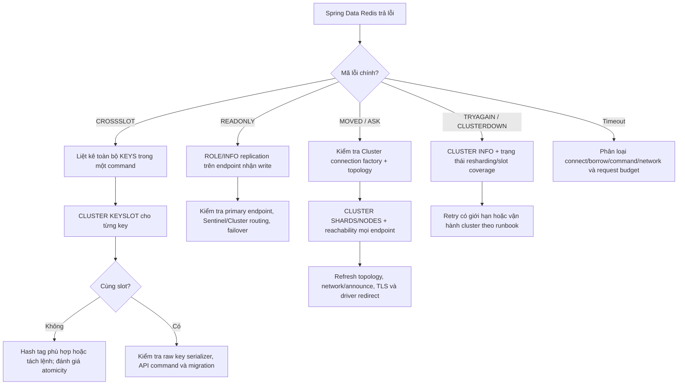

# Lỗi CROSSSLOT, READONLY và chuyển hướng Cluster trong Spring Data Redis

## 1. Vì sao ứng dụng Spring Data Redis chạy được ở Redis standalone nhưng lỗi khi chuyển sang Cluster?

Một ứng dụng có thể hoạt động bình thường với Redis standalone nhưng sau khi triển khai Redis Cluster bắt đầu gặp các thông báo:

```text
CROSSSLOT Keys in request don't hash to the same slot

READONLY You can't write against a read only replica.

MOVED 12182 10.42.1.8:6379

ASK 12182 10.42.1.9:6379
```

Các thông báo này thường không phải cùng một loại lỗi:

- **CROSSSLOT** là vấn đề **thiết kế các key của một thao tác đa key**, vì Redis Cluster phân phối key theo hash slot.
- **READONLY** thường là vấn đề **định tuyến thao tác ghi tới replica**, vai trò node hoặc trạng thái failover.
- **MOVED** và **ASK** là thông điệp **chuyển hướng (redirection)**: node nhận lệnh cho biết một slot cần được truy cập ở node khác, cố định hoặc tạm thời trong quá trình di chuyển dữ liệu.
- Một ứng dụng dùng cluster-aware client có thể tự xử lý phần lớn chuyển hướng; một ứng dụng trỏ RedisTemplate vào một node bằng cấu hình standalone thì thường không.

Để chẩn đoán đúng, cần xác định **lệnh nào**, **những key nào**, **địa chỉ node nào**, **vai trò node**, và **topology mà client đang biết** ở thời điểm lỗi xảy ra.

### Mục tiêu bài học

Sau bài học, bạn sẽ có thể:

1. Giải thích 16.384 hash slot và cách Redis tính slot từ tên key.
2. Nhận biết CROSSSLOT trong MGET/MSET, DEL nhiều key, Lua script, Redis transaction và API Spring Data Redis.
3. Sử dụng hash tag có chủ đích để đưa những key cần thao tác nguyên tử về cùng slot.
4. Phân biệt lỗi READONLY với lệnh READONLY dành cho kết nối đọc replica.
5. Hiểu MOVED, ASK, ASKING, topology refresh và hành vi của Lettuce/Jedis.
6. Cấu hình Spring Boot đúng chế độ Redis Cluster, không nhầm với một Redis endpoint standalone.
7. Dùng các lệnh chẩn đoán an toàn như CLUSTER KEYSLOT, CLUSTER INFO, CLUSTER NODES, CLUSTER SHARDS và ROLE.
8. Nhận diện lỗi mạng Docker/Kubernetes, advertised node addresses, TLS và topology cũ sau failover.
9. Xây dựng cách retry, monitoring và kiểm thử phù hợp mà không làm phát sinh side effect trùng.

---

## 2. Redis Cluster phân chia dữ liệu như thế nào?

Redis Cluster không lưu mọi key trên một primary duy nhất. Cluster chia **không gian key** thành **16.384 hash slot**, từ 0 đến 16383. Mỗi primary chịu trách nhiệm cho một hoặc nhiều khoảng slot; replica của primary đó có thể tiếp quản khi failover.

Ví dụ một cluster ba primary:

```text
                         Redis Cluster
                   16,384 hash slots
                     0 ... 16383

   Primary A             Primary B              Primary C
   Slots 0–5460          Slots 5461–10922        Slots 10923–16383
        |                       |                       |
     Replica A               Replica B               Replica C

Spring Boot + Lettuce Cluster client:
  - Tính slot của mỗi key.
  - Tìm primary đang sở hữu slot.
  - Gửi command tới node tương ứng.
  - Theo dõi chuyển hướng/failover/resharding để cập nhật routing.
```

Các khoảng slot chỉ minh họa; khi resharding, slot có thể đổi primary.

### 2.1. Tính hash slot

Với tên key thông thường, Redis Cluster tính:

\[
\text{slot} = CRC16(\text{key}) \bmod 16384
\]

Trong đó CRC16 là biến thể được Redis Cluster sử dụng, không phải mọi thuật toán CRC16 bất kỳ đều cho cùng kết quả.

Ví dụ:

```redis
CLUSTER KEYSLOT user:100:profile
CLUSTER KEYSLOT user:101:profile
```

Hai key có thể thuộc hai slot khác nhau, do đó nằm ở hai primary khác nhau.

### 2.2. Redis Cluster định tuyến theo key, không theo “database”

Trong Redis Cluster, các key thuộc cùng logical database chung (thường DB 0); không dùng `SELECT 1` như một cách phân vùng dữ liệu kiểu Redis standalone.

Một key ở slot 1000 có thể nằm tại primary A, còn key ở slot 12000 nằm tại primary C. Việc hai key cùng có prefix `user:` không làm chúng cùng slot.

### 2.3. Tại sao có giới hạn đa key?

Nhiều command Redis yêu cầu các key cùng được xử lý trong một đơn vị thao tác ở node đang chịu trách nhiệm cho slot đó. Khi hai key nằm ở hai slot khác nhau, không có một node đơn lẻ nào sở hữu cả hai.

Redis Cluster **không tự thực hiện một transaction phân tán** chỉ vì ứng dụng gửi một command có nhiều key. Đây là nguyên nhân cốt lõi của CROSSSLOT.

---

## 3. Bảng chẩn đoán nhanh

| Thông báo | Ý nghĩa chính | Bước kiểm tra đầu |
|---|---|---|
| `CROSSSLOT Keys in request don't hash to the same slot` | Một thao tác đa key chứa key thuộc các slot khác nhau | Liệt kê toàn bộ key và chạy `CLUSTER KEYSLOT` |
| `READONLY You can't write against a read only replica` | Gửi write tới node đang ở vai trò replica/read-only | Chạy `ROLE` hoặc `INFO replication` trên đúng endpoint |
| `MOVED <slot> <host>:<port>` | Slot thuộc node khác; client cần cập nhật định tuyến | Kiểm tra cấu hình Cluster client và topology mới |
| `ASK <slot> <host>:<port>` | Key/slot đang di chuyển, cần chuyển hướng tạm | Kiểm tra resharding, hỗ trợ ASK/ASKING |
| `TRYAGAIN ...` | Tình trạng tạm trong quá trình thay đổi slot hoặc xử lý nhiều key | Kiểm tra cluster migration, retry có giới hạn |
| `CLUSTERDOWN ...` | Cluster không phục vụ được một phần/toàn bộ keyspace theo trạng thái hiện tại | `CLUSTER INFO`, slot coverage, quorum và node health |
| `NOAUTH` / `NOPERM` | Chưa xác thực hoặc thiếu quyền ACL | Kiểm tra credential và ACL đúng namespace |
| Connection timeout / connection refused | Không kết nối được tới endpoint cần truy cập | Kiểm tra DNS, route, port, TLS, network policy |

**Không sửa tất cả bằng cách tăng timeout hoặc retry.** Ví dụ CROSSSLOT do thiết kế key sẽ không tự hết sau 10 lần retry.

---

## 4. Lỗi CROSSSLOT: hai key trông liên quan nhưng ở hai slot khác nhau

Giả sử ứng dụng lưu:

```text
cart:user-42:items
cart:user-42:coupon
```

Một developer muốn đọc cả hai trong cùng lệnh MGET:

```redis
MGET cart:user-42:items cart:user-42:coupon
```

Trong Redis Cluster, nếu hai key có slot khác nhau, server có thể trả:

```text
(error) CROSSSLOT Keys in request don't hash to the same slot
```

Cùng prefix `cart:user-42:` không có ý nghĩa phân nhóm slot nếu Redis dùng toàn bộ key để tính CRC16.

### 4.1. Kiểm tra bằng CLUSTER KEYSLOT

```redis
CLUSTER KEYSLOT cart:user-42:items
CLUSTER KEYSLOT cart:user-42:coupon
```

Nếu kết quả khác nhau, một command Redis yêu cầu các key nằm cùng slot sẽ không thể xử lý chúng như một thao tác nguyên tử trong Redis Cluster.

Không nên tự đoán slot dựa vào tên key. **Chạy CLUSTER KEYSLOT trên tất cả key liên quan** là cách kiểm chứng rõ ràng.

### 4.2. CROSSSLOT có thể xảy ra khi key chưa tồn tại

Lỗi CROSSSLOT dựa trên tên key và hash slot, không yêu cầu key đã có dữ liệu. Hai key rỗng/chưa tạo vẫn có thể nằm ở hai slot khác nhau.

Vì thế, xóa key rồi chạy lại `MGET` không giải quyết nguyên nhân.

### 4.3. CROSSSLOT không tự động nghĩa Redis Cluster hỏng

Cluster vẫn có thể báo:

```redis
CLUSTER INFO
```

với `cluster_state:ok`, nhưng request đa key vẫn bị CROSSSLOT. Đó là giới hạn đúng theo thiết kế của Redis Cluster, không phải dấu hiệu mất node.

---

## 5. Những thao tác thường gây CROSSSLOT

Các command nhiều key hoặc script/transaction truy cập nhiều key có thể chịu giới hạn cùng slot.

| Thao tác | Ví dụ rủi ro | Cách xử lý |
|---|---|---|
| `MGET` | Đọc nhiều string ở các user khác nhau | Nhóm key cùng slot hoặc đọc độc lập |
| `MSET` | Ghi nhiều key ở các slot khác nhau | Dùng key cùng hash tag hoặc tách lệnh |
| `DEL key1 key2` | Xóa nhiều key khác slot | Xóa riêng từng key nếu không cần atomicity |
| `RENAME` | Đổi tên key sang slot khác | Thiết kế tên trong cùng slot hoặc tránh rename đa slot |
| `SUNION` / `SINTER` | Gộp set ở các slot khác nhau | Thiết kế lại data model theo cùng tag |
| `ZINTER` / `ZUNION` | Tính toán trên nhiều sorted set | Đưa key liên quan cùng slot |
| Lua `EVAL` nhiều `KEYS` | Script đọc/ghi nhiều key khác slot | Hash tag chung, truyền đầy đủ KEYS |
| `MULTI/EXEC` với nhiều key | Transaction trải các slot | Giới hạn transaction trong một slot hoặc chuyển logic sang DB |
| Một số dạng XREAD nhiều Stream | Stream key thuộc nhiều slot | Dùng cùng slot cho multi-stream read hoặc tách readers |
| `COPY` giữa key khác slot | Copy nguồn/đích thuộc các slot khác nhau | Kiểm tra hạn chế command/version và layout |

Một số **client library** có thể tự chia tách một số thao tác tổng hợp như multi-get thành nhiều command ở các node tương ứng. Nếu vậy, API cấp cao có thể không báo CROSSSLOT ngay, **nhưng tính nguyên tử, snapshot và thứ tự xử lý không giống một Redis command đa key**. Phải kiểm tra hành vi phiên bản Spring Data Redis/driver đang dùng, không dựa vào giả định.

### 5.1. Xóa nhiều key không mặc nhiên là atomic

Ví dụ:

```java
redis.delete(
        List.of(
                "cart:user-42:items",
                "cart:user-42:coupon"
        )
);
```

Tùy template, connection factory và driver, API có thể phát một thao tác DEL đa key hoặc phân tách lệnh. Khi mục tiêu là **xóa chính xác từng key độc lập**, có thể chủ động:

```java
redis.delete("cart:user-42:items");
redis.delete("cart:user-42:coupon");
```

Điều này tránh yêu cầu một lệnh nhiều key phải cùng slot, **nhưng không nguyên tử**. Nếu hai key cần được xóa cùng lúc để duy trì invariant nghiệp vụ, phải thiết kế key cùng slot hoặc chuyển invariant sang nguồn lưu trữ phù hợp.

### 5.2. Pipeline không thay thế transaction

Pipeline có thể giảm round trip khi gửi nhiều command. Tuy nhiên, việc pipeline những lệnh tới nhiều slot/node không biến chúng thành một giao dịch nguyên tử.

```text
Pipeline:
  SET key-A
  SET key-B
  SET key-C

Không có nghĩa:
  cả ba SET cùng commit hoặc cùng rollback.
```

Nếu nghiệp vụ cần all-or-nothing trên nhiều shard, Redis Cluster đơn thuần không phải công cụ thay thế transaction phân tán.

---

## 6. Redis hash tag: cách chủ động đưa key liên quan về cùng slot

Redis Cluster có cơ chế **hash tag**: nếu tên key chứa một cặp dấu ngoặc nhọn hợp lệ với phần bên trong không rỗng, Redis dùng phần bên trong cặp dấu đó để tính slot thay vì toàn bộ tên key.

Ví dụ:

```text
cart:{user-42}:items
cart:{user-42}:coupon
cart:{user-42}:version
```

Cả ba có hash tag `user-42` nên cùng slot:

\[
CRC16(\text{"user-42"}) \bmod 16384
\]

Kiểm tra:

```redis
CLUSTER KEYSLOT cart:{user-42}:items
CLUSTER KEYSLOT cart:{user-42}:coupon
CLUSTER KEYSLOT cart:{user-42}:version
```

Kết quả slot phải bằng nhau.

Bây giờ một MGET thích hợp:

```redis
MGET cart:{user-42}:items cart:{user-42}:coupon
```

### 6.1. Trường hợp không có hash tag hợp lệ

Các tên key dưới đây không nên được xem là có hash tag mong muốn:

```text
cart:user-42:items       -- Không có {...}
cart:{}:items            -- Nội dung giữa {} rỗng
cart:{user-42:items      -- Thiếu }
cart:user-42}:items      -- Thiếu {
```

Đối với các key có nhiều dấu ngoặc, Redis áp dụng quy tắc về **cặp dấu ngoặc hợp lệ đầu tiên**. Để tránh nhầm lẫn, hãy tạo key qua một hàm cố định thay vì nhận key tùy ý từ người dùng.

### 6.2. Hash tag giống nhau không có nghĩa key giống nhau

```text
cart:{user-42}:items
cart:{user-42}:coupon
```

Đây là **hai key Redis khác nhau**, nhưng được đặt cùng slot. Chúng vẫn có thể có type, TTL và giá trị riêng.

### 6.3. Không gán một hash tag cho mọi user

Ví dụ nguy hiểm:

```text
cart:{all-users}:user-1
cart:{all-users}:user-2
cart:{all-users}:user-3
```

Tất cả key bị ép vào cùng một slot. Nếu workload lớn, slot đó tạo **hotspot** trên một primary, làm mất lợi ích chia shard.

Nên dùng một hash tag **cho tập key thực sự cần phối hợp nguyên tử**, chẳng hạn một user/giỏ hàng hoặc một aggregate nghiệp vụ, không dùng một tag toàn cục.

### 6.4. Scope tenant và user

Nếu hai tenant có user ID trùng nhau:

```text
tenant-A user-42
tenant-B user-42
```

đừng thiết kế key chỉ bằng `{user-42}` rồi coi đó là ranh giới bảo mật. Hash slot không phải ACL; key namespace phải chứa danh tính tenant đã xác thực, ví dụ:

```text
cart:{tenant-A:user-42}:items
cart:{tenant-B:user-42}:items
```

Hai tag khác nhau thường vào các slot khác nhau, dù collision giữa các tag khác nhau về lý thuyết vẫn có thể xảy ra. **Tính cô lập dữ liệu** phụ thuộc toàn bộ key, quyền truy cập và code; không phụ thuộc chỉ vào slot.

---

## 7. Thiết kế key an toàn trong Spring Data Redis

Một lớp tạo key giúp mọi service cùng dùng quy tắc hash tag, tránh mỗi nơi nối chuỗi khác nhau.

**`RedisCartKeys.java`**

```java
package com.example.cluster;

import java.nio.charset.StandardCharsets;
import java.security.MessageDigest;
import java.security.NoSuchAlgorithmException;
import java.util.HexFormat;

public final class RedisCartKeys {

    private RedisCartKeys() {
    }

    public record CartKeys(
            String items,
            String coupon,
            String version
    ) {
    }

    public static CartKeys forCart(
            String trustedTenantId,
            String cartId
    ) {
        String tag = stableTag(trustedTenantId, cartId);

        return new CartKeys(
                "cart:v1:{" + tag + "}:items",
                "cart:v1:{" + tag + "}:coupon",
                "cart:v1:{" + tag + "}:version"
        );
    }

    private static String stableTag(
            String tenantId,
            String cartId
    ) {
        if (tenantId == null || tenantId.isBlank()
                || cartId == null || cartId.isBlank()) {
            throw new IllegalArgumentException(
                    "Missing cart identity"
            );
        }

        // Định dạng có chiều dài prefix để giảm nhập nhằng
        // khi nối nhiều phần định danh.
        String input = tenantId.length() + ":" + tenantId
                + "|" + cartId.length() + ":" + cartId;

        try {
            byte[] digest = MessageDigest
                    .getInstance("SHA-256")
                    .digest(
                            input.getBytes(StandardCharsets.UTF_8)
                    );

            // Tag cố định, không chứa { } hoặc input không tin cậy.
            return "cart-" +
                    HexFormat.of()
                            .formatHex(digest)
                            .substring(0, 24);
        } catch (NoSuchAlgorithmException ex) {
            throw new IllegalStateException(
                    "SHA-256 unavailable",
                    ex
            );
        }
    }
}
```

Ở đây, các key thuộc một cart có **cùng tag**. SHA-256 chỉ dùng để có chuỗi định danh ổn định tránh ký tự đặc biệt, **không tự cấp quyền hoặc thay mã hóa bảo mật**.

### 7.1. Dùng StringRedisTemplate

```java
@Service
public class CartReader {

    private final StringRedisTemplate redis;

    public CartReader(StringRedisTemplate redis) {
        this.redis = redis;
    }

    public List<String> readItemsAndCoupon(
            String tenantId,
            String cartId
    ) {
        var keys = RedisCartKeys.forCart(tenantId, cartId);

        return redis.opsForValue().multiGet(
                List.of(
                        keys.items(),
                        keys.coupon()
                )
        );
    }
}
```

Ví dụ phù hợp khi `items` và `coupon` đều là Redis string theo cùng serializer. Nếu dùng Redis Hash cho items, phải dùng command tương ứng; hash tag chỉ quyết định slot, **không thay đổi Redis data type**.

### 7.2. Chú ý serialize key

`StringRedisTemplate` dùng key dạng chuỗi; một `RedisTemplate<Object,Object>` cấu hình key serializer khác có thể tạo key bytes khác.

Cluster tính slot trên **bytes của key sau serialization**. Vì vậy:

- Nên chuẩn hóa key serializer giữa các component phải chia sẻ key.
- Không dùng mỗi Java `toString()` để suy ra raw Redis key.
- Với key cần thao tác cùng slot, kiểm tra trên **tên key thực tế mà Redis nhận**.
- Một migration serializer có thể làm cả key schema lẫn slot phân bố thay đổi.

---

## 8. Lua script đa key phải cùng slot

Lua giúp thực hiện nhiều lệnh Redis như một thao tác nguyên tử trên một node, nhưng **không vượt qua giới hạn slot** trong Redis Cluster.

Ví dụ cập nhật coupon và version cùng một cart:

```lua
-- redis/cart-update-coupon.lua
-- KEYS[1] = cart:{tag}:coupon
-- KEYS[2] = cart:{tag}:version
-- ARGV[1] = coupon code
-- ARGV[2] = TTL seconds

local ttl = tonumber(ARGV[2])
if not ttl or ttl <= 0 then
    return redis.error_reply("invalid TTL")
end

redis.call('SET', KEYS[1], ARGV[1], 'EX', ttl)
return redis.call('INCR', KEYS[2])
```

Gọi bằng Redis CLI:

```redis
EVAL "redis.call('SET',KEYS[1],ARGV[1],'EX',ARGV[2]); return redis.call('INCR',KEYS[2])" 2 cart:{user-42}:coupon cart:{user-42}:version SAVE20 300
```

Hai `KEYS` cùng hash tag sẽ thuộc một slot. Nếu thay `version` thành `cart:{user-99}:version`, script đa key sẽ không còn cùng slot và có thể bị từ chối bởi Redis Cluster.

### 8.1. Spring Data Redis với RedisScript

```java
package com.example.cluster;

import java.util.List;

import org.springframework.core.io.ClassPathResource;
import org.springframework.data.redis.core.StringRedisTemplate;
import org.springframework.data.redis.core.script.DefaultRedisScript;

public final class CartCouponUpdater {

    private final StringRedisTemplate redis;
    private final DefaultRedisScript<Long> script;

    public CartCouponUpdater(StringRedisTemplate redis) {
        this.redis = redis;

        script = new DefaultRedisScript<>();
        script.setLocation(
                new ClassPathResource(
                        "redis/cart-update-coupon.lua"
                )
        );
        script.setResultType(Long.class);
    }

    public Long setCoupon(
            String tenantId,
            String cartId,
            String coupon
    ) {
        var keys = RedisCartKeys.forCart(tenantId, cartId);

        return redis.execute(
                script,
                List.of(
                        keys.coupon(),
                        keys.version()
                ),
                coupon,
                "300"
        );
    }
}
```

Với ứng dụng thật, nên đưa `RedisScript` thành singleton bean thay vì tạo lại nhiều lần. Cấu trúc ví dụ chỉ làm rõ **hai KEYS cùng slot**.

### 8.2. Script không được “giấu” các key ngoài KEYS

Redis scripting cần nhận **toàn bộ tên key truy cập** qua danh sách `KEYS` theo yêu cầu của cơ chế script. Không xây tên key tùy ý trong Lua từ input rồi mong driver đoán slot đúng.

Nếu script truy cập nhiều key ở các slot khác nhau, cần thiết kế lại data model hoặc chuyển phần phối hợp sang một nền tảng có transaction phù hợp.

### 8.3. Lua atomic không có rollback SQL

Một script Redis chạy nguyên tử đối với các lệnh Redis trong phạm vi của nó, nhưng không có nghĩa Redis script cùng một SQL transaction hoặc external API commit nguyên tử.

Khi update coupon đồng thời tạo order trong database, vẫn cần quy tắc nhất quán, retry/idempotency và reconciliation theo yêu cầu nghiệp vụ.

---

## 9. Chẩn đoán CROSSSLOT từ ứng dụng

Không nên chỉ nhìn exception tổng quát như:

```text
RedisSystemException
RedisCommandExecutionException
CROSSSLOT Keys in request don't hash to the same slot
```

mà đoán ngay Redis Cluster đang có node chết. Cần:

1. Xác định method Spring Data Redis: `multiGet`, `delete(Collection)`, `execute(RedisScript)`, `executePipelined`, transaction hay Stream multi-read.
2. Liệt kê **tất cả key thực tế** được truyền vào một command hoặc script.
3. Xác định key serializer.
4. Trên Redis Cluster test/production có quyền quan sát, dùng `CLUSTER KEYSLOT` cho từng key.
5. Nếu slot khác, quyết định có thật sự cần một **thao tác nguyên tử đa key** hay không.
6. Nếu cần, thay đổi key schema để cùng hash tag và có chiến lược migration.
7. Nếu không cần, tách lệnh và ghi rõ mất atomicity.
8. Chạy integration test với Redis Cluster thật để xác minh.

### 9.1. Đừng chỉ thêm hash tag vào tên một key

Nếu trước đây đã có dữ liệu:

```text
cart:user-42:items
cart:user-42:coupon
```

và code mới đọc:

```text
cart:{user-42}:items
cart:{user-42}:coupon
```

thì đây là **những key Redis hoàn toàn khác**. Chỉ đổi code không tự di chuyển dữ liệu cũ. Cần kế hoạch:

- Dual-read/migration có điều kiện.
- Ghi version namespace mới.
- Bảo vệ TTL và ownership.
- Không làm mất dữ liệu cart đang hoạt động.
- Tránh ghi song song hai schema mà không có quy tắc đối soát.
- Kiểm thử rollback phiên bản.

### 9.2. Phân biệt CROSSSLOT và WRONGTYPE

Hai key cùng slot vẫn có thể sai kiểu dữ liệu:

```redis
SET cart:{user-42}:items "value"
HGET cart:{user-42}:items some-field
```

Lệnh HGET trên string trả `WRONGTYPE`, không phải CROSSSLOT.

Hash tag giải quyết **vị trí slot**, không giải quyết serializer, kiểu dữ liệu, tính hợp lệ nghiệp vụ hoặc ACL.

---

## 10. Lỗi READONLY: ứng dụng đang ghi vào replica

Một phản hồi thường thấy:

```text
READONLY You can't write against a read only replica.
```

Thông báo này xuất hiện khi một client gửi thao tác ghi tới node **không có vai trò primary có thể nhận write** theo ngữ cảnh Redis.

Ví dụ:

```text
Trước failover:
  Node A (primary)  <- Spring write
  Node B (replica)

Sau failover:
  Node A (replica hoặc đã hạ vai trò)
  Node B (primary)

Client vẫn gửi SET tới Node A
  -> READONLY
```

### 10.1. Kiểm tra role của đúng endpoint nhận lệnh

```redis
ROLE
```

Redis có thể trả vai trò theo từ ngữ kỹ thuật lịch sử `master` / `slave` trong output. Trong bài, ta gọi là primary / replica.

Hoặc:

```redis
INFO replication
```

Những field thường gặp:

```text
role:master
connected_slaves:...
```

hoặc:

```text
role:slave
master_host:...
master_port:...
master_link_status:up
```

Tên field phụ thuộc Redis version nhưng mục tiêu là xác định node **đang phục vụ là primary hay replica**, chứ không chỉ còn chạy process.

### 10.2. PING thành công vẫn có thể READONLY

Replica thường trả lời:

```redis
PING
GET some-key
```

mà không cho `SET`. Vì vậy health check chỉ dùng `PING` có thể báo “Redis UP” trong khi mọi thao tác ghi đều thất bại.

Khi ứng dụng cần ghi, cần kiểm tra đúng primary routing và khả năng ghi của client theo kiến trúc. Không nhất thiết chạy write probe lên dữ liệu thật; dùng probe key riêng nếu chính sách môi trường cho phép.

### 10.3. READONLY còn là tên một Redis command

Đừng nhầm hai nghĩa:

- **Error `READONLY ...`**: server từ chối thao tác ghi vì node read-only.
- **Lệnh `READONLY` trong Redis Cluster**: cho phép một kết nối cluster-aware thực hiện một số thao tác **đọc** ở replica theo quy tắc routing.

Lệnh `READWRITE` có thể tắt chế độ read-only client theo cơ chế Cluster, nhưng **không chuyển replica thành primary**. Không gửi `READWRITE` hoặc đổi client setting bừa bãi để “sửa” node thực sự đang là replica.

---

## 11. Những nguyên nhân phổ biến gây READONLY

### 11.1. Cấu hình Spring Boot là standalone nhưng endpoint trỏ vào replica

Ví dụ ứng dụng có:

```yaml
spring:
  data:
    redis:
      host: redis-node-1.internal
      port: 6379
```

Đây là cấu hình một endpoint, không tự biến thành Redis Cluster client chỉ vì hostname chứa chữ “cluster”.

Nếu `redis-node-1.internal` hiện là replica, write `SET` có thể trả READONLY.

**Hướng giải quyết:** cấu hình kết nối phù hợp topology thực tế (Cluster/Sentinel/managed primary endpoint), không chỉ cố tăng retry.

### 11.2. DNS hoặc load balancer đưa write tới cả replica

Một service Kubernetes hoặc load balancer trỏ vào **mọi Redis Pod**, bao gồm replicas, có thể đưa connection write tới replica.

Lỗi có thể xuất hiện ngẫu nhiên: request tới primary thành công, request tới replica thất bại.

Cần kiểm tra:

- Endpoint nào thực sự được ứng dụng dùng.
- Service selector có trỏ vào cả primary lẫn replica không.
- Cơ chế failover có cập nhật endpoint role-aware không.
- Một TCP load balancer không hiểu Redis role có phù hợp cho write không.

### 11.3. Failover xảy ra nhưng client vẫn giữ topology cũ

Redis Cluster/Sentinel có thể đổi primary, nhưng client đang dùng connection/topology cũ.

Cần:

- Đảm bảo client có **cluster-aware/Sentinel-aware configuration**.
- Bật/kiểm tra topology refresh và driver reconnect.
- Xem log role change, MOVED/ASK và lỗi write.
- Xác minh mọi Redis node sau failover có endpoint truy cập được.
- Không hard-code địa chỉ primary cũ trong service.

### 11.4. Client read-from replica được sử dụng không đúng phạm vi

Lettuce có chế độ read routing như `ReadFrom.REPLICA_PREFERRED`. Nó phục vụ **đọc** từ replica khi phù hợp, nhưng ứng dụng cần bảo đảm **ghi vẫn tới primary** theo semantics của cluster-aware client.

Nếu custom code tự lấy một connection tới replica rồi gửi write, hoặc sử dụng nhầm connection dành cho read, READONLY vẫn có thể xuất hiện.

### 11.5. Replica đang sync, promotion chưa hoàn tất

Trong một đợt thay đổi role, client có thể thấy node vừa thay đổi trạng thái hoặc chưa sẵn sàng cho write. Phải chẩn đoán theo timeline failover, không giả định “node nào đã từng là primary thì luôn là primary”.

---

## 12. READONLY sau failover: quy trình điều tra an toàn

Giả sử log application:

```text
Redis command SET failed:
READONLY You can't write against a read only replica.
```

Thực hiện:

**Bước 1 — Xác định endpoint thực sự nhận write.** Xem host/port và cấu hình connection factory/driver. Với Cluster, cần biết node mà command đã được route tới.

**Bước 2 — Kiểm tra role.**

```redis
ROLE
INFO replication
```

**Bước 3 — Kiểm tra cluster state nếu dùng Redis Cluster.**

```redis
CLUSTER INFO
CLUSTER NODES
```

**Bước 4 — Kiểm tra topology phía client.** Client đang dùng cluster nodes list hay host/port standalone? Có reconnect/topology refresh? Có node address unreachable?

**Bước 5 — Xác minh endpoint service/DNS.** Nếu dùng proxy/managed Redis, phải phân biệt primary/write endpoint và reader endpoint theo hợp đồng của nhà cung cấp.

**Bước 6 — Phục hồi đúng hướng.** Điều chỉnh routing/topology hoặc cấu hình connection; nếu cluster failover chưa hoàn tất, làm theo runbook vận hành.

**Bước 7 — Xác minh.** Kiểm tra write vào key test an toàn nếu được phép, rồi đo tỷ lệ READONLY và lỗi nghiệp vụ đã về baseline.

### Không nên làm gì?

- Không chạy `REPLICAOF NO ONE` tùy tiện trên replica để ép nó thành primary.
- Không chạy `CLUSTER FAILOVER` hoặc `CLUSTER RESET` trên production chỉ để “xóa lỗi” nếu không có quy trình được phê duyệt.
- Không gửi `READWRITE` rồi nghĩ replica có thể nhận write.
- Không chuyển mọi request thành read-only khi nghiệp vụ cần ghi thật.
- Không tăng số retry vô hạn vào node đang là replica.

Các thao tác đổi vai trò có thể làm tăng nguy cơ split-brain, mất dữ liệu và lệch replication nếu thực hiện sai.

---

## 13. Chuyển hướng MOVED trong Redis Cluster

Một thông báo:

```text
MOVED 12182 10.42.1.8:6379
```

có ý nghĩa:

- Command đang truy cập một key thuộc slot `12182`.
- Node nhận command cho biết slot đó đang được phục vụ ở `10.42.1.8:6379`.
- Cluster-aware client nên xử lý chuyển hướng và cập nhật kiến thức routing của mình.

`MOVED` là cơ chế Redis Cluster dùng để cho client biết nơi sở hữu slot hiện tại.

### 13.1. MOVED không đồng nghĩa command chưa bao giờ thành công

Trong nhiều trường hợp, MOVED trả về trước khi command được xử lý ở node sai, và một client cluster-aware sẽ gửi lại tới đúng node. Nhưng ở cấp API, nếu đi kèm timeout, retry, failover và nhiều command, không thể dùng một thông báo redirect để suy luận chắc chắn về **toàn bộ logical operation** hoặc side effect của các command khác đã gửi.

Đối với thao tác không lũy đẳng, phải thiết kế retry có điều kiện và idempotency.

### 13.2. Vì sao MOVED xuất hiện?

- Client ban đầu gửi key tới **node không sở hữu slot**.
- Slot vừa chuyển primary do resharding.
- Failover đổi node sở hữu slot.
- Topology cache phía client bị cũ.
- Client cấu hình Redis standalone thay vì Redis Cluster.
- Client chỉ biết seed node mà không khám phá/cập nhật được các node thực.

### 13.3. Redis Cluster client nên làm gì?

Thông thường:

1. Đọc slot từ tên key.
2. Chọn node theo topology đang có.
3. Nếu node trả `MOVED`, gửi command đến endpoint mới.
4. Làm mới thông tin slot owner theo cơ chế driver.
5. Có giới hạn số redirect/hops nếu topology không ổn định.

Redis-aware client như Lettuce Cluster và Jedis Cluster có các cơ chế xử lý redirect. **Ứng dụng thường không cần tự parse chuỗi MOVED**, miễn là sử dụng đúng loại connection factory và cấu hình network cho các node.

---

## 14. Chuyển hướng ASK: tạm thời khi resharding

Thông báo:

```text
ASK 12182 10.42.1.9:6379
```

xuất hiện trong quá trình di chuyển slot/key, khi node cũ còn có vai trò trong trạng thái migration và chỉ dẫn client chuyển **command hiện tại** tới node đích.

Khác với MOVED:

| Tiêu chí | MOVED | ASK |
|---|---|---|
| Ý nghĩa | Slot hiện thuộc node khác | Chuyển hướng tạm trong quá trình migration |
| Có nên thay mapping slot owner ngay? | Thường cập nhật theo topology | Không coi ASK đơn lẻ là mapping cuối cùng |
| Cách xử lý | Gửi lệnh tới endpoint trả về, refresh topology phù hợp | Gửi `ASKING` rồi command trên cùng connection tới node đích |
| Khi thường gặp | Routing sai, failover, slot di chuyển xong | Slot/key đang di chuyển |
| Có thể hết sau thời gian ngắn? | Phụ thuộc topology mới | Thường gắn giai đoạn migration |

### 14.1. Tại sao cần ASKING?

Khi node đích đang ở trạng thái **importing slot**, node đó chưa chắc công bố mình là owner cuối cùng của slot. Lệnh `ASKING` cho biết client đang đi theo một ASK redirection và cần được phép thực hiện command kế tiếp theo quy tắc migration.

Quy trình khái niệm:

```text
Client                Node A                 Node B
  | GET key ------------>|                      |
  |<------ ASK slot Node B                      |
  |                                              |
  | ASKING ------------------------------------>|
  | GET key ----------------------------------->|
  |<----------------------------------- response|
```

**ASKING và command phải đi qua đúng connection/session theo ngữ nghĩa Redis.** Không nên gửi `ASKING` ở một RedisTemplate connection ngẫu nhiên rồi `GET` trên connection khác trong pool.

Cluster-aware driver tự xử lý điều này trong phạm vi hỗ trợ. Với code ứng dụng thông thường, cách đúng là dùng cluster client thay vì tự tái hiện ASK/ASKING.

### 14.2. Không cập nhật topology chỉ dựa trên một ASK

Trong quá trình resharding, ownership chính thức chưa chắc đã chuyển hoàn toàn. Nếu ứng dụng coi ASK là MOVED vĩnh viễn, có thể tiếp tục gửi lệnh sai nơi sau khi migration thay đổi.

---

## 15. Ví dụ một slot đang được di chuyển

```text
Ban đầu:
  Slot 12182 thuộc Primary A
  Key product:{sku-42}:stock nằm ở A

Bắt đầu migration:
  A được đánh dấu migrating slot 12182
  B được đánh dấu importing slot 12182

Trong quá trình di chuyển:
  Một số command với key đã chuyển có thể được ASK sang B.
  Một số key/command vẫn ở A theo trạng thái migration.

Sau khi hoàn tất:
  Slot 12182 chính thức thuộc B.
  Client cũ có thể nhận MOVED tới B.
```

Nếu một tác vụ resharding chạy lâu và app ghi nhận nhiều ASK/TRYAGAIN, cần kiểm tra tiến độ migration và tải node. Không nên chỉ “tăng max redirects lên 1000” để che giấu một migration kẹt.

### 15.1. TRYAGAIN trong resharding

Một số thao tác đa key đang thực hiện khi slot chuyển trạng thái có thể nhận:

```text
TRYAGAIN Multiple keys request during rehashing of slot
```

Đây là lỗi **khác CROSSSLOT**:

- CROSSSLOT: các key **vốn** thuộc nhiều slot; lỗi thiết kế key hoặc giới hạn command.
- TRYAGAIN: các key có thể cùng slot nhưng trạng thái migration làm thao tác tạm thời chưa thực thi được như mong đợi.

Với TRYAGAIN, retry có giới hạn/backoff có thể phù hợp sau khi đánh giá command. Với CROSSSLOT do key layout, retry thường vô ích.

---

## 16. Cấu hình Spring Boot đúng chế độ Redis Cluster

Nếu đang dùng Redis Cluster, cần cung cấp **cluster nodes** thay vì chỉ một `host/port` như Redis standalone.

Ví dụ Spring Boot 3.x:

```yaml
spring:
  data:
    redis:
      cluster:
        nodes:
          - redis-0.redis.svc.cluster.local:6379
          - redis-1.redis.svc.cluster.local:6379
          - redis-2.redis.svc.cluster.local:6379
        max-redirects: 5

      connect-timeout: 2s
      timeout: 3s

      lettuce:
        cluster:
          refresh:
            adaptive: true
            period: 30s
```

Địa chỉ và giá trị chỉ là **ví dụ**, không phải cấu hình áp dụng cho mọi Kubernetes hoặc managed Redis. Thuộc tính có thể khác theo Spring Boot version; cần đối chiếu metadata/reference của phiên bản dự án.

### 16.1. cluster.nodes là seed nodes

Danh sách cluster nodes ban đầu giúp client khởi tạo kết nối và khám phá topology. **Không nhất thiết phải điền toàn bộ node để cluster client hoạt động**, nhưng cần có những seed endpoint có khả năng kết nối ổn định và khám phá đúng topology.

Khi Cluster có nhiều primary/replica, driver phải kết nối tới **các node thực sự sở hữu slot**, không chỉ seed node đầu tiên.

### 16.2. max-redirects

Giới hạn số lần redirect ngăn client mắc kẹt trong một chuỗi MOVED/ASK quá dài. Nếu vượt giới hạn:

- Kiểm tra cluster health/topology.
- Kiểm tra node advertised addresses.
- Kiểm tra client routing configuration và refresh.
- Kiểm tra thay đổi topology đang diễn ra.
- Chỉ tăng giới hạn nếu có lý do vận hành rõ.

Tăng giới hạn không giải quyết CROSSSLOT hoặc READONLY do trỏ nhầm replica.

### 16.3. Topology refresh

Adaptive refresh giúp driver làm mới topology khi phát hiện những tín hiệu phù hợp như MOVED/ASK, reconnect hoặc tình trạng persistent reconnect theo cơ chế của Lettuce.

Periodic refresh bổ sung cập nhật định kỳ trong trường hợp thay đổi topology không tạo trigger dễ nhận thấy. Cần kiểm tra phiên bản và tần suất thích hợp; refresh quá thường xuyên làm tăng traffic tới Redis và tốn tài nguyên.

### 16.4. Không tạo cluster bằng một host/port

Sai nếu Cluster thật nằm sau nhiều node:

```yaml
spring:
  data:
    redis:
      host: redis-cluster-entry
      port: 6379
```

Cấu hình này có thể tạo standalone connection factory (tùy cấu hình tổng thể) và không thực hiện slot routing như một Redis Cluster client. Nếu `redis-cluster-entry` chỉ trỏ tới một node, những key ở slot khác sẽ nhận MOVED.

Đối với proxy **thật sự hỗ trợ Redis Cluster routing**, cách kết nối có thể khác theo nhà cung cấp. Phải phân biệt một proxy thông minh với một DNS/load balancer chỉ phân phối TCP.

---

## 17. Cấu hình Lettuce Cluster topology refresh bằng Java

Khi cần kiểm soát sâu hơn và Spring Boot đang dùng Lettuce, có thể cấu hình cluster-aware client options. Ví dụ:

```java
package com.example.cluster.config;

import java.time.Duration;

import io.lettuce.core.cluster.ClusterClientOptions;
import io.lettuce.core.cluster.ClusterTopologyRefreshOptions;

import org.springframework.boot.autoconfigure.data.redis
        .LettuceClientConfigurationBuilderCustomizer;
import org.springframework.context.annotation.Bean;
import org.springframework.context.annotation.Configuration;

@Configuration
public class RedisClusterClientConfiguration {

    @Bean
    LettuceClientConfigurationBuilderCustomizer clusterRefresh() {
        return builder -> {
            ClusterTopologyRefreshOptions refresh =
                    ClusterTopologyRefreshOptions.builder()
                            .enableAllAdaptiveRefreshTriggers()
                            .enablePeriodicRefresh(
                                    Duration.ofSeconds(30)
                            )
                            .build();

            ClusterClientOptions options =
                    ClusterClientOptions.builder()
                            .topologyRefreshOptions(refresh)
                            .build();

            builder.clientOptions(options);
        };
    }
}
```

**Lưu ý:** ví dụ minh họa API Lettuce và Spring Boot quen thuộc; cú pháp import, builder customizer và khả năng phối hợp với cấu hình Boot phải được đối chiếu với version cụ thể. Khi đã có `LettuceClientConfigurationBuilderCustomizer` khác, tránh việc customizer sau vô tình ghi đè `clientOptions` và bỏ mất timeout/security configuration trước đó.

### 17.1. Không tạo connection factory mới cho mỗi request

Cluster client có topology cache và tài nguyên kết nối cần được reuse. Nếu tự khởi tạo `RedisClusterClient` hay `LettuceConnectionFactory` trong mỗi HTTP request:

- Tăng connection churn.
- Tăng độ trễ discovery/topology.
- Tăng nguy cơ leak.
- Khó tập trung monitoring và shutdown.

Nên để Spring quản lý connection factory và lifecycle theo ứng dụng.

### 17.2. Adaptive và periodic refresh không sửa key layout

Nếu Redis báo CROSSSLOT vì hai key khác slot, refresh topology nhiều lần cũng không giúp. Topology refresh chỉ giải quyết **client biết slot thuộc node nào**, không thay đổi slot của key.

---

## 18. Cấu hình Spring Data Redis bằng RedisClusterConfiguration

Ngoài YAML auto-configuration, Spring Data Redis có thể tạo `LettuceConnectionFactory` với `RedisClusterConfiguration`:

```java
package com.example.cluster.config;

import java.util.List;

import org.springframework.context.annotation.Bean;
import org.springframework.context.annotation.Configuration;
import org.springframework.data.redis.connection.RedisClusterConfiguration;
import org.springframework.data.redis.connection.lettuce.LettuceConnectionFactory;

@Configuration
public class ExplicitClusterConnectionConfig {

    @Bean
    LettuceConnectionFactory redisConnectionFactory() {
        RedisClusterConfiguration cluster =
                new RedisClusterConfiguration(
                        List.of(
                                "redis-0.redis.svc.cluster.local:6379",
                                "redis-1.redis.svc.cluster.local:6379",
                                "redis-2.redis.svc.cluster.local:6379"
                        )
                );

        cluster.setMaxRedirects(5);

        return new LettuceConnectionFactory(cluster);
    }
}
```

Ví dụ trên chỉ minh họa **cluster-aware factory**; nó chưa thể hiện TLS, username/password, read preference, topology refresh options hoặc customizer của môi trường thật.

Không nên đồng thời khai báo factory thủ công và kỳ vọng Spring Boot auto-configuration vẫn tự thêm mọi cấu hình `spring.data.redis.*` như khi không có bean tùy biến. Nếu tự tạo factory, cần kiểm soát những thành phần đã tự cấu hình.

### Cluster vs Sentinel

- **Redis Sentinel:** giám sát và điều phối failover cho một primary cùng replicas, không chia 16.384 hash slot như Redis Cluster.
- **Redis Cluster:** phân chia dữ liệu theo slot và hỗ trợ failover trong topology Cluster.

Hai cấu hình này **không tương đương**. Nếu production dùng Sentinel, không ép ứng dụng sang `spring.data.redis.cluster.nodes` chỉ vì gặp READONLY; cần kiểm tra `spring.data.redis.sentinel.*` và cách client phát hiện primary.

---

## 19. READONLY và read preference của Lettuce

Lettuce có cơ chế chọn nơi đọc, ví dụ `ReadFrom.REPLICA_PREFERRED`. Nó hữu ích khi:

- Workload đọc nhiều.
- Chấp nhận eventual consistency.
- Muốn phân tải đọc khỏi primary.

Nhưng cần hiểu rủi ro dữ liệu:

```text
Client ghi SET user:42:status ACTIVE trên primary.
Replica chưa kịp nhận update.
Client đọc từ replica -> vẫn thấy giá trị cũ.
```

**Replica read có thể stale**, ngay cả khi không có lỗi READONLY.

### 19.1. Chỉ bật replica read theo nghiệp vụ

Phù hợp hơn với:

- Cache hoặc báo cáo không yêu cầu read-after-write mạnh.
- Dữ liệu không quyết định quyền/trạng thái thanh toán tức thời.

Cần thận trọng với:

- Kiểm tra token đã bị thu hồi.
- Đọc trạng thái thanh toán ngay sau write.
- Idempotency record quyết định có được thực hiện side effect lần nữa.
- Lock/leader state.

### 19.2. Một ví dụ API Lettuce

```java
import io.lettuce.core.ReadFrom;
import org.springframework.data.redis.connection.lettuce
        .LettuceClientConfiguration;

LettuceClientConfiguration config =
        LettuceClientConfiguration.builder()
                .readFrom(ReadFrom.REPLICA_PREFERRED)
                .build();
```

Đoạn này chỉ minh họa read preference; để dùng thật phải kết hợp đúng Redis Cluster/Sentinel configuration và connection factory. Không tự suy ra mọi command sẽ route an toàn nếu ứng dụng có custom low-level connections.

### 19.3. READONLY error không phải “vì bật replica read thì bình thường”

Một Redis Cluster client thiết kế đúng có thể đọc từ replica và vẫn route write về primary. **WRITE trả READONLY** là tín hiệu routing/role không đúng hoặc một connection không phù hợp với write, không phải hệ quả bắt buộc của việc bật `ReadFrom.REPLICA_PREFERRED`.

---

## 20. Một nguyên nhân MOVED thường bị bỏ quên: địa chỉ node được công bố không truy cập được

Trong Redis Cluster, seed node có thể trả topology chứa địa chỉ của các node khác. Client phải kết nối tới những địa chỉ đó.

Ví dụ container setup:

```text
Host máy developer:
  localhost:7000 -> container A:6379
  localhost:7001 -> container B:6379
  localhost:7002 -> container C:6379

Redis Cluster topology quảng bá:
  172.18.0.2:6379
  172.18.0.3:6379
  172.18.0.4:6379
```

Nếu Spring Boot chạy **ngoài Docker network**, client có thể kết nối được `localhost:7000` nhưng không truy cập được các địa chỉ `172.18.0.x:6379` được quảng bá trong CLUSTER metadata.

Kết quả:

1. Kết nối seed thành công.
2. Client biết slot thuộc node B.
3. Client thử kết nối `172.18.0.3:6379`.
4. Kết nối bị timeout/connection refused.
5. App có thể báo MOVED loop, topology refresh failure hoặc connection timeout.

### 20.1. Dấu hiệu nhận biết

- `redis-cli -c` chạy **bên trong Docker network** hoạt động, nhưng ứng dụng chạy trên host lỗi.
- `CLUSTER NODES`/`CLUSTER SHARDS` quảng bá IP chỉ có thể truy cập bên trong một network khác.
- Kết nối được node seed nhưng không kết nối được node sở hữu slot.
- Lỗi chỉ xảy ra khi truy cập key ở một vài slot/node.

### 20.2. Hướng sửa

- Đảm bảo các địa chỉ Redis quảng bá **có thể resolve và truy cập được từ vị trí chạy Spring Boot**.
- Cấu hình Redis Cluster announce endpoints theo topology mạng thực tế.
- Trong Kubernetes, dùng DNS/Service phù hợp và cách Redis chart/operator công bố endpoint đúng.
- Nếu dùng Docker cho integration test, tạo cluster với địa chỉ/port mà application container cùng network có thể truy cập.
- Nếu Spring chạy trên host, cần một setup có announced addresses và port forwarding phù hợp, không chỉ publish seed port.

**Không sửa bằng cách hard-code tất cả request vào seed node**. Làm vậy chỉ trì hoãn redirect rồi gặp thêm lỗi khi key thuộc slot khác.

---

## 21. Redis Cluster trên Kubernetes: những điểm cần kiểm tra

Kubernetes có nhiều kiểu Service:

- Headless Service cung cấp DNS cho từng pod/node.
- ClusterIP Service đưa traffic tới tập endpoint.
- LoadBalancer/Ingress hoặc gateway/proxy có đặc tính khác.

Nếu một Redis Cluster cần client kết nối trực tiếp từng node, một **Service cân bằng TCP tới mọi Redis Pod** không nhất thiết là endpoint đúng cho Cluster routing.

### Checklist network

1. Từ pod Spring Boot, resolve được DNS của **mọi Redis node được công bố** không?
2. Kết nối TCP/TLS tới từng Redis data port được không?
3. Redis có công bố địa chỉ/hostname đúng với route của client không?
4. Node có port khác nhau giữa service/host và container không?
5. Cluster nội bộ có kết nối tới các Redis cluster-bus ports cần thiết không?
6. TLS có chứng chỉ hợp lệ với hostname đang được dùng không?
7. NetworkPolicy có chặn traffic từ app tới một số shard/replica không?
8. Nếu sau resharding xuất hiện node mới, client có route được tới node đó không?
9. Khi failover, service discovery và topology refresh cập nhật thế nào?
10. Có proxy đặc thù nào che giấu topology cho client không? Nếu có, phải theo hợp đồng của proxy.

### Cảnh báo với static pod IP

Pod IP có thể đổi khi rollout/restart. Đừng đưa IP tạm vào cấu hình app cố định lâu dài nếu topology Redis được thiết kế quanh DNS/service ổn định.

Tuy nhiên một Cluster client vẫn phải chấp nhận các endpoint công bố thật sự bởi Redis và có cơ chế refresh khi thay đổi.

---

## 22. TLS và authentication trong Cluster

Cấu hình Redis Cluster đúng chưa đủ nếu client không thể kết nối tới một hoặc nhiều node vì TLS hoặc ACL.

### 22.1. Triệu chứng

- Kết nối seed thành công nhưng node redirect trả TLS handshake failure.
- Một số node sử dụng port TLS khác mà thông tin topology không phù hợp.
- Authentication error chỉ xảy ra với một node do cấu hình credential lệch.
- `MOVED` trả endpoint không khớp hostname trong chứng chỉ TLS.
- Connection timeout chỉ xảy ra sau khi client nhận topology redirect.

### 22.2. Nguyên tắc xử lý

- Dùng TLS/credential đồng nhất theo cấu hình Redis Cluster hoặc managed service.
- Đảm bảo mọi endpoint được Redis công bố tương thích với DNS/chứng chỉ của client.
- Kiểm tra Redis ACL cho các command ứng dụng dùng, kể cả command liên quan topology nếu môi trường yêu cầu.
- Không tắt TLS certificate validation để “giải quyết MOVED” mà không hiểu rủi ro.
- Không đưa password trực tiếp vào CLI command arguments hiển thị trong shell history hoặc process list.

Ví dụ khi dùng `redis-cli` cần xác thực, có thể dùng phương pháp cấp secret an toàn của môi trường, như biến môi trường được quản lý hoặc cấu hình CLI thích hợp; không copy credential thật vào tài liệu lỗi.

---

## 23. Các lệnh chẩn đoán Redis Cluster cần biết

Các lệnh dưới đây chủ yếu là **đọc trạng thái**; vẫn cần quyền ACL phù hợp.

### 23.1. CLUSTER INFO

```redis
CLUSTER INFO
```

Ví dụ các field:

```text
cluster_state:ok
cluster_slots_assigned:16384
cluster_slots_ok:16384
cluster_slots_pfail:0
cluster_slots_fail:0
cluster_known_nodes:6
cluster_size:3
```

Giải thích:

- `cluster_state:ok`: cluster đang ở trạng thái phục vụ theo đánh giá của node.
- `cluster_slots_assigned`: số slot đã được gán.
- `cluster_slots_ok`: số slot có trạng thái bình thường theo reporting.
- `cluster_slots_pfail/fail`: các slot liên quan tới node ở tình trạng nghi vấn/lỗi.
- `cluster_known_nodes`: số node mà node báo cáo biết.
- `cluster_size`: số primary groups/phân vùng đang phục vụ theo định nghĩa báo cáo.

Một trạng thái `ok` **không chứng minh** client có thể kết nối tới mọi advertised endpoint hoặc command đa key đúng layout.

### 23.2. CLUSTER NODES

```redis
CLUSTER NODES
```

Output thường chứa:

- Node ID.
- Host/IP, port và metadata khác.
- Vai trò `master`/`slave` (tên lịch sử trong protocol).
- Trạng thái như `myself`, `fail`, `handshake`.
- Link/connectivity.
- Các khoảng slot được sở hữu.
- Một số thông tin migrating/importing slots.

Cần nhận diện **node nào giữ slot của key bị lỗi**, **node đó đang làm primary hay replica**, và **địa chỉ của nó có được client truy cập không**.

### 23.3. CLUSTER SHARDS hoặc CLUSTER SLOTS

```redis
CLUSTER SHARDS
```

Redis 7.0 trở lên có `CLUSTER SHARDS` để xem thông tin shard/slots/nodes theo định dạng dành cho client discovery. Với client hoặc Redis version cũ có thể dùng:

```redis
CLUSTER SLOTS
```

`CLUSTER SLOTS` là API legacy/deprecated trong tài liệu Redis mới nhưng vẫn thường gặp trong các driver cũ. Đối chiếu version thực tế.

### 23.4. CLUSTER KEYSLOT

```redis
CLUSTER KEYSLOT cart:{user-42}:items
CLUSTER KEYSLOT cart:{user-42}:coupon
```

Dùng để xác nhận hai key có cùng slot, không cần dữ liệu của key tồn tại.

### 23.5. ROLE và INFO replication

```redis
ROLE
INFO replication
```

Dùng khi gặp READONLY hoặc nghi application gửi write tới replica.

### 23.6. CLIENT LIST

```redis
CLIENT LIST
```

Có thể giúp xem client nào đang kết nối với một node và trạng thái connection. Dữ liệu có thể chứa IP, client name và metadata nội bộ; cần bảo vệ output và tránh log public.

---

## 24. redis-cli: có và không có -c khác nhau thế nào?

`redis-cli` có cờ `-c` để chạy theo chế độ nhận biết Redis Cluster redirect.

Ví dụ:

```bash
redis-cli -h redis-0.redis.svc.cluster.local -p 6379 \
  CLUSTER INFO
```

Đọc một key bằng CLI không bật cluster mode:

```bash
redis-cli -h redis-0.redis.svc.cluster.local -p 6379 \
  GET cart:{user-42}:coupon
```

Nếu key thuộc node khác, bạn có thể trực tiếp nhìn thấy `MOVED`.

Bật cluster mode:

```bash
redis-cli -c -h redis-0.redis.svc.cluster.local -p 6379 \
  GET cart:{user-42}:coupon
```

`redis-cli -c` có thể tự đi theo chuyển hướng cluster phù hợp. Điều này có ích để chứng minh slot routing, nhưng **không sửa CROSSSLOT của một lệnh multi-key khác slot**.

### 24.1. -c không đảm bảo mọi topology truy cập được

Nếu Redis trả địa chỉ node chỉ reachable bên trong Kubernetes hoặc Docker, `redis-cli -c` chạy ngoài mạng đó vẫn có thể bị timeout ở bước redirect.

### 24.2. -c không biến replica thành writable

Nếu bạn cố tình kết nối trực tiếp replica rồi gửi write ngoài routing phù hợp, chỉ bật `-c` không giải quyết một deployment sai role hoặc cấu hình endpoint hỏng. Cần xem ROLE và đường đi thực tế của lệnh.

### 24.3. Không chạy các lệnh phá hủy để thử nghiệm trên production

Các lệnh `CLUSTER RESET`, `CLUSTER FAILOVER`, `CLUSTER SETSLOT`, `FLUSHALL`, `SHUTDOWN` hoặc thay replication role có thể làm gián đoạn dịch vụ và mất dữ liệu. Bài này chỉ cần lệnh đọc trạng thái để chẩn đoán production.

---

## 25. Phân tích log ứng dụng Spring Data Redis

Một log thực tế có thể bắt đầu bằng ngoại lệ của Spring:

```text
org.springframework.data.redis.RedisSystemException:
Error in execution

Caused by: io.lettuce.core.RedisCommandExecutionException:
CROSSSLOT Keys in request don't hash to the same slot
```

Hoặc:

```text
RedisCommandExecutionException:
READONLY You can't write against a read only replica
```

Hoặc:

```text
RedisConnectionException:
Unable to connect to 10.42.1.8:6379
```

Tên exception cụ thể phụ thuộc phiên bản Spring Data Redis, driver và đường thực thi. Không nên viết handler chỉ dựa vào một package/class name nếu không kiểm tra đúng phiên bản.

### Cần giữ các thông tin chẩn đoán nào?

- Timestamp và correlation/trace ID.
- Tên operation: GET, SET, MGET, DEL, EVAL, XREADGROUP...
- Số key, kiểu namespace, **không log raw secret/key**.
- Error category: CROSSSLOT, READONLY, MOVED, ASK, TIMEOUT...
- Redis node/endpoint liên quan (đã kiểm soát truy cập log).
- Spring Boot/driver version.
- Topology change gần thời điểm lỗi.
- Request đã gửi write hay đang đọc?
- Client cluster topology refresh có thất bại không?

### Không nên làm gì?

- In toàn bộ command arguments để tìm key: có thể lộ session/token/PII.
- Gắn raw Redis key hoặc user ID vào metric label: gây high cardinality và rò rỉ thông tin.
- Tắt retry limit rồi cho chương trình chạy mãi.
- Tự động dùng `FLUSHDB` khi gặp CROSSSLOT.

---

## 26. Tính chất retry của từng lỗi không giống nhau

Một chính sách retry cần căn cứ vào loại lỗi và **lệnh có side effect hay không**.

| Lỗi | Retry thường có ích? | Điều kiện |
|---|---|---|
| CROSSSLOT do key khác slot | Không | Cần sửa key layout/command |
| READONLY do trỏ replica | Chỉ sau khi routing/topology đúng | Không retry mãi vào cùng replica |
| MOVED | Có, qua cluster-aware driver | Cập nhật định tuyến, giới hạn redirect |
| ASK | Có, qua ASKING + command đúng connection | Chỉ tạm thời trong migration |
| TRYAGAIN khi migration | Có thể | Retry ngắn, backoff và giới hạn |
| CLUSTERDOWN | Có thể sau khi cluster phục hồi | Fail fast/budget, kiểm tra cluster health |
| Connect timeout | Có thể | Không biết command đã tới server hay chưa |
| Command timeout sau write | Rủi ro duplicate | Idempotency/đối soát trước retry |

### 26.1. Cẩn trọng với INCR, XADD, LPUSH, charge

Nếu một command được Redis thực thi nhưng response bị mất, retry có thể:

- `INCR` tăng counter hai lần.
- `XADD` tạo hai record với ID mới.
- `LPUSH` thêm phần tử trùng.
- Lua script ghi trạng thái hai lần nếu không có guard.
- Một service external payment bị gọi lại.

**Không thể suy ra “timeout thì lệnh chưa chạy”**. Cần thiết kế idempotency key, expected version, unique constraint hoặc reconcile trạng thái tùy tác động nghiệp vụ.

### 26.2. Redis redirect và write retry

MOVED/ASK là một phần của Redis Cluster protocol, nên cluster-aware driver thường đã có cơ chế xử lý. Không nên bọc mọi `RedisTemplate` call trong vòng retry vô hạn vì:

- Có thể nhân đôi side effect nếu lỗi thực không chỉ là redirect.
- Có thể tăng áp lực trong lúc cluster đang failover.
- Có thể che một vòng MOVED do advertised node hỏng.
- Có thể làm HTTP request vượt timeout budget.

Nếu cần retry bổ sung tại tầng service, phải có giới hạn số lần, backoff/jitter, phân loại lỗi và **ngân sách thời gian**.

---

## 27. Cây quyết định chẩn đoán



Cây này dùng để quyết định **bước điều tra tiếp theo**, không thay thế thông tin Redis version, topology hoặc đặc thù cloud provider.

---

## 28. Tình huống thực hành A: CROSSSLOT khi lấy giỏ hàng

### Bối cảnh

```java
List<String> values = redis.opsForValue().multiGet(
        List.of(
                "cart:tenant-1:user-42:items",
                "cart:tenant-1:user-42:coupon"
        )
);
```

Trên standalone, lệnh hoạt động. Trên Cluster, hai key có thể nằm khác slot.

### Chẩn đoán

```redis
CLUSTER KEYSLOT cart:tenant-1:user-42:items
CLUSTER KEYSLOT cart:tenant-1:user-42:coupon
```

Nếu khác, nguyên nhân rõ ràng.

### Hướng sửa

```text
cart:{tenant-1:user-42}:items
cart:{tenant-1:user-42}:coupon
```

Đồng thời lên kế hoạch migration dữ liệu từ key cũ. Nếu chỉ đọc dữ liệu độc lập, có thể dùng hai lệnh GET; nhưng phải chấp nhận chúng không tạo snapshot nguyên tử.

### Bài học

Không phải lỗi kết nối. Đừng thay đổi pool hoặc timeout để giải quyết CROSSSLOT.

---

## 29. Tình huống thực hành B: READONLY sau failover

### Bối cảnh

```text
09:00 Node A là primary, Node B là replica.
09:01 A mất kết nối mạng.
09:02 Cluster promote B.
09:03 Spring app vẫn giữ connection write tới A.
09:03 SET -> READONLY.
```

### Chẩn đoán

- Xem `ROLE` trên A và B.
- Xem `CLUSTER NODES` để xác định primary mới.
- Kiểm tra app dùng Redis Cluster configuration hay standalone host A.
- Đối chiếu log Lettuce topology refresh/reconnect và thời điểm failover.
- Kiểm tra mọi node endpoints có reachable từ ứng dụng.

### Hướng sửa

Dùng cluster-aware/Sentinel-aware routing phù hợp, cập nhật topology/endpoint, đảm bảo driver có thể kết nối primary hiện tại. Nếu route cứng vào node A, sửa cấu hình thay vì chỉ restart application mỗi lần failover.

### Bài học

`PING` của A vẫn có thể thành công, nhưng A là replica. Một kết quả health check “UP” không chứng minh write path tốt.

---

## 30. Tình huống thực hành C: MOVED vì client dùng sai connection factory

### Bối cảnh

Một Redis Cluster có ba primary. Ứng dụng khai báo:

```yaml
spring:
  data:
    redis:
      host: redis-0
      port: 6379
```

Tất cả `GET`/`SET` gửi tới redis-0.

### Triệu chứng

- Một số key ở slot redis-0 sở hữu hoạt động.
- Các key ở slot redis-1/redis-2 trả MOVED.
- Restart app không làm thay đổi vì cấu hình vẫn standalone.

### Chẩn đoán

```redis
CLUSTER KEYSLOT product:SKU-1
CLUSTER NODES
```

So sánh slot owner với endpoint mà app đang gửi lệnh.

### Hướng sửa

Chuyển sang `spring.data.redis.cluster.nodes` hoặc cluster-aware factory/managed proxy phù hợp. Đảm bảo advertised endpoints đúng, không chỉ seed node reachable.

### Bài học

Một endpoint “redis-cluster” trong DNS không tự làm RedisTemplate trở thành cluster-aware client.

---

## 31. Tình huống thực hành D: MOVED lặp lại do Docker NAT

### Bối cảnh

Ứng dụng Spring Boot chạy ngoài Docker, dùng `localhost:7000` làm seed. Redis Cluster công bố node khác là `172.18.0.3:6379` chỉ reachable trong Docker bridge network.

### Triệu chứng

- `redis-cli` trong Docker chạy được.
- App ngoài Docker timeout khi redirect.
- Log có MOVED hoặc connection failure tới địa chỉ 172.18.x.x.
- Một số key vẫn hoạt động vì slot của seed node trùng.

### Cách điều tra

1. Lấy topology từ `CLUSTER NODES`/`CLUSTER SHARDS`.
2. Xem node endpoint mà Redis công bố.
3. Từ môi trường chạy app, kiểm tra DNS và network reachability.
4. Xác nhận port được công bố không phải port nội bộ không route được.

### Hướng sửa

Tạo Redis Cluster test topology có địa chỉ/port phù hợp với client hoặc chạy Spring Boot trong cùng network. Tránh hack bằng cách bắt mọi key luôn đi qua seed.

---

## 32. Tình huống thực hành E: ASK khi đang resharding

### Bối cảnh

Đội vận hành chuyển slot từ primary A sang primary B để cân bằng tải. Trong thời gian migration, app thấy ASK và đôi khi TRYAGAIN.

### Chẩn đoán

- `CLUSTER INFO` xem cluster state.
- `CLUSTER NODES` xem migration/importing slot markers.
- Kiểm tra thời điểm vận hành resharding.
- Xem Lettuce/Jedis version và khả năng ASK handling.
- Đối chiếu lệnh đa key có thể gặp TRYAGAIN khi key đang được di chuyển.

### Hướng sửa

Để cluster-aware client tự xử lý ASK/ASKING đúng protocol; retry có giới hạn cho những lỗi tạm thời phù hợp. Nếu resharding kẹt, xử lý ở tầng vận hành theo runbook.

### Bài học

ASK không có nghĩa toàn bộ mapping slot đã chuyển vĩnh viễn; không được cập nhật routing như MOVED chỉ vì thấy một ASK.

---

## 33. Tình huống thực hành F: Lua script chạy trên standalone nhưng CROSSSLOT trên Cluster

### Bối cảnh

Ứng dụng dùng rate limiter cần vừa tăng counter vừa cập nhật một ZSET:

```text
rate:user-42:counter
rate:user-42:events
```

Lua script gọi `INCR` và `ZADD` trên hai key.

### Triệu chứng

`EVAL` trả CROSSSLOT hoặc lỗi cluster liên quan nhiều key.

### Hướng sửa

Thiết kế:

```text
rate:{user-42}:counter
rate:{user-42}:events
```

Truyền cả hai key qua danh sách `KEYS` của `RedisTemplate.execute(RedisScript, keys, args)`, kiểm tra bằng `CLUSTER KEYSLOT`.

Nếu cần cập nhật nhiều user trong một script, không ép toàn bộ người dùng vào một hash tag lớn: có thể phải thiết kế khác để giữ khả năng scale.

### Bài học

Lua nguyên tử trong phạm vi một node, không vượt qua ranh giới slot của Redis Cluster.

---

## 34. Tình huống thực hành G: CacheManager clear và Redis Cluster

### Bối cảnh

Ứng dụng Spring Cache dùng RedisCacheManager với nhiều key phân tán trên Cluster. Một lệnh clear cache hoặc `@CacheEvict(allEntries = true)` bắt đầu lỗi hoặc mất thời gian bất thường.

### Nguyên nhân có thể

- Cache writer dọn key bằng batch strategy không phù hợp topology/driver.
- Key pattern quét nhiều node.
- Một thao tác DEL nhiều key vô tình gặp giới hạn slot.
- Cache prefix quá rộng hoặc quá nhiều key.
- Redis node bị tải nặng khi scan/clear.
- Một số node trong cluster unreachable.

### Điều cần làm

1. Xác định RedisCacheWriter và batch strategy thực tế.
2. Kiểm tra Spring Data Redis/driver version và hỗ trợ SCAN theo Cluster.
3. Kiểm tra prefix của cache; không dùng pattern xóa toàn database.
4. Đánh giá cách xóa từng key/nhóm theo slot hoặc chiến lược cache version.
5. Đặt ngưỡng khối lượng và quan sát latency, key count, errors.
6. Test trước trên Cluster gần với production, không chỉ standalone.

**Không sửa lỗi bằng `FLUSHALL`**, vì nó xóa dữ liệu toàn instance/cluster theo khả năng/triển khai và có thể ảnh hưởng nhiều workload khác.

---

## 35. Test trong Redis Cluster thật, không chỉ Redis standalone

Một unit test với Mockito không thể phát hiện CROSSSLOT thật. Một integration test với một Redis standalone container cũng không thực thi slot routing của Cluster.

### 35.1. Phân chia cấp độ test

| Test | Cần Redis Cluster thật? |
|---|---|
| Hàm tạo key và hash tag | Không nhất thiết; unit test xác minh cấu trúc |
| StringRedisTemplate GET/SET cơ bản | Standalone thường đủ cho semantics đơn key |
| Lua script đa key cùng slot | Nên có Cluster integration test |
| MGET/MSET hoặc transaction nhiều key | Nên có Cluster integration test |
| Routing MOVED/ASK | Cần topology Cluster và tình huống chuyển slot |
| READONLY sau failover | Cần test role change trên Cluster/Sentinel phù hợp |
| Kết nối qua advertised DNS/TLS | Cần môi trường mạng gần production |
| Reconnect/topology refresh | Cần fault/failover test có kiểm soát |

### 35.2. Tạo key có hash tag trong test

Một phép kiểm tra đơn giản:

```java
@Test
void keysOfSameCartShareHashTag() {
    var keys = RedisCartKeys.forCart(
            "tenant-A",
            "cart-42"
    );

    String expectedTag = keys.items().substring(
            keys.items().indexOf('{') + 1,
            keys.items().indexOf('}')
    );

    assertThat(keys.coupon())
            .contains("{" + expectedTag + "}");

    assertThat(keys.version())
            .contains("{" + expectedTag + "}");
}
```

Đây là **unit test của quy tắc tên key**, không phải test tính slot của server. Cần test Cluster integration riêng để quan sát `CLUSTER KEYSLOT` và thực thi command đa key.

### 35.3. Integration test Cluster

Với môi trường Redis Cluster test chuyên dụng:

1. Ghi hai key có cùng hash tag vào Cluster.
2. `CLUSTER KEYSLOT` xác nhận cùng slot.
3. Thực hiện MGET hoặc Lua script hai key và xác minh kết quả.
4. Tạo hai key với các hash tag có slot khác nhau (kiểm tra trước).
5. Thực hiện trực tiếp Redis command đa key với hai key khác slot trong test; xác nhận Redis từ chối.
6. Kiểm tra Spring Data Redis adapter không vô tình thay đổi serializer/slot.
7. Xóa **chỉ key do test sở hữu**, tránh `FLUSHALL` trên Redis chia sẻ.

Không cần tự gây failover/resharding để test tất cả unit logic. Test topology/resilience nên có môi trường riêng và runbook được phê duyệt.

### 35.4. Phân biệt các lỗi cần assert

- CROSSSLOT: fail vì multi-key layout; không phụ thuộc node chết.
- MOVED/ASK: có thể không lộ ra API nếu client tự redirect thành công.
- READONLY: cần kiểm tra đúng role và loại connection.
- Timeout: cần phân loại network, pool, command, redirect loop.

Không nên yêu cầu integration test “luôn nhìn thấy MOVED” khi dùng driver cluster-aware, vì **điểm đúng của client là xử lý chuyển hướng một cách trong suốt**.

---

## 36. Monitoring Redis Cluster và lỗi định tuyến

Một dashboard hữu ích nên có:

### Tín hiệu server

- `cluster_state`, assigned/ok/fail slots.
- Primary/replica role theo từng node.
- Slot migration/resharding events.
- Node reachability và replication status.
- Connected clients và rejected connections.
- CPU, memory, network, command latency.
- Redis error replies, phân loại CROSSSLOT/READONLY/TRYAGAIN nếu exporter có hỗ trợ.

### Tín hiệu client

- Command errors theo loại: CROSSSLOT, READONLY, TIMEOUT...
- Redirects MOVED/ASK (nếu driver expose).
- Topology refresh success/failure.
- Reconnect events và connect latency.
- Command p95/p99 theo loại operation.
- Địa chỉ Redis node xảy ra connection failure.
- Pool usage/borrow timeout khi có pool.
- Retry attempts và request time budget exceeded.

### Tín hiệu nghiệp vụ

- HTTP 5xx, 409, 503 theo endpoint.
- Số job/consumer bị chậm.
- Cache fallback rate.
- Redis-based locks/idempotency failures.
- Các tác động đã commit nhưng client timeout.
- Thời gian phục hồi sau failover hoặc resharding.

### Tránh metric high cardinality

Không gắn **raw Redis key**, principal, tenant ID, session ID hoặc order ID vào metric labels. Dùng một tập nhãn nhỏ như:

```text
operation=EVAL
error_kind=CROSSSLOT
component=cart
redis_role=primary
```

Nếu cần điều tra một request cụ thể, sử dụng trace/correlation ID theo chính sách bảo mật thay vì đưa toàn bộ key vào Prometheus.

---

## 37. Runbook khi CROSSSLOT tăng sau deployment

**Triệu chứng:** ứng dụng vừa đổi cách lưu cache hoặc Lua script, log xuất hiện CROSSSLOT.

### Quy trình

1. Xác định commit/deployment phát sinh lỗi và operation tương ứng.
2. Từ code path, xác định tất cả key một command/script sử dụng.
3. Đối chiếu key serializer trước và sau thay đổi.
4. Kiểm tra `CLUSTER KEYSLOT` trên những key đại diện.
5. Nếu slot khác, quyết định cần atomicity thật hay không.
6. Nếu cần, thiết kế hash tag theo aggregate nghiệp vụ.
7. Lập kế hoạch migration khi đã có dữ liệu dưới key cũ.
8. Bổ sung Cluster integration test cho command đa key và Lua.
9. Kiểm tra tác động tới hot slots khi chọn tag.
10. Xác minh lỗi CROSSSLOT về 0 và nghiệp vụ đúng.

### Không làm

- Không nâng timeout, refresh topology hoặc restart Redis như giải pháp chính.
- Không dùng một hash tag toàn cục để “cho chắc cùng slot”.
- Không bỏ giới hạn atomicity mà không đánh giá business invariants.
- Không xóa dữ liệu production chỉ để tạo lại key theo tên mới.

---

## 38. Runbook khi READONLY tăng sau failover

**Triệu chứng:** lệnh ghi ở Spring Boot thất bại với READONLY, trong khi Redis vẫn nhận GET/PING.

### Quy trình

1. Xác định node/endpoint đang nhận write.
2. Đọc `ROLE` và `INFO replication`.
3. Nếu Cluster, đọc `CLUSTER NODES` và trạng thái failover.
4. Nếu Sentinel, kiểm tra endpoint/primary discovery theo Sentinel.
5. Xem app dùng standalone host/port hay cluster/sentinel aware client.
6. Kiểm tra load balancer có route write tới replica không.
7. Kiểm tra topology refresh/reconnect và lỗi mạng.
8. Xác định primary hiện tại và điều chỉnh routing đúng kiến trúc.
9. Kiểm tra write probe vào namespace test nếu được phép.
10. Theo dõi lỗi READONLY và HTTP errors về baseline.

### Không làm

- Không promote replica thủ công chỉ để làm write thành công nếu không có runbook.
- Không gọi `READWRITE` và nghĩ node đã trở thành primary.
- Không xóa Redis keyspace.
- Không retry vô hạn các write vào node đang là replica.

---

## 39. Runbook khi MOVED/ASK lặp lại hoặc vượt redirect limit

**Triệu chứng:** ứng dụng có RedisClusterClient nhưng vẫn bị redirect loop, command timeout hoặc không kết nối được một số shard.

### Quy trình

1. Xác nhận Cluster client thật sự được khởi tạo.
2. Đọc `CLUSTER INFO`, `CLUSTER NODES`, `CLUSTER SHARDS`.
3. Xác định slot và endpoint mới được trả trong MOVED/ASK.
4. Từ đúng môi trường Spring Boot, kiểm tra DNS/TCP/TLS tới endpoint đó.
5. Kiểm tra Redis advertised addresses và port mapping.
6. Xem topology refresh settings và version Lettuce/Jedis.
7. Kiểm tra có resharding, failover hoặc thay node mới không.
8. Xem giới hạn redirects, thời gian command và số retries.
9. Nếu cluster đang migration, theo dõi ASK/TRYAGAIN và trạng thái slot.
10. Xác minh sau khắc phục bằng command trải nhiều slot và kiểm tra p95/p99.

### Nếu chỉ một số key lỗi

Nghi vấn cao là **node sở hữu các slot tương ứng** không truy cập được. Đây khác với lỗi toàn bộ Redis endpoint hoặc ACL chung.

### Nếu CLI -c hoạt động nhưng Spring app lỗi

So sánh **môi trường mạng**, **Redis driver**, **TLS settings**, **topology source**, **client configuration** và cách serialize key. Không kết luận Redis khỏe từ một CLI chạy ở network khác với app.

---

## 40. Những hiểu lầm cần tránh

| Hiểu lầm | Giải thích đúng |
|---|---|
| “Redis Cluster chỉ là Redis standalone có nhiều node” | Cluster có hash slot, routing và giới hạn đa key |
| “Cùng prefix nên cùng slot” | Chỉ hash tag hợp lệ mới chủ động ép key về cùng slot |
| “CROSSSLOT là lỗi mạng” | Thường là lỗi thiết kế key/command đa key |
| “Redis Cluster không hỗ trợ bất kỳ nhiều-key command nào” | Nhiều command đa key hoạt động khi key cùng slot; cần xét command/version |
| “Có Lua là vượt qua CROSSSLOT” | Lua vẫn chịu giới hạn slot của Cluster |
| “Tách MGET thành GET giữ nguyên atomicity” | Các GET riêng có thể quan sát state ở thời điểm khác nhau |
| “Pipelining có nghĩa transaction” | Pipeline không tạo all-or-nothing |
| “Hash tag tất cả key thành {global} là tốt” | Tạo hotspot và mất cân bằng shard |
| “READONLY là thiếu permission ACL” | Thường là write gửi tới replica; ACL có lỗi NOPERM riêng |
| “READWRITE biến replica thành primary” | Không; đó là cơ chế read preference của connection |
| “PING OK tức write chắc OK” | Replica vẫn có thể trả PING/GET |
| “MOVED và ASK giống hệt nhau” | MOVED gắn routing slot owner; ASK là chuyển hướng tạm cần ASKING |
| “ASK nghĩa slot đã hoàn tất migration” | Chưa chắc; không cập nhật mapping vĩnh viễn chỉ từ ASK |
| “Cứ kết nối được seed node là dùng được Cluster” | Client phải tới được node sở hữu các slot khác |
| “redis-cli -c sẽ sửa CROSSSLOT” | -c theo redirect, không đổi slot của key |
| “Tăng max redirects luôn sửa redirect loop” | Không sửa advertised address lỗi hoặc topology kẹt |
| “Đặt spring.data.redis.host là tên cluster đủ” | Cần cluster-aware config hoặc proxy đúng hợp đồng |
| “Topology refresh thay đổi hash slot của key” | Refresh chỉ cập nhật slot ownership, không đổi công thức slot |
| “READONLY sau failover luôn cần restart Redis” | Thường cần sửa routing/reconnect/topology |
| “Retry mọi write khi timeout là an toàn” | Write có thể đã thực thi; cần idempotency |
| “Cluster integration test chạy bằng standalone container là đủ” | Standalone không kiểm tra slot routing/MOVED/ASK |
| “Một Redis node CLUSTER INFO ok nghĩa toàn app kết nối mọi node” | Node healthy không chứng minh app network reachability |
| “SLOWLOG rỗng thì không có lỗi Cluster” | Routing/connection fail có thể xảy ra trước khi command được thực thi |

---

## 41. Checklist trước khi triển khai Redis Cluster với Spring Data Redis

### Thiết kế key và thao tác

1. Có liệt kê những API dùng MGET, MSET, DEL nhiều key, Lua hoặc Redis transaction không?
2. Những key cần nguyên tử có hash tag theo aggregate nghiệp vụ không?
3. Có kiểm tra slot từ tên key sau serialization không?
4. Có tránh dùng một hash tag chung tạo hotspot không?
5. Có kế hoạch migration cho những key đã tồn tại với schema cũ không?
6. Có test CROSSSLOT và đúng hành vi multi-key trên Redis Cluster không?

### Cấu hình client

7. Spring Boot thực sự dùng `RedisClusterConfiguration`/`spring.data.redis.cluster.nodes` khi backend là Redis Cluster không?
8. Có seed endpoints truy cập được từ application không?
9. Lettuce/Jedis có phiên bản hỗ trợ Cluster topology hiện tại không?
10. Có cấu hình topology refresh và redirect limits phù hợp không?
11. Có tránh tạo client/connection factory mới theo mỗi request không?
12. Nếu đọc replica, nghiệp vụ có chấp nhận stale read không?

### Network và hạ tầng

13. Mọi announced Redis endpoints có DNS/route/TLS hợp lệ từ application không?
14. Docker/Kubernetes port mapping có phù hợp topology không?
15. Cluster nodes có liên lạc nội bộ đúng không?
16. Có phân biệt primary và replica endpoints/roles không?
17. Có kiểm tra failover/resharding với deployment topology tương ứng không?
18. Có runbook an toàn khi cluster state không ok không?

### Retry, bảo mật, vận hành

19. Lỗi CROSSSLOT có được phân loại là lỗi thiết kế cần sửa, không retry vô hạn không?
20. MOVED/ASK có được client xử lý theo protocol không?
21. Timeout của lệnh ghi có policy idempotency không?
22. Metrics có số lỗi theo loại, topology refresh, connection failures và HTTP impact không?
23. Logs/traces có tránh chứa raw keys, tokens và payload không?
24. Cluster/Sentinel failover có được diễn tập trên môi trường không ảnh hưởng người dùng không?
25. Có giới hạn lệnh vận hành để không vô tình chạy RESET/FAILOVER/FLUSH trên production không?

---

## 42. Bảng tổng kết cách chọn giải pháp

| Vấn đề | Giải pháp ưu tiên | Không phải giải pháp |
|---|---|---|
| MGET nhiều key khác slot | Hash tag theo nhóm cần atomicity, hoặc tách GET nếu chấp nhận không nguyên tử | Tăng timeout |
| Lua hai KEYS khác slot | Đưa KEYS về cùng slot hoặc thiết kế lại logic | Thêm retry EVAL |
| DEL nhiều key khác slot | Xóa từng key hoặc phân nhóm slot phù hợp | FLUSHALL |
| READONLY khi write | Xác minh primary routing, role và failover | READWRITE trên replica |
| MOVED do client standalone | Cấu hình Cluster client/connection factory | Hard-code seed node |
| MOVED tới IP không reachable | Sửa advertised endpoints và network route | Tăng max redirects vô hạn |
| ASK trong resharding | Cluster driver xử lý ASKING tạm thời | Coi ASK như mapping slot cố định |
| TRYAGAIN ngắn khi migration | Backoff/retry giới hạn và theo dõi migration | Chạy script vô hạn |
| CLUSTERDOWN | Điều tra cluster state/slot coverage/failover | Tăng command timeout vô hạn |
| Replica read stale | Dùng primary khi cần read-after-write hoặc điều chỉnh consistency model | Chỉ tăng TTL |
| Timeout sau write | Idempotency/reconciliation ở nguồn side effect | Retry write bất điều kiện |

---

## 43. Kết luận

Khi ứng dụng Spring Data Redis làm việc với Redis Cluster, cần hiểu **hash slot**, **vai trò node** và **quy tắc chuyển hướng** trước khi xử lý lỗi.

**CROSSSLOT** thường báo rằng một thao tác đa key đang truy cập những key không cùng slot. Cách sửa bền vững là xem lại thiết kế key, dùng hash tag cho nhóm thực sự cần phối hợp, hoặc tách lệnh khi không cần tính nguyên tử.

**READONLY** thường báo rằng ứng dụng gửi write tới replica hoặc topology routing chưa cập nhật sau failover. Phải xác minh `ROLE` và đường kết nối, không cố dùng `READWRITE` để biến replica thành primary.

**MOVED** cho biết slot nên được gửi tới node sở hữu mới; **ASK** là chuyển hướng tạm thời trong migration và yêu cầu semantics `ASKING` phù hợp. Lettuce/Jedis cluster-aware client có thể tự xử lý phần lớn, miễn có topology refresh và network reachability tới các endpoint được Redis Cluster công bố.

Để chẩn đoán nhanh:

```text
CROSSSLOT
    -> Xem KEYS và CLUSTER KEYSLOT
    -> Hash tag/tách lệnh/đánh giá atomicity

READONLY
    -> ROLE / INFO replication
    -> Primary endpoint, failover, Sentinel/Cluster routing

MOVED / ASK
    -> CLUSTER NODES / CLUSTER SHARDS
    -> Cluster-aware client, topology refresh, mạng/TLS/announce

TRYAGAIN / CLUSTERDOWN
    -> CLUSTER INFO
    -> Migration/slot coverage/node health
```

Điều quan trọng nhất là **không nhầm lỗi protocol/routing với lỗi nghiệp vụ và không dùng retry vô hạn để che giấu nguyên nhân gốc**. Khi một thao tác có side effect, bảo vệ idempotency và tính nhất quán phải được thiết kế ở cấp ứng dụng, không phó mặc cho Cluster redirect.

### Tài liệu tham khảo

- [Redis Cluster specification](https://redis.io/docs/latest/operate/oss_and_stack/reference/cluster-spec/)
- [Redis Cluster tutorial](https://redis.io/docs/latest/operate/oss_and_stack/management/scaling/)
- [Redis — CLUSTER KEYSLOT](https://redis.io/docs/latest/commands/cluster-keyslot/)
- [Redis — CLUSTER INFO](https://redis.io/docs/latest/commands/cluster-info/)
- [Redis — CLUSTER NODES](https://redis.io/docs/latest/commands/cluster-nodes/)
- [Redis — CLUSTER SHARDS](https://redis.io/docs/latest/commands/cluster-shards/)
- [Redis — CLUSTER SLOTS](https://redis.io/docs/latest/commands/cluster-slots/)
- [Redis — READONLY](https://redis.io/docs/latest/commands/readonly/)
- [Redis — READWRITE](https://redis.io/docs/latest/commands/readwrite/)
- [Redis — ASKING](https://redis.io/docs/latest/commands/asking/)
- [Redis — ROLE](https://redis.io/docs/latest/commands/role/)
- [Redis — EVAL](https://redis.io/docs/latest/commands/eval/)
- [Spring Data Redis — Redis Cluster](https://docs.spring.io/spring-data/redis/reference/redis/cluster.html)
- [Spring Data Redis — RedisTemplate](https://docs.spring.io/spring-data/redis/reference/redis/template.html)
- [Spring Boot — Data Redis auto-configuration](https://docs.spring.io/spring-boot/reference/data/nosql.html#data.nosql.redis)
- [Lettuce — Redis Cluster](https://redis.github.io/lettuce/ha-sharding/)
