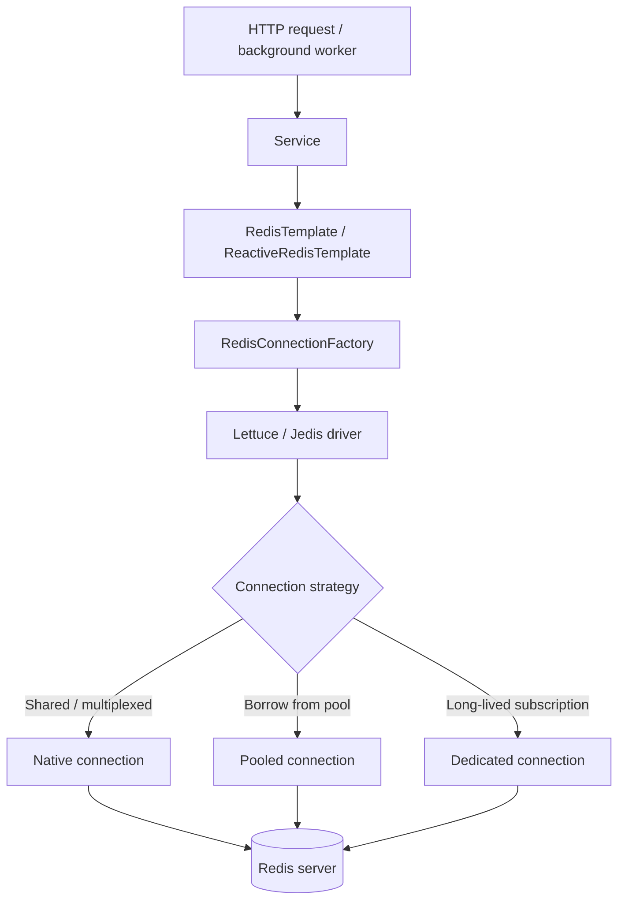
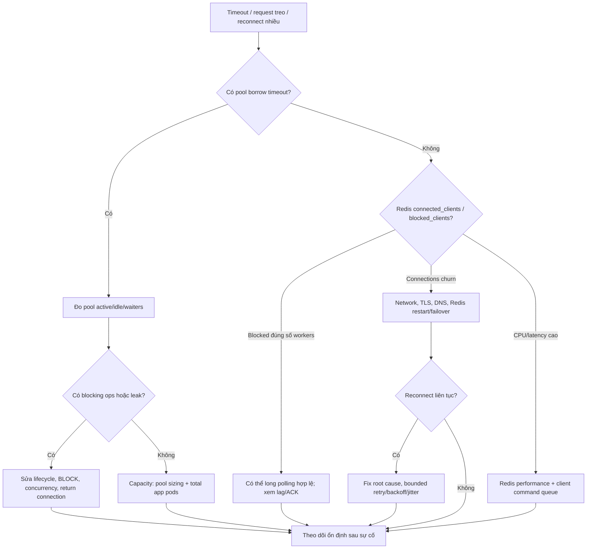

# Cạn pool, lệnh chặn kéo dài hoặc reconnect liên tục trong Spring Data Redis

## 1. Ba triệu chứng dễ bị nhầm thành một lỗi Redis

Trong một ứng dụng Spring Boot sử dụng Spring Data Redis, người vận hành có thể quan sát thấy request treo, timeout tăng, số kết nối tới Redis tăng đột biến hoặc log liên tục báo mất rồi khôi phục connection. Ba nhóm nguyên nhân thường gặp là:

1. **Cạn connection pool:** các tác vụ muốn mượn connection nhưng không còn connection khả dụng hoặc phải chờ quá lâu.
2. **Lệnh chặn (blocking command) kéo dài:** một connection đang chờ dữ liệu từ Redis theo đúng semantics của `BLPOP`, `BRPOP`, `XREAD` hoặc `XREADGROUP BLOCK`, khiến nó chưa thể được tái sử dụng.
3. **Reconnect liên tục:** kết nối TCP/TLS/Redis bị đóng, thất bại khi tạo mới hoặc bị thay đổi bởi failover, topology hay mạng; client cố kết nối lại và có thể kéo theo timeout, pool wait và retry storm.

Chúng có thể liên quan nhau:

```text
Consumer dùng XREADGROUP BLOCK 0
       |
       v
Nhiều connection bị giữ lâu
       |
       v
Pool dành cho blocking bị cạn
       |
       v
Borrow wait / timeout tăng
       |
       v
Ứng dụng retry đồng loạt
       |
       v
Redis/Network/Client CPU chịu tải
       |
       v
Connection reset / reconnect tăng
```

Nhưng thứ tự cũng có thể ngược lại: Redis node failover làm nhiều connection mất đồng thời, client cần tạo lại và pool tạm thời không cấp được connection cho caller.

**Cảnh báo quan trọng:** Không phải ứng dụng Spring Data Redis nào cũng dùng pool cho từng `GET`/`SET`. Với Lettuce, một native connection có thể được chia sẻ/multiplex cho các thao tác thông thường. Tăng `max-active` theo phản xạ có thể không giải quyết được nút thắt thực.

Bài học này xây một quy trình chẩn đoán có phân loại, phân biệt kết nối vật lý với connection wrapper/connection pool, nhận diện blocking commands, đánh giá reconnect storms và đề xuất cách khắc phục có thể kiểm chứng trong môi trường an toàn.

## 2. Nắm mô hình kết nối trước khi tối ưu

Các thành phần thường gặp:

- `RedisConnectionFactory`: abstraction của Spring Data Redis để cấp kết nối.
- `LettuceConnectionFactory`: implementation dùng Lettuce, thường được Spring Boot chọn qua starter.
- `JedisConnectionFactory`: implementation dùng Jedis trong những cấu hình chọn Jedis.
- `RedisTemplate`/`StringRedisTemplate`: operations API đồng bộ.
- `ReactiveRedisTemplate`/`ReactiveStringRedisTemplate`: operations API phản ứng.
- `RedisMessageListenerContainer`: container quản lý các kết nối Pub/Sub thường có vòng đời dài.
- Redis Streams reader/receiver: có thể dùng blocking reads và kết nối được giữ trong lúc chờ.

Một đường gọi:



Cùng một ứng dụng có thể sử dụng nhiều đường kết nối tùy operation. Không thể kết luận “pool đang cạn” chỉ từ số active HTTP requests hoặc một log Redis timeout.

### Bốn loại tài nguyên cần phân biệt

| Tài nguyên | Ý nghĩa | Triệu chứng khi thiếu |
| --- | --- | --- |
| Thread/executor | Nơi chạy code blocking hoặc callback | Thread pool nghẽn, request không được xử lý |
| Redis client connection | TCP/TLS socket hoặc connection driver tới server | Connect/reconnect errors, command queue wait |
| Connection pool | Nơi mượn/trả các connection cần pool | Borrow wait, pool exhausted, timeout chờ resource |
| Redis server client slot | Kết nối mà Redis chấp nhận theo `maxclients` | “max number of clients reached”, connect failures |

Tăng pool size không tạo thêm Redis server capacity vô hạn. Ngược lại, có thể làm server đạt `maxclients` hoặc tăng CPU/bandwidth usage.

## 3. Lettuce: shared native connection khác pooling

Lettuce là client phổ biến của Spring Data Redis. Lettuce hỗ trợ xử lý nhiều command bất đồng bộ trên kết nối được quản lý, vì thế **một native connection có thể phục vụ nhiều request Redis**.

Theo cấu hình thường dùng của `LettuceConnectionFactory`, `shareNativeConnection` mặc định được bật cho các thao tác không cần connection riêng. Các thao tác như blocking và transaction có thể sử dụng kết nối riêng, tùy cấu hình và đường gọi.

Ví dụ:

```java
@Autowired
private StringRedisTemplate redis;

public String findStatus(String id) {
    return redis.opsForValue().get("status:" + id);
}
```

Một nghìn lượt gọi `GET` không nhất thiết có nghĩa có một nghìn Redis sockets hoặc một nghìn pooled connections.

### Vì sao tăng pool không giúp một số workload?

Nếu phần lớn lệnh `GET`/`SET` dùng một shared native connection:

- Pool settings có thể không chi phối đường thao tác đó như bạn tưởng.
- Bottleneck có thể là event-loop CPU, client-side queue, network throughput hoặc Redis server latency.
- Một command timeout có thể do connection đang reconnect hoặc output queue, không phải `getResource()` chờ pool.

Với Lettuce, pool trở nên quan trọng hơn trong những đường cần dedicated connection, cấu hình non-shared connections hoặc những thư viện/đường code chủ động dùng pool.

### Có nên tắt `shareNativeConnection`?

Không nên đổi:

```java
factory.setShareNativeConnection(false);
```

chỉ để “mỗi command có một connection cho nhanh”. Điều đó thay mô hình cấp connection, có thể tăng số connection vật lý và áp lực lên pool/server. Chỉ thực hiện khi có thiết kế và số liệu cho thấy shared connection không đáp ứng yêu cầu cụ thể.

Một thay đổi như vậy cần đo throughput, latency, số connections, CPU và concurrency trước/sau, đồng thời kiểm tra transaction, Pub/Sub và blocking operations.

## 4. Jedis và pool: xác định driver thực sự đang chạy

Một project có thể dùng Lettuce hoặc Jedis. Thư viện, mô hình connection và các property tương ứng không giống hoàn toàn.

Trước khi sửa cấu hình:

1. Xác định runtime có `LettuceConnectionFactory` hay `JedisConnectionFactory`.
2. Kiểm tra starter/client dependencies và custom factory beans.
3. Xác định pooling implementation có thật sự được bật không.
4. Phân biệt “số Redis connections đang mở” với “active/idle/borrowed objects” của pool.
5. Kiểm tra có nhiều connection factory cho cache, session, Streams hay không.

Không dùng một tuning guide viết cho Jedis pool để áp nguyên xi cho ứng dụng Lettuce shared-connection.

### Pool không phải tính năng Redis server

Pool được quản lý ở phía Java client. Redis chỉ thấy những TCP client connections; Redis không biết chúng được mượn từ một Apache Commons Pool, tạo riêng bởi driver hay giữ lâu bởi listener.

Do đó cần **hai góc nhìn đồng thời**:

- Phía Java: pool metrics, thread dump, driver logs.
- Phía Redis: `INFO clients`, `CLIENT LIST`, `blocked_clients`, memory/network/CPU.

## 5. Dấu hiệu cạn connection pool thực sự

Những biểu hiện thường gặp:

- Log kiểu `Could not get a resource from the pool` hoặc `Timeout waiting for idle object`.
- Borrow wait tăng mạnh dù Redis command execution time nhỏ.
- Số active connections trong pool gần `maxTotal/max-active`.
- Idle connections bằng 0 trong lúc nhiều threads đang đợi.
- Tăng latency request trước khi Redis nhận command.
- Blocked operations hoặc transaction giữ connection quá lâu.
- Sau một số giờ hoạt động, pool không hồi phục ngay cả khi traffic giảm.

Tuy nhiên các thông điệp exception cụ thể phụ thuộc client/version và tầng Spring exception translation. Không chỉ match text của một exception rồi kết luận.

### Pool cạn có thể do hai loại vấn đề

**Pool được thiết kế quá nhỏ so với concurrency chính đáng:**

```text
8 connections tối đa
16 workers thường xuyên dùng dedicated connections
Mỗi operation giữ 1 connection trong 500 ms
=> tối đa 8 workers có thể chạy đồng thời; 8 workers chờ
```

**Connection bị giữ bất thường hoặc không trả:**

```text
Một số worker mượn connection thủ công
Có exception nhưng không close
Active count tăng dần qua nhiều giờ
Traffic giảm nhưng pool vẫn không có idle connection
```

Tăng pool có thể tạm che cả hai nhưng không chữa nguyên nhân rò tài nguyên.

## 6. Cấu hình Lettuce pool trong Spring Boot

Ví dụ Spring Boot 3.x với pooling được hỗ trợ và dependency phù hợp:

```yaml
spring:
  data:
    redis:
      connect-timeout: 2s
      timeout: 3s
      lettuce:
        pool:
          max-active: 16
          max-idle: 8
          min-idle: 2
          max-wait: 1s
```

Ý nghĩa:

- `max-active`: mức tối đa active connections/objects do pool quản lý theo semantics của client configuration.
- `max-idle`: giới hạn idle resources được giữ lại.
- `min-idle`: mục tiêu duy trì số idle resources theo chính sách pool, không phải mức đảm bảo trong mọi lúc.
- `max-wait`: giới hạn thời gian **mượn connection từ pool**.
- `spring.data.redis.timeout`: liên quan đến Redis command timeout; **khác** thời gian đợi mượn pool.
- `connect-timeout`: thời gian chờ tạo kết nối tới endpoint.

Một số cấu hình yêu cầu `commons-pool2` có mặt:

```xml
<dependency>
    <groupId>org.apache.commons</groupId>
    <artifactId>commons-pool2</artifactId>
</dependency>
```

Dự án phải kiểm tra đúng dependency management và configuration của version Spring Boot/driver; **một đoạn YAML không tự chứng minh pool được sử dụng**.

### Không tăng `max-active` vô hạn

Ví dụ 50 application pods, mỗi pod có thể mở 40 pooled connections:

```text
50 pods × 40 connections = 2.000 connections tối đa dự kiến
```

Đó chưa kể command connections chia sẻ, Pub/Sub, health checks, admin/monitoring connections hoặc những backend khác.

Redis `maxclients`, file descriptor limits, proxies/load balancers và memory cũng giới hạn khả năng mở connection. Tuning phải tính **tổng số instance**, không chỉ một JVM.

## 7. Tách pool wait, command timeout và connect timeout

Ba đồng hồ này trả lời ba câu hỏi khác nhau.

```text
Request bắt đầu
   |
   |--- Chờ mượn connection (pool max-wait)
   |
   |--- Kết nối TCP/TLS/AUTH nếu cần (connect timeout)
   |
   |--- Gửi command, chờ Redis response (command timeout)
   |
   |--- Deserialize result và trả HTTP response
```

Mỗi bước có thể timeout riêng; tổng thời gian request có thể lớn hơn một timeout được cấu hình.

| Đồng hồ | Bị giới hạn bởi | Khi quá hạn |
| --- | --- | --- |
| Pool borrow wait | Pool/config client | Không lấy được pooled resource |
| TCP connect | Network client | Không thiết lập connection |
| TLS handshake/auth | TLS/client config và timeout liên quan | Handshake hoặc AUTH failure |
| Redis command | Driver command timeout | Command không hoàn tất trong deadline |
| Blocking wait tại Redis | Tham số `BLOCK`/`BLPOP` | Redis trả nil/empty sau thời gian chờ hoặc tiếp tục nếu vô hạn |
| HTTP request deadline | Web/server/gateway | Caller có thể hủy request trước khi Redis command xong |

**Không nên đặt các deadline độc lập mà không xét nhau.** Nếu HTTP deadline 500 ms nhưng pool wait 5 giây, request có thể đã thất bại ở biên trong khi Java vẫn giữ một task chờ connection.

Một thiết kế hợp lý xác định **tổng ngân sách thời gian cho logical operation**, rồi phân bổ cho connection acquisition, command và retry.

## 8. Blocking Redis commands hoạt động như thế nào?

Redis có các lệnh chủ động chờ dữ liệu khi nguồn đang trống. Ví dụ:

- `BLPOP`/`BRPOP`: đợi phần tử trong List.
- `BLMOVE`/`BRPOPLPUSH`: đợi một phần tử để chuyển, tùy phiên bản Redis.
- `XREAD BLOCK ...`: đợi record mới trong Stream.
- `XREADGROUP ... BLOCK ...`: đợi record trong consumer group.
- Các biến thể blocking List/Stream mới hơn theo phiên bản Redis.

Ví dụ CLI:

```redis
BLPOP jobs:pending 30
```

Nếu `jobs:pending` chưa có phần tử, Redis có thể giữ command chờ tối đa khoảng 30 giây theo ngữ nghĩa timeout của lệnh.

```redis
XREAD BLOCK 5000 STREAMS events:orders $
```

Ở đây `BLOCK 5000` diễn đạt thời hạn 5.000 mili giây cho Stream read.

```redis
XREADGROUP GROUP order-workers consumer-A BLOCK 5000 STREAMS events:orders >
```

Consumer group phải tồn tại trước và có semantics riêng về pending, ACK, consumer ownership.

### `BLOCK 0` thường có nghĩa chờ vô hạn

Với Redis blocking commands liên quan, tham số timeout bằng 0 có thể nghĩa là **chặn vô hạn** cho đến khi có dữ liệu hoặc connection/lệnh bị ngắt.

Ví dụ:

```redis
BLPOP jobs:pending 0
XREADGROUP GROUP order-workers consumer-A BLOCK 0 STREAMS events:orders >
```

Điều này có thể hợp lý cho một long-running worker quản lý connection riêng và shutdown lifecycle rõ ràng, nhưng rất nguy hiểm nếu chạy bên trong request HTTP hoặc lấy nhầm connection từ pool phục vụ thao tác ngắn.

### Blocking connection không giống thread bị deadlock

Redis có thể đang làm đúng điều được yêu cầu: giữ command trong trạng thái chờ. Thread Java hoặc future có thể đang đợi response vì không có message, chứ Redis server không bị treo.

Phải phân biệt **waiting hợp lệ** với **resource starvation** do đặt blocking operations sai chỗ.

## 9. Số `blocked_clients` trên Redis có ý nghĩa gì?

Quan sát:

```bash
redis-cli INFO clients
```

Một phần output có thể có:

```text
connected_clients:120
blocked_clients:36
maxclients:10000
```

Các con số chỉ là ví dụ.

- `connected_clients`: số client connections ở thời điểm quan sát theo Redis.
- `blocked_clients`: số clients đang bị chặn bởi những blocking operations mà Redis thống kê.
- `maxclients`: giới hạn connections của server theo cấu hình/giới hạn tài nguyên.

Nếu ứng dụng có 36 consumers cố ý dùng `XREADGROUP BLOCK`, `blocked_clients=36` có thể bình thường. Không kết luận server đang lỗi chỉ vì con số đó lớn hơn 0.

Nhưng nếu có 36 blocked clients trong khi chỉ dự kiến 4 consumers, cần điều tra:

- Worker cũ chưa đóng connection?
- Mỗi request tạo một blocking consumer mới?
- Scheduler chạy trùng nhiều instance?
- Consumer không dừng sau deploy?
- Pool dành cho blocking connections bị chiếm hết?
- Thời hạn BLOCK là vô hạn trong khi worker cần polling có deadline?

**Phải so sánh số blocked clients với số consumer/listener dự kiến từ topology ứng dụng.**

## 10. Dùng `CLIENT LIST` để biết connection nào đang chờ

Khi Redis ACL cho phép, trong môi trường kiểm soát:

```bash
redis-cli CLIENT LIST
```

Mỗi client có metadata có thể bao gồm:

```text
id=123 addr=10.0.0.5:45678 age=200 idle=30 flags=b cmd=xreadgroup
id=124 addr=10.0.0.6:45679 age=120 idle=10 flags=N cmd=get
```

Các dòng minh họa. Các field/flags thực tế thay đổi theo Redis version và client state.

Hữu ích:

- `id`: client connection ID.
- `addr`: source address/port của connection.
- `age`: thời gian connection đã tồn tại.
- `idle`: thời gian theo ngữ nghĩa Redis của client inactivity.
- `flags`: trạng thái client, trong đó flag liên quan blocking có thể hữu ích.
- `cmd`: command gần đây/hiện được liên hệ với client.

Một client có `cmd=xreadgroup` và blocked flag gợi ý long-poll stream consumer, không phải một request GET bị kẹt.

### Giới hạn khi nhìn từ server

- Một Lettuce shared connection có thể phục vụ nhiều logical commands; một dòng `CLIENT LIST` không ánh xạ 1–1 với HTTP request.
- Không thấy `cmd=get` không chứng minh client không từng gửi GET; server list là snapshot.
- Connection ID có thể thay sau reconnect.
- `addr` trong NAT/Kubernetes có thể là IP node/proxy, không trực tiếp là một pod.
- Redis Cluster có nhiều nodes; một node không có đầy đủ client list của node khác.

Không lưu hoặc công bố `CLIENT LIST` nguyên văn cho người không có quyền vì có thể chứa địa chỉ, tên client và thông tin vận hành nhạy cảm.

## 11. Vì sao `SLOWLOG` thường không giải thích được lệnh chặn lâu?

Redis `SLOWLOG` thường ghi **thời gian thực thi command trên server**, không tính toàn bộ thời gian request chờ network/client hoặc khoảng chờ có chủ đích của một blocking operation theo cách người dùng đo end-to-end.

Ví dụ:

```text
Application thấy BLPOP mất 20 giây
Redis thực thi và trả ngay sau khi có item
=> SLOWLOG có thể không cho thấy "20 giây CPU xử lý"
```

SLOWLOG là công cụ quan trọng cho commands chiếm CPU/server execution time, nhưng không nên dùng một mình để chẩn đoán:

- Pool borrowing wait.
- Network latency.
- TLS handshake.
- Blocking wait do queue/Stream trống.
- Redis client retry/backoff.
- Serialization/deserialization phía Java.
- Java thread waiting/GC pauses.

Kết hợp:

```bash
redis-cli INFO clients
redis-cli CLIENT LIST
redis-cli SLOWLOG GET 20
redis-cli LATENCY LATEST
```

Các lệnh chẩn đoán yêu cầu ACL phù hợp; dùng ở môi trường được phép và không tự thay cấu hình Redis server để chạy chúng.

## 12. Redis List blocking read trong Spring Data Redis

Spring Data Redis có các overload list operations với timeout:

```java
import java.time.Duration;
import org.springframework.data.redis.core.StringRedisTemplate;

public final class JobQueueReader {

    private final StringRedisTemplate redis;

    public JobQueueReader(StringRedisTemplate redis) {
        this.redis = redis;
    }

    public String takeOne() {
        return redis.opsForList()
                .leftPop("jobs:pending", Duration.ofSeconds(2));
    }
}
```

Đây là ví dụ một operation có thể gọi Redis blocking pop tương ứng. Khi timeout mà không có element, kết quả có thể là null theo hợp đồng API đồng bộ.

Điểm cần nhớ:

- Timeout ở overload list pop **không phải** thời gian borrow pool.
- Lệnh sẽ giữ server-side command/connection trong lúc đợi.
- Driver command timeout phải tương thích với blocking duration; các version/driver có cơ chế timeout handling khác nhau, nên phải kiểm tra hành vi thực tế.
- Nếu gọi trong request HTTP, phải cân nhắc deadline HTTP và cách hủy khi client disconnect.
- Nếu có nhiều consumers, tính số dedicated connections cần thiết.

### Đừng gọi `leftPop(key, Duration.ZERO)` mà không biết semantics

Trong nhiều Redis blocking command, timeout zero được hiểu là chờ vô hạn. Một Duration.ZERO trong client API có thể được ánh xạ theo driver/command semantics như vậy.

Muốn polling có kiểm soát, dùng timeout dương hữu hạn và đọc documentation của đúng overload/driver version.

## 13. Redis Streams blocking read: cấu hình rõ `BLOCK`

Ví dụ consumer group:

```java
import java.time.Duration;
import java.util.List;

import org.springframework.data.redis.connection.stream.Consumer;
import org.springframework.data.redis.connection.stream.ReadOffset;
import org.springframework.data.redis.connection.stream.StreamReadOptions;
import org.springframework.data.redis.connection.stream.StreamOffset;
import org.springframework.data.redis.core.StringRedisTemplate;

public class OrderStreamPoller {

    private final StringRedisTemplate redis;
    private final String consumerName;

    public OrderStreamPoller(
            StringRedisTemplate redis,
            String consumerName) {
        this.redis = redis;
        this.consumerName = consumerName;
    }

    public void pollOnce() {
        var options = StreamReadOptions.empty()
                .count(10)
                .block(Duration.ofSeconds(2));

        var records = redis.opsForStream().read(
                Consumer.from("order-workers", consumerName),
                options,
                StreamOffset.create(
                        "orders:events",
                        ReadOffset.lastConsumed()));

        if (records == null || records.isEmpty()) {
            return;
        }

        for (var record : records) {
            // Xử lý message có idempotency và chính sách lỗi rõ.
            // ACK theo hợp đồng nghiệp vụ sau khi xử lý thành công.
        }
    }
}
```

**Điều kiện:** Stream và consumer group `order-workers` đã được tạo. Đoạn code là khung polling, không bao gồm xử lý pending entries và `XACK`.

Với `StreamReadOptions.block(Duration.ofSeconds(2))`, worker có cơ hội trở lại vòng lặp và xem cờ shutdown định kỳ. Không giữ một request HTTP chờ `BLOCK 0` vô hạn chỉ để “đợi sự kiện”.

### Blocking read tác động lên connection như thế nào?

Khi Redis đang chờ Stream records, connection thực hiện lệnh blocking không thể dùng như một command channel bình thường cho nhiều thao tác độc lập theo cách client tùy ý. Spring Data Redis/Lettuce thường sử dụng dedicated connection cho blocking operations theo cấu hình phù hợp.

Nếu một executor tạo 100 consumers cùng BLOCK mà pool dedicated connections chỉ chứa 16 resources, nhiều worker có thể chờ mượn pool trước khi thực sự đọc stream.

Giải pháp không nhất thiết là tăng pool lên 100; có thể thiết kế **số consumers hợp lý**, tối ưu batch size, giới hạn concurrency và tổ chức worker service tách khỏi HTTP API.

## 14. Redis Streams receiver và reactive subscription

Trong reactive Redis, subscription có vòng đời rõ ràng. Một stream receiver có thể sử dụng connection và polling/long-poll theo cấu hình.

Các điểm cần phân biệt:

- Reactive API không biến Redis blocking wait thành không tiêu tốn tài nguyên server/client.
- `Flux` có thể xử lý backpressure phía ứng dụng, nhưng Redis Pub/Sub không tự lưu messages cho subscriber offline.
- Khi mỗi HTTP request tạo một stream receiver/subscription mới, số kết nối hoặc subscriptions có thể tăng không giới hạn.
- Khi cancel subscriber, cần đảm bảo lifecycle giải phóng tài nguyên theo API/version đang dùng.
- Không gọi blocking synchronous template trên Reactor event-loop nếu latency có thể kéo dài.
- Tách reactive receiver lâu dài thành component quản lý lifecycle và concurrency.

### Mẫu anti-pattern

```java
@GetMapping("/jobs/next")
public Mono<String> next() {
    // KHÔNG NÊN làm blocking request trên event-loop.
    String value = redisTemplate.opsForList()
            .leftPop("jobs:pending", Duration.ZERO);

    return Mono.justOrEmpty(value);
}
```

Đây là một blocking call được thực hiện **trước khi trả Mono**, có thể chiếm thread xử lý request vô thời hạn.

Nếu API cần streaming thực sự, thiết kế một async/streaming endpoint với lifecycle/cancellation phù hợp, hoặc tách worker nhận job khỏi HTTP request. Dùng `boundedElastic()` có thể tránh block event-loop nhưng vẫn cần quản lý thread, pool và số connection; nó **không giải quyết** lệnh Redis chờ vô hạn.

## 15. Pub/Sub giữ kết nối lâu dài là thiết kế bình thường

`RedisMessageListenerContainer` quản lý subscription tới Redis:

```java
@Bean
RedisMessageListenerContainer listenerContainer(
        RedisConnectionFactory factory,
        MessageListener listener) {

    RedisMessageListenerContainer container =
            new RedisMessageListenerContainer();

    container.setConnectionFactory(factory);
    container.addMessageListener(
            listener,
            new ChannelTopic("orders.created"));

    return container;
}
```

Các import cho Spring Data Redis listener types cần có trong project. Khi là bean managed, Spring quản lý lifecycle của container theo cấu hình hỗ trợ.

Khác với `GET` đơn lẻ, subscription thường kéo dài trong suốt vòng đời ứng dụng. Một connection dành cho Pub/Sub tồn tại lâu **không phải connection leak**.

Nhưng nếu code tạo một `RedisMessageListenerContainer` mới cho mỗi request rồi không stop/destroy:

```text
Request 1 -> new listener container -> 1 subscription connection
Request 2 -> new listener container -> thêm 1 connection
...
Request 500 -> hàng trăm subscription connections tồn tại
```

đây là **lifecycle/resource leak**.

Nên tạo listener/receiver ở cấp application component có ownership rõ, đăng ký topic một cách có kiểm soát và cleanup khi shutdown.

## 16. Pool cạn vì ứng dụng tự mượn connection rồi quên đóng

Khi làm việc trực tiếp với `RedisConnectionFactory`, code cần trả tài nguyên theo contract.

Ví dụ:

```java
public String ping(RedisConnectionFactory factory) {
    RedisConnection connection = factory.getConnection();

    try {
        return connection.ping();
    } finally {
        connection.close();
    }
}
```

Trong cấu hình có pool, `close()` trên connection wrapper phù hợp thường có vai trò trả resource về pool thay vì đóng TCP socket vật lý ngay.

Mẫu rò rỉ:

```java
public String brokenPing(RedisConnectionFactory factory) {
    RedisConnection connection = factory.getConnection();

    // Nếu ping() ném exception, không close connection.
    return connection.ping();
}
```

Sau nhiều lượt lỗi, số active borrowed resources có thể tăng mà không được trả.

### Ưu tiên template nếu không cần API mức thấp

`RedisTemplate` thực hiện quản lý connection cho các operations thông thường theo abstraction Spring Data Redis. Đừng tự lấy và giữ `RedisConnection` khi service chỉ cần `GET` hoặc `SET`.

Nếu thực sự cần connection cấp thấp:

- Định nghĩa rõ ownership.
- Đóng trong `finally` hoặc try-with-resources nếu API tương ứng hỗ trợ.
- Không chia sẻ cùng một dedicated connection thủ công không đúng thread-safety contract.
- Không giữ connection qua tác vụ ngoài Redis kéo dài, như HTTP call/SQL transaction.
- Không giữ connection trong cache singleton hoặc static variable mà không có lifecycle.

## 17. Transaction và pipeline có thể giữ connection lâu hơn dự kiến

Một số trường hợp:

- `MULTI`/`EXEC` transaction.
- `WATCH` + optimistic locking.
- RedisTemplate transaction support.
- Pipeline callback kéo dài.
- Blocking reads.
- Manual `RedisConnection` usage.

Nếu một transaction mở kết nối rồi thực hiện logic chậm trước `EXEC` hoặc rollback/cleanup, resource có thể bị giữ.

Anti-pattern về phạm vi:

```text
Borrow Redis connection
  |
  +-- WATCH key
  |
  +-- HTTP call tới hệ thống ngoài (3 giây)
  |
  +-- SQL query (2 giây)
  |
  +-- MULTI/EXEC
  |
  +-- Close connection
```

Khi nhiều request cùng làm vậy, pool bị chiếm phần lớn thời gian bởi các bước **không thuộc Redis**.

Nên thu hẹp critical section: chuẩn bị dữ liệu bên ngoài trước, sau đó thực hiện thao tác Redis có concurrency control/transaction ngắn. Chú ý `WATCH` và lệnh transaction phải dùng đúng connection/semantics của Spring Data Redis; không thể chia các lệnh tùy ý giữa hai connection rồi mong transaction áp dụng.

**Redis MULTI/EXEC không tự rollback mọi lệnh như SQL transaction.** Hãy thiết kế error handling, idempotency và recovery phù hợp.

## 18. Thread dump giúp thấy đang chờ cái gì

Khi ứng dụng bị treo nhưng Redis metrics chưa rõ, một thread dump có thể cho manh mối:

```text
Thread A:
  WAITING / TIMED_WAITING ở pool borrow
  => nghi thiếu pooled resource

Thread B:
  WAITING trên Future/command completion
  => nghi Redis response, blocking operation hoặc command timeout

Thread C:
  BLOCKED trên synchronized lock do code ứng dụng
  => nghi contention không liên quan Redis pool

Thread D:
  Netty event-loop đang xử lý CPU nặng
  => nghi event-loop starvation / callback code quá chậm
```

Không chỉ nhìn trạng thái `WAITING`: Java thread có thể chờ Redis blocking command đúng thiết kế. Cần liên hệ stack trace với tên worker, operation, pool metrics và thời điểm xảy ra lỗi.

### Thread dump khác Redis `blocked_clients`

- Thread dump mô tả trạng thái threads Java.
- `blocked_clients` mô tả clients bị Redis server giữ trong blocking operations.
- Một Java async caller có thể không giữ một thread blocked trong lúc Redis server đang giữ connection.
- Một Java thread có thể bị chặn chờ connection pool trong khi Redis server không có client blocked nào.

Đó là lý do nên thu cả hai góc nhìn trước khi chỉnh tham số.

## 19. Reconnect liên tục: định nghĩa và triệu chứng

**Reconnect storm** là khi client liên tục mất kết nối hoặc không thể thiết lập connection bền vững, rồi nhiều instance cố kết nối lại cùng lúc.

Các dấu hiệu:

- Log liên tục “reconnect”, “disconnected”, “channel inactive”, “connection reset” hoặc “connection refused”.
- Số kết nối được tạo/đóng tăng mạnh.
- Redis `connected_clients` dao động.
- Command timeout và error rate tăng, ngay cả khi Redis server CPU không quá cao.
- TLS handshake/auth failures lặp lại.
- Sau failover, client tiếp tục cố vào node cũ hoặc endpoint không truy cập được.
- Một số app pods chịu lỗi nhiều hơn các pods khác.

Reconnect không nhất thiết là lỗi của driver. Nó có thể là phản ứng hợp lý trước network instability, Redis restart, failover hoặc giới hạn tài nguyên.

### Đừng suy từ một log reconnect thành sự cố

Một lần reconnect khi rolling deployment Redis có thể bình thường. Đáng lo khi tần suất cao, kéo dài, làm request lỗi hoặc khiến resource consumption tăng.

Nên đo:

```text
reconnect attempts / second
connection failures / second
command timeouts / second
active Redis connections
Redis blocked_clients
pool borrow wait p95/p99
HTTP request latency/error rate
```

Nhiều chỉ số ở đây cần instrument từ client; không mặc định Spring Data Redis tự xuất tất cả.

## 20. Các nguyên nhân reconnect thường gặp

| Nhóm | Nguyên nhân cụ thể | Cách kiểm tra |
| --- | --- | --- |
| Redis server | Restart, crash, OOM, maxclients, failover | Redis/server logs, INFO, orchestrator events |
| Network | Packet loss, NAT/LB idle timeout, firewall reset | Network events, endpoint path, packet/connection metrics |
| DNS | Host thay IP, stale resolution, service discovery lỗi | DNS lookup từ app pod, TTL/resolution |
| TLS | Certificate mismatch, CA rotation, mTLS config sai | Handshake exception, trust store, server cert |
| ACL/Auth | WRONGPASS/NOAUTH hoặc token rotate | Client/server auth logs, secret version |
| Cluster/Sentinel | Primary đổi, topology stale, node advertises unreachable address | Cluster/Sentinel state, driver topology logs |
| Client resources | Netty event-loop bị nghẽn, heap/GC pressure, thread exhaustion | JVM CPU/GC/thread dumps |
| Proxy/mesh | Sidecar restart, idle connection timeout, max connection | Proxy logs/metrics và policy |
| Deployment | Pods restart, rolling config/secret changes | Deployment timeline và pod events |
| Retry policies | Retry storm khiến tải tăng và connection bị churn | Retry attempts, backoff, concurrency |

Cần bắt đầu bằng **mốc thời gian**: reconnect tăng ngay sau deploy, secret rotation, failover hay lúc traffic bùng nổ? Correlation theo timeline thường loại được nhiều giả thuyết.

## 21. Redis server đạt `maxclients` khác pool cạn

Ví dụ Redis trả lỗi liên quan giới hạn số client connections:

```text
ERR max number of clients reached
```

Đây là phía **Redis server** hết client slots hoặc chạm giới hạn tài nguyên tương ứng.

Nguyên nhân có thể:

- Quá nhiều app pods/connection pools.
- Mỗi request tự tạo Redis client/factory/container rồi không đóng.
- Long-lived Pub/Sub/Streams connections nhân lên.
- Lỗi reconnect tạo nhiều connection đồng thời.
- Monitoring, health probes và admin tools tạo connection ngoài dự tính.

Không sửa bằng cách tăng `max-active` ở Java; điều đó có thể làm lỗi nặng hơn.

Cần kiểm tra:

```bash
redis-cli INFO clients
redis-cli CONFIG GET maxclients
```

Lệnh `CONFIG GET` phụ thuộc Redis ACL và policy vận hành. Nếu managed service không cho chạy, xem metric/config từ hệ thống quản trị tương ứng.

### Tăng `maxclients` có đủ không?

Chưa chắc. Redis cần file descriptors và memory/buffers cho client connections. Tăng giới hạn khi ứng dụng đang tạo connection leak chỉ dời thời điểm sự cố.

Ưu tiên:

1. Xác định ai đang mở connection.
2. So số connections với số app instances và thiết kế pool/subscriptions.
3. Giảm connection leak, không tạo client theo request.
4. Chỉ tăng giới hạn có kiểm soát sau capacity planning.

## 22. Network idle timeout và keepalive

Một số proxy/load balancer/NAT đóng TCP connection sau thời gian idle. Redis client có thể giữ connection nghĩ rằng nó còn sống, tới lúc gửi command tiếp theo mới phát hiện connection đã bị reset.

Mẫu:

```text
10:00 Connect Redis thành công
10:05 Không có traffic
10:10 Proxy đóng idle TCP connection
10:12 App gửi GET
10:12 Connection reset / reconnect
10:12 Retry/Fallback
```

Đối với shared connection hoặc long-lived subscribers, cần xem:

- Idle timeout của proxy/LB/mesh.
- TCP keepalive settings.
- Driver/client keepalive/heartbeat options theo version.
- Redis server `timeout` setting (nếu được cấu hình).
- Connection validation khi lấy từ pool.
- Service mesh hoặc NAT connection tracking.

**Không đặt heartbeat cực ngắn** trên hàng nghìn connections để “tránh disconnect” mà không tính network/CPU. Cũng không tắt mọi timeout vô hạn vì có thể giữ connection hỏng rất lâu.

Một chính sách hợp lý căn cứ vào đường network thật và cách client phát hiện/làm mới connection.

## 23. Failover Redis Sentinel/Cluster và reconnect

Redis Sentinel:

- Một primary cũ có thể mất kết nối hoặc đổi role.
- Replica được promote thành primary mới.
- Client Sentinel-aware cần tìm primary mới và reconnect.
- Lệnh ghi vào node cũ có thể gặp `READONLY` hoặc lỗi connection.

Redis Cluster:

- Slot ownership có thể thay đổi khi failover/reshard.
- Client nhận `MOVED`/`ASK` hoặc cần topology refresh.
- Một số node endpoint Redis công bố có thể không truy cập được từ Kubernetes/NAT nếu cấu hình cluster announce không đúng.
- ReadFrom replica có thể ảnh hưởng consistency.

### Không nhầm redirect bình thường với reconnect storm

`MOVED`/`ASK` là một phần Redis Cluster routing; cluster-aware driver xử lý redirect theo semantics phù hợp. Nhưng redirect lặp liên tục, timeout và topology refresh không thành công có thể chỉ ra cấu hình endpoint/topology sai.

Đọc client driver logs với mức phù hợp, xem cluster health và đối chiếu thời gian failover. Tránh bật DEBUG quá rộng trên production vì log có thể tạo tải hoặc lộ thông tin.

### Retry sau reconnect có thể nhân đôi side effect

Nếu client gửi `INCR`, Redis đã thực thi nhưng response mất, một retry có thể tăng thêm lần nữa. Tương tự `LPUSH`, `XADD *` và `PUBLISH`.

Vì vậy reconnect policy và application retry policy là **hai thứ khác nhau**. Không bọc mọi Redis method trong retry vô hạn. Cần idempotency cho từng operation và deadline rõ ràng.

## 24. TLS/ACL lỗi có thể trông giống reconnect loop

Nếu kết nối TCP được mở nhưng TLS handshake hoặc AUTH thất bại, client có thể thử kết nối lại theo chính sách driver.

Phân biệt:

```text
TCP connect failure:
  Connection refused / connect timed out

TLS handshake failure:
  SSLHandshakeException / certificate / hostname errors

Redis authentication failure:
  WRONGPASS / NOAUTH

ACL command failure:
  NOPERM khi thực hiện command
```

**Cần sửa đúng tầng**:

- TCP: host/port/firewall/routing.
- TLS: trust store, certificate, protocol, port, hostname.
- AUTH: username/password hoặc secret rotation.
- ACL: quyền đúng command/key/channel.
- Redis topology: Sentinel/Cluster endpoints.

Một `NOPERM` khi `XREADGROUP` không nhất thiết khiến factory không được tạo. Nhiều client vẫn kết nối thành công, nhưng application command thất bại.

Không “sửa” TLS error bằng tắt hostname verification, hoặc auth error bằng log password ra console.

## 25. Event-loop starvation và callback/blocking code

Với Lettuce và Netty, một số I/O và callbacks chạy trên các executor/event-loops của client. Nếu code ứng dụng đưa công việc CPU/blocking nặng lên thread không phù hợp, hệ quả có thể là:

- Redis responses đã đến nhưng chưa được xử lý kịp.
- Command completion bị trễ.
- Timeout tăng dù Redis server đang nhanh.
- Heartbeat/connection operations bị trì hoãn.
- Người vận hành hiểu nhầm thành network instability.

Ví dụ WebFlux anti-pattern:

```java
@GetMapping("/status/{id}")
public Mono<String> get(@PathVariable String id) {
    // Một template đồng bộ có thể block event-loop.
    String value = stringRedisTemplate.opsForValue()
            .get("status:" + id);

    return Mono.justOrEmpty(value);
}
```

Với request handler WebFlux, ưu tiên API reactive:

```java
@GetMapping("/status/{id}")
public Mono<String> get(@PathVariable String id) {
    return reactiveStringRedisTemplate.opsForValue()
            .get("status:" + id);
}
```

Nếu một thư viện bắt buộc phải block, tách nó vào scheduler/executor phù hợp và **giới hạn concurrency**. Chuyển từ event-loop sang thread pool không xóa nhu cầu connection hoặc giới hạn Redis server.

### Không cho rằng mọi timeout do Redis server

Khi Redis `SLOWLOG` không có command chậm nhưng application p99 tăng, kiểm tra CPU, GC, event-loop lag và số command pending phía client trước khi tăng Redis timeout.

## 26. Retry storm: từ một lỗi nhỏ thành outage lớn

Một request gặp timeout và retry ba lần có thể làm Redis nhận thêm ba command hoặc nhiều hơn, tùy tầng gọi.

Nếu gateway, service và driver đều retry:

```text
Gateway: 3 attempts
  Service: 3 attempts/request
    Redis operation: 3 attempts/service call

Tối đa lý thuyết: 3 × 3 × 3 = 27 Redis attempts
```

Đây là ví dụ minh họa, phụ thuộc cơ chế retry và có thể bị cắt bởi deadline.

Khi Redis đang chậm, retry storm:

- Tăng active/queued operations.
- Chiếm pool lâu hơn.
- Tăng Redis CPU và network.
- Gia tăng command timeout.
- Gây thêm reconnect khi client/proxy quá tải.
- Làm service downstream chịu load khi cache fallback đồng loạt.

Giải pháp:

1. Có **tổng request deadline** rõ.
2. Giới hạn retry attempts và concurrency.
3. Backoff theo cấp số nhân và jitter.
4. Chỉ retry những lỗi transient được phép.
5. Kiểm tra tính lũy đẳng của Redis operation.
6. Dùng circuit breaker/bulkhead khi phù hợp.
7. Có metric phân biệt first attempt với retry attempt.
8. Khi Redis cache không khả dụng, fallback phải có capacity planning để tránh dồn tải xuống database.

## 27. Không sử dụng pool như một hàng đợi vô hạn

Nếu `max-wait` rất dài và số incoming requests lớn:

```text
500 HTTP requests
  |
  v
16 pooled Redis connections
  |
  +-- 16 active operations
  |
  +-- 484 requests chờ mượn resource
```

Hệ quả:

- Thread memory/queue tăng.
- HTTP deadline đã hết nhưng worker có thể còn chờ.
- Khi pool có resource, nhiều công việc đã vô ích vẫn được xử lý.
- Retry của caller làm queue tăng thêm.

Một thiết kế ổn định cần:

- Giới hạn số pending requests/operations.
- Pool wait timeout ngắn hơn tổng deadline phù hợp.
- Không tạo vô hạn background jobs.
- Dành capacity riêng cho blocking consumers nếu cần.
- Circuit breaker/fallback để không xếp hàng mãi.

**Giới hạn song song trước khi borrow** thường dễ kiểm soát hơn để mọi request tự chen vào pool wait queue.

## 28. Đo pool metrics: những số nào đáng tin?

Nếu pool được cấu hình và có thể instrument, các chỉ số quan trọng:

| Metric | Ý nghĩa |
| --- | --- |
| Active/borrowed | Resources đang được dùng |
| Idle | Resources hiện rảnh |
| Max total/active | Giới hạn cấu hình |
| Waiters | Số tasks đang chờ resource |
| Borrow wait time p95/p99 | Thời gian mượn connection |
| Borrow timeout count | Không lấy được resource trong deadline |
| Created/destroyed objects | Churn của connection/pool resources |
| Validation failures | Resource không còn hợp lệ khi borrow/return |
| Pool exhaustion events | Tần suất thiếu resource |
| Command latency | Chi phí sau khi resource đã có |

Tên metric cụ thể phụ thuộc pool implementation, Micrometer instrumentation và client version; **không mặc định Spring Boot Actuator tự phát đủ tất cả**.

Trong hệ thống không dùng pooled connections cho GET/SET thường ngày, có thể thấy pool active thấp trong khi Redis command latency cao. Lúc đó phải quan sát client command queue, event-loop, RTT và Redis server thay vì kết luận metrics sai.

### Sample metrics định hướng

```text
redis_pool_active{factory="stream"} = 16
redis_pool_idle{factory="stream"} = 0
redis_pool_waiters{factory="stream"} = 12

redis_command_latency_seconds{operation="GET"}
redis_command_timeout_total{operation="XREADGROUP"}
redis_reconnect_attempts_total{client="catalog"}
```

Các tên trên **là đề xuất instrumentation**, không phải metric mặc định của Spring Data Redis.

Không gắn raw Redis key, user ID hoặc trace ID vào low-cardinality metric labels. Dùng client/factory role, operation group và result có tập giá trị hữu hạn.

## 29. Redis server metrics để đối chiếu

Một số lệnh chẩn đoán:

```bash
redis-cli INFO clients
redis-cli INFO stats
redis-cli INFO memory
redis-cli INFO cpu
redis-cli INFO replication
redis-cli CLIENT LIST
redis-cli SLOWLOG GET 20
redis-cli LATENCY LATEST
```

Đối với Redis Cluster, cần thu dữ liệu trên những nodes liên quan, không chỉ một node.

| Tín hiệu Redis | Cách diễn giải thận trọng |
| --- | --- |
| `connected_clients` tăng | Có thể do scale-out, leak, reconnect, subscriptions |
| `blocked_clients` tăng | Có thể là blocking consumers hợp lệ hoặc quá nhiều blocking ops |
| `rejected_connections` tăng | Có thể đã chạm maxclients/limits |
| `total_connections_received` tăng nhanh | Có nhiều connection churn; cần so traffic/topology |
| `instantaneous_ops_per_sec` tăng | Request load có thể tăng, gồm retries |
| `used_memory`/evictions tăng | Redis memory pressure có thể làm performance xấu |
| `SLOWLOG` có nhiều lệnh chậm | Server execution time đáng điều tra |
| CPU/latency monitor spikes | Server có những mốc hoạt động bất thường |
| Replication/failover events | Có thể giải thích reconnect/read-only errors |

Không suy ra Redis server quá tải chỉ vì `connected_clients` cao; phải so CPU, ops/s, network, maxclients và workload.

## 30. Ghi log client an toàn khi chẩn đoán

Với Spring Data Redis và Lettuce, có thể tạm tăng log level cho những package được chọn ở local/staging:

```yaml
logging:
  level:
    org.springframework.data.redis: DEBUG
    io.lettuce.core: INFO
```

Các level là ví dụ. Không nhất thiết bật DEBUG cho toàn bộ Lettuce/Netty trên production vì có thể tạo nhiều log, chiếm CPU và tiết lộ thông tin endpoint hoặc command arguments tùy instrumentation.

Một log hữu ích nên có:

```text
timestamp
service / instance / pod
traceId hoặc correlation ID
redis factory role
operation type
attempt number
elapsed time / timeout type
result/error category
connection endpoint hoặc topology role theo chính sách
```

Tránh log:

- Password/connection URL chứa credential.
- Redis value chứa PII/secret.
- Raw session tokens trong key.
- Full Lua script/ARGV có dữ liệu nhạy cảm.
- Hàng triệu Redis key dưới dạng metric labels.

Khi tăng logging, đặt thời gian hiệu lực và tiêu chí tắt; đừng để DEBUG toàn diện mãi sau sự cố.

## 31. Phân biệt loại timeout bằng timeline

Giả sử request mất 2,5 giây rồi thất bại. Có thể là:

**Trường hợp A: pool wait**

```text
t=0ms    Request bắt đầu
t=0ms    Xin borrow connection
t=2000ms Borrow timeout
t=2005ms HTTP 503
Redis server không thấy command này
```

**Trường hợp B: Redis blocking read hợp lệ**

```text
t=0ms    Borrow dedicated connection
t=5ms    XREADGROUP BLOCK 2000 tới Redis
t=2005ms Redis trả empty do không có record
t=2010ms Poller tiếp tục chu kỳ
```

**Trường hợp C: reconnect**

```text
t=0ms    Command queued
t=100ms  TCP reset
t=500ms  Client reconnect attempt
t=1200ms TLS handshake failed
t=2500ms Command timeout
```

Ba timeline dẫn tới những hành động khác:

- A: tìm pool ownership, active resources, sizing, leak.
- B: xác nhận đó là consumer đúng thiết kế, tối ưu poll duration/concurrency.
- C: tìm network/TLS/topology/driver resource và policy retry.

Không nên chỉ thấy cả ba cùng mất ~2 giây rồi tăng `spring.data.redis.timeout`.

## 32. Thiết kế worker polling không giữ tài nguyên vô hạn

Một worker tiêu thụ Redis Streams có thể thực hiện polling hữu hạn và dừng sạch.

Khung điều khiển:

```java
public final class OrderConsumerWorker implements Runnable {

    private final OrderStreamPoller poller;
    private final AtomicBoolean running = new AtomicBoolean(true);

    public OrderConsumerWorker(OrderStreamPoller poller) {
        this.poller = poller;
    }

    public void stop() {
        running.set(false);
    }

    @Override
    public void run() {
        while (running.get()) {
            try {
                poller.pollOnce(); // BLOCK hữu hạn bên trong.
            } catch (RuntimeException ex) {
                // Ghi metric/log, phân loại lỗi và backoff có giới hạn.
                // Không busy-loop liên tục trên cùng một connection lỗi.
            }
        }
    }
}
```

Đây là mẫu kiến trúc, cần thêm imports, lifecycle/executor và error policy phù hợp. Không bắt exception rồi bỏ qua mãi mãi: nếu Redis liên tục lỗi, vòng lặp không backoff có thể gây reconnect storm.

**Thời hạn BLOCK hữu hạn** giúp worker định kỳ kiểm tra `running` để shutdown. Cũng cần tính driver command timeout và lifecycle của executor để không chờ lâu hơn thời gian ứng dụng được phép dừng.

Nếu dùng Spring lifecycle, quản lý start/stop qua component/SmartLifecycle hoặc runner đúng cách, không tạo một thread riêng không được quản lý cho mỗi message.

## 33. Chọn số consumer và BLOCK duration bằng số liệu

Giả sử:

```text
8 stream partitions/streams cần đọc
4 application instances
Mỗi instance dự kiến 2 blocking consumers
=> 8 consumers tổng
```

Nếu mỗi consumer giữ một dedicated connection, đó là phần capacity **có chủ đích** của hệ thống.

Nhưng nếu mỗi instance tạo 20 consumers vì một retry/error handler lặp registration:

```text
4 instances × 20 consumers = 80 connections
```

số connections tăng 10 lần mà throughput không chắc tăng, vì cùng event group hoặc resource contention có thể khiến nhiều consumers chỉ chờ.

Cần xác định:

- Số streams và nhóm consumer thật sự cần.
- Số consumers tối ưu theo throughput và CPU processing.
- Batch size mỗi read.
- Processing latency của một record.
- Số pending entries và cách reclaim.
- BLOCK duration.
- Memory/network budget.
- Số application replicas và autoscaling.
- Graceful shutdown khi scale-down.

### BLOCK quá ngắn có thể gây vòng gọi liên tục

Nếu poll mỗi 1 ms trên stream trống, ứng dụng có thể tạo rất nhiều Redis command và network round-trips.

### BLOCK quá dài có thể làm shutdown chậm

Nếu poll BLOCK vài phút hoặc vô hạn, worker có thể không kịp dừng theo termination grace period khi pod bị thay thế.

Không có con số “đúng cho mọi hệ thống”. Chọn theo latency nhận message, command overhead và shutdown budget.

## 34. Khi dùng timeout bên ngoài một blocking command

Có thể nghĩ:

```text
Redis XREADGROUP BLOCK 0
HTTP timeout 1s
=> sau 1s mọi thứ đều được giải phóng
```

Nhưng timeout phía HTTP/caller không tự chứng minh rằng Redis connection đã được hủy và trả về pool ngay lập tức. Cần biết:

- Cancellation được truyền xuống driver không?
- Command có còn pending ở connection không?
- Connection wrapper được close/return không?
- Blocking operation có được server/client kết thúc đúng lúc không?
- Reactive cancellation có thực sự giải phóng subscription không?

Vì vậy nên cấu hình **server-side BLOCK duration hữu hạn** tương thích với driver and app deadline, và kiểm thử cancellation/resource cleanup trong môi trường riêng.

Tránh dùng command timeout nhỏ hơn blocking wait một cách vô tình; nó có thể gây timeout và reconnect không cần thiết. Đồng thời command timeout quá dài có thể che mất lỗi mạng hoặc treo operation.

## 35. Phép kiểm thử chẩn đoán pool exhaustion trong lab

Không chủ động làm cạn pool production. Dùng Redis riêng, số connections nhỏ và kiểm tra có giới hạn.

Kịch bản:

1. Tạo Redis test instance (ví dụ Testcontainers).
2. Tạo factory/pool test với capacity nhỏ **nếu đường operation thật sự dùng pool**.
3. Tạo một số blocking consumers đủ chiếm dedicated connections.
4. Phát thêm một task cần connection từ cùng pool.
5. Quan sát borrow wait/timeout có giới hạn.
6. Dừng/cancel consumers đúng cách.
7. Xác nhận active resources giảm và task khác có thể tiếp tục.
8. Dọn executor, connection factories và container sau test.

Một phép kiểm thử chỉ thay `spring.data.redis.lettuce.pool.max-active=1` rồi gọi hai `GET` có thể **không tạo pool exhaustion như mong đợi** nếu Lettuce đang share native connection. Cần kiểm tra connection strategy trước.

### Test “không rò connection”

Lặp operation qua nhiều vòng lỗi/exception trong test environment và theo dõi:

```text
Before: active pooled resources = 0
During: active tăng theo số workers
After all operations complete: active trở lại mức dự kiến
```

Nếu active không giảm sau khi workload kết thúc, cần tìm manual connection usage, transaction/pipeline lifecycle hoặc listeners còn tồn tại.

## 36. Kiểm thử reconnect trong môi trường cô lập

Một integration test fault injection có thể:

1. Khởi động Redis test và Spring app test.
2. Xác nhận `GET`/`SET` bình thường.
3. Ngắt Redis test connection hoặc restart test Redis qua môi trường lab.
4. Quan sát client errors/reconnect attempts.
5. Khôi phục Redis test.
6. Đợi ứng dụng tự kết nối lại trong deadline.
7. Xác nhận command read-only hoạt động lại.
8. Kiểm tra không còn connection leak hoặc retry storm.
9. Kiểm tra behavior của blocking consumers/PubSub sau reconnect.
10. Dọn toàn bộ tài nguyên.

Dùng proxy network fault injection hoặc Testcontainers isolation khi cần mô phỏng lỗi sau khi command đã gửi.

**Không thử bằng cách kill primary Redis production** hoặc thay ACL/timeout server thật trong giờ phục vụ. Failover test nên thực hiện theo runbook trong staging/lab.

### Test đúng điểm không xác định

Một command như `INCR` có thể đã được Redis thực hiện nhưng response bị mất. Sau reconnect, retry mù có thể tăng hai lần. Vì vậy test recovery cần kiểm tra idempotency của business operations, không chỉ “client reconnect rồi API trả 200”.

## 37. Dashboard tối thiểu để phân biệt nguyên nhân

Một dashboard vận hành nên đặt cạnh nhau:

| Nhóm | Chỉ số | Cách sử dụng |
| --- | --- | --- |
| Application | HTTP p95/p99 latency, error rate | Biết người dùng bị ảnh hưởng thế nào |
| Redis command client | Command RTT, timeout, pending/queued | Phân biệt client-side delay |
| Pool | Active, idle, waiters, borrow wait | Chứng minh hoặc loại trừ pool exhaustion |
| JVM | CPU, GC pause, thread count, event-loop lag | Phát hiện process starvation |
| Network | TCP resets, connect errors, TLS handshake | Điều tra reconnect |
| Redis clients | `connected_clients`, `blocked_clients`, `rejected_connections` | Thấy connections và blocking tại server |
| Redis performance | CPU, memory, evictions, SLOWLOG, latency | Kiểm tra Redis server pressure |
| Topology | Failover events, replication status, node roles | Liên hệ reconnect với role change |
| Consumer | Consumer count, pending entries, processed/s | Đánh giá blocking workers có hợp lý không |
| Retry | Attempts, backoff, fallback rate | Phát hiện retry storm |

Nên ghi rõ `service`, `environment` và `connectionFactory role` trong metric labels với tập giá trị hữu hạn. Không dùng mỗi Redis key làm một label.

## 38. Runbook: cạn pool nhưng Redis CPU thấp

Kịch bản:

```text
HTTP p99 tăng
Pool waiters > 0
Pool active == max-active
Redis CPU thấp
blocked_clients cao gần số consumer threads
```

Hướng kiểm tra:

1. Có bao nhiêu consumer/listener được thiết kế chạy?
2. Số blocking operations có bằng số consumers mong đợi không?
3. Có request nào tự khởi tạo blocking reads không?
4. Có manual connection resource bị giữ sau exception không?
5. `BLOCK 0` có đang giữ connections vô hạn không?
6. Transaction/pipeline có giữ resource qua HTTP/SQL calls không?
7. Pool có chia sẻ giữa HTTP cache path và background consumers không?
8. Borrow wait + HTTP deadline có khiến requests xếp hàng vô ích không?

Hướng khắc phục:

- Giảm/giới hạn số blocking consumers.
- Chuyển long-running consumers thành service/executor có lifecycle riêng.
- Dùng BLOCK hữu hạn khi phù hợp.
- Trả connections đúng cách.
- Cô lập connection resources theo workload nếu có cơ sở.
- Chỉ sau đó mới điều chỉnh pool capacity có số liệu.

Không tăng Redis CPU/memory trước khi xác nhận Redis server thật sự quá tải.

## 39. Runbook: reconnect nhiều nhưng pool không cạn

Kịch bản:

```text
Pool active bình thường
Borrow wait gần 0
Redis connections created/destroyed tăng
Lettuce reconnect logs dày
HTTP GET thỉnh thoảng timeout
```

Hướng kiểm tra:

1. Redis server logs có restart/failover không?
2. Network path có proxy/NAT idle timeout hoặc resets không?
3. TLS certificate/secret vừa rotate không?
4. Redis `maxclients` có bị chạm không?
5. Cluster/Sentinel endpoints/client topology có đúng không?
6. DNS có phân giải tới endpoint không truy cập được từ pod không?
7. JVM có GC pauses/event-loop starvation không?
8. Có quá nhiều retry/reconnect clients cùng lúc không?
9. Client có tạo/đóng connection factory mỗi request không?

Tùy nguyên nhân, điều chỉnh timeout/keepalive hoặc cấu hình topology; không dùng pool settings như câu trả lời chung cho mọi reconnect.

## 40. Runbook: `blocked_clients` cao nhưng request vẫn khỏe

Kịch bản:

```text
blocked_clients = 40
40 consumer workers được triển khai
HTTP latency bình thường
Pool waiters = 0
Streams processing throughput ổn định
```

Đây có thể là trạng thái mong đợi. Không cần “unblock” toàn bộ clients để đưa metric về 0.

Nên xác nhận:

- Số consumers khớp deployment.
- BLOCK có deadline/lifecycle phù hợp.
- Consumer xử lý record và ACK theo policy.
- Pending entries/lag không tăng không kiểm soát.
- Connection count/Redis maxclients còn headroom.
- Shutdown/scale-down giải phóng connection.

Chỉ can thiệp khi có bằng chứng tài nguyên bị giữ ngoài thiết kế hoặc consumers không tiến triển.

## 41. Có nên dùng `CLIENT UNBLOCK` hoặc `CLIENT KILL`?

Redis có lệnh quản trị như:

```redis
CLIENT UNBLOCK <client-id> TIMEOUT
CLIENT KILL ID <client-id>
```

Đây là **công cụ can thiệp**, không phải giải pháp mặc định cho pool exhaustion. Chúng có thể làm worker nhận timeout/error, mất một subscription hoặc buộc client reconnect. Nếu chọn sai client ID, có thể ảnh hưởng nghiệp vụ đang chạy.

Chỉ dùng khi:

- Đã xác định đúng client và owner.
- Có runbook/phê duyệt phù hợp.
- Biết hậu quả đối với queue/Stream processing và retry.
- Có kế hoạch kiểm tra state/ACK/idempotency sau can thiệp.
- Giới hạn phạm vi ở môi trường/tài nguyên được ủy quyền.

Trong nhiều trường hợp, sửa lifecycle hoặc giảm consumer count ở ứng dụng an toàn hơn việc thao tác server trực tiếp.

## 42. Redis Streams pending và blocked read: đừng nhầm

Với consumer group:

- `XREADGROUP ... >` thường đọc entries mới cho group.
- Một record đã giao nhưng chưa ACK có thể nằm trong **pending entries list (PEL)**.
- Consumer dùng BLOCK chờ message mới có thể tiếp tục chờ dù PEL vẫn còn nhiều record chưa xử lý.
- Khi worker crash, cần cơ chế reclaim/claim pending theo contract, không chỉ tăng số consumer hoặc số connections.

Ví dụ:

```text
Stream có 1.000 pending entries
Consumer gọi XREADGROUP ... STREAMS stream >
=> có thể vẫn chờ record mới
```

Nếu mục tiêu là xử lý pending, cần cơ chế như đọc pending theo ID phù hợp hoặc `XAUTOCLAIM`/`XCLAIM` theo version Redis và chiến lược consumer group.

**Pool exhaustion và consumer lag là hai chỉ số khác nhau.** Một nhóm có nhiều pending chưa chắc thiếu connections; có thể handler lỗi, không ACK hoặc thiếu cơ chế reclaim.

## 43. Lệnh Pub/Sub và Redis Streams không có semantics giống nhau

Pub/Sub subscription giữ connection lâu nhưng không tạo pending entries được Redis replay như Streams consumer group. Redis Pub/Sub có thể mất message trong reconnect window.

Nếu ứng dụng cố “chữa” mất Pub/Sub message bằng cách tạo nhiều subscriptions/retry publish:

- Có thể tăng connections.
- Có thể phát duplicate messages.
- Không đảm bảo replay khi subscriber offline.
- Reconnect storm có thể càng nghiêm trọng.

Nếu nghiệp vụ cần durable processing, hãy chọn Redis Streams hoặc broker phù hợp, quản lý ACK/reclaim và idempotency. Đó là **quyết định kiến trúc**, không phải tham số pool.

## 44. Khi nào tách pool/connection factory theo workload?

Một ứng dụng dùng Redis cho:

```text
A. HTTP cache GET/SET (latency thấp)
B. Long-running Redis Streams consumers
C. Pub/Sub notification listeners
```

Nếu dùng chung resource giới hạn khiến blocking consumers chiếm capacity của đường HTTP, có thể cân nhắc:

- Dùng một factory/connection strategy riêng cho blocking worker.
- Tách worker deployment khỏi HTTP-serving deployment.
- Dùng role-based template và qualifier rõ ràng.
- Đặt giới hạn consumer concurrency riêng.
- Đo headroom trên Redis server trước khi mở thêm connections.

Ví dụ cấu trúc bean:

```text
cacheRedisTemplate
  -> cacheRedisConnectionFactory
  -> Redis endpoint

streamRedisTemplate
  -> streamRedisConnectionFactory
  -> Redis endpoint hoặc endpoint/cluster phù hợp
```

Nếu có hai factories, cần `@Qualifier`/`@Primary` có chủ đích. Tránh để một template tự động chọn nhầm Redis backend do có nhiều bean.

Tách factory không bắt buộc phải tách Redis server, nhưng cần biết tổng số connections và quyền ACL vẫn cộng lên cùng backend nếu cùng endpoint.

## 45. Tự tạo nhiều Redis clients là một loại connection leak

Anti-pattern:

```java
public String getStatus(String id) {
    LettuceConnectionFactory factory =
            new LettuceConnectionFactory("redis", 6379);

    // Tạo factory mỗi lần request, không quản lý lifecycle.
    // ...
    return "unknown";
}
```

Mỗi factory/client có thể tạo connection, event-loop resources hoặc thread liên quan, và code không có Spring lifecycle để cleanup.

Thay vào đó, inject singleton bean do Spring Boot tự cấu hình:

```java
@Service
public class StatusService {

    private final StringRedisTemplate redis;

    public StatusService(StringRedisTemplate redis) {
        this.redis = redis;
    }

    public String find(String id) {
        return redis.opsForValue().get("status:" + id);
    }
}
```

Không tạo Redis client trong mỗi message handler, mỗi HTTP request hoặc mỗi schedule tick trừ khi có lý do và lifecycle/quota rõ ràng.

## 46. Tình huống production: scale-out làm connection tăng đột ngột

Ví dụ:

```text
Trước deploy:
  10 app pods
  12 connections/pod trung bình
  ~120 app connections

Sau autoscaling:
  60 app pods
  12 connections/pod trung bình
  ~720 app connections
```

Số liệu minh họa chưa tính Pub/Sub, Streams, health checks và admin clients. Nếu Redis server chỉ được chuẩn bị cho vài trăm connections, autoscaling có thể kéo theo:

- Chạm maxclients.
- Nhiều TLS handshakes đồng thời.
- Connection spikes khi rolling restart.
- Redis/proxy socket buffer memory tăng.
- Redis auth/reconnect errors làm ứng dụng tiếp tục scale.

Cần phối hợp application autoscaling với Redis capacity:

- Giới hạn max replicas khi thích hợp.
- Tính connections tối đa theo pod.
- Có headroom cho failover/rolling deploy.
- Tránh mọi pod khởi động đồng thời mà không jitter/backoff.
- Tối ưu client connection reuse.
- Tách worker replicas khỏi HTTP replicas nếu consumers không cần scale theo HTTP RPS.

## 47. Phân biệt “Redis không phản hồi” với một command đang chờ hợp lệ

Một worker Redis Streams có thể chờ 2 giây rồi nhận empty result. Đó không phải Redis timeout error. Một Redis command timeout thường nghĩa caller không nhận completion trong ngân sách được thiết lập.

Ví dụ:

```text
BLOCK 2 seconds, không có record
=> Redis trả empty sau thời gian chờ
=> worker xử lý như không có công việc

Command timeout 1 second trong lúc BLOCK 2 seconds
=> client có thể timeout trước khi Redis trả
=> log có lỗi, retry có thể khởi tạo thêm operation
```

Thực tế driver có thể xử lý blocking command timeout theo cơ chế đặc biệt và phiên bản; **không suy từ công thức trên rằng mọi command đều timeout đúng tại mốc đã tính**. Cần thử với đúng Redis/Spring Data/driver version.

Nguyên tắc thiết kế: timeout phải nhất quán từ Redis BLOCK tới driver, executor shutdown và HTTP/workflow deadline.

## 48. Bảo mật trong quá trình chẩn đoán

Một cuộc điều tra pool/reconnect có thể cần dữ liệu từ:

- JVM thread dumps và heap metrics.
- Redis `CLIENT LIST`.
- Redis connection URLs.
- Driver debug logs.
- Kubernetes events.
- Connection pool metrics.
- Traces/HTTP request IDs.

Dữ liệu có thể chứa hostname nội bộ, Redis user, Redis key, session ID hoặc thông tin cá nhân.

Hãy:

1. Chỉ thực hiện lệnh admin với quyền được cấp.
2. Không gửi password qua lệnh shell dễ nằm trong lịch sử.
3. Redact credentials và payload trước khi chia sẻ log.
4. Không bật `MONITOR` liên tục trên production để dò mọi lệnh; nó có thể tạo overhead và lộ dữ liệu.
5. Không dùng `KEYS *` hay `FLUSHALL` để chẩn đoán pool.
6. Không làm failover/cắt mạng trên production chỉ để tái hiện lỗi.
7. Giới hạn thời gian bật debug và phân quyền xem telemetry.

## 49. Sơ đồ quyết định xử lý nhanh



Mọi nhánh đều cần đối chiếu ảnh hưởng tới request/consumer business behavior. Không giải quyết một metric đơn lẻ bằng cách tăng mọi timeout/pool limit.

## 50. Checklist trước khi thay đổi cấu hình

1. Runtime driver là Lettuce hay Jedis?
2. Bean factory/template nào thực sự phục vụ đường gọi bị lỗi?
3. Với Lettuce, đường đó dùng shared native connection hay dedicated pooled connection?
4. Pool có được bật và có dependency cần thiết không?
5. Có metric active/idle/waiters/borrow wait không?
6. Command timeout khác pool max-wait thế nào?
7. Có lệnh `BLPOP`/`BRPOP`/`XREADGROUP BLOCK` đang chạy không?
8. BLOCK duration là hữu hạn hay bằng 0?
9. Bao nhiêu consumers/listeners được dự kiến cho mỗi app instance?
10. Một HTTP request có tạo consumer/subscription mới không?
11. Có manual connection usage thiếu close ở exception path không?
12. Có transaction/pipeline giữ connection qua I/O chậm không?
13. `blocked_clients` trên Redis có tương ứng số workers thiết kế không?
14. `CLIENT LIST` có cho thấy blocking commands hoặc connection churn không?
15. Redis đã chạm `maxclients`/file descriptor limits chưa?
16. Server CPU/network/memory có dấu hiệu quá tải không?
17. Reconnect tăng có trùng Redis restart/failover không?
18. TLS/ACL/secret rotation có thay đổi gần đây không?
19. Redis Cluster/Sentinel client đang dùng topology mode đúng không?
20. Load balancer/NAT/proxy có idle timeout không?
21. JVM GC/event-loop có bị nghẽn không?
22. Retry có bị lồng giữa driver/service/gateway không?
23. Những command được retry có lũy đẳng không?
24. HTTP/workflow deadline có nhất quán với BLOCK/driver timeout không?
25. Tăng pool size có làm số connections toàn cụm vượt Redis capacity không?
26. Có kiểm thử graceful shutdown/cancel blocking read không?
27. Có kế hoạch rollback cấu hình và telemetry theo dõi không?
28. Các thao tác admin đã có quyền/runbook và được cô lập chưa?

## 51. Bài thực hành an toàn trong Redis test

### Bài A — Quan sát một blocking client

Dùng Redis riêng:

```redis
BLPOP demo:jobs:empty 5
```

Trong terminal khác:

```bash
redis-cli INFO clients
redis-cli CLIENT LIST
```

Quan sát `blocked_clients` trong khi lệnh chờ. Khi lệnh hết hạn hoặc có phần tử, số blocked clients có thể giảm.

### Bài B — Giải phóng blocking read bằng message

Terminal A:

```redis
BLPOP demo:jobs:ready 10
```

Terminal B:

```redis
RPUSH demo:jobs:ready job-42
```

BLPOP kết thúc khi Redis có element. Đây là behavior bình thường, không phải reconnect.

### Bài C — So sánh các timeout

Tại Spring test:

- Cấu hình Redis blocking read 2 giây.
- Theo dõi thời gian nhận empty result.
- Thử command timeout tương thích.
- So với một cấu hình command timeout quá thấp, ghi nhận lỗi theo đúng version client.
- Không kết luận từ một lần đo; xem exception class và connection lifecycle.

### Bài D — Tính tổng capacity

Giả định 20 pods, 16 pooled connections/pod và 2 long-lived listeners/pod.

```text
Pooled max: 20 × 16 = 320
Long-lived listeners: 20 × 2 = 40
Tổng mức tham chiếu: ~360 + shared/monitoring/admin connections
```

Xác định headroom `maxclients` và các giới hạn mạng, nhưng không coi phép tính là con số socket chính xác khi client reuse hoặc pool lazy creation.

### Bài E — Kiểm tra reconnect khi Redis test restart

Dùng Testcontainers hoặc Redis local **cô lập**, không dùng production:

1. Kết nối và GET/SET một key thử.
2. Khởi động một consumer có blocking read hữu hạn.
3. Restart Redis test.
4. Quan sát driver logs, reconnect attempts và errors.
5. Khi Redis trở lại, xác nhận worker có thể tiếp tục hoặc được restart đúng lifecycle.
6. Kiểm tra active resources, không có subscriptions/workers trùng sau reconnect.

## 52. Câu hỏi tự kiểm tra

1. Pool borrow timeout khác Redis command timeout ở tầng nào?
2. Tại sao nhiều `GET` đồng thời trên Lettuce không nhất thiết đồng nghĩa phải tăng pool?
3. `shareNativeConnection` ảnh hưởng mô hình sử dụng connections như thế nào?
4. Vì sao blocking Redis command có thể giữ dedicated connection lâu?
5. `BLOCK 0` thường có nghĩa gì đối với Redis Streams và List?
6. Khi nào `blocked_clients` lớn vẫn là trạng thái bình thường?
7. Vì sao `SLOWLOG` có thể không phản ánh toàn bộ 20 giây `BLPOP` chờ item?
8. `CLIENT LIST` giúp phân biệt những client đang chờ command nào ra sao?
9. Nếu pool active đạt max nhưng Redis CPU thấp, nên kiểm tra những gì trước?
10. Nếu Redis trả “max number of clients reached”, tăng max-active có giúp không?
11. Vì sao một RedisConnection mượn thủ công nhưng không close có thể gây leak?
12. Transaction/pipeline giữ connection qua HTTP call dài gây hậu quả gì?
13. `@GetMapping` gọi `leftPop(..., Duration.ZERO)` có rủi ro nào?
14. Vì sao Reactor/non-blocking API không loại bỏ việc Redis server phải giữ blocking read?
15. Khi consumer group có nhiều pending, `XREADGROUP ... >` có tự xử lý lại chúng không?
16. Redis Pub/Sub khác Redis Streams thế nào khi subscriber disconnect?
17. Vì sao timeout của HTTP caller không bảo đảm Redis connection đã được trả về pool?
18. Redis Sentinel failover có thể gây reconnect và `READONLY` như thế nào?
19. Redis Cluster topology sai có thể khiến client reconnect liên tục không?
20. Những lỗi TLS/ACL nào có thể trông giống network instability?
21. Một proxy idle timeout có thể gây “lần GET đầu sau thời gian rảnh bị lỗi” như thế nào?
22. Tại sao có thể xảy ra timeout do JVM event-loop/GC dù Redis CPU thấp?
23. Retry storm nhiều tầng ảnh hưởng pool và Redis server ra sao?
24. Khi nào nên tách connection factory hoặc deployment cho blocking consumers?
25. Vì sao tăng pool size cần xét tổng số app pods và Redis maxclients?
26. Thử nghiệm nào giúp phân biệt resource leak và thiếu capacity hợp lệ?
27. Vì sao nên dùng finite BLOCK để hỗ trợ graceful shutdown?
28. Khi nào cần quan sát Redis client metrics cùng JVM thread dumps?
29. Tại sao không nên dùng CLIENT KILL/UNBLOCK hàng loạt để “giải phóng pool”?
30. Các tín hiệu nào chứng minh thay đổi cấu hình đã thực sự khắc phục root cause?

**Ghi nhớ:** Trong Spring Data Redis, “cạn pool”, “blocking command chờ lâu” và “reconnect liên tục” là ba hiện tượng liên quan nhưng **không đồng nhất**. Trước tiên xác định driver và connection strategy, rồi đo pool borrow wait, long-lived commands, Redis `connected_clients/blocked_clients` và network/topology events. Với Lettuce, lệnh thông thường có thể chia sẻ native connection; không mặc định tăng pool chữa mọi timeout. Quản lý lifecycle của RedisConnection, Streams consumers và Pub/Sub subscriptions; đặt BLOCK/timeout/retry phù hợp; chỉ tăng capacity sau khi loại trừ leak, concurrency sai và reconnect root cause. Mọi phép thử gây lỗi kết nối hoặc can thiệp client phải thực hiện ở môi trường cô lập.

## Tài liệu tham khảo

- [Spring Data Redis — Redis Connections](https://docs.spring.io/spring-data/redis/reference/redis/redis-connections.html): connection factories, Lettuce và Jedis.
- [Spring Data Redis — RedisTemplate](https://docs.spring.io/spring-data/redis/reference/redis/template.html): connection lifecycle và operations.
- [Spring Data Redis — Redis Streams](https://docs.spring.io/spring-data/redis/reference/redis/streams.html): Stream reads, consumers và reactive receivers.
- [Spring Data Redis — Pub/Sub](https://docs.spring.io/spring-data/redis/reference/redis/pubsub.html): subscription listener lifecycle.
- [Spring Boot — Redis](https://docs.spring.io/spring-boot/reference/data/nosql.html): Spring Boot Redis auto-configuration và connection properties.
- [Lettuce — Reference Guide](https://redis.github.io/lettuce/): client connection, pooling và reconnect behavior.
- [Apache Commons Pool — GenericObjectPool](https://commons.apache.org/proper/commons-pool/apidocs/org/apache/commons/pool2/impl/GenericObjectPool.html): active/idle/borrow semantics.
- [Redis — BLPOP](https://redis.io/docs/latest/commands/blpop/): blocking list pop.
- [Redis — XREADGROUP](https://redis.io/docs/latest/commands/xreadgroup/): consumer group blocking reads.
- [Redis — INFO](https://redis.io/docs/latest/commands/info/): clients, memory, stats và replication.
- [Redis — CLIENT LIST](https://redis.io/docs/latest/commands/client-list/): quan sát client connections.
- [Redis — CLIENT UNBLOCK](https://redis.io/docs/latest/commands/client-unblock/): can thiệp blocking clients có kiểm soát.
- [Redis — SLOWLOG](https://redis.io/docs/latest/commands/slowlog/): command execution diagnostics.
- [Redis — Latency Monitoring](https://redis.io/docs/latest/operate/oss_and_stack/management/optimization/latency-monitor/): server-side latency events.
