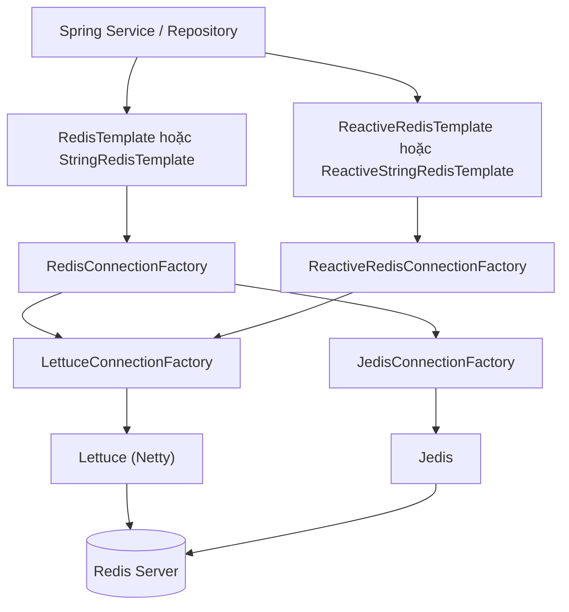

# Phân biệt Lettuce và Jedis

## 1. Lettuce và Jedis nằm ở đâu trong Spring Data Redis?

Khi một ứng dụng Spring Boot gọi `StringRedisTemplate.opsForValue().get(key)`, lời gọi đó không trực tiếp giao tiếp với Redis bằng mã mạng do Spring tự viết. **Spring Data Redis** cung cấp tầng API và chuyển đổi dữ liệu; bên dưới, một **Redis client/driver** phụ trách thiết lập kết nối, gửi lệnh theo giao thức Redis và nhận phản hồi.

Hai client Java phổ biến là:

- **Lettuce**: client xây dựng trên **Netty**, hỗ trợ mô hình đồng bộ (synchronous), bất đồng bộ (asynchronous) và phản ứng (reactive). Tập trung vào I/O không chặn ở tầng driver và chia sẻ kết nối thông thường giữa nhiều luồng theo đúng phạm vi an toàn.
- **Jedis**: client Java có lịch sử lâu đời, nổi bật với API lệnh Redis trực tiếp, mô hình gọi đồng bộ dễ hiểu và sử dụng kết nối riêng hoặc connection pool cho nhiều luồng gọi song song. Khả năng và API cụ thể của Jedis thay đổi qua các phiên bản.

Trong ứng dụng sử dụng Spring Data Redis, tầng phụ thuộc có thể hình dung như sau:



Sơ đồ nhấn mạnh một điểm quan trọng: **`RedisTemplate` là API Spring Data Redis; Lettuce/Jedis là driver bên dưới**. Thay driver có thể không cần sửa business service nếu service đang làm việc qua `RedisTemplate`. Ngược lại, mã ứng dụng sử dụng trực tiếp API của `io.lettuce.core` hoặc `redis.clients.jedis` sẽ gắn chặt với thư viện đó.

`RedisConnectionFactory` là điểm nối của tầng Spring Data Redis đồng bộ. Trong Spring Data Redis, `LettuceConnectionFactory` còn có thể cung cấp kết nối reactive; `JedisConnectionFactory` được sử dụng cho giao tiếp đồng bộ.

> Lưu ý về phiên bản: ví dụ cấu hình dưới đây dùng quy ước **Spring Boot 3.x / Spring Data Redis 3.x**. Khi dùng Spring Boot 2.x, bản driver quá cũ hoặc một phiên bản mới hơn, phải kiểm tra tài liệu và dependency management đúng phiên bản trước khi sao chép cấu hình.

## 2. So sánh nhanh Lettuce và Jedis

| Tiêu chí | Lettuce | Jedis |
|---|---|---|
| Cơ chế I/O cốt lõi | Dựa trên Netty, giao tiếp mạng bất đồng bộ | API truyền thống dựa trên I/O đồng bộ qua socket; các phiên bản mới có thể mở rộng API |
| Phong cách gọi phổ biến | Sync, async và reactive | Đồng bộ, cách sử dụng trực tiếp, dễ theo luồng tuần tự |
| Tích hợp reactive trong Spring Data Redis | Có, hỗ trợ `ReactiveRedisConnectionFactory` | Không phải driver được dùng cho reactive API của Spring Data Redis |
| Chia sẻ kết nối | `StatefulRedisConnection` thông thường của Lettuce có thể được nhiều thread sử dụng đồng thời | Không dùng chung một kết nối `Jedis` thông thường giữa nhiều thread; sử dụng pool hoặc abstraction quản lý pool |
| Connection pool | Không phải mọi lệnh thông thường đều cần pool; hữu ích cho một số workload/cách cấu hình | Thường là cơ chế quan trọng khi nhiều thread chạy lệnh đồng bộ |
| Tích hợp Spring | `LettuceConnectionFactory` | `JedisConnectionFactory` |
| Lựa chọn mặc định của Spring Boot starter | Thông thường là Lettuce | Cần bổ sung/chọn Jedis khi muốn đổi driver |
| Redis Cluster / Sentinel / TLS | Hỗ trợ, phụ thuộc phiên bản và cấu hình | Hỗ trợ, phụ thuộc phiên bản và cấu hình |
| Pipeline, transaction | Có, qua API client và/hoặc Spring Data Redis | Có, qua API client và/hoặc Spring Data Redis |
| Hiệu năng | Có lợi thế về I/O bất đồng bộ và quản lý nhiều yêu cầu đồng thời trong nhiều workload | Có thể hoạt động rất tốt với lời gọi đồng bộ và pool được cấu hình đúng |
| Khi nên xem xét | WebFlux, reactive, yêu cầu concurrency cao, muốn dùng mặc định của Boot | Ứng dụng imperative, đội ngũ quen Jedis, hệ thống đã có kinh nghiệm vận hành với Jedis |

**Không có quy tắc “Lettuce luôn nhanh hơn Jedis” hoặc “Jedis luôn đơn giản hơn nên phải chọn Jedis”.** Kết quả phụ thuộc kiểu gọi, số kết nối, số request đồng thời, kích thước value, network latency, serialization, TLS, cấu hình client, Redis server và thời gian đo ở tải thực tế.

## 3. Bản chất kỹ thuật: I/O bất đồng bộ của Lettuce

### 3.1. Netty và mô hình xử lý lệnh

Lettuce dùng **Netty** để vận hành các kết nối TCP và xử lý I/O bằng event loop. Một ứng dụng có thể gửi nhiều command đồng thời trên một `StatefulRedisConnection` thông thường; client ghép kết quả nhận được về đúng command tương ứng.

```text
Thread A -- GET user:1 -----\
Thread B -- GET user:2 ------> Lettuce connection --> Redis
Thread C -- INCR views -----/         |
                                       +--> Redis responses
                                             |
                                hoàn thành kết quả tương ứng
```

Lợi ích là giảm nhu cầu mở một socket riêng cho từng thread trong những trường hợp phù hợp, đồng thời có API async/reactive để thread gọi không phải chờ phản hồi theo kiểu blocking.

Nhưng **“Lettuce dùng I/O non-blocking” không đồng nghĩa mọi phương thức của ứng dụng đều non-blocking**. Ví dụ:

```java
String value = stringRedisTemplate.opsForValue().get("user:1");
```

Với `StringRedisTemplate` đồng bộ, **thread gọi Java vẫn chờ kết quả**. Driver sử dụng Netty ở tầng kết nối, nhưng API ứng dụng là synchronous. Để xây dựng chuỗi xử lý reactive từ đầu tới cuối, sử dụng `ReactiveStringRedisTemplate`/`ReactiveRedisTemplate`, phương thức trả về `Mono` hoặc `Flux`.

### 3.2. Thread safety và ngoại lệ quan trọng

Một kết nối Lettuce `StatefulRedisConnection` thông thường được thiết kế để sử dụng đồng thời ở tầng driver. Tuy nhiên:

- **`RedisConnection` wrapper của Spring Data Redis không phải đối tượng được bảo đảm thread-safe**. Nên inject và chia sẻ **connection factory/template** do Spring quản lý, thay vì giữ một đối tượng `RedisConnection` rồi phát cho nhiều thread.
- Các thao tác làm thay đổi trạng thái kết nối, như transaction `MULTI/EXEC`, hoặc lệnh blocking có thể cần kết nối riêng để không gây ảnh hưởng bất ngờ đến thao tác khác.
- `LettuceConnectionFactory` của Spring Data Redis mặc định có cơ chế chia sẻ native connection cho các hoạt động thông thường và dùng kết nối khác khi cần cho blocking/transaction tùy cấu hình và phiên bản.
- Nếu sử dụng client Lettuce trực tiếp, phải hiểu phạm vi thread safety và lifecycle của loại connection cụ thể; không suy từ một kết nối shareable ra rằng mọi đối tượng Lettuce đều có thể dùng chung vô điều kiện.

Lettuce có cơ chế đồng bộ hóa riêng đối với việc gửi/nhận lệnh và quản lý connection; code ứng dụng vẫn phải xử lý race condition nghiệp vụ, chẳng hạn thao tác `GET` rồi `SET` không trở thành atomic chỉ vì dùng Lettuce.

### 3.3. Pooling ở Lettuce

Khi nhiều thread cùng gọi các lệnh Redis thông thường, Lettuce thường có thể **tái sử dụng một native connection** thay vì cấp một socket mới cho mỗi lời gọi. Vì vậy không nên bật pool chỉ vì số request HTTP lớn.

Pool vẫn hữu ích trong các trường hợp cần kết nối riêng, lệnh blocking, transaction hoặc khi đã đo và thấy chia sẻ connection là điểm nghẽn phù hợp để giải quyết. Pool làm tăng tổng số kết nối, tiêu thụ tài nguyên, có thể gây đợi lấy connection và cần giám sát; tăng `max-active` không tự bảo đảm tăng throughput.

## 4. Bản chất kỹ thuật: I/O đồng bộ và connection pool của Jedis

### 4.1. Kết nối Jedis thông thường không dùng chung giữa các thread

Trong mô hình truyền thống, một đối tượng `Jedis` đại diện cho kết nối sử dụng socket. Nhiều thread đồng thời thao tác qua **cùng một instance kết nối `Jedis` thông thường** có thể làm rối trạng thái đọc/ghi và phản hồi. Cách sử dụng phù hợp là lấy connection riêng cho mỗi phần công việc hoặc dùng API pool được thiết kế để quản lý việc cấp phát kết nối.

```text
Thread A --> borrow connection 1 --\
Thread B --> borrow connection 2 ---> Redis server
Thread C --> borrow connection 3 --/
                   |
             return to pool
```

Với mã dùng Jedis trực tiếp, một pool có thể mang dạng:

```java
// Ví dụ khái niệm với API Jedis trực tiếp; không cần tự tạo
// JedisPool nếu ứng dụng đã dùng JedisConnectionFactory của Spring.
try (Jedis jedis = jedisPool.getResource()) {
    String value = jedis.get("product:42");
    System.out.println(value);
} // đóng resource để trả kết nối về pool
```

Các phiên bản Jedis hiện đại cung cấp thêm abstraction như `JedisPooled`; API quản lý pool cụ thể cần xem theo version. **Không đánh đồng `JedisPool` hoặc `JedisPooled` (cơ chế chia sẻ quản lý nhiều kết nối) với việc cho nhiều thread cùng sử dụng một `Jedis` connection trần.**

Khi làm việc qua Spring Data Redis, phần lớn ứng dụng chỉ inject `StringRedisTemplate` và để `JedisConnectionFactory` quản lý kết nối. Không tự gọi `new Jedis(...)` trong từng controller/request rồi quên đóng tài nguyên.

### 4.2. Thread của ứng dụng sẽ chờ phản hồi

Với API Jedis đồng bộ truyền thống:

```java
String value = jedis.get("product:42");
```

Thread gọi đợi I/O trả về trước khi tiếp tục. Đây là mô hình phù hợp với Spring MVC/imperative khi thread pool được định cỡ và timeout hợp lý. Mặt trái là khi Redis chậm, các thread có thể bị giữ lại, rồi dẫn đến cạn thread request hoặc pool connection.

Nếu ứng dụng yêu cầu pipeline reactive xuyên suốt, việc lấy lệnh đồng bộ của Jedis rồi bọc bằng `Mono.fromCallable(...)` không tự biến I/O của Jedis thành non-blocking. Có thể offload sang thread pool chuyên dụng nhưng vẫn tốn thread và cần quản lý tài nguyên; đó không thay thế đường kết nối reactive được Spring Data Redis hỗ trợ qua Lettuce.

### 4.3. Pool không giải quyết mọi điểm nghẽn

Số connection phù hợp phải được đo. Ví dụ có 200 request đồng thời nhưng Jedis pool chỉ cho phép 8 connection đang hoạt động, các request khác có thể phải đợi pool. Tăng pool lên 200 có thể giảm thời gian chờ trong một số tình huống, nhưng cũng có thể dồn quá nhiều lệnh đến Redis, tăng connection, RAM và CPU, hoặc gây timeout ở phía server.

Cần xem đồng thời:

- Số active/idle connection, thời gian đợi mượn connection, số request bị timeout khi chờ.
- Thời gian thực thi Redis command và thời gian mạng (phân vị p95/p99).
- Số worker thread của ứng dụng, thời gian chờ Redis và giới hạn kết nối của Redis server.
- Hành vi khi Redis failover, mất mạng và khi pool phải tái tạo connection.

## 5. Spring Boot dùng client nào và thay đổi ở đâu?

Với ứng dụng Spring Boot 3.x dùng `spring-boot-starter-data-redis`, client **Lettuce là lựa chọn mặc định thông thường**. Spring Boot quản lý phiên bản dependency tương thích với Spring Data Redis nếu sử dụng dependency management/BOM đúng cách.

### 5.1. Cấu hình Lettuce

Dependency Gradle Groovy (một ứng dụng Spring Boot đã cấu hình plugin/dependency management):

```groovy
dependencies {
    implementation 'org.springframework.boot:spring-boot-starter-data-redis'
}
```

`application.yml`:

```yaml
spring:
  data:
    redis:
      client-type: lettuce
      host: localhost
      port: 6379
      connect-timeout: 2s
      timeout: 2s
```

`client-type: lettuce` làm lựa chọn rõ ràng, nhưng thường có thể bỏ vì là mặc định của starter. Với dữ liệu nhạy cảm, cấu hình credential qua nguồn bí mật của môi trường và TLS theo yêu cầu; không đặt mật khẩu thật trong file ví dụ.

Spring Boot có namespace cấu hình riêng dành cho Lettuce, chẳng hạn `spring.data.redis.lettuce.pool.*` khi dùng pooling. Chỉ bật/cấu hình pool khi có nhu cầu và dependency cần thiết, thường bao gồm `commons-pool2`. Mặc định không nhất thiết cần pool cho các lệnh ngắn thông thường.

### 5.2. Chuyển sang Jedis

Nếu dùng Gradle với starter Redis, có thể loại Lettuce và thêm Jedis:

```groovy
dependencies {
    implementation('org.springframework.boot:spring-boot-starter-data-redis') {
        exclude group: 'io.lettuce', module: 'lettuce-core'
    }
    implementation 'redis.clients:jedis'
}
```

`application.yml`:

```yaml
spring:
  data:
    redis:
      client-type: jedis
      host: localhost
      port: 6379
      connect-timeout: 2s
      timeout: 2s
      jedis:
        pool:
          max-active: 16
          max-idle: 8
          min-idle: 1
          max-wait: 1s
```

Pool Jedis cần thư viện pooling tương ứng trên classpath (thường là Apache Commons Pool 2, tùy tổ hợp phiên bản/starter) để kích hoạt theo cơ chế cấu hình của Spring Boot. Đảm bảo dependency thực tế được quản lý bởi BOM tương thích, thay vì tự ép phiên bản Jedis bất kỳ.

Nếu cả Lettuce và Jedis cùng có trên classpath, cấu hình `spring.data.redis.client-type` giúp Spring Boot xác định client mong muốn. Khi ứng dụng tự khai báo `RedisConnectionFactory`, auto-configuration của Boot có thể nhường quyền cho bean tùy biến; khi đó cần xem chính bean đang chạy để biết driver nào thực sự được dùng.

### 5.3. Business service có thể giữ nguyên

Hai cấu hình trên có thể dùng cùng mã service:

```java
import java.time.Duration;
import org.springframework.data.redis.core.StringRedisTemplate;
import org.springframework.stereotype.Service;

@Service
public class ProcessStateStore {
    private final StringRedisTemplate redis;

    public ProcessStateStore(StringRedisTemplate redis) {
        this.redis = redis;
    }

    public void markRunning(String processId) {
        redis.opsForValue().set(
                "process:state:v1:" + processId,
                "RUNNING",
                Duration.ofMinutes(10));
    }

    public String currentState(String processId) {
        return redis.opsForValue().get(
                "process:state:v1:" + processId);
    }
}
```

Service chỉ phụ thuộc `StringRedisTemplate`, không import `Jedis` hoặc `StatefulRedisConnection`. Driver bên dưới được chọn ở phần cấu hình. Điều này giúp giữ business code độc lập tương đối với client.

Thay driver **không** khiến key, TTL, serializer, dữ liệu Redis hoặc nghiệp vụ tự thay đổi. Khi cùng dùng `StringRedisTemplate` với cấu hình serialization tương thích, hai driver có thể truy cập cùng khóa. Tuy nhiên vẫn cần xác nhận kết nối tới đúng DB/cluster, authentication, TLS, serializer và hỗ trợ lệnh của phiên bản client.

## 6. Reactive Redis là tiêu chí phân biệt quan trọng

Một ứng dụng Spring WebFlux thường muốn I/O Redis không làm block thread xử lý sự kiện. Spring Data Redis hỗ trợ kết nối reactive qua **Lettuce** và các API reactive như `ReactiveStringRedisTemplate`.

Ví dụ service đơn giản:

```java
import java.time.Duration;
import org.springframework.data.redis.core.ReactiveStringRedisTemplate;
import org.springframework.stereotype.Service;
import reactor.core.publisher.Mono;

@Service
public class ReactiveProcessStateStore {
    private final ReactiveStringRedisTemplate redis;

    public ReactiveProcessStateStore(
            ReactiveStringRedisTemplate redis) {
        this.redis = redis;
    }

    public Mono<Boolean> markRunning(String id) {
        return redis.opsForValue().set(
                "process:state:v1:" + id,
                "RUNNING",
                Duration.ofMinutes(10));
    }

    public Mono<Boolean> isRunning(String id) {
        return redis.opsForValue()
                .get("process:state:v1:" + id)
                .map("RUNNING"::equals)
                .defaultIfEmpty(false);
    }
}
```

Ở đây `Mono` đại diện cho kết quả sẽ có trong tương lai; việc kết hợp các thao tác bằng reactive operators giúp ứng dụng không phải chờ Redis theo kiểu blocking trên event loop. **Đừng gọi `block()` trong luồng xử lý reactive của WebFlux** vì sẽ phá vỡ mục tiêu không chặn của mô hình đó.

Jedis có thể được dùng từ một ứng dụng chạy WebFlux cho các phần việc đồng bộ đã tách riêng, nhưng **`JedisConnectionFactory` không đáp ứng đường API `ReactiveRedisConnectionFactory` của Spring Data Redis**. Khi yêu cầu rõ ràng là sử dụng `ReactiveRedisTemplate`, chọn Lettuce.

Mặt khác, việc một ứng dụng chạy Spring MVC không bắt buộc phải dùng Jedis: Lettuce có API synchronous đầy đủ và được Spring Boot hỗ trợ mặc định.

## 7. Kết nối, chia sẻ và vòng đời tài nguyên

### 7.1. Phân biệt template, factory và native connection

| Thành phần | Vai trò | Cách sử dụng khuyến nghị |
|---|---|---|
| `RedisTemplate` / `StringRedisTemplate` | API xử lý operation, serialization | Bean chia sẻ do Spring quản lý; cấu hình hoàn tất trước khi dùng |
| `RedisConnectionFactory` | Tạo/cấp kết nối Spring Data Redis | Bean do Spring quản lý |
| `RedisConnection` | Wrapper kết nối theo hợp đồng Spring Data Redis | Không lưu rồi chia sẻ tùy tiện giữa nhiều thread |
| Lettuce `StatefulRedisConnection` | Native connection do Lettuce quản lý | Thường hỗ trợ nhiều thread với operation thông thường; chú ý transaction/blocking |
| Jedis connection thông thường | Native connection của Jedis | Không chia sẻ đồng thời giữa thread; mượn/trả qua pool hoặc factory |
| Pool | Quản lý số kết nối và thời gian chờ | Định cỡ theo tải đo được, có giới hạn và quan sát được |

Một sai lầm là nghĩ rằng mỗi request phải tạo một `RedisTemplate` hoặc `RedisConnectionFactory` mới. Trên thực tế, template/factory thường là singleton bean, còn cơ chế driver/factory chịu trách nhiệm quản lý kết nối bên dưới.

### 7.2. Blocking commands, transactions và pipeline

Redis hỗ trợ các lệnh block chờ dữ liệu, transaction `MULTI/EXEC` và pipelining. Cả Lettuce và Jedis đều có đường sử dụng những cơ chế này, nhưng **phải xét tình trạng connection**:

- **Blocking** như `BLPOP` có thể giữ một connection chờ dữ liệu; không để nó ảnh hưởng các request ngắn dùng cùng connection theo cách không phù hợp.
- **Transaction** giữ trạng thái nhiều lệnh cho tới `EXEC` trên connection tương ứng; quản lý connection trở nên quan trọng.
- **Pipelining** giảm số vòng trao đổi mạng khi gửi nhiều lệnh, nhưng **không tự biến chúng thành một giao dịch nguyên tử**.
- Với **Redis Cluster**, các lệnh đa khóa và transaction có thể bị ràng buộc bởi hash slot; việc dùng driver khác không tự loại bỏ giới hạn đó.

Trong Spring Data Redis, ưu tiên dùng API transaction/pipeline được cung cấp bởi template/factory, thay vì trộn điều khiển native connection từ Jedis/Lettuce một cách ngẫu nhiên trong service.

### 7.3. Timeouts và kết nối đã mất

Một yêu cầu đến Redis có các giai đoạn: lấy connection, kết nối mạng (nếu cần), gửi lệnh, chờ xử lý và đọc phản hồi. Một timeout có thể xuất hiện tại bất kỳ giai đoạn nào; cần phân biệt:

- **Connect timeout**: thời gian tối đa để thiết lập kết nối.
- **Command/read timeout**: thời gian chờ phản hồi lệnh, theo cách client và Spring cấu hình.
- **Pool borrow timeout**: thời gian chờ mượn connection còn trống trong pool.
- **Application request timeout**: hạn mức toàn bộ request ở Spring/HTTP.

Timeout quá dài có thể làm cạn worker thread hoặc hàng đợi; timeout quá ngắn gây lỗi giả khi mạng chậm hoặc Redis đang failover. Cần đo timeout trong điều kiện có độ trễ mạng, dữ liệu thực, tải đỉnh và quá trình chuyển primary.

**Timeout không luôn cho biết lệnh Redis đã được thực thi hay chưa.** Ví dụ sau khi gửi `INCR`, kết nối có thể mất trước khi response về. Nếu client hoặc ứng dụng retry vô điều kiện, bộ đếm có thể tăng hai lần. Với thao tác không idempotent, cần có thiết kế retry/idempotency riêng; driver không tự cung cấp bảo đảm nghiệp vụ “exactly once”.

## 8. Redis Standalone, Sentinel, Cluster và TLS

Lettuce và Jedis đều có thể hoạt động với nhiều mô hình triển khai Redis, nhưng tính năng thực tế cần kiểm tra theo **phiên bản Spring Data Redis, phiên bản driver và Redis server**.

### Standalone

Ứng dụng kết nối một Redis endpoint. Phù hợp cho local development, thử nghiệm hoặc môi trường có một điểm truy cập do hạ tầng quản lý. Hai driver đều hỗ trợ mô hình này.

### Redis Sentinel

Sentinel giúp theo dõi và phát hiện/chuyển đổi primary theo cấu hình cụm Sentinel. Client cần biết cấu hình Sentinel, master name và cách xác thực phù hợp. Cả Lettuce và Jedis có hỗ trợ Sentinel, nhưng cách phát hiện topology, reconnect và xử lý request trong giai đoạn failover có thể khác theo client/version. Không xem Sentinel là cơ chế đảm bảo mọi write không mất hoặc request không bị lỗi khi failover.

### Redis Cluster

Redis Cluster chia khóa theo hash slots và có thể phản hồi redirect như `MOVED` hoặc `ASK` khi topology thay đổi. Client phải hỗ trợ định tuyến và cập nhật topology. Lettuce và Jedis đều có cơ chế Redis Cluster; cấu hình topology refresh, reconnect và số connection cần đánh giá theo cách triển khai cụ thể.

Các thao tác đa khóa phải tuân theo quy tắc Redis Cluster, dù kết nối qua driver nào. Nếu cần đặt các khóa liên quan vào cùng một slot, có thể dùng hash tag như `order:{42}:status` và `order:{42}:items`, nhưng phải cân nhắc cân bằng tải, tránh đẩy quá nhiều khóa nóng vào cùng slot.

### TLS và authentication

Không lưu mật khẩu trong mã nguồn hoặc log. Dùng cơ chế cấu hình bí mật của môi trường, TLS theo yêu cầu và giới hạn quyền của Redis user/ACL. Cả hai driver có thể được cấu hình bảo mật, nhưng kiểm tra hỗ trợ certificate, hostname verification, URL scheme và tùy chọn TLS phù hợp phiên bản.

Ví dụ thuộc tính Spring Boot thường dùng:

```yaml
spring:
  data:
    redis:
      ssl:
        enabled: true
```

Việc bật TLS phải đi cùng endpoint, chứng chỉ và cấu hình server phù hợp; không chỉ thêm dòng YAML rồi giả định đã an toàn. Với managed Redis, ưu tiên thông số kết nối chính thức từ nhà cung cấp.

## 9. Đánh giá hiệu năng: đo đúng bài toán trước khi đổi driver

Có ba câu hỏi thường bị trộn lẫn:

1. **Từng lệnh mất bao lâu?** Ví dụ `GET` một giá trị 200 byte.
2. **Ứng dụng xử lý đồng thời được bao nhiêu request?** Tùy mô hình thread, pool connection và khả năng Redis server.
3. **Tài nguyên tiêu thụ bao nhiêu?** CPU, heap, direct memory, số socket, số thread, áp lực GC và Redis CPU.

Lettuce có nền tảng I/O bất đồng bộ thuận lợi khi cần rất nhiều thao tác đồng thời. Jedis có thể đạt hiệu năng tốt với workload đồng bộ nếu dùng pool hợp lý. Tuy nhiên benchmark micro trên localhost không nhất thiết phản ánh môi trường có TLS, network latency, persistence, replication và nhiều loại lệnh.

### Kịch bản benchmark thực tế

Giả sử ứng dụng Spring MVC lưu cache thông tin sản phẩm:

| Biến cần kiểm soát | Ví dụ thiết lập |
|---|---|
| Workload | 80% GET, 15% SET có TTL, 5% INCR |
| Kích thước value | 0,5 KB; 4 KB; 32 KB |
| Độ đồng thời | 10, 50, 200 request đang chạy |
| Redis server | Cùng một bản Redis, cùng CPU/RAM, cùng cấu hình |
| Mạng | Cùng latency và đường truyền; thử cả TLS nếu production dùng |
| Serialization | Cùng định dạng JSON/chuỗi và dữ liệu |
| Lettuce | Ghi rõ connection sharing và pooling có bật hay không |
| Jedis | Ghi rõ `max-active`, `max-wait` và chỉ số đợi connection |
| Số liệu | Throughput, p50/p95/p99, timeout, CPU/heap/socket, pool wait |

Khi thử nghiệm, giữ điều kiện công bằng. Một kết quả Jedis chậm do pool quá nhỏ chỉ chứng minh **cấu hình pool đang là bottleneck**; một kết quả Lettuce chậm do block event loop chứng minh **cách sử dụng không phù hợp**. Không kết luận đặc tính chung của driver từ một cấu hình bất lợi.

Kết quả đáng dùng cho quyết định là: với mức tải mục tiêu và ngân sách tài nguyên đã biết, client nào đạt SLA p95/p99 ổn định hơn và dễ vận hành hơn.

## 10. Cách chọn client theo bối cảnh ứng dụng

| Bối cảnh | Gợi ý | Vì sao |
|---|---|---|
| Tạo một Spring Boot MVC service mới | Bắt đầu với Lettuce mặc định | Ít cấu hình, được starter tích hợp tốt và hỗ trợ API sync |
| Spring WebFlux và `ReactiveRedisTemplate` | Chọn Lettuce | Có đường tích hợp reactive trong Spring Data Redis |
| Hệ thống MVC hiện tại dùng Jedis ổn định | Có thể tiếp tục dùng Jedis | Không cần đổi chỉ vì khác mặc định; đo và đánh giá rủi ro nâng cấp |
| Đội ngũ cần API Redis sync trực tiếp và đã chuẩn hóa Jedis | Jedis là lựa chọn hợp lý | Tính quen thuộc và cơ chế quản lý pool có thể phù hợp |
| Rất nhiều thao tác Redis đồng thời, cần tránh thread chờ I/O | Ưu tiên đánh giá Lettuce async/reactive | Thiết kế bất đồng bộ có thể giảm áp lực thread khi cả ứng dụng được tổ chức phù hợp |
| Dùng nhiều lệnh blocking hoặc transaction chuyên biệt | Đánh giá cách quản lý dedicated connections của cả hai | Yêu cầu kết nối/transaction quan trọng hơn tên driver |
| Ứng dụng có độ trễ cao ở Redis | Đo nguyên nhân trước | Bottleneck có thể là mạng, Redis command, serializer, pool hoặc key nóng, không phải driver |
| Cần Sentinel/Cluster/TLS | Cả hai là ứng viên | Chọn theo mức hỗ trợ và hành vi failover của phiên bản triển khai |

Một câu hỏi mở đầu hiệu quả là **“Ứng dụng đang dùng programming model nào?”** Nếu là reactive với Spring Data Redis, Lettuce có lợi thế quyết định về API. Nếu là imperative, cả hai có thể phù hợp; thứ tự ưu tiên chuyển sang khả năng vận hành, dependency, kết quả đo tải và kỹ năng của nhóm phát triển.

## 11. Các sai lầm phổ biến

### “Lettuce hỗ trợ non-blocking, nên dùng RedisTemplate sẽ không block”

Sai. `RedisTemplate` là API synchronous. Muốn luồng xử lý reactive, phải sử dụng reactive API phù hợp và tránh chèn lời gọi blocking vào event loop.

### “Jedis không thread-safe nên không dùng được trong nhiều request”

Thiếu ngữ cảnh. Một **connection Jedis trần** không nên dùng đồng thời giữa các thread. Nhưng một ứng dụng có thể sử dụng **pool được quản lý đúng** để phục vụ nhiều request song song. `JedisConnectionFactory` tồn tại để tích hợp cách quản lý connection đó vào Spring.

### “Lettuce thread-safe nên có thể chia sẻ mọi RedisConnection”

Sai. Khả năng chia sẻ một **native StatefulRedisConnection thông thường** không đồng nghĩa mọi wrapper của Spring hoặc transaction/connection state đều được dùng chung an toàn. Không tự chia sẻ `RedisConnection` giữa nhiều thread; để template/factory xử lý vòng đời.

### “Cứ tăng connection pool là Redis nhanh hơn”

Không đúng trong mọi trường hợp. Pool quá nhỏ gây chờ, nhưng pool quá lớn có thể tăng tài nguyên và tải server. Đo pool wait, Redis latency và throughput trước khi điều chỉnh.

### “Đổi driver sẽ giải quyết cache bị sai dữ liệu”

Driver không tự giải quyết TTL, cache invalidation, race condition, độ bền hay tính nhất quán giữa Redis với PostgreSQL. Những vấn đề này thuộc thiết kế dữ liệu và nghiệp vụ.

### “Kết nối Redis thành công nghĩa là failover đã được kiểm chứng”

Kết nối ban đầu chỉ xác nhận một điều kiện đơn lẻ. Cần thử timeout, mất mạng, replica promotion, lệnh đang thực thi và khởi động lại client để đánh giá tính sẵn sàng thực tế.

## 12. Checklist triển khai khi dùng Spring Data Redis

1. **Xác định mô hình ứng dụng**: imperative hay reactive; API Redis dùng trực tiếp hay thông qua `RedisTemplate`.
2. **Chọn driver qua dependency/config**: kiểm tra starter mặc định, tránh để version tự đặt xung đột với Spring Boot BOM.
3. **Giao quyền quản lý kết nối cho Spring**: inject template/factory; không tạo native connection trong từng request nếu không có nhu cầu thực sự.
4. **Chọn cấu hình connection đúng workload**: Lettuce có thể dùng shared native connection cho lệnh thường; Jedis cần cơ chế quản lý connection/pool phù hợp khi nhiều thread.
5. **Cấu hình timeout, bảo mật và topology**: host, ACL, TLS, Sentinel/Cluster; giới hạn pool và số reconnect nếu hệ thống cần.
6. **Đặt tên key và serializer rõ ràng**: driver nào cũng phải đọc/ghi cùng định dạng khi migration.
7. **Đo p95/p99 và lỗi**: quan sát latency, timeout, số connection, pool wait, tải Redis, số lỗi sau failover.
8. **Thử gián đoạn và retry**: xem thao tác ghi có thể được thực thi dù client báo timeout không; bảo đảm idempotency khi cần.
9. **Giữ business code độc lập driver**: dùng các API Spring Data Redis và adapter riêng; chỉ dùng native API khi một tính năng thực sự yêu cầu.

### Một ví dụ quyết định hoàn chỉnh

Một dịch vụ API Spring Boot MVC cần lưu trạng thái xác thực tạm 5 phút và tăng bộ đếm số lượt đăng nhập. Nhóm phát triển chưa dùng Redis trước đó. Hướng bắt đầu phù hợp là **Lettuce + `StringRedisTemplate`** với TTL, timeout và key namespace rõ ràng; không bật pool tùy tiện. Nếu sau khi đo workload thật, yêu cầu hoặc vận hành khiến Jedis có lợi hơn, thay dependency và `client-type` rồi thử lại toàn bộ hành vi liên quan. Logic xác thực có thể tiếp tục gọi `opsForValue()`.

Ngược lại, một dịch vụ WebFlux có luồng gọi Redis reactive cần **Lettuce + `ReactiveStringRedisTemplate`**, đồng thời giữ các thành phần I/O khác trong pipeline không chặn. Chỉ đổi sang Jedis rồi tiếp tục gọi API sync từ event loop sẽ làm thay đổi đặc tính tải của cả dịch vụ.

**Kết luận về lựa chọn:** Lettuce và Jedis đều là Redis client hợp lệ, nhưng khác rõ về mô hình kết nối và API. **Lettuce** mạnh ở I/O dựa trên Netty, chia sẻ kết nối thông thường, hỗ trợ sync/async/reactive và là lựa chọn mặc định thực dụng cho Spring Boot mới. **Jedis** phù hợp với cách gọi đồng bộ và quản lý kết nối bằng pool, nhất là hệ thống đã chuẩn hóa theo Jedis. Dù chọn client nào, thiết kế đúng TTL, serializer, thread safety, timeout, retry và hành vi khi Redis failover mới quyết định độ tin cậy của ứng dụng.
